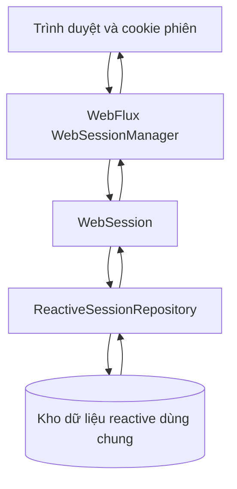

# ReactiveSessionRepository và hợp đồng bất đồng bộ

Spring Session cung cấp một lớp trừu tượng để ứng dụng quản lý phiên người dùng qua một kho lưu trữ. Với ứng dụng Servlet, mã ứng dụng thường làm việc qua `HttpSession` và một `SessionRepository` đồng bộ. Với ứng dụng reactive dùng Spring WebFlux, lớp tương ứng là `WebSession` và repository có hợp đồng bất đồng bộ là `ReactiveSessionRepository`.

`ReactiveSessionRepository` mô tả cách tạo, tìm, lưu và xóa một phiên bằng Reactor `Mono`. Hợp đồng này cho phép WebFlux kết hợp thao tác session với các thao tác I/O khác mà không phải chặn event loop để chờ kho dữ liệu. Khi chạy nhiều instance, các instance có thể cùng dùng một repository reactive đặt trên kho chia sẻ, chẳng hạn Redis được truy cập qua client reactive.

Điểm quan trọng là `ReactiveSessionRepository` chỉ định nghĩa cách ứng dụng trao đổi với kho phiên. Nó không tự biến một kho dữ liệu đồng bộ thành kho reactive, cũng không tự cung cấp transaction nghiệp vụ hay bảo đảm mọi cập nhật session đồng thời đều được tuần tự hóa.

## 1. Phân biệt API Servlet và API reactive

Hai mô hình có mục tiêu giống nhau nhưng thuộc hai ngăn xếp web khác nhau:

| Thành phần | Ứng dụng Servlet | Ứng dụng reactive WebFlux |
|---|---|---|
| API phiên ở tầng web | `HttpSession` | `WebSession` |
| Repository | `SessionRepository<S>` | `ReactiveSessionRepository<S>` |
| Kiểu trả về thao tác repository | Giá trị trực tiếp hoặc `void` | `Mono<S>` hoặc `Mono<Void>` |
| Mô hình I/O | Thường là đồng bộ, có thể dùng thread cho request | Kết hợp publisher, tránh chặn event loop |
| Cách tích hợp | Filter Servlet của Spring Session | `WebSessionManager` và session store của WebFlux |

Không nên lấy `HttpSession` làm API của controller WebFlux. Controller reactive thường nhận `WebSession`; framework quản lý việc tìm phiên, bắt đầu phiên, lưu thay đổi và kết thúc phiên theo vòng đời của request. `ReactiveSessionRepository` nằm phía dưới lớp tích hợp đó, chịu trách nhiệm lưu trữ đối tượng phiên.

Sơ đồ tổng quát:



Khi request đến, lớp quản lý phiên lấy mã phiên từ cookie, yêu cầu repository tìm dữ liệu và tạo `WebSession` cho request. Khi request kết thúc, các thay đổi cần lưu được chuyển thành thao tác repository. Tên cookie, cờ bảo mật và cách phát hành cookie được cấu hình ở lớp web/session phù hợp; repository không phải nơi tạo ra cookie HTTP.

## 2. Hợp đồng của ReactiveSessionRepository

Interface cốt lõi có dạng tổng quát như sau:

```java
public interface ReactiveSessionRepository<S extends Session> {

    Mono<S> createSession();

    Mono<Void> save(S session);

    Mono<S> findById(String id);

    Mono<Void> deleteById(String id);
}
```

`S` là kiểu session cụ thể triển khai hợp đồng `Session`. `Mono` biểu diễn một kết quả có thể phát ra tối đa một phần tử, hoàn tất mà không có phần tử hoặc kết thúc bằng lỗi. Bốn phương thức có trách nhiệm khác nhau:

| Phương thức | Ý nghĩa | Cách hiểu kết quả |
|---|---|---|
| `createSession()` | Tạo một đối tượng session mới với định danh và thông tin vòng đời ban đầu | `Mono<S>` phát ra session mới; việc tạo đối tượng chưa đồng nghĩa session đã được lưu bền vững |
| `save(session)` | Ghi trạng thái session vào kho hoặc cập nhật trạng thái đã tồn tại | `Mono<Void>` hoàn tất khi thao tác lưu kết thúc theo cam kết của repository |
| `findById(id)` | Tìm session theo định danh | Phát ra session nếu tìm thấy và còn hợp lệ; `Mono.empty()` nếu không có session phù hợp |
| `deleteById(id)` | Xóa session theo định danh | `Mono<Void>` báo thời điểm thao tác xóa hoàn tất hoặc phát lỗi nếu thao tác thất bại |

Thông thường, `createSession()` tạo đối tượng trong bộ nhớ và trả về nó; ứng dụng hoặc lớp tích hợp tiếp tục đặt thuộc tính rồi gọi `save`. Vì vậy, không được xem một session vừa tạo là đã tồn tại trong kho cho đến khi chuỗi lưu hoàn tất.

`findById` không tìm thấy phiên thường được biểu diễn bằng `Mono.empty()`, không phải bằng một phần tử `null`. Nếu kho dữ liệu không truy cập được, dữ liệu không giải tuần tự hóa được hoặc xảy ra lỗi I/O, publisher nên kết thúc bằng `onError`. Hai trường hợp này có ý nghĩa khác nhau: phiên không tồn tại là trạng thái nghiệp vụ có thể dự kiến; lỗi kho dữ liệu là sự cố cần được xử lý và quan sát riêng.

`save` và `deleteById` trả về `Mono<Void>` vì kết quả chính là việc thao tác hoàn tất. Không có đối tượng session nào được phát ra từ hai publisher này. Muốn trả tiếp dữ liệu đã có trong chuỗi, dùng các toán tử như `thenReturn` hoặc `then`.

## 3. Vòng đời và dữ liệu trong Session

Đối tượng `Session` mang dữ liệu cần thiết để duy trì phiên, bao gồm:

- Định danh session.
- Thời điểm tạo và thời điểm truy cập gần nhất.
- Khoảng thời gian không hoạt động tối đa (`maxInactiveInterval`).
- Các thuộc tính dạng cặp tên–giá trị.
- Trạng thái hết hạn và các thao tác thay đổi thuộc tính.

Ví dụ, một session có thể lưu `app.user.context`, `app.cart.id` hoặc trạng thái của một quy trình nhiều bước. Dữ liệu nên nhỏ, có kiểu ổn định và phù hợp với serializer của repository. Với dữ liệu nghiệp vụ lớn hoặc cần tồn tại độc lập với session, hãy lưu trong kho nghiệp vụ và chỉ giữ mã tham chiếu trong session.

Repository cần phối hợp với vòng đời phiên:

1. Khi tạo phiên, cấp định danh phù hợp và thiết lập thông tin thời gian ban đầu.
2. Khi lưu, ghi các thuộc tính cùng thông tin hết hạn theo chính sách của session.
3. Khi tìm, không trả lại một session đã hết hạn như thể nó còn hợp lệ.
4. Khi xóa, loại bỏ dữ liệu session và các dữ liệu phụ liên quan mà implementation quản lý.
5. Khi phiên được gia hạn, cập nhật thời hạn lưu trữ theo `maxInactiveInterval` và chính sách làm mới thời gian truy cập.

Thời gian hết hạn ở tầng session và thời điểm dọn dữ liệu vật lý trong kho có thể không trùng nhau. Ví dụ, Redis có thể tự xóa khóa theo TTL sau một khoảng thời gian; một số repository khác có thể cần tác vụ dọn dữ liệu. Ứng dụng không nên dựa vào việc dữ liệu vật lý biến mất ngay đúng thời điểm hết hạn để quyết định quyền truy cập. Repository và lớp quản lý session phải kiểm tra tính hợp lệ trước khi sử dụng phiên.

## 4. Kết hợp repository bằng Reactor

Với API reactive, mỗi thao tác được biểu diễn trong một chuỗi publisher. Ví dụ dưới đây minh họa service tạo session mới, lưu mã giỏ hàng và trả về ID sau khi lưu thành công:

```java
import org.springframework.session.MapSession;
import org.springframework.session.ReactiveSessionRepository;
import org.springframework.stereotype.Service;
import reactor.core.publisher.Mono;

@Service
public class ReactiveCartSessionService {

    private static final String CART_ID = "app.cart.id";

    private final ReactiveSessionRepository<MapSession> sessions;

    public ReactiveCartSessionService(
            ReactiveSessionRepository<MapSession> sessions) {
        this.sessions = sessions;
    }

    public Mono<String> createCartSession(String cartId) {
        return sessions.createSession()
                .flatMap(session -> {
                    session.setAttribute(CART_ID, cartId);
                    return sessions.save(session)
                            .thenReturn(session.getId());
                });
    }

    public Mono<String> updateCartSession(
            String sessionId, String cartId) {
        return sessions.findById(sessionId)
                .switchIfEmpty(Mono.error(
                        new IllegalArgumentException("Session không tồn tại")))
                .flatMap(session -> {
                    session.setAttribute(CART_ID, cartId);
                    return sessions.save(session)
                            .thenReturn(session.getId());
                });
    }

    public Mono<Void> deleteSession(String sessionId) {
        return sessions.deleteById(sessionId);
    }
}
```

Ví dụ dùng `MapSession` để minh họa kiểu session; cấu hình ứng dụng phải cung cấp một bean `ReactiveSessionRepository` có cùng kiểu generic. `MapSession` cùng repository dạng map phù hợp cho kiểm thử hoặc môi trường đơn giản trong bộ nhớ. Muốn chia sẻ session giữa nhiều instance, cần một implementation kết nối tới kho dùng chung.

Trong `createCartSession`, `flatMap` nhận session được phát ra từ `createSession`, thêm thuộc tính rồi nối thao tác `save`. `thenReturn` chỉ phát ra ID sau khi publisher lưu hoàn tất. Nếu thao tác lưu lỗi, publisher kết thúc bằng lỗi và ID không được phát ra như thể session đã được tạo thành công.

Trong `updateCartSession`, `switchIfEmpty` chuyển trường hợp không tìm thấy session thành lỗi nghiệp vụ. Khi repository phát lỗi kết nối hoặc lỗi giải tuần tự hóa, lỗi đó vẫn truyền qua chuỗi và không bị nhầm thành trường hợp session không tồn tại.

## 5. Mono là hợp đồng bất đồng bộ, không phải một giá trị đã có

Khi một phương thức trả về `Mono<S>`, caller đang nhận một mô tả về kết quả tương lai, không phải session đã được lấy đồng bộ. Điều này ảnh hưởng đến cách viết code:

- Dùng `map` để biến đổi giá trị đã được phát ra mà không tạo publisher mới.
- Dùng `flatMap` khi bước tiếp theo cũng trả về `Mono` hoặc một publisher khác.
- Dùng `then` khi chỉ quan tâm thao tác trước hoàn tất rồi mới chạy thao tác tiếp theo.
- Dùng `thenReturn(value)` khi muốn phát ra một giá trị cố định sau khi thao tác trước hoàn tất.
- Dùng `switchIfEmpty` để định nghĩa hành vi khi publisher hoàn tất mà không phát ra phần tử.
- Dùng `onErrorResume` hoặc `onErrorMap` để xử lý hoặc chuyển đổi lỗi theo loại lỗi cụ thể.

Ví dụ:

```java
public Mono<SessionView> getSessionView(String id) {
    return sessions.findById(id)
            .map(session -> new SessionView(
                    session.getId(),
                    session.getLastAccessedTime(),
                    session.getMaxInactiveInterval()));
}
```

Đoạn code trên chưa thực hiện thao tác đọc ngay tại thời điểm gọi phương thức. Với publisher dạng cold thường gặp trong các API truy cập dữ liệu reactive, thao tác bắt đầu khi có subscription. Tuy nhiên, tính cold hay hot là thuộc tính của publisher cụ thể; không nên tự suy đoán hành vi của một implementation nếu tài liệu không cam kết điều đó.

Trong controller WebFlux, hãy trả publisher về cho framework để nó quản lý subscription và ghi response. Không tự gọi `subscribe()` bên trong controller hoặc service để chạy thao tác rồi trả về ngay. Làm như vậy sẽ tách thao tác lưu khỏi vòng đời request, khiến lỗi khó truyền tới caller và có thể trả response trước khi dữ liệu được lưu.

Không gọi `block()` trên event loop của WebFlux để chờ repository. `block()` biến chuỗi reactive thành lời gọi chờ đồng bộ, có thể làm nghẽn thread phục vụ nhiều request. Nếu phải tích hợp một API blocking, cần cô lập thao tác đó khỏi event loop và xem đây là một ranh giới blocking có chi phí vận hành rõ ràng.

## 6. Tích hợp với WebSession trong WebFlux

Ở tầng controller, ứng dụng thường thao tác với `WebSession` thay vì gọi repository trực tiếp. Ví dụ:

```java
import org.springframework.web.bind.annotation.PostMapping;
import org.springframework.web.bind.annotation.RequestParam;
import org.springframework.web.bind.annotation.RestController;
import org.springframework.web.server.WebSession;
import reactor.core.publisher.Mono;

@RestController
public class CartController {

    private static final String CART_ID = "app.cart.id";

    @PostMapping("/cart/session")
    public Mono<String> rememberCart(
            @RequestParam String cartId,
            WebSession session) {
        session.getAttributes().put(CART_ID, cartId);
        return Mono.just(session.getId());
    }
}
```

Ví dụ minh họa thao tác với thuộc tính của `WebSession`; ứng dụng cần bổ sung xác thực quyền sở hữu giỏ hàng và kiểm tra dữ liệu đầu vào. Lớp quản lý session của WebFlux phối hợp với session store để lưu các thay đổi theo vòng đời request. Không cần gọi `ReactiveSessionRepository.save` trực tiếp trong controller nếu ứng dụng đang dùng tích hợp `WebSession` tiêu chuẩn.

Khi tự cấu hình repository, cần đăng ký implementation reactive và bật cấu hình tích hợp Spring Session phù hợp với phiên bản Spring Session đang dùng. `WebSessionManager` sử dụng session store để tải và lưu `WebSession`. Cấu hình phải nhất quán trên mọi instance: cùng kho dữ liệu, serializer tương thích, tên cookie và chính sách thời hạn phù hợp.

Đừng nhầm `WebSession` với `HttpSession`: hai kiểu này thuộc hai API web khác nhau. Nếu ứng dụng cần gọi một dịch vụ đồng bộ hoặc thư viện Servlet từ WebFlux, phải đánh giá ranh giới blocking và không chuyển trực tiếp `HttpSession` vào chuỗi reactive.

## 7. Chọn implementation và kho lưu trữ

`ReactiveSessionRepository` là hợp đồng; implementation quyết định dữ liệu được lưu ở đâu và I/O có thực sự không chặn hay không.

| Lựa chọn | Đặc điểm | Khi phù hợp |
|---|---|---|
| Repository map trong bộ nhớ | Dữ liệu chỉ nằm trong tiến trình, mất khi ứng dụng dừng và không chia sẻ giữa instance | Kiểm thử, demo hoặc môi trường đơn giản |
| Repository trên Redis reactive | Có thể dùng kho Redis chung và client reactive; hỗ trợ chia sẻ session giữa nhiều instance | Ứng dụng WebFlux cần lưu trữ session phân tán và I/O reactive |
| Repository tự triển khai | Tự định nghĩa cách ánh xạ session sang kho dữ liệu và bảo đảm hợp đồng `Mono` | Khi có kho dữ liệu reactive hoặc yêu cầu lưu trữ riêng |

Spring Session JDBC tiêu chuẩn cung cấp repository đồng bộ cho ngăn xếp Servlet. Không nên mặc định rằng chỉ cần bọc thao tác JDBC trong `Mono` là đã có một repository không chặn. Nếu bắt buộc gọi JDBC blocking từ ứng dụng reactive, có thể cô lập lời gọi trên scheduler dành cho tác vụ blocking, nhưng I/O vẫn blocking và cần giới hạn tải, timeout, pool kết nối cũng như back-pressure ở ranh giới đó. Khi yêu cầu là reactive end-to-end, hãy chọn kho và driver reactive hoặc triển khai repository trên một API lưu trữ thực sự reactive.

Khi chọn implementation, kiểm tra ít nhất các điểm sau:

- Repository có dùng client và driver không chặn cho các thao tác I/O hay không.
- Cách cấp ID session và cách bảo vệ ID.
- Serializer có thể đọc dữ liệu được ghi bởi mọi instance đang chạy hay không.
- Cách áp dụng `maxInactiveInterval`, gia hạn TTL và dọn session hết hạn.
- Cách xử lý lỗi kết nối, timeout, lỗi tuần tự hóa và kho dữ liệu tạm thời không sẵn sàng.
- Cách ghi nhận metrics, log và sự kiện vòng đời nếu ứng dụng cần quan sát session.
- Cách triển khai rolling update khi session cũ vẫn tồn tại trong kho.

## 8. Triển khai một ReactiveSessionRepository tùy chỉnh

Khi tự viết repository, cần giữ hợp đồng nhất quán cho cả bốn phương thức. Một implementation không nên phát `null`, chặn thread để chờ I/O hoặc nuốt lỗi khiến caller hiểu nhầm rằng thao tác đã thành công.

Các nguyên tắc triển khai:

1. **Tạo session:** cấp ID duy nhất, khởi tạo thời gian tạo và thời gian không hoạt động theo cấu hình, trả về một publisher chứa session mới.
2. **Lưu session:** tuần tự hóa thuộc tính theo định dạng ổn định, ghi dữ liệu và áp dụng TTL tương ứng. Publisher chỉ hoàn tất khi thao tác lưu đạt mức hoàn tất mà implementation cam kết.
3. **Tìm session:** đọc theo ID, giải tuần tự hóa, kiểm tra hết hạn và phát `Mono.empty()` nếu session không còn tồn tại hoặc không còn hợp lệ.
4. **Xóa session:** xóa dữ liệu phiên và các chỉ mục liên quan nếu có; phát lỗi khi kho không thực hiện được thao tác.
5. **Quản lý lỗi:** chuyển lỗi I/O, lỗi serializer và lỗi cấu hình thành tín hiệu `onError` có ngữ nghĩa rõ ràng; không biến mọi lỗi thành `Mono.empty()`.
6. **Quản lý thời hạn:** bảo đảm TTL trong kho phù hợp với `maxInactiveInterval`, đồng thời xử lý trường hợp dữ liệu đã hết hạn nhưng chưa được dọn vật lý.
7. **An toàn khi nhiều instance:** dùng cấu trúc dữ liệu và thao tác kho phù hợp để các instance có thể đọc cùng định dạng và nhìn thấy cập nhật theo cam kết của kho.

Đối với Redis, hãy cân nhắc cách ghi session và TTL được thực hiện cùng nhau. Nếu ghi nội dung thành công nhưng cập nhật TTL thất bại, hoặc ngược lại, dữ liệu có thể tồn tại lâu hơn dự kiến hoặc mất sớm. Tùy yêu cầu, cần dùng thao tác nguyên tử hoặc transaction mà Redis và implementation hỗ trợ.

## 9. Lỗi, timeout và hủy subscription

Publisher reactive có ba kết quả thường gặp:

| Tín hiệu | Ý nghĩa trong thao tác session | Hành vi ứng dụng nên cân nhắc |
|---|---|---|
| `onNext` rồi `onComplete` | Đã có session hoặc thao tác đã hoàn tất | Tiếp tục luồng xử lý |
| `onComplete` không có `onNext` | Không tìm thấy session hoặc không có kết quả | Xử lý như session không tồn tại nếu đúng ngữ cảnh |
| `onError` | Lỗi kết nối, timeout, serializer, cấu hình hoặc lỗi implementation | Phân loại lỗi, ghi nhận và trả phản hồi phù hợp |

Ví dụ, không nên viết `onErrorResume(error -> Mono.empty())` cho mọi lỗi khi tìm session. Làm vậy có thể biến sự cố Redis thành thông báo người dùng chưa có phiên, che giấu lỗi vận hành và dẫn đến việc tạo session mới ngoài ý muốn. Chỉ chuyển lỗi thành empty hoặc fallback khi đã xác định loại lỗi và hành vi dự phòng an toàn.

Có thể đặt timeout cho một thao tác repository trong chuỗi reactive:

```java
public Mono<MapSession> findSession(String id) {
    return sessions.findById(id)
            .timeout(Duration.ofSeconds(2));
}
```

Timeout ở tầng Reactor giới hạn thời gian chờ của publisher tại vị trí đặt toán tử. Nó không tự bảo đảm rằng lệnh đã gửi tới kho dữ liệu bị hủy hoặc không có side effect. Cần cấu hình timeout ở cả client kết nối và driver theo khả năng của chúng.

Khi caller hủy subscription, publisher có thể nhận tín hiệu cancellation và ngừng công việc nếu implementation hỗ trợ. Tuy nhiên, nếu thao tác ghi đã tới kho dữ liệu, việc hủy phía ứng dụng không đảm bảo dữ liệu chưa được ghi. Vì vậy, không suy luận rằng request bị ngắt đồng nghĩa thao tác lưu đã được rollback. Với thao tác cần tính nhất quán, hãy thiết kế transaction, idempotency hoặc bước xác minh trạng thái phù hợp ở tầng dữ liệu/nghiệp vụ.

## 10. Đồng thời và tính nhất quán

Reactive chỉ mô tả cách biểu diễn và phối hợp I/O. Nó không có nghĩa các thao tác trên cùng một session tự động chạy tuần tự hoặc được khóa độc quyền.

Giả sử hai request gần như đồng thời cùng gọi `findById("S1")`. Cả hai nhận một trạng thái ban đầu có `cartCount = 1`. Request A tăng thành `2` rồi lưu; request B cũng tăng bản sao của nó thành `2` rồi lưu sau đó. Giá trị cuối có thể vẫn là `2`, dù người dùng đã gửi hai thao tác tăng. Đây là lỗi cập nhật mất dữ liệu.

Để xử lý:

- Đưa các thay đổi quan trọng như số lượng giỏ hàng, hạn mức hoặc trạng thái đơn hàng vào kho nghiệp vụ có transaction, optimistic locking hoặc thao tác nguyên tử.
- Nếu repository hỗ trợ versioning hoặc compare-and-set, dùng phiên bản để phát hiện xung đột và định nghĩa cách retry an toàn.
- Tránh giữ object mutable trong nhiều nhánh publisher cùng cập nhật. Tạo bản cập nhật rõ ràng và lưu có kiểm soát.
- Không retry mù quáng một thao tác có side effect nếu chưa biết thao tác trước đã được kho thực hiện hay chưa. Thiết kế idempotency key hoặc kiểm tra trạng thái trước khi lặp lại.
- Với dữ liệu giao diện có thể chấp nhận cập nhật cuối cùng thắng, ghi rõ chính sách đó và kiểm thử hành vi thực tế.

Nếu hai instance dùng chung Redis, việc cả hai đều truy cập được session không có nghĩa thao tác đọc–sửa–ghi trên toàn bộ session là nguyên tử. Hãy kiểm tra bảo đảm cụ thể của repository và kho dữ liệu, rồi đặt tính nhất quán ở đúng nơi cần thiết.

## 11. Kiểm thử hợp đồng reactive

Kiểm thử cần xác minh cả giá trị phát ra lẫn tín hiệu hoàn tất hoặc lỗi. Reactor cung cấp `StepVerifier` để kiểm tra publisher mà không cần gọi `block()` trong test:

```java
StepVerifier.create(service.createCartSession("CART-42"))
        .assertNext(id -> assertThat(id).isNotBlank())
        .verifyComplete();
```

Với trường hợp không tìm thấy session:

```java
when(repository.findById("missing"))
        .thenReturn(Mono.empty());

StepVerifier.create(service.updateCartSession("missing", "CART-42"))
        .expectError(IllegalArgumentException.class)
        .verify();
```

Ví dụ thứ hai giả định repository là mock được cấu hình trong test. Cần bổ sung kiểm tra rằng `save` không được gọi khi session không tồn tại.

Các trường hợp nên có trong bộ kiểm thử:

| Trường hợp | Điều cần xác minh |
|---|---|
| Tạo session | Có ID hợp lệ và trạng thái ban đầu đúng |
| Lưu rồi tìm lại | Thuộc tính được giữ nguyên sau round-trip qua repository |
| Tìm ID không tồn tại | Trả `Mono.empty()` theo hợp đồng |
| Kho dữ liệu phát lỗi | Lỗi được truyền tới caller và không bị đổi thành không tìm thấy |
| Xóa session | Sau khi xóa, lần tìm tiếp theo không còn session |
| Hết hạn | Session hết hạn không được dùng lại; TTL được áp dụng đúng |
| Serializer thay đổi | Dữ liệu cũ được đọc hoặc xử lý theo chiến lược chuyển đổi |
| Nhiều instance | Session được tạo ở instance A có thể được đọc ở instance B |
| Đồng thời | Xung đột cập nhật được xử lý theo chính sách đã chọn |
| Hủy hoặc timeout | Ứng dụng không giả định rằng side effect ở kho chắc chắn đã bị hủy |

Mock repository phù hợp để kiểm tra logic service và cách xử lý tín hiệu. Để xác minh tính reactive và khả năng chia sẻ thực tế, cần integration test với datastore và driver được triển khai, chẳng hạn Redis reactive trong môi trường kiểm thử. Nên đo cả timeout, connection pool, tải đồng thời và hành vi khi kho tạm thời mất kết nối.

## 12. Lỗi thường gặp khi dùng ReactiveSessionRepository

| Lỗi | Hậu quả | Cách khắc phục |
|---|---|---|
| Gọi `block()` trên event loop | Chặn thread phục vụ nhiều request, làm giảm khả năng mở rộng | Kết hợp publisher bằng `flatMap`, `map`, `then` |
| Gọi `subscribe()` trong service rồi trả về ngay | Mất liên kết lỗi và kết quả với vòng đời request | Trả `Mono` cho caller hoặc framework quản lý |
| Cho rằng `createSession()` đã lưu session | Request khác có thể không tìm thấy session | Gọi và chờ `save` hoàn tất trong cùng chuỗi |
| Nhầm `Mono.empty()` với lỗi kho | Xử lý sai tình trạng session và che giấu sự cố | Phân biệt `onComplete` rỗng với `onError` |
| Bọc JDBC blocking trong `Mono` rồi gọi là reactive | Event loop vẫn có thể bị chặn nếu không cô lập đúng cách | Dùng driver reactive hoặc cô lập blocking trên scheduler phù hợp |
| Cho rằng reactive đồng nghĩa cập nhật nguyên tử | Nhiều request có thể ghi đè nhau | Dùng transaction, versioning hoặc thao tác nguyên tử ở kho nghiệp vụ |
| Nuốt mọi lỗi bằng fallback rỗng | Mất khả năng phát hiện datastore outage | Chỉ xử lý fallback cho lỗi đã phân loại |
| Không kiểm thử TTL và serializer | Session có thể hết hạn sai hoặc không đọc được sau triển khai | Integration test trên datastore thật và kiểm tra tương thích dữ liệu |

## 13. Quy trình chọn và tích hợp repository

Khi thiết kế session cho một ứng dụng WebFlux, hãy thực hiện lần lượt:

1. Xác nhận ứng dụng thực sự dùng WebFlux và `WebSession`; xác định nơi session được tạo, đọc và kết thúc.
2. Chọn `ReactiveSessionRepository` phù hợp với datastore và driver. Kiểm tra I/O có thực sự không chặn.
3. Xác định kiểu `Session`, serializer, tên thuộc tính và phiên bản schema được mọi instance hỗ trợ.
4. Thiết lập timeout, TTL, cookie và chính sách bảo mật cho session ID.
5. Viết service kết hợp `Mono` mà không tự subscribe hoặc block trên event loop.
6. Định nghĩa cách xử lý session không tồn tại, lỗi kho, timeout và cancellation.
7. Xác định dữ liệu nào được phép cập nhật trong session và dữ liệu nghiệp vụ nào cần transaction riêng.
8. Kiểm thử hợp đồng bằng `StepVerifier`, sau đó kiểm thử tích hợp với datastore và nhiều instance.

Một repository reactive tốt cung cấp các thao tác session có tín hiệu hoàn tất và lỗi rõ ràng, sử dụng I/O không chặn, quản lý thời hạn đúng và giữ định dạng dữ liệu tương thích giữa các instance. Khi kết hợp đúng với `WebSession` và Reactor, ứng dụng Spring WebFlux có thể duy trì trạng thái người dùng qua nhiều request mà không phải chặn event loop trong lúc chờ kho session.
