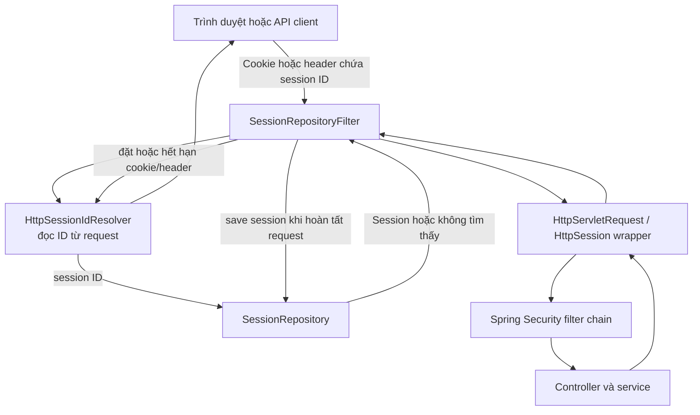

# Repository, lớp tích hợp web và nguồn sinh định danh phiên

Spring Session tách việc quản lý phiên thành ba phần có trách nhiệm riêng: **repository tạo và lưu đối tượng phiên**, **lớp tích hợp Servlet đưa phiên đó vào API `HttpSession` của ứng dụng**, và **bộ phân giải định danh phiên trao đổi session ID giữa trình duyệt với máy chủ**. Hiểu đúng ranh giới này giúp cấu hình Redis hoặc JDBC mà không phải thay đổi mã controller, đồng thời tránh nhầm lẫn giữa nơi lưu phiên và nơi truyền định danh phiên.

## 1. Bức tranh tổng thể

Trong ứng dụng Spring MVC dùng Servlet, controller thường gọi `request.getSession()` hoặc nhận `HttpSession` qua tham số. Spring Session giữ nguyên cách lập trình này bằng cách đặt một filter ở trước phần còn lại của chuỗi xử lý request. Filter tìm session ID trong request, tải phiên từ repository, rồi cung cấp một đối tượng tương thích với `HttpSession` cho mã ứng dụng.



Ba câu hỏi cần được trả lời riêng:

1. **Phiên được tạo và lưu ở đâu?** `SessionRepository` chịu trách nhiệm tạo, tìm, lưu và xóa đối tượng `Session`.
2. **API Servlet nhận phiên bằng cách nào?** `SessionRepositoryFilter` kết nối repository với `HttpServletRequest`, `HttpServletResponse` và `HttpSession`.
3. **Máy chủ biết ID nào thuộc request hiện tại bằng cách nào?** `HttpSessionIdResolver` đọc ID từ cookie hoặc header và ghi ID trở lại response khi cần.

Repository không quyết định trình duyệt gửi ID bằng cookie hay header. Resolver cũng không lưu dữ liệu phiên. Filter điều phối hai thành phần đó và làm cho ứng dụng Servlet sử dụng phiên qua API quen thuộc.

## 2. Abstraction `Session` và `SessionRepository`

Spring Session định nghĩa API độc lập với kho lưu trữ. Hai abstraction cơ bản là `Session` và `SessionRepository` trong package `org.springframework.session`.

### `Session`

`Session` mô tả trạng thái của một phiên mà không phụ thuộc Redis, JDBC hay bộ nhớ cục bộ. Một đối tượng phiên cung cấp các thông tin và thao tác chính:

- Định danh phiên thông qua `getId()`.
- Thời điểm tạo và thời điểm truy cập gần nhất.
- Khoảng không hoạt động tối đa (maximum inactive interval) và khả năng xác định phiên đã hết hạn.
- Đọc, ghi, liệt kê và xóa các attribute bằng tên.

Các attribute là dữ liệu ứng dụng gắn với phiên, ví dụ mã bản nháp hoặc bước hiện tại của một quy trình. Repository lưu metadata của phiên cùng các attribute này theo cách triển khai của nó. Ứng dụng nên giữ attribute nhỏ, dễ tuần tự hóa và không đưa entity lớn hoặc thông tin bí mật không cần thiết vào phiên.

### `SessionRepository<S extends Session>`

`SessionRepository` là hợp đồng lưu trữ tổng quát. Các thao tác cốt lõi gồm:

| Phương thức | Vai trò |
|---|---|
| `createSession()` | Tạo một đối tượng phiên mới với định danh mới và cấu hình thời hạn mặc định của repository |
| `save(session)` | Lưu trạng thái phiên vào kho lưu trữ |
| `findById(id)` | Tìm phiên theo ID; trả về `null` khi không có phiên còn hiệu lực tương ứng |
| `deleteById(id)` | Xóa phiên theo ID |

Tham số kiểu `S` cho phép mỗi repository sử dụng kiểu triển khai `Session` phù hợp. Mã ứng dụng tích hợp Servlet thường không cần gọi trực tiếp các phương thức này vì `SessionRepositoryFilter` thực hiện việc tải và lưu phiên. API trực tiếp hữu ích khi xây dựng hạ tầng riêng, công cụ quản trị hoặc kiểm thử repository.

Ví dụ dưới đây minh họa vòng đời qua API repository. Kiểu `S` được quyết định bởi repository được inject; ví dụ không giả định mọi kho lưu trữ đều dùng cùng một lớp session cụ thể.

```java
import org.springframework.session.Session;
import org.springframework.session.SessionRepository;

public class TemporaryFlowStore {
    public <S extends Session> String createFlow(
            SessionRepository<S> repository) {
        S session = repository.createSession();
        session.setAttribute("flow.step", "ADDRESS");
        session.setAttribute("flow.reference", "draft-4821");

        // Khi gọi API repository trực tiếp, ứng dụng chủ động lưu thay đổi.
        repository.save(session);
        return session.getId();
    }

    public <S extends Session> S loadFlow(
            SessionRepository<S> repository, String sessionId) {
        return repository.findById(sessionId);
    }

    public <S extends Session> void removeFlow(
            SessionRepository<S> repository, String sessionId) {
        repository.deleteById(sessionId);
    }
}
```

Trong ứng dụng web, không nên tự gọi `save` sau mỗi `setAttribute` khi đang thao tác qua `HttpSession` được filter quản lý. Filter theo dõi phiên trong request và lưu thay đổi theo cơ chế tích hợp của Spring Session. Quy tắc gọi `save` ở ví dụ trên áp dụng cho trường hợp dùng trực tiếp `SessionRepository`.

## 3. Các loại repository thường gặp

### Repository trong bộ nhớ

`MapSessionRepository` lưu session trong một map ở bộ nhớ của tiến trình. Nó hữu ích cho thử nghiệm, ví dụ nhỏ hoặc môi trường phát triển không cần dữ liệu dùng chung. Mỗi instance ứng dụng có map riêng; khởi động lại tiến trình làm mất các phiên đang lưu. Vì vậy, map repository không đáp ứng yêu cầu chia sẻ session giữa nhiều instance trong môi trường production.

### Repository dùng Redis

Spring Session cung cấp repository dựa trên Redis. Các session được lưu trong Redis để nhiều instance ứng dụng có thể đọc cùng trạng thái khi chúng dùng chung cấu hình kết nối và namespace phù hợp. Tùy phiên bản và cấu hình, có các biến thể repository hỗ trợ lập chỉ mục để tìm phiên theo thuộc tính, chẳng hạn principal name.

Redis phù hợp khi cần truy cập nhanh và có hạ tầng Redis được vận hành riêng. Cần thiết kế TTL, dung lượng, chính sách eviction, bảo mật kết nối, khả năng dự phòng và giám sát. Redis là kho lưu session; cookie hoặc header của client vẫn chỉ mang session ID.

### Repository dùng JDBC

Spring Session có repository dựa trên JDBC để lưu phiên trong cơ sở dữ liệu quan hệ. Cách này có thể phù hợp khi tổ chức muốn dùng hạ tầng cơ sở dữ liệu hiện có hoặc cần vận hành session trong cùng hệ sinh thái quản trị dữ liệu. Đổi lại, cần quản lý schema, chỉ mục, truy vấn dọn phiên hết hạn, tải đọc/ghi và ảnh hưởng lên cơ sở dữ liệu.

### Repository có hỗ trợ chỉ mục

Một số repository triển khai `FindByIndexNameSessionRepository`, mở rộng hợp đồng cơ bản để tìm các phiên theo tên và giá trị chỉ mục. Trường hợp thường gặp là tìm các phiên gắn với một người dùng đã xác thực bằng chỉ mục principal name. Khả năng này hữu ích cho quản lý phiên đăng nhập, ví dụ hiển thị hoặc giới hạn các phiên của cùng một tài khoản.

Không phải mọi repository đều hỗ trợ mọi loại chỉ mục. Hãy kiểm tra implementation đang sử dụng và cách nó lấy principal name. Việc truy vấn theo chỉ mục cần dữ liệu chỉ mục được tạo và duy trì đúng; không nên giả định có thể tìm mọi attribute tùy ý bằng một truy vấn miễn phí.

| Repository | Nơi lưu | Dùng phù hợp khi | Điểm cần lưu ý |
|---|---|---|---|
| `MapSessionRepository` | Bộ nhớ tiến trình | Phát triển và kiểm thử | Không chia sẻ giữa instance, mất dữ liệu khi tiến trình dừng |
| Redis-backed repository | Redis dùng chung | Nhiều instance cần truy cập session nhanh | TTL, eviction, dung lượng, kết nối và khả năng dự phòng |
| JDBC-backed repository | Cơ sở dữ liệu quan hệ | Muốn dùng hạ tầng SQL hiện có | Schema, chỉ mục, dọn dữ liệu và tải đọc/ghi |

Chọn repository theo yêu cầu vận hành và vòng đời dữ liệu. Đổi repository không đòi hỏi controller chuyển sang API riêng của Redis hoặc JDBC; mục tiêu của abstraction là giữ phần lớn mã ứng dụng độc lập với implementation lưu trữ.

## 4. `SessionRepositoryFilter`: lớp tích hợp Servlet

`SessionRepositoryFilter` là cầu nối giữa Spring Session và Servlet API. Trong cấu hình Spring Session cho Servlet, filter này được đăng ký dưới tên bean chuẩn `springSessionRepositoryFilter`.

Ở đầu request, filter dùng resolver để lấy các session ID từ request. Với ID tìm được, filter gọi repository để tải session. Sau đó filter bọc request và response để các lời gọi Servlet như `getSession()`, `getSession(false)`, `setAttribute()` hoặc `invalidate()` làm việc với session do Spring Session quản lý.

Trong quá trình xử lý, controller và service tiếp tục sử dụng `HttpSession` như bình thường:

```java
import jakarta.servlet.http.HttpSession;
import org.springframework.web.bind.annotation.PostMapping;
import org.springframework.web.bind.annotation.RestController;

@RestController
class WizardController {
    @PostMapping("/wizard/next")
    String next(HttpSession session) {
        Integer current = (Integer) session.getAttribute("wizard.step");
        int next = current == null ? 1 : current + 1;
        session.setAttribute("wizard.step", next);
        return "Đã chuyển đến bước " + next;
    }
}
```

Khi request kết thúc và response được hoàn tất, filter lưu các thay đổi phiên theo cơ chế của repository. Nếu một phiên mới được tạo, resolver ghi định danh vào response. Khi phiên bị invalidate, resolver được yêu cầu hết hạn định danh phía client. Nhờ vậy controller không cần tự đọc cookie, tự truy vấn Redis hoặc tự ghi bản ghi session vào JDBC.

Filter phải chạy trước những filter cần đọc session. Đặc biệt, `SessionRepositoryFilter` cần đứng trước Spring Security filter chain để `SecurityContext` được tải và lưu qua session Spring Session đúng cách. Các annotation cấu hình như `@EnableRedisHttpSession` hoặc `@EnableJdbcHttpSession` thường tạo hạ tầng filter/repository cần thiết; không đăng ký thêm một filter trùng lặp nếu cấu hình đã tạo filter đó.

Tên package Servlet phụ thuộc phiên bản nền tảng. Spring Session 3.x dùng Jakarta Servlet (`jakarta.servlet`); các thế hệ cũ hơn thuộc hệ `javax.servlet`. Cần đồng bộ phiên bản Spring Session với Spring Boot, Spring Framework và container Servlet của ứng dụng.

## 5. `HttpSessionIdResolver`: cách trao đổi session ID

`HttpSessionIdResolver` định nghĩa cách Spring Session đọc và ghi session ID ở biên HTTP. Hợp đồng của resolver có ba thao tác:

- `resolveSessionIds(request)`: đọc danh sách ID phiên từ request hiện tại.
- `setSessionId(request, response, sessionId)`: gửi ID phiên về client khi cần tạo hoặc thay đổi định danh.
- `expireSession(request, response)`: yêu cầu client xóa hoặc hết hạn định danh phiên đang giữ.

Resolver chỉ xử lý việc trao đổi định danh. Nó không tạo đối tượng `Session`, không quyết định TTL của repository và không lưu attribute. Những việc đó thuộc repository và filter.

### Cookie resolver

`CookieHttpSessionIdResolver` là lựa chọn phổ biến cho trình duyệt. Nó đọc session ID từ cookie và ghi cookie vào response. Cookie là một giá trị tham chiếu đến phiên phía máy chủ; không nên đưa dữ liệu nghiệp vụ hoặc thông tin xác thực tùy ý vào cookie session.

Cookie được tuần tự hóa bởi `CookieSerializer`. `DefaultCookieSerializer` cho phép cấu hình tên cookie, path, domain, thuộc tính `HttpOnly`, `Secure`, `SameSite` và thời hạn cookie phía trình duyệt. Ví dụ cấu hình:

```java
import org.springframework.context.annotation.Bean;
import org.springframework.context.annotation.Configuration;
import org.springframework.session.web.http.CookieHttpSessionIdResolver;
import org.springframework.session.web.http.DefaultCookieSerializer;
import org.springframework.session.web.http.HttpSessionIdResolver;

@Configuration
class SessionCookieConfiguration {
    @Bean
    HttpSessionIdResolver httpSessionIdResolver() {
        CookieHttpSessionIdResolver resolver =
                new CookieHttpSessionIdResolver();

        DefaultCookieSerializer serializer = new DefaultCookieSerializer();
        serializer.setCookieName("APPSESSION");
        serializer.setCookiePath("/");
        serializer.setUseHttpOnlyCookie(true);
        serializer.setUseSecureCookie(true);
        serializer.setSameSite("Lax");

        resolver.setCookieSerializer(serializer);
        return resolver;
    }
}
```

Trong mã sản phẩm, có thể khai báo biến trực tiếp là `DefaultCookieSerializer` để không cần ép kiểu. `Secure=true` yêu cầu trình duyệt chỉ gửi cookie qua HTTPS; môi trường phát triển chạy HTTP cần cấu hình phù hợp với cách chạy thực tế. Nếu ứng dụng nằm sau reverse proxy, phải cấu hình nhận diện HTTPS từ proxy một cách tin cậy để cookie không bị phát hành sai thuộc tính.

`HttpOnly` ngăn JavaScript đọc cookie qua API trình duyệt thông thường, `Secure` giới hạn cookie trên kết nối bảo mật và `SameSite` giúp kiểm soát việc gửi cookie trong ngữ cảnh site khác. Các thuộc tính này bổ trợ cho TLS, CSRF protection, chính sách domain/path và kiểm soát truy cập; không thay thế các biện pháp bảo mật còn lại.

### Header resolver

Với client không dựa vào cơ chế cookie tự động của trình duyệt, có thể dùng `HeaderHttpSessionIdResolver` để trao đổi ID qua HTTP header. Ví dụ resolver tích hợp sẵn cho header `x-auth-token`:

```java
import org.springframework.context.annotation.Bean;
import org.springframework.session.web.http.HeaderHttpSessionIdResolver;
import org.springframework.session.web.http.HttpSessionIdResolver;

@Bean
HttpSessionIdResolver httpSessionIdResolver() {
    return HeaderHttpSessionIdResolver.xAuthToken();
}
```

Client phải đọc ID từ response header và gửi lại trong header tương ứng ở request sau. Cách này thường phù hợp với ứng dụng native hoặc API client có thể chủ động quản lý header. Trình duyệt không tự động gửi một header tùy chỉnh như gửi cookie, nên frontend phải quản lý vòng đời ID rõ ràng.

Header resolver không biến session ID thành access token có thể công khai. Session ID vẫn là thông tin mang quyền sử dụng phiên: phải truyền qua TLS, tránh ghi vào log, analytics hoặc URL, và phải xóa ở client khi đăng xuất. Việc dùng header cũng không tự giải quyết xác thực, phân quyền, CORS hay CSRF; cần đánh giá toàn bộ mô hình bảo mật của ứng dụng.

### Resolver tùy chỉnh

Ứng dụng có thể triển khai `HttpSessionIdResolver` khi cần một định dạng cookie hoặc header riêng. Khi đó cần xử lý nhất quán cả ba thao tác: đọc ID, phát hành ID và hết hạn ID. Một resolver chỉ đọc được ID nhưng không xóa được cookie/header cũ có thể khiến client liên tục gửi lại định danh không còn hợp lệ. Không nên tự viết resolver nếu cookie hoặc header resolver có sẵn đáp ứng yêu cầu.

## 6. Nguồn sinh session ID và vòng đời định danh

Session ID được tạo khi repository tạo một phiên mới. Cụ thể, `createSession()` trả về đối tượng `Session` mới với ID do implementation phiên/repository quản lý. Ví dụ `MapSession` sử dụng định danh ngẫu nhiên theo mặc định. Repository lưu phiên dưới ID đó và filter dùng ID để tìm lại phiên ở request sau.

Đây là luồng trách nhiệm:

1. Ứng dụng hoặc Servlet API yêu cầu tạo session.
2. `SessionRepositoryFilter` yêu cầu repository tạo session mới.
3. Repository trả về `Session` có ID mới.
4. Resolver ghi ID vào cookie hoặc header trong response.
5. Client gửi lại ID ở request kế tiếp.
6. Resolver trích ID, filter gọi `findById(id)` để tải phiên.

**Resolver không phải nguồn sinh ID.** `CookieHttpSessionIdResolver` và `HeaderHttpSessionIdResolver` chỉ vận chuyển ID qua HTTP. `CookieSerializer` định dạng cookie, không tạo ra ID. Việc tự tạo một chuỗi dễ đoán trong controller hoặc lấy ID từ tên người dùng sẽ phá vỡ tính khó đoán và có thể gây chiếm quyền phiên.

Session ID cần duy nhất và khó đoán để người khác không thể suy ra hoặc thử lần lượt ID của người dùng khác. Coi ID như một bearer secret: người nắm được ID có thể có khả năng tiếp tục phiên tương ứng nếu các lớp bảo vệ khác không ngăn cản. Không gửi ID qua query string, không đưa vào liên kết, không ghi đầy đủ vào log và không chia sẻ ID giữa người dùng.

### Thay đổi ID sau xác thực

Sau khi người dùng đăng nhập hoặc thay đổi mức quyền, ứng dụng cần chống session fixation. Spring Security cung cấp chiến lược bảo vệ session fixation; tùy chiến lược, ID hiện tại có thể được thay đổi hoặc session được tạo mới và các attribute hợp lệ được chuyển sang. Spring Session tích hợp với Servlet API để thao tác thay đổi ID được phản ánh vào repository và resolver.

Không lưu session ID vào hồ sơ người dùng hoặc dùng nó làm định danh nghiệp vụ ổn định. ID có thể thay đổi trong quá trình xác thực và biến mất khi session hết hạn hoặc đăng xuất. Khi cần nhận diện người dùng, dùng principal/user ID của tầng xác thực và nghiệp vụ.

### Hết hạn và đăng xuất

Khi session hết hạn hoặc bị xóa, `findById` có thể không tìm thấy phiên. Ứng dụng cần xử lý trường hợp đó như trạng thái bình thường: yêu cầu đăng nhập lại hoặc khôi phục quy trình từ dữ liệu nghiệp vụ đã lưu. Khi đăng xuất, cần invalidate/xóa session theo cơ chế tích hợp và để resolver hết hạn cookie hoặc xóa định danh ở client. Xóa cookie phía trình duyệt mà không xóa phiên phía repository có thể để lại dữ liệu cho đến khi TTL dọn dẹp; ngược lại, xóa phiên phía repository nhưng giữ cookie cũ sẽ khiến request sau gửi ID không còn hiệu lực.

TTL của repository và tuổi thọ cookie là hai cấu hình liên quan nhưng khác nhau. TTL quyết định phiên phía máy chủ còn được giữ bao lâu; tuổi thọ cookie quyết định trình duyệt giữ định danh bao lâu. Cookie hết hạn không nhất thiết xóa ngay dữ liệu phiên phía máy chủ, và dữ liệu phiên phía máy chủ hết hạn sẽ làm cookie còn lại trở thành tham chiếu không hợp lệ.

## 7. Cấu hình tích hợp với repository

Với Redis, cấu hình Servlet thường bật repository thông qua `@EnableRedisHttpSession`. `RedisConnectionFactory` phải được cung cấp bởi cấu hình Spring hoặc Spring Boot. Ví dụ sau cho thấy cấu hình session timeout và resolver cookie có thể được kết hợp:

```java
import org.springframework.context.annotation.Configuration;
import org.springframework.session.data.redis.config.annotation.web.http.EnableRedisHttpSession;

@Configuration
@EnableRedisHttpSession(maxInactiveIntervalInSeconds = 1800)
class RedisSessionConfiguration {
    // RedisConnectionFactory được cung cấp bởi cấu hình ứng dụng.
    // HttpSessionIdResolver có thể được khai báo riêng như ví dụ cookie ở trên.
}
```

Với JDBC, có thể dùng `@EnableJdbcHttpSession` và cung cấp `DataSource` cùng schema Spring Session phù hợp. Cả hai kiểu cấu hình đều tạo hạ tầng để filter kết nối Servlet API với repository. Tên annotation và thuộc tính cấu hình cần khớp phiên bản Spring Session đang dùng.

Trong Spring Boot, starter và auto-configuration có thể tự cấu hình một phần hạ tầng. Hãy xác định rõ ai chịu trách nhiệm đăng ký repository, filter và resolver. Tránh vừa bật cơ chế auto-configuration vừa tự đăng ký filter hoặc bean resolver trùng tên/khác thứ tự, vì có thể dẫn đến filter chạy hai lần hoặc resolver không được chọn như mong đợi.

## 8. Những lỗi tích hợp thường gặp

| Hiện tượng | Nguyên nhân có thể có | Hướng kiểm tra |
|---|---|---|
| Request nào cũng tạo session mới | Client không gửi lại cookie/header, domain/path không khớp hoặc resolver đọc sai tên | Kiểm tra request/response header trong môi trường thử nghiệm và cấu hình resolver |
| Controller không thấy session đã tạo ở request trước | Filter chưa đăng ký, chạy sai thứ tự hoặc các instance dùng repository khác nhau | Kiểm tra `SessionRepositoryFilter`, filter order, cookie và cấu hình kho dùng chung |
| Spring Security không giữ trạng thái đăng nhập | Session filter chạy sau Security filter chain hoặc session bị mất | Đảm bảo repository filter chạy trước Security và kiểm tra repository/ID resolver |
| Cookie không được trình duyệt gửi qua request | `Secure`, `SameSite`, domain, path hoặc HTTPS proxy cấu hình không phù hợp | Kiểm tra thuộc tính cookie thực tế và scheme của request |
| Logout xong client vẫn gửi ID cũ | Resolver không hết hạn cookie/header hoặc frontend chưa xóa header lưu trữ | Kiểm tra `expireSession` và phản hồi logout |
| Một số ID không tải được sau triển khai | Phiên hết TTL, repository bị dọn hoặc dữ liệu không tương thích | Kiểm tra TTL, log repository và thay đổi phiên bản dữ liệu session |

Khi điều tra, ghi nhận tên cookie/header và trạng thái xử lý nhưng che giá trị session ID. ID là bí mật truy cập phiên, không phải dữ liệu chẩn đoán vô hại.

## 9. Kiểm thử ranh giới giữa filter, resolver và repository

Một bài kiểm thử tích hợp nên xác minh cả đường đi của ID và dữ liệu phiên:

1. Gửi request đầu tiên không có session ID và gọi `getSession()`; xác nhận response phát hành cookie hoặc header theo resolver đã cấu hình.
2. Gửi request tiếp theo với đúng cookie/header; xác nhận filter tải lại cùng session và controller đọc được attribute đã lưu.
3. Cập nhật attribute; gửi request sau nữa và xác nhận thay đổi được giữ trong repository.
4. Invalidate session hoặc đăng xuất; xác nhận resolver hết hạn định danh phía client và repository không còn trả phiên cũ.
5. Dùng cùng ID qua hai instance được cấu hình cùng repository; xác nhận instance thứ hai đọc được phiên đã tạo ở instance thứ nhất.
6. Thử ID không hợp lệ hoặc đã hết hạn; xác nhận ứng dụng xử lý như phiên không tồn tại và không rò rỉ thông tin nội bộ.

Trong unit test, có thể kiểm thử riêng resolver với request/response giả lập và repository với implementation phù hợp. Trong integration test, nên đưa `SessionRepositoryFilter` thực vào chuỗi Servlet để phát hiện lỗi thứ tự filter, cookie, header và lưu phiên. Với Redis hoặc JDBC, môi trường kiểm thử cần có kho tương ứng hoặc một môi trường thay thế được cấu hình rõ ràng; `MapSessionRepository` không chứng minh được hành vi chia sẻ giữa nhiều instance.

## 10. Nguyên tắc thiết kế

- Dùng `SessionRepository` làm abstraction lưu trữ; chọn Redis, JDBC hoặc map theo yêu cầu vận hành.
- Để `SessionRepositoryFilter` tích hợp repository với Servlet API và giữ mã controller sử dụng `HttpSession`.
- Chọn `HttpSessionIdResolver` theo cách client trao đổi ID: cookie cho trình duyệt thông thường, header khi client quản lý header một cách chủ động.
- Để repository/implementation tạo ID; không tự tạo ID dễ đoán và không coi ID là định danh người dùng.
- Đặt filter trước Spring Security, cấu hình cookie an toàn và đồng bộ TTL phía máy chủ với trải nghiệm phía client.
- Kiểm thử đầy đủ tạo, tải, lưu, thay ID, hết hạn và đăng xuất; khi vận hành nhiều instance, xác nhận chúng dùng cùng repository và cùng cách phân giải ID.

Khi các lớp được cấu hình đúng, ứng dụng Servlet chỉ cần thao tác với `HttpSession`, repository chịu trách nhiệm về dữ liệu phiên, filter kết nối hai phía và resolver quản lý việc trao đổi session ID. Phân tách rõ bốn vai trò này giúp ứng dụng Spring Session dễ thay đổi kho lưu trữ, dễ kiểm thử và vận hành ổn định khi chạy trên nhiều instance.
