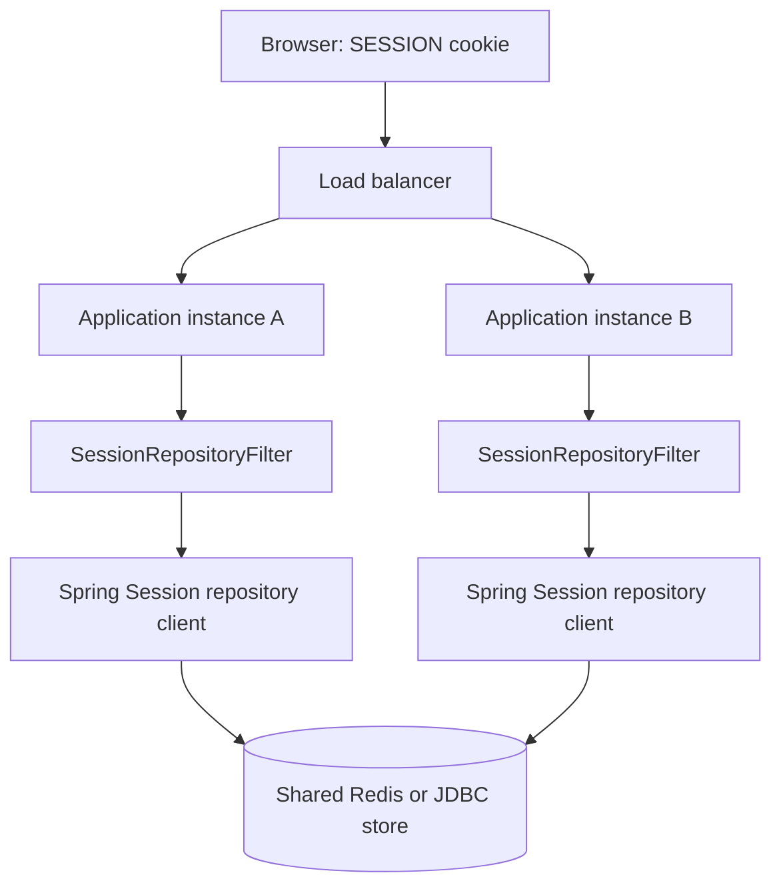
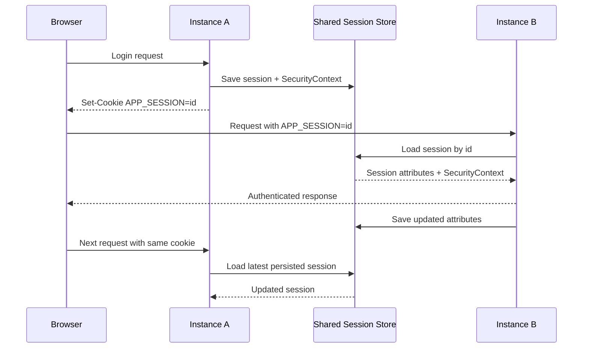
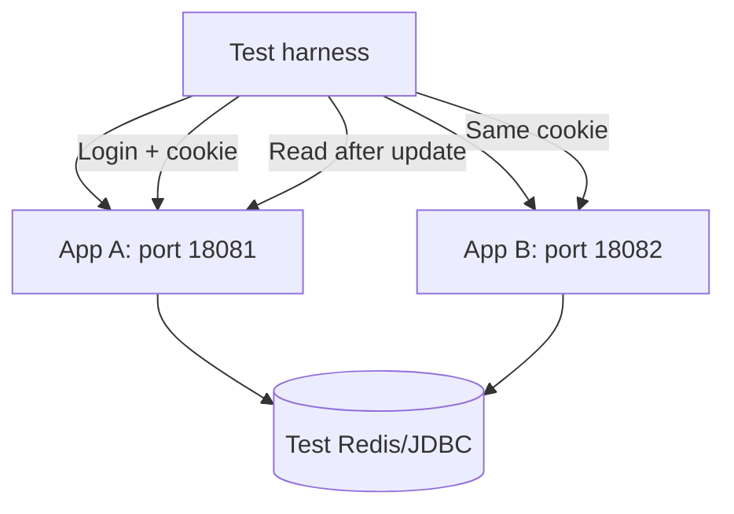

# Hai bản chạy ứng dụng cùng đọc phiên qua một kho

Spring Session cho phép nhiều bản chạy của cùng một ứng dụng đọc và cập nhật trạng thái phiên từ một kho dùng chung như Redis hoặc JDBC. Nhờ đó, request có thể được load balancer chuyển từ instance A sang instance B mà người dùng vẫn giữ trạng thái đăng nhập và các attributes của session. Mỗi instance có bộ nhớ JVM riêng, nhưng session được lưu ngoài tiến trình nên không phụ thuộc vào node đã nhận request trước đó.

Để mô hình này hoạt động, hai instance phải thống nhất cách nhận diện session, repository, namespace hoặc bảng dữ liệu, serializer, cookie và chính sách timeout. Việc cùng kết nối tới một Redis host hoặc database chưa đủ. Cần kiểm thử bằng hai tiến trình ứng dụng độc lập: tạo session qua A, gửi chính session cookie tới B, đọc và cập nhật dữ liệu, rồi xác nhận request tiếp theo thấy trạng thái đã lưu. Cũng cần kiểm tra logout, expiration, lỗi kho dữ liệu và cập nhật đồng thời.

## 1. Mô hình nhiều instance dùng chung session store

Trong mô hình không dùng session store chia sẻ, mỗi instance có thể giữ session trong bộ nhớ riêng. Nếu request đầu được xử lý ở A và request sau đi tới B, B không biết session của A. Sticky session có thể giữ request ở cùng node, nhưng nó không giải quyết failover khi node dừng và hạn chế khả năng phân phối request.

Với Spring Session, các instance dùng cùng một `SessionRepository` backend:



Hai instance có thể chạy trên hai JVM, hai container hoặc hai máy khác nhau. Chúng không cần chia sẻ heap hay sticky session để khôi phục cùng session. Cả hai cần truy cập được kho dữ liệu và hiểu cùng định dạng session.

## 2. Những điều kiện để hai instance nhìn thấy cùng một phiên

Một request từ B chỉ khôi phục được session do A tạo nếu các yếu tố sau tương thích:

1. **Cùng session ID:** browser gửi đúng cookie/header chứa ID do A phát.
2. **Cùng repository backend:** A và B kết nối tới cùng Redis deployment/database hoặc cùng JDBC database/schema.
3. **Cùng namespace/bảng:** các key Redis hoặc bảng JDBC mà A ghi chính là nơi B đọc.
4. **Cùng cookie contract:** cookie name, path, domain và cách encode/decode session ID tương thích.
5. **Cùng serializer và schema:** B deserialize được attributes do A ghi.
6. **Cùng semantics timeout:** cả hai áp dụng chính sách inactivity timeout tương thích.
7. **Cùng cấu hình bảo mật:** cách lưu và khôi phục SecurityContext, principal và authorities tương thích.

Sai một yếu tố có thể khiến B coi request là chưa có session, tạo phiên mới hoặc lỗi khi đọc dữ liệu. Khi chẩn đoán, cần kiểm tra từng điều kiện thay vì chỉ xác nhận hai instance có cùng Redis URL.

## 3. Cấu hình Redis cho hai instance Servlet

Với ứng dụng Servlet, Spring Session Redis có thể được bật bằng `@EnableRedisHttpSession`. Hai instance của cùng ứng dụng phải dùng cùng namespace và timeout:

```java
@Configuration
@EnableRedisHttpSession(
        redisNamespace = "orders:session",
        maxInactiveIntervalInSeconds = 1800)
class SessionConfiguration {
}
```

Trong Spring Boot, nếu starter và auto-configuration đang quản lý session repository, có thể cấu hình bằng properties thay vì khai báo annotation. Ví dụ minh họa:

```properties
spring.session.store-type=redis
spring.session.redis.namespace=orders:session
spring.session.timeout=30m
spring.data.redis.host=redis.internal
spring.data.redis.port=6379
```

Tên property và cơ chế auto-configuration phụ thuộc phiên bản Spring Boot. Nếu dự án đã khai báo `@EnableRedisHttpSession` hoặc custom repository bean, hãy xác minh cấu hình thực tế được áp dụng; đừng giả định một property sẽ ghi đè mọi cấu hình Java.

Mỗi instance dùng Redis connection factory riêng trong JVM, nhưng cùng trỏ tới một Redis logical deployment/database và namespace. Có thể dùng Redis Cluster hoặc dịch vụ managed nếu repository/client hỗ trợ topology đó và cấu hình notifications cần thiết đã được thiết lập.

Không đặt namespace khác nhau giữa A và B. Ví dụ A dùng `orders:session` nhưng B dùng `orders:session-v2` thì B sẽ tìm trong vùng key khác và không khôi phục session do A tạo.

## 4. Cấu hình JDBC cho hai instance Servlet

Với JDBC, cả hai instance phải dùng cùng database, schema và tên bảng Spring Session. Cấu hình thường dùng `@EnableJdbcHttpSession` hoặc auto-configuration của Spring Boot:

```java
@Configuration
@EnableJdbcHttpSession
class JdbcSessionConfiguration {
}
```

Ví dụ properties:

```properties
spring.session.store-type=jdbc
spring.session.jdbc.initialize-schema=never
spring.session.timeout=30m
spring.datasource.url=jdbc:postgresql://db.internal:5432/appdb
spring.datasource.username=session_app
spring.datasource.password=${SESSION_DB_PASSWORD}
```

Trong production, schema nên được tạo và nâng cấp bằng migration do nhóm vận hành quản lý; `initialize-schema=never` tránh nhiều instance cùng cố khởi tạo schema khi khởi động. Các instance phải dùng cùng schema/table tương thích với repository và cùng cách lưu attributes.

Nếu A và B trỏ tới hai database khác nhau, hoặc một bên dùng table prefix/schema khác, session không được chia sẻ. Khi dùng read replica, cần chú ý độ trễ replication: request ngay sau khi A ghi nhưng B đọc từ replica chưa nhận dữ liệu có thể không thấy phiên mới. Với thao tác cần đọc sau ghi nhất quán, đọc từ primary hoặc dùng chiến lược bảo đảm read-your-writes.

## 5. Cookie session ID phải dùng chung qua host công khai

Trong triển khai nhiều instance, browser thường chỉ giao tiếp với một hostname công khai, ví dụ `app.example.com`; load balancer chuyển request tới A hoặc B. Cookie không cần chứa địa chỉ node. Nó chỉ cần mang session ID mà cả hai instance có thể đọc.

Ví dụ cấu hình cookie:

```java
@Bean
CookieSerializer cookieSerializer() {
    DefaultCookieSerializer serializer = new DefaultCookieSerializer();
    serializer.setCookieName("APP_SESSION");
    serializer.setCookiePath("/");
    serializer.setUseHttpOnlyCookie(true);
    serializer.setUseSecureCookie(true);
    serializer.setSameSite("Lax");
    return serializer;
}
```

Cookie serializer phải có cấu hình tương thích ở mọi instance. Với cùng public hostname, thường không cần đặt `Domain` thủ công; browser gửi cookie theo host đã phát. Nếu ứng dụng dùng nhiều subdomain, chỉ đặt domain cha khi thực sự cần chia sẻ cookie và các subdomain cùng miền tin cậy.

`Secure` phù hợp với production HTTPS; nếu TLS kết thúc tại reverse proxy, cấu hình forwarded headers đáng tin cậy để ứng dụng nhận biết scheme bên ngoài. `HttpOnly` giảm khả năng JavaScript đọc session ID, còn `SameSite` giúp kiểm soát một số ngữ cảnh cross-site. Các thuộc tính này không thay thế CSRF protection.

Không cấu hình cookie name khác nhau giữa A và B. Nếu A phát `APP_SESSION` nhưng B chỉ đọc `SESSION`, B không nhận được ID từ cookie dù hai bên dùng cùng Redis.

## 6. SessionRepositoryFilter phải được áp dụng trên cả hai instance

Spring Session Servlet tích hợp với container qua `SessionRepositoryFilter`. Filter này bọc request/response để `HttpSession` được đọc và ghi thông qua `SessionRepository` thay vì chỉ dùng session cục bộ của servlet container.

Trong ứng dụng Spring Boot được cấu hình chuẩn, filter thường được đăng ký tự động khi Spring Session được bật. Cả A và B phải có cùng cơ chế tích hợp. Nếu một instance dùng Spring Session còn instance kia dùng native container session, hai bên sẽ không nhìn cùng trạng thái dù cùng Redis.

Khi tích hợp Spring Security, `SessionRepositoryFilter` cần chạy trước Spring Security filter chain để SecurityContext được tải và lưu qua session mà Spring Session quản lý. Kiểm tra thứ tự filter nếu thấy `JSESSIONID` và cookie Spring Session cùng xuất hiện ngoài dự kiến hoặc trạng thái đăng nhập chỉ tồn tại trên một node.

Không đăng ký thêm một `SessionRepositoryFilter` thủ công nếu auto-configuration đã tạo filter. Hai filter cùng bọc session có thể gây hành vi khó đoán.

## 7. Luồng request từ A sang B

Một kịch bản thường gặp:

1. Browser gửi request đăng nhập; load balancer chuyển tới A.
2. Spring Security xác thực người dùng và lưu SecurityContext vào `HttpSession`.
3. Spring Session ghi session vào Redis/JDBC khi response hoàn tất theo cấu hình flush/save.
4. Response trả cookie chứa session ID.
5. Request kế tiếp gửi cookie đó; load balancer chuyển request tới B.
6. `SessionRepositoryFilter` ở B đọc ID và tải session từ kho chung.
7. Spring Security ở B khôi phục SecurityContext và thực hiện authorization.
8. B có thể cập nhật attributes; thay đổi được lưu vào cùng repository.
9. Request sau đó tới A hoặc B đều đọc trạng thái đã lưu, tùy semantics và thứ tự hoàn tất ghi.



Điều quan trọng là B tải dữ liệu từ kho dùng chung. B không nhận bản sao heap của A và không thể tự thấy thay đổi chưa được A flush xuống repository.

## 8. Ví dụ endpoint để kiểm chứng đọc và ghi chéo node

Một endpoint test-only hoặc endpoint nội bộ có thể ghi một marker và trả về node xử lý:

```java
@RestController
class SessionProbeController {

    @Value("${INSTANCE_ID:local}")
    private String instanceId;

    @GetMapping("/internal/session-probe")
    Map<String, Object> inspect(HttpSession session) {
        return Map.of(
                "instance", instanceId,
                "sessionId", session.getId(),
                "marker", String.valueOf(session.getAttribute("probe.marker")));
    }

    @PostMapping("/internal/session-probe")
    Map<String, Object> update(
            HttpSession session,
            @RequestParam String marker) {
        session.setAttribute("probe.marker", marker);
        return Map.of(
                "instance", instanceId,
                "sessionId", session.getId(),
                "marker", marker);
    }
}
```

Chỉ bật endpoint probe trong profile test hoặc môi trường nội bộ có xác thực. Không trả session ID hoặc attributes nhạy cảm ra endpoint công khai. Trong test, endpoint có thể trả một định danh instance để chứng minh request thực sự đi qua hai bản chạy khác nhau.

Kịch bản: POST marker qua A, GET qua B, rồi GET qua A. Cả ba response phải có cùng session ID và marker đã lưu, miễn là response trước đã hoàn tất việc lưu session.

## 9. Chia sẻ session không đồng nghĩa chia sẻ bộ nhớ JVM

Mỗi request tải session thành một object trong JVM xử lý request. Nếu A đang giữ object session trong bộ nhớ, B không thể trực tiếp sửa object đó. B chỉ cập nhật repository; A sẽ nhìn thấy dữ liệu mới khi tải session lại trong một request khác.

Vì vậy:

- Không giữ `HttpSession` hoặc object attribute trong singleton bean để dùng lâu dài.
- Không giả định một request đang chạy sẽ thấy cập nhật do node khác vừa ghi.
- Không dùng session làm cơ chế broadcast giữa các instance.
- Không dựa vào một mutable object trong session như shared-memory object có đồng bộ.
- Dùng database/cache/message broker riêng cho dữ liệu cần phối hợp realtime hoặc có semantics nhất quán mạnh.

Session store là kho persistence cho request tiếp theo, không phải một object distributed được đồng bộ liên tục trong mọi JVM.

## 10. Cập nhật đồng thời và last-write-wins

Hai request có thể được xử lý đồng thời trên A và B với cùng session ID:

1. A tải session có `counter = 0`.
2. B tải cùng session cũng có `counter = 0`.
3. A tăng counter thành 1.
4. B tăng counter thành 1.
5. A lưu session.
6. B lưu snapshot của mình.

Kết quả có thể là `counter = 1` thay vì 2. Shared Redis/JDBC không tự biến chuỗi đọc–sửa–ghi thành phép tăng nguyên tử. `SaveMode` và `FlushMode` điều khiển phạm vi/thời điểm ghi, không phải distributed lock cho mọi attribute.

Nếu dữ liệu session có thể được cập nhật đồng thời, hãy xác định semantics mong muốn:

- Chấp nhận last-write-wins cho một số tùy chọn không quan trọng.
- Dùng optimistic version hoặc compare-and-set ở tầng nghiệp vụ để phát hiện xung đột.
- Dùng thao tác atomic của kho dữ liệu nếu phù hợp.
- Tuần tự hóa thao tác theo khóa nghiệp vụ bằng queue/lock có fencing và timeout rõ ràng.
- Chuyển dữ liệu quan trọng như số dư, tồn kho hoặc trạng thái đơn hàng sang database nghiệp vụ có transaction.

Không dùng sticky sessions để chữa race condition. Sticky chỉ ảnh hưởng node nhận request; nhiều tab hoặc request song song vẫn có thể chạy đồng thời trên cùng node.

## 11. SaveMode, FlushMode và thời điểm dữ liệu xuất hiện ở node khác

Trong Servlet, Spring Session có thể lưu thay đổi vào cuối request hoặc theo chế độ flush tương ứng. `SaveMode` ảnh hưởng attributes nào được ghi; `FlushMode` ảnh hưởng khi nào thay đổi được flush xuống repository. Cấu hình cụ thể và mặc định phụ thuộc repository/version.

Một bài test chéo node phải đợi response của request ghi hoàn tất trước khi gửi request đọc tiếp theo, trừ khi mục tiêu test là kiểm tra race giữa save và read. Nếu đọc từ B trước khi A flush xong, B có thể thấy trạng thái cũ; điều đó không chứng minh store bị hỏng.

Với JDBC, transaction commit và read consistency của database quyết định khi nào B thấy thay đổi. Với Redis, lệnh ghi hoàn tất trên node/primary và đường đọc của B quyết định khả năng read-after-write; nếu đọc qua replica bất đồng bộ, có thể có độ trễ. Hãy cấu hình read path theo yêu cầu nhất quán.

## 12. Serialization phải tương thích giữa các instance

Session attributes cần được serialize để lưu trong kho. Nếu A ghi một class mà B không có hoặc có phiên bản không tương thích, B có thể lỗi khi deserialize hoặc không dùng được attribute.

Các nguyên tắc triển khai:

- Dùng cùng phiên bản ứng dụng/dependency trong các instance cùng nhóm triển khai, hoặc bảo đảm schema tương thích trong rolling update.
- Tránh lưu object phụ thuộc class nội bộ, ORM proxy, request/response hoặc service bean.
- Dùng DTO nhỏ, ổn định và có thể serialize.
- Khi thay đổi class, field hoặc serializer, duy trì khả năng đọc dữ liệu session cũ trong thời gian rollout/TTL còn hiệu lực.
- Không bật polymorphic deserialization rộng cho dữ liệu từ kho chia sẻ.
- Kiểm thử A ghi/B đọc và B ghi/A đọc với đúng serializer production.

Nếu không thể đọc session cũ an toàn sau một lần deploy, có thể cần version namespace mới và buộc người dùng đăng nhập lại theo kế hoạch. Không để một instance ghi format mà instance khác không thể đọc.

## 13. SecurityContext và cấu hình Spring Security

Với ứng dụng Servlet session-based, Spring Security lưu SecurityContext vào session thông qua repository của nó. Khi Spring Session thay thế session container, SecurityContext được lưu trong session do Spring Session quản lý. Cả A và B cần cùng cấu hình Spring Security và cùng cách deserialize principal/authorities.

Các điều kiện cần xác minh:

- A và B đều có Spring Session filter và filter order đúng.
- Cả hai dùng cùng authentication model, principal representation và authority mapping.
- `SecurityContextRepository` được cấu hình tương thích.
- Logout trên một node invalidate session ở shared store để node còn lại không khôi phục được ở request mới.
- Các instance không tin attributes do client tự gửi hoặc tự ghi mà không qua xác thực.

Không coi việc đọc được SecurityContext từ Redis/JDBC là đủ để cấp quyền nếu các instance có trust boundary khác nhau. Với các ứng dụng độc lập, OIDC/SSO có thể phù hợp hơn việc chia sẻ nguyên session và SecurityContext.

## 14. Session fixation và đổi session ID

Sau khi xác thực, Spring Security có thể thay đổi session ID để giảm nguy cơ session fixation. Thay đổi này cần được lưu vào shared repository và phản ánh trong cookie trả về browser.

Kiểm thử nhiều instance cần xác minh:

1. Đăng nhập qua A và nhận session cookie sau authentication.
2. Xác nhận ID mới được dùng sau session fixation protection.
3. Gửi cookie mới tới B; B khôi phục đúng SecurityContext.
4. Gửi cookie ID cũ tới B; ID cũ không được dùng để khôi phục phiên đã chuyển ID theo chính sách.
5. Logout qua B và gửi cookie mới tới A; A không khôi phục phiên đã bị invalidate.

Không chỉ kiểm tra cookie name hoặc status code. Hãy kiểm tra session ID và trạng thái xác thực trên request thực sự đi qua node khác.

## 15. Logout và expiration trên cả hai instance

Khi người dùng logout qua A, session cần bị invalidate ở shared store. Request tiếp theo qua B với cookie cũ phải bị coi là anonymous hoặc bị từ chối. Xóa cookie ở response chỉ xóa bản sao của browser; repository state mới là yếu tố quyết định request khác có thể khôi phục phiên hay không.

Session timeout cũng được lưu ở repository. Cả hai instance phải dùng timeout tương thích và đọc cùng dữ liệu expiration. Với Redis, key TTL/expiration notification có thể có độ trễ và một số repository giữ dữ liệu trong grace period để phát event. Với JDBC, cleanup task có thể xóa hàng vật lý sau thời điểm hết hạn logic. Dù vậy, `findById` không được khôi phục session đã hết hạn logic.

Kiểm thử logout/expiry:

- Tạo session qua A.
- Đọc session qua B.
- Logout qua A.
- Gửi lại cookie cũ tới B và xác nhận không còn authentication.
- Tạo session mới, để hết timeout, rồi kiểm tra ID cũ trên cả A và B.
- Nếu kiểm tra event, xác minh notification/listener theo repository và topology; không giả định application event local tự động tới mọi JVM.

## 16. Sự kiện session và tài nguyên gắn với node

Các event như `SessionCreatedEvent`, `SessionDeletedEvent` hoặc `SessionExpiredEvent` có thể giúp ứng dụng dọn tài nguyên liên quan. Nhưng một WebSocket connection hoặc stream thường nằm trong bộ nhớ của node đang giữ kết nối. Node A không thể trực tiếp đóng object connection nằm ở B.

Nếu session bị xóa ở A và B cần đóng WebSocket, phải có event transport hoặc cơ chế broadcast để B nhận lệnh và đóng connection cục bộ. Redis keyspace notifications/Pub/Sub có giới hạn delivery và topology; JDBC application event thường không tự broadcast giữa các JVM. Thiết kế listener idempotent và có đối soát nếu việc đóng connection là yêu cầu quan trọng.

Không dùng event làm nguồn xác thực duy nhất. Request mới phải kiểm tra shared repository. Event hỗ trợ cleanup tài nguyên phụ trợ.

## 17. Load balancer, health check và sticky session

Với shared session store, sticky session không còn là điều kiện để giữ trạng thái đăng nhập. Load balancer có thể phân phối request tới bất kỳ instance khỏe nào, miễn là instance truy cập cùng repository và cấu hình tương thích.

Vẫn có thể bật affinity vì lý do hiệu năng hoặc giữ các state cục bộ khác, nhưng không nên dựa vào nó để bảo đảm session persistence. Khi node chết, request chuyển node khác phải khôi phục được session.

Health check nên phản ánh khả năng phục vụ request, bao gồm khả năng truy cập session store nếu ứng dụng không thể hoạt động khi store mất kết nối. Tránh health check quá nặng gọi Redis/database liên tục; dùng readiness/liveness phù hợp và theo dõi connection pool, timeout, lỗi repository riêng.

Nếu shared store bị lỗi, mọi instance có thể cùng mất khả năng khôi phục session. Đây là dependency quan trọng, cần có HA, backup, monitoring và kế hoạch degraded behavior.

## 18. Kiểm thử tích hợp với hai bản chạy thật

Một test chỉ dùng một Spring context và mock repository không chứng minh hai JVM chia sẻ session. Nên có test integration khởi chạy hai bản ứng dụng độc lập, cùng dùng Redis/JDBC test store.

Mô hình test:



Test harness cần điều khiển trực tiếp port A và B, không để load balancer chọn node ngẫu nhiên. Dùng Testcontainers cho Redis hoặc database riêng của test. Cả hai app nhận cùng datasource/Redis endpoint, namespace và cookie settings; mỗi app có `INSTANCE_ID` riêng để response cho biết node xử lý.

Kịch bản tối thiểu:

1. Khởi động A và B với cùng cấu hình Spring Session.
2. Đăng nhập qua A hoặc gọi endpoint tạo session; lưu session cookie từ response.
3. Gửi request tới B với đúng cookie; xác nhận session ID và marker giống A.
4. Cập nhật attribute qua B; đợi response hoàn tất.
5. Gửi request mới tới A; xác nhận attribute đã cập nhật.
6. Gửi request song song qua A/B để kiểm tra semantics ghi đồng thời.
7. Logout qua A; gửi cookie cũ tới B; xác nhận session không còn được khôi phục.
8. Khởi động lại A hoặc B rồi kiểm tra session vẫn đọc được từ node còn lại.
9. Kiểm tra lỗi repository và serializer không làm ứng dụng báo đã xác thực khi không tải được session.

## 19. Ví dụ test HTTP dùng cùng cookie

Đoạn mã dưới đây minh họa phần cốt lõi của test harness. `baseA` và `baseB` là URL của hai tiến trình độc lập; endpoint `/test/session` chỉ tồn tại trong test profile:

```java
ResponseEntity<Void> created = restTemplate.postForEntity(
        baseA + "/test/session?marker=from-A", null, Void.class);

String sessionCookie = extractCookieValue(
        created.getHeaders(), "APP_SESSION");

HttpHeaders headers = new HttpHeaders();
headers.add(HttpHeaders.COOKIE,
        "APP_SESSION=" + sessionCookie);

ResponseEntity<SessionProbe> readOnB = restTemplate.exchange(
        baseB + "/test/session",
        HttpMethod.GET,
        new HttpEntity<>(headers),
        SessionProbe.class);

assertThat(readOnB.getBody().marker()).isEqualTo("from-A");
```

Đây là ví dụ khung; `extractCookieValue` và `SessionProbe` là helper/DTO do test định nghĩa. Trong ứng dụng thực tế, cookie có thể được encode hoặc thêm thuộc tính; test phải lấy đúng giá trị cookie từ response thay vì tự suy ra session ID. Không log cookie nguyên vẹn.

Để chứng minh cả hai node thực sự được gọi, response test nên có trường instance ID hoặc test harness gửi request trực tiếp tới từng port. Không chỉ gọi qua load balancer rồi giả định request thứ hai đi tới B.

## 20. Kiểm thử nhiều instance với Redis

Khi dùng Redis Testcontainers:

- Chỉ tạo một Redis container dùng chung cho A và B trong test.
- Cấu hình hai app dùng cùng host/port/database và cùng `redisNamespace`.
- Dùng cookie serializer giống nhau.
- Nếu test indexed events, bật và xác minh keyspace notifications theo yêu cầu repository.
- Đọc lại session sau khi mỗi response đã hoàn tất.
- Cleanup session theo ID sau test; không dùng `FLUSHDB` nếu container được chia sẻ với test khác.

Nếu A và B dùng hai Redis container khác nhau, test không kiểm tra shared session. Nếu dùng một Redis nhưng namespace khác nhau, B sẽ không tìm thấy session A. Cả hai trường hợp đều có thể tạo test fail có ích, nhưng cần phân biệt rõ mục tiêu test.

Với Redis Cluster/managed Redis, test topology production nếu ứng dụng phụ thuộc keyspace notifications hoặc failover. Một Redis standalone trong test không chứng minh subscription và expiration event hoạt động giống cluster.

## 21. Kiểm thử nhiều instance với JDBC

Với JDBC Testcontainers:

- Dùng một database container cho cả A và B.
- Tạo schema Spring Session một lần bằng migration hoặc schema script phù hợp.
- Cả hai dùng cùng datasource endpoint, schema và table name.
- Không để cả hai instance chạy migration phá hủy hoặc khởi tạo schema đồng thời khi startup.
- Xác nhận bảng attributes được ghi và đọc cùng với bảng session chính.
- Kiểm tra transaction commit trước khi node kia đọc.
- Nếu dùng read replica, kiểm tra replication lag và read-after-write behavior.

Test nên có thêm trường hợp B dùng schema khác để xác nhận nó không khôi phục session A. Không dùng database production hoặc database chứa dữ liệu thật cho test này.

## 22. Kiểm thử rolling deployment và tương thích phiên bản

Trong rolling deployment, A có thể chạy phiên bản N và B chạy phiên bản N+1 trong một khoảng thời gian. Cả hai cùng truy cập session được ghi bởi phiên bản còn lại.

Kiểm thử cần xác nhận:

1. A phiên bản N tạo session với attributes hiện có.
2. B phiên bản N+1 đọc được session đó.
3. B cập nhật attribute theo schema mới nhưng vẫn giữ khả năng tương thích nếu A còn cần đọc.
4. A đọc được dữ liệu mới hoặc xử lý an toàn attribute không hiểu.
5. Session cũ hết TTL trước khi loại bỏ code đọc format cũ.

Nếu không thể duy trì tương thích, có thể dùng namespace version mới và chấp nhận người dùng đăng nhập lại sau cutover. Không để hai phiên bản ghi cùng namespace với serializer/schema không tương thích.

## 23. Chẩn đoán lỗi khi A và B không thấy cùng session

| Triệu chứng | Nguyên nhân có thể | Hướng kiểm tra |
|---|---|---|
| B tạo session mới sau khi A login | Cookie không được gửi, cookie name/path khác hoặc namespace khác | Kiểm tra `Set-Cookie`, request `Cookie` và namespace |
| A thấy session, B báo anonymous | B dùng native container session hoặc filter order sai | Kiểm tra `SessionRepositoryFilter` và Spring Security chain |
| B lỗi deserialize | Serializer/class version/principal không tương thích | Kiểm tra serializer và dependency của hai instance |
| B đọc dữ liệu cũ ngay sau khi A cập nhật | A chưa flush/commit hoặc B đọc replica trễ | Kiểm tra response completion, FlushMode và read path |
| Logout ở A nhưng B vẫn xác thực | Store/namespace khác nhau, cache stale hoặc logout chỉ xóa cookie | Kiểm tra repository delete và request cookie cũ tới B |
| Chỉ một node nhận event | Event transport local, Pub/Sub hoặc keyspace subscription chưa đúng | Kiểm tra topology và subscriber trên từng instance |
| Session hết hạn khác nhau giữa node | Timeout hoặc clock/config khác nhau | Đồng bộ cấu hình và thời gian hệ thống |
| Có cả `JSESSIONID` và `APP_SESSION` | Native session được tạo ngoài Spring Session | Kiểm tra filter order và code gọi session sớm |

Khi điều tra, log instance ID, request correlation ID, loại thao tác và thời gian xử lý. Không log session ID, cookie, SecurityContext payload hoặc token nguyên vẹn. Dùng metric về session miss, repository latency, serialization error và logout failure.

## 24. Lỗi kho dữ liệu và hành vi degraded

Redis/JDBC là dependency chung. Khi kho không truy cập được, mọi instance có thể không tải hoặc lưu được session. Cần xác định rõ ứng dụng sẽ:

- Từ chối request cần xác thực nếu không thể khôi phục SecurityContext.
- Trả lỗi phù hợp thay vì tự tạo một trạng thái authenticated giả.
- Áp dụng timeout ngắn, connection pool và retry có giới hạn.
- Không retry vô hạn trên request thread.
- Theo dõi lỗi repository, connection exhaustion và latency.
- Khôi phục readiness khi session store hoạt động trở lại.

Không fallback sang session in-memory riêng trên từng node khi shared store lỗi nếu điều đó làm thay đổi semantics bảo mật. Người dùng có thể thấy đăng xuất hoặc request thất bại tạm thời, nhưng các node không được tự tạo các phiên độc lập mà hệ thống không thể thu hồi nhất quán.

## 25. Những điều không nên giả định

- Cùng Redis host không có nghĩa cùng namespace.
- Cùng namespace không bảo đảm cookie được gửi tới cả hai instance.
- Cùng session store không làm object session trong heap được đồng bộ realtime.
- Sticky session không thay thế shared repository.
- Shared repository không cung cấp distributed lock cho mọi attribute.
- `@Transactional` ở một request không nhất thiết bao trùm mọi thao tác Redis/JDBC session.
- Application event local không tự broadcast tới mọi JVM.
- TTL vật lý và thời điểm session hết hạn logic có thể khác nhau.
- Cùng code source không bảo đảm serializer/schema runtime giống nhau nếu dependency hoặc config lệch.

## 26. Checklist triển khai

| Hạng mục | Điều kiện đạt |
|---|---|
| Repository | A và B dùng cùng Redis/database backend |
| Namespace/schema | Cùng namespace Redis hoặc cùng schema/table JDBC |
| Cookie | Cùng name, path, domain và encoding policy |
| Filter | Spring Session filter chạy trên cả hai instance trước Spring Security |
| Serializer | Cả hai đọc được attributes do instance kia ghi |
| Security | Principal, authorities và SecurityContext tương thích |
| Timeout | Inactivity timeout và clock policy thống nhất |
| Load balancer | Request có thể chuyển node mà vẫn khôi phục session |
| Concurrency | Xác định semantics khi hai request cùng sửa một session |
| Logout | Cookie cũ bị từ chối trên node còn lại |
| Failure | Shared store outage không làm phát sinh authenticated local session |
| Observability | Có metric theo node mà không lộ cookie/session ID |

## 27. Quy trình kiểm thử và đưa vào vận hành

1. Khởi chạy hai instance độc lập với cùng cấu hình Spring Session.
2. Kết nối cả hai tới cùng Redis/JDBC test store và namespace/schema.
3. Đăng nhập hoặc tạo session qua A; giữ cookie từ response.
4. Gửi cookie đó tới B và xác nhận cùng session ID/attributes được khôi phục.
5. Cập nhật qua B; đọc lại qua A sau khi response B hoàn tất.
6. Kiểm thử session fixation, logout, expiration và request với cookie cũ.
7. Kiểm thử hai request đồng thời để xác nhận chính sách ghi.
8. Khởi động lại một instance và xác nhận instance còn lại vẫn truy cập được session.
9. Thử lỗi Redis/JDBC, serializer mismatch và cấu hình namespace sai trong môi trường test.
10. Kiểm thử rolling deployment giữa hai phiên bản nếu cần.
11. Theo dõi latency, lỗi kết nối, session miss, serialization error, cleanup và logout.

## 28. Tài liệu chính thức để đối chiếu

Các annotation, properties và chi tiết repository thay đổi theo phiên bản Spring Boot/Spring Session. Hãy đối chiếu tài liệu đúng dòng đang dùng:

- [Spring Session — Redis configuration](https://docs.spring.io/spring-session/reference/configuration/redis.html)
- [Spring Session — JDBC configuration](https://docs.spring.io/spring-session/reference/configuration/jdbc.html)
- [Spring Session — HttpSession integration](https://docs.spring.io/spring-session/reference/http-session.html)
- [Spring Security — Session Management](https://docs.spring.io/spring-security/reference/servlet/authentication/session-management.html)

Hai bản chạy ứng dụng có thể cùng khôi phục một phiên khi cùng nhận session ID và dùng chung repository, namespace/schema, serializer, cookie contract và timeout. Bài kiểm thử quyết định là tạo session ở A, gửi cookie sang B, cập nhật qua B rồi đọc lại qua A; tiếp theo xác minh logout, expiration, restart và concurrent writes. Shared store loại bỏ sự phụ thuộc vào bộ nhớ của một node, nhưng không tự giải quyết xung đột ghi, broadcast event hoặc khác biệt schema. Các điểm đó cần cấu hình và kiểm thử riêng trước khi triển khai nhiều instance.
