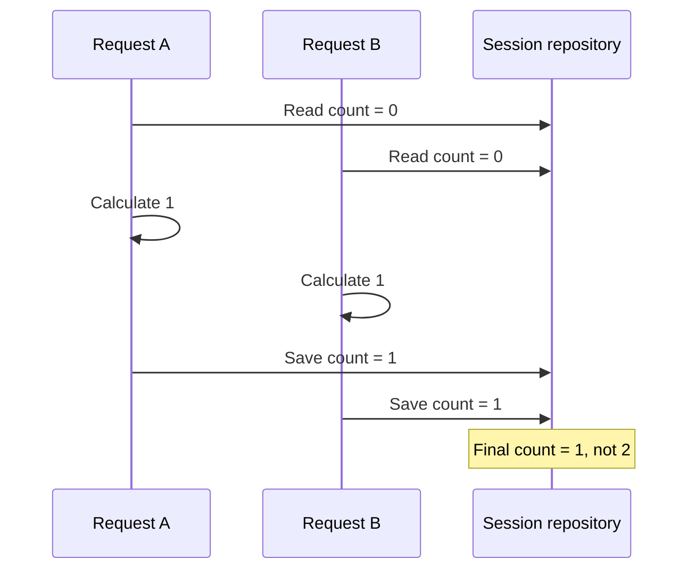

# Đăng nhập hoặc cập nhật cùng lúc để kiểm tra tranh chấp

Khi một trình duyệt gửi nhiều request đồng thời, hoặc nhiều instance cùng xử lý đăng nhập cho một tài khoản, các request có thể đọc cùng một trạng thái session rồi ghi những kết quả khác nhau. Đây là nhóm lỗi tranh chấp (race condition). Chúng có thể làm vượt giới hạn số phiên, mất cập nhật, ghi đè thuộc tính hoặc để một phiên đã bị thu hồi tiếp tục được sử dụng trong một khoảng thời gian.

Spring Session lưu session trong repository như Redis hoặc JDBC để các instance chia sẻ trạng thái. Kho dùng chung giúp các node nhìn thấy dữ liệu chung, nhưng không tự biến một chuỗi đọc-sửa-ghi thành thao tác nguyên tử. Muốn kiểm tra đúng tranh chấp, cần tạo request thật sự chạy đồng thời, điều khiển điểm giao nhau một cách có chủ đích, dùng repository thật và xác nhận invariant sau khi mọi request hoàn tất.

## 1. Các loại tranh chấp thường gặp

Trong ứng dụng Spring Session, cần phân biệt ít nhất bốn nhóm:

| Nhóm | Ví dụ | Hậu quả |
|---|---|---|
| Concurrent login | Hai lần đăng nhập cùng principal trên hai node | Vượt giới hạn `maximumSessions` hoặc cả hai cùng được chấp nhận |
| Concurrent session update | Hai request cùng đọc và sửa một session | Lost update hoặc kết quả phụ thuộc thứ tự ghi |
| Logout/update race | Một request logout trong khi request khác đang cập nhật session | Request cũ có thể ghi lại dữ liệu hoặc tiếp tục chạy |
| Session ID rotation race | Đổi ID sau xác thực trong khi request khác vẫn dùng ID cũ | Request thất bại, session tách đôi hoặc trạng thái cũ còn được dùng |

Không phải mọi tranh chấp đều là lỗi của Spring Session. Có trường hợp repository hoạt động đúng theo contract nhưng nghiệp vụ đã giả định một phép cập nhật nguyên tử mà HTTP session không cung cấp. Test cần xác định invariant của ứng dụng, không chỉ kiểm tra rằng request trả HTTP 200.

## 2. Đọc-sửa-ghi không tự động nguyên tử

Giả sử session chứa bộ đếm:

```java
Integer count = (Integer) session.getAttribute("count");
if (count == null) {
    count = 0;
}
session.setAttribute("count", count + 1);
```

Hai request có thể cùng đọc giá trị 0, cùng tính ra 1 và cùng lưu 1. Kết quả cuối là 1 dù đã có hai lần tăng. Đây là lost update.

Sơ đồ:



Một repository có thể bảo đảm từng lệnh lưu riêng lẻ, nhưng điều đó không đồng nghĩa toàn bộ chuỗi đọc-sửa-ghi của hai request được tuần tự hóa. Không dùng session attribute làm bộ đếm chính xác, số dư, hạn mức thanh toán hoặc dữ liệu nghiệp vụ cần cập nhật nguyên tử.

## 3. Vì sao kho session dùng chung vẫn có race?

Redis/JDBC dùng chung giúp nhiều instance đọc cùng nguồn dữ liệu. Tuy nhiên:
- Hai request có thể đọc cùng phiên bản trước khi request nào ghi.
- Một request có thể giữ snapshot cũ trong bộ nhớ trong suốt vòng đời xử lý.
- Việc lưu session thường diễn ra khi request hoàn tất hoặc theo flush mode.
- Hai thao tác ghi có thể đến kho theo thứ tự khác thứ tự bắt đầu request.
- Repository không mặc nhiên cung cấp optimistic locking hoặc compare-and-set cho toàn bộ session.

Vì vậy, shared store giải quyết khả năng chia sẻ trạng thái giữa node, không phải cơ chế khóa nghiệp vụ. Nếu cần cập nhật nguyên tử, hãy dùng transaction, optimistic locking, atomic operation hoặc coordinator phù hợp ở tầng dữ liệu nghiệp vụ.

## 4. Thiết kế test theo invariant

Trước khi viết test, hãy mô tả điều luôn phải đúng sau khi các request kết thúc. Ví dụ:

- Với giới hạn một phiên: số session được admission cho một principal không vượt quá một.
- Với hai cập nhật độc lập: cả hai thuộc tính phải được giữ nếu cấu hình repository và hợp đồng ứng dụng yêu cầu merge.
- Với cùng một thuộc tính: kết quả phải theo quy tắc được định nghĩa, hoặc test phải phát hiện lost update.
- Sau logout: request mới dùng session ID cũ không được xác thực.
- Khi session ID được rotate: ID cũ không còn được chấp nhận theo chính sách.
- Một principal không được làm thay đổi session của principal khác.

Tránh khẳng định request A luôn thắng hoặc request B luôn thắng nếu hệ thống không quy định thứ tự. Khi không có thứ tự bảo đảm, test nên kiểm tra invariant, số bản ghi và tính nhất quán cuối cùng thay vì phụ thuộc vào lịch chạy của thread.

## 5. Phân biệt test tuần tự và test đồng thời

Một test tuần tự:

```java
clientA.updateSession();
clientB.updateSession();
assertFinalState();
```

chỉ kiểm tra hai cập nhật nối tiếp. Nó không tạo ra thời điểm hai request cùng đọc một snapshot.

Một test đồng thời cần:
1. Tạo trạng thái session ban đầu.
2. Khởi chạy ít nhất hai request độc lập.
3. Đồng bộ chúng tại một điểm sau khi đã đọc dữ liệu cần tranh chấp.
4. Cho cả hai tiếp tục gần như cùng lúc.
5. Chờ cả hai hoàn tất.
6. Đọc lại từ repository bằng request mới hoặc repository API.
7. Kiểm tra invariant.

Không dùng `Thread.sleep` để hy vọng hai request đụng nhau. Sleep không tạo đồng bộ xác định và làm test chập chờn theo tốc độ máy CI.

## 6. Dùng CountDownLatch hoặc CyclicBarrier thay cho sleep

`CountDownLatch` và `CyclicBarrier` giúp điều khiển thời điểm các worker tiếp tục:

```java
CyclicBarrier barrier = new CyclicBarrier(2);

void waitUntilBothRequestsHaveRead() {
    try {
        barrier.await(5, TimeUnit.SECONDS);
    }
    catch (InterruptedException ex) {
        Thread.currentThread().interrupt();
        throw new IllegalStateException("Interrupted at race barrier", ex);
    }
    catch (BrokenBarrierException | TimeoutException ex) {
        throw new IllegalStateException("Race barrier failed", ex);
    }
}
```

Trong test-only hook, gọi `waitUntilBothRequestsHaveRead()` sau khi request đã đọc session và trước khi ghi. Khi request A và B cùng tới barrier, cả hai được thả ra để ghi.

Luôn đặt timeout cho barrier. Nếu một request không đến, test phải fail có thông tin thay vì treo vô hạn. Không đưa barrier hoặc latch này vào production bean.

## 7. Dựng endpoint test-only để tạo lost update

Một endpoint chỉ bật trong test profile có thể đọc bộ đếm, đợi barrier rồi ghi giá trị tăng:

```java
@RestController
@Profile("race-test")
class SessionRaceProbeController {

    private final CyclicBarrier barrier = new CyclicBarrier(2);

    @PostMapping("/_test/session/increment")
    ResponseEntity<Void> increment(HttpSession session) {
        Integer current = (Integer) session.getAttribute("count");
        if (current == null) {
            current = 0;
        }

        awaitBothRequests(barrier);
        session.setAttribute("count", current + 1);
        return ResponseEntity.noContent().build();
    }

    private static void awaitBothRequests(CyclicBarrier barrier) {
        try {
            barrier.await(5, TimeUnit.SECONDS);
        }
        catch (InterruptedException ex) {
            Thread.currentThread().interrupt();
            throw new IllegalStateException(ex);
        }
        catch (BrokenBarrierException | TimeoutException ex) {
            throw new IllegalStateException(ex);
        }
    }
}
```

Endpoint này minh họa test hook Servlet. Nó cố ý chặn hai request sau khi đọc cùng giá trị để làm lộ lost update. Không triển khai endpoint này trong production; barrier blocking chỉ phù hợp với test server và cần đủ request threads để cả hai request tới được điểm chờ.

## 8. Gửi hai request đồng thời bằng HTTP client

Để kiểm tra filter chain và cookie thật, khởi động ứng dụng bằng `@SpringBootTest(webEnvironment = RANDOM_PORT)` và gửi request qua HTTP client. Hai request cập nhật cùng một session phải dùng cùng cookie jar; hai lần đăng nhập độc lập phải dùng hai cookie jar riêng.

Ví dụ gửi hai request cùng session:

```java
ExecutorService pool = Executors.newFixedThreadPool(2);

CompletableFuture<HttpResponse<String>> first =
        CompletableFuture.supplyAsync(
                () -> sendIncrement(clientWithSessionCookie), pool);

CompletableFuture<HttpResponse<String>> second =
        CompletableFuture.supplyAsync(
                () -> sendIncrement(clientWithSessionCookie), pool);

HttpResponse<String> responseA = first.get(10, TimeUnit.SECONDS);
HttpResponse<String> responseB = second.get(10, TimeUnit.SECONDS);

assertThat(responseA.statusCode()).isEqualTo(204);
assertThat(responseB.statusCode()).isEqualTo(204);

pool.shutdownNow();
```

`clientWithSessionCookie` là HTTP client đã nhận cookie từ request tạo session ban đầu. Hai `CompletableFuture` khởi chạy độc lập; barrier phía server mới là điểm đồng bộ bảo đảm cả hai request đã đọc trước khi ghi.

Trong test thực tế, cần `try/finally` để đóng executor, và chờ future có timeout. Không dùng một `MockHttpSession` chia sẻ giữa hai request vì như vậy test có thể bỏ qua repository và không phản ánh hai lần resolve session độc lập.

## 9. Khởi tạo session và cookie trước khi chạy race

Trước khi gửi request đồng thời:
1. Gửi request khởi tạo session qua endpoint test-only.
2. Nhận `Set-Cookie` từ response.
3. Giữ cookie trong HTTP client.
4. Xác nhận session tồn tại trong repository nếu test cần kiểm tra store.
5. Chỉ sau đó mới gửi hai request đồng thời.

Cookie phải được lấy từ response thật. Không tự chế session ID, vì resolver có thể mã hóa ID hoặc dùng cookie name/path riêng. Nếu ứng dụng dùng CSRF, request POST phải gửi CSRF token hợp lệ; không tắt CSRF toàn cục chỉ để đơn giản hóa race test.

## 10. Kiểm thử hai lần đăng nhập cùng principal

Một tình huống phổ biến là giới hạn số session cho một tài khoản. Với `maximumSessions(1)`, ứng dụng có thể:
- Từ chối lần đăng nhập mới khi đã đạt giới hạn.
- Hoặc cho phép phiên mới và đánh dấu phiên cũ hết hạn, tùy `maxSessionsPreventsLogin`.

Test đồng thời phải xác minh chính sách thực tế sau khi cả hai lần login hoàn tất. Không chỉ assert rằng cả hai response là 2xx; cần đọc trạng thái session và thử truy cập endpoint bảo vệ bằng từng cookie.

Nếu giới hạn là một:
- Reject-new policy: tối đa một login thành công, phiên đã có tiếp tục dùng được.
- Replace-old policy: một phiên được giữ theo chính sách, phiên bị thay thế phải bị từ chối ở request tiếp theo.
- Với hai login thực sự cùng lúc, kết quả có thể phụ thuộc thứ tự admission nếu hệ thống không có coordinator nguyên tử.

## 11. Vì sao maximumSessions có thể bị race?

Quy trình kiểm soát session thường phải đọc các phiên của principal, đếm số lượng rồi quyết định có cho login hay không. Nếu hai node cùng đọc trước khi phiên nào được đăng ký, cả hai có thể nhìn thấy cùng một trạng thái cũ.

`SpringSessionBackedSessionRegistry` giúp các node tra cứu session từ `FindByIndexNameSessionRepository` dùng chung. Tuy nhiên, registry không tự cung cấp một transaction nguyên tử bao trùm bước tra cứu, admission và lưu session mới.

Nếu yêu cầu giới hạn cứng, cần kiểm thử và có thể bổ sung admission-control tập trung theo principal, ví dụ database row lock/unique constraint hoặc Redis Lua script. Cơ chế phải xử lý cả crash, timeout, reservation mồ côi và session ID rotation.

## 12. Đồng bộ hai lần đăng nhập tại điểm admission

Để tái hiện race có kiểm soát, có thể thêm test-only decorator quanh `SessionRegistry` hoặc admission service. Decorator chụp danh sách session hiện có cho từng login, rồi chờ cả hai login cùng đến barrier trước khi trả kết quả.

Ý tưởng:

```java
List<SessionInformation> snapshot =
        delegate.getAllSessions(principal, false);

barrier.await(5, TimeUnit.SECONDS);

return snapshot;
```

Nếu cả hai lần login đều nhận snapshot rỗng, test tái hiện chính xác tình huống check-then-act. Hook phải được đặt đúng tại điểm kiểm tra trước khi đăng ký session mới; nếu đặt sau admission, nó không kiểm tra được race cần thiết.

Đây là test seam, không phải thay đổi production policy. Khi test dùng `SpringSessionBackedSessionRegistry` thật, delegate vẫn phải đọc repository dùng chung để phản ánh nhiều node.

## 13. Hai instance độc lập cùng dùng Redis/JDBC

Để kiểm tra race trong cụm, cần hai application instance độc lập cùng trỏ đến một session store:
- Cùng Redis namespace hoặc JDBC schema/table.
- Cùng cookie name, resolver và serializer.
- Cùng cấu hình Spring Security.
- Cùng principal index nếu dùng `SpringSessionBackedSessionRegistry`.
- Cùng policy `maximumSessions` và admission service.

Có thể chạy hai Spring Boot process/container riêng hoặc hai context độc lập nếu mục tiêu chỉ là kiểm tra shared repository. Khi cần chứng minh hành vi giữa JVM, phải chạy process riêng; hai context trong một JVM không tạo ranh giới process.

Một request login đến A, request còn lại đến B. Sau đó kiểm tra session từ cả hai node và xác nhận invariant không phụ thuộc load balancer.

## 14. Kiểm thử cập nhật hai thuộc tính khác nhau

Hai request cùng session có thể cập nhật hai key khác nhau, ví dụ `lastViewedProduct` và `preferredTab`. Test cần xác định repository và `SaveMode` có giữ cả hai cập nhật hay không.

Một số repository/configuration chỉ lưu thuộc tính được đánh dấu thay đổi; cấu hình khác có thể ghi nhiều hoặc toàn bộ thuộc tính từ snapshot request. Vì vậy, kết quả phụ thuộc implementation, save mode, flush mode và thời điểm ghi.

Test nên:
1. Khởi tạo session với hai thuộc tính ban đầu.
2. Request A đọc session, chờ barrier rồi cập nhật key A.
3. Request B đọc cùng snapshot, chờ barrier rồi cập nhật key B.
4. Đợi cả hai response hoàn tất.
5. Đọc session mới từ repository.
6. Assert cả hai giá trị nếu cấu hình/hợp đồng yêu cầu merge.

Không giả định mọi repository đều merge độc lập thuộc tính. Test trên Redis/JDBC implementation thực tế và ghi rõ cấu hình đang dùng.

## 15. Kiểm thử hai request cập nhật cùng một thuộc tính

Nếu cả hai request cập nhật cùng một key, cần quy định kết quả mong đợi. Ví dụ hai request cùng đọc `count=0` rồi cùng ghi `count=1`.

Nếu không có versioning hoặc atomic increment, kết quả cuối có thể là 1. Đừng viết test mong 2 chỉ vì đã có hai request. Test nên chứng minh lost update hoặc xác nhận cơ chế chống lost update thực sự hoạt động.

Nếu ứng dụng yêu cầu tăng chính xác:
- Đưa bộ đếm vào database với `UPDATE counter SET value = value + 1`.
- Dùng optimistic locking với cột version.
- Dùng atomic increment trong Redis.
- Dùng transaction/lock theo khóa nghiệp vụ.

Session có thể giữ UI state, nhưng không nên làm nguồn sự thật cho counter cần chính xác.

## 16. SaveMode và FlushMode ảnh hưởng gì?

Spring Session repository có các lựa chọn ảnh hưởng cách thay đổi session được ghi:

- `SaveMode` quyết định thuộc tính nào được xem là cần lưu.
- `FlushMode` quyết định thời điểm thay đổi được flush xuống repository.

Trong Redis repository, `ON_SET_ATTRIBUTE` tập trung vào thuộc tính được đặt qua `setAttribute`; `ALWAYS` có thể lưu lại nhiều trạng thái session hơn. `FlushMode.ON_SAVE` thường ghi khi request/session được lưu; chế độ immediate flush có thể ghi sớm hơn.

Các mode này ảnh hưởng cửa sổ race và khả năng ghi đè, nhưng không tự tạo transaction read-modify-write nguyên tử. Khi đổi mode, hãy chạy lại test concurrent update trên repository thật. Không dùng `FlushMode.IMMEDIATE` như giải pháp thay thế khóa hoặc optimistic locking.

## 17. Logout đồng thời với request cập nhật

Một race quan trọng:
1. Request A resolve session và bắt đầu xử lý.
2. Request B logout, invalidate session và xóa repository record.
3. Request A tiếp tục sửa session snapshot cũ.
4. Request A hoàn tất và có thể thử lưu trạng thái.

Hành vi cuối phụ thuộc filter, repository, thời điểm save và cách invalidate được triển khai. Không nên giả định request đang chạy sẽ tự dừng ngay khi một request khác logout.

Test cần:
- Tạo session và lấy cookie.
- Dùng barrier để request A giữ session sau khi resolve.
- Gửi logout qua request B.
- Cho A tiếp tục và hoàn tất.
- Gửi request thứ ba bằng cookie cũ.
- Xác nhận request mới không được xác thực.
- Kiểm tra repository không còn session hợp lệ theo policy.

Nếu nghiệp vụ yêu cầu thu hồi tức thời, có thể cần revocation marker hoặc version check trên mỗi request nhạy cảm. Chỉ xóa cookie ở response logout là chưa đủ.

## 18. Session fixation và đổi session ID trong lúc cạnh tranh

Spring Security có thể thay session ID sau xác thực để chống session fixation. Khi nhiều request cùng dùng cookie cũ:
- Một request có thể rotate ID.
- Request khác vẫn mang ID cũ.
- Cookie response từ các response đồng thời có thể đến browser theo thứ tự khác thứ tự xử lý.
- Client có thể lưu cookie cuối cùng không phải ID mà ứng dụng dự định giữ.

Test nên xác nhận:
- Login tạo/rotate ID theo strategy đang dùng.
- Cookie mới được phát đúng.
- ID cũ không tiếp tục được chấp nhận theo policy.
- Request đang chạy với ID cũ có behavior được xác định.
- Hai response login không khiến cookie jar kết thúc ở trạng thái bất hợp lệ.

Dùng HTTP client có cookie jar riêng cho mỗi luồng login. Không dùng chung cookie jar giữa hai tài khoản hoặc hai client khi kiểm tra concurrent login, vì việc cập nhật cookie có thể làm nhiễu kết quả.

## 19. Cấu hình integration test với Redis Testcontainers

Đối với Redis, dùng container thật để kiểm tra serialization, repository save và session lookup:

```java
@Testcontainers
@SpringBootTest(webEnvironment = SpringBootTest.WebEnvironment.RANDOM_PORT)
class ConcurrentSessionIntegrationTest {

    @Container
    static final GenericContainer<?> redis =
            new GenericContainer<>(DockerImageName.parse("redis:7.4-alpine"))
                    .withExposedPorts(6379);

    @DynamicPropertySource
    static void redisProperties(DynamicPropertyRegistry registry) {
        registry.add("spring.data.redis.host", redis::getHost);
        registry.add("spring.data.redis.port",
                () -> redis.getMappedPort(6379));
    }
}
```

Tên property tùy Spring Boot version. Xác minh context dùng đúng `RedisIndexedSessionRepository` hoặc repository được chọn, không phải map repository. Với Spring Session Redis, session namespace và serializer phải giống production.

Nếu cần test nhiều node, hai ứng dụng phải cùng kết nối Redis container đó. Một context đơn không kiểm tra được sự khác biệt cấu hình giữa hai node.

## 20. Cấu hình integration test với JDBC

Với JDBC, dùng database tương ứng production qua Testcontainers. Kiểm tra:
- Schema Spring Session đúng version.
- `JdbcIndexedSessionRepository` hoặc repository được cấu hình thực tế.
- Cùng schema/table cho các instance cần chia sẻ.
- Transaction manager và DataSource đúng.
- SQL không route session read sang replica cũ.
- Attribute serialization tương thích.
- Cleanup task không xóa session trong lúc test race.

H2 có thể hữu ích cho test nhanh, nhưng nếu production dùng PostgreSQL/MySQL, cần chạy concurrency integration test trên DBMS tương ứng để kiểm tra locking, isolation level và SQL semantics thật.

## 21. Tránh test đồng thời giả bằng mock

Các cách sau không chứng minh race của repository:
- Mock `SessionRepository` chỉ trả một object cố định.
- Dùng cùng `MockHttpSession` cho nhiều request.
- Gọi service hai lần tuần tự.
- Dùng `Thread.sleep` để hy vọng overlap.
- Dùng một node local map trong khi production dùng Redis/JDBC.
- Assert response status mà không đọc trạng thái cuối.

Mock phù hợp để kiểm tra service xử lý lỗi hoặc nhánh logic. Race integration test cần repository thật, request độc lập và điểm đồng bộ sau khi đọc trạng thái.

## 22. Cấu trúc test race có thể tái sử dụng

Một helper có thể gửi hai request và chờ cả hai:

```java
<T> List<T> runConcurrently(
        Callable<T> first,
        Callable<T> second) throws Exception {

    ExecutorService executor = Executors.newFixedThreadPool(2);
    try {
        Future<T> a = executor.submit(first);
        Future<T> b = executor.submit(second);

        return List.of(
                a.get(10, TimeUnit.SECONDS),
                b.get(10, TimeUnit.SECONDS)
        );
    }
    finally {
        executor.shutdownNow();
    }
}
```

Helper này chỉ khởi chạy song song; nó không bảo đảm cả hai request đã đọc cùng snapshot. Để tạo race xác định, vẫn cần barrier/latch tại điểm sau khi đọc và trước khi ghi. Dùng timeout cho cả barrier và future để test fail nhanh nếu có deadlock.

Nếu một test chạy nhiều vòng, tạo barrier mới cho mỗi vòng hoặc reset đúng cách. Không chia sẻ barrier đã broken giữa các test song song.

## 23. Assertions sau khi race hoàn tất

Sau khi hai request hoàn tất, đọc trạng thái bằng request thứ ba hoặc repository mới. Không dùng object session trong thread A/B làm nguồn xác nhận cuối vì đó là snapshot cục bộ.

Những assertion có thể cần:
- Số session theo principal.
- Session ID nào còn hợp lệ.
- Thuộc tính nào tồn tại và giá trị cuối.
- Session có bị invalidate sau logout không.
- Cookie nào được phát và client đang giữ cookie nào.
- Có session mồ côi hoặc admission reservation bị kẹt không.
- Các request của principal khác có bị ảnh hưởng không.

Khi thứ tự ghi không được quy định, assert tập giá trị hợp lệ hoặc invariant. Không assert một thread cụ thể phải thắng chỉ vì test chạy thường xuyên theo thứ tự đó trên máy phát triển.

## 24. Kiểm thử nhiều vòng và độ ổn định

Race condition có thể hiếm khi xuất hiện. Một test có barrier làm tăng khả năng tái hiện, nhưng vẫn nên:
- Chạy nhiều lần với dữ liệu fixture mới.
- Chạy song song các test khác để phát hiện shared state.
- Chạy trên CI có số CPU và tốc độ khác máy phát triển.
- Ghi nhận timeout, deadlock và kết quả cuối.
- Giữ log đủ để biết node, principal test, session ID đã che và request correlation ID.
- Không dùng một Redis database chung cho các pipeline không cô lập.

Nếu test phải chạy hàng trăm vòng, đặt giới hạn thời gian tổng và tạo namespace riêng theo test run. Không tăng số vòng vô hạn để bù cho một test không có synchronization đúng.

## 25. Phân biệt tranh chấp session và tranh chấp dữ liệu nghiệp vụ

Session repository không phải database transaction cho toàn bộ request. Nếu hai request cùng cập nhật đơn hàng, giỏ hàng hoặc hạn mức, hãy xử lý tranh chấp tại nơi dữ liệu có thẩm quyền.

Ví dụ optimistic locking ở entity nghiệp vụ:

```java
@Entity
class Cart {
    @Id
    private UUID id;

    @Version
    private long version;

    private int itemCount;
}
```

Khi hai transaction cùng cập nhật một phiên bản, một transaction có thể nhận optimistic locking failure và được retry hoặc trả conflict theo nghiệp vụ. Session chỉ giữ `cartId` để xác định giỏ hàng.

Không đặt `@Version` trên DTO trong session rồi kỳ vọng Spring Session tự thực thi optimistic locking. Versioning phải được thực hiện bởi repository/database nghiệp vụ có hỗ trợ điều kiện cập nhật.

## 26. Ma trận tình huống cần kiểm thử

| Tình huống | Cách tạo tranh chấp | Điều cần xác minh |
|---|---|---|
| Hai login cùng principal | Hai client, hai node, barrier ở admission | Không vượt giới hạn theo policy |
| Hai request tăng cùng counter | Cùng cookie, barrier sau read | Phát hiện lost update hoặc dùng atomic store |
| Hai request sửa hai key | Cùng cookie, barrier sau read | Merge/overwrite theo SaveMode thực tế |
| Logout và update | Một request giữ snapshot, request kia invalidate | Request mới với cookie cũ bị từ chối |
| Session ID rotation | Login đồng thời hoặc request cũ trong lúc rotate | Cookie/ID cũ-mới theo đúng policy |
| Hai principal khác nhau | Chạy song song | Không rò dữ liệu chéo |
| Redis/JDBC chậm hoặc lỗi | Fault injection có kiểm soát | Error handling, timeout và không cấp quyền sai |
| Node chết giữa save | Dừng instance tại điểm test hook | Repository và cleanup phục hồi đúng |

## 27. Chẩn đoán lỗi thường gặp

| Triệu chứng | Nguyên nhân có thể | Hướng điều tra |
|---|---|---|
| Hai login cùng được chấp nhận | Check-then-act không nguyên tử | Đồng bộ tại admission và kiểm tra số session cuối |
| Counter tăng hai lần nhưng chỉ tăng một | Lost update | Barrier sau read, dùng atomic update ở domain store |
| Thuộc tính A mất sau khi B lưu | Save mode ghi snapshot rộng hoặc stale state | Kiểm tra repository, SaveMode và FlushMode |
| Session sống lại sau logout | Request cũ ghi lại hoặc replica/state cũ | Kiểm tra repository read path và revocation policy |
| Test lúc pass lúc fail | Dùng sleep hoặc assertion phụ thuộc thứ tự thread | Dùng barrier và assert invariant |
| Test deadlock | Barrier thiếu participant hoặc server thread pool quá nhỏ | Timeout barrier, tăng test server threads phù hợp |
| Cookie cuối cùng không đúng | Dùng chung cookie jar hoặc response rotation đồng thời | Tách client và kiểm tra Set-Cookie |
| Chỉ lỗi trên CI | Timing, connection pool hoặc topology khác | Chạy test nhiều vòng và thu thập node/request trace |

Không log session ID nguyên vẹn, cookie, credential hoặc SecurityContext đầy đủ. Dùng ID đã che, correlation ID và principal giả lập riêng cho test.

## 28. Quy trình triển khai test race

1. Xác định invariant và chính sách login/update/logout.
2. Chọn repository implementation giống production.
3. Tạo fixture session và cookie qua HTTP.
4. Dùng hai request/client độc lập.
5. Đặt barrier sau bước đọc cần tranh chấp.
6. Chạy request đồng thời bằng executor có giới hạn.
7. Chờ kết quả với timeout.
8. Đọc trạng thái cuối từ repository hoặc request mới.
9. Assert invariant thay vì phụ thuộc thread thắng.
10. Lặp lại test trên Redis/JDBC thật và nhiều instance nếu cần.
11. Kiểm tra cleanup, timeout, lỗi store và node failure.
12. Nếu phát hiện race, sửa ở đúng tầng: admission coordinator hoặc transaction dữ liệu nghiệp vụ.

## 29. Checklist trước khi phát hành

- Test dùng repository thật hoặc ghi rõ giới hạn của mock.
- Request được chạy đồng thời, không phải tuần tự.
- Có barrier/latch tại đúng điểm sau read, trước write/admission.
- Không dùng `Thread.sleep` làm synchronization.
- Login test dùng cookie jar riêng cho từng client.
- Update test dùng cùng cookie khi cần tranh chấp cùng session.
- Test có timeout cho barrier, future và HTTP call.
- Session ID rotation và logout được kiểm tra.
- Redis/JDBC namespace/schema và serializer giống production.
- Multi-node test dùng shared store thật.
- SaveMode/FlushMode được ghi rõ.
- Kết quả cuối được đọc lại từ repository hoặc request mới.
- Invariant được xác định trước và assertion không phụ thuộc thứ tự thread.
- Dữ liệu nghiệp vụ cần atomic update nằm trong store có transaction/locking phù hợp.
- Test cleanup an toàn và không xóa dữ liệu của test khác.

Kiểm thử tranh chấp cho Spring Session phải tạo ra hai thao tác thực sự chồng lấn trên cùng principal hoặc session. Hãy dùng HTTP client độc lập, barrier/latch sau bước đọc, repository Redis/JDBC thật và assertion trên trạng thái cuối. `SpringSessionBackedSessionRegistry` giúp các node nhìn thấy session chung nhưng không tự tuần tự hóa toàn bộ admission; session repository cũng không biến read-modify-write thành transaction nghiệp vụ. Khi cần giới hạn đăng nhập cứng hoặc cập nhật chính xác, bổ sung admission-control nguyên tử hoặc chuyển phép cập nhật vào database/service có locking và versioning phù hợp.

