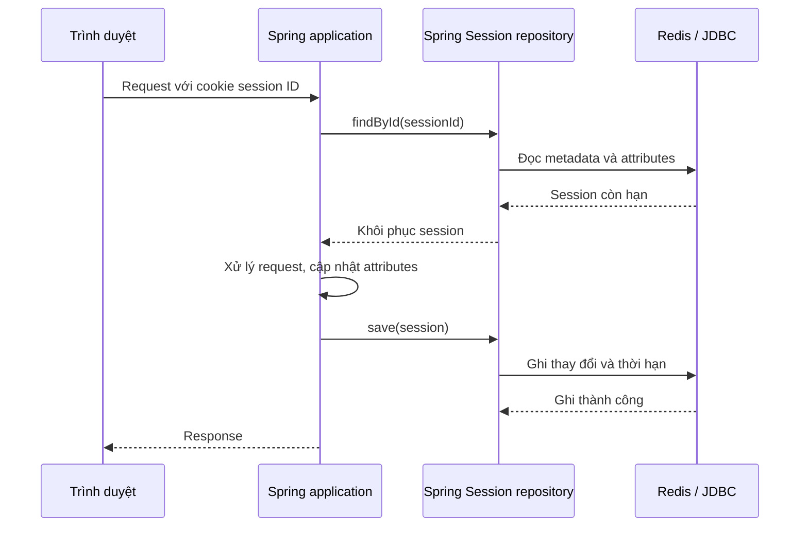

# Mất kết nối, chuyển đổi dự phòng, eviction và phục hồi kho

Spring Session chuyển trạng thái `HttpSession` hoặc `WebSession` ra khỏi bộ nhớ riêng của một instance để nhiều request và nhiều node có thể dùng chung. Khi kho session là Redis hoặc JDBC gặp mất kết nối, failover, eviction hoặc phục hồi sau sự cố, ứng dụng phải xử lý đúng hai loại dữ liệu: trạng thái phiên đã được lưu và định danh phiên mà trình duyệt đang giữ.

Cookie chỉ chứa session ID; nó không chứa bản sao `SecurityContext` hay các session attributes. Nếu kho không truy cập được, ứng dụng không thể suy ra trạng thái đăng nhập chỉ từ cookie. Nếu backend trả lời rõ ràng rằng session không còn tồn tại, người dùng có thể cần đăng nhập lại. Nếu backend đang lỗi, ứng dụng cần nhận biết đó là lỗi lưu trữ thay vì âm thầm coi session là mới hoặc chuyển sang một kho local khác.

## 1. Phân biệt mất kết nối, mất session và session hết hạn

Ba tình huống này có biểu hiện khác nhau và cần cách xử lý khác nhau:

| Tình huống | Điều repository quan sát được | Ý nghĩa |
|---|---|---|
| Kho session không truy cập được | Kết nối timeout, connection refused, lỗi transaction hoặc lỗi driver | Chưa biết session có tồn tại hay không; đây là lỗi hạ tầng |
| Session không còn trong kho | Lookup hoàn tất nhưng không tìm thấy ID | Session có thể đã hết hạn, bị logout, bị eviction hoặc mất dữ liệu |
| Session hết hạn logic | `EXPIRY_TIME`/TTL đã qua hoặc repository xác định idle timeout hết hạn | Không được khôi phục phiên để xác thực, dù dữ liệu vật lý có thể chưa bị xóa |

Không được biến lỗi kết nối thành kết quả “không tìm thấy session”. Nếu backend unavailable mà ứng dụng coi mọi lookup là rỗng, người dùng có thể bị đăng xuất hàng loạt hoặc ứng dụng có thể tạo session mới không đúng chính sách. Ngược lại, không được dùng session cũ từ cache local để tiếp tục xác thực khi không thể kiểm tra trạng thái thu hồi ở kho chung.

## 2. Vòng đời session khi backend hoạt động bình thường

Với ứng dụng Servlet, `SessionRepositoryFilter` điều phối thao tác `HttpSession` qua repository. Với WebFlux, `WebSessionManager` dùng `ReactiveSessionRepository`. Redis/JDBC giữ metadata và attributes bên ngoài process.



Khi kho bị lỗi ở bước đọc, ứng dụng không thể xác minh session. Khi lỗi ở bước ghi, request có thể đã xử lý nghiệp vụ nhưng trạng thái session chưa được lưu bền vững. Hai trường hợp cần được theo dõi riêng vì rủi ro và cách phục hồi khác nhau.

## 3. Mất kết nối Redis

Spring Session Data Redis dùng Spring Data Redis để truy cập Redis. Trong cấu hình reactive WebFlux, repository reactive dùng client reactive; trong Servlet, repository Redis có thể dùng API đồng bộ hoặc cấu hình tương ứng của phiên bản.

Các nguyên nhân thường gặp:

- Redis process dừng, restart hoặc bị OOM.
- DNS, route, firewall, security group hoặc network policy làm mất kết nối.
- Redis failover sang primary mới và client chưa cập nhật topology.
- Connection pool hoặc client connection bị cạn.
- Redis quá tải, command latency cao hoặc event loop/client thread bị nghẽn.
- TLS certificate hết hạn, hostname không khớp hoặc cấu hình xác thực sai.

Hành vi của request phụ thuộc thời điểm lỗi:

- Nếu lookup session thất bại, request cần session có thể không được xử lý như một request đã xác thực.
- Nếu session đã đọc thành công nhưng save thất bại, thay đổi session mới nhất có thể bị mất.
- Nếu logout xóa session thất bại, session có thể vẫn còn trong kho và cần xử lý lại theo chính sách thu hồi.
- Nếu ứng dụng không phân biệt lỗi backend với session miss, hành vi xác thực có thể không nhất quán giữa các node.

Không bắt mọi exception Redis rồi tạo `MapSession` local. Một node có thể tiếp tục coi người dùng đã đăng nhập trong khi node khác từ chối cùng cookie, tạo ra trạng thái bảo mật không nhất quán.

## 4. Mất kết nối JDBC và connection pool

Với Spring Session JDBC, `JdbcIndexedSessionRepository` dùng database quan hệ và JDBC đồng bộ. Khi database hoặc network bị gián đoạn, thao tác lấy/lưu session có thể thất bại qua JDBC driver hoặc connection pool.

Các dấu hiệu thường gặp:

- Connection timeout khi lấy connection từ pool.
- Socket timeout hoặc communications link failure khi thực thi SQL.
- Database failover khiến connection cũ không còn hợp lệ.
- Transaction bị rollback hoặc commit không xác định sau khi kết nối bị ngắt.
- Pool giữ connection stale lâu hơn khả năng phục hồi của database/proxy.
- Database quá tải do connection pool của nhiều instance cộng lại vượt năng lực server.

HikariCP có các thiết lập như `connectionTimeout`, `validationTimeout`, `maxLifetime` và `keepaliveTime` để quản lý connection. Giá trị cần được chọn theo timeout của database, proxy và hạ tầng. Không đặt `maxLifetime` dài hơn giới hạn idle/connection lifetime của proxy nếu proxy chủ động đóng connection cũ.

Ví dụ cấu hình minh họa:

```yaml
spring:
  datasource:
    hikari:
      connection-timeout: 2s
      validation-timeout: 1s
      max-lifetime: 25m
      keepalive-time: 5m
```

Các giá trị chỉ là ví dụ để minh họa cách đặt giới hạn; phải căn cứ database, proxy và phiên bản HikariCP đang dùng. Không sao chép nguyên các con số vào production mà chưa đo thời gian kết nối, query và failover thực tế.

## 5. Chọn chính sách khi kho session unavailable

Ứng dụng cần có chính sách rõ ràng cho endpoint public, endpoint yêu cầu đăng nhập và endpoint ghi dữ liệu.

| Loại request | Hành vi phù hợp khi session store unavailable |
|---|---|
| Endpoint public không cần session | Có thể tiếp tục nếu không tạo/đọc session |
| Endpoint yêu cầu xác thực bằng session | Không được giả định người dùng anonymous hoặc authenticated tùy tiện; trả lỗi khả dụng phù hợp hoặc từ chối theo chính sách |
| Đăng nhập mới | Không xác nhận đăng nhập thành công nếu không lưu được session theo yêu cầu stateful |
| Logout/invalidate | Báo lỗi nếu không thể xác nhận thu hồi; có thể dùng cơ chế revocation độc lập nếu đã thiết kế |
| Request cập nhật session | Không giả vờ save thành công khi repository báo lỗi |
| Request nghiệp vụ không phụ thuộc session | Có thể tiếp tục nếu security policy và các dependency khác cho phép |

Với ứng dụng bảo mật, khi không thể xác minh session thì phải fail closed cho tài nguyên được bảo vệ. Điều này không nhất thiết có nghĩa trả `401` cho mọi lỗi backend; một lỗi kho thường phù hợp hơn với `503 Service Unavailable` để phân biệt sự cố hạ tầng với credentials không hợp lệ. Cách ánh xạ exception ở filter/repository cần được kiểm tra vì lỗi có thể xảy ra trước khi controller được gọi.

Không trả `200` như thể session đã được lưu nếu thao tác save thất bại. Không tạo session local làm fallback trừ khi đó là một kiến trúc được thiết kế, có semantics riêng và được kiểm thử đầy đủ.

## 6. Redis failover và replication

Redis có thể được triển khai standalone, Sentinel-managed hoặc Redis Cluster/managed service. Cơ chế failover và cách client phát hiện primary mới phụ thuộc topology.

- **Standalone:** không có primary thay thế tự động nếu chỉ chạy một Redis server. Restart có thể làm gián đoạn mọi thao tác session.
- **Sentinel:** Sentinel theo dõi primary/replica và có thể promote replica khi primary lỗi. Client cần cấu hình Sentinel-aware để tìm primary hiện tại.
- **Cluster:** client phải hỗ trợ cluster topology, slot mapping và xử lý MOVED/ASK redirection theo Redis protocol.
- **Managed Redis:** nhà cung cấp có thể quản lý failover, endpoint, TLS và replication; cần hiểu thời gian chuyển đổi và cam kết durability của dịch vụ.

Redis replication thường là bất đồng bộ. Khi primary lỗi ngay sau khi nhận một write nhưng trước khi replica nhận write đó, failover có thể làm mất thay đổi gần nhất. Vì vậy, “Redis HA” không đồng nghĩa mọi session write được bảo toàn tuyệt đối.

Khi failover:

1. Client có thể tạm thời nhận lỗi kết nối hoặc lỗi topology.
2. Primary mới được chọn và endpoint/connection được cập nhật.
3. Client cần tạo lại hoặc tái sử dụng connection hợp lệ theo cơ chế driver.
4. Request tiếp theo đọc lại session từ kho đang hoạt động.
5. Session write chưa replicate có thể không còn; session ID trong cookie vẫn tồn tại nhưng lookup có thể miss.

Không nên giả định mọi thao tác đang chạy sẽ tự động được retry an toàn. Một lệnh save có thể đã được thực hiện ở primary cũ nhưng client mất phản hồi trước khi biết kết quả. Retry phải tính tới idempotency và semantics của repository.

## 7. Redis persistence: RDB, AOF và giới hạn phục hồi

Redis có thể dùng RDB snapshot, AOF hoặc kết hợp cả hai để phục hồi dữ liệu sau restart. Mỗi lựa chọn có trade-off về tốc độ ghi, dung lượng và khoảng dữ liệu có thể mất khi sự cố.

- **RDB:** lưu snapshot tại các mốc; dữ liệu phát sinh sau snapshot gần nhất có thể mất nếu Redis crash trước lần snapshot tiếp theo.
- **AOF:** ghi lại các thao tác thay đổi; chính sách fsync quyết định mức độ dữ liệu có thể mất và chi phí I/O.
- **RDB + AOF:** có thể kết hợp ưu điểm snapshot và log, nhưng cần vận hành, backup và kiểm thử restore.

Đối với session, cần xác định mức độ chấp nhận mất dữ liệu. Mất một session có thể chỉ khiến người dùng đăng nhập lại; với hệ thống lưu thêm trạng thái giỏ hàng hoặc quy trình nhiều bước trong session, tác động nghiệp vụ có thể lớn hơn.

Không coi Redis persistence là bản backup duy nhất. Cần kiểm thử phục hồi từ backup, xác nhận TTL còn đúng sau restore và hiểu liệu restore có làm sống lại session đã logout hoặc đã hết hạn trước thời điểm backup hay không. Nếu restore dữ liệu cũ, cần một chính sách thu hồi hoặc yêu cầu đăng nhập lại để tránh phục hồi trạng thái xác thực đã bị hủy.

## 8. Eviction trong Redis và nguy cơ mất session trước TTL

Redis áp dụng `maxmemory` và `maxmemory-policy` khi bộ nhớ đạt giới hạn. Nếu policy cho phép eviction, Redis có thể xóa key trước khi session idle timeout kết thúc. Trình duyệt vẫn giữ cookie session ID nhưng repository không còn tìm thấy session.

Các policy có thể ảnh hưởng session:

| Policy | Tác động khái quát |
|---|---|
| `noeviction` | Không tự xóa key để lấy chỗ; lệnh ghi có thể thất bại khi chạm giới hạn bộ nhớ |
| `allkeys-lru` / `allkeys-lfu` | Có thể loại bất kỳ key nào theo thuật toán, gồm session key |
| `volatile-lru` / `volatile-lfu` | Chỉ xét key có expiration; session thường có TTL nên vẫn có thể bị loại |
| `volatile-ttl` | Có thể ưu tiên loại key còn TTL; session key có expiration có thể bị ảnh hưởng |
| `allkeys-random` / `volatile-random` | Có thể xóa key ngẫu nhiên trong tập đủ điều kiện |

Không nên dùng một Redis cache chung với policy eviction không được đánh giá cho session. Với session store, thường cần tách capacity và failure domain khỏi cache dữ liệu có thể tái tạo. `noeviction` có thể giúp tránh việc âm thầm loại session, nhưng khi bộ nhớ đầy thì thao tác ghi sẽ lỗi; đây là một failure rõ ràng cần alert và capacity planning, không phải cách loại bỏ sự cố.

Hãy theo dõi `used_memory`, `maxmemory`, `evicted_keys`, `expired_keys`, fragmentation và tốc độ tăng key. Chỉ số `evicted_keys` tăng bất thường là dấu hiệu cần điều tra ngay vì người dùng có thể bị mất phiên trước idle timeout.

## 9. TTL, expiration và cleanup

TTL của Redis hoặc `EXPIRY_TIME` trong JDBC là cơ chế lưu trữ thời hạn. Idle timeout của Spring Session quyết định session còn hợp lệ hay không. Hai mốc liên quan nhưng không nên coi cleanup vật lý là lớp kiểm soát bảo mật duy nhất.

- Redis có thể xóa key hết hạn bằng lazy expiration khi truy cập hoặc active expiration theo chu kỳ.
- JDBC thường cần query kiểm tra `EXPIRY_TIME` và tác vụ cleanup xóa session hết hạn.
- Cleanup có thể chạy trễ hoặc thất bại trong khi session đã hết hạn logic.
- Eviction có thể xóa session trước deadline.
- Restore backup có thể đưa dữ liệu cũ trở lại nếu TTL/expiry không được xử lý đúng.

Repository phải từ chối session hết hạn khi đọc. Không được chấp nhận một session chỉ vì key hoặc hàng dữ liệu vẫn tồn tại. Khi backend có TTL, kiểm tra cấu hình serializer/repository để bảo đảm TTL được cập nhật đúng khi session được truy cập hoặc lưu theo semantics của Spring Session.

## 10. JDBC database failover và replica lag

Với JDBC, database có thể chạy primary/standby, cluster hoặc dịch vụ managed. Khi failover, connection pool có thể còn giữ connection tới primary cũ. Các connection đó cần được phát hiện là stale và tạo lại sau khi endpoint writer mới sẵn sàng.

Các điểm cần xem xét:

- Connection string có endpoint failover hoặc DNS name ổn định không?
- Driver có hỗ trợ topology/failover của database không?
- Pool có loại bỏ connection chết sau network partition không?
- Transaction bị ngắt ở giữa commit có thể có kết quả không xác định ở client không?
- Session read có bị route sang read replica không?
- Replica lag có khiến session vừa được ghi chưa xuất hiện ở lần đọc tiếp theo không?

Session repository thường cần read-after-write nhất quán. Nếu write session vào primary nhưng lookup tiếp theo được route tới replica chưa đồng bộ, ứng dụng có thể tưởng session không tồn tại. Không route session lookup sang read replica có eventual consistency trừ khi đã chấp nhận và xử lý được độ trễ đó.

Sau failover, cần kiểm tra transaction isolation, schema và index trên node mới. Không chạy migration schema cùng lúc failover mà không có kế hoạch điều phối; repository có thể gặp lỗi cột/bảng nếu các node thấy schema không đồng nhất.

## 11. Phục hồi sau khi backend hoạt động trở lại

Khi Redis/JDBC phục hồi, client và pool cần tái lập kết nối. Tuy nhiên, không phải mọi session trước sự cố đều còn nguyên:

- Session có thể vẫn tồn tại nếu backend giữ được dữ liệu.
- Một số write gần thời điểm failover có thể mất.
- Session có thể đã hết hạn trong thời gian backend unavailable.
- Redis eviction có thể đã loại key.
- Database transaction có thể rollback hoặc commit mà client chưa nhận được xác nhận.
- Backup restore có thể khôi phục trạng thái cũ, bao gồm session lẽ ra đã bị logout.

Quy trình phục hồi nên:

1. Xác nhận backend đã sẵn sàng và topology primary/replica ổn định.
2. Xác nhận connection pool/client tạo được connection mới.
3. Chạy health check kiểm tra read/write an toàn trên key/table kiểm thử riêng, không dùng session thật.
4. Xác nhận repository có thể đọc và ghi session test.
5. Theo dõi lỗi lookup, save, deserialize và latency sau khi mở traffic.
6. Để request tiếp theo lookup lại session từ backend; không tái sử dụng bản session local stale.
7. Nếu session miss, áp dụng chính sách đăng nhập lại; không tự khôi phục `SecurityContext` từ cookie.
8. Nếu restore backup, đánh giá nguy cơ phục hồi session đã logout và thực hiện invalidation/rotation theo kế hoạch.

Không xóa toàn bộ session ngay sau mọi lần reconnect nếu backend vẫn giữ dữ liệu hợp lệ. Điều đó gây logout hàng loạt không cần thiết. Ngược lại, nếu không thể chứng minh trạng thái session sau restore hoặc failover, có thể cần chủ động invalidation theo một phạm vi có kiểm soát.

## 12. Không fallback âm thầm sang local repository

Một anti-pattern là khi Redis/JDBC lỗi, ứng dụng tự chuyển sang `MapSessionRepository` hoặc cache local để “tiếp tục phục vụ”. Điều này tạo hai nguồn sự thật:

- Node A dùng local map và tạo session mới.
- Node B vẫn dùng Redis/JDBC và không thấy session của A.
- Khi backend phục hồi, session local không được tự merge vào kho chung.
- Logout hoặc session revocation ở node khác không tác động tới bản local.
- Scale-in hoặc restart node làm mất các session tạm.

Nếu cần degraded mode, phải thiết kế rõ endpoint nào được phép hoạt động không cần session, trạng thái nào được lưu ở đâu, cách đồng bộ và cách thu hồi. Không coi local fallback là tương đương shared repository.

Đối với endpoint yêu cầu xác thực, nếu không thể xác minh session thì không tiếp tục như người dùng đã đăng nhập. Tùy kiến trúc, trả lỗi tạm thời hoặc yêu cầu xác thực lại sau khi backend ổn định. Không lưu mật khẩu hoặc token để tự tái tạo session trong lúc kho unavailable.

## 13. Retry, timeout và circuit breaker

Retry có thể giúp vượt qua lỗi network ngắn, nhưng retry không đúng cách có thể khuếch đại sự cố.

- Đặt connect timeout và command/query timeout hữu hạn.
- Retry chỉ với lỗi tạm thời đã xác định; dùng exponential backoff và jitter.
- Giới hạn số lần retry và tổng thời gian request.
- Không retry vô hạn thao tác ghi có kết quả không xác định nếu không có idempotency.
- Không retry lỗi cấu hình như authentication failed, schema missing hoặc serializer incompatible như thể đó là network glitch.
- Circuit breaker có thể ngăn request tiếp tục dồn vào backend đang lỗi, nhưng fallback phải phù hợp chính sách session.
- Bulkhead/connection pool limits giúp một nhóm request không chiếm hết tài nguyên của ứng dụng.

Với Spring Session JDBC, thao tác repository imperative có thể ném exception đồng bộ trong filter chain. Với WebFlux, reactive repository phát error signal. Cần ánh xạ lỗi ở đúng lớp tích hợp; `@ControllerAdvice` có thể không bắt được lỗi phát sinh trước khi request tới controller.

## 14. Quan sát tình trạng kho session

Theo dõi cả ứng dụng và backend để phân biệt lỗi repository với lỗi xác thực:

| Metric/log | Ý nghĩa |
|---|---|
| Session repository lookup latency | Thời gian tìm session |
| Session save/delete failures | Tỷ lệ lỗi ghi hoặc thu hồi session |
| Session not-found/expired count | Số lookup không tìm thấy hoặc session hết hạn |
| Redis connection errors/reconnects | Tình trạng kết nối Redis |
| Redis `evicted_keys` / `expired_keys` | Phân biệt eviction và expiration ở mức backend |
| Redis memory usage / fragmentation | Áp lực bộ nhớ và nguy cơ chạm maxmemory |
| Replication lag / failover events | Khả năng mất write gần thời điểm chuyển primary |
| JDBC pool active/idle/pending | Cạn connection hoặc pool saturation |
| JDBC timeout/deadlock/rollback | Vấn đề database hoặc transaction |
| Session deserialize failures | Serializer/class/schema không tương thích |
| Login failure và reauthentication rate | Tác động người dùng sau sự cố |

Không ghi session ID, cookie, `SecurityContext` hoặc raw serialized attributes vào log/metric. Dùng correlation ID và tên node; chỉ ghi loại exception và backend operation cần điều tra.

## 15. Kiểm thử mất kết nối và chuyển đổi dự phòng

Kiểm thử happy path không chứng minh repository phục hồi đúng sau sự cố. Cần fault injection trong môi trường test/staging với dữ liệu giả.

### 15.1. Kịch bản Redis

1. Khởi động Redis test instance và ứng dụng Spring Session.
2. Đăng nhập, lấy cookie session và xác nhận request tiếp theo được xác thực.
3. Dừng Redis hoặc chặn network bằng Toxiproxy; gửi request yêu cầu session và xác nhận lỗi được xử lý đúng, không tạo local session.
4. Khôi phục network/Redis; xác nhận client reconnect và request tiếp theo đọc lại session nếu dữ liệu còn.
5. Khởi động Sentinel/Cluster failover test; kiểm tra client theo được primary mới.
6. Tạo tải tới gần `maxmemory`, quan sát policy eviction và xác nhận session bị ảnh hưởng theo thiết kế.
7. Kiểm tra `noeviction` khi bộ nhớ đầy: write phải thất bại rõ ràng, metrics/alert phải phát hiện.
8. Thử restart/restore theo persistence mode; xác nhận TTL, session logout và session expiry có semantics đã định.

### 15.2. Kịch bản JDBC

1. Ghi session vào database primary và đọc lại bằng cùng cookie.
2. Chặn kết nối database hoặc dừng primary; xác nhận timeout hữu hạn và response phù hợp.
3. Chuyển primary sang standby; xác nhận pool loại connection stale và kết nối tới writer mới.
4. Kiểm tra read-after-write; không để session lookup đọc replica bị lag nếu yêu cầu nhất quán.
5. Làm cạn connection pool trong test có kiểm soát; xác nhận request timeout thay vì chờ vô hạn.
6. Kiểm tra transaction bị ngắt khi save/delete; xác nhận dữ liệu không bị ghi một phần ngoài semantics repository.
7. Khôi phục database và xác nhận repository đọc/ghi session mới.
8. Kiểm tra cleanup job hoạt động lại và không xóa session còn hạn.

### 15.3. Kịch bản ứng dụng nhiều node

1. Đăng nhập qua node A, gửi cookie tới node B và xác nhận cùng session.
2. Tắt backend trong lúc node A và B cùng nhận request.
3. Khôi phục backend và xác nhận cả hai node dùng cùng nguồn dữ liệu.
4. Xác nhận không node nào giữ local fallback state ngoài thiết kế.
5. Logout trên một node, kiểm tra session bị thu hồi trên node còn lại sau khi backend/event propagation hoạt động.
6. Restart một application node; session vẫn còn nếu backend bảo toàn dữ liệu.
7. Kiểm tra hành vi khi session miss sau eviction/failover: người dùng phải xác thực lại và không được nhận quyền từ cookie cũ.

Testcontainers phù hợp để tạo Redis/database cô lập. Toxiproxy hoặc công cụ fault injection tương đương có thể mô phỏng latency, packet loss và connection reset. Không thử eviction hoặc failover phá hủy trên production nếu chưa có kế hoạch kiểm soát tác động.

## 16. Quy trình ứng phó sự cố

Khi có báo cáo người dùng bị đăng xuất hoặc request session lỗi:

1. Xác định lỗi là lookup miss, session expired hay backend connection failure.
2. Kiểm tra thời điểm bắt đầu, phạm vi node và tỷ lệ request bị ảnh hưởng.
3. Kiểm tra Redis failover/reconnect, memory/eviction hoặc JDBC failover/pool state.
4. Xác nhận cookie name, repository namespace/schema và serializer không thay đổi ngoài dự kiến.
5. Xác nhận backend đã ổn định trước khi mở lại toàn bộ traffic.
6. Kiểm tra session test mới có thể create/save/find/delete.
7. Theo dõi login/re-authentication rate và lỗi deserialize sau khi phục hồi.
8. Nếu dữ liệu bị mất hoặc restore có thể phục hồi session đã logout, thực hiện invalidation/reauthentication có kiểm soát.
9. Ghi lại thời gian gián đoạn, số session bị ảnh hưởng và nguyên nhân gốc.

Không xóa toàn bộ Redis database hoặc bảng session chỉ để khắc phục lỗi kết nối. Hành động đó có thể làm mất mọi phiên và không sửa được nguyên nhân như network, pool hoặc eviction policy.

## 17. Lỗi thường gặp và cách xử lý

| Hiện tượng | Nguyên nhân có thể | Hướng điều tra |
|---|---|---|
| Nhiều người dùng bị đăng xuất cùng lúc | Redis failover, database outage, eviction hoặc serializer rollout | Phân biệt backend error với lookup miss; xem metrics theo thời điểm/node |
| Redis phục hồi nhưng một số session không còn | Write chưa replicate, eviction hoặc session đã hết hạn | Kiểm tra failover timeline, `evicted_keys`, TTL và persistence |
| Request lỗi sau khi DB failover | Pool còn connection stale hoặc transaction timeout | Kiểm tra driver, pool lifecycle, endpoint writer và validation |
| Session mất khi chuyển node | Node dùng namespace/store khác hoặc local repository | So sánh cấu hình giữa instance và test đọc chéo node |
| Redis memory đầy, session biến mất | Eviction policy loại key có TTL | Kiểm tra `maxmemory-policy`, `evicted_keys` và capacity |
| `noeviction` làm login/save lỗi | Redis đạt maxmemory nên từ chối write | Tăng capacity, giới hạn dữ liệu hoặc tách workload; không che write failure |
| Login trả thành công nhưng request sau anonymous | Save session thất bại hoặc cookie ID không ánh xạ tới dữ liệu | Kiểm tra save result, `Set-Cookie`, repository read-after-write |
| Logout không có hiệu lực trong outage | Delete không tới backend | Không xác nhận thu hồi thành công; dùng revocation mechanism nếu yêu cầu |
| Sau restore có session cũ sống lại | Backup chứa trạng thái trước logout/expiry | Đánh giá session invalidation epoch hoặc yêu cầu đăng nhập lại |
| JDBC lookup đôi khi không thấy session vừa ghi | Read replica lag hoặc route sai datasource | Đọc session từ primary/consistency path |
| Reconnect gây tải tăng đột biến | Retry storm và tất cả node reconnect cùng lúc | Backoff, jitter, giới hạn retry và connection ramp-up |

## 18. Nguyên tắc cần nhớ

- Phân biệt backend unavailable, session miss và session expired; không ánh xạ tất cả thành anonymous hoặc session mới.
- Cookie chỉ mang session ID; không chứng minh session data còn tồn tại hay người dùng còn được xác thực.
- Redis/JDBC failover có thể làm mất một số write gần thời điểm sự cố tùy replication và transaction semantics.
- Redis eviction có thể xóa session trước TTL; theo dõi `evicted_keys`, memory và `maxmemory-policy`.
- `noeviction` tránh eviction tự động nhưng có thể làm write thất bại khi đầy bộ nhớ; cần capacity planning và alert.
- Redis RDB/AOF và database backup/replication có trade-off; phải kiểm thử restore, TTL và nguy cơ phục hồi session đã logout.
- JDBC cần connection pool timeout hợp lý, loại connection stale và read-after-write nhất quán.
- Không fallback âm thầm sang `MapSessionRepository` khi shared store lỗi.
- Với tài nguyên bảo vệ, không tiếp tục dựa vào session khi không thể xác minh trạng thái; phân biệt lỗi hạ tầng với credentials sai.
- Retry phải giới hạn, có backoff/jitter và chỉ áp dụng khi thao tác an toàn.
- Kiểm thử fault injection: network loss, failover, eviction, pool exhaustion, restart, restore và nhiều node.
- Sau phục hồi, kiểm tra backend read/write, để request lookup lại từ kho chung và yêu cầu xác thực lại khi session thực sự mất.
