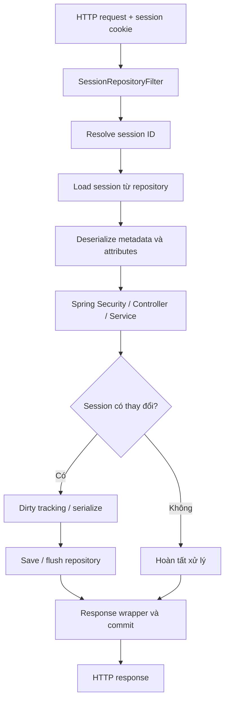

# Độ trễ tải, lưu phiên và phần chi phí trong một yêu cầu HTTP

Khi ứng dụng dùng Spring Session, một request HTTP có thể phát sinh thêm công việc ngoài xử lý controller: đọc session từ Redis/JDBC, deserialize attribute, cập nhật last-access time, serialize dữ liệu thay đổi và ghi session trở lại repository. Những thao tác này tiêu thụ thời gian CPU, network, connection pool và tài nguyên của store. Với request đơn giản, phần chi phí session có thể chiếm tỷ lệ đáng kể trong tổng latency; với request nặng, nó có thể bị che khuất bởi truy vấn nghiệp vụ hoặc gọi dịch vụ ngoài.

Muốn tối ưu đúng, cần đo riêng thời gian tải session, thời gian lưu session và các thành phần bên trong như chờ connection, query/Redis command, serialize và kích thước payload. Chỉ nhìn latency tổng của endpoint không cho biết session repository có phải nút thắt hay không. Ngược lại, chỉ đo thời gian Redis/JDBC cũng chưa đủ nếu phần lớn chi phí nằm ở serialize object lớn hoặc filter lifecycle.

## 1. Một request có thể trả chi phí session ở đâu?

Trong Servlet stack, `SessionRepositoryFilter` bọc request/response để thay `HttpSession` container bằng session do Spring Session quản lý. Khi ứng dụng cần session, filter/repository tìm session theo ID từ cookie. Khi session thay đổi, repository lưu dữ liệu theo chính sách flush/save và vòng đời request.



Đây là luồng khái quát. Việc tải có thể diễn ra khi session thực sự được truy cập, còn thời điểm lưu phụ thuộc `FlushMode`, repository implementation và response lifecycle. Không phải mọi request đều chắc chắn tải toàn bộ session; request không sử dụng session có thể tránh một số thao tác. Cần xác minh bằng trace và query/command thực tế của ứng dụng.

## 2. Phân rã latency của một request

Một cách nhìn hữu ích là phân rã thời gian request thành các thành phần:

\[
T_{request} = T_{queue} + T_{session-load} + T_{application} + T_{session-save} + T_{response}
\]

Trong đó:

- `T_queue`: thời gian chờ thread, connection hoặc tài nguyên trước khi xử lý.
- `T_session-load`: tìm session, đọc payload và khôi phục object.
- `T_application`: Spring Security, controller, service, truy vấn nghiệp vụ và gọi dịch vụ khác.
- `T_session-save`: xác định thay đổi, serialize và ghi repository.
- `T_response`: hoàn thiện response và truyền dữ liệu về client.

Đây là mô hình tư duy, không phải phép cộng chính xác cho mọi hệ thống. Một số công việc có thể chồng lấp hoặc được thực hiện ở thread khác; khi đo bằng distributed tracing cần tránh cộng hai lần cùng một khoảng thời gian.

Ví dụ một endpoint `/profile` có latency p95 là 120 ms. Trace cho thấy session load p95 18 ms, session save p95 12 ms, còn phần xử lý ứng dụng và response khoảng 90 ms. Nếu tối ưu repository làm session load/save giảm một nửa, mức cải thiện tối đa của endpoint vẫn bị giới hạn bởi phần còn lại. Đo tỷ trọng giúp chọn đúng nơi đầu tư.

## 3. Những thành phần tạo độ trễ khi tải session

Tải session thường gồm một số bước:

1. Đọc cookie hoặc resolver để lấy session ID.
2. Gọi repository `findById` hoặc thao tác tương đương.
3. Chờ connection pool nếu dùng JDBC hoặc chờ kết nối/client resource nếu dùng Redis.
4. Gửi lệnh qua network đến store.
5. Store tìm key/row, đọc metadata và attribute.
6. Truyền payload về ứng dụng.
7. Deserialize attribute thành object Java.
8. Kiểm tra expiration và cập nhật metadata theo repository semantics.

Không phải repository nào cũng thực hiện từng bước bằng một round-trip riêng. Redis repository có thể dùng một hoặc nhiều command tùy cấu trúc lưu trữ; JDBC repository có thể đọc metadata và attributes qua các query. Hãy đo số command/SQL thực tế, không giả định cố định “một request bằng một query”.

### Kích thước session ảnh hưởng trực tiếp

Session có 20 attribute nhỏ thường rẻ hơn session chứa một object lớn với danh sách hàng nghìn phần tử. Kích thước ảnh hưởng đến:

- Byte phải truyền giữa ứng dụng và store.
- CPU serialize/deserialize.
- Bộ nhớ tạm trong JVM.
- Thời gian xử lý Redis hoặc database.
- Garbage collection do tạo nhiều object.

Không lưu entity JPA, object graph lớn, ảnh, file, cache nghiệp vụ hoặc dữ liệu có thể truy vấn lại dễ dàng trong session. Nên lưu ID và trạng thái ngắn cần thiết cho luồng người dùng.

## 4. Những thành phần tạo độ trễ khi lưu session

Khi session thay đổi, Spring Session phải xác định dữ liệu cần lưu và ghi xuống repository. Chi phí có thể gồm:

- Theo dõi attribute đã được set hoặc remove.
- Serialize attribute được chọn.
- Chờ connection hoặc client resource.
- Thực thi Redis command hoặc SQL update/insert/delete.
- Cập nhật last-access time và expiration metadata.
- Cập nhật index principal hoặc cấu trúc phụ trợ nếu repository cần.
- Xử lý retry hoặc lỗi transaction.

Một request chỉ đổi `locale` nhưng session chứa object `cart` lớn có thể vẫn phải serialize nhiều dữ liệu nếu `SaveMode` hoặc repository strategy yêu cầu ghi nhiều attribute. Cần kiểm tra cả số attribute dirty và số byte ghi.

## 5. Redis và JDBC có profile chi phí khác nhau

| Thành phần | Spring Session Redis | Spring Session JDBC |
|---|---|---|
| Đường truy cập | Redis client, network, Redis command | JDBC pool, SQL, transaction và database |
| Chờ tài nguyên | Connection/client resource, event loop hoặc pool tùy client | Chờ connection từ HikariCP/DataSource |
| Tải dữ liệu | Đọc key/hash/structure theo repository implementation | Đọc row session và attributes theo schema/query |
| Lưu thay đổi | Redis write command, TTL và index | SQL insert/update/delete, index và transaction |
| Độ trễ thường bị ảnh hưởng bởi | Network RTT, Redis CPU, payload và command latency | Pool wait, query plan, lock, I/O và transaction |
| Expiration | TTL/expiration và cleanup/index behavior | `EXPIRY_TIME` và tác vụ cleanup |

Không có quy tắc rằng Redis luôn nhanh hơn JDBC trong mọi workload. Redis có thể chậm khi payload lớn, network xa hoặc instance quá tải; JDBC có thể đáp ứng tốt khi database đã được tối ưu và session load không quá cao. Đo trên topology thật và dữ liệu đại diện.

## 6. `SaveMode` quyết định phạm vi dữ liệu ghi

`SaveMode` ảnh hưởng đến tập attribute được ghi khi session save:

| Giá trị | Hành vi | Tác động hiệu năng |
|---|---|---|
| `ON_SET_ATTRIBUTE` | Đánh dấu attribute được set rõ ràng | Thường giảm ghi thừa nếu code gọi `setAttribute` sau khi thay đổi |
| `ON_GET_ATTRIBUTE` | Đánh dấu attribute đã đọc hoặc set | Hỗ trợ mutable object nhưng chỉ đọc nhiều cũng có thể làm tăng serialize/ghi |
| `ALWAYS` | Ghi tất cả attribute khi save | Đơn giản nhưng có thể tạo write amplification lớn |

Ví dụ cấu hình Redis Servlet:

```java
@Configuration
@EnableRedisHttpSession(
        saveMode = SaveMode.ON_SET_ATTRIBUTE,
        flushMode = FlushMode.ON_SAVE)
class SessionConfiguration {
}
```

Tên package và thuộc tính annotation phụ thuộc Spring Session version. Kiểm tra API đúng phiên bản trước khi sao chép cấu hình.

Với `ON_SET_ATTRIBUTE`, code nên ưu tiên thay object bằng giá trị mới và gọi `setAttribute`. Nếu lấy một `List` từ session rồi sửa tại chỗ mà không gọi lại `setAttribute`, thay đổi có thể không được đánh dấu như mong muốn. `ON_GET_ATTRIBUTE` hỗ trợ trường hợp này nhưng có thể ghi lại nhiều attribute chỉ đọc.

## 7. `FlushMode` quyết định thời điểm ghi

`FlushMode` điều khiển thời điểm thay đổi được đẩy xuống repository:

- `ON_SAVE`: gom thay đổi và ghi khi repository được gọi save, thường trong giai đoạn hoàn tất request/response.
- `IMMEDIATE`: đẩy thay đổi sớm hơn khi thao tác session phát sinh, tùy semantics repository.

`ON_SAVE` thường giảm số round-trip khi một request thay đổi nhiều attribute, vì có thể gom chúng vào lần lưu cuối. `IMMEDIATE` có thể làm dữ liệu được ghi sớm hơn nhưng tăng số lần I/O. Không nên chọn `IMMEDIATE` chỉ với giả định nó luôn nhanh hoặc bảo đảm durability tuyệt đối ngay khi setter trả về.

Hai chế độ không thay thế transaction hoặc optimistic locking. Nếu hai request cùng sửa một session, `IMMEDIATE` không tự ngăn lost update; nó chỉ thay đổi thời điểm ghi.

## 8. Ví dụ: một request thay đổi nhiều attribute

Giả sử request cập nhật ngôn ngữ, theme và bước checkout:

```java
@PostMapping("/profile/preferences")
void updatePreferences(HttpSession session) {
    session.setAttribute("locale", "vi-VN");
    session.setAttribute("theme", "dark");
    session.setAttribute("checkoutStep", 2);
}
```

Với `ON_SAVE`, repository có thể ghi các thay đổi tại thời điểm save cuối request. Với `IMMEDIATE`, các thao tác có thể phát sinh ghi sớm hơn và nhiều hơn. Chi phí thực tế phụ thuộc repository và cách Spring Session theo dõi attribute.

Nếu request có nhiều lần set cùng một attribute, tránh tạo và serialize object lớn nhiều lần không cần thiết. Gom logic cập nhật trong bộ nhớ rồi set giá trị cuối cùng khi phù hợp.

## 9. Session load có thể xảy ra dù controller không gọi `getSession()` trực tiếp

Các thành phần khác có thể truy cập session:

- Spring Security tải `SecurityContext` từ `HttpSessionSecurityContextRepository`.
- CSRF token repository có thể dùng session.
- Request cache lưu request ban đầu trước khi redirect login.
- MVC interceptor hoặc framework integration đọc session.
- Code tiện ích gọi `request.getSession()` trong filter hoặc view.

Vì vậy, endpoint trông như stateless có thể vẫn chạm session do filter chain. Nếu muốn endpoint thực sự stateless, cần cấu hình SecurityFilterChain và các thành phần liên quan theo stateless policy; chỉ tránh gọi `getSession()` trong controller là chưa đủ.

Khi điều tra, so sánh endpoint có/không có session cookie và theo dõi repository calls. Không suy luận từ code controller đơn lẻ.

## 10. Chi phí của session không thay đổi

Một request chỉ đọc session có thể không cần ghi toàn bộ attributes, nhưng repository vẫn có thể cập nhật last-access time hoặc expiration metadata. Điều này phụ thuộc repository và `FlushMode`.

Nếu session timeout được gia hạn theo hoạt động, một request đọc session vẫn có thể tạo thao tác ghi metadata/TTL. Vì thế, workload “chỉ đọc” ở tầng controller chưa chắc là read-only ở tầng repository.

Để đo chính xác:

- Theo dõi số lần `findById`, `save` và `deleteById`.
- Đếm SQL/Redis command liên quan session.
- Phân biệt ghi attribute với cập nhật metadata/expiration.
- So sánh request không gửi cookie, request có cookie nhưng không truy cập session và request đọc attribute.
- Kiểm tra semantics `lastAccessedTime` của repository đang dùng.

## 11. Instrument repository bằng Micrometer

Micrometer `Timer` có thể đo thời gian gọi repository. Một decorator minh họa:

```java
import io.micrometer.core.instrument.MeterRegistry;
import io.micrometer.core.instrument.Timer;
import org.springframework.session.Session;
import org.springframework.session.SessionRepository;

class TimedSessionRepository<S extends Session>
        implements SessionRepository<S> {

    private final SessionRepository<S> delegate;
    private final MeterRegistry registry;
    private final Timer findTimer;
    private final Timer saveTimer;
    private final Timer deleteTimer;

    TimedSessionRepository(SessionRepository<S> delegate,
                           MeterRegistry registry) {
        this.delegate = delegate;
        this.registry = registry;
        this.findTimer = Timer.builder("app.session.repository")
                .tag("operation", "find")
                .register(registry);
        this.saveTimer = Timer.builder("app.session.repository")
                .tag("operation", "save")
                .register(registry);
        this.deleteTimer = Timer.builder("app.session.repository")
                .tag("operation", "delete")
                .register(registry);
    }

    @Override
    public S createSession() {
        return delegate.createSession();
    }

    @Override
    public S findById(String id) {
        Timer.Sample sample = Timer.start(registry);
        try {
            return delegate.findById(id);
        }
        finally {
            sample.stop(findTimer);
        }
    }

    @Override
    public void save(S session) {
        Timer.Sample sample = Timer.start(registry);
        try {
            delegate.save(session);
        }
        finally {
            sample.stop(saveTimer);
        }
    }

    @Override
    public void deleteById(String id) {
        Timer.Sample sample = Timer.start(registry);
        try {
            delegate.deleteById(id);
        }
        finally {
            sample.stop(deleteTimer);
        }
    }
}
```

Đây là decorator minh họa cho `SessionRepository` đồng bộ. Cách đăng ký wrapper phụ thuộc auto-configuration và repository bean của ứng dụng; tránh tạo vòng lặp khi delegate vô tình trỏ lại chính decorator. Với repository reactive, dùng `Mono`/`Flux` instrumentation và đo thời gian từ subscription đến terminal signal, không đo lúc tạo publisher.

Timer trên đo thời gian lời gọi repository từ ứng dụng, có thể bao gồm client wait, network và xử lý repository. Nó không tự tách thời gian serialize khỏi thời gian store. Muốn phân tách sâu hơn, cần instrumentation tại client/driver hoặc trace span riêng.

Không thêm `sessionId`, username, email hoặc tenant ID làm metric tag. Các giá trị đó tạo cardinality cao và có thể tiết lộ dữ liệu nhạy cảm. Tag chỉ nên là tập hữu hạn như operation, store type và outcome.

## 12. Đo latency bằng distributed tracing

Một trace HTTP có thể có các span hoặc event sau:

```text
HTTP GET /profile
  ├─ security.filter-chain
  ├─ spring-session.load
  │    ├─ redis command / JDBC acquire
  │    └─ deserialize attributes
  ├─ controller.profile
  │    └─ user-service / business query
  └─ spring-session.save
       ├─ serialize dirty attributes
       └─ redis command / JDBC update
```

Tên span chỉ là gợi ý. Spring Boot/Micrometer Observation có thể cung cấp instrumentation cho một số thành phần, nhưng không nên giả định mọi phiên bản Spring Session đều tự tạo span riêng cho load/save. Có thể bổ sung Observation/Timer quanh repository hoặc client nếu cần.

Trace nên giúp trả lời:

- Session load bắt đầu và kết thúc ở đâu?
- Thời gian chờ connection chiếm bao nhiêu?
- Redis/JDBC command mất bao lâu?
- Deserialize/serialize có chiếm CPU đáng kể không?
- Save có nằm trên critical path trước response commit không?
- Request nào không truy cập session nhưng vẫn bị filter/security chain tạo session?

Sampling cần phù hợp với lưu lượng và chi phí telemetry. Không đưa cookie, session ID hoặc serialized session vào span attribute. Nếu cần liên kết log, dùng trace ID hoặc correlation ID.

## 13. Các metric nên theo dõi

### Tầng HTTP

- Request rate và response status.
- p50, p95, p99 latency theo endpoint hoặc nhóm endpoint.
- Số request timeout và lỗi 5xx.
- Thread pool queue và request concurrency.

### Tầng Spring Session

- Số lần load/save/delete trên mỗi request.
- Latency của `findById`, `save` và `deleteById`.
- Tỷ lệ session not-found, expired và repository error.
- Kích thước session, số attribute và số byte serialize/ghi nếu đo được.
- Số lần serialize/deserialize lỗi.
- Tỷ lệ request tạo session mới.

### Tầng Redis

- Command latency và command rate.
- CPU, memory, network throughput.
- Connected clients, blocked clients và pool/client saturation.
- Eviction, expired keys và replication lag nếu có.
- Latency theo command liên quan session.

### Tầng JDBC/database

- Hikari active, idle, pending và acquisition time.
- Query latency, rows read/written và top SQL.
- Lock wait, deadlock và transaction duration.
- Connection timeout, database CPU và I/O.
- Cleanup duration và số session/attribute được xóa.

Đo metric theo node và tổng hợp toàn cụm. Một node có thể chậm do pool riêng bị cạn dù database tổng thể chưa đạt giới hạn; ngược lại mọi node có thể cùng chậm do store quá tải.

## 14. Percentile quan trọng hơn chỉ nhìn trung bình

Session load trung bình 3 ms không có nghĩa mọi request đều nhanh. Một số request có session lớn hoặc store chậm có thể mất 100 ms và làm p99 tăng.

| Chỉ số | Cách đọc |
|---|---|
| p50 | Request điển hình ở giữa phân bố |
| p95 | 5% request chậm hơn ngưỡng này |
| p99 | 1% request chậm hơn ngưỡng này; hữu ích cho tail latency |
| max | Giá trị lớn nhất quan sát được, nhạy với outlier |
| mean | Trung bình; có thể che khuất tail latency |

Không cộng p95 của session load với p95 của session save rồi gọi đó là p95 request; percentile của tổng không bằng tổng percentile thành phần. Dùng trace hoặc histogram cùng request correlation để hiểu phân bố tổng thể.

## 15. Tính phần chi phí session trong request

Trong workload đồng bộ, có thể ước lượng phần thời gian session bằng:

\[
R_{session} = \frac{T_{load} + T_{save}}{T_{request}} \times 100\%
\]

Ví dụ một endpoint có thời gian trung vị 50 ms, trong đó load 4 ms và save 6 ms. Phần session chiếm khoảng 20% ở median theo các số đo này. Nếu endpoint khác mất 500 ms do gọi dịch vụ ngoài, cùng 10 ms session chỉ chiếm 2%.

Chỉ so sánh các phép đo cùng request population và cùng percentile. Không lấy median session time chia cho p99 request time. Nếu span chồng lấp hoặc session save chạy trong async task, cần xác định critical path thay vì cộng thời lượng một cách máy móc.

## 16. Tối ưu kích thước session

Session nhỏ thường giúp giảm cả load và save. Một số cách:

- Lưu ID thay vì toàn bộ entity hoặc object graph.
- Lưu dữ liệu UI ngắn hạn, không lưu kết quả truy vấn lớn có thể tải lại.
- Dọn attribute không còn cần sau khi hoàn tất luồng.
- Dùng DTO nhỏ và cấu trúc dễ serialize.
- Tránh collection không giới hạn như lịch sử thao tác hoặc danh sách sản phẩm lớn.
- Đặt giới hạn số lượng phần tử cho cart/recent items và chỉ lưu thông tin cần thiết.
- Không lưu stream, file, socket, connection hoặc object gắn với request.

Đo kích thước session thực tế theo phân bố, không chỉ xem một session mẫu. Theo dõi p50/p95/p99 bytes và số attribute để phát hiện một số session bất thường lớn.

## 17. Giảm số lần truy cập session

Không gọi `request.getSession()` hoặc `request.getSession(true)` một cách vô thức trong mọi filter/controller. Nếu chỉ cần đọc, dùng `getSession(false)` để tránh tạo session mới khi chưa có. Không tạo session cho endpoint stateless như health check hoặc webhook nếu không cần.

Kiểm tra các thành phần tự động truy cập session:

- Spring Security context persistence.
- CSRF token repository.
- Request cache.
- Flash attributes và MVC redirect flow.
- Custom interceptor/filter.
- Template/view helper.

Nếu endpoint không cần session, cấu hình SecurityFilterChain stateless phù hợp và bảo đảm các thành phần khác không tạo session ngoài ý muốn. Đừng đổi toàn ứng dụng sang stateless chỉ để giảm một query nếu các luồng form login cần session.

## 18. Tối ưu truy cập Redis

Với Redis:

- Đặt Redis gần application region/zone để giảm network RTT.
- Dùng connection pool/client phù hợp với concurrency và client implementation.
- Theo dõi command latency, network và payload size.
- Tránh session payload lớn khiến command transfer và serialization tốn thời gian.
- Chọn serializer hiệu quả nhưng vẫn an toàn và tương thích version.
- Không dùng Redis scan toàn bộ key session trên request path.
- Kiểm tra eviction policy và memory headroom để tránh mất session ngoài dự kiến.
- Theo dõi replication lag nếu đọc từ replica; session cần read-after-write consistency phù hợp.

Không gộp nhiều thao tác thành script tùy chỉnh nếu chưa hiểu semantics expiration, index và concurrency của repository. Một tối ưu command có thể phá vỡ TTL hoặc principal index nếu bỏ qua thao tác phụ.

## 19. Tối ưu truy cập JDBC

Với JDBC:

- Dùng database dialect/schema đúng và tạo index theo query repository.
- Theo dõi Hikari acquisition time và connection usage duration.
- Giữ transaction ngắn, không giữ connection trong khi gọi dịch vụ ngoài.
- Kiểm tra execution plan cho query theo session ID, expiry và principal.
- Theo dõi lock wait, deadlock và cleanup query.
- Tính tổng `maximumPoolSize` của tất cả node, không chỉ một JVM.
- Dùng batch/cleanup có giới hạn nếu implementation hỗ trợ và phù hợp.
- Tránh lưu session attribute quá lớn khiến serialization và SQL payload tăng.

Không tăng pool vô hạn khi acquisition time cao. Nếu database CPU/lock đã quá tải, thêm connection có thể làm throughput giảm. Tìm query chậm và transaction dài trước khi thay pool size.

## 20. Đo hiệu năng bằng workload đại diện

Benchmark nên có nhiều nhóm request:

1. Không gửi session cookie và không tạo session.
2. Có cookie nhưng endpoint không đọc attribute.
3. Đọc một attribute nhỏ.
4. Đọc session có nhiều attribute.
5. Thay đổi một attribute nhỏ.
6. Thay đổi nhiều attribute trong một request.
7. Session có payload lớn.
8. Logout/invalidate và delete.
9. Request đồng thời dùng cùng session ID.
10. Nhiều node cùng truy cập store.

Với từng nhóm, đo request rate, p50/p95/p99, CPU, allocation/GC, số repository operations, command/SQL rate và store latency. Thực hiện warm-up, chạy đủ lâu để ổn định và giữ cố định dataset/cấu hình khi so sánh.

Đừng chỉ benchmark một request tuần tự. Spring Session thường được dùng dưới tải đồng thời; connection pool, lock, network queue và contention chỉ hiện rõ khi concurrency tăng.

## 21. Ví dụ kế hoạch so sánh `SaveMode` và `FlushMode`

Có thể chạy cùng workload với một số cấu hình:

| Thử nghiệm | SaveMode | FlushMode | Câu hỏi |
|---|---|---|---|
| A | `ON_SET_ATTRIBUTE` | `ON_SAVE` | Baseline khi code set attribute rõ ràng |
| B | `ON_GET_ATTRIBUTE` | `ON_SAVE` | Chi phí khi attribute được đọc nhiều |
| C | `ALWAYS` | `ON_SAVE` | Write amplification khi ghi mọi attribute |
| D | `ON_SET_ATTRIBUTE` | `IMMEDIATE` | Tác động của flush sớm và số round-trip |

Giữ nguyên kích thước session, số attribute, request mix, node count và store version. So sánh:

- Session save latency.
- Repository operations/request.
- Redis command hoặc SQL statement/request.
- Serialized bytes/request.
- HTTP p95/p99.
- CPU và allocation rate.
- Store CPU/IO và connection pool wait.

Không chọn cấu hình chỉ dựa vào benchmark micro của một method. Cần xác nhận endpoint thật và semantics khi lỗi hoặc request đồng thời.

## 22. Kiểm thử và giám sát regression

Khi thay đổi serializer, session model, repository hoặc timeout, cần so sánh với baseline trước thay đổi. Đặt ngưỡng cảnh báo cho p95/p99 session load/save và request latency, nhưng tránh alert theo một mẫu ngắn hoặc một outlier.

Một quy trình regression:

1. Chạy integration test Redis/JDBC để xác nhận chức năng.
2. Chạy benchmark workload đại diện với cấu hình baseline.
3. Thay đổi một yếu tố tại một thời điểm.
4. Đo lại cùng môi trường và dataset.
5. So sánh latency, throughput, bytes, CPU, GC và store load.
6. Chạy kiểm thử đồng thời và multi-node để bảo đảm tối ưu không làm mất cập nhật.
7. Triển khai canary và theo dõi production metrics trước rollout toàn bộ.

Không giảm timeout hoặc bỏ ghi session chỉ để cải thiện latency nếu điều đó làm sai semantics đăng nhập hoặc mất trạng thái nghiệp vụ.

## 23. Các lỗi thường gặp

| Hiện tượng | Nguyên nhân có thể | Hướng điều tra |
|---|---|---|
| Endpoint đơn giản vẫn chậm khi có cookie | Security/CSRF/request cache tải session | So sánh request có và không có cookie; trace filter chain |
| Load nhanh nhưng save chậm | Serialize lớn, dirty tracking rộng hoặc store write chậm | Đo save riêng, bytes và command/SQL |
| Save latency tăng khi số attribute tăng | `ALWAYS`/`ON_GET_ATTRIBUTE` hoặc session payload lớn | Đo attribute dirty và kích thước session |
| p99 cao nhưng median ổn | Store queue, pool wait, lock hoặc session outlier lớn | Phân tích percentile và trace chậm |
| Redis CPU thấp nhưng session latency cao | Network RTT, client pool hoặc payload transfer | Đo client wait và network RTT |
| JDBC pool pending tăng | Query chậm, connection giữ lâu hoặc pool quá nhỏ | Xem Hikari metrics, query plan và transaction |
| Request đọc session vẫn ghi store | Last-access/expiration metadata được cập nhật | Đếm SQL/Redis command thực tế |
| Tối ưu `IMMEDIATE` làm request chậm hơn | Nhiều lần ghi trong một request | So sánh command count với `ON_SAVE` |
| Tăng pool nhưng latency xấu hơn | Database quá tải hoặc lock contention | Kiểm tra DB CPU, lock và active query |
| Session mất sau tối ưu SaveMode | Mutable object không được đánh dấu dirty | Gọi lại `setAttribute` hoặc chọn mode phù hợp |

## 24. Checklist hiệu năng

- Đo riêng latency `findById`, `save`, `deleteById`.
- Đo cả HTTP p50/p95/p99 và phần session trên critical path.
- Theo dõi số lần repository operation trên mỗi request.
- Đo kích thước session, số attribute và bytes serialize.
- Xác định filter/security component nào truy cập session.
- Chọn `SaveMode` phù hợp với cách code thay đổi attribute.
- Chọn `FlushMode` theo yêu cầu latency và số lần I/O.
- Với Redis, đo command latency, network, client saturation và memory.
- Với JDBC, đo pool wait, query plan, lock và transaction duration.
- Không dùng session ID hoặc principal làm metric label.
- Benchmark với session size, request mix, concurrency và số node gần production.
- Kiểm thử regression chức năng và race condition sau mỗi tối ưu.

Độ trễ session là tổng của tải dữ liệu, deserialize, xử lý thay đổi, serialize và ghi repository, cộng với thời gian chờ tài nguyên ở Redis/JDBC. `SaveMode` ảnh hưởng lượng dữ liệu cần ghi; `FlushMode` ảnh hưởng thời điểm và số lần ghi. Đo riêng load/save bằng metric và trace, kết hợp percentile HTTP, kích thước session và chỉ số store, sẽ cho biết chi phí thực sự nằm ở đâu. Tối ưu hiệu quả thường bắt đầu bằng session nhỏ, ít truy cập không cần thiết, dirty tracking đúng và connection/query được cấu hình theo workload; mọi thay đổi cần được benchmark và kiểm tra lại tính đúng đắn khi nhiều request cùng hoạt động.
