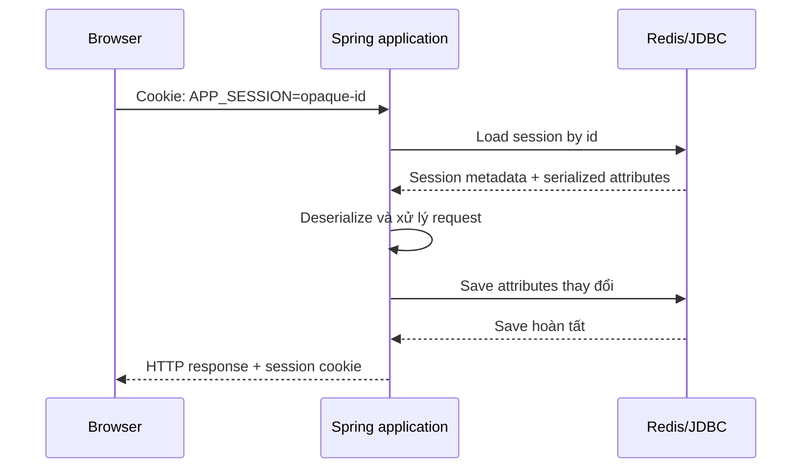

# Kích thước thuộc tính, chi phí serializer và lưu lượng truyền dữ liệu

Spring Session lưu trạng thái phiên ngoài bộ nhớ của một instance, thường trong Redis hoặc JDBC. Mỗi attribute được đưa vào `HttpSession` hoặc `WebSession` có thể làm tăng dung lượng lưu trữ, chi phí serialize/deserialize, số byte truyền giữa ứng dụng và kho dữ liệu, cũng như thời gian xử lý request. Một session chứa vài ID và cờ trạng thái có đặc tính hiệu năng rất khác session chứa cả object graph lớn, danh sách hàng nghìn phần tử hoặc ảnh được mã hóa Base64.

Tối ưu hiệu năng vì vậy bắt đầu bằng việc đo kích thước dữ liệu thực tế và tần suất đọc/ghi. Cần phân biệt dữ liệu session được truyền giữa ứng dụng và Redis/JDBC với cookie session ID được gửi giữa browser và ứng dụng: thông thường browser chỉ gửi session ID, không gửi toàn bộ attributes. Giảm kích thước attributes chủ yếu giảm chi phí ở server và session store; nó không tự động làm request HTTP từ browser nhỏ đi ngoài phần cookie/metadata.

## 1. Những loại chi phí do session attributes tạo ra

Một attribute có thể phát sinh nhiều chi phí trong suốt vòng đời request:

1. **Bộ nhớ heap:** object và các object được tham chiếu nằm trong JVM khi session được tải.
2. **Serialization:** chuyển object graph thành byte hoặc dạng lưu trữ của repository.
3. **Deserialization:** dựng lại object khi session được tải ở request tiếp theo hoặc instance khác.
4. **Lưu trữ:** Redis giữ key/hash và metadata; JDBC lưu hàng session cùng các hàng attributes.
5. **Network I/O:** ứng dụng truyền dữ liệu đã serialize qua mạng tới Redis/database và nhận dữ liệu khi đọc.
6. **CPU và GC:** object lớn làm tăng cấp phát, copy buffer, thời gian xử lý và áp lực garbage collector.
7. **Replication/backup:** dữ liệu lớn có thể làm tăng lưu lượng replica, snapshot, backup và thời gian phục hồi.

Kích thước không phải yếu tố duy nhất. Một attribute nhỏ nhưng bị serialize lại ở mọi request có thể đắt hơn một attribute lớn nhưng hiếm khi thay đổi. Một session trung bình nhỏ nhưng p99 rất lớn cũng có thể tạo spike latency và memory pressure.

## 2. Browser thường chỉ gửi session ID

Với mô hình server-side session, cookie thường chứa một session ID opaque. Khi request tới ứng dụng, `SessionRepositoryFilter` dùng ID đó để tải session từ repository. Các attributes nằm ở Redis/JDBC, không được nhúng toàn bộ vào cookie.



Do đó, một session có 200 KB attributes không nhất thiết làm mọi request browser gửi thêm 200 KB. Nhưng nếu mỗi request cần tải và deserialize toàn bộ session, dữ liệu lớn vẫn làm tăng chi phí phía server và lưu lượng nội bộ. Cookie vẫn có giới hạn kích thước riêng; không nên đưa dữ liệu session vào cookie như một cách thay thế repository nếu chưa đánh giá lại toàn bộ mô hình bảo mật và kích thước header.

## 3. Mô hình chi phí gần đúng

Có thể dùng một mô hình đơn giản để xác định yếu tố cần đo:

```text
Dung lượng session store
  ≈ số session đang hoạt động
    × (bytes attributes đã serialize + metadata + index overhead)

Lưu lượng session store mỗi giây
  ≈ request/giây
    × (bytes đọc trung bình/request + bytes ghi trung bình/request)

CPU serialization mỗi giây
  ≈ số lần serialize/deserialize mỗi giây
    × CPU time trung bình mỗi lần
```

Đây là mô hình ước lượng, không phải công thức dung lượng chính xác. Redis encoding, key/hash metadata, JDBC row/page overhead, index, replication và batching tạo thêm chi phí. Một request cũng có thể không đọc session, chỉ đọc một phần theo implementation, hoặc lưu nhiều lần tùy `FlushMode` và cách code truy cập session.

Để so sánh hai phiên bản, đo cùng một workload, cùng repository, cùng số session và cùng phân bố kích thước. Không kết luận serializer mới nhanh hơn chỉ từ kích thước file JSON mẫu.

## 4. Attribute lớn thường đến từ object graph không cần thiết

Các nguồn làm session phình to thường gặp:

- Lưu toàn bộ JPA entity thay vì ID hoặc DTO nhỏ.
- Lưu danh sách kết quả tìm kiếm hoặc hàng nghìn dòng dữ liệu.
- Lưu ảnh, file, PDF hoặc chuỗi Base64.
- Lưu toàn bộ giỏ hàng thay vì `cartId`.
- Lưu principal chứa hồ sơ người dùng, quyền và quan hệ lồng nhau không cần thiết.
- Lưu object có tham chiếu vòng, cache nội bộ hoặc collection lớn.
- Lưu nhiều bản sao cùng dữ liệu dưới các attribute khác nhau.

Ví dụ, thay vì:

```java
session.setAttribute("customer", customerEntity);
session.setAttribute("cart", fullCartWithProductDetails);
session.setAttribute("searchResults", allSearchResults);
```

hãy lưu các tham chiếu nhỏ:

```java
session.setAttribute("customerId", customerId);
session.setAttribute("cartId", cartId);
session.setAttribute("searchContextId", searchContextId);
```

Khi cần dữ liệu, tải từ service hoặc database nghiệp vụ với kiểm tra quyền. Cách này có thể thêm một truy vấn nghiệp vụ, nhưng tránh serialize và truyền lặp lại một object graph lớn ở mọi lần lưu session. Cần đo tổng chi phí; không nên chuyển mọi attribute thành một truy vấn riêng nếu việc đó tạo N+1 query hoặc làm request chậm hơn.

## 5. Chọn dữ liệu phù hợp để đưa vào session

Session nên chứa trạng thái nhỏ, cần thiết để điều phối request kế tiếp:

| Dữ liệu | Khuyến nghị | Lý do |
|---|---|---|
| `userId` hoặc subject | Thường phù hợp | Nhỏ, dùng để tra cứu dữ liệu nguồn |
| `SecurityContext` | Theo mô hình xác thực | Cần cho session-based authentication, nhưng principal nên gọn |
| `cartId`/`checkoutId` | Thường phù hợp | Tham chiếu tới dữ liệu nghiệp vụ |
| Ngôn ngữ/giao diện | Phù hợp nếu cần | Dữ liệu nhỏ và ít thay đổi |
| Danh sách hàng nghìn sản phẩm | Tránh | Tăng heap, serialize và lưu lượng |
| Entity ORM có quan hệ | Tránh | Proxy, lazy loading và schema coupling |
| Ảnh/file/Base64 | Không phù hợp | Dữ liệu lớn; lưu ở object storage và giữ ID |
| Cache kết quả API lớn | Thường không | Dùng cache chuyên dụng với TTL và giới hạn kích thước |
| Password/OTP/token thô | Tránh | Tăng rủi ro bảo mật, không phải tối ưu hóa hiệu năng |

Một attribute có thể nhỏ ở dạng object nhưng tạo object graph lớn qua các tham chiếu. Hãy đo kích thước serialized bytes và xem xét nội dung tham chiếu, không chỉ nhìn số field trong class.

## 6. Kích thước object không bằng kích thước serialized

`Object` trong heap có overhead riêng: header, alignment, reference, collection capacity và các object được tham chiếu. Kích thước serialized phụ thuộc serializer và cách biểu diễn dữ liệu. Ví dụ:

- Một `ArrayList` có thể giữ capacity lớn hơn số phần tử thực tế.
- Một object có nhiều reference có thể kéo theo cả graph lớn.
- JSON có thể lặp tên field và biểu diễn số/chuỗi dưới dạng text.
- Java serialization có metadata về class và object handle.
- Một serializer có thể nén hoặc mã hóa, làm byte size thay đổi.

Vì vậy, không dùng `Instrumentation.getObjectSize()` trên object gốc làm số byte truyền qua Redis/JDBC. Phép đo đó không bao gồm toàn bộ object graph và không phản ánh serializer thực tế. Hãy đo bằng chính serializer hoặc conversion mechanism đang cấu hình cho repository.

## 7. Đo kích thước bằng serializer thực tế

Với Spring Session Redis, có thể dùng bean `RedisSerializer<Object>` mà ứng dụng cấu hình cho Spring Session để đo byte của từng attribute. Ví dụ minh họa:

```java
@Component
class SessionAttributeSizer {

    private final RedisSerializer<Object> serializer;

    SessionAttributeSizer(
            @Qualifier("springSessionDefaultRedisSerializer")
            RedisSerializer<Object> serializer) {
        this.serializer = serializer;
    }

    int serializedSize(Object value) {
        byte[] bytes = this.serializer.serialize(value);
        return bytes == null ? 0 : bytes.length;
    }
}
```

Bean name và cách cấu hình serializer cần khớp phiên bản Spring Session Redis đang dùng. Đừng tạo một serializer riêng chỉ để benchmark nếu repository dùng serializer khác; kết quả khi đó không phản ánh bytes thực tế.

Có thể đo từng attribute trong test hoặc môi trường profiling:

```java
for (Map.Entry<String, Object> entry : session.getAttributeNames().stream()
        .collect(Collectors.toMap(
                Function.identity(), session::getAttribute))
        .entrySet()) {
    int size = sizer.serializedSize(entry.getValue());
    System.out.printf("attribute=%s bytes=%d%n", entry.getKey(), size);
}
```

Đoạn mã chỉ minh họa trong test; việc đọc tất cả attributes có thể đánh dấu chúng là đã truy cập tùy `SaveMode` và implementation. Không ghi tên attribute nhạy cảm hoặc nội dung value ra log production. Trong production, ưu tiên metric tổng hợp theo nhóm attribute đã cho phép, hoặc thực hiện sampling có kiểm soát.

Tổng kích thước từng attribute không nhất thiết bằng tổng payload lưu thực tế: repository còn metadata, session ID, timestamps, expiry, index và encoding của Redis/JDBC. Hãy đo thêm tổng bytes theo key/session hoặc row khi môi trường test cho phép.

## 8. Serializer ảnh hưởng CPU, kích thước và tương thích

Serializer quyết định cách object được chuyển thành dữ liệu lưu trữ. Một số lựa chọn phổ biến có đặc tính khác nhau:

| Lựa chọn | Ưu điểm | Đánh đổi |
|---|---|---|
| Java native serialization | Có thể serialize object Java `Serializable`; ít cấu hình ban đầu | Coupling class/version, payload khó quan sát, rủi ro khi deserialize dữ liệu không tin cậy |
| JSON serializer | Dễ quan sát và trao đổi giữa ngôn ngữ; schema có thể rõ ràng | Có thể verbose hơn, cần quản lý type/schema và cấu hình polymorphism an toàn |
| Serializer nhị phân theo schema | Payload gọn và schema có thể kiểm soát | Cần quản lý schema/version và công cụ debug |
| Serializer có nén | Giảm bytes lưu/truyền khi dữ liệu có thể nén | Tốn CPU, tăng latency và phức tạp tương thích |

Không có serializer nhanh nhất cho mọi dữ liệu. JSON có thể lớn hơn nhưng giảm coupling; định dạng nhị phân có thể nhỏ hơn nhưng cần schema; nén có lợi với text lặp lại nhưng ít lợi với dữ liệu đã nén như JPEG/ZIP.

Khi đổi serializer, mọi instance cùng đọc/ghi repository phải tương thích trong giai đoạn rolling deployment. Không triển khai một node ghi format mới trong khi node khác chỉ đọc được format cũ nếu cả hai cùng namespace. Có thể cần dual-read migration hoặc namespace version mới.

## 9. Cấu hình serializer cho Redis Session

Spring Session Redis cho phép ứng dụng cung cấp serializer mặc định qua bean có tên theo contract của phiên bản, thường là `springSessionDefaultRedisSerializer`. Ví dụ minh họa với JSON serializer:

```java
@Configuration
class SessionSerializationConfiguration {

    @Bean("springSessionDefaultRedisSerializer")
    RedisSerializer<Object> springSessionDefaultRedisSerializer() {
        return new GenericJackson2JsonRedisSerializer();
    }
}
```

Đây là ví dụ khởi đầu. Trong ứng dụng thực tế, cần cấu hình Jackson modules, type metadata và allowlist type theo yêu cầu của các attributes đang lưu. Không bật default typing rộng cho dữ liệu lấy từ Redis nếu không có kiểm soát type an toàn. Cần kiểm thử `serialize` rồi `deserialize` cho principal, SecurityContext và DTO của ứng dụng.

Với JDBC, cách chuyển attributes sang cột lưu trữ phụ thuộc `JdbcIndexedSessionRepository`, `ConversionService` và phiên bản Spring Session. Đừng giả định bean Redis serializer cũng được JDBC repository sử dụng. Hãy kiểm tra contract serialization của JDBC implementation và cấu hình riêng theo API được hỗ trợ.

## 10. SaveMode và số lượng attributes được ghi

`SaveMode` ảnh hưởng attributes nào được lưu khi session được save. Các chế độ thường gặp:

- `ON_SET_ATTRIBUTE`: ghi những attributes được đặt bằng API session trong request.
- `ON_GET_ATTRIBUTE`: có thể ghi cả attributes đã được truy cập, tùy semantics implementation.
- `ALWAYS`: ghi toàn bộ attributes.

Tên và chi tiết hành vi cần đối chiếu phiên bản Spring Session đang dùng. Điều quan trọng là `ON_SET_ATTRIBUTE` có thể giảm lượng serialization/ghi khi session chứa nhiều attributes nhưng request chỉ sửa một phần nhỏ. Tuy nhiên, nếu code sửa trực tiếp một object mutable lấy từ session mà không gọi `setAttribute` lại, repository có thể không nhận biết thay đổi.

Ví dụ:

```java
CartState cart = (CartState) session.getAttribute("cart");
cart.add(item);
// Không nhất thiết được nhận diện là attribute đã thay đổi.

session.setAttribute("cart", cart);
// Đánh dấu lại attribute theo API session.
```

Nếu `cart` lớn, mỗi lần set lại có thể serialize toàn bộ object graph. Tốt hơn là lưu `cartId` trong session và cập nhật giỏ hàng ở service/database riêng nếu nghiệp vụ cần dữ liệu lớn hoặc cập nhật thường xuyên.

## 11. FlushMode và thời điểm truyền dữ liệu

`FlushMode` điều khiển khi nào thay đổi session được flush xuống repository. Tùy repository và phiên bản, `ON_SAVE` thường gom thay đổi đến lúc save ở cuối request; `IMMEDIATE` có thể đẩy thay đổi ngay khi chúng xảy ra.

| Chế độ | Hành vi tổng quát | Ảnh hưởng hiệu năng |
|---|---|---|
| `ON_SAVE` | Ghi khi session được save ở điểm lifecycle | Có cơ hội gom thay đổi và giảm round trip |
| `IMMEDIATE` | Ghi ngay khi thay đổi được thực hiện | Có thể tăng số lệnh/round trip nếu request sửa nhiều lần |

`ON_SAVE` có thể giảm số lần ghi nhưng dữ liệu chỉ được lưu khi request hoàn tất theo lifecycle. `IMMEDIATE` có thể phù hợp khi cần flush sớm, nhưng không có nghĩa toàn bộ nghiệp vụ được transaction nguyên tử. Hãy đo số lệnh Redis hoặc số câu SQL, thời gian response và hành vi khi request lỗi giữa chừng.

Đừng đổi FlushMode chỉ để giảm latency mà không kiểm tra semantics. Nếu request thay đổi một attribute nhiều lần, batch cuối request có thể chỉ ghi trạng thái cuối; immediate flush có thể gửi nhiều phiên bản trung gian.

## 12. Redis: payload, hash fields và round trips

Redis repository thường lưu session dưới dạng cấu trúc key/hash cùng các key/index phụ trợ. Các attributes được serialize thành value; metadata như creation time, last access time và max inactive interval cũng được lưu để quản lý expiry.

Chi phí thực tế gồm:

- Kích thước serialized value của mỗi attribute.
- Số lượng attributes và số lần thay đổi.
- Số lệnh Redis/round trips trong request.
- TTL và metadata/index key phụ trợ.
- Replication traffic và persistence/AOF/RDB overhead.
- Latency mạng giữa application và Redis.

Một attribute 100 KB được ghi ở mọi request có thể tạo lưu lượng lớn hơn một attribute 500 KB chỉ được ghi một lần khi tạo session. Cần đo bytes/request và write frequency, không chỉ đo kích thước session tại một thời điểm.

Không tự thao tác trực tiếp cấu trúc key nội bộ của Spring Session bằng Redis command trong code nghiệp vụ. Format key, hash field, expiration marker và index có thể thay đổi theo repository/version. Dùng `SessionRepository` và API hỗ trợ.

## 13. JDBC: attributes table và chi phí truy vấn

Spring Session JDBC thường tách metadata session và attributes thành các bảng. Một session có thể tương ứng một hàng metadata và nhiều hàng attributes. Kích thước attributes ảnh hưởng dung lượng BLOB/serialized column, I/O, buffer, transaction log và backup.

Các yếu tố cần đo:

- Số hàng attributes trung bình mỗi session.
- Tổng bytes serialized trong các cột attribute.
- Kích thước hàng metadata và index.
- Số truy vấn load/save/delete trong mỗi request.
- Lock duration, transaction time và connection pool wait.
- Chi phí cleanup hàng hết hạn và index liên quan.

Nếu session có nhiều attributes, repository có thể phải đọc nhiều hàng để dựng session. Nếu mỗi request chỉ thay đổi một attribute nhưng save policy khiến toàn bộ attributes được ghi lại, lượng I/O có thể tăng. Kiểm tra SQL thực tế và execution plan thay vì giả định chỉ có một câu lệnh cập nhật nhỏ.

Không tối ưu bằng cách tự sửa bảng session ngoài repository nếu không nắm đầy đủ quan hệ attributes, expiry và index. Các thao tác SQL thủ công có thể làm dữ liệu không nhất quán hoặc bỏ qua event.

## 14. Tính tổng lưu lượng theo tần suất request

Giả sử một session có 40 KB serialized attributes. Nếu 100 request/giây đều tải toàn bộ session, lượng đọc lý thuyết có thể xấp xỉ 4 MB/s trước overhead. Nếu mỗi request cũng ghi lại toàn bộ 40 KB, lượng ghi có thể tương tự. Con số thật phụ thuộc implementation, compression, caching, `SaveMode`, `FlushMode` và số attributes thực sự được tải/ghi.

Đây là lý do cần đo:

- Bytes đọc mỗi request.
- Bytes ghi mỗi request.
- Tỷ lệ request có session và tỷ lệ request thay đổi session.
- Số lần serialize/deserialize.
- Số command/SQL statement và round trip.
- Phân bố kích thước p50/p95/p99.

Một session lớn không phải lúc nào cũng gây vấn đề nếu rất ít request truy cập nó. Một session vừa phải nhưng được đọc/ghi trên mọi API request có thể tạo tải đáng kể.

## 15. Đo kích thước và thời gian serialization

Benchmark nên tách ít nhất ba thao tác:

1. Serialize object/attribute sang byte.
2. Deserialize byte về object.
3. Lưu và tải session qua repository thật.

Ví dụ đo trong test/profiling:

```java
long start = System.nanoTime();
byte[] payload = serializer.serialize(attributeValue);
long serializeNanos = System.nanoTime() - start;

start = System.nanoTime();
Object restored = serializer.deserialize(payload);
long deserializeNanos = System.nanoTime() - start;

System.out.printf("bytes=%d serializeNs=%d deserializeNs=%d%n",
        payload.length, serializeNanos, deserializeNanos);
```

Đây là micro-measurement đơn giản để minh họa. Không dùng một lần chạy làm benchmark kết luận. Cần warmup, nhiều lần lặp, cùng JVM/config, nhiều kích thước dữ liệu, đo phân vị và dùng JMH nếu cần benchmark serializer cô lập. Sau đó vẫn phải đo end-to-end với Redis/JDBC vì network, connection pool và repository lifecycle có thể chiếm phần lớn thời gian.

## 16. Compression: khi nào có ích?

Nén có thể giảm bytes nếu attributes chứa nhiều text lặp lại hoặc JSON có tính dư thừa. Tuy nhiên, nén làm tăng CPU và có thể tăng latency, đặc biệt khi request phải giải nén trước khi dùng session. Dữ liệu ảnh, ZIP hoặc payload đã nén thường không giảm đáng kể.

Nếu cân nhắc nén:

- Đo tỷ lệ nén trên dữ liệu production-like, không chỉ dữ liệu nhân tạo.
- Đo CPU serialize/compress và decompress.
- Chọn ngưỡng kích thước để chỉ nén payload lớn nếu implementation cho phép.
- Gắn version/format marker để đọc dữ liệu cũ trong rolling deployment.
- Kiểm tra memory spike do buffer nén/giải nén.
- Đánh giá replication/backup và chi phí CPU ở Redis/JDBC client.

Không nén trước rồi lưu một chuỗi Base64 của dữ liệu nén; Base64 làm tăng kích thước khoảng một phần ba so với byte gốc. Nếu serializer hỗ trợ byte array trực tiếp, tránh chuyển vòng qua Base64 không cần thiết.

## 17. Đừng dùng session làm cache dữ liệu lớn

Session có vòng đời và semantics gắn với người dùng/trình duyệt. Cache dữ liệu lớn thường cần eviction, TTL, keying, invalidation và chia sẻ giữa nhiều người dùng khác nhau. Đưa cache vào session có thể nhân bản cùng một payload cho mỗi người dùng và khiến mỗi request tải dữ liệu không cần thiết.

Ví dụ, thay vì lưu kết quả tìm kiếm 500 sản phẩm trong session, có thể lưu:

```java
session.setAttribute("searchResultId", resultSetId);
```

Kết quả thực tế nằm trong cache/service có TTL và giới hạn dung lượng. Cần xác minh quyền sở hữu `resultSetId` trước khi trả dữ liệu để người dùng không đọc kết quả của người khác.

Với giỏ hàng, lưu `cartId` trong session và giữ nội dung trong kho nghiệp vụ. Điều này cũng giúp nhiều thiết bị hoặc service cùng cập nhật cart theo transaction phù hợp.

## 18. Kích thước principal và SecurityContext

Spring Security có thể lưu SecurityContext trong session. Nếu principal là object lớn chứa toàn bộ profile, permissions chi tiết, danh sách tenant hoặc các entity quan hệ, mỗi lần session được serialize có thể kéo theo payload lớn.

Thiết kế principal nên giữ thông tin cần cho authentication và authorization:

- Subject/user ID ổn định.
- Authorities/scopes cần thiết và có kích thước kiểm soát.
- Tenant hoặc security context tối thiểu nếu cần.
- Không lưu password, token bí mật hoặc hồ sơ đầy đủ.
- Không giữ entity ORM, lazy collection hoặc object phụ thuộc service.

Nếu quyền thay đổi thường xuyên, cân nhắc tải authorization từ service/cache có TTL ngắn hoặc dùng version để phát hiện context cũ. Giảm kích thước principal không được làm mất thông tin cần để xác thực đúng; phải kiểm thử cả authorization và serialization.

## 19. Session attributes mutable và dirty tracking

Một lỗi hiệu năng và correctness có thể xuất hiện khi attribute là object mutable:

```java
List<String> filters = (List<String>) session.getAttribute("filters");
filters.add("active");
```

Repository có thể không biết attribute đã thay đổi nếu ứng dụng không gọi lại `setAttribute`, tùy `SaveMode` và cách implementation theo dõi truy cập/thay đổi. Nếu dùng `ON_SET_ATTRIBUTE`, hãy đặt lại attribute sau khi sửa:

```java
session.setAttribute("filters", filters);
```

Tuy nhiên, đặt lại một collection lớn có thể làm toàn bộ collection được serialize. Nếu filters có thể được biểu diễn bằng một vài tham số nhỏ, lưu cấu trúc nhỏ hơn. Nếu cần cập nhật collection lớn thường xuyên, cân nhắc kho dữ liệu nghiệp vụ riêng.

Không giả định chỉ một phần tử thay đổi thì serializer chỉ gửi phần tử đó. Nhiều serializer serialize toàn bộ object graph của attribute.

## 20. Giảm số lần ghi bằng cách chỉ lưu khi thay đổi

Một request có thể đọc session nhưng không thay đổi attributes. Nếu code gọi `setAttribute` với cùng giá trị một cách vô điều kiện, repository có thể đánh dấu attribute cần ghi dù giá trị không đổi.

Trước khi đặt lại attribute, có thể so sánh giá trị mới với giá trị hiện tại:

```java
Object current = session.getAttribute("locale");
if (!Objects.equals(current, requestedLocale)) {
    session.setAttribute("locale", requestedLocale);
}
```

Không nên thêm so sánh sâu cho object graph lớn nếu chi phí `equals()` cao hơn việc ghi. Tốt nhất là lưu dữ liệu nhỏ, immutable và chỉ thay đổi khi thực sự cần. Đo write frequency và bytes ghi để xác định có lợi hay không.

## 21. Giới hạn kích thước session và bảo vệ trước payload bất thường

Spring Session không phải lúc nào cũng áp một giới hạn byte tổng quát cho toàn bộ attributes. Ứng dụng nên đặt giới hạn ở tầng nghiệp vụ:

- Giới hạn số phần tử của collection được đưa vào session.
- Giới hạn độ dài chuỗi và kích thước DTO.
- Không nhận object tùy ý từ client rồi serialize thẳng vào session.
- Từ chối file, ảnh hoặc payload lớn; lưu ở object storage.
- Đặt ngưỡng cảnh báo cho session size p95/p99.
- Kiểm tra session size trước khi lưu nếu yêu cầu ứng dụng cần hard limit.

Nếu tự xây `SessionRepository` wrapper để áp giới hạn, phải xử lý cả create/save và không làm mất semantics của expiration/index. Khi vượt giới hạn, trả lỗi nghiệp vụ rõ ràng hoặc loại bỏ dữ liệu không thiết yếu; không âm thầm truncate serialized bytes vì sẽ làm payload không đọc được.

## 22. Theo dõi metrics hiệu năng

Không nên log toàn bộ attributes để đo kích thước. Có thể thu thập metric tổng hợp:

| Metric | Ý nghĩa |
|---|---|
| Session size bytes p50/p95/p99 | Phân bố payload session |
| Attribute size theo nhóm cho phép | Tìm nguồn làm session phình to |
| Serialize/deserialize duration | CPU cost của serializer |
| Repository load/save latency | Thời gian đọc/ghi Redis/JDBC |
| Bytes read/write | Lưu lượng mạng session store |
| Commands/SQL per request | Round trips và số thao tác |
| Active sessions | Quy mô dữ liệu sống |
| Session attributes count | Số lượng object cần quản lý |
| Error rate serialize/deserialize | Tương thích schema và dữ liệu lỗi |
| Connection pool wait/Redis latency | Áp lực hạ tầng |

Theo dõi p95/p99 và phân bố, không chỉ average. Gắn nhãn metric bằng application/instance/repository type; tránh gắn username, email, session ID hoặc cart ID vì tạo cardinality cao và có thể chứa dữ liệu cá nhân.

## 23. Kiểm thử hiệu năng có kiểm soát

Một benchmark hữu ích cần nhiều nhóm session:

| Nhóm | Dữ liệu mẫu | Mục tiêu |
|---|---|---|
| Nhỏ | Một vài ID và cờ trạng thái | Baseline |
| Vừa | Principal gọn, preference, workflow DTO | Workload thường gặp |
| Lớn | Collection có hàng trăm phần tử | Xác định điểm bắt đầu tăng latency |
| Rất lớn | Payload gần ngưỡng ứng dụng cho phép | Kiểm tra memory, timeout và bảo vệ |
| Mutable | Collection thay đổi một phần tử | Kiểm tra dirty tracking và serialization |
| Không đổi | Request đọc session nhưng không sửa | Đo write amplification |

Chạy cùng workload trên Redis và JDBC nếu ứng dụng hỗ trợ cả hai. Đo throughput, latency p50/p95/p99, CPU, heap, GC, bytes mạng, repository commands/SQL và session size. Thực hiện warmup và đủ thời gian để TTL/cleanup/replication thể hiện hành vi thực.

Không benchmark chỉ bằng serializer trong bộ nhớ rồi suy ra hiệu năng end-to-end. Cũng không chạy stress test trên kho production có session thật nếu chưa có kế hoạch tải và cách ly.

## 24. Chẩn đoán vấn đề kích thước và lưu lượng

| Triệu chứng | Nguyên nhân có thể | Hướng kiểm tra |
|---|---|---|
| Request tăng latency khi đăng nhập | Principal/SecurityContext lớn hoặc serialization đắt | Đo serialized bytes và thời gian serialize |
| Redis network throughput tăng | Session lớn hoặc ghi lại nhiều lần | Đo bytes/request, SaveMode và FlushMode |
| JDBC write amplification | Nhiều attributes bị ghi lại hoặc nhiều hàng attribute | Kiểm tra SQL và row count |
| Heap/GC tăng khi session load | Object graph lớn, collection capacity hoặc deserialize nhiều | Heap profile và attribute inventory |
| P99 cao nhưng average ổn | Một số session có payload rất lớn | Phân bố p95/p99 và top size trong test |
| Session save chậm sau thay đổi nhỏ | Attribute mutable lớn bị serialize toàn bộ | Đo từng attribute và cân nhắc ID reference |
| Backup/replication tăng dung lượng | Session payload lớn và TTL dài | Kiểm tra active session count, bytes và retention |
| Deserialize lỗi sau rolling deploy | Serializer/class/schema không tương thích | Kiểm tra version marker và compatibility tests |

Không ghi payload vào log để tìm attribute lớn. Dùng test/profiling có dữ liệu giả, metric tổng hợp hoặc instrumentation chỉ ghi kích thước và tên nhóm attribute đã được duyệt.

## 25. Quy trình tối ưu theo thứ tự ưu tiên

1. Đo session size p50/p95/p99 và bytes đọc/ghi trên repository thật.
2. Xác định attribute lớn nhất và tần suất nó được đọc/ghi.
3. Loại bỏ dữ liệu dư thừa, entity lớn, file và cache khỏi session.
4. Thay object graph bằng ID hoặc DTO tối thiểu.
5. Giữ principal và SecurityContext gọn nhưng vẫn đủ cho authorization.
6. Kiểm tra mutable attributes và bảo đảm dirty tracking đúng.
7. Chọn SaveMode/FlushMode theo pattern đọc/ghi thực tế.
8. Benchmark serializer với dữ liệu production-like và kiểm thử tương thích giữa instance.
9. Chỉ thêm compression nếu tiết kiệm bytes lớn hơn chi phí CPU/latency.
10. Theo dõi Redis/JDBC network, query/command count, heap, GC và p99 sau triển khai.

## 26. Checklist trước khi phát hành

| Kiểm tra | Điều kiện đạt |
|---|---|
| Attribute inventory | Mỗi attribute có mục đích và owner rõ ràng |
| Session size | Có số đo p50/p95/p99, không chỉ average |
| Object graph | Không chứa entity/proxy/file/cache lớn không cần thiết |
| Serializer | Đo bằng serializer thực tế của repository |
| Compatibility | Các instance đang chạy đọc được dữ liệu do nhau ghi |
| SaveMode | Chỉ ghi attributes cần thiết theo semantics đã kiểm thử |
| FlushMode | Số round trip và thời điểm lưu phù hợp yêu cầu |
| Network | Đo bytes read/write và repository latency |
| Security | Không log payload, cookie hoặc token |
| Limits | Có giới hạn cho collection/string/payload bất thường |
| Regression | Có test cho session nhỏ, lớn, mutable và không thay đổi |

## 27. Tài liệu chính thức để đối chiếu

Tên property, serializer bean và hành vi repository phụ thuộc phiên bản. Khi triển khai, đối chiếu tài liệu của đúng dòng Spring Session/Spring Boot:

- [Spring Session — Redis configuration](https://docs.spring.io/spring-session/reference/configuration/redis.html)
- [Spring Session — JDBC configuration](https://docs.spring.io/spring-session/reference/configuration/jdbc.html)
- [Spring Session — API reference](https://docs.spring.io/spring-session/reference/api.html)
- [Spring Data Redis — Serialization](https://docs.spring.io/spring-data/redis/reference/redis/template.html)

Kích thước session attributes ảnh hưởng trực tiếp tới heap, serialization, dung lượng Redis/JDBC và lưu lượng giữa ứng dụng với kho dữ liệu. Hãy đo bằng serializer thật, phân tích từng attribute và tần suất ghi, rồi thay object graph lớn bằng ID hoặc DTO nhỏ. `SaveMode` và `FlushMode` có thể giảm write amplification nhưng không thay thế thiết kế dữ liệu gọn. Tối ưu cần giữ tương thích giữa các instance và đo end-to-end, bao gồm p95/p99, CPU, GC, network và repository latency.
