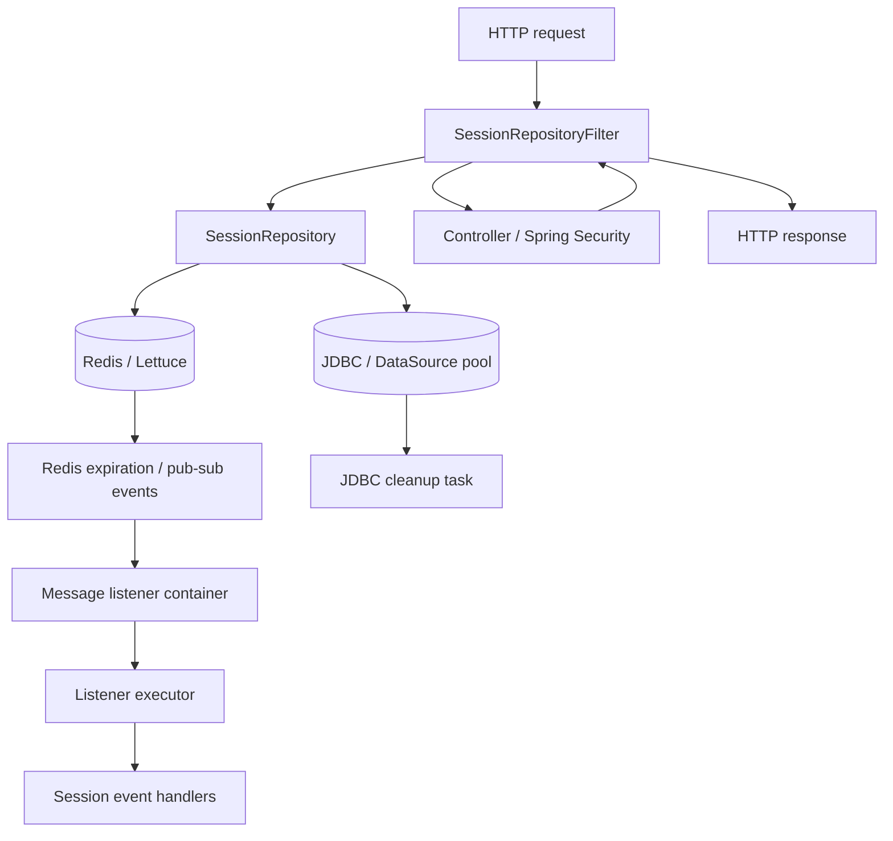

# Nhóm kết nối, luồng listener, thời gian chờ và mức bão hòa

Spring Session thêm một kho trạng thái dùng chung vào đường xử lý request. Mỗi request có thể cần đọc hoặc ghi session trong Redis/JDBC; các sự kiện như session được tạo, xóa hoặc hết hạn có thể đi qua listener; tác vụ cleanup cũng sử dụng kết nối tới kho. Khi lưu lượng tăng, nút nghẽn thường không chỉ nằm ở controller mà còn ở connection pool, thời gian chờ lấy kết nối, thread pool của listener, độ trễ kho dữ liệu và hàng đợi tác vụ nền.

Muốn vận hành ổn định, cần quan sát toàn bộ đường đi: request chờ connection bao lâu, connection được giữ trong bao lâu, Redis/JDBC xử lý lệnh mất bao lâu, listener nhận và xử lý sự kiện ra sao, queue có tăng liên tục không, và hệ thống phản ứng thế nào khi một tài nguyên chạm giới hạn. Tăng kích thước pool một cách mù quáng thường chỉ chuyển hàng đợi từ ứng dụng xuống database/Redis, làm mức bão hòa nghiêm trọng hơn.

## 1. Các nhóm tài nguyên trong đường xử lý session

### 1.1. Luồng request và repository

Với Servlet stack, `SessionRepositoryFilter` bọc `HttpSession` và dùng `SessionRepository` để nạp/lưu session. Repository Redis sử dụng `RedisConnectionFactory`; repository JDBC sử dụng `DataSource`/`JdbcTemplate`. Tùy cấu hình flush/save và hành vi request, session có thể được đọc đầu request và lưu khi request kết thúc hoặc khi thay đổi được flush.



Sơ đồ thể hiện các nhóm tài nguyên chính. Một ứng dụng thường chọn Redis hoặc JDBC làm repository session chính; không có nghĩa mỗi request đồng thời ghi vào cả hai kho.

### 1.2. Những pool và executor khác nhau

| Thành phần | Quản lý tài nguyên nào | Dấu hiệu bão hòa |
|---|---|---|
| JDBC `DataSource` pool | Connection tới database | Active chạm maximum, pending tăng, acquire timeout |
| Redis client/connection factory | Connection hoặc native connection tới Redis | Command latency, connection wait, reconnect, maxclients |
| Redis Pub/Sub listener | Connection subscription và luồng nhận message | Listener disconnect/reconnect, event lag |
| Listener task executor | Thread xử lý callback/event | Active threads chạm max, queue tăng, task bị reject |
| HTTP server executor | Thread/worker xử lý request | Request queue, thread saturation, p95/p99 tăng |
| JDBC cleanup scheduler | Thread và connection chạy cleanup | Cleanup trễ, query kéo dài, tranh chấp với request |
| Redis command/event executor | Các tác vụ client và callback | Queue/latency tăng, callback chạy chậm |

Không gộp tất cả thành “connection pool”. JDBC connection pool, Redis command connection, Pub/Sub subscription connection và listener thread pool có vòng đời, cách dùng và metric khác nhau.

### 1.3. Một request có thể tạo nhiều lần truy cập kho

Một request có thể đọc session, cập nhật một hoặc nhiều attribute, cập nhật last-access time, lưu SecurityContext và phát sinh thao tác phụ. Cấu hình repository/flush mode quyết định số lệnh thực tế. Vì vậy, 1.000 request/giây không nhất thiết tương đương 1.000 lệnh Redis/SQL mỗi giây.

Đo command/query rate và thời gian xử lý trên workload thật. Không suy ra năng lực kho chỉ từ số request HTTP.

## 2. JDBC connection pool

### 2.1. Vai trò của DataSource pool

`JdbcIndexedSessionRepository` truy cập các bảng session và attributes thông qua JDBC. `DataSource` pool giữ một số connection đã mở để request không phải tạo TCP/database session mới mỗi lần.

Pool có giới hạn vì database cũng có giới hạn connection, memory, worker, lock và I/O. Khi tất cả connection đang được sử dụng, request mới phải chờ tới khi có connection trả về hoặc hết `connectionTimeout`.

### 2.2. Cấu hình HikariCP minh họa

Spring Boot thường dùng HikariCP khi có dependency phù hợp. Ví dụ cấu hình ban đầu cho một instance:

```yaml
spring:
  datasource:
    hikari:
      maximum-pool-size: 20
      minimum-idle: 5
      connection-timeout: 1500
      validation-timeout: 500
      idle-timeout: 600000
      max-lifetime: 1500000
```

Ý nghĩa:

- `maximum-pool-size`: số connection tối đa pool có thể cấp đồng thời.
- `minimum-idle`: số connection nhàn rỗi mục tiêu được giữ sẵn.
- `connection-timeout`: thời gian tối đa caller chờ lấy connection từ pool, tính bằng millisecond.
- `validation-timeout`: thời gian tối đa kiểm tra connection.
- `idle-timeout`: thời gian connection nhàn rỗi có thể được thu hồi khi pool lớn hơn mức tối thiểu.
- `max-lifetime`: tuổi thọ tối đa của connection trước khi pool thay thế nó.

Các con số trên chỉ là ví dụ. Chọn `max-lifetime` thấp hơn giới hạn tuổi thọ connection của database/proxy một khoảng an toàn; không sao chép giá trị nếu hạ tầng có giới hạn khác.

### 2.3. Pool size không phải số thread

Nếu HTTP server có 200 worker thread, không có nghĩa cần 200 JDBC connection. Nhiều request đang xử lý có thể không truy cập database cùng lúc. Ngược lại, một transaction giữ connection trong khi thực hiện nhiều bước sẽ làm connection bị chiếm lâu.

Ước lượng sơ bộ theo định luật Little:

\[
L = \lambda \times W
\]

Trong đó:

- `L`: số request/connection trung bình đang được phục vụ đồng thời.
- `λ`: tốc độ công việc đi vào, ví dụ số lần acquire connection mỗi giây.
- `W`: thời gian giữ connection trung bình, tính bằng giây.

Ví dụ, workload cần 120 lần truy cập DB mỗi giây và mỗi lần giữ connection trung bình 20 ms thì số connection trung bình theo phép tính đơn giản là `120 × 0,02 = 2,4`. Pool thực tế cần headroom cho burst, truy vấn dài, transaction và tác vụ nền; phép tính này không thay thế load test.

### 2.4. Đừng giữ connection trong lúc gọi dịch vụ bên ngoài

Một transaction mở connection rồi gọi HTTP service, chờ message hoặc thực hiện xử lý CPU dài sẽ làm thời gian giữ connection tăng. Điều này giảm throughput dù SQL rất nhanh.

Giữ transaction ngắn quanh thao tác DB cần tính nhất quán. Tránh đặt network call chậm bên trong transaction chỉ để thuận tiện. Theo dõi connection usage/hold duration và leak detection để tìm code path giữ connection quá lâu.

### 2.5. Tính tổng connection trên toàn cụm

Pool size cấu hình theo instance phải được nhân với số instance:

\[
C_{total} = N_{instances} \times C_{pool/node} + C_{jobs} + C_{admin}
\]

Ví dụ 8 instance, mỗi instance có pool 20 connection đã có thể mở tới 160 connection, chưa tính migration, monitoring, batch job và ứng dụng khác. Tổng này phải thấp hơn ngân sách connection của database và chừa chỗ cho quản trị/failover.

Nếu autoscaling tăng gấp đôi số instance nhưng giữ nguyên pool size, database có thể quá tải dù từng node không bão hòa. Capacity plan phải tính cả số replica tối đa.

## 3. Redis connection và Lettuce

### 3.1. `RedisConnectionFactory` không đồng nghĩa mỗi request lấy một connection độc lập

Spring Data Redis thường dùng Lettuce trong Spring Boot. Với `LettuceConnectionFactory`, mặc định native connection có thể được chia sẻ cho các thao tác thông thường không blocking/transaction. Các thao tác blocking, transaction hoặc Pub/Sub có thể cần connection riêng.

Vì vậy, không nên suy luận rằng 100 HTTP request đồng thời sẽ luôn chiếm 100 connection Redis. Cần hiểu loại command, chế độ chia sẻ native connection, client configuration và phiên bản Spring Data Redis đang dùng.

### 3.2. Khi nào connection pool Redis được dùng?

Lettuce có thể được cấu hình với Commons Pool để quản lý connection trong một số chế độ, chẳng hạn khi không chia sẻ native connection hoặc khi cần connection riêng cho loại thao tác nhất định. Việc thêm `commons-pool2` hoặc cấu hình `spring.data.redis.lettuce.pool.*` không có nghĩa mọi lệnh Redis thông thường tự động dùng một pooled connection riêng.

Kiểm tra `LettuceConnectionFactory` và `LettuceClientConfiguration` thực tế. Nếu dùng `shareNativeConnection=false`, pool có thể trở thành yếu tố quan trọng hơn; khi giữ mặc định chia sẻ, hãy đo số connection thực tế và không tăng pool chỉ dựa trên số HTTP thread.

### 3.3. Cấu hình timeout Redis

Ví dụ cấu hình timeout kết nối và command trong Spring Boot 3:

```yaml
spring:
  data:
    redis:
      connect-timeout: 500ms
      timeout: 300ms
```

Tên property có thể khác ở phiên bản Spring Boot cũ (ví dụ prefix `spring.redis`). `connect-timeout` giới hạn thời gian thiết lập kết nối; `timeout` là timeout thao tác theo client/configuration. Kiểm tra property metadata của phiên bản đang chạy thay vì sao chép nguyên xi.

Không đặt timeout nhỏ hơn latency bình thường của Redis trong điều kiện tải đỉnh. Timeout quá ngắn làm request thất bại và retry tạo thêm tải; timeout quá dài khiến request giữ worker/thread lâu khi Redis đã có sự cố.

### 3.4. Giới hạn connection phía Redis

Redis có giới hạn client connection. Theo dõi `connected_clients`, `blocked_clients`, rejected connections, CPU, network và latency. Tính cả application nodes, Pub/Sub listeners, monitoring, admin tools, backup và các dịch vụ khác.

Không dùng một Redis connection cho mọi tác vụ dài hạn nếu client library yêu cầu connection riêng. Pub/Sub, blocking commands và transaction có semantics riêng.

## 4. Listener connection và Redis Pub/Sub

### 4.1. Vì sao Spring Session cần listener?

Redis repository có thể sử dụng expiration event để phát hiện session hết hạn và dọn dữ liệu phụ như index. `RedisMessageListenerContainer` quản lý subscription và phân phối message tới listener. Spring Session có thể tự cấu hình hạ tầng listener khi bật Redis session support.

Listener nhận event không phải là đường xác thực chính của request. Khi request tới với session ID đã hết hạn, repository vẫn phải từ chối session theo thời gian/TTL. Event hỗ trợ cleanup và thông báo lifecycle; không nên dựa vào việc event đã tới mới quyết định session còn hợp lệ.

### 4.2. Subscription connection khác command connection

Redis Pub/Sub connection thường được dành cho subscription và không nên được xem như connection command thông thường. Lettuce có thể tạo native Pub/Sub connection riêng. Listener container quản lý kết nối này và quá trình reconnect khi Redis tạm thời mất kết nối.

Khi đếm connection Redis, hãy tính các listener container trên từng application context/instance. Nếu vô tình khai báo nhiều container cho cùng một mục đích hoặc tạo một listener riêng trong khi Spring Session đã có listener nội bộ, số subscription và connection có thể tăng không cần thiết.

### 4.3. Keyspace notification phải được bật phù hợp

Spring Session Redis cần expiration notifications theo cấu hình và phiên bản để phát các event như `SessionExpiredEvent` và xử lý index liên quan. Redis keyspace notification có thể bị giới hạn trên dịch vụ managed hoặc bị cấu hình sai.

Kiểm tra:

- Redis có phát expiration event theo các flag cần thiết không.
- Listener container có subscribe đúng channel/pattern không.
- Listener có reconnect sau failover không.
- Ứng dụng có ghi nhận thời điểm listener disconnect/reconnect không.
- Event lag và lỗi xử lý có được quan sát không.

Không thay đổi `notify-keyspace-events` trên Redis dùng chung mà chưa đánh giá ảnh hưởng tới ứng dụng khác. Nếu managed Redis không cho phép lệnh `CONFIG`, cấu hình notification qua control plane của dịch vụ và dùng `ConfigureRedisAction.NO_OP` khi tài liệu Spring Session yêu cầu.

## 5. Listener thread pool và xử lý sự kiện

### 5.1. Tách thread nhận message khỏi công việc nghiệp vụ

Callback listener nên làm ít việc: kiểm tra loại event, trích dữ liệu cần thiết và chuyển công việc sang executor phù hợp. Không thực hiện truy vấn DB dài, gọi HTTP chậm hoặc gửi email đồng bộ trên thread nhận Pub/Sub.

Nếu listener xử lý chậm, callback queue tăng, event lag tăng và có thể ảnh hưởng các event khác. Dùng bounded executor có giới hạn thread/queue và metric; không tạo thread mới cho mỗi event.

### 5.2. Ví dụ event handler bất đồng bộ

```java
import org.springframework.context.annotation.Bean;
import org.springframework.context.annotation.Configuration;
import org.springframework.scheduling.concurrent.ThreadPoolTaskExecutor;

@Configuration
@EnableAsync
public class SessionEventExecutorConfiguration {

    @Bean("sessionEventExecutor")
    ThreadPoolTaskExecutor sessionEventExecutor() {
        ThreadPoolTaskExecutor executor = new ThreadPoolTaskExecutor();
        executor.setCorePoolSize(2);
        executor.setMaxPoolSize(8);
        executor.setQueueCapacity(500);
        executor.setThreadNamePrefix("session-event-");
        executor.setWaitForTasksToCompleteOnShutdown(true);
        executor.setAwaitTerminationSeconds(20);
        return executor;
    }
}
```

```java
import org.springframework.scheduling.annotation.Async;
import org.springframework.context.event.EventListener;
import org.springframework.stereotype.Component;
import org.springframework.session.events.SessionDeletedEvent;
import org.springframework.session.events.SessionExpiredEvent;

@Component
public class SessionLifecycleListener {

    @Async("sessionEventExecutor")
    @EventListener
    public void onSessionExpired(SessionExpiredEvent event) {
        // Ghi metric hoặc gửi công việc idempotent sang service phù hợp.
        // Không log raw session ID hay session attributes nhạy cảm.
    }

    @Async("sessionEventExecutor")
    @EventListener
    public void onSessionDeleted(SessionDeletedEvent event) {
        // Xử lý cleanup nghiệp vụ nếu cần; thao tác phải idempotent.
    }
}
```

Đây là ví dụ khung. Cần import đúng event classes của Spring Session và bảo đảm ứng dụng đã cấu hình event publication cho repository đang dùng. Nếu đã có executor/async configuration, tái sử dụng cấu hình hiện tại thay vì tạo nhiều pool không cần thiết.

### 5.3. Queue phải có giới hạn

Queue không giới hạn có thể biến một listener chậm thành tăng heap liên tục. Queue quá nhỏ có thể reject nhanh khi burst. Chọn capacity theo thời gian xử lý, burst dự kiến và độ trễ chấp nhận được; đo queue depth và oldest task age.

Chính sách reject phải có chủ đích:

- Với event chỉ phục vụ metric/telemetry, có thể drop có đếm và cảnh báo nếu chấp nhận mất.
- Với xử lý nghiệp vụ cần đảm bảo, không dựa vào Pub/Sub ephemeral làm hàng đợi bền vững duy nhất; dùng outbox, durable queue hoặc Redis Streams/message broker có acknowledgement phù hợp.
- Không dùng `CallerRunsPolicy` một cách vô thức trên listener thread: khi queue đầy, nó có thể chạy công việc chậm ngay trên thread nhận event và làm nghẽn subscription.

### 5.4. Event handler phải idempotent

Redis expiration event có thể đến trễ hoặc handler có thể được gọi lại sau reconnect/retry. Xử lý cùng event nhiều lần không được tạo side effect lặp nguy hiểm. Dùng event ID/correlation, unique constraint hoặc thao tác upsert/idempotent.

Không giả định thứ tự event toàn cục giữa nhiều node. Nếu nghiệp vụ phụ thuộc thứ tự, cần sequence/version và cơ chế lưu bền vững.

### 5.5. JDBC repository và event semantics

Đừng giả định Redis expiration event và JDBC cleanup có cùng cơ chế. Redis có Pub/Sub/keyspace notification; JDBC thường dựa vào dữ liệu expiry và tác vụ cleanup. Việc phát event lifecycle cụ thể phụ thuộc repository/phiên bản và đường xóa session. Nếu cần một sự kiện nghiệp vụ đáng tin cậy cho cả hai repository, phát event/outbox ở tầng nghiệp vụ thay vì phụ thuộc vào cleanup vật lý.

## 6. Timeout: đặt ngân sách theo từng lớp

### 6.1. Các loại timeout không thể thay thế nhau

| Timeout | Bảo vệ điều gì | Ví dụ nơi cấu hình |
|---|---|---|
| Connection acquire timeout | Thời gian chờ connection rảnh trong pool | Hikari `connection-timeout`, Redis pool `max-wait` nếu dùng pool |
| Connect timeout | Thời gian thiết lập TCP/TLS tới Redis/database | Redis client, JDBC driver/socket |
| Command/query timeout | Thời gian Redis command hoặc SQL query được phép chạy | Redis client timeout, JDBC statement/query timeout |
| Transaction timeout | Thời gian transaction DB tối đa | Spring transaction manager/transaction definition |
| Listener task timeout | Thời gian callback được phép chạy hoặc deadline xử lý | Executor/task handler/application policy |
| Request deadline | Tổng thời gian xử lý request | Servlet container, application, gateway |
| Load balancer/client timeout | Thời gian caller chờ response | Ingress, reverse proxy, client |

Một request có thể hết thời gian chờ pool trước khi query bắt đầu; query timeout không giới hạn thời gian chờ lấy connection. Cần cấu hình từng lớp.

### 6.2. Timeout lồng nhau

Thiết kế một ngân sách tổng thể. Ví dụ minh họa:

```text
Pool acquire          <= 150 ms
Redis command         <= 250 ms
DB query              <= 500 ms
Application deadline  <= 2 s
Gateway timeout       >= 2.5 s
```

Đây không phải giá trị khuyến nghị chung; hãy thay bằng SLO và latency đo được. Ý tưởng là thao tác phụ thuộc phải thất bại đủ sớm để ứng dụng trả response có kiểm soát trước khi gateway/client ngắt kết nối.

Nếu gateway timeout ngắn hơn request deadline, client có thể bỏ cuộc trong khi server vẫn giữ thread và connection xử lý công việc vô ích. Nếu timeout nội bộ quá dài, request treo sẽ chiếm worker và làm queue tăng.

### 6.3. Timeout cleanup và tác vụ nền

Cleanup job không nên giữ transaction/connection vô thời hạn. Đặt query/transaction timeout, batch size và giới hạn thời gian chạy. Nếu job không hoàn tất trong chu kỳ, ghi nhận backlog và có chính sách chống chạy chồng lấn.

### 6.4. Retry không được khuếch đại sự cố

Khi Redis/JDBC chậm, retry ngay và vô hạn làm tải tăng thêm. Chỉ retry lỗi transient, giới hạn số lần, dùng exponential backoff có jitter và deadline tổng. Chỉ retry thao tác idempotent hoặc có cơ chế chống thực hiện hai lần.

Không retry lỗi xác thực, lỗi schema, lỗi serialization không thể khắc phục hoặc lỗi cấu hình như thể chúng là lỗi mạng tạm thời.

## 7. Nhận biết mức bão hòa

### 7.1. JDBC pool saturation

Các dấu hiệu:

- Active connections thường xuyên bằng `maximumPoolSize`.
- Pending/waiting threads tăng.
- Connection acquisition time và timeout tăng.
- DB query latency, lock wait hoặc I/O tăng.
- HTTP request p95/p99 tăng dù CPU ứng dụng chưa cao.

Phân biệt pool saturation với database saturation. Nếu pool active cao vì transaction giữ connection lâu, tăng pool có thể làm database nhận nhiều query đồng thời hơn và tệ hơn. Kiểm tra slow query, lock, transaction duration và connection leak trước khi tăng pool.

### 7.2. Redis saturation

Theo dõi:

- Command latency và timeout rate.
- `connected_clients`, `blocked_clients` và rejected connection.
- CPU, network throughput, memory, eviction và replication lag.
- Reconnect count và connection acquisition wait nếu có pool.
- Redis slow log/latency monitor theo chính sách vận hành.

Nếu Redis CPU cao, tăng connection pool không làm Redis xử lý nhanh hơn. Tìm command đắt, key quá lớn, scan không phù hợp, hot key, payload session lớn hoặc request pattern tạo quá nhiều round trip.

### 7.3. Listener saturation

Dấu hiệu gồm listener callback duration tăng, executor active thread đạt max, queue depth tăng liên tục, rejected task, event lag hoặc reconnect liên tục. Nếu message được nhận nhưng handler chậm, tăng listener thread chỉ hữu ích khi downstream còn capacity.

Nếu listener handler gọi JDBC và JDBC pool đã đầy, tăng listener threads có thể làm nhiều task cùng chờ DB hơn. Giới hạn concurrency của listener theo năng lực downstream.

### 7.4. HTTP saturation do dependency

Request thread có thể bị giữ trong lúc chờ connection hoặc command. Khi nhiều request cùng chờ, HTTP worker pool cạn dù CPU không cao. Theo dõi thread dump, request queue, dependency wait time và timeout theo từng lớp.

## 8. Sizing pool và executor có phương pháp

### 8.1. Bắt đầu từ ngân sách của dependency

Với JDBC, hỏi DBA về max connections, workload khác và reserve cho admin/replication. Với Redis, hỏi maxclients, connection usage từ dịch vụ khác, memory/CPU headroom và giới hạn managed service.

Phân bổ ngân sách cho toàn cụm trước, rồi chia cho số instance tối đa. Không đặt maximum pool ở mỗi node bằng toàn bộ khả năng của database.

### 8.2. Đo thời gian giữ tài nguyên

Đo:

- Connection acquire wait.
- Connection hold duration.
- Query/command duration.
- Transaction duration.
- Listener queue wait và callback duration.

Nếu acquire wait cao nhưng hold duration thấp, có thể pool quá nhỏ hoặc burst cao. Nếu hold duration cao, tìm transaction dài, query chậm hoặc code giữ connection trong lúc xử lý khác.

### 8.3. Tăng dần và kiểm tra đường cong throughput

Chạy load test với nhiều mức concurrency và pool size. Ghi throughput, p95/p99, error rate, DB/Redis CPU, queue depth và connection wait. Khi tăng pool không còn cải thiện throughput nhưng latency/DB load tăng, đã vượt vùng tối ưu.

Không chỉ tối ưu throughput tối đa. Chọn mức concurrency giữ latency trong SLO và còn headroom khi một node hoặc dependency giảm năng lực.

### 8.4. Giữ reserve cho tác vụ quan trọng

Nếu cleanup hoặc listener dùng cùng JDBC pool với request, burst request có thể chiếm hết connection và làm cleanup/event xử lý chậm. Có thể dùng pool riêng cho workload nền nếu database có ngân sách; nếu không, giới hạn concurrency và thời gian chạy của background tasks để không tranh toàn bộ tài nguyên request.

Không nhân đôi pool mà không tính tổng connection ở database. Pool riêng chỉ phân vùng contention trong ứng dụng, không tạo thêm năng lực ở database.

## 9. Cấu hình listener executor có giới hạn

### 9.1. Chọn queue capacity theo độ trễ

Giả sử listener xử lý trung bình 20 ms mỗi event và executor có 4 worker. Năng lực lý thuyết xấp xỉ 200 event/giây nếu không có thời gian chờ downstream. Queue 1.000 event có thể tương đương nhiều giây backlog; nếu event cần xử lý trong 1 giây, queue đó quá lớn.

Đánh giá queue capacity bằng thời gian chờ tối đa chấp nhận được, không chỉ bằng số lượng. Metric `oldest queued task age` thường hữu ích hơn queue depth đơn lẻ.

### 9.2. Tách loại công việc

Không dùng một executor chung cho:

- Listener callback nhanh.
- Gọi dịch vụ từ xa.
- Tác vụ ghi database.
- Cleanup batch.

Nếu các loại công việc có đặc tính khác nhau, tách executor hoặc dùng queue/broker riêng với concurrency phù hợp. Tránh tạo quá nhiều executor nhỏ không được giám sát.

### 9.3. Graceful shutdown

Khi deploy hoặc shutdown:

1. Ngừng nhận request mới qua readiness/drain.
2. Cho request đang chạy hoàn tất trong deadline.
3. Dừng nhận event mới hoặc đóng listener theo thứ tự phù hợp.
4. Chờ task đang xử lý trong thời hạn cấu hình.
5. Ghi nhận queue còn tồn và xử lý theo semantics: bỏ các task telemetry có thể mất, hoặc chuyển việc quan trọng sang durable queue/outbox.
6. Đóng Redis/JDBC resources.

Không giả định queue trong memory được bảo toàn khi process bị kill -9. Công việc cần đảm bảo phải được lưu bền vững trước khi acknowledge/đánh dấu hoàn tất.

## 10. Metrics và tracing cần theo dõi

### 10.1. JDBC/DataSource

Các metric hữu ích:

- Active, idle, maximum và minimum connections.
- Pending/waiting threads.
- Connection acquire duration và timeout count.
- Connection usage/hold duration.
- Query duration, transaction duration và slow query count.
- Database lock wait, CPU, IOPS và connection count tổng.

Spring Boot Actuator/Micrometer có thể xuất metric pool nếu instrumentation được bật. Tên metric phụ thuộc pool và phiên bản; kiểm tra `/actuator/metrics` hoặc Prometheus scrape trong môi trường test. Không công khai endpoint metrics nhạy cảm ra Internet.

### 10.2. Redis

Theo dõi command latency, command rate, connected clients, blocked clients, reconnects, timeouts, memory, evictions, CPU, network và replication/failover. Với Spring Data Redis, bổ sung metric phía client như command duration và lỗi kết nối nếu instrumentation hỗ trợ.

### 10.3. Listener

Theo dõi:

- Số event nhận theo loại.
- Event-to-handler-start lag.
- Handler duration.
- Executor active count, queue depth, oldest task age.
- Rejected task và exception count.
- Subscription connection state và reconnect count.
- Số event bị bỏ qua hoặc xử lý trùng.

Không đưa session ID, username hoặc payload nhạy cảm vào metric label. Dùng event type, outcome, application, environment và node.

### 10.4. Request và correlation

Gắn correlation/request ID xuyên qua gateway, ứng dụng và log dependency. Khi request chậm, cần biết nó chờ pool, chờ query hay chờ listener side effect. Distributed tracing có thể giúp phân biệt thời gian trong ứng dụng với thời gian dependency.

Không log cookie hoặc raw session ID để tương quan. Dùng trace ID/request ID và một định danh kỹ thuật đã được che nếu thực sự cần.

## 11. Kịch bản kiểm thử tải và bão hòa

### 11.1. Baseline

Đo hệ thống ở tải bình thường: throughput, p50/p95/p99, error rate, pool active/idle, acquire wait, Redis command latency, DB query latency, listener queue và event lag. Ghi rõ số instance và cấu hình pool.

### 11.2. Burst session read/write

Tăng dần request cần đọc/ghi session. Xác minh repository latency, serialization time và connection metrics. Thử session payload nhỏ/lớn để thấy tác động lên network và thời gian ghi.

### 11.3. JDBC pool exhaustion

Trong môi trường test cô lập, giảm `maximum-pool-size` hoặc tạo transaction giữ connection có kiểm soát. Xác minh request chờ tới `connectionTimeout`, trả lỗi có kiểm soát và pool hồi phục sau khi connection được trả. Không làm test exhaustion trên database dùng chung production.

### 11.4. Redis latency và reconnect

Mô phỏng latency hoặc tạm ngắt Redis trong môi trường test. Xác minh connect/command timeout, retry budget, error handling và recovery. Không fallback âm thầm sang local in-memory session vì sẽ tạo trạng thái khác nhau giữa node.

### 11.5. Listener burst và downstream chậm

Phát một burst session expiration/deletion event, làm handler chậm có kiểm soát và quan sát queue depth, oldest task age, rejection, event lag. Xác minh listener thread không bị giữ bởi công việc DB/HTTP lâu và hệ thống có chính sách cho event không xử lý kịp.

### 11.6. Cleanup cạnh tranh với request

Với JDBC, tạo nhiều session hết hạn để cleanup có công việc đáng kể. Đo cleanup duration, rows deleted, DB locks, pool wait và request latency. Điều chỉnh cron/batch/concurrency để cleanup không chiếm toàn bộ pool.

### 11.7. Scale-out

Tăng số instance trong khi giữ pool per-node. Xác minh tổng connection không vượt ngân sách. Test rolling deploy và shutdown khi listener đang có queue; kiểm tra task được hoàn tất hoặc xử lý theo durability policy.

## 12. Xử lý lỗi thường gặp

| Triệu chứng | Nguyên nhân có thể | Hướng xử lý |
|---|---|---|
| Hikari active luôn bằng maximum | Pool quá nhỏ, transaction dài, query chậm hoặc connection leak | Xem acquire/hold duration, slow query và transaction boundary |
| Pending threads tăng nhưng DB CPU thấp | Connection bị giữ lâu hoặc pool sizing/lock không hợp lý | Tìm transaction chờ lock, network call trong transaction và leak |
| Tăng pool làm DB chậm hơn | Database đã bão hòa CPU/IO/lock | Giảm concurrency, tối ưu query và đặt ngân sách toàn cụm |
| Redis connection tăng bất thường | Nhiều factory/container, pool config sai hoặc reconnect loop | Kiểm tra client topology, listener container và connection lifecycle |
| Redis timeout nhưng CPU thấp | Network, connection wait, proxy hoặc timeout cấu hình sai | Phân biệt connect, acquire và command timeout |
| SessionExpiredEvent không tới | Keyspace notification hoặc listener subscription lỗi | Kiểm tra Redis event flags, listener state và reconnect |
| Listener queue tăng liên tục | Handler chậm hoặc downstream bão hòa | Giới hạn concurrency, tách executor và tối ưu handler |
| Event bị mất khi restart | Dựa vào Pub/Sub/in-memory queue cho công việc cần durability | Dùng outbox hoặc durable message broker |
| Listener thread bị block | Handler gọi DB/HTTP đồng bộ quá lâu | Chuyển sang bounded executor và giới hạn queue |
| Cleanup làm request chậm | Job chạy quá thường xuyên hoặc batch quá lớn | Điều chỉnh cadence/batch và giới hạn tài nguyên nền |
| Timeout gateway trước timeout ứng dụng | Ngân sách timeout lồng nhau không hợp lý | Đặt dependency/request deadlines theo SLO và có headroom |
| Retry làm sự cố nặng hơn | Retry không giới hạn hoặc không có jitter | Giới hạn attempts, backoff, deadline và idempotency |
| Shutdown mất event | Queue chỉ ở memory hoặc shutdown không drain | Dùng durable queue/outbox và graceful lifecycle |

## 13. Quy trình chẩn đoán một request session chậm

1. Xác định request ID, node xử lý và khoảng thời gian p95/p99 tăng.
2. Kiểm tra request thread có đang chờ connection hay không.
3. Nếu JDBC, kiểm tra Hikari active/pending/acquire wait, transaction duration, DB locks và slow query.
4. Nếu Redis, phân biệt connection/reconnect, command latency, Redis CPU/network và client timeout.
5. Kiểm tra session payload size, số attribute và số lần repository read/write.
6. Nếu request chờ side effect/event, kiểm tra listener executor queue và handler duration; tránh chạy nghiệp vụ listener đồng bộ trong request path.
7. So sánh tổng pool capacity trên toàn số instance với giới hạn dependency.
8. Kiểm tra retry, timeout và gateway deadline để tìm thời gian chờ bị cộng dồn.
9. Thay đổi một yếu tố tại một thời điểm rồi load test lại.
10. Ghi lại throughput, latency, errors và headroom để xác nhận nút nghẽn đã được giải quyết.

## 14. Checklist vận hành

- [ ] Tính pool size theo số instance tối đa và ngân sách connection của Redis/JDBC.
- [ ] Phân biệt JDBC pool, Redis command connection, Pub/Sub connection và listener executor.
- [ ] Đo connection acquire wait và hold duration, không chỉ đếm số connection.
- [ ] Đặt connect, acquire, command/query, transaction và request timeout riêng.
- [ ] Giữ transaction ngắn và tránh gọi dịch vụ ngoài khi đang giữ DB connection.
- [ ] Cấu hình listener executor có bounded queue và concurrency theo downstream capacity.
- [ ] Làm listener handler idempotent, nhanh và không log session credential.
- [ ] Không dùng Pub/Sub/in-memory queue cho công việc bắt buộc phải đảm bảo delivery.
- [ ] Theo dõi listener lag, queue depth, rejected tasks và subscription reconnect.
- [ ] Theo dõi Redis/JDBC saturation cùng p95/p99 và HTTP thread utilization.
- [ ] Kiểm thử pool exhaustion, Redis latency, listener burst, cleanup contention và scale-out.
- [ ] Có graceful shutdown và chính sách xử lý task còn lại.

Nhóm kết nối, listener thread, timeout và mức bão hòa là một hệ thống liên quan chặt chẽ. Hãy tính capacity ở quy mô toàn cụm, đo thời gian chờ và thời gian giữ tài nguyên, đặt timeout theo một ngân sách chung, đồng thời giới hạn queue của listener. Khi có saturation, xác định đúng nơi đang chờ trước khi tăng pool; tăng concurrency ở ứng dụng không thể tạo thêm năng lực cho Redis hoặc database đã bão hòa.

## Tài liệu tham khảo

- [Spring Session — Redis Configuration](https://docs.spring.io/spring-session/reference/configuration/redis.html)
- [Spring Session — JDBC Configuration](https://docs.spring.io/spring-session/reference/configuration/jdbc.html)
- [Spring Data Redis — Redis Connection](https://docs.spring.io/spring-data/redis/reference/redis/connection-modes.html)
- [Spring Data Redis — Pub/Sub](https://docs.spring.io/spring-data/redis/reference/redis/pubsub.html)
- [Spring Framework — Task Execution and Scheduling](https://docs.spring.io/spring-framework/reference/integration/scheduling.html)
- [Spring Boot — Metrics](https://docs.spring.io/spring-boot/reference/actuator/metrics.html)
- [HikariCP — Configuration](https://github.com/brettwooldridge/HikariCP)
- [Redis — Client handling](https://redis.io/docs/latest/develop/reference/clients/)
