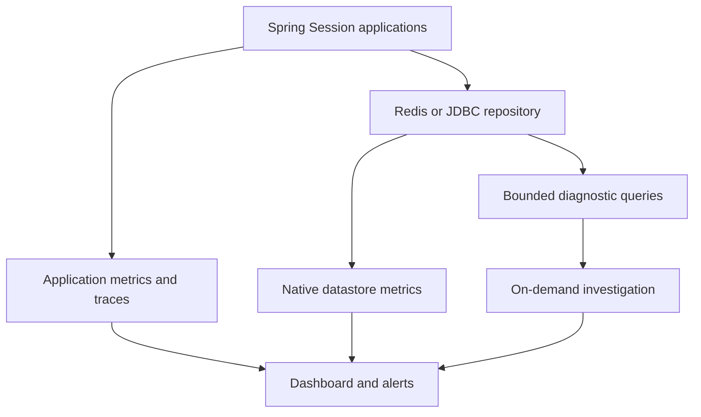

# Quan sát dữ liệu Redis hoặc JDBC mà không gây tải quét quá lớn

Spring Session lưu session vào kho dùng chung như Redis hoặc JDBC để nhiều instance ứng dụng có thể đọc cùng trạng thái. Khi vận hành, đội ngũ cần biết số lượng session, tốc độ tạo/xóa, TTL, dung lượng, độ trễ đọc/ghi, lỗi kết nối và tình trạng dọn phiên hết hạn. Tuy nhiên, session store thường chứa rất nhiều key hoặc row thay đổi liên tục. Một truy vấn quét toàn bộ keyspace Redis hoặc đọc toàn bộ bảng `SPRING_SESSION` có thể chiếm CPU, I/O, băng thông và connection của chính kho dữ liệu đang phục vụ request người dùng.

Nguyên tắc quan sát an toàn là ưu tiên metrics tổng hợp do Redis/database cung cấp, metrics của ứng dụng và các truy vấn có giới hạn. Chỉ dùng `SCAN` hoặc truy vấn liệt kê theo lô khi thật sự cần kiểm tra mẫu hay điều tra một vấn đề cụ thể. Không dùng một vòng quét đầy đủ lặp lại theo chu kỳ ngắn để làm dashboard đếm session. Việc quan sát cũng phải tránh đọc payload session, vì attributes có thể chứa thông tin cá nhân, trạng thái xác thực hoặc dữ liệu nhạy cảm.

Trong `SPRING_SESSION`, bài học này trình bày cách quan sát Redis và JDBC theo từng lớp, cách dùng `INFO`, `SCAN`, thống kê database, index và slow-query metrics, cách đặt ngân sách cho các tác vụ kiểm tra, cùng những lỗi vận hành thường gặp. Mục tiêu là phát hiện xu hướng và bất thường mà không biến hệ thống giám sát thành một nguồn tải mới.

## 1. Vì sao quét toàn bộ session store nguy hiểm?

Session store khác một bảng danh mục ít thay đổi. Mỗi request đã xác thực có thể đọc session; request thay đổi attributes có thể ghi lại session; hoạt động truy cập có thể cập nhật thời điểm truy cập/TTL; session hết hạn hoặc logout có thể xóa key/row và các index liên quan. Khi số người dùng đồng thời tăng, số thao tác này cũng tăng.

Một tác vụ giám sát quét tất cả session mỗi vài giây có thể:

- Cạnh tranh CPU với lệnh đọc/ghi session của request.
- Tạo lượng I/O hoặc network traffic lớn giữa monitor và datastore.
- Làm tăng latency p95/p99 dù ứng dụng không có thêm người dùng.
- Tăng connection pool pressure ở JDBC hoặc số client/command ở Redis.
- Tạo nhiều kết quả không nhất quán vì session liên tục được thêm, cập nhật và xóa trong lúc quét.
- Đọc nhầm dữ liệu nhạy cảm nếu truy vấn lấy toàn bộ attributes hoặc Redis hash.

Đặc biệt, một dashboard cần “số session hiện tại” không nên mặc định triển khai bằng cách liệt kê mọi session ID. Hãy tìm metric tổng hợp, ước lượng từ thống kê datastore hoặc đếm theo luồng sự kiện ứng dụng nếu yêu cầu chính xác và semantics đã được xác định.

## 2. Xác định câu hỏi trước khi chọn cách quan sát

Không phải mọi câu hỏi vận hành đều cần cùng một loại truy vấn:

| Câu hỏi | Dữ liệu nên quan sát | Cách ít gây tải |
|---|---|---|
| Redis/database có khỏe không? | Availability, connection, CPU, memory, replication, storage | Metrics native của datastore và health check nhẹ |
| Session store đang tăng nhanh không? | Số key/row ước lượng, creation/deletion rate, memory/table growth | Metrics tổng hợp theo thời gian, không quét từng session |
| TTL có được thiết lập không? | Số key có expiration, average TTL, expired count, expiry index | Redis `INFO`/metrics hoặc database statistics và truy vấn giới hạn |
| Session read/save chậm không? | Latency, command/query duration, pool wait, error rate | Application metrics, Redis commandstats/slowlog, DB query statistics |
| Có nhiều session hết hạn chưa được dọn không? | Expired/cleanup backlog, số row/key quá hạn mẫu | Index trên expiration và batch query có giới hạn |
| Một user có quá nhiều phiên không? | Principal index hoặc truy vấn theo principal có giới hạn | Truy vấn theo index đã hỗ trợ, chỉ khi có yêu cầu nghiệp vụ |
| Session cụ thể vì sao lỗi? | Một ID đã được xác định, metadata tối thiểu | Tra cứu một key/row có điều kiện chính xác, không dump payload |

Một nguyên tắc thực tế: metrics trả lời xu hướng; tracing/logs giúp định vị request; truy vấn giới hạn hỗ trợ điều tra; full scan chỉ dành cho tác vụ bảo trì có kế hoạch và ngân sách riêng.

## 3. Các lớp quan sát nên kết hợp



Nên quan sát ít nhất bốn lớp:

1. **Ứng dụng:** số request cần session, số lần tạo/đọc/lưu/xóa, latency repository, lỗi timeout/serialization và số lần session không tìm thấy.
2. **Redis hoặc database:** CPU, memory, connections, command/query latency, replication, eviction, I/O và tình trạng storage.
3. **Spring Session:** namespace/schema, TTL, expiration behavior, repository errors và event processing nếu ứng dụng sử dụng session lifecycle events.
4. **Hệ thống triển khai:** số application instances, deployment version, network latency, pool saturation và thay đổi cấu hình.

Metrics nên có nhãn có cardinality thấp như application, environment, repository type, operation và outcome. Không dùng session ID, user ID, cookie value hoặc principal làm metric label vì số lượng giá trị có thể tăng theo người dùng và làm hệ thống metrics quá tải.

## 4. Quan sát Redis bằng metrics tổng hợp

Redis cung cấp lệnh `INFO` để lấy thống kê theo nhóm. Đây thường là điểm bắt đầu tốt hơn việc liệt kê key:

```text
INFO server
INFO clients
INFO memory
INFO stats
INFO keyspace
INFO commandstats
INFO replication
```

Các nhóm hữu ích:

| Nhóm | Thông tin có thể dùng | Câu hỏi vận hành |
|---|---|---|
| `server` | Version, uptime, role liên quan | Redis vừa restart hay thay version? |
| `clients` | Connected clients, blocked clients | Connection có tăng bất thường hoặc client bị block không? |
| `memory` | Used memory, peak, fragmentation, eviction-related fields | Session store có gần giới hạn memory không? |
| `stats` | Total commands, keyspace hits/misses, expired/evicted keys | Cache/session workload thay đổi ra sao? |
| `keyspace` | Số key, số key có expiration và average TTL theo DB | Keyspace có tăng hoặc TTL coverage thay đổi không? |
| `commandstats` | Số lần gọi và thời gian CPU theo command | Lệnh nào chiếm nhiều thời gian Redis? |
| `replication` | Role, replica link, replication offset/lag liên quan | Replica có theo kịp primary không? |

Các field cụ thể thay đổi theo Redis version và dịch vụ managed. Thu thập theo interval hợp lý, lưu delta/counter rate thay vì chỉ nhìn một giá trị tuyệt đối. Ví dụ `expired_keys` là bộ đếm tích lũy; tốc độ tăng trong một khoảng thời gian hữu ích hơn một con số tổng kể từ lúc server khởi động.

### 4.1. `INFO keyspace` không phải số session chính xác

`INFO keyspace` có thể cho biết số key trong từng logical database và số key có expiration. Nhưng Redis database có thể chứa nhiều loại key khác nhau: session, index, cache hoặc dữ liệu ứng dụng khác. Nếu namespace của Spring Session dùng prefix, tổng key count không tự tách được riêng session records.

Trong Redis Cluster, phải hiểu số liệu theo từng node/shard. `INFO` từ một node không phải snapshot toàn cluster. Không cộng primary và replica với nhau như thể chúng là hai bản dữ liệu độc lập; replica chứa bản sao của shard. Dùng metrics từ dịch vụ quản lý hoặc thu thập theo primary/shard để tránh đếm trùng.

### 4.2. `DBSIZE` hữu ích nhưng không đếm riêng Spring Session

`DBSIZE` trả số key trong database Redis mà node đang phục vụ. Đây là phép đo tổng hợp nhanh cho một database, nhưng:

- Nó không lọc theo `redisNamespace` của Spring Session.
- Nó có thể bao gồm cache và key của ứng dụng khác.
- Trong Cluster, kết quả phải được diễn giải theo node và topology.
- Nó không cho biết mỗi key có kích thước bao nhiêu hoặc session nào còn hợp lệ theo logic ứng dụng.

Dùng `DBSIZE` như tín hiệu xu hướng tổng keyspace nếu database được dành riêng cho session. Nếu Redis dùng chung cho nhiều ứng dụng, ghi rõ metric là tổng key của DB, không gắn nhãn sai thành “số Spring Session”.

## 5. Không dùng `KEYS` trong giám sát định kỳ

Lệnh `KEYS pattern` tìm tất cả key phù hợp và có độ phức tạp phụ thuộc tổng số key trong database. Trên keyspace lớn, lệnh có thể giữ Redis bận trong thời gian đáng kể và làm các request khác chậm lại. Vì Redis xử lý command trên event loop của server, một lệnh nặng có thể ảnh hưởng nhiều client cùng lúc.

Ví dụ không nên dùng trong production monitoring:

```text
KEYS spring:session:*
```

Không đặt lệnh này trong health check, scheduled job, dashboard refresh hoặc actuator endpoint. Nếu cần điều tra một key đã biết, truy vấn chính xác key đó. Nếu cần duyệt keyspace, dùng `SCAN` theo lô và theo ngân sách, hiểu rõ giới hạn của nó.

## 6. Dùng `SCAN` có kiểm soát

`SCAN` trả về cursor để duyệt keyspace theo nhiều bước. Ví dụ:

```text
SCAN 0 MATCH portal:session:* COUNT 200
```

Kết quả gồm cursor tiếp theo và một nhóm key. Tiếp tục gọi với cursor mới cho tới khi cursor trả về `0` nếu muốn hoàn tất một vòng duyệt.

Các đặc tính cần nhớ:

- `COUNT` là gợi ý số phần tử Redis cố gắng trả về, không phải giới hạn cứng.
- Một lần gọi có thể trả ít hơn, nhiều hơn hoặc không có key dù cursor chưa về `0`.
- Một vòng `SCAN` đầy đủ vẫn có tổng chi phí phụ thuộc kích thước keyspace.
- Key có thể được thêm/xóa trong lúc quét; kết quả có thể chứa trùng lặp và không phải snapshot nhất quán.
- `MATCH` lọc kết quả theo pattern nhưng không biến toàn bộ scan thành phép tìm kiếm có index.
- Client phải xử lý cursor đúng và loại trùng nếu cần thống kê gần đúng.

`SCAN` ít gây chặn hơn `KEYS`, nhưng không miễn phí. Không chạy vòng scan liên tục ở tần suất cao chỉ để cập nhật số đếm dashboard.

### 6.1. Chọn COUNT và chu kỳ theo ngân sách

COUNT nhỏ làm mỗi batch nhẹ hơn nhưng có thể cần nhiều lượt gọi hơn; COUNT lớn giảm số vòng round-trip nhưng mỗi lượt có thể trả nhiều dữ liệu hơn. Hãy bắt đầu với batch nhỏ, đo thời gian, bytes nhận về, CPU và ảnh hưởng tới latency request rồi mới điều chỉnh.

Một tác vụ inventory nên có:

- Tần suất thấp, chạy theo lịch bảo trì hoặc theo nhu cầu điều tra.
- Giới hạn thời gian tối đa cho mỗi lần chạy.
- Giới hạn số key/bytes được xử lý trong một lượt nếu không cần scan toàn bộ.
- Khoảng nghỉ giữa các batch để nhường tài nguyên cho traffic chính.
- Cancellation/timeout và metric cho scan duration, scanned keys, returned keys.
- Tránh chạy đồng thời nhiều bản job từ các application instances.

Nếu mục tiêu chỉ là lấy mẫu, dừng sau số batch hoặc số key đã định trước. Đừng gọi đó là tổng số session; hãy đặt tên là sample hoặc estimate.

### 6.2. Ví dụ vòng scan có giới hạn

Pseudocode sau minh họa một tác vụ điều tra chạy theo lô, không phải code production hoàn chỉnh:

```java
long cursor = 0L;
int batches = 0;
int maxBatches = 20;
int countHint = 200;

while (cursor != 0L || batches == 0) {
    ScanResult<String> page = scan(cursor, "portal:session:*", countHint);
    inspectOnlyKeyNames(page.getResults());
    cursor = page.getCursor();
    batches++;

    if (batches >= maxBatches) {
        break; // Kết quả là sample, không phải full inventory.
    }
    pauseBriefly();
}
```

API thực tế phụ thuộc Redis client (Lettuce/Jedis) và kiểu cursor. Khi cursor được biểu diễn dưới dạng chuỗi hoặc object, không ép kiểu thành `long` như pseudocode. Không dùng vòng lặp này trong request thread; chạy ở worker/background task có giới hạn tài nguyên và tránh chặn event loop.

### 6.3. Redis Cluster cần scan theo từng primary

Trong Redis Cluster, `SCAN` trên một node chỉ duyệt keyspace mà node đó quản lý. Nếu cần inventory toàn cluster, phải dùng cluster-aware client hoặc chạy scan trên từng primary theo topology hiện tại. Không scan cả primary lẫn replica rồi cộng kết quả vì replica là bản sao dữ liệu của primary. Trong lúc resharding/failover, topology có thể đổi; kết quả inventory chỉ là quan sát best-effort.

Với Sentinel, hãy biết client đang truy cập primary nào. Sentinel giúp tìm primary hiện tại; nó không làm `SCAN` tự động trở thành phép duyệt toàn bộ cluster hay toàn bộ replica set.

## 7. Chỉ kiểm tra metadata, không đọc payload session

Spring Session Redis có thể lưu session data và attributes dưới dạng các key/field tùy repository và version. Cấu trúc nội bộ không phải API nghiệp vụ ổn định. Tránh viết monitor phụ thuộc trực tiếp vào tên key, encoding hoặc layout nội bộ nếu không có cam kết tương thích.

Khi cần điều tra một key đã xác định, ưu tiên metadata tối thiểu:

```text
TYPE portal:session:<known-id>
TTL portal:session:<known-id>
PTTL portal:session:<known-id>
MEMORY USAGE portal:session:<known-id>
```

Các lệnh trên chỉ là ví dụ nếu biết chính xác key format và kiểu key của repository. Không áp dụng hàng loạt lên mọi key trong một vòng scan. `MEMORY USAGE` có chi phí phụ thuộc cấu trúc key; chỉ lấy mẫu số lượng nhỏ.

Tránh `GET`/`HGETALL` hoặc dump toàn bộ session attributes để quan sát. Payload có thể chứa `SecurityContext`, principal, CSRF state, thông tin cá nhân hoặc dữ liệu nghiệp vụ. Log session ID đầy đủ cũng có thể làm lộ bearer credential. Nếu cần correlation, dùng mã đã hash/ẩn danh và chỉ log metadata cần thiết.

## 8. Dùng commandstats, slowlog và latency tools

Redis có các công cụ quan sát lệnh và latency:

```text
INFO commandstats
SLOWLOG GET 20
LATENCY LATEST
```

- `INFO commandstats` giúp nhận biết command nào được gọi nhiều hoặc tiêu tốn CPU tổng thể.
- `SLOWLOG GET 20` lấy một số lượng entry giới hạn trong slow log; đặt `slowlog-log-slower-than` và `slowlog-max-len` theo policy vận hành.
- `LATENCY LATEST` cho biết event latency được Redis ghi nhận theo cấu hình và version.

Không gọi các lệnh điều tra này quá thường xuyên. Slowlog có thể chứa command arguments; kiểm tra chính sách redaction và quyền truy cập trước khi chia sẻ log. Không đưa session ID, token hoặc serialized attributes vào ticket/chat vận hành.

Khi dùng Redis managed service, một số lệnh có thể bị chặn hoặc trả dữ liệu giới hạn. Ưu tiên metrics và dashboard do provider cung cấp nếu chúng có độ chi tiết phù hợp. Không cố vượt qua command restrictions bằng cách tạo tải scan khác.

## 9. Quan sát TTL và expiration

Session TTL giúp datastore tự loại bỏ session sau thời gian không hoạt động theo policy. Với Redis, có thể theo dõi:

- Số key có expiration trong `INFO keyspace`.
- `avg_ttl` nếu Redis version cung cấp cho database đó.
- Delta của `expired_keys` theo thời gian.
- `evicted_keys` để phân biệt hết hạn tự nhiên với eviction do thiếu memory.
- Application events/metrics về session expired/deleted nếu ứng dụng đã instrument.

Không coi `expired_keys` là số phiên người dùng đã logout. Nó là counter key hết hạn ở Redis và có thể gồm key khác ngoài session. Một session có thể gồm nhiều key/index; do đó số key hết hạn không nhất thiết bằng số session hết hạn.

Keyspace notifications có thể hỗ trợ xử lý `SessionExpiredEvent`/`SessionDeletedEvent` tùy cấu hình và repository. Nhưng Pub/Sub notification có thể bị bỏ lỡ khi listener ngắt kết nối; không dùng event count làm nguồn duy nhất để tính số session đang hoạt động hoặc thu hồi quyền. Hãy kết hợp TTL, repository state và metrics ứng dụng.

### 9.1. Phân biệt expiration với eviction

`expired_keys` tăng khi key hết hạn theo TTL; `evicted_keys` tăng khi Redis loại key do policy eviction để giải phóng memory. Nếu `evicted_keys` tăng trong session store, người dùng có thể mất session trước idle timeout. Đây là tín hiệu capacity/policy cần điều tra.

Dashboard nên thể hiện hai counter riêng. Đừng gộp chúng thành “session đã hết hạn”, vì eviction là sự cố memory/policy, còn expiration là lifecycle dự kiến.

## 10. Quan sát JDBC mà không đọc toàn bộ bảng

Spring Session JDBC thường dùng bảng session metadata và bảng attributes, ví dụ `SPRING_SESSION` và `SPRING_SESSION_ATTRIBUTES`. Schema cụ thể phụ thuộc database dialect và phiên bản Spring Session. Bảng metadata thường chứa primary ID, session ID, thời điểm tạo/truy cập, max inactive interval, expiry time và có thể principal name. Bảng attributes lưu payload serialize.

Để quan sát, bắt đầu từ database-native statistics thay vì chạy `SELECT *`:

- Số row ước lượng và kích thước bảng/index.
- Số lần sequential scan/index scan.
- Buffer/cache hit, physical reads và I/O waits.
- Lock waits, deadlocks và transaction duration.
- Slow query count và latency theo statement fingerprint.
- Connection pool active/idle/pending và acquire time.

PostgreSQL có các view thống kê như `pg_stat_user_tables`, `pg_stat_user_indexes` và `pg_statio_user_tables`. MySQL có `information_schema.tables` (row estimate với InnoDB có thể không chính xác) và Performance Schema summaries. Các hệ quản trị khác có catalog tương ứng. Dùng số liệu ước lượng cho dashboard xu hướng, không tuyên bố đó là số session chính xác.

### 10.1. Thống kê bảng ước lượng

Ví dụ PostgreSQL:

```sql
SELECT
    relname,
    n_live_tup,
    n_dead_tup,
    seq_scan,
    idx_scan
FROM pg_stat_user_tables
WHERE relname IN ('spring_session', 'spring_session_attributes');
```

`n_live_tup` và `n_dead_tup` là ước lượng từ thống kê, không phải kết quả đếm chính xác từng row. Tên bảng có thể được lưu lowercase tùy cách tạo schema. View thống kê có thể được cập nhật theo chu kỳ và reset theo cấu hình/hoạt động database. Đây là cách quan sát xu hướng mà không phải đọc payload session.

### 10.2. Không chạy COUNT(*) dày đặc trên bảng lớn

`SELECT COUNT(*) FROM SPRING_SESSION` có thể cần đọc một lượng lớn index entries hoặc rows tùy database, isolation và plan. Nếu bảng lớn và monitor chạy liên tục, chính truy vấn count có thể gây I/O đáng kể.

Nếu cần con số chính xác cho một báo cáo định kỳ, hãy:

- Chạy ngoài giờ cao điểm hoặc với interval dài.
- Đo execution time và logical/physical reads.
- Dùng transaction isolation phù hợp và giới hạn thời gian.
- Không chạy đồng thời từ mọi application instance.
- So sánh với statistics estimate để xác định có thực sự cần exact count không.

Dashboard realtime thường chỉ cần xu hướng; số row ước lượng hoặc application counters có thể phù hợp hơn full count mỗi vài giây.

## 11. Truy vấn JDBC có giới hạn và dùng index

Khi điều tra session hết hạn, có thể cần tìm một lượng nhỏ row quá hạn. Nếu schema có index trên `EXPIRY_TIME`, một truy vấn có điều kiện và giới hạn số dòng có thể giảm công việc:

```sql
SELECT PRIMARY_ID, EXPIRY_TIME
FROM SPRING_SESSION
WHERE EXPIRY_TIME < :cutoff
ORDER BY EXPIRY_TIME
FETCH FIRST 100 ROWS ONLY;
```

Cú pháp giới hạn dòng khác nhau giữa PostgreSQL, MySQL, Oracle và các database khác (`LIMIT`, `FETCH FIRST`, `TOP`). Ví dụ giả định cột và index tương ứng tồn tại trong schema đang dùng. Chỉ chọn metadata cần thiết; không join sang bảng attributes nếu không cần.

Để phân trang inventory, có thể dùng keyset pagination theo primary key thay cho `OFFSET` lớn:

```sql
SELECT PRIMARY_ID, EXPIRY_TIME
FROM SPRING_SESSION
WHERE PRIMARY_ID > :lastSeenId
ORDER BY PRIMARY_ID
FETCH FIRST 100 ROWS ONLY;
```

Keyset pagination tránh phải bỏ qua hàng nghìn/hàng triệu row như `OFFSET` lớn. Tuy nhiên, một vòng duyệt hết bảng vẫn có tổng chi phí O(N), và dữ liệu có thể thay đổi trong khi duyệt. Nếu không cần audit đầy đủ, chỉ lấy mẫu hoặc dừng sau một ngân sách xác định.

### 11.1. Kiểm tra index trước khi chạy truy vấn

Schema Spring Session chuẩn thường có index phục vụ lookup theo session ID và expiration cleanup; có thể có index principal tùy schema/repository. Không giả định index giống nhau trên mọi database/version. Xem DDL thực tế được triển khai và query plan trước khi thiết kế monitor.

Dùng `EXPLAIN`/plan viewer để xác minh database có dùng index phù hợp. `EXPLAIN ANALYZE` thực thi câu lệnh trên nhiều database; không chạy tùy tiện với query scan lớn trong production. Trước khi thêm index mới, đo write amplification, storage và lock/build cost vì Spring Session có thể ghi session thường xuyên.

### 11.2. Truy vấn theo principal phải có giới hạn

Nếu ứng dụng dùng indexed repository để tìm session theo principal, truy vấn theo principal có thể hữu ích cho điều tra một tài khoản cụ thể hoặc chức năng quản trị. Tuy nhiên, không chạy một truy vấn riêng cho từng user để dựng dashboard tổng hợp. Hãy dùng index đúng mục đích, giới hạn kết quả, phân trang và yêu cầu quyền quản trị.

Không xuất principal name, email hoặc session ID vào metric labels. Trong log điều tra, giảm thiểu và ẩn danh dữ liệu định danh.

## 12. Quan sát slow query và connection pool JDBC

Session save/find/delete là một phần tải database. Theo dõi:

- Query latency p50/p95/p99 theo statement fingerprint.
- Số lần execute và lỗi theo câu lệnh repository.
- Connection pool active, idle, pending và acquire timeout.
- Transaction duration, lock wait và deadlock.
- Database CPU, buffer reads, disk I/O và replication lag nếu có.
- Kích thước `SPRING_SESSION` và `SPRING_SESSION_ATTRIBUTES` theo thời gian.

Nếu dùng HikariCP, metrics pool có thể cho biết số connection đang dùng và số thread chờ. Không tăng pool size ngay khi thấy pending connections; trước tiên kiểm tra query latency, database capacity và transaction bị giữ lâu. Pool lớn hơn có thể làm database quá tải nhanh hơn.

Slow query log hoặc Performance Schema cần được cấu hình với threshold và retention phù hợp. Không bật log mọi statement kèm parameter nếu parameter có session ID hoặc payload. Dùng statement fingerprint và bind-value redaction.

## 13. Không đọc bảng attributes để làm dashboard

`SPRING_SESSION_ATTRIBUTES` có thể chứa serialized object. Truy vấn `SELECT * FROM SPRING_SESSION_ATTRIBUTES` vừa tốn tài nguyên vừa có thể làm lộ dữ liệu. Dashboard thường chỉ cần metadata:

- Số row ước lượng.
- Table/index size.
- Insert/update/delete rate.
- Query latency và I/O.
- Lỗi serialization/deserialization từ ứng dụng.

Nếu cần điều tra một session cụ thể, trước tiên xác minh quyền truy cập và session ID qua kênh an toàn; chỉ đọc metadata tối thiểu. Không giải serialize payload trong một job giám sát định kỳ.

## 14. Metrics từ ứng dụng Spring

Metrics từ datastore cho biết Redis/database đang làm gì, nhưng không luôn trả lời Spring Session request path nào bị lỗi. Ứng dụng nên có số liệu tổng hợp cho:

- Số request cần khôi phục session và số request không dùng session.
- Số lần tạo session mới, lưu, invalidate và session-not-found.
- Latency cho session lookup/save/delete nếu có thể instrument ở repository boundary.
- Lỗi kết nối, timeout, serialization và repository operation.
- Số event expired/deleted nhận được nếu ứng dụng xử lý lifecycle event.
- Số lần refresh TTL/last-access và kích thước payload ước lượng nếu đo được an toàn.

Không giả định mọi phiên bản Spring Session tự cung cấp toàn bộ metric này. Có thể dùng Micrometer/Observation ở application boundary, datasource/Redis client instrumentation hoặc wrapper có kiểm soát. Nếu tự instrument repository, tránh thay đổi semantics, tránh double-count khi retry và không ghi session content.

### 14.1. Đặt tên metric và tag an toàn

Ví dụ các metric khái niệm:

```text
spring_session_operation_total{operation="find",outcome="success"}
spring_session_operation_total{operation="save",outcome="error"}
spring_session_operation_duration_seconds{operation="save"}
spring_session_lifecycle_total{event="created"}
```

Đây là tên minh họa cho custom instrumentation, không khẳng định là tên metric built-in của mọi Spring Session version. Tag nên giới hạn ở application, environment, repository type, operation và outcome. Không thêm `sessionId`, `principal`, `username`, `cookie` hoặc `attributeName` có cardinality cao/nhạy cảm.

## 15. Dùng event để theo dõi lifecycle nhưng hiểu giới hạn

Spring Session có thể phát các application events như session created, expired hoặc deleted tùy repository và event listener configuration. Các event hữu ích để:

- Đếm xu hướng tạo/xóa session ở tầng ứng dụng.
- Cập nhật một số index/cache phụ.
- Ghi nhận hoạt động logout/expiration theo policy.
- Phát hiện chênh lệch giữa event rate và traffic.

Nhưng event delivery không mặc nhiên là audit log bền vững. Redis keyspace notification dùng Pub/Sub có thể bị bỏ lỡ khi subscriber ngắt kết nối; JDBC cleanup job có thể xóa row theo batch; listener có thể lỗi hoặc bị chậm. Không dùng event counter như số lượng session chính xác nếu không có cơ chế reconciliation.

Nếu event listener thực hiện side effect, xử lý idempotent vì event có thể được phát lại hoặc xử lý nhiều lần tùy cơ chế. Không gọi truy vấn full scan từ mỗi event. Listener nên thực hiện công việc nhỏ hoặc đẩy một message vào pipeline có giới hạn.

## 16. Thiết kế chu kỳ thu thập và ngân sách truy vấn

Chia công việc theo tần suất và chi phí:

| Loại quan sát | Ví dụ | Chu kỳ gợi ý để bắt đầu | Ghi chú |
|---|---|---:|---|
| Metrics native | Redis INFO, DB pool, CPU, memory | 15–60 giây | Điều chỉnh theo chi phí và SLA; dùng exporter nếu có |
| Application metrics | Session save latency/error rate | 10–60 giây | Thu thập trong ứng dụng, không quét store |
| Slow query/slowlog | Top command/query chậm | 1–5 phút hoặc on-demand | Giới hạn số entry và retention |
| Metadata query có index | Số row quá hạn mẫu | 5–15 phút hoặc theo nhu cầu | Giới hạn row và thời gian |
| SCAN inventory | Kiểm tra key prefix mẫu | On-demand hoặc lịch thưa | Có timeout, max batches và rate limit |
| Full audit/reconciliation | Đối soát số lượng hoặc dọn dữ liệu | Cửa sổ bảo trì | Chạy một worker, có kế hoạch rollback/stop |

Các chu kỳ trên chỉ là điểm khởi đầu. Cần đo trên kích thước dữ liệu và tải thực tế. Tạo một ngân sách riêng cho monitor: tối đa bao nhiêu command/query mỗi phút, bao nhiêu bytes đọc, thời gian chạy tối đa, số connection và CPU có thể dùng. Dừng tác vụ khi vượt ngân sách hoặc khi latency hệ thống chính tăng.

Không chạy scheduled scan từ mọi application instance. Nếu có job điều tra định kỳ, chọn một worker leader hoặc một monitoring service riêng; dùng distributed scheduling/lease nếu cần bảo đảm chỉ một tiến trình chạy.

## 17. Tránh tạo tải đột biến khi monitor phục hồi

Nếu monitoring service mất kết nối rồi khởi động lại, nhiều job có thể chạy bù cùng lúc. Điều này gây thundering herd. Nên:

- Dùng jitter cho lịch thu thập.
- Giới hạn concurrency và queue length.
- Không chạy bù tất cả chu kỳ bị bỏ lỡ nếu dữ liệu cũ không còn hữu ích.
- Dùng timeout, cancellation và backoff.
- Tách monitoring credentials khỏi credentials ứng dụng; chỉ cấp quyền đọc cần thiết.
- Có circuit breaker hoặc tạm dừng scan khi Redis/database đang quá tải.

Monitor phải fail-open đối với request nghiệp vụ: nếu dashboard không đọc được metrics, request session không nên chờ monitor hoàn tất. Không để health endpoint thực hiện truy vấn đếm toàn bộ session trước khi báo trạng thái ứng dụng.

## 18. Dashboard và cảnh báo nên tập trung vào xu hướng

Một dashboard vận hành session có thể chia thành các nhóm:

**Ứng dụng**
- Session find/save/delete latency p95/p99.
- Tỷ lệ lỗi repository và timeout.
- Số session create/invalidate/expired event theo phút.
- Số request anonymous/đã xác thực theo endpoint group.

**Redis**
- Used memory và memory headroom.
- Evicted keys, expired keys rate.
- Connected/blocked clients.
- Command latency, slowlog count và commandstats.
- Replication health/lag và failover events.
- Keyspace size/expiration count theo database hoặc shard.

**JDBC**
- Session table/index size và row estimate.
- Query latency và slow statement count.
- Connection pool active/idle/pending.
- Lock waits/deadlocks và database I/O.
- Tốc độ insert/update/delete của session tables.

Cảnh báo nên dựa vào baseline và SLO: latency tăng kéo dài, error rate vượt ngưỡng, memory headroom giảm nhanh, eviction xuất hiện, connection pool pending kéo dài hoặc expiry cleanup lag tăng. Không đặt một ngưỡng session count chung cho mọi ứng dụng; payload, TTL và traffic pattern khác nhau.

## 19. Lỗi thường gặp và cách khắc phục

| Triệu chứng | Nguyên nhân có thể | Hướng xử lý |
|---|---|---|
| Redis latency tăng mỗi khi dashboard refresh | Dashboard chạy `KEYS` hoặc full `SCAN` | Bỏ full scan khỏi chu kỳ ngắn; dùng INFO metrics và sample có giới hạn |
| Số session hiển thị cao hơn thực tế | Đếm mọi key trong Redis, gồm index/cache hoặc replica | Phân biệt keyspace với session records; đếm đúng namespace và topology |
| Scan trả key trùng hoặc số đếm dao động | Keyspace thay đổi trong lúc SCAN | Deduplicate nếu cần sample; không coi scan là snapshot chính xác |
| `SCAN MATCH` vẫn tốn CPU | MATCH không phải index; full iteration vẫn duyệt keyspace | Giảm tần suất, dừng sớm hoặc dùng metrics khác |
| `expired_keys` không bằng số session hết hạn | Một session có nhiều key; Redis DB có key khác | Gọi đúng tên metric là key expiration count; dùng app events/metrics bổ sung |
| JDBC dashboard gây I/O cao | COUNT(*)/SELECT * quét bảng lớn | Dùng catalog statistics, query có index và giới hạn dòng |
| Query quá hạn vẫn chậm | Thiếu index phù hợp hoặc plan không dùng index | Kiểm tra DDL/EXPLAIN; cân nhắc index sau khi đo write overhead |
| Session attributes lộ trong log | Slow query/command log chứa payload hoặc parameter | Redact, chỉ ghi statement fingerprint và metadata tối thiểu |
| Pool JDBC pending tăng | Query chậm, transaction dài hoặc pool quá nhỏ | Kiểm tra DB latency/lock trước khi tăng pool |
| Metrics bị cardinality explosion | Dùng session ID/user ID làm label | Loại tag định danh; aggregate theo operation/outcome |
| Event count thấp hơn expiration thực tế | Listener mất kết nối hoặc notification không bền vững | Dùng event như tín hiệu, bổ sung reconciliation và TTL metrics |
| Monitor làm datastore quá tải sau restart | Nhiều job chạy bù đồng thời | Jitter, single worker, concurrency limit và backoff |

## 20. Quy trình điều tra an toàn

Khi có báo cáo session store tăng dung lượng hoặc chậm:

1. Xem application metrics: session find/save latency, error rate, request rate và số instance.
2. Kiểm tra Redis/database CPU, memory, connection count, I/O và network latency.
3. Với Redis, đọc `INFO` theo nhóm cần thiết, so sánh counter delta và kiểm tra replication/eviction.
4. Với JDBC, xem table/index statistics, query latency, pool metrics và slow statements.
5. Xác định namespace/schema của Spring Session; không suy số session từ tổng key/row nếu kho dùng chung dữ liệu khác.
6. Nếu cần inventory, dùng SCAN hoặc truy vấn theo index với batch nhỏ, timeout và giới hạn tổng thời gian.
7. Chỉ lấy metadata của key/row cần điều tra; không dump attributes hoặc security context.
8. Đối chiếu application events với datastore statistics, hiểu rằng event delivery có thể không đầy đủ.
9. Ghi nhận chi phí của chính tác vụ giám sát: duration, bytes, command/query count và ảnh hưởng latency.
10. Dừng hoặc giảm tần suất quan sát nếu nó làm tăng tải hệ thống chính.

## 21. Checklist thiết kế monitoring cho Spring Session

- [ ] Dùng native Redis/database metrics trước khi nghĩ tới full scan.
- [ ] Phân biệt số Redis keys, số session records và số người dùng đang hoạt động.
- [ ] Không dùng `KEYS` trong production monitoring.
- [ ] Nếu dùng `SCAN`, có COUNT hint, timeout, batch limit, pause và deduplication phù hợp.
- [ ] Với Redis Cluster, scan từng primary theo topology; không cộng cả replica.
- [ ] Với JDBC, ưu tiên catalog statistics, query có index và giới hạn kết quả.
- [ ] Không chạy COUNT(*) dày đặc trên bảng lớn.
- [ ] Không đọc toàn bộ session attributes để dựng dashboard.
- [ ] Thu thập session operation latency/error ở application boundary.
- [ ] Không dùng session ID, user ID, cookie hoặc principal làm metric labels.
- [ ] Tách expiration khỏi eviction và event delivery khỏi số lượng session chính xác.
- [ ] Giới hạn quyền monitoring và bảo vệ slowlog/query logs.
- [ ] Chạy job scan từ một worker có lịch, concurrency và ngân sách rõ ràng.
- [ ] Có cảnh báo khi monitor tiêu tốn quá nhiều CPU, I/O, network hoặc connection.

Quan sát Spring Session an toàn không đòi hỏi phải đọc mọi session. Redis `INFO`, command statistics, database catalog views, query metrics, connection pool metrics và application instrumentation cung cấp phần lớn tín hiệu cần cho dashboard. `SCAN` và truy vấn JDBC theo index chỉ nên dùng theo lô có giới hạn khi cần điều tra. Không dùng `KEYS`, `SELECT *` hoặc count toàn bảng theo chu kỳ ngắn; không dump session attributes hoặc định danh người dùng vào log/metrics. Khi tách rõ metrics tổng hợp, truy vấn chẩn đoán và full audit, đội vận hành có thể phát hiện xu hướng, TTL bất thường và datastore bottleneck mà không làm tăng tải trên chính kho phiên đang phục vụ ứng dụng.
