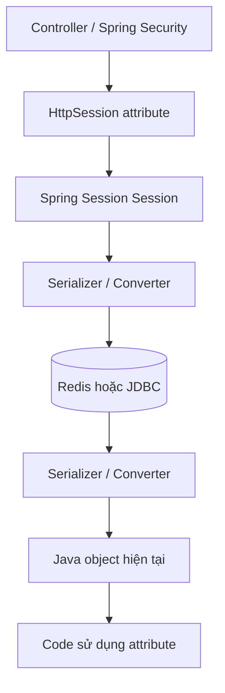
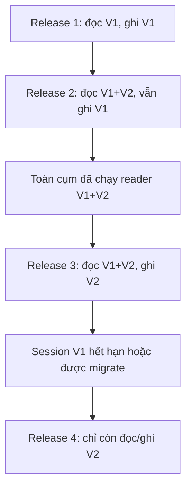

# Lỗi giải tuần tự hóa, không tìm thấy lớp và thay đổi cấu trúc thuộc tính

Spring Session lưu session ở repository bên ngoài JVM, thường là Redis hoặc JDBC. Các attribute trong session phải được chuyển từ object Java thành dữ liệu có thể lưu trữ, rồi được khôi phục khi request sau tải session. Quá trình này phụ thuộc serializer, classpath, phiên bản ứng dụng và cấu trúc của từng attribute. Vì session có thể tồn tại lâu hơn một lần triển khai, một phiên được ghi bởi phiên bản ứng dụng cũ có thể được đọc bởi phiên bản mới hoặc ngược lại trong giai đoạn rolling deployment.

Lỗi deserialize thường xuất hiện khi repository tìm thấy session nhưng không thể chuyển payload thành object mà ứng dụng hiện tại hiểu. Nguyên nhân có thể là class đã bị đổi package/xóa, `serialVersionUID` không tương thích, field đổi kiểu, serializer thay đổi hoặc JSON type metadata trỏ đến class không có trên classpath. Cũng có trường hợp deserialize thành công nhưng code truy cập attribute lại ép kiểu sai hoặc không hiểu schema cũ.

Vì vậy, thay đổi cấu trúc session attribute phải được quản lý như thay đổi schema dữ liệu có vòng đời. Cần thiết kế tương thích ngược, tương thích xuôi khi cần, có kế hoạch rollout và một chiến lược phục hồi khi session cũ không còn đọc được. Không nên coi lỗi deserialize là lỗi request thông thường rồi âm thầm tạo session mới, vì cách đó có thể làm mất trạng thái đăng nhập hoặc dữ liệu người dùng mà không có dấu vết điều tra.

## 1. Session attribute đi qua serializer như thế nào?

Trong Servlet stack, ứng dụng đọc/ghi attribute qua `HttpSession`. Spring Session thay session container bằng một implementation được quản lý bởi `SessionRepository`. Repository lưu metadata và các attribute vào Redis/JDBC; serializer chuyển object thành byte hoặc cấu trúc dữ liệu lưu trữ.



Đường đi cụ thể phụ thuộc repository và cấu hình. Redis repository có serializer cho session data; JDBC repository có cơ chế chuyển đổi attribute sang dạng lưu trữ trong cột dữ liệu. Phiên bản Spring Session, Spring Data và serializer tùy chỉnh có thể làm thay đổi chi tiết. Vì vậy, khi điều tra cần xác định chính xác repository bean và serializer đang chạy, không suy luận chỉ từ việc ứng dụng có dependency Redis/JDBC.

### Một attribute không chỉ là giá trị trong map

Ví dụ:

```java
session.setAttribute("cart", cart);
session.setAttribute("locale", "vi-VN");
session.setAttribute("checkout", checkoutState);
```

Mỗi giá trị có kiểu runtime và có thể tham chiếu đến nhiều class khác. Nếu `cart` chứa `CartItem`, `Money`, enum hoặc implementation collection riêng, tất cả các kiểu cần thiết cho quá trình deserialize đều phải tương thích. Một field đơn giản thay đổi kiểu cũng có thể khiến toàn bộ attribute không đọc được.

Không nên lưu entity JPA, Hibernate proxy, stream, connection, request object hoặc object graph lớn vào session. Các object đó thường gắn với runtime, schema database hoặc thư viện cụ thể và dễ gây lỗi khi nâng cấp.

## 2. Các nhóm lỗi thường gặp

| Nhóm lỗi | Ví dụ | Nguyên nhân phổ biến |
|---|---|---|
| Không tìm thấy class | `ClassNotFoundException` | Class được serialize không còn trên classpath hoặc package đã đổi |
| Serialized form không tương thích | `InvalidClassException` | `serialVersionUID` hoặc cấu trúc Java serialization không khớp |
| Payload không đúng định dạng | `StreamCorruptedException`, lỗi parse JSON | Dữ liệu bị hỏng, serializer đổi hoặc payload không thuộc format mong đợi |
| Không ánh xạ được type | Jackson/JSON mapping exception | Type metadata, module hoặc DTO không còn tương thích |
| Ép kiểu thất bại sau deserialize | `ClassCastException` | Object được khôi phục thành kiểu khác với kiểu code hiện tại mong đợi |
| Cấu trúc hợp lệ nhưng semantics sai | `NullPointerException`, lỗi validation hoặc logic | Field mới thiếu giá trị, enum mới chưa được xử lý hoặc giá trị cũ có ý nghĩa khác |

Lỗi có thể xuất hiện trong `findById`, khi truy cập attribute cụ thể hoặc ở tầng ứng dụng sau khi repository đã deserialize thành công. Cần đọc exception chain và xác định giai đoạn lỗi; không quy mọi lỗi liên quan session thành “Redis hỏng” hoặc “database mất dữ liệu”.

## 3. `ClassNotFoundException`: class cũ không còn trên classpath

Giả sử phiên bản A lưu attribute bằng class:

```java
package com.example.shop.session;

public class CartState implements java.io.Serializable {
    private String cartId;
    private int itemCount;
}
```

Sau một đợt refactor, phiên bản B chuyển class sang package `com.example.shop.web.CartState` hoặc thay bằng `ShoppingCartSnapshot`. Nếu session cũ vẫn chứa serialized object của class cũ, JVM phiên bản B có thể không tìm được class đó khi deserialize.

Một lỗi tương tự xảy ra khi:

- Class nằm trong module JAR đã bị loại khỏi artifact mới.
- Class chuyển sang dependency mà node mới chưa đóng gói.
- Một ứng dụng dùng chung Redis nhưng không có thư viện principal/attribute contract của ứng dụng ghi dữ liệu.
- Class loader hoặc module layer của ứng dụng không nhìn thấy class.
- Một phiên bản chạy trên node cũ ghi type mà node mới chưa hỗ trợ.

### Cách xử lý

1. Xác định tên class trong exception và artifact/version đã ghi dữ liệu.
2. Kiểm tra class có còn trong artifact đang chạy hay không.
3. Nếu cần đọc session cũ, giữ class tương thích trong một giai đoạn chuyển tiếp hoặc cung cấp migration converter.
4. Triển khai reader tương thích trên toàn bộ node trước khi bắt đầu ghi format mới.
5. Chờ session cũ hết TTL hoặc migrate có kiểm soát rồi mới gỡ class cũ.

Không thêm một class rỗng cùng tên chỉ để JVM deserialize thành công. Object có thể được khôi phục nhưng semantics, field và quyền truy cập có thể sai. Nếu cần compatibility class, phải giữ đúng contract và có test đọc payload thực tế đã tạo bởi phiên bản trước.

## 4. `serialVersionUID` và Java serialization

Với Java serialization, class có thể khai báo `serialVersionUID` để xác định phiên bản serialized form. Nếu không khai báo, JVM tính một giá trị mặc định từ cấu trúc class. Thay đổi class có thể làm giá trị mặc định thay đổi và gây `InvalidClassException` khi đọc object cũ.

Ví dụ:

```java
public final class CartSnapshot implements Serializable {
    private static final long serialVersionUID = 1L;

    private String cartId;
    private int itemCount;

    // constructor, getters và các method khác
}
```

Khai báo UID cố định giúp kiểm soát một phần compatibility, nhưng không bảo đảm mọi thay đổi field đều an toàn về mặt nghiệp vụ. Ví dụ, đổi field từ `int` sang `String` có thể không tương thích; thêm field có thể khiến giá trị cũ được khôi phục thành `null` hoặc `0`; xóa field có thể làm dữ liệu cũ bị bỏ qua.

Không tăng UID theo mỗi lần build nếu mục tiêu là đọc dữ liệu cũ. Cũng không giữ nguyên UID một cách máy móc khi thay đổi không tương thích. Mỗi thay đổi phải được đánh giá theo quy tắc Java serialization và test với payload của phiên bản trước.

### Những thay đổi Java serialization cần xem xét

| Thay đổi | Hành vi cần xem xét |
|---|---|
| Thêm field | Dữ liệu cũ không có field; giá trị có thể là mặc định của kiểu |
| Xóa field | Dữ liệu cũ có field nhưng class mới không còn; field có thể bị bỏ qua |
| Đổi tên field | Field cũ không tự động ánh xạ sang tên mới |
| Đổi kiểu field | Có thể gây `InvalidClassException` hoặc không thể gán giá trị |
| Đổi package/class name | Có thể gây `ClassNotFoundException` |
| Đổi superclass hoặc hierarchy | Có thể làm serialized form không tương thích |
| Đổi enum constant | Giá trị cũ có thể không ánh xạ được nếu constant đã bị xóa/đổi tên |

Ngay cả khi object deserialize được, code vẫn phải xử lý field mới vắng mặt và dữ liệu cũ không còn hợp lệ.

## 5. JSON serializer và type metadata

JSON có thể làm dữ liệu dễ quan sát hơn Java serialization, nhưng không tự động giải quyết compatibility. Một payload có thể chứa tên class đầy đủ hoặc type discriminator. Nếu package/class đổi, mapping có thể thất bại dù các field JSON vẫn giống nhau.

Ví dụ payload minh họa:

```json
{
  "_type": "com.example.shop.session.CartState",
  "cartId": "cart-2048",
  "itemCount": 3
}
```

Nếu ứng dụng mới đổi class thành `ShoppingCartSnapshot`, serializer cần mapping type cũ sang DTO mới hoặc đọc schema trung lập. Không nên phụ thuộc lâu dài vào tên class nội bộ trong payload nếu nhiều ứng dụng hoặc nhiều version cùng đọc dữ liệu.

### Polymorphic deserialization và rủi ro bảo mật

Serializer hỗ trợ polymorphic type có thể khởi tạo object theo type metadata trong payload. Nếu bật default typing rộng hoặc cho phép type tùy ý, dữ liệu bị sửa trong Redis/JDBC có thể kích hoạt việc khởi tạo class không mong muốn. Rủi ro tăng nếu kho session có nhiều writer hoặc quyền truy cập bị chia sẻ quá rộng.

Biện pháp:

- Dùng DTO/schema rõ ràng và allowlist kiểu cần deserialize.
- Không bật polymorphic default typing rộng nếu chưa hiểu tác động bảo mật.
- Bảo vệ Redis/JDBC bằng ACL, credential tối thiểu và TLS phù hợp.
- Không cho người dùng hoặc hệ thống không tin cậy ghi payload session tùy ý.
- Kiểm thử payload sai type, type lạ và dữ liệu bị cắt cụt.
- Khi serializer đổi, có kế hoạch đọc dữ liệu cũ và thu hồi dữ liệu không còn tương thích.

## 6. Thay đổi cấu trúc attribute

Không phải mọi thay đổi đều làm deserialize thất bại. Một số thay đổi khiến object được khôi phục nhưng ứng dụng diễn giải sai.

Ví dụ phiên bản cũ lưu:

```java
class CheckoutState implements Serializable {
    private int step;
    private String couponCode;
}
```

Phiên bản mới đổi thành:

```java
class CheckoutState implements Serializable {
    private String step;
    private Coupon coupon;
}
```

Ngay cả khi có converter hoặc serializer tùy chỉnh, dữ liệu cũ như `step=2` và `couponCode="SAVE10"` cần được chuyển đổi thành cấu trúc mới. Chỉ đổi tên field hoặc kiểu Java mà không có migration sẽ làm mất thông tin hoặc gây lỗi khi code sử dụng.

### Những thay đổi cấu trúc thường gặp

- Đổi tên attribute trong session, ví dụ `cart` thành `shoppingCart`.
- Đổi class của attribute.
- Đổi field type, ví dụ `long` thành `BigDecimal`.
- Thay `List` bằng `Map` hoặc thay kiểu phần tử.
- Thêm field bắt buộc nhưng session cũ không có giá trị.
- Đổi enum constant hoặc cách biểu diễn trạng thái.
- Đổi định dạng ngày/giờ, tiền tệ hoặc identifier.
- Chuyển từ một DTO nội bộ sang DTO dùng chung giữa nhiều ứng dụng.

Mỗi thay đổi cần xác định cách đọc dữ liệu cũ, cách ghi dữ liệu mới và khoảng thời gian hai định dạng cùng tồn tại.

## 7. Phiên bản hóa schema attribute

Một cách quản lý rõ ràng là gắn version vào DTO hoặc payload. Ví dụ:

```java
public record CartSnapshot(
        int schemaVersion,
        String cartId,
        int itemCount,
        String currency) implements Serializable {
}
```

Khi đọc:

1. Xác định schema version.
2. Nếu là version hiện tại, chuyển sang domain model.
3. Nếu là version cũ được hỗ trợ, chạy converter/migration.
4. Nếu version mới hơn mà node hiện tại chưa hiểu, xử lý theo policy rõ ràng; không đoán cấu trúc.
5. Nếu payload không hợp lệ, ghi nhận lỗi và áp dụng quy trình recovery.

Version cần mô tả schema dữ liệu, không nhất thiết trùng với version ứng dụng. Nhiều release ứng dụng có thể cùng ghi một schema version; một release cũng có thể đọc nhiều schema version trong giai đoạn chuyển đổi.

### Ví dụ converter giữa hai schema

```java
record CartV1(String cartId, int itemCount, String couponCode) {}
record CartV2(int schemaVersion, String cartId,
              int itemCount, CouponSnapshot coupon) {}
record CouponSnapshot(String code) {}

CartV2 migrate(CartV1 oldValue) {
    CouponSnapshot coupon = oldValue.couponCode() == null
            ? null
            : new CouponSnapshot(oldValue.couponCode());

    return new CartV2(2, oldValue.cartId(),
            oldValue.itemCount(), coupon);
}
```

Ví dụ này minh họa chuyển đổi dữ liệu sau khi đã deserialize được `CartV1`. Nếu serializer không thể khôi phục class V1 vì class đã bị xóa, converter này không thể chạy. Do đó, compatibility class hoặc decoder cho format cũ phải còn tồn tại trong giai đoạn migration.

## 8. Attribute name cũng là một phần của schema

Tên attribute trong `HttpSession` thường là key để code lấy dữ liệu. Đổi tên key từ `cart` sang `shoppingCart` có thể khiến session cũ không còn được đọc dù serialized object bên trong vẫn hợp lệ.

Ví dụ đọc tương thích:

```java
Object value = session.getAttribute("shoppingCart");
if (value == null) {
    value = session.getAttribute("cart");
}

CartSnapshot cart = convertToCurrentCart(value);
session.setAttribute("shoppingCart", cart);
session.removeAttribute("cart");
```

Đây là chiến lược đọc key mới trước, fallback key cũ rồi ghi lại định dạng mới. Chỉ dùng khi kiểu dữ liệu cũ có thể được deserialize an toàn và converter đã được kiểm thử. Nếu cả hai key cùng tồn tại, cần quy định nguồn nào có ưu tiên để tránh ghi đè dữ liệu mới bằng dữ liệu cũ.

Không nên giữ fallback vô thời hạn. Sau khi session cũ hết TTL hoặc đã được migrate, có thể loại bỏ code đọc key cũ trong release sau.

## 9. Tương thích trong rolling deployment

Khi triển khai nhiều node, node cũ và node mới có thể chạy đồng thời. Một request có thể ghi session bằng node mới rồi request tiếp theo đến node cũ. Nếu node cũ không đọc được schema mới, lỗi chỉ xuất hiện ngẫu nhiên theo routing.

Một trình tự an toàn thường dùng là expand/contract:

1. **Expand reader:** triển khai phiên bản có thể đọc cả schema cũ và schema mới, nhưng vẫn ghi schema cũ.
2. **Đồng bộ node:** bảo đảm mọi node trong cụm đều có reader tương thích.
3. **Switch writer:** bắt đầu ghi schema mới sau khi toàn bộ node đọc được schema đó.
4. **Drain old data:** chờ session cũ hết TTL hoặc migrate có kiểm soát.
5. **Contract:** gỡ hỗ trợ schema cũ trong một release sau khi không còn dữ liệu cũ.



Không bắt đầu ghi V2 khi vẫn còn node chỉ đọc được V1. Nếu không thể triển khai reader tương thích, lựa chọn khác là chủ động invalidate session trong maintenance window và yêu cầu người dùng đăng nhập lại. Cách này làm mất trạng thái phiên nhưng có thể an toàn hơn việc để request lỗi không kiểm soát.

## 10. Serializer migration là thay đổi dữ liệu, không chỉ đổi cấu hình

Giả sử Redis repository đang dùng Java serialization và phiên bản mới chuyển sang JSON serializer. Các key cũ vẫn chứa byte theo format cũ. Đổi cấu hình serializer không tự chuyển payload cũ thành JSON.

Các chiến lược có thể cân nhắc:

- **Dual reader:** reader nhận diện format cũ/mới và giải mã theo đúng serializer; writer chỉ ghi format mới sau khi tất cả node đọc được cả hai.
- **Offline migration:** dừng hoặc cô lập writer, đọc từng session bằng serializer cũ, chuyển sang schema mới và ghi lại có kiểm soát.
- **Lazy migration:** khi session cũ được đọc thành công, chuyển đổi và ghi lại phiên bản mới.
- **Invalidate:** xóa session cũ và yêu cầu xác thực lại khi dữ liệu không cần giữ hoặc không thể chuyển đổi an toàn.

Dual reader cần nhận diện format đáng tin cậy, không thử hàng loạt serializer trên payload tùy ý rồi chọn kết quả đầu tiên. Offline migration cần backup, batch, checkpoint, rollback plan và giới hạn tải. Lazy migration phải xử lý nhiều node cùng đọc/ghi và tránh hai converter ghi đè nhau.

Với JDBC, thay đổi serializer có thể yêu cầu chuyển dữ liệu trong cột attribute; với Redis, cần biết key layout và serializer của repository. Không sửa trực tiếp dữ liệu nội bộ khi chưa có migration tool hoặc contract được kiểm thử.

## 11. Xử lý lỗi ở runtime

Khi deserialize thất bại, ứng dụng cần có policy nhất quán. Các nguyên tắc:

- Không tiếp tục coi request là đã xác thực nếu không thể khôi phục SecurityContext đáng tin cậy.
- Không trả stack trace, classpath hoặc serialized payload cho client.
- Không tự động xóa toàn bộ repository vì một attribute hỏng.
- Ghi nhận loại lỗi, repository, schema version và correlation ID; không log session ID/cookie nguyên vẹn.
- Phân biệt lỗi dữ liệu cụ thể với lỗi hạ tầng như Redis timeout hoặc JDBC connection failure.
- Nếu session không thể khôi phục an toàn, invalidate đúng session và yêu cầu đăng nhập lại theo policy.

Một lỗi deserialize không đồng nghĩa session không tồn tại. Repository có thể tìm thấy record nhưng không thể đọc attribute. Cần phân biệt `not found`, `expired`, `serialization failure`, `store unavailable` và `version conflict` để tránh xử lý sai.

### Fail closed với dữ liệu xác thực

Nếu `SecurityContext` không deserialize được, không được tự tạo một `Authentication` mặc định hoặc tin cookie chỉ vì session ID còn tồn tại. Có thể chuyển người dùng về login, xóa cookie/session hỏng theo quy trình đã xác định và phát metric. Với API, trả lỗi xác thực hoặc lỗi dịch vụ theo contract; không trả HTML redirect ngoài ý muốn.

Nếu lỗi xảy ra ở attribute nghiệp vụ không nhạy cảm, có thể có fallback riêng, ví dụ bỏ giỏ hàng cache và tải lại từ nguồn chuẩn. Không áp dụng fallback “bỏ qua attribute” cho SecurityContext, tenant context hoặc quyền truy cập.

## 12. Phân biệt lỗi deserialize với lỗi store

| Dấu hiệu | Nhóm lỗi | Hướng điều tra |
|---|---|---|
| Redis/JDBC timeout trước khi nhận payload | Hạ tầng/store | Kết nối, pool, network, server health |
| Có payload nhưng `ClassNotFoundException` | Classpath | Artifact, package và dependency |
| `InvalidClassException` | Java serialized form | `serialVersionUID`, hierarchy và field type |
| JSON parse/mapping exception | Serializer/schema | Type metadata, module và payload version |
| Deserialize thành công, `ClassCastException` sau đó | Application contract | Kiểu runtime và code ép kiểu |
| Field mới là null/0 dù session cũ có dữ liệu tương tự | Schema migration | Mapping field cũ sang field mới |
| Chỉ node mới hoặc node cũ lỗi | Mixed-version compatibility | Thứ tự rollout và classpath giữa node |

Khi lỗi chỉ xảy ra ở một node, so sánh build version, dependency tree, serializer configuration, JDK và classloader giữa các node. Cùng Redis/JDBC không bảo đảm các JVM có cùng khả năng deserialize.

## 13. Kiểm tra và quan sát session payload an toàn

Điều tra cần đủ thông tin để tìm nguyên nhân nhưng không làm lộ dữ liệu người dùng. Nên ghi:

- Loại repository (Redis/JDBC) và tên logical store.
- Operation: load, deserialize, convert, save hoặc delete.
- Exception class và root cause đã được lọc.
- Attribute name hoặc loại attribute nếu không nhạy cảm.
- Schema version/serializer version nếu payload có metadata.
- Application build/version và node identifier.
- Correlation/trace ID.
- Số session lỗi theo nhóm, không gắn session ID làm metric label.

Không log raw cookie, session ID, SecurityContext, token, principal credential hoặc toàn bộ serialized bytes. Nếu cần giữ mẫu payload lỗi để phân tích, phải dùng kho cách ly có mã hóa, kiểm soát quyền, thời hạn lưu ngắn và quy trình phê duyệt dữ liệu phù hợp.

## 14. Runbook khi một phiên không deserialize được

Một quy trình điều tra có thể thực hiện theo thứ tự:

1. **Xác định phạm vi:** một session, một loại attribute, một node hay toàn bộ cụm?
2. **Phân loại exception:** tìm root cause thay vì chỉ đọc wrapper `SerializationException`.
3. **Xác định writer:** phiên được tạo/cập nhật bởi build nào và serializer nào, nếu telemetry có ghi nhận.
4. **So sánh reader:** kiểm tra classpath, dependency, `serialVersionUID`, type metadata và schema version.
5. **Kiểm tra rollout:** có node cũ/mới cùng chạy và ghi định dạng khác nhau không?
6. **Bảo vệ người dùng:** không khôi phục quyền xác thực từ dữ liệu không đọc được; yêu cầu login lại nếu cần.
7. **Chọn recovery:** converter, dual reader, migration batch hoặc invalidate đúng session.
8. **Đo tác động:** tỷ lệ session lỗi, login lại, request 5xx và tải repository.
9. **Ngăn tái diễn:** bổ sung compatibility test, deployment gate và cảnh báo.

Không chạy lệnh xóa toàn bộ Redis key hoặc toàn bộ bảng session để xử lý một lỗi cục bộ. Nếu phải invalidate diện rộng, cần xác định phạm vi, đánh giá tác động và có kế hoạch thông báo/khôi phục.

## 15. Phục hồi một session bị hỏng

Nếu chỉ một attribute không đọc được, cần quyết định dựa trên vai trò của attribute:

| Attribute | Hành vi phục hồi có thể phù hợp |
|---|---|
| Cache UI có thể tải lại | Bỏ attribute hỏng và tải lại từ nguồn chuẩn |
| Giỏ hàng chưa checkout | Thử converter; nếu không thể, thông báo và phục hồi từ cart service nếu có |
| Workflow đang thực hiện | Dùng migration có kiểm tra; không tự đặt bước mặc định nếu làm thay đổi nghiệp vụ |
| SecurityContext | Không cấp quyền; invalidate/reauthenticate theo policy |
| Tenant/authorization context | Fail closed và xác minh lại từ nguồn có thẩm quyền |
| CSRF state | Tạo lại theo cơ chế bảo mật của framework và yêu cầu luồng phù hợp |

Nếu session metadata đọc được nhưng một attribute hỏng, repository mặc định có thể không cung cấp API để xóa riêng payload lỗi sau khi deserialize thất bại. Cách xử lý phụ thuộc store layout và repository. Không truy cập trực tiếp key/cột nội bộ bằng SQL/Redis command tùy tiện; xây dựng công cụ recovery được kiểm thử và giới hạn quyền nếu cần.

## 16. Kiểm thử tương thích dữ liệu giữa các phiên bản

Kiểm thử serializer phải dùng payload thật được tạo bởi phiên bản trước, không chỉ serialize rồi deserialize trong cùng một build.

Một bộ kiểm thử nên gồm:

1. Tạo fixture session bằng phiên bản ứng dụng N.
2. Lưu payload qua Redis/JDBC hoặc export fixture theo cách an toàn.
3. Đọc payload bằng phiên bản N+1.
4. Xác nhận principal, authorities và attribute nghiệp vụ được khôi phục đúng.
5. Kiểm tra field mới có default/migration hợp lý.
6. Kiểm tra attribute/key cũ được ánh xạ sang tên mới.
7. Kiểm tra enum value, field type và class bị đổi package.
8. Kiểm tra payload hỏng, thiếu class và type metadata không hợp lệ.
9. Kiểm tra N+1 ghi payload mà N có thể đọc trong giai đoạn mixed-version nếu chiến lược yêu cầu.
10. Kiểm tra logout/expiration và cleanup sau migration.

Fixture cần được version hóa cùng test, không chứa dữ liệu người dùng thật. Nếu payload Java serialization phụ thuộc JDK hoặc thư viện, lưu thông tin build/serializer/JDK đã tạo fixture để tái hiện lỗi.

### Test class bị thiếu

Có thể tạo fixture từ artifact cũ rồi chạy test bằng classpath mới không chứa class đó để xác nhận hệ thống phát hiện và xử lý lỗi đúng. Không chỉ mock `ClassNotFoundException`; cần test qua serializer/repository thực tế nếu đây là rủi ro production.

### Test schema evolution

Test converter với dữ liệu V1, V2 và dữ liệu thiếu field. Assertion phải xác nhận semantics, không chỉ kiểm tra object khác null. Ví dụ `couponCode` cũ cần chuyển đúng sang `CouponSnapshot.code`; `checkoutStep` cũ phải được ánh xạ theo bảng chuyển đổi rõ ràng.

## 17. Thiết kế DTO session ổn định

Để giảm coupling, tạo DTO riêng cho session thay vì lưu domain entity hoặc class nội bộ của một module. DTO nên:

- Có field tối thiểu cần thiết.
- Có schema version khi cần migration dài hạn.
- Dùng kiểu dữ liệu ổn định và dễ serialize.
- Không chứa service, repository, proxy hoặc resource runtime.
- Có converter từ DTO sang domain model.
- Có test compatibility giữa các version được hỗ trợ.

Ví dụ:

```java
public record UserSessionView(
        int schemaVersion,
        String subjectId,
        String displayName,
        String locale) implements Serializable {
}
```

Đổi `displayName` hoặc `locale` cần xác định default cho session cũ. Nếu `subjectId` đổi semantics, đó có thể là breaking change và cần migration hoặc buộc xác thực lại. Không coi việc đổi tên field là refactor nội bộ khi object đã được lưu lâu dài trong session store.

## 18. Thay đổi serializer hoặc thư viện Spring Session

Nâng cấp Spring Session, Spring Data Redis, Jackson, JDK hoặc JDBC driver có thể làm thay đổi cách object được serialize/deserialize. Trước khi nâng cấp:

- Đọc release notes liên quan serialization và repository.
- Xác định serializer hiện tại ở runtime.
- Tạo fixture từ phiên bản đang chạy.
- Kiểm tra khả năng đọc fixture trên dependency mới.
- Kiểm tra node cũ đọc dữ liệu do node mới ghi trong rolling deployment.
- Nếu format thay đổi, chọn dual-reader, migration hoặc invalidate có kiểm soát.
- Chuẩn bị rollback plan; phiên bản cũ phải đọc được dữ liệu mà phiên bản mới đã ghi, hoặc có cách cô lập/thu hồi session.

Rollback code không tự rollback dữ liệu session. Nếu bản mới đã ghi payload mà bản cũ không đọc được, chỉ rollback artifact có thể làm toàn bộ session mới lỗi. Đây là lý do cần giữ writer ở schema cũ cho đến khi mọi reader đã tương thích.

## 19. Session expiration giúp giới hạn thời gian tương thích cần duy trì

Session thường có idle timeout; dữ liệu cũ sẽ biến mất sau khi hết hạn và cleanup hoàn tất. Timeout giúp giới hạn thời gian phải hỗ trợ schema cũ, nhưng không bảo đảm mọi record bị xóa đúng ngay thời điểm TTL.

Khi lập kế hoạch bỏ class/format cũ:

- Xác định idle timeout lớn nhất đang cấu hình.
- Tính cả absolute lifetime nếu có.
- Xem cleanup cadence và dữ liệu có thể còn tồn tại sau expiration.
- Kiểm tra session có thể được gia hạn liên tục không.
- Xác nhận không còn node cũ ghi schema cũ.
- Chỉ gỡ compatibility code sau khi có bằng chứng dữ liệu cũ đã hết hoặc đã migrate.

Nếu session có thể tồn tại lâu không giới hạn do hoạt động liên tục, cần một absolute lifetime hoặc migration strategy để không phải giữ format cũ mãi mãi.

## 20. Những sai lầm thường gặp

| Sai lầm | Hậu quả | Cách làm phù hợp |
|---|---|---|
| Xóa class principal/attribute ngay khi refactor | Session cũ ném `ClassNotFoundException` | Giữ compatibility class hoặc migrate trước khi gỡ |
| Không khai báo/không quản lý `serialVersionUID` | Serialized form có thể không tương thích sau build mới | Quản lý UID và test payload phiên bản trước |
| Giữ UID nhưng đổi field type tùy tiện | Deserialize lỗi hoặc dữ liệu sai semantics | Dùng schema migration/converter |
| Đổi Java serialization sang JSON chỉ bằng config | Payload cũ không đọc được | Dual reader hoặc migrate dữ liệu |
| Đổi tên session attribute không có fallback | Code mới không tìm thấy trạng thái cũ | Đọc key cũ trong giai đoạn chuyển tiếp và rewrite |
| Bật polymorphic typing rộng | Tăng rủi ro deserialize object không mong muốn | Allowlist DTO/type và bảo vệ store |
| Bắt lỗi deserialize rồi coi là anonymous | Có thể che lỗi diện rộng hoặc làm mất trạng thái không có audit | Phân loại lỗi, metric và policy reauthentication |
| Xóa toàn bộ session store khi một attribute hỏng | Đăng xuất hàng loạt và mất dữ liệu | Cô lập phạm vi và recovery đúng session |
| Rollback app sau khi format mới đã được ghi | Node cũ không đọc được session mới | Giữ backward/forward compatibility hoặc có rollback data plan |

## 21. Checklist vận hành và phục hồi

- Biết rõ serializer thực tế của Redis/JDBC repository.
- Giữ class principal và attribute contract tương thích qua thời gian session tồn tại.
- Dùng DTO nhỏ, ổn định; tránh entity và object gắn với runtime.
- Quản lý `serialVersionUID` nếu dùng Java serialization.
- Phiên bản hóa schema attribute và viết converter khi cần.
- Kiểm thử class thiếu, field đổi kiểu, enum đổi tên và payload hỏng.
- Dùng expand/contract để triển khai reader trước writer.
- Kiểm tra mixed-version deployment và rollback compatibility.
- Phân biệt lỗi deserialize với store unavailable và session not-found.
- Fail closed khi không khôi phục được SecurityContext hoặc quyền.
- Không log session ID, cookie, token hoặc serialized payload nguyên vẹn.
- Invalidate đúng phạm vi; không xóa toàn bộ store để chữa một session lỗi.
- Theo dõi lỗi theo node, serializer version, exception type và schema version.
- Duy trì compatibility cho đến khi session cũ hết TTL hoặc được migrate.

Lỗi deserialize và thay đổi cấu trúc session attribute là vấn đề tương thích dữ liệu qua nhiều lần triển khai. Spring Session có thể tìm được session trong Redis/JDBC nhưng ứng dụng vẫn không đọc được object nếu class, serializer hoặc schema đã thay đổi. DTO ổn định, schema version, converter, kiểm thử fixture cũ và quy trình expand/contract giúp các node đọc được dữ liệu trong giai đoạn chuyển tiếp. Khi dữ liệu xác thực không thể khôi phục an toàn, cần fail closed và yêu cầu xác thực lại; khi attribute nghiệp vụ không nhạy cảm bị lỗi, chỉ phục hồi từ nguồn chuẩn theo policy đã định. Không xóa rộng session store hoặc bỏ qua lỗi một cách âm thầm.
