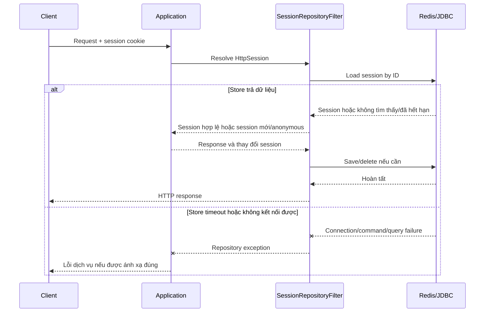

# Timeout kho phiên và phân biệt lỗi xác thực với lỗi hạ tầng

Spring Session lưu trạng thái phiên bên ngoài tiến trình ứng dụng, thường trong Redis hoặc JDBC. Khi một request cần khôi phục `HttpSession` hoặc `WebSession`, ứng dụng phải truy cập kho dữ liệu này. Nếu thao tác đọc hoặc ghi bị timeout, ứng dụng không thể kết luận rằng người dùng đã đăng xuất, session đã hết hạn hay thông tin đăng nhập sai. Đó có thể là lỗi hạ tầng khiến trạng thái xác thực tạm thời không thể được xác minh.

Trong vận hành cần phân biệt hai nhóm timeout rất khác nhau: **thời hạn không hoạt động của session** và **thời gian chờ một thao tác tới kho session**. Nhóm đầu là chính sách vòng đời phiên; nhóm sau là giới hạn thời gian kết nối, lấy connection, chạy command/query hoặc chờ phản hồi. Trộn hai nhóm này có thể làm ứng dụng chuyển lỗi Redis/JDBC thành màn hình đăng nhập, khiến người dùng đăng nhập lại liên tục và che giấu sự cố hạ tầng.

## 1. Hai ý nghĩa khác nhau của “timeout session store”

| Loại timeout | Ví dụ | Kết quả đúng khi xảy ra |
|---|---|---|
| Session inactivity timeout | Người dùng không hoạt động trong 30 phút | Session hết hạn theo chính sách; request tiếp theo cần xác thực lại |
| Redis connect timeout | Ứng dụng không kết nối được Redis trong thời hạn cấu hình | Lỗi hạ tầng; không thể xác minh session hiện tại |
| Redis command timeout | Lệnh đọc/ghi session không nhận phản hồi kịp | Lỗi hạ tầng; kết quả thao tác có thể chưa rõ |
| JDBC pool acquisition timeout | Không lấy được connection từ HikariCP | Lỗi bão hòa pool hoặc database; không phải thông tin đăng nhập sai |
| JDBC query/statement timeout | Truy vấn session chạy quá lâu | Lỗi truy cập kho dữ liệu; cần điều tra query, lock hoặc tải DB |
| HTTP/proxy timeout | Gateway hết thời gian chờ ứng dụng | Request bị kết thúc ở tầng HTTP; nguyên nhân có thể nằm ở app hoặc store |

`maxInactiveInterval` điều khiển thời gian session có thể không hoạt động. Nó không phải socket timeout của Redis, không phải thời gian chờ connection pool và cũng không phải timeout của HTTP request.

## 2. Vòng đời request khi Spring Session truy cập repository

Trong ứng dụng Servlet, `SessionRepositoryFilter` bọc request/response để `HttpSession` được quản lý bởi Spring Session. Khi code hoặc Spring Security cần session, repository tải dữ liệu từ Redis/JDBC. Thay đổi session được lưu theo lifecycle và `FlushMode`/`SaveMode` của cấu hình.



Một kết quả “không tìm thấy session” là khác với “không thể truy vấn session”. Nếu repository trả về không có bản ghi hoặc session đã hết hạn, ứng dụng có thể xử lý như phiên anonymous. Nếu repository không phản hồi, ứng dụng không biết session có tồn tại hay không.

## 3. Phân biệt lỗi xác thực, session hết hạn và lỗi hạ tầng

Ba tình huống có thể khiến người dùng không còn được xem là đã đăng nhập, nhưng nguyên nhân và cách xử lý khác nhau:

| Tình huống | Điều ứng dụng biết | Hành vi thường phù hợp |
|---|---|---|
| Sai username/password | Authentication provider đã kiểm tra credential và từ chối | `401` hoặc redirect về login theo kiểu ứng dụng |
| Tài khoản bị khóa/vô hiệu hóa | Provider xác định trạng thái tài khoản không được đăng nhập | Từ chối xác thực, hiển thị thông báo phù hợp và không tiết lộ quá nhiều chi tiết |
| Session ID không tồn tại hoặc đã hết hạn | Repository truy vấn thành công và xác nhận không có session hợp lệ | Anonymous, `401` hoặc redirect login |
| Người dùng đã logout/phiên bị thu hồi | Repository truy vấn thành công nhưng session đã bị xóa/không hợp lệ | Anonymous hoặc từ chối request được bảo vệ |
| Thiếu quyền truy cập | Người dùng đã xác thực nhưng không đủ authority | `403 Forbidden` theo cấu hình |
| Redis/JDBC timeout | Không thể xác định session state | Lỗi dịch vụ, thường `503` hoặc lỗi `5xx` được phân loại |
| Connection pool cạn | Ứng dụng không lấy được connection để đọc/ghi session | Lỗi hạ tầng; điều tra pool/database và tải |

`401` và redirect login là cách biểu diễn phổ biến cho request chưa xác thực, nhưng chính xác response phụ thuộc `AuthenticationEntryPoint`, loại client và cấu hình Spring Security. `403` cũng có thể xuất hiện do CSRF hoặc authorization policy, không chỉ do người dùng thiếu role.

Điểm cốt lõi: chỉ coi request là anonymous vì session không tồn tại khi repository đã trả lời thành công. Timeout không phải bằng chứng rằng session đã hết hạn.

## 4. Phân biệt session inactivity timeout với cookie lifetime

Session server-side và cookie trình duyệt có thời hạn độc lập:

- `maxInactiveInterval`: thời gian session được phép không có hoạt động trước khi hết hạn.
- Redis TTL hoặc `EXPIRY_TIME` trong JDBC: cơ chế lưu trữ/đánh dấu thời điểm hết hạn của repository.
- Cookie `Max-Age`/`Expires`: thời gian browser giữ cookie session ID.
- Remember-me validity: thời gian credential dài hạn của Spring Security có thể đăng nhập lại.
- HTTP request timeout: giới hạn thời gian xử lý một request.

Đóng browser không đảm bảo session trong Redis/JDBC bị xóa ngay. Cookie có thể hết hạn ở browser trong khi session record còn chờ cleanup. Ngược lại, cookie có thể vẫn được gửi nhưng session server-side đã hết hạn; repository trả về không có session hợp lệ.

Nếu session timeout là 30 phút, request hợp lệ có thể cập nhật last-access time và gia hạn inactivity window theo semantics repository. Không nhầm việc Redis key vật lý còn tồn tại trong một khoảng grace period với việc session vẫn được phép xác thực. Repository phải áp dụng kiểm tra hết hạn logic.

## 5. Cấu hình timeout theo từng lớp

Không nên đặt một timeout duy nhất cho mọi tầng. Mỗi timeout bảo vệ một tài nguyên khác nhau:

| Tầng | Cấu hình/điểm kiểm soát | Mục tiêu |
|---|---|---|
| Spring Session | `spring.session.timeout` hoặc `setMaxInactiveInterval` | Vòng đời không hoạt động của session |
| Redis connect | Connect timeout của Redis client | Giới hạn thời gian thiết lập kết nối |
| Redis command | Command/socket timeout của client | Giới hạn thời gian chờ phản hồi command |
| Connection pool | Thời gian chờ lấy connection | Tránh request đợi pool vô hạn |
| JDBC connection | HikariCP `connection-timeout` | Giới hạn thời gian chờ connection |
| JDBC statement/query | Query timeout hoặc statement/database timeout | Giới hạn truy vấn chậm/lock |
| Application request | Servlet async/request deadline nếu có | Giới hạn thời gian xử lý tổng thể |
| Gateway/load balancer | Upstream response timeout | Giới hạn thời gian client chờ |

Các giá trị cần có quan hệ hợp lý. Thời gian chờ pool cộng thời gian thao tác store và xử lý ứng dụng phải nằm trong ngân sách request. Nếu gateway timeout sau 2 giây nhưng JDBC query timeout là 30 giây, client đã nhận lỗi trong khi worker có thể vẫn chiếm connection và tiếp tục xử lý.

## 6. Ví dụ cấu hình Spring Boot

Ví dụ dưới đây minh họa các property phổ biến ở các dòng Spring Boot hiện đại:

```properties
# Session inactivity timeout
spring.session.timeout=30m

# Redis client timeouts
spring.data.redis.connect-timeout=1s
spring.data.redis.timeout=700ms

# JDBC connection pool acquisition timeout (milliseconds)
spring.datasource.hikari.connection-timeout=1000
```

Property prefix và kiểu cấu hình Redis có thể khác giữa phiên bản Spring Boot (ví dụ các dòng cũ dùng `spring.redis.*`). Hãy xác minh metadata của phiên bản dự án. `spring.datasource.hikari.connection-timeout` chỉ giới hạn thời gian chờ lấy connection từ pool; nó không phải query timeout. Với JDBC statement, dùng API/configuration được hỗ trợ bởi driver, `JdbcTemplate` hoặc database để đặt query timeout phù hợp.

Giá trị 1 giây/700 mili giây chỉ là ví dụ để minh họa quan hệ timeout, không phải khuyến nghị áp dụng nguyên trạng. Hãy đo latency thực tế, network topology, tải đỉnh và yêu cầu SLA trước khi chọn.

Nếu khai báo `@EnableRedisHttpSession` với `maxInactiveIntervalInSeconds`, hãy bảo đảm giá trị annotation và `spring.session.timeout` không gây nhầm lẫn. Cấu hình Java tường minh có thể quyết định repository thay cho auto-configuration.

## 7. Chọn ngân sách timeout theo request deadline

Một request có thể cần lấy connection, kết nối tới Redis, chạy nhiều command, xử lý nghiệp vụ và ghi session trước khi response hoàn tất. Hãy phân bổ ngân sách theo deadline tổng:

```text
Gateway deadline:                 2,000 ms
Application processing budget:   1,600 ms
  Pool acquisition:                100 ms
  Store connect/command budget:     400 ms
  Business processing:             800 ms
  Session save + response margin:  300 ms
```

Đây chỉ là ví dụ phân bổ, không phải phép cộng luôn chính xác cho mọi request; một số thao tác chạy song song hoặc tái sử dụng connection. Mục tiêu là tránh để timeout ở tầng trong dài hơn deadline ngoài quá nhiều, đồng thời dành đủ thời gian cho việc lưu session và gửi response.

Nếu repository timeout sát bằng gateway timeout, ứng dụng có thể không kịp phân loại lỗi hoặc trả response có cấu trúc. Nếu repository timeout quá ngắn, các đợt latency tăng nhẹ sẽ tạo lỗi giả. Dùng histogram p95/p99 và error rate để điều chỉnh.

## 8. Redis timeout: connect, command và pool

Các lỗi Redis cần được phân biệt:

- **Connect timeout:** không hoàn tất bắt tay TCP/TLS hoặc thiết lập kết nối tới Redis.
- **Command timeout:** command đã gửi nhưng client không nhận response trong giới hạn.
- **Pool wait timeout:** không có connection/connection slot sẵn sàng trong thời gian chờ.
- **Connection reset/closed:** connection bị đóng do mạng, failover hoặc server.
- **Server busy/slow command:** Redis phản hồi chậm do tải, command nặng hoặc persistence/failover.

Một command timeout có kết quả không chắc chắn: Redis có thể đã thực hiện command nhưng response bị mất trên đường về. Với lệnh đọc, retry thường ít rủi ro hơn; với lệnh ghi, cần xét tính idempotent và trạng thái cuối. Không retry vô hạn hoặc retry toàn bộ request nếu nghiệp vụ có side effect.

Theo dõi latency Redis, connected clients, rejected connections, pool active/idle, pending acquisition, command latency và lỗi failover. Nếu nhiều instance cùng timeout, điều tra Redis/network trước khi tăng pool size một cách mù quáng.

## 9. JDBC timeout: lấy connection, query và lock

Với Spring Session JDBC, thao tác load/save/delete đi qua datasource và database. Các nguyên nhân timeout thường gặp:

- HikariCP hết connection vì request chờ hoặc giữ connection quá lâu.
- Database quá tải CPU/I/O.
- Query session chờ lock hoặc bị chậm do index không phù hợp.
- Network giữa ứng dụng và database bị gián đoạn.
- Database failover hoặc connection cũ không còn hợp lệ.
- Cleanup session chạy quá nặng và tranh chấp tài nguyên với request.

Phân biệt pool acquisition timeout với statement timeout. Pool timeout xảy ra trước khi câu SQL được gửi. Query timeout xảy ra khi connection đã được cấp nhưng câu lệnh không hoàn tất đúng hạn.

Theo dõi HikariCP active/idle/pending, acquisition time, usage time, connection timeout, DB lock wait, slow query, transaction duration và cleanup job. Đừng tăng `maximumPoolSize` nếu database đã quá tải; điều đó có thể làm nhiều truy vấn đồng thời hơn và khiến tình trạng xấu đi.

## 10. Xử lý lỗi xác thực theo đúng ngữ nghĩa

Spring Security phân biệt lỗi trong quá trình xác thực và lỗi truy cập tài nguyên:

- `AuthenticationException`: quá trình xác thực thất bại, ví dụ credential không hợp lệ hoặc tài khoản không được phép đăng nhập.
- `AccessDeniedException`: người dùng đã xác thực nhưng không có quyền hoặc request vi phạm policy như CSRF.
- Session không tồn tại/hết hạn: không có Authentication được khôi phục; ứng dụng xử lý request như anonymous.
- Repository/hạ tầng exception: không thể tải hoặc lưu trạng thái xác thực; không được đổi thành sai mật khẩu.

Nếu người dùng nhập sai mật khẩu, hệ thống có thể trả thông báo xác thực thất bại và ghi metric `authentication_failure`. Nếu Redis timeout khi Spring Security đang khôi phục `SecurityContext`, đó là `session_store_failure` hoặc `dependency_timeout`. Hai metric cần tách biệt để đội vận hành không nhầm một đợt Redis outage với đợt credential stuffing.

Không bắt mọi exception rồi ném `BadCredentialsException`. Cách đó vừa làm sai thông điệp cho người dùng, vừa làm hỏng số liệu bảo mật và có thể kích hoạt khóa tài khoản do lỗi hạ tầng.

## 11. Khi repository không truy cập được, phải fail closed

Nếu ứng dụng không thể đọc session store, nó không thể xác minh session ID hiện tại có ánh xạ tới SecurityContext hợp lệ hay không. Đối với endpoint yêu cầu xác thực, hành vi an toàn là từ chối xử lý như một request đã xác thực và báo lỗi dịch vụ phù hợp.

Không nên:

- Tạo một session in-memory riêng trên node như fallback ngầm.
- Giả định người dùng đã logout chỉ vì Redis không phản hồi.
- Chuyển repository exception thành `BadCredentialsException`.
- Bỏ qua kiểm tra authorization vì không đọc được SecurityContext.
- Trả response thành công cho thao tác nhạy cảm khi không thể xác minh session.

Một số endpoint public/stateless có thể tiếp tục phục vụ nếu không cần session store. Có thể tách rõ các đường dẫn không dùng session hoặc dùng security policy stateless. Nhưng với request cần khôi phục trạng thái xác thực, không được tự suy diễn danh tính khi repository lỗi.

Fail closed không có nghĩa mọi request đều phải thất bại nếu Redis mất kết nối. Endpoint public không phụ thuộc session có thể tiếp tục chạy; endpoint yêu cầu session cần từ chối hoặc trả lỗi dịch vụ. Phạm vi ảnh hưởng phải được xác định rõ trong security configuration.

## 12. Ánh xạ lỗi hạ tầng thành HTTP response

Lỗi Redis/JDBC có thể xuất hiện trong filter chain, khi controller gọi `getSession()`, hoặc lúc `SessionRepositoryFilter` lưu session sau khi downstream filter/controller hoàn tất. Vì vậy, một `@ControllerAdvice` đơn thuần có thể không bắt được mọi lỗi phát sinh ở filter hoặc response commit.

Thiết kế xử lý lỗi cần:

1. Nhận diện nhóm exception repository/driver đã biết, không bắt mọi `RuntimeException`.
2. Ánh xạ lỗi dependency tạm thời thành response `503 Service Unavailable` hoặc mã `5xx` phù hợp với API contract.
3. Với request browser, có thể hiển thị trang lỗi tạm thời; không redirect tới login như thể session đã hết hạn.
4. Giữ nguyên `401`/redirect cho trường hợp xác thực thật sự thất bại hoặc session không còn hợp lệ.
5. Không trả tên host, connection string, SQL hoặc stack trace cho client.
6. Ghi log có correlation ID, loại dependency và exception class đã làm sạch.

Đặt exception translation ở ranh giới đủ bao phủ thao tác session, gồm cả phần filter save nếu cần. Trong Servlet, có thể cần filter bao ngoài Spring Session filter hoặc cơ chế error dispatch của container; phải kiểm thử thứ tự filter thực tế. Đừng thêm filter tùy tiện trước/sau mà vô tình thay đổi thứ tự `SessionRepositoryFilter` và Spring Security.

## 13. Vì sao không nên redirect tới login khi Redis timeout?

Giả sử browser gửi cookie session hợp lệ nhưng Redis tạm thời không phản hồi. Nếu ứng dụng biến lỗi đó thành anonymous và redirect `/login`, người dùng sẽ thấy như bị đăng xuất. Sau khi Redis phục hồi, session cũ có thể vẫn còn và người dùng có thể đăng nhập lại trong khi session cũ chưa bị thu hồi.

Hành vi này gây ra:

- Nhầm lẫn giữa lỗi vận hành và lỗi xác thực.
- Tăng login traffic sau khi store phục hồi.
- Có thể tạo nhiều session cho cùng người dùng.
- Làm sai metric logout/session expiration.
- Che giấu Redis/JDBC outage và kéo dài thời gian khắc phục.

Với API, trả `503` giúp client phân biệt dependency unavailable và có thể retry theo policy. Với browser, hiển thị thông báo “dịch vụ phiên tạm thời không khả dụng, vui lòng thử lại” thay vì xóa cookie hoặc bắt nhập lại mật khẩu. Không xóa session cookie khi chưa biết trạng thái server-side.

## 14. Lỗi xảy ra khi lưu session sau khi nghiệp vụ đã chạy

Một tình huống khó là controller đã thực hiện nghiệp vụ nhưng session save thất bại ở cuối request. Ví dụ, controller cập nhật giỏ hàng trong database nghiệp vụ rồi response được chuẩn bị, nhưng `SessionRepositoryFilter` không lưu được attribute `cartId`.

Không nên tự động retry toàn bộ request chỉ vì session save timeout. Nghiệp vụ có thể đã commit, dẫn tới tạo đơn hàng hoặc thanh toán hai lần. Cần:

- Dùng idempotency key cho các thao tác nghiệp vụ không thể lặp an toàn.
- Tách transaction nghiệp vụ khỏi session state và xác định kết quả commit.
- Ghi log correlation ID để điều tra trạng thái không đồng bộ.
- Chỉ retry thao tác repository khi semantics của thao tác cho phép và dữ liệu đầu vào còn mới.
- Không trả thành công nếu response phụ thuộc vào session state chưa lưu và việc lưu thất bại.

Một timeout ở phía client cũng không chứng minh server chưa commit. API có side effect nên có cơ chế tra cứu kết quả theo idempotency key thay vì yêu cầu người dùng bấm lại.

## 15. Retry, circuit breaker và giới hạn chờ

Retry có thể giúp vượt qua lỗi mạng ngắn, nhưng retry sai cách làm tăng tải đúng lúc dependency đang quá tải.

Nguyên tắc:

- Chỉ retry lỗi tạm thời đã nhận diện, không retry lỗi xác thực hoặc lỗi dữ liệu.
- Giới hạn số lần và tổng thời gian retry.
- Dùng exponential backoff có jitter khi phù hợp.
- Không giữ servlet thread hoặc JDBC connection trong lúc chờ dài.
- Tránh retry đồng thời ở nhiều lớp (HTTP client, service, repository, proxy) gây nhân số request.
- Với thao tác ghi có kết quả không chắc chắn, đánh giá idempotency trước khi retry.
- Circuit breaker có thể ngăn request tiếp tục dồn vào dependency đang lỗi, nhưng trạng thái open phải trả lỗi dịch vụ rõ ràng.

Không dùng fallback cache hoặc in-memory session để giả lập một session store khỏe mạnh. Fallback chỉ phù hợp nếu được thiết kế rõ về consistency, expiry, security và reconciliation; trong đa số ứng dụng xác thực, một session local không thể thay thế trạng thái dùng chung an toàn.

## 16. Readiness, liveness và tình trạng session store

Readiness và liveness phục vụ mục tiêu khác nhau:

- **Liveness:** tiến trình có còn sống và có thể tiếp tục chạy không?
- **Readiness:** instance có đủ khả năng nhận request production không, gồm dependency bắt buộc như session store?

Nếu Redis/JDBC là dependency bắt buộc cho request xác thực, readiness có thể chuyển `DOWN` khi store không thể truy cập trong ngưỡng đã định. Load balancer/người điều phối khi đó ngừng gửi request mới tới instance không sẵn sàng.

Không nên làm liveness fail ngay khi Redis có một lỗi transient, khiến orchestrator restart hàng loạt instance và tạo thêm kết nối tới dependency đang quá tải. Liveness nên phản ánh sức khỏe tiến trình; readiness phản ánh khả năng phục vụ. Health indicator cần timeout ngắn, tránh tạo thêm tải hoặc treo thread khi dependency lỗi.

Nếu một số endpoint không cần session vẫn có thể phục vụ, cân nhắc readiness theo nhóm dịch vụ hoặc định tuyến riêng. Tuy nhiên, không cho endpoint yêu cầu xác thực đi vào node không thể kiểm tra session.

## 17. Quan sát và cảnh báo đúng loại lỗi

Theo dõi riêng các chỉ số:

| Metric/log | Phân loại | Mục đích |
|---|---|---|
| Authentication failures | Xác thực | Phát hiện credential sai hoặc tấn công đăng nhập |
| Session not found/expired | Vòng đời session | Đo session hết hạn và cookie cũ |
| Session repository load/save failures | Hạ tầng session | Phát hiện Redis/JDBC lỗi |
| Redis connect/command timeout | Redis | Phân biệt mạng, server và command chậm |
| Hikari pending/acquisition timeout | JDBC pool | Phát hiện pool cạn hoặc DB chậm |
| SQL query/lock timeout | Database | Phát hiện truy vấn và lock |
| HTTP 503/5xx do dependency | Ứng dụng | Theo dõi tác động tới người dùng |
| Session save latency p95/p99 | Repository | Nhận diện suy giảm trước khi timeout hàng loạt |

Log nên có request correlation ID, instance ID, dependency type, operation (load/save/delete), elapsed time và exception class. Không ghi session ID, cookie, password, OTP, token hoặc SecurityContext payload. Nếu cần liên kết nhiều log, dùng hash hoặc identifier đã che với thời hạn lưu ngắn.

Đặt alert riêng cho authentication failure spike và repository timeout spike. Một đợt credential stuffing thường có nhiều request bị từ chối xác thực; một đợt Redis outage thường có lỗi phân bố trên nhiều principal, nhiều instance và cùng thời điểm dependency.

## 18. Runbook: phân loại một request bị chuyển về login

Khi người dùng báo bị chuyển về trang login hoặc API trả `401`, thực hiện theo thứ tự:

1. Kiểm tra response và correlation ID; xác định lỗi là `401`, redirect, `403` hay `5xx`.
2. Kiểm tra request có gửi cookie session đúng name/path/domain hay không, nhưng không copy giá trị cookie vào ticket/log.
3. Kiểm tra repository load có hoàn tất thành công hay timeout.
4. Nếu load thành công nhưng không có session/đã hết hạn, kiểm tra inactivity timeout, logout và cookie cũ.
5. Nếu repository load thất bại, kiểm tra Redis/JDBC, network, TLS, DNS, pool và failover.
6. Kiểm tra Spring Security log để phân biệt `AuthenticationException`, `AccessDeniedException` và exception repository.
7. So sánh nhiều instance: có node nào dùng namespace, serializer hoặc datasource khác không?
8. Kiểm tra liệu ứng dụng có ánh xạ lỗi repository thành anonymous/login redirect sai không.
9. Sau khi dependency phục hồi, xác minh request với cookie cũ theo chính sách; không tự động xóa hoặc tái tạo session hàng loạt.
10. Ghi nhận thời điểm bắt đầu/kết thúc, tỷ lệ lỗi và các thao tác phục hồi.

Không yêu cầu người dùng nhập lại mật khẩu nhiều lần khi chưa xác định lỗi xác thực hay lỗi hạ tầng. Việc lặp login có thể làm tăng tải identity provider và tạo thêm session.

## 19. Runbook: Redis không phản hồi

Các bước chẩn đoán:

- Kiểm tra DNS, route, firewall, TLS certificate và credential/ACL.
- Kiểm tra Redis endpoint, primary/replica role và trạng thái failover.
- Kiểm tra connected clients, rejected connections, memory, CPU, latency và slow commands.
- Kiểm tra Lettuce/Jedis pool: active, idle, pending và acquisition wait.
- Kiểm tra connect timeout và command timeout đang được áp dụng ở từng instance.
- Xác nhận tất cả instance dùng cùng endpoint, database và namespace.
- Kiểm tra lỗi serialization riêng biệt; lỗi deserialize không giống connection timeout.
- Nếu Redis đã phục hồi, kiểm tra read/write session bằng test account và xác minh logout/expiry.

Không chạy `FLUSHDB`/`FLUSHALL` để “sửa” session store. Không tăng timeout vô hạn hoặc tăng connection pool thiếu kiểm soát. Nếu Redis failover, chờ client reconnect theo cấu hình và xác minh trạng thái session; không giả định mọi lệnh ghi có timeout đều chưa được thực hiện.

## 20. Runbook: JDBC session repository chậm hoặc timeout

Các bước chẩn đoán:

- Kiểm tra database availability, DNS, TLS và network.
- Kiểm tra Hikari active/idle/pending và acquisition timeout.
- Kiểm tra query session, execution plan, index và lock wait.
- Kiểm tra transaction duration và cleanup job đang chạy.
- Kiểm tra database failover hoặc connection stale trong pool.
- Phân biệt lỗi lấy connection với query timeout.
- Xác nhận A/B dùng cùng datasource/schema/table và migration tương thích.
- Sau phục hồi, xác minh session có thể được tải và lưu, sau đó kiểm tra expiration cleanup.

Không truncate bảng session để khắc phục pool timeout. Không tăng pool size nếu database đang bão hòa. Tìm nguyên nhân giữ connection lâu, truy vấn chậm hoặc thiếu capacity trước khi điều chỉnh.

## 21. Phục hồi sau khi store hoạt động trở lại

Khi Redis/JDBC phục hồi, cần xác minh theo các lớp:

1. Connection pool/client reconnect thành công.
2. Repository có thể đọc một session test đã biết.
3. Repository có thể tạo, cập nhật và xóa session test.
4. Các instance cùng đọc được session từ kho chung.
5. Session đã hết hạn vẫn không được khôi phục chỉ vì key/hàng vật lý còn tồn tại.
6. Session đã logout không được sống lại từ cache hoặc bản sao cũ.
7. Event listener/expiration subscriber kết nối lại nếu implementation cần chúng.
8. Metrics và alert trở về mức bình thường.

Nếu có replica lag hoặc restore từ backup, đánh giá nguy cơ session đã bị thu hồi xuất hiện trở lại. Có thể cần đổi namespace/version hoặc yêu cầu xác thực lại theo kế hoạch nếu không thể chứng minh trạng thái thu hồi được bảo toàn.

## 22. Kiểm thử timeout và phân biệt lỗi

Test cần tạo ra cả tình huống session hết hạn hợp lệ và tình huống repository không truy cập được:

| Test case | Cách tạo tình huống | Kết quả mong đợi |
|---|---|---|
| Session hết inactivity timeout | Tạo session timeout ngắn và chờ/điều khiển clock | Repository trả không có session hợp lệ; request thành anonymous/login |
| Cookie ID không tồn tại | Gửi ID ngẫu nhiên | Không khôi phục authentication; không báo store outage |
| Redis connection refused | Dừng Redis hoặc chặn kết nối trong test | Dependency error/503 cho endpoint cần session |
| Redis command delay | Fault injection/proxy làm command chậm hơn timeout | Repository timeout được phân loại là hạ tầng |
| JDBC pool exhausted | Giữ hết connection trong test có kiểm soát | Pool acquisition timeout, không phải bad credentials |
| JDBC query/lock timeout | Giữ lock hoặc tạo query chậm trong database test | Database operation timeout và alert tương ứng |
| Logout khi store khỏe | Invalidate session qua một node | Node khác từ chối cookie cũ |
| Store outage rồi phục hồi | Ngắt rồi mở lại dependency | Session state được xử lý theo dữ liệu repository; không fallback local |
| Save timeout sau business commit | Cố ý làm store chậm sau thao tác nghiệp vụ | Không retry side effect một cách mù quáng |

Dùng Testcontainers cho Redis/JDBC và proxy/fault injection trong môi trường test. Không gây lỗi mạng hoặc dừng dependency production để thử runbook. Mỗi test cần timeout hữu hạn và cleanup tài nguyên.

## 23. Kiểm thử exception translation trong filter chain

Vì Spring Session filter có thể đọc hoặc lưu session ngoài thời điểm controller đang chạy, test chỉ gọi service method không đủ. Cần kiểm tra request HTTP qua filter chain:

1. Gửi request có session cookie hợp lệ tới endpoint được bảo vệ.
2. Làm repository fail ở thao tác load; xác nhận response là lỗi dependency, không phải redirect login.
3. Cho load thành công nhưng làm thao tác save thất bại khi request hoàn tất; xác nhận response không bị báo thành công sai nếu save là điều kiện của thao tác.
4. Gửi credential sai khi store khỏe; xác nhận vẫn là authentication failure.
5. Gửi cookie session hết hạn khi store khỏe; xác nhận anonymous/login behavior.
6. Gửi request public không cần session khi store lỗi; xác nhận behavior theo security design, không vô tình tạo session.

Test phải chạy với filter order production. Nếu exception translation filter đặt sai vị trí, nó có thể không bắt được lỗi xảy ra trong `SessionRepositoryFilter` hoặc có thể thay đổi security semantics.

## 24. Đồng bộ đồng hồ và thời hạn

Expiration dựa trên thời gian nên đồng hồ hệ thống cần được đồng bộ. Các instance chạy lệch giờ có thể tính last-access/expiry khác nhau, đặc biệt khi metadata hoặc timestamp được tạo ở ứng dụng rồi lưu vào database.

- Đồng bộ clock bằng NTP/chrony hoặc cơ chế nền tảng.
- Theo dõi clock skew giữa app nodes và database.
- Không đặt timeout cực ngắn sát giới hạn clock skew.
- Trong test, ưu tiên clock có thể điều khiển hoặc polling điều kiện hết hạn thay vì `Thread.sleep` cố định.
- Phân biệt thời điểm hết hạn logic với lúc Redis/JDBC cleanup xóa vật lý.

Clock skew không phải lỗi xác thực và cũng không phải Redis command timeout. Nếu nhiều node báo session hết hạn bất thường, so sánh timestamp/clock trước khi kết luận cookie hoặc credential sai.

## 25. Các anti-pattern cần tránh

| Anti-pattern | Hậu quả | Cách xử lý |
|---|---|---|
| Chuyển repository timeout thành `BadCredentialsException` | Sai metric, khóa tài khoản nhầm, người dùng bị bắt login lại | Phân loại dependency exception riêng |
| Coi mọi session miss là store outage | Báo lỗi sai khi session thật sự hết hạn | Phân biệt kết quả rỗng với exception |
| Coi store timeout là session expired | Có thể xóa cookie và mất khả năng tiếp tục phiên sau phục hồi | Trả lỗi dịch vụ, giữ nguyên credential client |
| Fallback sang in-memory session trên mỗi node | Trạng thái xác thực phân mảnh, logout không nhất quán | Fail closed cho endpoint cần session |
| Retry vô hạn | Khuếch đại outage và giữ thread/connection | Retry hữu hạn, backoff và deadline |
| Tăng pool size để chữa DB chậm | Làm database quá tải hơn | Phân tích pool wait, query, lock và DB capacity |
| Đặt store timeout dài hơn gateway nhiều lần | Worker tiếp tục chạy sau khi client đã timeout | Căn chỉnh ngân sách timeout |
| Bắt mọi exception rồi trả 503 | Che lỗi lập trình và lỗi nghiệp vụ | Chỉ ánh xạ exception hạ tầng đã nhận diện |
| Retry toàn bộ POST sau save timeout | Side effect nghiệp vụ có thể lặp | Idempotency key và kiểm tra kết quả commit |

## 26. Checklist cấu hình và vận hành

| Hạng mục | Điều kiện đạt |
|---|---|
| Session TTL | Được cấu hình theo chính sách inactivity, không nhầm với network timeout |
| Redis/JDBC timeout | Có giới hạn connect, command/query và pool wait |
| Request deadline | Các timeout tầng trong nằm trong ngân sách tổng thể |
| Error classification | Auth failure, session expiry và repository failure có metric/response riêng |
| Failure mode | Endpoint cần session fail closed khi không thể xác minh trạng thái |
| HTTP response | Dependency timeout không bị chuyển thành login redirect hoặc bad credentials |
| Retry | Hữu hạn, có backoff và xét idempotency |
| Health | Readiness phản ánh dependency; liveness không restart-loop do lỗi transient |
| Observability | Có latency, timeout, pool, query/command và 5xx metrics |
| Security | Không log session ID, cookie, token hoặc credential |
| Recovery | Có test read/write/delete và kiểm tra session cũ sau phục hồi |
| Testing | Có fault injection cho Redis/JDBC và test qua filter chain |

## 27. Quy trình xử lý sự cố cho đội vận hành

1. Xác định thời điểm bắt đầu, phạm vi instance và tỷ lệ request lỗi.
2. Phân loại response: auth failure, anonymous/session expired, `403`, `503` hay lỗi `5xx`.
3. Kiểm tra repository load/save latency và exception class.
4. Kiểm tra Redis connection/command hoặc JDBC pool/query/lock tương ứng.
5. So sánh timeout giữa client, gateway, application, pool và store.
6. Chuyển readiness của instance không thể truy cập dependency theo chính sách; tránh restart hàng loạt nếu tiến trình còn khỏe.
7. Khôi phục dependency hoặc network, theo dõi client reconnect.
8. Xác minh session đọc/ghi/xóa trên kho dùng chung và kiểm tra logout/expiry.
9. Kiểm tra side effect nghiệp vụ của request timeout trước khi yêu cầu client retry.
10. Đóng sự cố khi error rate, latency và readiness ổn định; ghi nhận nguyên nhân và điều chỉnh timeout/alert.

## 28. Tài liệu chính thức để đối chiếu

Property và exception cụ thể thay đổi theo phiên bản Spring Boot, Spring Session, Spring Data Redis và JDBC driver. Hãy đối chiếu đúng dependency đang chạy:

- [Spring Session — Redis configuration](https://docs.spring.io/spring-session/reference/configuration/redis.html)
- [Spring Session — JDBC configuration](https://docs.spring.io/spring-session/reference/configuration/jdbc.html)
- [Spring Session — HttpSession integration](https://docs.spring.io/spring-session/reference/http-session.html)
- [Spring Security — Authentication architecture](https://docs.spring.io/spring-security/reference/servlet/authentication/architecture.html)
- [Spring Boot — Application properties](https://docs.spring.io/spring-boot/appendix/application-properties/index.html)

Session hết inactivity timeout là một kết quả vòng đời bình thường: repository truy vấn thành công nhưng không còn phiên hợp lệ. Redis/JDBC timeout là lỗi hạ tầng: ứng dụng không thể xác định trạng thái session. Hãy giữ hai tình huống riêng trong exception handling, HTTP response, metric và runbook. Đặt timeout kết nối, pool, command/query và request theo một ngân sách rõ ràng; khi kho phiên không thể xác minh trạng thái, endpoint cần xác thực phải fail closed và báo lỗi dịch vụ thay vì giả vờ người dùng nhập sai mật khẩu hoặc đã đăng xuất.
