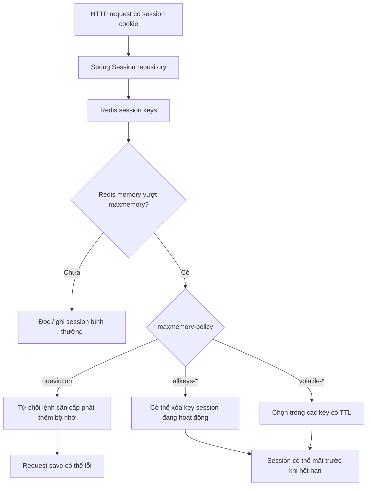

# Chính sách bộ nhớ Redis, eviction và rủi ro mất phiên đang hoạt động

Spring Session dùng Redis để lưu session bên ngoài JVM, nhờ đó nhiều instance ứng dụng có thể đọc cùng trạng thái phiên. Tuy nhiên, Redis vẫn là một kho dữ liệu có giới hạn bộ nhớ. Khi bộ nhớ đạt ngưỡng `maxmemory`, Redis áp dụng eviction policy để quyết định có xóa key hiện có hay từ chối lệnh ghi mới. Nếu policy cho phép eviction trên key session, một phiên vẫn còn thời hạn có thể biến mất trước khi người dùng đăng xuất hoặc hết idle timeout.

Eviction cần được phân biệt với expiration. Expiration là việc key hết TTL theo chính sách vòng đời session; eviction là việc Redis loại key để giải phóng bộ nhớ khi vượt giới hạn. Một session bị eviction có thể làm người dùng bị đăng xuất đột ngột, mất trạng thái giỏ hàng hoặc phải xác thực lại. Với ứng dụng coi session là trạng thái xác thực, chọn memory policy là quyết định về độ sẵn sàng và tính toàn vẹn của phiên, không chỉ là tối ưu cache.

## 1. Redis memory policy ảnh hưởng đến Spring Session như thế nào?

Mỗi node ứng dụng Spring Session kết nối đến Redis dùng chung. Repository lưu session metadata và attribute thành một hoặc nhiều key/structure. Khi Redis hết headroom, policy quyết định key nào có thể bị loại hoặc lệnh ghi nào bị từ chối.



Redis không hiểu ý nghĩa nghiệp vụ của key. Nếu key chứa session ID, cart state hoặc cache, Redis chỉ áp dụng policy theo tập key và tiêu chí như LRU/LFU/TTL. Namespace `spring:session` giúp phân biệt key ở mức tên, nhưng không tự tạo một vùng bộ nhớ được bảo vệ khỏi eviction.

## 2. Phân biệt expiration và eviction

Hai cơ chế có mục đích khác nhau:

| Cơ chế | Điều kiện xảy ra | Mục đích | Tác động đến session |
|---|---|---|---|
| Expiration/TTL | Key đã đến thời điểm hết hạn | Kết thúc dữ liệu theo vòng đời đã đặt | Session hết idle timeout hoặc key phụ hết hạn |
| Eviction | Redis cần giải phóng bộ nhớ theo `maxmemory` policy | Giữ Redis trong giới hạn bộ nhớ | Session còn hạn vẫn có thể bị xóa nếu key đủ điều kiện |
| Explicit delete | Ứng dụng gọi logout/invalidate hoặc quản trị thu hồi | Thu hồi session có chủ đích | Session bị xóa theo yêu cầu nghiệp vụ |

Ví dụ: session được cấu hình idle timeout 30 phút và người dùng vừa hoạt động cách đây 2 phút. Nếu Redis dùng `allkeys-lru`, key session vẫn có thể bị chọn eviction khi Redis cần bộ nhớ, dù TTL còn gần 28 phút. Đây không phải session expiration theo chính sách của ứng dụng.

Ngược lại, nếu session hết TTL, Redis có thể loại key khi truy cập hoặc qua cơ chế expiration nền. Việc xóa vật lý có thể không xảy ra đúng một thời điểm tuyệt đối; repository vẫn cần kiểm tra trạng thái hết hạn theo semantics của Spring Session.

Không dùng metric `expired_keys` để kết luận có eviction hay không. `expired_keys` và `evicted_keys` phản ánh hai nhóm sự kiện khác nhau; cần theo dõi riêng.

## 3. Các nhóm `maxmemory-policy`

Redis có các nhóm policy phổ biến:

| Policy | Tập key có thể bị loại | Tiêu chí |
|---|---|---|
| `noeviction` | Không loại key để giải phóng bộ nhớ | Lệnh cần thêm bộ nhớ có thể nhận lỗi OOM |
| `allkeys-lru` | Mọi key | Ước lượng least recently used |
| `allkeys-lfu` | Mọi key | Ước lượng least frequently used |
| `allkeys-random` | Mọi key | Chọn ngẫu nhiên |
| `volatile-lru` | Key có expiration/TTL | Ước lượng ít được dùng gần đây |
| `volatile-lfu` | Key có expiration/TTL | Ước lượng tần suất truy cập thấp |
| `volatile-random` | Key có expiration/TTL | Chọn ngẫu nhiên trong tập đủ điều kiện |
| `volatile-ttl` | Key có expiration/TTL | Ưu tiên key còn TTL ngắn hơn |

Redis dùng thuật toán xấp xỉ cho một số policy như LRU/LFU; không nên coi kết quả như thứ tự chính xác toàn bộ key. Các phiên bản Redis có thể có khác biệt nhỏ về cấu hình và metric, nên kiểm tra tài liệu của phiên bản triển khai.

### `noeviction`

Khi đạt `maxmemory`, Redis không xóa key hiện có để lấy chỗ. Các thao tác đọc và lệnh không cần thêm bộ nhớ vẫn có thể hoạt động; lệnh cần cấp phát thêm có thể thất bại với lỗi OOM. Với session store, ưu điểm là Redis không tự chọn xóa một session đang hoạt động chỉ để nhận thêm dữ liệu cache khác.

Đổi lại, khi bộ nhớ đầy, việc tạo session mới hoặc lưu thay đổi có thể thất bại. Ứng dụng cần xử lý lỗi repository rõ ràng, cảnh báo sớm và có quy trình tăng capacity hoặc giải phóng dữ liệu an toàn. `noeviction` không làm Redis có thêm bộ nhớ; nó chuyển rủi ro từ mất ngẫu nhiên session hiện có sang lỗi ghi mới khi chạm giới hạn.

### `allkeys-lru` và `allkeys-lfu`

Các policy này có thể xóa bất kỳ key nào, kể cả key session đang có TTL. Nếu Redis dùng chung cho cache và session, một session ít được truy cập gần đây có thể bị loại để nhường bộ nhớ cho cache nóng. `allkeys-lfu` cũng không hiểu session còn đang xác thực; một phiên ít request có thể bị coi là ít phổ biến.

Không nên dùng `allkeys-lru`, `allkeys-lfu` hoặc `allkeys-random` cho một Redis instance mà dữ liệu session phải được giữ đến khi hết hạn hoặc bị thu hồi có chủ đích.

### Nhóm `volatile-*`

Các policy `volatile-*` chỉ chọn key có expiration/TTL. Điều này không tự động khiến chúng an toàn cho session: session key thường có TTL chính là đối tượng có thể bị loại. `volatile-ttl` có thể ưu tiên key sắp hết hạn, nhưng key đó vẫn có thể đại diện cho người dùng đang hoạt động. `volatile-lru` và `volatile-lfu` cũng có thể xóa session có tần suất truy cập thấp.

Ngoài ra, không phải mọi key liên quan đến repository đều nhất thiết có cùng TTL hoặc cùng cấu trúc. Nếu một số key/index không có expiration, chúng không nằm trong tập ứng viên của `volatile-*`, nhưng session data có TTL vẫn có thể bị loại. Cần hiểu key layout của đúng Spring Session repository/version trước khi dựa vào policy này.

## 4. Vì sao eviction có thể làm mất session đang hoạt động?

Spring Session lưu dữ liệu phiên trong Redis, còn trình duyệt giữ session ID trong cookie. Khi key chứa session bị eviction:

1. Trình duyệt vẫn gửi cookie có session ID cũ.
2. Ứng dụng gọi repository để tìm session theo ID.
3. Redis không còn dữ liệu session tương ứng.
4. Spring Session không thể khôi phục `SecurityContext` và các attribute cũ.
5. Request có thể được xem như không có session hợp lệ; ứng dụng có thể yêu cầu đăng nhập lại hoặc tạo session mới theo luồng.

Hậu quả phụ thuộc loại dữ liệu:

- Người dùng bị đăng xuất ngoài dự kiến.
- Giỏ hàng hoặc tiến trình checkout lưu trong session bị mất.
- Flash attribute hoặc saved request biến mất.
- CSRF state gắn với session không còn khớp.
- Các ứng dụng chia sẻ session có thể đồng thời mất trạng thái.
- Support khó điều tra nếu chỉ thấy session not-found mà không theo dõi `evicted_keys`.

Nếu dữ liệu nghiệp vụ quan trọng chỉ tồn tại trong session, eviction có thể gây mất dữ liệu thực tế. Session nên chứa trạng thái ngắn hạn có thể tái tạo hoặc khôi phục; đơn hàng, thanh toán, số dư và dữ liệu chuẩn phải được lưu trong kho nghiệp vụ có độ bền phù hợp.

## 5. Khuyến nghị policy cho Redis chuyên dùng lưu session

Với Redis được dành riêng cho Spring Session, lựa chọn thường an toàn hơn là `noeviction` cùng capacity planning và cảnh báo đủ sớm. Cấu hình minh họa:

```text
maxmemory 4gb
maxmemory-policy noeviction
```

Con số 4 GB chỉ là ví dụ; cần dựa trên số session đồng thời, kích thước session, replication, overhead, buffer và giới hạn hạ tầng. `maxmemory` không nên được đặt bằng toàn bộ RAM của máy/container vì Redis còn cần bộ nhớ cho overhead và hệ điều hành.

Một cấu hình Spring Boot có thể đặt timeout và namespace:

```yaml
spring:
  session:
    store-type: redis
    timeout: 30m
    redis:
      namespace: spring:session:production
```

Đây là ví dụ property ở mức ứng dụng; memory policy được cấu hình ở Redis server hoặc dịch vụ Redis quản lý, không phải thuộc tính của Spring Session. Tên property và auto-configuration phụ thuộc phiên bản Spring Boot. Không nhầm `spring.session.timeout` với Redis `maxmemory` hoặc eviction policy.

### Tách Redis session khỏi Redis cache

Nếu cache cần eviction để tự cân bằng bộ nhớ, còn session cần giữ ổn định đến TTL/revoke, nên tách chúng thành các Redis deployment/cluster riêng. Dùng hai logical database hoặc hai key prefix trong cùng Redis process không tạo cách ly memory policy; một nhóm key vẫn có thể gây áp lực lên nhóm còn lại.

Tách riêng giúp:

- Chọn `noeviction` cho session và policy cache phù hợp cho cache.
- Đặt quota/capacity và cảnh báo độc lập.
- Tránh cache miss storm làm session store đầy.
- Phân quyền, backup, maintenance và scaling riêng.
- Giới hạn phạm vi sự cố khi cache bị tăng đột biến.

Nếu không thể tách, cần tính tổng memory footprint và chọn policy theo loại dữ liệu có yêu cầu nghiêm ngặt nhất. Không mặc định `volatile-*` sẽ bảo vệ session chỉ vì cache key có TTL.

## 6. Capacity planning cho session store

Ước lượng bộ nhớ cần dựa trên session hoạt động và kích thước payload thực tế:

\[
M_{sessions} \approx N_{active} \times S_{avg} \times F_{overhead}
\]

Trong đó:

- `N_active`: số session đồng thời ở thời điểm peak.
- `S_avg`: kích thước dữ liệu session trung bình sau serialization.
- `F_overhead`: hệ số tính thêm key/object metadata, allocator, index và cấu trúc Redis.

Sau đó cộng headroom cho tăng trưởng, replication/client buffers và vận hành:

\[
M_{planned} = M_{sessions} + M_{growth} + M_{replication} + M_{buffer} + M_{headroom}
\]

Đây là mô hình ước lượng. Redis memory overhead không thể suy ra chính xác chỉ từ kích thước JSON/serialized payload; đo `MEMORY USAGE`, `INFO memory` và dữ liệu thực tế trong môi trường tương tự production.

Ví dụ minh họa: 300.000 session hoạt động, mỗi session trung bình 3 KB payload. Payload thô khoảng 900 MB. Nếu tính thêm overhead key/structure, index và headroom, bộ nhớ cần thiết có thể cao hơn đáng kể. Không đặt `maxmemory=900MB` chỉ vì phép nhân payload cho ra 900 MB.

### Dùng phân vị, không chỉ trung bình

Một số session có thể lớn hơn nhiều do cart hoặc workflow. Đo p50/p95/p99 session size và số attribute. Capacity planning cần xem peak session count, burst login sau outage, campaign hoặc đầu giờ làm việc. Một đợt nhiều người đăng nhập lại cùng lúc có thể làm số session và write rate tăng đột biến.

## 7. Các thành phần bộ nhớ ngoài payload session

Redis process cần bộ nhớ cho nhiều thành phần:

- Key và object metadata.
- Hash/list/set hoặc cấu trúc index do repository tạo.
- Allocator fragmentation và overhead nội bộ.
- Client output/input buffers.
- Replication backlog và buffers.
- AOF rewrite hoặc RDB snapshot overhead tùy cấu hình/version.
- Temporary memory cho lệnh lớn, fork và copy-on-write trong một số hoạt động persistence.
- Bộ nhớ hệ điều hành/container và tiến trình phụ trợ.

`maxmemory` là ngưỡng Redis dùng cho memory management, không phải tổng cam kết RAM mà container có thể sử dụng. Các vùng bộ nhớ được tính hoặc loại khỏi eviction accounting có thể khác theo phiên bản Redis. Cần quan sát cả `used_memory`, `used_memory_rss`, `mem_not_counted_for_evict` nếu có, memory fragmentation và cgroup/container memory.

Đặt giới hạn container đúng với tổng footprint dự kiến. Nếu Redis bị hệ điều hành OOM-kill trước khi policy nội bộ hoạt động, mọi session trên instance đó có thể mất khả năng truy cập hoặc cần failover.

## 8. Theo dõi `evicted_keys` và các chỉ số memory

Các chỉ số nên thu thập liên tục:

| Chỉ số | Ý nghĩa | Cách dùng |
|---|---|---|
| `used_memory` | Bộ nhớ Redis đang tính toán sử dụng | So với `maxmemory` và xu hướng tăng |
| `used_memory_peak` | Mức sử dụng cao nhất kể từ lần reset | Nhận biết peak đã xảy ra |
| `used_memory_rss` | Bộ nhớ resident mà hệ điều hành thấy | Phát hiện fragmentation và áp lực RAM thực |
| `mem_fragmentation_ratio` | Tỷ lệ RSS so với logical memory theo định nghĩa Redis | Theo dõi phân mảnh; không diễn giải đơn độc |
| `evicted_keys` | Tổng số key đã bị eviction | Theo dõi delta/rate; session store kỳ vọng không tăng |
| `expired_keys` | Tổng số key hết hạn được Redis xử lý | Phân biệt TTL với eviction |
| `keyspace_hits` / `keyspace_misses` | Thống kê hit/miss của keyspace | Kết hợp với repository behavior, không đồng nhất mọi miss là session eviction |
| OOM/write errors | Lệnh ghi thất bại do giới hạn memory | Cảnh báo session save/create không thành công |
| Connected clients/buffers | Tài nguyên client và buffer | Phát hiện tăng kết nối hoặc buffer bất thường |

Lấy thông tin cơ bản:

```bash
redis-cli INFO memory
redis-cli INFO stats
redis-cli CONFIG GET maxmemory
redis-cli CONFIG GET maxmemory-policy
```

Trong production, dùng exporter/monitoring thay vì gọi lệnh thủ công liên tục. Một số dịch vụ managed Redis giới hạn `CONFIG GET`; dùng control plane và metrics do nhà cung cấp cung cấp.

`evicted_keys` thường là counter tích lũy. Cần theo dõi tốc độ tăng trong khoảng thời gian, không chỉ giá trị tổng từ khi Redis khởi động. Nếu counter tăng trong session store, điều tra ngay policy và key nào đủ điều kiện; không chờ người dùng báo bị logout.

## 9. Cảnh báo và ngưỡng vận hành

Không có một ngưỡng phần trăm RAM phù hợp cho mọi Redis. Xác định cảnh báo theo capacity, tốc độ tăng và thời gian còn lại trước khi chạm giới hạn.

Các cảnh báo nên có:

- `used_memory / maxmemory` vượt warning/critical threshold do SLO và tốc độ tăng quyết định.
- `evicted_keys` tăng trong session deployment.
- OOM/write errors xuất hiện.
- RSS hoặc container memory tiến gần limit.
- Memory growth bất thường so với active session count.
- Session save latency và repository error rate tăng.
- Session not-found/reauthentication tăng bất thường.
- Replication lag, failover hoặc persistence backlog vượt ngưỡng.

Nên cảnh báo sớm đủ thời gian để tăng capacity hoặc giảm tải an toàn. Nếu bộ nhớ tăng 5% mỗi giờ, cảnh báo khi còn 1% headroom là quá muộn dù chưa có eviction.

## 10. Session key và TTL trong Spring Session

Spring Session áp dụng idle timeout cho session và repository chuyển thời hạn này thành expiration/metadata phù hợp. Cấu trúc key, cách gia hạn TTL và xử lý expiration event phụ thuộc repository implementation và version.

Một số điểm cần nhớ:

- Session có TTL không có nghĩa nó được miễn eviction.
- `volatile-*` có thể chọn key session vì session key có expiration.
- Expiration event có thể được xử lý bất đồng bộ; không dùng event làm cơ chế duy nhất để quyết định session có hợp lệ hay không.
- Redis keyspace notifications cần được cấu hình nếu ứng dụng dựa vào sự kiện expiration; dịch vụ managed có thể giới hạn cấu hình này.
- Spring Session repository vẫn phải xác định session hết hạn khi load theo semantics của nó.
- Không sửa TTL trực tiếp bằng `EXPIRE` cho key nội bộ nếu chưa hiểu cách repository duy trì key/index liên quan.

Không giả định tất cả key nội bộ của Redis repository có cùng TTL. Một số implementation dùng key phục vụ expiration event hoặc index với thời hạn khác session data. Hãy kiểm tra tài liệu của đúng Spring Session version và không viết automation xóa key theo pattern rộng.

## 11. Vì sao eviction có thể khó phát hiện?

Khi session key bị eviction, request kế tiếp có thể chỉ quan sát kết quả như session not-found. Nếu ứng dụng tạo session mới cho request đó, người dùng có thể thấy trạng thái anonymous mà không có exception rõ ràng.

Để phân biệt:

- Đối chiếu thời điểm session not-found với `evicted_keys` rate.
- Kiểm tra key/session đã có TTL hết hạn hay bị xóa chủ động.
- Theo dõi logout và administrative revoke event.
- Gắn correlation ID vào request trace, không ghi session ID nguyên vẹn.
- Đo tỷ lệ login lại bất thường và session creation rate.
- Kiểm tra Redis failover/flush/restore events.

Không kết luận mọi miss là eviction. Session có thể đã hết TTL, người dùng logout, cookie sai domain/path, ứng dụng dùng namespace khác hoặc session ID không hợp lệ.

## 12. Tác động khi nhiều node cùng dùng Redis

Trong cụm Spring Session, tất cả node cùng dùng repository. Nếu Redis eviction xóa key session, mọi node đều có thể không tìm thấy session đó. Sticky session không bảo vệ được dữ liệu đã mất ở Redis.

Các hệ quả ở cấp cụm:

- Nhiều người dùng bị logout gần cùng thời điểm.
- Các node có thể đồng loạt tạo session mới, làm tăng write load.
- Người dùng retry login hoặc request, tạo burst traffic.
- Session event/cleanup không nhất thiết phản ánh đầy đủ nguyên nhân eviction.
- Failover sang replica có thể giữ hoặc không giữ trạng thái gần nhất tùy replication/persistence và thời điểm sự cố.

Nếu dùng Redis Cluster, memory limit và eviction được áp dụng theo node/shard. Một shard nóng hoặc đầy có thể evict key trên shard đó dù tổng memory toàn cluster còn trống. Cần theo dõi từng shard, phân bố key và hot key; không chỉ xem trung bình toàn cluster.

## 13. Redis persistence và eviction là hai chủ đề khác nhau

Eviction quyết định key nào bị loại khi memory policy cần giải phóng bộ nhớ. Persistence như RDB snapshot hoặc AOF quyết định dữ liệu được ghi xuống storage để phục hồi sau restart. Replica/failover quyết định khả năng tiếp tục phục vụ khi node gặp sự cố.

Các cơ chế này không thay thế nhau:

- Bật AOF không ngăn `allkeys-lru` xóa session khi memory pressure.
- Có replica không bảo đảm key bị eviction ở primary sẽ còn nguyên trên replica sau đồng bộ.
- RDB snapshot có thể không chứa các thay đổi mới nhất kể từ snapshot.
- `noeviction` không bảo đảm dữ liệu sống sót qua mất điện hoặc lỗi storage.
- TTL hết hạn vẫn có thể xóa session dù persistence được bật.

Đánh giá durability cần xem RDB/AOF policy, fsync, replication, failover, backup và recovery. Đánh giá eviction cần xem `maxmemory`, policy và memory headroom. Hai bộ cấu hình phải được kiểm tra riêng.

## 14. Khi Redis chạm `maxmemory` với `noeviction`

Với `noeviction`, Redis từ chối lệnh cần thêm bộ nhớ khi vượt ngưỡng. Spring Session có thể gặp lỗi khi:

- Tạo session mới sau login.
- Cập nhật attribute.
- Gia hạn metadata/expiration cần ghi.
- Ghi index hoặc cấu trúc phụ trợ.

Ứng dụng cần xử lý lỗi theo chính sách:

1. Không báo login thành công nếu session xác thực chưa được lưu và request sau không thể khôi phục trạng thái.
2. Không nuốt exception từ repository rồi trả response thành công giả.
3. Phân loại lỗi OOM khác với Redis unavailable hoặc timeout.
4. Phát metric và alert ngay khi write fail.
5. Có thể trả lỗi dịch vụ tạm thời phù hợp thay vì tạo session local không chia sẻ.
6. Khôi phục headroom bằng tăng capacity hoặc xóa dữ liệu cache không quan trọng theo quy trình.

Không tự động chuyển sang local in-memory session khi Redis hết bộ nhớ. Cách fallback đó khiến các node có session khác nhau, làm sai giả định chia sẻ và có thể tạo lỗi xác thực khó dự đoán.

## 15. Quy trình xử lý eviction hoặc memory pressure

Khi thấy `evicted_keys` tăng hoặc memory tiến gần `maxmemory`:

1. **Xác nhận phạm vi:** Redis standalone, cluster hay managed service; node/shard nào đang đầy?
2. **Kiểm tra policy:** lấy `maxmemory` và `maxmemory-policy` đang có hiệu lực.
3. **Phân loại dữ liệu:** session, cache, queue, lock hay key ứng dụng khác có dùng chung instance?
4. **Xem metric:** used memory, RSS, fragmentation, evicted/expired keys, OOM errors, client buffers.
5. **Đối chiếu ứng dụng:** session not-found, login lại, save latency và repository exceptions.
6. **Giữ nguyên dữ liệu cần thiết:** không chạy `FLUSHDB`/`FLUSHALL` để giảm memory.
7. **Tăng headroom:** scale memory/shard hoặc chuyển cache không quan trọng sang store riêng.
8. **Giảm tải an toàn:** giới hạn cache growth, session payload bất thường hoặc batch job gây burst.
9. **Kiểm tra lại policy:** nếu session bị eviction, chuyển sang policy phù hợp sau khi đánh giá tác động và khả năng ghi.
10. **Theo dõi sau phục hồi:** evicted rate về 0, OOM error hết, session save thành công và tỷ lệ login bất thường giảm.

Không đổi policy ngay trên production mà không xem xét dữ liệu hiện có và hành vi của lệnh ghi. Chuyển từ eviction policy sang `noeviction` có thể khiến write lỗi ngay nếu memory đã ở trên ngưỡng. Cần giải phóng hoặc mở rộng bộ nhớ trước và chuẩn bị xử lý lỗi ứng dụng.

## 16. Kiểm thử memory policy

Kiểm thử cần dùng Redis cô lập, không tạo áp lực memory trên instance dùng chung. Testcontainers có thể khởi chạy Redis với `maxmemory` nhỏ và policy xác định.

Ví dụ lệnh khởi chạy cho một test container:

```bash
redis-server --maxmemory 32mb --maxmemory-policy noeviction
```

Đây là cấu hình test minh họa. Mức 32 MB cần đủ lớn cho overhead Redis và workload của test; không suy ra capacity production từ con số này.

### Test với `noeviction`

1. Tạo session qua HTTP và lưu cookie.
2. Ghi thêm dữ liệu test không liên quan cho đến khi Redis chạm memory limit.
3. Xác nhận Redis từ chối lệnh cần cấp phát thêm.
4. Xác nhận session đã lưu trước đó vẫn đọc được nếu chưa hết TTL và chưa bị xóa chủ động.
5. Xác nhận request cần save session mới nhận lỗi phù hợp, không trả thành công giả.
6. Giải phóng dữ liệu test, sau đó xác nhận repository hoạt động lại.

### Test với policy có eviction

Trong container riêng, tạo session đang còn TTL rồi tạo memory pressure bằng key test. Xác nhận policy có thể làm key session biến mất nếu key đủ điều kiện. Test này chứng minh rủi ro, không phải cấu hình khuyến nghị cho session store.

### Kiểm thử TTL riêng

Tạo session có timeout ngắn, chờ expiration và xác nhận repository từ chối session hết hạn. Test phải phân biệt expiration bình thường với eviction; không chỉ quan sát key biến mất rồi kết luận TTL hoạt động.

## 17. Cấu hình Redis Cluster và managed Redis

Trong Redis Cluster, mỗi shard có giới hạn memory và policy riêng. Một shard có thể đầy do phân bố key không đều hoặc hot key. Cần theo dõi `used_memory`, `evicted_keys` và OOM trên từng primary/shard.

Với managed Redis:

- Kiểm tra policy mặc định của nhà cung cấp.
- Xác nhận có thể đặt `maxmemory-policy` hay không.
- Xác định `maxmemory` được tính theo node, shard hay plan.
- Kiểm tra replica, failover và persistence semantics.
- Xem metrics eviction và OOM do provider cung cấp.
- Xác định behavior khi scale/resize hoặc vượt quota.

Không giả định dịch vụ managed Redis mặc định dùng `noeviction`. Một số dịch vụ có policy hoặc giới hạn riêng. Cần kiểm tra cấu hình thực tế qua console/API và thử trong môi trường staging.

## 18. Những sai lầm thường gặp

| Sai lầm | Rủi ro | Cách làm phù hợp |
|---|---|---|
| Dùng `allkeys-lru` cho Redis session | Session đang hoạt động có thể bị loại | Dùng Redis session riêng với `noeviction` và capacity phù hợp |
| Nghĩ `volatile-*` bảo vệ session | Session có TTL vẫn là ứng viên eviction | Xác định key layout và policy; không coi TTL là bảo vệ |
| Coi eviction là expiration | Không phát hiện mất phiên sớm | Theo dõi `evicted_keys` và `expired_keys` riêng |
| Đặt `maxmemory` bằng payload thô | Thiếu overhead, buffer và headroom | Đo memory thực tế và lập ngân sách |
| Dùng chung Redis cache và session | Cache growth có thể đẩy session ra khỏi memory | Tách deployment hoặc chọn policy theo yêu cầu session |
| Chỉ xem memory trung bình cluster | Một shard có thể đầy trước các shard khác | Theo dõi từng node/shard |
| Bật persistence rồi cho rằng không mất session | Persistence không ngăn eviction | Đánh giá eviction, replication và persistence riêng |
| Nuốt OOM exception khi save | Ứng dụng có thể báo đăng nhập thành công nhưng session không tồn tại | Phân loại lỗi và fail đúng contract |
| Dùng local session khi Redis đầy | Các node có trạng thái xác thực khác nhau | Báo lỗi tạm thời và phục hồi shared store |
| Chạy `FLUSHALL` để lấy bộ nhớ | Mất toàn bộ session và dữ liệu Redis | Cô lập cache, scale hoặc cleanup đúng namespace |

## 19. Checklist vận hành

- Dành Redis riêng cho session nếu session cần mức bảo vệ cao hơn cache.
- Chọn `noeviction` khi ưu tiên giữ session hiện có và đã có capacity/headroom phù hợp.
- Hiểu rõ `noeviction` khiến write mới thất bại khi hết memory.
- Tránh `allkeys-*` cho store chứa session đang hoạt động.
- Không coi `volatile-*` là an toàn; key session có TTL vẫn có thể bị loại.
- Tách biệt expiration, explicit delete và eviction trong monitoring.
- Tính memory theo active session count, payload distribution, overhead và replication/buffer.
- Theo dõi `used_memory`, RSS, fragmentation, `evicted_keys`, `expired_keys` và OOM/write errors.
- Theo dõi từng shard trong Redis Cluster và kiểm tra policy của managed Redis.
- Không để cache hoặc batch workload chiếm headroom của session store.
- Kiểm thử `noeviction`, memory pressure, TTL và repository error trên Redis cô lập.
- Không nuốt lỗi save hoặc fallback sang local session khi Redis hết bộ nhớ.
- Có runbook scale memory, giảm tải, chuyển cache và xác minh session sau phục hồi.

Redis eviction có thể xóa session còn hiệu lực nếu policy cho phép chọn key session; TTL không bảo vệ key khỏi mọi eviction policy. Với session store, `noeviction` thường là lựa chọn phù hợp khi cần tránh mất ngẫu nhiên phiên đang hoạt động, nhưng phải đi kèm capacity planning, headroom, monitoring và xử lý lỗi ghi khi Redis đầy. Tách Redis session khỏi cache, theo dõi eviction riêng với expiration và kiểm thử memory pressure trên môi trường cô lập giúp giảm nguy cơ người dùng bị logout hoặc mất trạng thái ngoài dự kiến.
# Chính sách bộ nhớ Redis, eviction và rủi ro mất phiên đang hoạt động

Spring Session thường dùng Redis để lưu session cho nhiều instance ứng dụng. Redis giữ session trong bộ nhớ và có thể đặt thời hạn cho key. Khi Redis đạt giới hạn bộ nhớ, chính sách maxmemory quyết định điều gì xảy ra với dữ liệu mới: Redis có thể loại bỏ key hiện có (eviction) hoặc từ chối các lệnh ghi. Lựa chọn này ảnh hưởng trực tiếp đến đăng nhập và trải nghiệm người dùng.

Với session xác thực, eviction không được xem như một cơ chế dọn cache vô hại. Nếu Redis loại bỏ key của một session vẫn còn thời hạn, request tiếp theo có thể không tìm thấy phiên và người dùng bị đăng xuất sớm. Ngược lại, chính sách noeviction giữ các key hiện có nhưng có thể khiến tạo hoặc cập nhật session thất bại khi bộ nhớ đầy. Cần chọn chính sách theo yêu cầu tính đúng đắn, dự trù dung lượng và giám sát chủ động.

## 1. Phân biệt expiration và eviction

Hai cơ chế đều có thể làm key biến mất khỏi Redis nhưng nguyên nhân và ý nghĩa khác nhau:

- **Expiration:** key bị hết hạn theo TTL do ứng dụng hoặc repository đặt. Với Spring Session, TTL liên quan đến max inactive interval của session. Đây là kết thúc vòng đời dự kiến.
- **Eviction:** Redis chủ động loại bỏ key trước khi TTL hết hạn để đáp ứng chính sách maxmemory. Đây là phản ứng với áp lực bộ nhớ.

Ví dụ: session có idle timeout 30 phút. Nếu người dùng vẫn hoạt động sau 10 phút nhưng Redis loại bỏ key vì memory pressure, session mất sớm dù timeout nghiệp vụ chưa đến. Đây là eviction, không phải expiration.

| Cơ chế | Tác nhân | Thời điểm | Ý nghĩa đối với session |
| --- | --- | --- | --- |
| Expiration | TTL và thời gian | Khi hết thời hạn | Phiên hết hạn theo chính sách |
| Eviction | Redis maxmemory policy | Khi cần giải phóng bộ nhớ | Phiên có thể mất trước timeout |
| Delete | Ứng dụng/logout/quản trị | Khi có lệnh xóa | Thu hồi có chủ đích |
| Flush/restore | Vận hành hoặc sự cố | Theo thao tác hạ tầng | Có thể mất hoặc thay đổi nhiều session |

Không dùng eviction thay cho TTL. TTL mô tả vòng đời session; eviction là biện pháp bảo vệ bộ nhớ của Redis.

## 2. Redis maxmemory hoạt động như thế nào?

Redis có thể được cấu hình giới hạn bộ nhớ bằng maxmemory. Khi lượng bộ nhớ được tính cho dữ liệu vượt ngưỡng, Redis áp dụng maxmemory-policy:

- Nếu policy cho phép eviction, Redis chọn một hoặc nhiều key đủ điều kiện để loại bỏ.
- Nếu policy là noeviction, Redis từ chối những lệnh ghi làm vượt giới hạn và trả lỗi OOM.
- Các lệnh đọc thường vẫn có thể hoạt động, nhưng các thao tác cần ghi hoặc cập nhật metadata có thể thất bại.

Ví dụ cấu hình trong redis.conf:

~~~text
maxmemory 2gb
maxmemory-policy noeviction
~~~

Đây là ví dụ minh họa. Giá trị maxmemory phải được chọn theo kích thước máy, giới hạn của managed Redis, replication, persistence, client buffers và phần headroom cần giữ. Không đặt maxmemory bằng toàn bộ RAM của máy nếu Redis còn cần bộ nhớ cho overhead hoặc hệ điều hành.

Ở dịch vụ Redis managed, tham số có thể được cấu hình qua parameter group hoặc console của nhà cung cấp. Hãy kiểm tra giá trị hiệu lực ở runtime; file cấu hình của ứng dụng Spring không điều khiển maxmemory-policy của Redis server.

## 3. Các nhóm eviction policy

Redis hỗ trợ nhiều chính sách. Tên chính xác và hành vi chi tiết cần đối chiếu với phiên bản Redis đang vận hành, nhưng có thể chia thành hai nhóm:

| Nhóm policy | Phạm vi key có thể bị loại bỏ | Ý nghĩa |
| --- | --- | --- |
| noeviction | Không tự loại bỏ key | Lệnh ghi vượt giới hạn bị từ chối |
| allkeys-lru | Mọi key | Ưu tiên key ít được truy cập gần đây |
| allkeys-lfu | Mọi key | Ưu tiên key ít được truy cập thường xuyên |
| allkeys-random | Mọi key | Chọn key ngẫu nhiên |
| volatile-lru | Key có TTL | LRU trong tập key có expiration |
| volatile-lfu | Key có TTL | LFU trong tập key có expiration |
| volatile-random | Key có TTL | Ngẫu nhiên trong tập key có expiration |
| volatile-ttl | Key có TTL | Ưu tiên key còn TTL ngắn |

Với Redis session store, nhiều key session được quản lý với expiration. Do đó, volatile-* vẫn có thể loại bỏ dữ liệu session trước thời hạn. allkeys-* có phạm vi rộng hơn và có thể loại bỏ cả key không có TTL, bao gồm dữ liệu index hoặc key của ứng dụng khác nếu dùng chung instance.

LRU và LFU tối ưu cho cache có thể tái tạo. Session xác thực không phải lúc nào cũng có thể tái tạo: mất session thường buộc người dùng đăng nhập lại và có thể ảnh hưởng quy trình đang thực hiện. Vì vậy, không chọn LRU/LFU chỉ vì chúng là lựa chọn phổ biến cho cache.

## 4. Vì sao eviction gây mất phiên đang hoạt động?

Một session đang hoạt động có thể gồm:

- Session hash/record chứa attributes và metadata.
- TTL hoặc key expiration phục vụ vòng đời session.
- Key phụ trợ hoặc index theo principal nếu dùng indexed repository.

Nếu Redis loại bỏ key chứa session trước timeout, repository có thể không tìm thấy session ở request kế tiếp. Session ID trong cookie của browser vẫn còn, nhưng server không còn dữ liệu tương ứng. Ứng dụng thường phải xem phiên đó là không hợp lệ và yêu cầu xác thực lại.

Eviction có thể gây:

- Người dùng bị đăng xuất dù vẫn đang thao tác.
- Giỏ hàng, wizard hoặc trạng thái tạm trong session bị mất.
- Web flow đang thực hiện bị gián đoạn.
- Tăng đột biến login traffic khi nhiều session bị loại bỏ.
- Session index hoặc metadata phụ trợ không đồng bộ, tùy key bị loại bỏ và implementation.
- Tăng tải lên Identity Provider hoặc dịch vụ xác thực.

Không dựa vào cookie còn tồn tại để kết luận session vẫn tồn tại. Cookie chỉ mang định danh; trạng thái session nằm trong repository.

## 5. Chính sách khuyến nghị cho session store

Với session có ý nghĩa xác thực, lựa chọn thường an toàn hơn là dùng Redis riêng hoặc deployment riêng và đặt:

~~~text
maxmemory-policy noeviction
~~~

Chính sách này ngăn Redis tự ý loại bỏ session key chỉ để giải phóng bộ nhớ. Khi đạt giới hạn, thao tác ghi mới có thể thất bại thay vì âm thầm làm mất phiên đang hoạt động.

Đây không có nghĩa hệ thống luôn hoạt động khi đầy bộ nhớ. Với noeviction:

- Tạo session mới có thể thất bại.
- Cập nhật lastAccessedTime hoặc attributes có thể thất bại.
- Logout hoặc thao tác xóa có thể vẫn cần xử lý theo khả năng backend, nhưng không nên giả định mọi command đều thành công.
- Request có thể nhận lỗi từ repository nếu filter không lưu được session.

Ứng dụng cần xử lý lỗi kho theo hướng an toàn, không coi lỗi ghi session là thành công và không cho request được bảo vệ tiếp tục như thể session đã lưu bền vững. Hãy thiết kế capacity alert và mở rộng dung lượng trước khi chạm ngưỡng.

Nếu tổ chức chấp nhận mất session sớm như một cache policy, phải ghi rõ tác động nghiệp vụ, cách người dùng xác thực lại và các dữ liệu nào có thể mất. Không dùng policy eviction cho kho session xác thực chỉ vì cache Redis hiện có đã cấu hình như vậy.

## 6. Không dùng chung Redis cache và session mà không phân tích policy

Một Redis instance có thể được dùng cho nhiều mục đích:

- Spring Session.
- Cache dữ liệu có thể tái tạo.
- Rate limit hoặc counter.
- Queue/stream hoặc metadata.
- Lock và coordination.

Các workload có đặc tính khác nhau. Cache có thể chấp nhận eviction; session xác thực thường cần giữ đến khi hết hạn hoặc được thu hồi. Nếu cùng một instance đặt allkeys-lru, key session có thể bị loại bỏ khi cache tăng trưởng. Nếu chuyển sang noeviction để bảo vệ session, cache write cũng có thể bị từ chối khi đầy.

Giải pháp:

- Tách session store khỏi cache store bằng Redis deployment/cluster riêng nếu có thể.
- Dùng capacity, alert và maxmemory-policy riêng cho từng workload.
- Dùng ACL và network isolation để giới hạn quyền truy cập.
- Nếu buộc phải dùng chung, xác định rõ policy áp dụng cho toàn instance và đo tổng memory của tất cả workload.

Chỉ dùng namespace khác nhau không tách maxmemory-policy. Redis logical database cũng không tạo giới hạn bộ nhớ hoặc eviction policy độc lập cho từng database.

## 7. Dự trù bộ nhớ cho session

Ước lượng bộ nhớ cần dựa trên số session đồng thời và kích thước thực tế:

\[
M_{sessions} \approx N_{active} \times S_{avg}
\]

Trong đó:

- \(N_{active}\): số session đồng thời ở giờ cao điểm.
- \(S_{avg}\): kích thước trung bình của một session sau serialization và overhead.

Ví dụ giả định 80.000 session đồng thời, kích thước trung bình 4 KiB:

\[
80.000 \times 4\text{ KiB} \approx 312.5\text{ MiB}
\]

Đây chỉ là phần payload ước tính. Bộ nhớ thực tế cao hơn do Redis object overhead, key names, hash encoding, index, allocator fragmentation, replication buffers, persistence buffers và client connections. Dùng số đo từ workload thật thay cho kích thước Java object trong heap.

Để dự trù:

1. Đo số session đồng thời theo giờ cao điểm.
2. Lấy mẫu kích thước session trong Redis bằng công cụ phù hợp ở môi trường test.
3. Tính phân vị p50/p95/p99 của session size, không chỉ trung bình.
4. Đo số key phụ trợ và index do repository tạo.
5. Cộng overhead, replication, persistence và headroom.
6. Chạy load test với login, request đọc/sửa, logout và expiration.
7. Dự báo tăng trưởng người dùng và thời gian retention.

Giảm kích thước session thường hiệu quả hơn chỉ tăng RAM. Tránh lưu object graph lớn, danh sách kết quả tìm kiếm, toàn bộ giỏ hàng hoặc dữ liệu có thể tải lại từ database.

## 8. Phân biệt maxmemory với RAM vật lý

Redis có thể dùng bộ nhớ ngoài phần dữ liệu key/value:

- Metadata và overhead của từng key/object.
- Bộ nhớ client buffers và replication backlog.
- AOF/RDB persistence buffers và copy-on-write khi fork.
- Allocator fragmentation.
- Bộ nhớ của tiến trình và hệ điều hành.

maxmemory là ngưỡng Redis dùng để áp dụng eviction policy; không phải cam kết rằng toàn bộ RAM còn lại được dành cho session data. Cần để headroom đủ cho hoạt động nền và các đợt tăng bộ nhớ tạm thời.

Các chỉ số thường cần theo dõi:

- used_memory và used_memory_peak.
- maxmemory và maxmemory_policy.
- used_memory_rss và fragmentation ratio.
- connected_clients và client buffers.
- replication backlog và trạng thái replica.
- evicted_keys và expired_keys.
- rejected_connections hoặc lỗi OOM trong log/metrics.

Ý nghĩa chi tiết của từng metric có thể thay đổi theo phiên bản và dịch vụ managed. Đọc cùng tài liệu của nhà cung cấp, không kết luận chỉ từ một chỉ số.

## 9. TTL của Spring Session và Redis expiration

Spring Session đặt thời hạn dựa trên max inactive interval. Khi session được sử dụng, lastAccessedTime được cập nhật theo request lifecycle và repository điều chỉnh expiration theo implementation.

Ví dụ cấu hình timeout:

~~~yaml
spring:
  session:
    timeout: 30m
  data:
    redis:
      host: redis-session.internal
      port: 6379
~~~

Property có thể khác theo phiên bản Spring Boot. Cần xác nhận timeout runtime của ứng dụng và TTL thực tế của key trong Redis.

Redis expiration không nhất thiết xóa vật lý key đúng vào mili giây TTL chạm 0; Redis có cơ chế lazy và active expiration. Spring Session repository cũng có thể kiểm tra thời điểm hết hạn theo metadata và dùng key phụ trợ cho expiration event. Vì vậy:

- Session đã hết hạn về mặt logic không nên được chấp nhận chỉ vì một key phụ trợ còn tồn tại.
- Key vật lý còn một khoảng thời gian không có nghĩa session vẫn hợp lệ.
- Expiration event có thể được phát trễ hoặc bị mất nếu notification không được cấu hình/nhận liên tục.
- Eviction có thể loại bỏ key trước TTL.

Không dùng số key Redis đang tồn tại làm số session hợp lệ mà không áp dụng semantics của repository.

## 10. Eviction và các key phụ trợ của Spring Session

Redis repository có thể quản lý nhiều key liên quan đến một session: dữ liệu session, expiration marker và index theo principal nếu dùng indexed repository. Cấu trúc cụ thể phụ thuộc implementation và phiên bản Spring Session.

Nếu một số key bị eviction nhưng key khác còn tồn tại, có thể xuất hiện trạng thái phụ trợ không đồng bộ. Ví dụ index có thể còn tham chiếu đến session đã mất; một key expiration marker có thể không còn dữ liệu session tương ứng. Repository và cleanup logic có thể xử lý một phần tình huống này, nhưng không nên giả định mọi dạng eviction đều được dọn ngay và hoàn toàn.

Hãy:

- Dùng repository API thay vì tự xóa một phần key nội bộ.
- Không phụ thuộc trực tiếp vào tên key nội bộ nếu không có hợp đồng công khai.
- Theo dõi session lookup miss và eviction count.
- Kiểm tra indexed session lookup sau khi có eviction trong môi trường test.
- Định kỳ đánh giá key phụ trợ tồn đọng nếu implementation cung cấp cách quan sát an toàn.

Không chạy lệnh xóa pattern rộng trên Redis production để sửa index nếu chưa biết đầy đủ key schema và tác động đến session đang hoạt động.

## 11. noeviction và lỗi ghi khi bộ nhớ đầy

Với noeviction, Redis trả lỗi cho command ghi khi thao tác sẽ vượt maxmemory. Ứng dụng có thể gặp lỗi ở:

- Tạo session sau đăng nhập.
- Cập nhật attribute hoặc lastAccessedTime.
- Gia hạn expiration.
- Cập nhật principal index.
- Lưu SecurityContext khi authentication hoàn tất.

Tác động có thể là response 5xx hoặc lỗi trong quá trình commit response, tùy thời điểm repository ghi và exception handling. Không nên bắt lỗi rồi trả response thành công nếu session không được lưu; client có thể nhận cookie cho một session không tồn tại.

Thiết kế xử lý:

- Phân biệt backend unavailable/OOM với session ID không tồn tại.
- Ghi log có correlation ID và loại lỗi, không ghi session ID.
- Trả lỗi có kiểm soát; không fail-open cho endpoint được bảo vệ.
- Alert trước khi memory gần ngưỡng.
- Tự động scale hoặc mở rộng dung lượng theo quy trình được kiểm soát.
- Có runbook cho tình huống Redis đạt maxmemory.

Không retry liên tục cùng một lệnh ghi khi memory vẫn đầy. Retry không giải phóng bộ nhớ và có thể làm tăng tải.

## 12. Persistence, replication và nguy cơ mất session

Eviction không phải nguồn duy nhất gây mất session. Redis persistence và replication có trade-off:

- RDB snapshot có thể không chứa những thay đổi phát sinh sau lần snapshot gần nhất.
- AOF với fsync theo chu kỳ có thể mất một lượng write gần đây khi máy chủ gặp sự cố, tùy cấu hình.
- Replication thường bất đồng bộ; failover có thể chọn replica chưa nhận được các write mới nhất.
- Restore backup cũ có thể làm mất session mới hoặc khôi phục session đã bị thu hồi.

Không có một cấu hình persistence duy nhất phù hợp mọi hệ thống. Session thường có thể được tạo lại bằng cách người dùng đăng nhập lại, nên tổ chức có thể chấp nhận một mức mất session nhất định. Nhưng cần phân biệt chấp nhận người dùng đăng nhập lại với chấp nhận request xác thực sai hoặc quyền cũ sống lại.

Nếu yêu cầu session không mất khi failover, cần đánh giá durability, replication acknowledgement, managed service guarantees và cách triển khai. Các tùy chọn tăng durability có thể ảnh hưởng latency và throughput.

## 13. Giám sát eviction và áp lực bộ nhớ

Theo dõi Redis bằng metrics và cảnh báo:

| Chỉ số | Cần quan sát | Dấu hiệu rủi ro |
| --- | --- | --- |
| used_memory / maxmemory | Mức sử dụng so với giới hạn | Tăng sát ngưỡng kéo dài |
| evicted_keys | Số key bị loại bỏ | Tăng trong khi session store đang hoạt động |
| expired_keys | Số key hết TTL | Tăng có thể là bình thường; cần so với session expiry |
| rejected writes / OOM | Lệnh ghi bị từ chối | Session create/update thất bại |
| used_memory_rss | RAM tiến trình thực tế | RSS cao bất thường so với dữ liệu |
| fragmentation ratio | Phân mảnh allocator | Cần đánh giá reclaim/defrag |
| connected_clients | Số client | Tăng bất thường hoặc buffer phình |
| replication lag | Độ trễ replica | Failover có thể mất write gần đây |

Có thể kiểm tra cấu hình và trạng thái bằng redis-cli trong môi trường có quyền phù hợp:

~~~text
CONFIG GET maxmemory
CONFIG GET maxmemory-policy
INFO memory
INFO stats
~~~

Managed Redis có thể chặn CONFIG GET hoặc chỉ hiển thị một phần. Dùng dashboard/metrics API của nhà cung cấp khi cần. Không đưa output có thông tin nhạy cảm vào log công khai.

Đặt cảnh báo ở nhiều ngưỡng, ví dụ warning khi memory vượt mức vận hành mục tiêu và critical trước khi chạm maxmemory. Ngưỡng cụ thể cần dựa trên tốc độ tăng trưởng và thời gian cần để mở rộng capacity.

## 14. Kiểm thử eviction và noeviction

Không thử ép Redis production đến maxmemory để xem session nào bị mất. Dùng Redis container hoặc instance thử nghiệm có giới hạn bộ nhớ nhỏ và dữ liệu giả.

Các test nên bao gồm:

1. Tạo session với TTL đủ dài.
2. Đọc lại để xác nhận session đang tồn tại.
3. Với policy allkeys-lru hoặc volatile-lru, tạo memory pressure có kiểm soát và quan sát session có thể bị loại bỏ trước TTL.
4. Với noeviction, làm đầy kho trong môi trường test và xác nhận write trả lỗi OOM.
5. Xác nhận ứng dụng xử lý lỗi ghi mà không phát hành session cookie giả thành công.
6. Xác nhận session ID đã mất không được chấp nhận như phiên hợp lệ.
7. Kiểm tra principal index và key phụ trợ sau eviction.
8. Kiểm thử failover/restore riêng để phân biệt mất key do eviction với mất write do durability.

Kết quả test không nên phụ thuộc vào việc Redis chọn đúng một key cụ thể theo LRU/LFU; thuật toán có thể lấy mẫu và có tính gần đúng. Kiểm tra chính sách tổng thể và khả năng session bị mất sớm thay vì assertion cứng vào một key luôn bị chọn.

## 15. Quy trình ứng phó khi evicted_keys tăng

Khi phát hiện eviction trong session store:

1. Xác nhận Redis instance/cluster có đang chứa session hay dùng chung với cache.
2. Kiểm tra maxmemory, maxmemory-policy, used_memory và tốc độ tăng.
3. Xác định eviction có trùng thời điểm người dùng bị logout hoặc session lookup miss không.
4. Kiểm tra keyspace và index bằng công cụ an toàn; không dump session payload vào ticket.
5. Giảm tải cache hoặc workload không quan trọng nếu đang dùng chung Redis.
6. Mở rộng memory hoặc tách session store theo runbook.
7. Nếu chuyển policy sang noeviction, đánh giá ngay nguy cơ write OOM và bảo đảm đủ capacity.
8. Kiểm tra session bị mất có yêu cầu người dùng đăng nhập lại hay cần quy trình khôi phục nghiệp vụ.
9. Theo dõi evicted_keys, OOM errors, session miss và login rate sau khi xử lý.

Không cố khôi phục session đã eviction bằng cách tái tạo session record từ cookie. Cookie không chứa attributes hoặc bằng chứng xác thực đủ để khôi phục trạng thái server. Người dùng cần xác thực lại theo quy trình an toàn.

## 16. Cấu hình vận hành tham khảo

Một thiết kế tách session store có thể có:

~~~text
Redis deployment: redis-session
maxmemory: theo capacity plan, ví dụ 4gb
maxmemory-policy: noeviction
TLS: enabled
Authentication/ACL: riêng cho ứng dụng
Persistence/replication: theo RPO/RTO
Monitoring: memory, evicted_keys, OOM, latency, replication lag
~~~

Ứng dụng Spring Session:

~~~yaml
spring:
  session:
    timeout: 30m
    redis:
      namespace: customer-portal:session
      flush-mode: on-save
      save-mode: on-set-attribute
  data:
    redis:
      host: redis-session.internal
      port: 6379
      ssl:
        enabled: true
~~~

Đây là mẫu định hướng; kiểm tra property names và các tùy chọn có trong phiên bản Spring Boot/Spring Session đang dùng. maxmemory và maxmemory-policy được cấu hình ở Redis server, không nằm trong YAML Spring Session.

## 17. Những lỗi thường gặp

| Biểu hiện | Nguyên nhân có thể | Hướng xử lý |
| --- | --- | --- |
| Người dùng bị logout trước timeout | Session key bị eviction | Kiểm tra evicted_keys và maxmemory-policy |
| Login thất bại khi Redis đầy | noeviction từ chối save session | Mở rộng capacity, giảm payload và xử lý OOM |
| Cache hoạt động nhưng session mất | Cache và session dùng chung Redis có eviction | Tách deployment hoặc policy theo workload |
| evicted_keys bằng 0 nhưng session vẫn mất | Có thể là expiration, delete, failover hoặc restore | Đối chiếu TTL, audit, replication và application logs |
| Memory còn thấp nhưng Redis chạm maxmemory | Overhead, buffers, replication hoặc fragmentation | So sánh used_memory, RSS và headroom |
| Index còn nhưng session không tìm thấy | Một key liên quan bị eviction hoặc cleanup chưa đồng bộ | Dùng repository API và kiểm tra index behavior |
| Sau failover session mới mất | Replica chưa nhận write mới nhất | Kiểm tra replication lag và durability guarantees |
| OOM log tăng liên tục | Retry write khi memory không giảm | Dừng retry vô hạn, mở rộng hoặc giảm tải |

## 18. Checklist thiết kế và vận hành

- [ ] Xác định Redis có chứa session xác thực hay chỉ cache có thể tái tạo.
- [ ] Phân biệt TTL expiration với eviction do maxmemory.
- [ ] Chọn noeviction cho session store khi yêu cầu giữ phiên đến timeout/thu hồi.
- [ ] Dự trù memory theo session count, session size, key overhead, index và headroom.
- [ ] Tách Redis session khỏi cache workload có policy eviction nếu có thể.
- [ ] Không coi namespace hoặc logical database là isolation về maxmemory.
- [ ] Theo dõi used_memory, maxmemory, evicted_keys, OOM và replication lag.
- [ ] Xử lý write failure theo hướng an toàn, không phát hành session không được lưu.
- [ ] Đặt TTL đúng với idle timeout và hiểu semantics expiration của repository.
- [ ] Kiểm thử eviction/noeviction trong môi trường cô lập.
- [ ] Có runbook khi eviction hoặc OOM tăng.
- [ ] Đánh giá persistence, replication và restore như các nguồn mất session riêng biệt.

Redis eviction là cơ chế quản lý bộ nhớ, không phải chính sách vòng đời session. Với Spring Session, eviction một key có thể khiến người dùng mất phiên trước idle timeout; noeviction tránh loại bỏ key nhưng yêu cầu hệ thống chủ động quản lý dung lượng và xử lý lỗi ghi khi đầy. Thiết kế phù hợp thường là Redis riêng cho session, policy noeviction, TTL nhất quán, capacity headroom và giám sát eviction/OOM. Khi kết hợp load test và runbook rõ ràng, hệ thống có thể giảm nguy cơ mất phiên đang hoạt động và xử lý có kiểm soát khi kho session gặp áp lực bộ nhớ.
