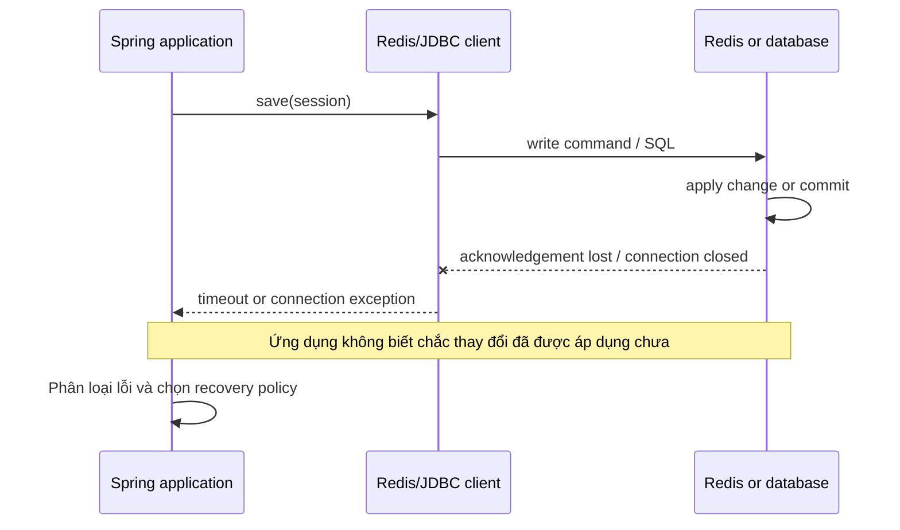
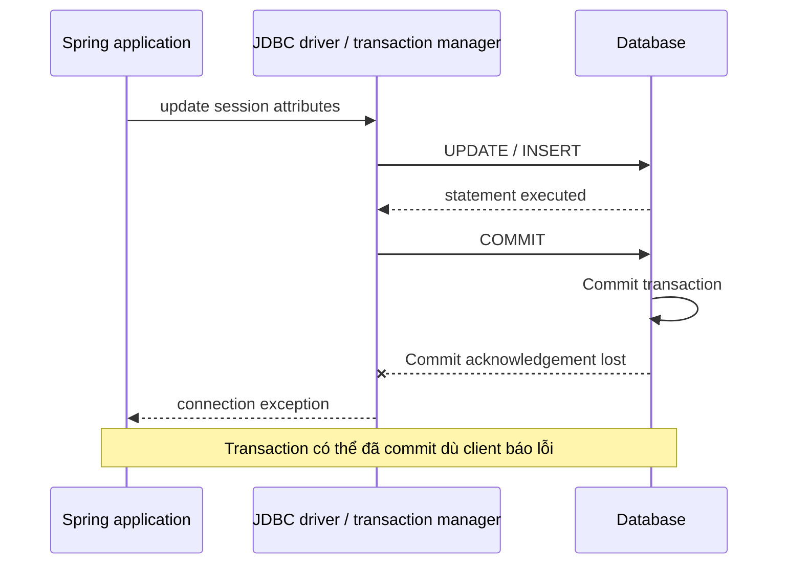

# Mất kết nối trong lúc ghi và kết quả cập nhật chưa xác định

Khi Spring Session ghi session vào Redis hoặc JDBC, ứng dụng gửi thao tác tới datastore và chờ xác nhận. Nếu kết nối bị ngắt hoặc timeout sau khi lệnh đã được gửi nhưng trước khi ứng dụng nhận được phản hồi, ứng dụng không thể kết luận thao tác đã thất bại. Datastore có thể chưa nhận lệnh, đã nhận nhưng chưa thực thi, đã thực thi và commit, hoặc đã thực thi nhưng phản hồi bị mất trên đường về. Đây là trạng thái **kết quả chưa xác định** (ambiguous outcome/ambiguous commit).

Vấn đề này khác với lỗi validation hoặc lỗi kết nối xảy ra chắc chắn trước khi gửi lệnh. Nếu tự động retry mọi exception, một thao tác không idempotent có thể được thực hiện hai lần. Nếu coi mọi timeout là thất bại, ứng dụng có thể báo lỗi trong khi session hoặc nghiệp vụ đã được cập nhật. Nếu coi mọi timeout là thành công, ứng dụng có thể tiếp tục dựa trên trạng thái chưa từng được lưu.

Trong `SPRING_SESSION`, cần phân biệt việc ghi session với việc commit nghiệp vụ. Session là trạng thái phục vụ trải nghiệm và xác thực; nó không nên là nguồn dữ liệu duy nhất cho đơn hàng, thanh toán hoặc giao dịch. Bài học này trình bày cách phân loại kết quả ghi Redis/JDBC, thiết kế retry an toàn, xử lý session và cookie khi response bị gián đoạn, kiểm soát thao tác nghiệp vụ lặp, quan sát sự cố và kiểm thử lỗi mạng.

## 1. Điều gì xảy ra khi mất kết nối trong lúc ghi?

Một thao tác ghi qua mạng có nhiều giai đoạn:

1. Ứng dụng chuẩn bị dữ liệu và lấy connection.
2. Client mã hóa và gửi command hoặc SQL statement.
3. Network chuyển dữ liệu tới Redis/database.
4. Datastore nhận và thực thi thao tác.
5. Datastore commit hoặc áp dụng thay đổi.
6. Datastore gửi acknowledgement/response.
7. Client nhận response và trả kết quả cho code Spring Session.
8. Ứng dụng hoàn tất response HTTP; cookie session có thể được gửi về browser.

Mất kết nối ở mỗi giai đoạn có ý nghĩa khác nhau. Nếu client biết chắc không lấy được connection và chưa gửi dữ liệu, thao tác chưa thể được thực thi qua connection đó. Nhưng nếu request đã được gửi và connection rơi trước khi nhận acknowledgement, ứng dụng thường không biết datastore đã áp dụng thay đổi hay chưa.



Timeout chỉ cho biết client không nhận được kết quả trong thời gian cho phép. Nó không chứng minh datastore chưa thực thi. Đây là điểm cốt lõi khi xử lý `RedisConnectionFailureException`, timeout của Lettuce/JDBC, `DataAccessException` hoặc lỗi connection reset.

## 2. Phân biệt ba trạng thái của thao tác ghi

| Trạng thái | Ví dụ | Điều có thể kết luận |
|---|---|---|
| Chắc chắn chưa gửi | Không lấy được connection trước khi gửi command; validation thất bại trước persistence | Thao tác ghi chưa được gửi qua connection đó |
| Kết quả chưa xác định | Client gửi command/SQL rồi timeout, socket đóng hoặc mất acknowledgement | Datastore có thể đã áp dụng hoặc chưa áp dụng thay đổi |
| Đã xác nhận | Client nhận response thành công hoặc transaction manager xác nhận commit | Client có bằng chứng thao tác hoàn tất theo contract của datastore |

Trong thực tế, exception không phải lúc nào cũng cho biết chính xác giai đoạn. Một lỗi có vẻ là connection failure có thể xảy ra sau khi bytes đã được gửi. Không suy luận trạng thái commit chỉ từ tên exception; xem driver, protocol, logs và timing. Nếu không có bằng chứng chắc chắn, xử lý theo hướng kết quả chưa xác định.

### 2.1. Timeout không phải rollback

Rollback chỉ có ý nghĩa khi transaction manager/datastore thực sự thực hiện rollback và client nhận được trạng thái tương ứng. Nếu kết nối mất trong lúc commit, client có thể không biết transaction đã commit hay chưa. Một transaction timeout ở phía ứng dụng không tự động đảo ngược thay đổi đã commit ở server.

Với Redis, command đơn lẻ thường được thực thi nguyên tử tại server, nhưng client vẫn có thể mất response sau khi command đã chạy. Với JDBC, database có thể commit transaction rồi connection bị ngắt trước khi client nhận acknowledgement. Cả hai trường hợp đều có thể tạo ambiguous outcome.

### 2.2. Không biến lỗi datastore thành session không tồn tại

Nếu repository đọc session bị timeout, không được bắt exception rồi trả `null` như thể session đã hết hạn. `session not found` và `datastore unavailable` có ý nghĩa khác nhau:

- Session không tồn tại/hết hạn: có thể xử lý theo luồng unauthenticated hoặc tạo session mới theo policy.
- Redis/JDBC không truy cập được: trạng thái xác thực chưa xác minh được; request cần session phải được xử lý như lỗi hạ tầng.

Nếu biến outage thành session rỗng, người dùng có thể bị logout hàng loạt, ứng dụng có thể ghi đè session mới lên trạng thái cũ và dashboard mất khả năng phân biệt lỗi kho dữ liệu với session hết hạn.

## 3. Ambiguous write trong Spring Session

Spring Session có thể lưu session khi request hoàn tất, tùy stack và repository. Trong Servlet stack, `SessionRepositoryFilter` điều phối việc lưu `HttpSession` trước khi response được commit. Trong WebFlux, `WebSessionManager` và reactive repository tham gia lifecycle của `WebSession`. Nếu thao tác save lỗi, response có thể thất bại trước khi browser nhận cookie hoặc dữ liệu response hoàn chỉnh.

Tuy nhiên, trạng thái datastore và trạng thái browser là hai chuyện khác nhau:

- Session mới có thể đã được ghi vào Redis/JDBC nhưng response bị lỗi trước khi cookie tới browser. Session đó có thể trở thành session mồ côi và được dọn theo TTL.
- Session hiện có có thể đã được cập nhật trong datastore nhưng browser không nhận response. Browser vẫn giữ cookie cũ, nhưng lần request tiếp theo có thể đọc trạng thái mới.
- Session ID có thể được rotate sau đăng nhập/session fixation protection; nếu save thành công nhưng cookie mới không tới browser, browser tiếp tục gửi ID cũ và có thể bị yêu cầu xác thực lại.
- Logout có thể đã xóa session trong datastore nhưng response cookie expiration không tới browser. Browser vẫn gửi cookie cũ; server phải coi ID đã invalid là không còn session hợp lệ.

Không giả định response thất bại đồng nghĩa session save thất bại, hoặc cookie cũ còn tồn tại đồng nghĩa session cũ còn hợp lệ.

## 4. Redis: command đã chạy nhưng acknowledgement bị mất

Với Redis, client gửi command qua TCP. Server có thể thực thi command và gửi reply; nếu connection bị đóng sau khi server thực thi nhưng trước khi client nhận reply, client chỉ thấy timeout/connection error. Ví dụ:

```text
Client                         Redis
  |                              |
  |--- HSET session key ... ---->|
  |                              | áp dụng HSET
  |<--- response bị mất --------X
  |                              |
  |--- client timeout -----------|
```

Nếu retry cùng một lệnh `HSET field value` với cùng field và cùng value, kết quả cuối thường giống nhau đối với field đó. Nhưng điều này không bảo đảm toàn bộ session repository save là idempotent: repository có thể thực hiện nhiều command để lưu session, cập nhật expiration key/index hoặc phát notification. Cấu trúc command thay đổi theo repository và phiên bản Spring Session.

Các điểm cần kiểm tra:

- Command nào đã được gửi và có thể đã thực thi?
- Repository save có gồm nhiều command hay script/transaction không?
- TTL có được đặt lại hay cập nhật cùng lúc với attributes không?
- Key phụ/index có thể bị cập nhật một phần không?
- Client có tự retry command ở tầng driver không?
- Đọc lại đang đi tới primary hay replica có replication lag?

Không giả định một lần gọi `sessionRepository.save(session)` tương ứng đúng một Redis command nguyên tử. Hãy xem contract/version và đo behavior thực tế trước khi đưa ra recovery guarantee.

## 5. JDBC: mất kết nối quanh thời điểm commit

Với JDBC, một thao tác lưu có thể nằm trong transaction. Nếu connection bị mất trước khi transaction gửi commit, database có thể rollback khi phát hiện connection đóng. Nhưng nếu database đã commit và acknowledgement bị mất, ứng dụng không biết transaction đã thành công.



Nếu retry một transaction cập nhật cùng giá trị tuyệt đối, kết quả có thể idempotent tùy SQL và các trigger/side effect. Nếu transaction tăng counter, tạo row mới không có unique key hoặc phát side effect ngoài database, retry có thể tạo kết quả trùng.

Với Spring Session JDBC, việc ghi session có thể liên quan đến row session và row attributes. Transaction boundary cụ thể phụ thuộc repository implementation, transaction manager và cách repository được gọi. Không suy ra toàn bộ request business transaction và session save luôn cùng một transaction hoặc luôn atomic với nhau.

## 6. Session save không đồng nghĩa business transaction đã commit

Một request có thể làm hai việc:

1. Cập nhật dữ liệu nghiệp vụ trong database, ví dụ tạo đơn hàng.
2. Cập nhật session, ví dụ lưu `lastOrderId` hoặc trạng thái wizard.

Hai việc này có thể dùng hai resource hoặc hai transaction boundary khác nhau. Ví dụ database nghiệp vụ commit thành công nhưng Redis session save timeout; hoặc session save thành công nhưng business transaction rollback. Không nên giả định Spring tự tạo distributed transaction giữa Redis và JDBC.

| Business DB | Session store | Kết quả cần xử lý |
|---|---|---|
| Commit thành công | Save thành công | Cả nghiệp vụ và session được cập nhật |
| Commit thành công | Save lỗi chắc chắn | Nghiệp vụ đã hoàn tất; session có thể chưa phản ánh trạng thái mới |
| Commit thành công | Save chưa xác định | Nghiệp vụ đã hoàn tất; không retry business action chỉ vì session save timeout |
| Rollback | Save thành công | Session có thể tham chiếu trạng thái nghiệp vụ chưa tồn tại |
| Kết quả business DB chưa xác định | Session save bất kỳ | Phải xác định business outcome bằng idempotency/transaction record trước khi thử lại |

Session chỉ nên lưu thông tin hỗ trợ trải nghiệm như bước hiện tại, lựa chọn tạm thời hoặc ID tham chiếu. Dữ liệu nghiệp vụ quan trọng phải có nguồn sự thật riêng. Nếu session ghi `orderCreated=true` nhưng order transaction chưa commit, state đó không được dùng làm bằng chứng đơn hàng đã tồn tại.

## 7. Retry an toàn cần idempotency

Một thao tác idempotent có thể được thực hiện nhiều lần với cùng input mà trạng thái cuối tương đương thực hiện một lần. Ví dụ đặt một thuộc tính session thành giá trị xác định:

```java
session.setAttribute("ui.locale", "vi-VN");
```

Nếu retry cùng giá trị, trạng thái cuối của attribute không thay đổi thêm. Ngược lại, các thao tác sau không tự idempotent:

```java
session.setAttribute("cart.item.count",
        currentCount + requestedQuantity);
```

```sql
UPDATE account
SET balance = balance - :amount
WHERE account_id = :id;
```

Nếu cùng lệnh được thực thi hai lần, quantity hoặc balance có thể thay đổi hai lần. Đặt một attribute mới có giá trị tăng dần, append vào danh sách hoặc phát email cũng có thể lặp side effect.

Trước khi retry, hãy phân loại thao tác:

- **Ghi giá trị tuyệt đối:** có thể idempotent nếu cùng key, cùng value và không có side effect khác.
- **Tăng/giảm hoặc append:** thường không idempotent nếu không có operation ID/deduplication.
- **Tạo bản ghi:** cần unique key hoặc idempotency record để tránh tạo trùng.
- **Gửi sự kiện/thanh toán/email:** cần deduplication hoặc transactional outbox/inbox.
- **Lưu toàn bộ session snapshot:** có thể ghi đè thay đổi mới hơn của request khác dù cùng retry một snapshot.

Không gắn nhãn idempotent chỉ vì HTTP method là PUT hoặc vì repository method tên `save`. Tính idempotent phụ thuộc semantics dữ liệu và side effects.

## 8. Idempotency key cho thao tác nghiệp vụ

Với endpoint có side effect, client có thể gửi một idempotency key ổn định cho cùng một ý định nghiệp vụ. Server lưu key này trong database với unique constraint và kết quả xử lý. Khi client retry do timeout, server tìm thấy key đã xử lý và trả lại kết quả trước đó thay vì thực hiện side effect lần nữa.

Ví dụ bảng lưu request idempotency:

```sql
CREATE TABLE operation_deduplication (
    idempotency_key VARCHAR(100) PRIMARY KEY,
    request_hash VARCHAR(128) NOT NULL,
    status VARCHAR(20) NOT NULL,
    result_reference VARCHAR(100),
    created_at TIMESTAMP NOT NULL
);
```

Mô hình xử lý khái quát:

1. Nhận idempotency key và chuẩn hóa request.
2. Tính request hash để phát hiện cùng key nhưng payload khác.
3. Trong transaction, tạo record với unique key hoặc đọc record đã tồn tại.
4. Nếu đã hoàn tất, trả lại kết quả đã lưu.
5. Nếu chưa xử lý, thực hiện business mutation và lưu kết quả trong cùng transaction phù hợp.
6. Commit transaction.
7. Nếu connection mất quanh commit, lần retry tra cứu key để biết operation đã được ghi nhận hay chưa.

Nếu cùng idempotency key nhưng request hash khác, trả lỗi conflict; không tái sử dụng key cho ý định khác. Cần chính sách retention cho idempotency records dài hơn cửa sổ retry của client và phù hợp thời gian đối soát.

Idempotency key không phải session ID. Session ID định danh phiên browser; idempotency key định danh một ý định nghiệp vụ. Không dùng cookie session làm khóa deduplication cho thanh toán hoặc tạo đơn.

## 9. Đảm bảo business update và deduplication cùng transaction

Để tránh trường hợp business mutation commit nhưng idempotency record không commit, hoặc ngược lại, lưu cả hai trong cùng database transaction nếu cùng một database hỗ trợ:

```java
@Transactional
public OrderResult createOrder(
        String idempotencyKey,
        CreateOrderCommand command) {

    String requestHash = hash(command);
    OperationRecord existing = operationRepository
            .findByKey(idempotencyKey)
            .orElse(null);

    if (existing != null) {
        existing.assertSameRequest(requestHash);
        return existing.toResult();
    }

    Order order = orderRepository.save(Order.from(command));
    operationRepository.save(OperationRecord.completed(
            idempotencyKey, requestHash, order.getId()));

    return OrderResult.from(order);
}
```

Đây là phác thảo logic; triển khai đồng thời phải dựa vào unique constraint và xử lý race khi hai request cùng insert key. Chỉ kiểm tra `findByKey` trước rồi insert mà không xử lý unique violation là chưa đủ. Cần bắt conflict trong transaction thích hợp, đọc record đã tồn tại bằng transaction mới nếu cần và trả lại kết quả đã commit.

Nếu side effect nằm ở hệ thống khác, như gửi message hoặc gọi payment provider, dùng idempotency key của provider và/hoặc transactional outbox. Không giữ database transaction mở trong khi chờ mạng bên ngoài nếu có thể tránh.

## 10. Retry thao tác session: khi nào có thể, khi nào không?

Retry cho session store cần thận trọng hơn retry cho một lệnh đọc thuần:

| Thao tác | Retry policy gợi ý |
|---|---|
| Đọc session sau lỗi kết nối | Retry giới hạn nếu lỗi transient và đọc từ nguồn phù hợp; nếu vẫn lỗi, trả lỗi hạ tầng |
| Set attribute thành giá trị tuyệt đối cố định | Có thể retry có giới hạn nếu repository operation an toàn và không ghi đè snapshot mới hơn |
| Tăng counter/append list trong session | Không retry mù; cần operation ID hoặc chuyển state quan trọng sang store có atomic update |
| Tạo session mới | Retry có thể tạo orphan session; cần chấp nhận TTL cleanup và xác minh cookie lifecycle |
| Invalidate/delete session | Delete thường có tính idempotent theo key, nhưng event/side effects và kết quả response vẫn cần kiểm tra |
| Rotate session ID | Không retry mù; có thể tạo ID mới khác hoặc làm browser và server lệch trạng thái |
| Business operation + session save | Retry business theo idempotency key riêng; xử lý session state như bước độc lập |

Một retry có thể làm giảm lỗi transient nhưng cũng tăng tải khi datastore đang outage. Chỉ retry lỗi có khả năng phục hồi, giới hạn số lần, dùng exponential backoff với jitter và tổng deadline nhỏ hơn request timeout. Không retry authentication/ACL, serialization incompatibility, schema error hoặc invalid data.

## 11. Retry toàn bộ request có thể lặp nghiệp vụ

Một anti-pattern là tự động gửi lại toàn bộ HTTP request khi session save timeout. Request có thể đã thực hiện business side effect trước khi lỗi xuất hiện ở giai đoạn commit session.

Ví dụ:

1. Controller gọi `orderService.createOrder()`.
2. Database commit đơn hàng thành công.
3. Response kết thúc và Spring Session cố lưu session.
4. Redis connection timeout.
5. Server trả lỗi hoặc connection đóng.
6. Browser/client retry POST.
7. Đơn hàng thứ hai được tạo nếu business endpoint không idempotent.

Giải pháp là bảo vệ business operation bằng idempotency key/unique business reference, không chỉ retry ở session repository. Một session save failure không được làm cho request retry tạo ra một đơn hàng mới.

Nếu endpoint có side effect, hãy xác định điểm commit nghiệp vụ và cách client truy vấn kết quả bằng request ID. Trạng thái session có thể được cập nhật lại sau đó bằng một thao tác riêng, nhưng không nên là căn cứ duy nhất để quyết định nghiệp vụ đã thực hiện hay chưa.

## 12. Session snapshot cũ và lost update sau retry

Ngay cả khi một thao tác set attribute là idempotent trên cùng snapshot, retry save toàn bộ session snapshot cũ có thể ghi đè dữ liệu mới được request khác cập nhật.

Ví dụ:

1. Request A đọc session version V1 với `cartStep=1`.
2. Request B đọc V1, cập nhật `cartStep=2` và save thành công.
3. Request A timeout khi save snapshot V1 đã sửa một phần.
4. A retry snapshot cũ.
5. Giá trị `cartStep=2` của B có thể bị ghi đè bởi dữ liệu cũ của A, tùy repository/save semantics.

Vì vậy, retry không chỉ cần xem command có idempotent với chính nó hay không; còn phải xét concurrency và freshness của snapshot. Các biện pháp:

- Giữ session attributes nhỏ, chỉ lưu dữ liệu tạm.
- Tránh cập nhật cùng attribute từ nhiều request đồng thời.
- Dùng immutable value và thay toàn bộ attribute có chủ đích.
- Dùng version/compare-and-set ở kho nghiệp vụ nếu cần kiểm soát optimistic concurrency.
- Chuyển counter hoặc workflow quan trọng sang repository có atomic update.
- Không retry một snapshot cũ sau khi đã biết có request mới hơn nếu không có cơ chế version check.

## 13. Không coi Redis và JDBC có cùng semantics

Redis và JDBC có failure modes chung ở lớp network nhưng cách thực thi và quan sát khác nhau:

| Khía cạnh | Redis | JDBC |
|---|---|---|
| Đơn vị ghi | Command, script hoặc chuỗi command repository | SQL statement/transaction |
| Ambiguous outcome | Command có thể đã chạy, reply bị mất | Transaction có thể đã commit, acknowledgement bị mất |
| Atomicity | Command đơn lẻ atomic; chuỗi nhiều command không tự atomic | Atomicity trong transaction theo database/transaction manager |
| Retry | Phụ thuộc semantics command, script và repository save | Phụ thuộc SQL, transaction boundary, unique constraints và side effects |
| Kiểm tra trạng thái | Đọc key/session từ primary phù hợp; chú ý replica lag | Query từ database/transaction mới; chú ý isolation/replica lag |
| Dọn dữ liệu | TTL/expiration và eviction | Expiration cleanup query/job và delete batch |

Không áp dụng một recovery policy chung cho mọi repository. Hãy kiểm tra phiên bản Spring Session, Redis client, JDBC driver, transaction manager và datastore topology đang triển khai.

## 14. Đọc lại sau timeout có thể giúp, nhưng không phải lúc nào cũng chứng minh được kết quả

Sau ambiguous write, một cách điều tra là đọc lại session từ primary hoặc database primary:

- Nếu đọc thấy giá trị mới, có bằng chứng thao tác đã được áp dụng tại thời điểm đọc.
- Nếu đọc thấy giá trị cũ, chưa chắc thao tác chưa từng chạy: có thể command chưa tới, bị rollback, bị ghi đè bởi request khác hoặc đọc từ replica lag.
- Nếu đọc lại cũng timeout, kết quả vẫn chưa xác định.

Đọc lại phải tránh vô tình tạo session mới hoặc refresh TTL nếu điều đó làm thay đổi trạng thái. Dùng repository/API phù hợp để đọc theo ID đã biết; không dùng một request browser mới thiếu cookie làm phép xác minh.

Với JDBC, đọc qua một connection/transaction mới sau khi kết thúc transaction lỗi có thể giúp xác định record hiện tại. Nhưng nếu đọc từ replica bất đồng bộ, kết quả có thể cũ. Với Redis replication, đọc replica có thể trả trạng thái trước lần ghi. Cần biết routing của client trước khi dùng read-after-write để kết luận.

Read-after-write là công cụ điều tra/reconciliation, không thay thế idempotency. Khi concurrent updates xảy ra, giá trị hiện tại không nhất thiết cho biết chính xác request nào đã commit.

## 15. Xử lý cookie và response khi session save chưa xác định

Session ID cookie là bằng chứng browser gửi lại một định danh, không phải bằng chứng rằng session record vẫn tồn tại hoặc save mới nhất đã commit.

Các tình huống:

| Tình huống | Browser có thể giữ gì? | Hành vi an toàn |
|---|---|---|
| Tạo session mới, save lỗi trước khi xác nhận | Có thể chưa nhận cookie | Trả lỗi phù hợp; session mồ côi nếu đã ghi sẽ hết hạn theo TTL |
| Update session hiện có, save đã commit nhưng reply mất | Cookie ID cũ vẫn còn | Request sau đọc trạng thái hiện tại; không lặp business side effect |
| Update session chưa commit | Cookie ID cũ vẫn còn | Request sau có thể đọc snapshot cũ; xử lý như state chưa cập nhật |
| Rotate ID, response cookie mới không tới browser | Browser còn ID cũ | Có thể cần đăng nhập lại; không chấp nhận ID cũ nếu đã invalidate |
| Logout đã xóa session nhưng cookie expiration mất | Browser gửi cookie cũ | Server coi ID không tồn tại là unauthenticated; có thể phát cookie expiration lại |

Không trả thành công giả chỉ để giữ UX khi session store lỗi. Với endpoint cần session để xác thực hoặc bảo vệ state, nếu không thể xác minh session thì fail closed theo security policy. Có thể cho phép endpoint public không cần session tiếp tục hoạt động nếu nó không phụ thuộc vào trạng thái đó.

## 16. Error handling ở tầng web và service

Phân biệt lỗi nghiệp vụ, lỗi validation và lỗi hạ tầng:

- Validation/domain error: trả 4xx theo contract.
- Session không tồn tại/hết hạn: xử lý như unauthenticated hoặc tạo session mới theo luồng bình thường.
- Datastore timeout/unavailable: trả lỗi hạ tầng phù hợp, thường 5xx/503 tùy API contract; không giả thành 404 hoặc anonymous.
- Ambiguous business commit: yêu cầu client dùng lại idempotency key hoặc cung cấp endpoint tra cứu operation status.

Ví dụ xử lý exception ở boundary có thể ghi nhận correlation ID và trả response ổn định:

```java
@RestControllerAdvice
class InfrastructureExceptionHandler {

    @ExceptionHandler({
            RedisConnectionFailureException.class,
            QueryTimeoutException.class
    })
    ResponseEntity<ProblemDetail> handleStoreUnavailable(
            RuntimeException exception) {

        ProblemDetail problem = ProblemDetail.forStatus(
                HttpStatus.SERVICE_UNAVAILABLE);
        problem.setTitle("Session store tạm thời không khả dụng");
        problem.setDetail(
                "Không thể xác nhận trạng thái lưu. Hãy thử lại bằng cùng request key nếu endpoint hỗ trợ.");
        return ResponseEntity.status(HttpStatus.SERVICE_UNAVAILABLE)
                .body(problem);
    }
}
```

Đây là ví dụ khái niệm; exception class cụ thể phụ thuộc Redis client, Spring Data Redis, JDBC driver và transaction manager. Không bắt mọi `DataAccessException` rồi luôn trả 503 nếu một số lỗi là schema/serialization không thể tự phục hồi. Cần phân loại exception theo nguyên nhân và ghi log nội bộ an toàn.

Response nên tránh tiết lộ hostname Redis, SQL, credentials hoặc stack trace. Nếu API hỗ trợ retry, trả correlation/operation ID và hướng dẫn client giữ nguyên idempotency key; không yêu cầu tạo key mới cho cùng ý định.

## 17. Bounded retry, backoff và circuit breaker

Retry policy nên có:

- Danh sách lỗi transient được phép retry.
- Số lần thử tối đa thấp và tổng thời gian giới hạn.
- Exponential backoff với jitter để các instance không retry cùng lúc.
- Deadline tổng nhỏ hơn request deadline hoặc được điều phối theo policy.
- Cancellation khi request đã bị client hủy.
- Metrics retry count và final outcome.
- Circuit breaker/bulkhead khi datastore outage kéo dài.

Ví dụ khoảng backoff có thể tăng dần như 50 ms, 100 ms, 200 ms với jitter và tối đa 2–3 lần, nhưng giá trị phải dựa trên latency/SLO thực tế. Không dùng con số cố định cho mọi hệ thống.

Circuit breaker ngăn request tiếp tục dồn vào datastore đang lỗi. Khi breaker mở, endpoint cần session có thể trả 503 nhanh thay vì chờ timeout nhiều lần. Health/readiness policy phải phản ánh datastore dependency; tuy nhiên, không để liveness probe thực hiện một chuỗi truy vấn nặng.

Retry ở client library, Spring Retry, Resilience4j và service code có thể chồng lên nhau. Hãy tính tổng số lần thử trên toàn stack. Ba lớp mỗi lớp retry ba lần có thể tạo tới nhiều lần gửi lệnh hơn dự kiến.

## 18. Không fallback sang local session store tùy tiện

Khi Redis/JDBC không khả dụng, việc tự chuyển một instance sang in-memory session store có thể tạo hai phiên bản trạng thái:

- Request tới instance A đọc session từ Redis.
- Redis lỗi, A lưu tạm session local.
- Request tiếp theo tới instance B không thấy session local của A.
- Khi Redis hồi phục, dữ liệu local có thể không được merge hoặc có thể ghi đè trạng thái mới hơn.

Đây là split-brain session state. Không tự fallback sang local memory trừ khi kiến trúc có thiết kế rõ về consistency, affinity, recovery và security. Với session xác thực, fail closed/503 thường an toàn hơn việc tạo một kho phiên tạm không đồng bộ.

Nếu sản phẩm cần chế độ degraded, hãy định nghĩa trước endpoint nào có thể hoạt động không cần session, dữ liệu nào chỉ mang tính tạm, thời hạn degraded mode và cách khôi phục. Không âm thầm thay repository trong lúc outage.

## 19. Quan sát và log mà không làm lộ session

Khi ghi nhận ambiguous write, log các metadata sau:

- Correlation/request ID và operation ID nghiệp vụ.
- Application instance, deployment version và repository type.
- Operation class: find/save/delete/rotate, không cần session ID đầy đủ.
- Thời gian bắt đầu, duration và timeout stage nếu biết.
- Exception class/cause, retry count và circuit breaker state.
- Kết quả phân loại: known-not-sent, confirmed, ambiguous hoặc reconciled.
- Redis primary/cluster shard hoặc JDBC datasource name ở mức an toàn.

Không log:

- Session cookie hoặc session ID đầy đủ.
- Serialized session attributes, `SecurityContext`, access/refresh token.
- Password, secret hoặc raw SQL bind values có dữ liệu nhạy cảm.
- Principal/email/user ID dưới dạng metric label cardinality cao.

Metrics nên theo dõi session save timeout rate, repository error rate, unknown outcome count, retry attempts, duplicate operation prevented, recovery duration và datastore latency. Đặt alert khi unknown outcomes tăng đột biến, nhưng không đếm mọi connection exception là ambiguous nếu biết chắc chưa gửi lệnh.

## 20. Kiểm thử mất kết nối đúng thời điểm

Một unit test mock ném `TimeoutException` chỉ kiểm tra code xử lý exception. Nó không chứng minh datastore đã hay chưa thực thi command trước khi mất kết nối. Để kiểm tra ambiguous outcome, cần fault injection gần với protocol thực tế.

### 20.1. Kiểm thử Redis

Có thể dùng Redis Testcontainers cùng proxy/fault injector như Toxiproxy trong môi trường test:

1. Khởi chạy Redis và ứng dụng dùng Spring Session Redis.
2. Tạo session và lưu marker baseline.
3. Thiết lập proxy để cho command đi tới Redis nhưng cắt response/connection trước khi client nhận acknowledgement.
4. Gửi request cập nhật session qua ứng dụng.
5. Xác minh ứng dụng nhận timeout/connection error.
6. Dùng một connection quản trị riêng đọc key từ primary để xác định server đã áp dụng update hay chưa.
7. Khôi phục network và gửi request tiếp theo bằng cookie hợp lệ.
8. Xác minh behavior không lặp side effect và không ghi đè một cập nhật mới hơn.

Để mô phỏng “server đã áp dụng nhưng reply bị mất”, cần bảo đảm proxy cắt phản hồi sau khi Redis xử lý command; chỉ ngắt network trước khi command tới server không tạo ra cùng tình huống.

### 20.2. Kiểm thử JDBC

Với JDBC, có thể dùng database container và proxy/fault injection ở network layer:

1. Tạo operation record và session baseline.
2. Gửi transaction update.
3. Làm mất kết nối ở giai đoạn quanh commit acknowledgement.
4. Xác minh client nhận lỗi.
5. Mở connection mới và kiểm tra trạng thái đã commit hay chưa.
6. Retry cùng idempotency key.
7. Xác minh business row chỉ tồn tại một lần và operation result ổn định.

Điểm khó là xác định chính xác thời điểm database commit so với network cut. Dùng proxy logs, database logs hoặc transaction instrumentation trong test để biết fault được chèn ở đâu. Một test chỉ kill connection trước khi gửi COMMIT không kiểm tra được mất acknowledgement sau commit.

### 20.3. Ma trận lỗi cần kiểm tra

| Fault point | Trạng thái có thể | Assertion chính |
|---|---|---|
| Không lấy được connection | Chắc chắn chưa gửi qua connection đó | Không có side effect; lỗi được phân loại transient |
| Ngắt trước khi command tới server | Chưa thực thi | Retry theo policy không tạo duplicate |
| Server thực thi, response bị mất | Ambiguous | Read/reconcile xác định trạng thái; không lặp nghiệp vụ |
| JDBC commit xong, acknowledgement mất | Ambiguous | Cùng idempotency key trả kết quả đã commit |
| Save session lỗi ở response commit | Session có thể đã lưu hoặc chưa | Cookie/response behavior được kiểm tra; business operation không bị lặp |
| Redis/JDBC outage kéo dài | Store unavailable | Circuit breaker/503; không fallback local âm thầm |
| Retry đồng thời từ nhiều client | Duplicate attempts | Unique key/atomic dedupe bảo đảm một kết quả |

## 21. Ví dụ kiểm thử idempotency khi client retry

Test service nên gửi hai lần cùng key và xác minh chỉ một order được tạo. Pseudocode minh họa:

```java
@Test
void repeatedRequestWithSameKeyReturnsSameOrder() {
    String key = "checkout-req-9f3a";
    CreateOrderCommand command = sampleCommand();

    OrderResult first = service.createOrder(key, command);
    OrderResult second = service.createOrder(key, command);

    assertThat(second.orderId()).isEqualTo(first.orderId());
    verify(orderRepository, times(1)).insert(any());
}
```

Test trên là unit-level behavior; cần thêm database integration test để xác minh unique constraint, transaction và hai request đồng thời. Một test concurrent phải chạy hai invocation cùng idempotency key và chứng minh một transaction thắng, request còn lại đọc lại kết quả đã lưu. Nếu payload khác nhưng key giống nhau, test phải xác minh conflict.

Session update cũng cần test riêng: retry set một giá trị tuyệt đối có thể giữ cùng trạng thái; retry increment phải được bảo vệ bằng operation ID/atomic operation hoặc không được retry. Không dùng test business idempotency thay cho test session repository semantics.

## 22. Recovery sau khi datastore phục hồi

Khi Redis/JDBC hoạt động lại:

1. Khôi phục connection pool/client và xác minh primary/topology.
2. Không phát lại hàng loạt request đã timeout nếu chưa có idempotency key.
3. Với business operations có operation ID, tra cứu trạng thái và trả kết quả đã commit hoặc tiếp tục theo policy.
4. Với session, cho request tiếp theo đọc từ repository chính; session chưa tồn tại/hết hạn được xử lý theo authentication policy.
5. Xác minh cookie rotation/logout không để ID cũ được chấp nhận ngoài ý muốn.
6. Kiểm tra session mồ côi được dọn theo TTL/cleanup policy.
7. Đối chiếu error rate, retry rate, queue backlog và datastore latency.
8. Giảm retry/backoff dần khi hệ thống ổn định; tránh dồn tải sau outage.

Không cần khôi phục mọi session mồ côi nếu chúng chỉ là trạng thái tạm và TTL đã giới hạn vòng đời. Không chạy full scan ngay sau outage chỉ để tìm mọi key đáng ngờ; ưu tiên metrics, sampling và cleanup mechanism sẵn có.

## 23. Lỗi thường gặp và cách xử lý

| Triệu chứng | Nguyên nhân có thể | Hướng xử lý |
|---|---|---|
| Timeout được coi là chắc chắn thất bại | Mất acknowledgement sau khi server đã commit | Đánh dấu outcome unknown và reconcile bằng operation ID/read phù hợp |
| Retry POST tạo hai đơn hàng | Business operation không idempotent | Dùng idempotency key và unique constraint trong database |
| Retry session save làm mất update mới | Retry snapshot cũ ghi đè request khác | Tránh shared mutable state; dùng version/CAS cho state quan trọng |
| User bị logout khi Redis timeout | Exception bị đổi thành session-not-found | Phân biệt datastore outage với session expired; fail closed/503 theo policy |
| Cookie mới không tới browser sau login | Save/response lỗi quanh session ID rotation | Yêu cầu đăng nhập lại an toàn; không chấp nhận ID cũ đã invalidate |
| Logout response lỗi nhưng session đã xóa | Delete commit thành công, cookie expiration bị mất | Request sau phải coi ID cũ là invalid; có thể gửi expiration lại |
| Retry storm khi Redis hồi phục | Mọi instance retry đồng thời | Backoff+jitter, giới hạn concurrency và circuit breaker |
| Local fallback tạo session khác nhau ở từng node | Split-brain state | Không fallback âm thầm; định nghĩa degraded mode trước |
| JDBC transaction timeout bị hiểu là rollback | Commit acknowledgement bị mất | Tra cứu operation record bằng connection/transaction mới |
| Đọc lại trả trạng thái cũ | Đọc replica lag hoặc request khác ghi đè | Đọc primary phù hợp; xét concurrency và topology |
| Event/side effect bị lặp | Retry hoặc event delivery lặp | Listener/consumer idempotent và deduplicate |

## 24. Checklist thiết kế và vận hành

- [ ] Phân biệt known-not-sent, confirmed và ambiguous outcome.
- [ ] Không coi timeout là bằng chứng rollback.
- [ ] Phân loại lỗi theo giai đoạn và driver/repository behavior.
- [ ] Không biến datastore outage thành session-not-found hoặc anonymous.
- [ ] Không retry toàn bộ request có side effect nếu thiếu idempotency.
- [ ] Dùng idempotency key riêng cho business operation; không dùng session ID.
- [ ] Đặt unique constraint và lưu kết quả operation trong transaction phù hợp.
- [ ] Chỉ retry thao tác session khi semantics và concurrency cho phép.
- [ ] Không retry snapshot session cũ có thể ghi đè update mới.
- [ ] Giới hạn retry, backoff, jitter, deadline và concurrency.
- [ ] Theo dõi cookie issuance, session ID rotation và logout behavior khi response lỗi.
- [ ] Không fallback local session store âm thầm khi Redis/JDBC unavailable.
- [ ] Log correlation/operation ID và exception metadata; không log cookie/session payload.
- [ ] Kiểm thử response loss sau khi Redis command hoặc JDBC commit đã được áp dụng.
- [ ] Kiểm thử retry đồng thời, duplicate prevention và recovery sau outage.

Mất kết nối trong lúc ghi không cho biết chắc session hoặc transaction đã thất bại. Redis có thể đã thực thi command nhưng reply bị mất; JDBC có thể đã commit nhưng acknowledgement không tới client. Vì vậy, cần phân loại trạng thái chưa xác định, tránh retry mù và tách session persistence khỏi business transaction. Với nghiệp vụ có side effect, idempotency key cùng unique constraint/transaction record giúp client retry an toàn. Với session, chỉ retry thao tác có semantics phù hợp, tránh ghi đè snapshot cũ và xử lý cookie theo trạng thái thực tế. Khi datastore không thể xác minh session, hãy coi đó là lỗi hạ tầng thay vì session hết hạn; kết hợp backoff, circuit breaker, observability và fault-injection tests để phục hồi có kiểm soát.
