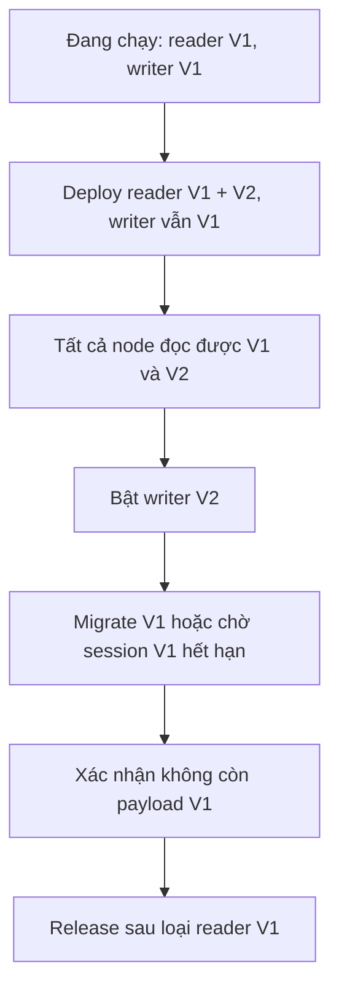

# Chuyển serializer hoặc phiên bản Jackson mà vẫn đọc được dữ liệu cần giữ

Spring Session lưu session attributes vào Redis, JDBC hoặc một repository dùng chung. Dữ liệu được chuyển thành byte hoặc một định dạng khác trước khi ghi. Khi nâng cấp serializer, Jackson hoặc class chứa trong session, phiên bản ứng dụng mới phải đọc được dữ liệu mà phiên bản cũ đã ghi. Trong rolling deployment, hai phiên bản có thể cùng chạy và luân phiên nhận request với cùng session ID; vì vậy phải kiểm tra cả chiều đọc dữ liệu cũ và chiều đọc dữ liệu mới.

Thay một bean serializer rồi triển khai đồng loạt không đủ để bảo đảm an toàn. Một session đang hoạt động có thể được ghi từ nhiều node, được khôi phục sau restart hoặc tồn tại qua nhiều lần release. Nếu định dạng mới không tương thích, người dùng có thể bị đăng xuất, `SecurityContext` có thể không khôi phục được, hoặc ứng dụng có thể lỗi khi deserialize một attribute hiếm gặp.

## 1. Dữ liệu session là một hợp đồng lưu trữ

Session thường chứa metadata do Spring Session quản lý và attributes do ứng dụng hoặc Spring Security lưu. Các attributes có thể gồm:

- `SecurityContext`, principal và authorities.
- ID giỏ hàng, trạng thái wizard hoặc lựa chọn giao diện.
- Locale, timezone và preferences.
- Thông tin luồng đăng nhập, OAuth2 authorization state hoặc dữ liệu tạm của ứng dụng.
- DTO hoặc object tùy chỉnh do code ứng dụng định nghĩa.

Khi serializer chuyển một object thành byte, định dạng đó trở thành một hợp đồng giữa tất cả node có thể đọc session. Hợp đồng bao gồm nhiều yếu tố:

1. Định dạng vật lý: Java serialization, JSON, CBOR hoặc byte format riêng.
2. Tên và cấu trúc field, kiểu dữ liệu, nullability và giá trị mặc định.
3. Type metadata hoặc cách ánh xạ payload về Java class.
4. Package/class name nếu format lưu tên class.
5. Jackson modules, custom serializers/deserializers và polymorphic type rules.
6. Phiên bản Spring Session, Spring Security, Jackson và các thư viện liên quan.
7. Compression, encryption, key version và encoding nếu có.

Một payload có thể deserialize thành công nhưng vẫn sai nghiệp vụ nếu ý nghĩa field thay đổi. Vì vậy, kiểm thử không chỉ hỏi “đọc được JSON không?” mà còn phải xác nhận dữ liệu sau khi khôi phục có cùng ý nghĩa.

## 2. Xác định serializer hiện tại trước khi nâng cấp

Trước khi thay đổi, lập danh sách serializer/converter đang dùng ở từng môi trường và từng loại repository.

| Repository | Điểm cần xác định |
|---|---|
| Spring Session Redis | Bean serializer được Spring Session sử dụng cho session attributes; thường là bean có tên `springSessionDefaultRedisSerializer` trong cấu hình Redis tương ứng |
| Spring Session JDBC | `ConversionService` dùng chuyển attribute từ object sang `byte[]` và ngược lại; cấu hình tùy chỉnh thường dùng bean `springSessionConversionService` theo phiên bản |
| Repository tùy chỉnh | Codec, schema, type registry, compression/encryption và cách đánh dấu version |
| Nhiều ứng dụng dùng chung store | Serializer thực tế của mọi producer/consumer, không chỉ service đang được nâng cấp |

Không suy ra serializer chỉ từ dependency có mặt trong classpath. Repository có thể được cấu hình bằng bean tùy chỉnh hoặc auto-configuration khác với mặc định. Kiểm tra cấu hình đang chạy, startup logs và một payload test được tạo bởi đúng release hiện tại.

Với Redis, xác định riêng serializer cho session attributes, key/value và các cấu trúc index nếu ứng dụng có cấu hình custom. Không thay mọi Redis serializer trong ứng dụng chỉ vì muốn thay serializer của session.

Với JDBC, xác định converter đang xử lý cột binary của attributes. Thay `ConversionService` có thể ảnh hưởng toàn bộ attribute được đọc từ bảng session. Cần giữ khả năng đọc dữ liệu cũ cho tới khi không còn record dùng format cũ.

## 3. Java serialization và JSON có thể không tương thích

Java serialization thường phụ thuộc class name, class hierarchy, field và `serialVersionUID`. JSON dễ quan sát hơn, nhưng payload JSON vẫn có thể chứa type metadata, property names và quy tắc ánh xạ riêng.

| Thay đổi | Nguy cơ |
|---|---|
| Java serialization sang JSON | Byte format khác hoàn toàn; reader cũ không đọc được payload mới |
| JSON serializer A sang JSON serializer B | Property naming, type metadata, null handling hoặc module có thể khác |
| Jackson 2 sang Jackson 3 | API, package, module và serializer integration có thể thay đổi; payload cũ cần được kiểm chứng |
| Đổi class/package | Type metadata hoặc Java serialization có thể không tìm thấy class cũ |
| Đổi field type hoặc enum | Payload có thể lỗi khi đọc hoặc ánh xạ sai ý nghĩa |
| Bật/tắt polymorphic typing | Type ID cũ có thể không được nhận diện hoặc bị từ chối |
| Thay module Spring Security | `Authentication`, principal hoặc `SecurityContext` có thể có cấu trúc khác |

Không mặc định rằng “cả hai đều là JSON” đồng nghĩa tương thích. Hai `ObjectMapper` có thể đọc cùng cú pháp JSON nhưng khác cách nhận biết class, xử lý subtype, ngày giờ, constructor, enum và custom type.

## 4. Jackson 2 và Jackson 3: điều gì cần kiểm tra?

Jackson 2 thường dùng namespace Java `com.fasterxml.jackson.*`; Jackson 3 dùng namespace mới `tools.jackson.*` và có thay đổi API/package cùng cách tích hợp trong hệ sinh thái Spring. Các module, serializer và converter được biên dịch cho một major version không nhất thiết dùng trực tiếp được với major version còn lại.

Payload JSON thuần với field ổn định có thể vẫn đọc được sau khi nâng Jackson, nhưng không thể suy ra điều đó nếu payload chứa:

- Polymorphic type metadata, chẳng hạn tên class được nhúng trong JSON.
- Custom serializer/deserializer được viết cho Jackson 2.
- Spring Security types và module Jackson tương ứng.
- Java time, Optional, record, sealed type hoặc kiểu thư viện ngoài cần module riêng.
- Quy tắc visibility, naming strategy, constructor detection hoặc unknown properties đã thay đổi.

Khi nâng major version, cần xác định Spring Boot/Spring Framework/Spring Session release hỗ trợ Jackson version nào. Không cố ép một module Jackson 2 vào mapper Jackson 3 bằng cách thêm dependency riêng lẻ. Dùng module và integration được hỗ trợ bởi release tương ứng, sau đó kiểm thử payload fixture từ các release đang được lưu trong session store.

### 4.1. Tương thích cú pháp không đồng nghĩa tương thích type

Ví dụ JSON sau có thể được đọc như một object đơn giản nếu cả hai phiên bản thống nhất schema:

```json
{
  "cartId": "CART-42",
  "itemCount": 3,
  "currency": "VND"
}
```

Nhưng payload có type metadata như sau phụ thuộc mạnh vào cấu hình serializer:

```json
{
  "@class": "com.example.session.CartSessionState",
  "cartId": "CART-42",
  "itemCount": 3
}
```

Nếu class được đổi package hoặc type validator không cho phép class này, reader mới có thể từ chối payload. Không nên dựa vào tên class Java như schema công khai lâu dài. Một type ID ổn định do ứng dụng quản lý thường dễ migration hơn.

## 5. Tránh serialize trực tiếp object graph lớn

Session attributes nên là DTO nhỏ, ổn định, có schema được quản lý. Tránh lưu trực tiếp:

- JPA entity và lazy proxy.
- Service, repository, datasource, transaction hoặc connection.
- `HttpServletRequest`, `HttpServletResponse`, WebSocket connection hoặc stream.
- Object chứa thread, lock hoặc tài nguyên runtime.
- Object graph có quan hệ vòng hoặc tham chiếu tới nhiều entity.
- Class nội bộ/anonymous class có tên phụ thuộc compiler.

Ví dụ DTO session có schema rõ:

```java
public record CartSessionState(
        int schemaVersion,
        String cartId,
        int itemCount,
        String currency) {
}
```

Trong code thực tế, hãy kiểm tra khả năng serialize của record theo Jackson version và module đang dùng. Một cách ổn định hơn nữa là giữ DTO persisted độc lập với model domain, sau đó map DTO sang object nghiệp vụ khi đọc.

## 6. Đưa version vào payload

Khi có khả năng thay đổi schema, nên đánh dấu version rõ ràng. Ví dụ envelope:

```json
{
  "type": "cart-session-state",
  "version": 2,
  "value": {
    "cartId": "CART-42",
    "itemCount": 3,
    "currency": "VND"
  }
}
```

Reader có thể chọn DTO hoặc converter theo `type` và `version`. Khi version 1 không có `currency`, migration từ V1 sang V2 phải có quy tắc mặc định đã được nghiệp vụ chấp thuận.

Quy tắc schema:

- Dùng type ID ổn định như `cart-session-state`, không buộc payload vào package Java.
- Thêm field tùy chọn theo hướng backward-compatible trước khi bắt buộc field đó.
- Không đổi ý nghĩa field cũ; tạo field mới hoặc tăng schema version nếu semantics thay đổi.
- Xác định cách xử lý field không biết, field thiếu, null và giá trị mặc định.
- Với enum, dùng code ổn định hoặc giữ alias cho giá trị cũ trong giai đoạn chuyển tiếp.
- Chuẩn hóa thời gian theo UTC và định dạng rõ ràng.
- Kiểm tra số nguyên, số thập phân, precision và overflow khi đổi kiểu.
- Không deserialize arbitrary class name từ payload không tin cậy.

## 7. Ví dụ codec có version với Jackson

Ví dụ sau minh họa cách xử lý JSON envelope và DTO rõ ràng. Đây là mã theo API Jackson 2 (`com.fasterxml.jackson.databind`); khi dùng Jackson 3, thay bằng API và package tương ứng được release Spring hỗ trợ. Ý tưởng version hóa payload vẫn giữ nguyên.

```java
import com.fasterxml.jackson.databind.JsonNode;
import com.fasterxml.jackson.databind.ObjectMapper;
import com.fasterxml.jackson.databind.node.ObjectNode;

final class CartSessionCodec {

    private final ObjectMapper mapper;

    CartSessionCodec(ObjectMapper mapper) {
        this.mapper = mapper;
    }

    byte[] encode(CartSessionState state) throws Exception {
        ObjectNode envelope = mapper.createObjectNode();
        envelope.put("type", "cart-session-state");
        envelope.put("version", 2);
        envelope.set("value", mapper.valueToTree(state));
        return mapper.writeValueAsBytes(envelope);
    }

    CartSessionState decode(byte[] bytes) throws Exception {
        JsonNode envelope = mapper.readTree(bytes);
        String type = envelope.path("type").asText();
        int version = envelope.path("version").asInt(-1);

        if (!"cart-session-state".equals(type)) {
            throw new IllegalArgumentException("Unsupported session payload type");
        }

        JsonNode value = envelope.path("value");
        return switch (version) {
            case 1 -> migrateV1(mapper.treeToValue(value, CartSessionV1.class));
            case 2 -> mapper.treeToValue(value, CartSessionState.class);
            default -> throw new IllegalArgumentException("Unsupported session schema version");
        };
    }

    private CartSessionState migrateV1(CartSessionV1 oldValue) {
        return new CartSessionState(
                2,
                oldValue.cartId(),
                oldValue.itemCount(),
                "VND");
    }
}
```

Ví dụ chỉ minh họa migration có version; lớp DTO, exception policy và checked exceptions cần điều chỉnh theo codebase. Giá trị `VND` chỉ hợp lệ nếu nghiệp vụ xác nhận currency mặc định cho dữ liệu V1. Không dùng một default tùy tiện cho dữ liệu có ảnh hưởng tiền, quyền hoặc trạng thái giao dịch.

## 8. Polymorphic typing và an toàn deserialize

Một số serializer dùng polymorphic type metadata để tái tạo kiểu object cụ thể. Cấu hình default typing quá rộng có thể cho phép payload chỉ định class không mong muốn và tạo rủi ro deserialization gadget nếu dữ liệu bị sửa hoặc đến từ nguồn không tin cậy.

Nguyên tắc:

- Ưu tiên DTO và type registry có allowlist rõ ràng.
- Chỉ cho phép các class session đã xác định.
- Không bật unrestricted default typing chỉ để sửa lỗi `InvalidTypeIdException`.
- Không deserialize payload do client kiểm soát trực tiếp thành arbitrary Java object.
- Giới hạn kích thước payload, độ sâu object graph và số lượng attributes.
- Xác thực quyền truy cập Redis/JDBC và bảo vệ backup/session data.
- Nếu payload cũ chứa type ID không còn dùng, tạo alias/migration có kiểm soát thay vì cho phép mọi class.

Jackson 2 và Jackson 3 có API validator/module khác nhau theo release. Dùng cơ chế subtype validation được phiên bản hỗ trợ; không sao chép cấu hình security từ major version khác mà chưa kiểm thử.

## 9. Spring Security và SecurityContext

Nếu session lưu `SecurityContext`, payload có thể chứa `Authentication`, principal và authorities. Việc nâng Jackson hoặc Spring Security có thể làm thay đổi cách các kiểu này được serialize.

Với Jackson 2, Spring Security cung cấp các module Jackson (ví dụ nhóm `SecurityJackson2Modules` ở các release tương ứng) để hỗ trợ các kiểu Spring Security. Module phải được đăng ký vào đúng `ObjectMapper` mà Spring Session serializer thực sự sử dụng. Một `ObjectMapper` khác được inject vào controller không ảnh hưởng serializer session nếu repository không dùng mapper đó.

Khi nâng Spring Security/Jackson:

1. Xác định custom principal, authentication token và authority type đang được lưu.
2. Kiểm tra module Jackson tương ứng với Spring Security release mới.
3. Kiểm tra custom principal có schema tương thích và có mặt trên mọi node.
4. Xác nhận type validator cho phép đúng các kiểu cần thiết.
5. Dùng fixture `SecurityContext` được tạo bởi release cũ để thử đọc bằng release mới.
6. Kiểm tra chiều ngược lại nếu rollback hoặc mixed-version deployment được yêu cầu.
7. Không serialize credential/password/token nhạy cảm không cần thiết.

Nếu không thể duy trì tương thích `SecurityContext`, có thể chọn chiến lược yêu cầu đăng nhập lại có kiểm soát. Đây có thể là lựa chọn an toàn hơn việc deserialize một object authentication cũ bằng cấu hình type rộng hoặc cố giữ một token đã thay đổi semantics.

## 10. Redis: serializer và namespace

Với Spring Session Redis, serializer cho session attributes thường được cấu hình bằng bean `springSessionDefaultRedisSerializer` trong các phiên bản hỗ trợ. Ví dụ cấu hình minh họa Jackson 2:

```java
@Bean
@SuppressWarnings("deprecation")
RedisSerializer<Object> springSessionDefaultRedisSerializer(ObjectMapper sessionObjectMapper) {
    return new GenericJackson2JsonRedisSerializer(sessionObjectMapper);
}
```

Tên class, constructor và trạng thái deprecated thay đổi theo Spring Data Redis/Spring Session release. Ví dụ này không phải chỉ dẫn để dùng nguyên xi khi nâng lên Jackson 3. Hãy chọn serializer adapter được hỗ trợ bởi phiên bản Spring Session và Jackson đang dùng, rồi xác minh đúng bean được repository nhận.

Đổi serializer trên cùng namespace có thể làm các node cũ và mới đọc cùng key bằng hai codec khác nhau. Các lựa chọn migration thường là:

- **Giữ namespace và dual-read:** chỉ phù hợp nếu reader mới phân biệt và đọc được cả format cũ lẫn mới.
- **Namespace version mới:** ghi session mới vào namespace khác và có logic đọc/chuyển đổi session cũ trong giai đoạn chuyển tiếp.
- **Cutover có chủ đích:** yêu cầu đăng nhập lại và bỏ session cũ nếu không cần giữ trạng thái.

Không đổi serializer cho cùng namespace khi node cũ vẫn có thể đọc/ghi mà không có kế hoạch tương thích hai chiều.

## 11. JDBC: ConversionService và dữ liệu attribute

Spring Session JDBC lưu session metadata và attributes trong các bảng session. Attribute object được chuyển thành `byte[]` khi ghi và chuyển ngược khi đọc. Với custom conversion, Spring Session có thể dùng `ConversionService` được cung cấp theo contract của phiên bản; bean thường được đặt tên `springSessionConversionService` trong cấu hình JDBC tương ứng.

Khi thay Jackson serializer/converter:

- Giữ reader có thể đọc byte format cũ trong lúc còn record cũ.
- Không đổi cột hoặc schema database cùng lúc nếu chưa có migration tương thích.
- Kiểm tra transaction khi update attribute và metadata.
- Kiểm tra `SPRING_SESSION_ATTRIBUTES.ATTRIBUTE_BYTES` hoặc cột binary tương ứng mà không dump dữ liệu nhạy cảm.
- Xác nhận cleanup không xóa session còn hạn khi migration chạy.
- Nếu dùng nhiều ứng dụng chung bảng, đồng bộ converter trên tất cả producer/consumer.

JDBC repository và schema có thể khác nhau theo phiên bản Spring Session. Không viết migration SQL dựa trên tên cột đoán được; dùng schema được cung cấp bởi release hoặc migration đã được kiểm chứng.

## 12. Đánh dấu format để dual-read an toàn

Reader mới cần biết payload thuộc format nào. Có ba cách phổ biến:

1. **Envelope có version:** payload chứa `type` và `version` ở cấu trúc ngoài.
2. **Format marker ở đầu byte array:** một prefix/magic byte riêng xác định codec.
3. **Namespace hoặc key version:** key/namespace chỉ chứa một format đã biết.

Nếu payload cũ không có marker, không nên thử deserialize bằng serializer mới rồi bắt mọi exception để fallback sang serializer cũ một cách tùy tiện. Một payload lỗi có thể bị diễn giải sai, và exception từ dữ liệu hỏng bị nhầm thành format cũ.

Khi phải hỗ trợ dữ liệu không có marker, hãy dùng một quy tắc nhận diện xác định từ cấu trúc đã biết hoặc namespace cũ. Reader phải từ chối payload không nhận dạng được và phát metric để điều tra.

## 13. Chiến lược expand-migrate-contract

Một chiến lược rolling upgrade thường an toàn là mở rộng khả năng đọc trước khi chuyển writer:

**Pha 1 — Reader mới đọc V1 và V2, writer vẫn V1.** Phát hành code có thể đọc format hiện tại và format mới, nhưng chưa ghi V2. Triển khai tới mọi node. Ở pha này, node cũ và mới vẫn trao đổi được dữ liệu V1.

**Pha 2 — Bật writer V2.** Chỉ sau khi mọi node có reader V1/V2, bật feature flag hoặc cấu hình writer V2. Từ thời điểm này, node nào cũng phải đọc được payload V2.

**Pha 3 — Migrate dữ liệu.** Có thể chuyển đổi lazy khi session được đọc và lưu lại, chạy migration job theo batch, hoặc chờ session V1 hết idle/absolute timeout. Cách chọn phụ thuộc số lượng session, chi phí đọc và thời gian giữ session.

**Pha 4 — Contract.** Khi không còn payload V1, không còn node rollback cần đọc V1 và dữ liệu cũ đã hết hạn/migrate, phát hành phiên bản sau để bỏ reader V1.



Điều kiện quan trọng: không bật writer V2 khi vẫn còn node chỉ đọc được V1. Nếu node cũ còn trong load balancer hoặc có thể được rollback, nó có thể nhận session V2 và thất bại.

## 14. Rollback phải được tính từ đầu

Rollback sau khi writer V2 đã hoạt động là tình huống dễ bị bỏ sót. Nếu phiên bản cũ chỉ đọc V1, rollback application nhưng giữ nguyên session store có thể làm tất cả session được ghi bằng V2 không đọc được.

Trước khi chuyển writer:

- Xác định phiên bản cũ có thể đọc V2 hay không.
- Nếu không, giữ writer V1 cho tới khi không còn khả năng rollback về phiên bản đó.
- Có thể giữ reader V1/V2 trong một release bridge và chỉ rollback về bridge release.
- Nếu cần rollback ngay, phải có migration ngược hoặc chấp nhận invalidation session có kế hoạch.
- Không phục hồi backup session store cũ một cách tùy tiện; backup có thể làm sống lại session đã logout hoặc bỏ các session mới.

Rollback code không tự rollback dữ liệu đã serialize. Code version và data format cần có kế hoạch phát hành độc lập.

## 15. Lazy migration và migration job

### Lazy migration

Khi reader đọc V1, nó chuyển thành model nội bộ mới. Khi session được lưu lại, writer ghi V2. Cách này giảm nhu cầu quét toàn bộ session store nhưng session ít hoạt động có thể giữ V1 cho tới khi hết hạn.

Ưu điểm:

- Phân tán chi phí chuyển đổi theo traffic.
- Không cần một job đọc/ghi toàn bộ keyspace trong thời gian ngắn.
- Session không hoạt động có thể hết hạn tự nhiên.

Giới hạn:

- Cần dual-read trong toàn bộ thời gian migration.
- Session ít được truy cập vẫn giữ format cũ.
- Phải theo dõi số payload V1 còn lại.
- Không phù hợp nếu cần loại bỏ ngay class/format có rủi ro bảo mật.

### Migration job

Job nền có thể chuyển đổi record theo batch:

1. Đọc một nhóm session V1 theo cursor/page có giới hạn.
2. Deserialize bằng codec V1.
3. Chuyển đổi sang DTO V2 theo migration function.
4. Serialize bằng codec V2.
5. Ghi lại theo cơ chế compare-and-set/version để không ghi đè cập nhật mới hơn từ request đang hoạt động.
6. Ghi metric success/failure và checkpoint.
7. Chạy lại an toàn; mỗi record cần idempotent.

Không quét hoặc cập nhật toàn bộ Redis keyspace bằng một lệnh blocking. Với JDBC, dùng batch size nhỏ, transaction có giới hạn và index phù hợp. Job phải tránh ghi đè session được ứng dụng cập nhật đồng thời.

## 16. Thay đổi serializer cùng lúc với thay đổi schema

Tránh thay codec, class model, Spring Security và database schema trong một bước nếu có thể. Chia thành các release:

1. Release A thêm DTO/schema mới nhưng vẫn đọc/ghi format cũ.
2. Release B triển khai reader hỗ trợ cả schema cũ và mới.
3. Release C chuyển writer sang schema mới.
4. Migration hoặc expiration xử lý payload cũ.
5. Release D bỏ reader cũ sau khi hết thời gian rollback.

Nếu bắt buộc gộp thay đổi, cần ma trận kiểm thử đầy đủ giữa mọi writer/reader version có thể cùng tồn tại. Mỗi thay đổi tăng thêm một chiều tương thích phải được kiểm chứng.

## 17. Encryption, compression và key rotation

Nếu payload session được nén hoặc mã hóa, serializer chỉ là một phần của pipeline. Cần xác định thứ tự, ví dụ:

```text
Session attributes -> JSON codec -> compression -> encryption -> storage bytes
```

Reader phải thực hiện ngược lại:

```text
storage bytes -> decryption -> decompression -> JSON codec -> session attributes
```

Khi nâng codec hoặc xoay khóa:

- Gắn format version và key identifier vào envelope/header.
- Reader hỗ trợ codec cũ/mới và key cũ/mới trong thời gian chuyển tiếp.
- Writer chỉ chuyển sang format/key mới sau khi mọi node có thể đọc nó.
- Giới hạn kích thước payload sau giải nén để tránh decompression bomb.
- Không đặt encryption key trong session, source code hoặc log.
- Loại key cũ sau khi payload cũ đã hết hạn hoặc được migrate.

Nếu backup/restore có thể đưa ciphertext cũ trở lại, giữ key giải mã cũ theo retention policy hoặc chủ động invalidate session đã phục hồi. Không xóa khóa cũ trước khi chắc chắn không còn payload cần đọc.

## 18. Kiểm thử bằng fixture từ release cũ

Fixture là payload giả được serialize bằng đúng serializer và classpath của release cũ. Fixture giúp kiểm thử reader mới mà không cần giữ nguyên một application server cũ trong mọi test.

Nên có fixture cho:

- Session không có attributes.
- Session với attributes cơ bản.
- Custom DTO ở từng schema version.
- Principal và `SecurityContext`.
- Enum, date/time, collection và nested object.
- Null/field thiếu/field mới.
- Payload gần giới hạn kích thước.
- Payload được nén/mã hóa nếu production dùng các lớp này.
- Payload lỗi hoặc type ID không được phép.

Fixture không được chứa session ID, cookie, password, access token hoặc dữ liệu người dùng thật. Lưu metadata về serializer version, application build và schema version tạo fixture.

## 19. Ma trận tương thích writer-reader

Với hai format V1 và V2, cần kiểm tra:

| Writer | Reader | Khi nào cần |
|---|---|---|
| V1 | V1 | Hành vi hiện tại và node cũ |
| V1 | V2 | Node mới phải đọc session cũ |
| V2 | V2 | Hành vi sau migration |
| V2 | V1 | Cần thiết nếu node cũ còn phục vụ request hoặc rollback về V1 |

Nếu V2 reader không thể đọc V1, phải có migration trước khi triển khai node V2 hoặc chấp nhận session invalidation có kế hoạch. Nếu V1 reader không thể đọc V2, không bật V2 writer khi node V1 còn tồn tại.

Với Jackson major upgrade, ma trận cần bao gồm fixture được tạo bởi đúng Jackson 2/Spring Session/Spring Security release cũ và payload được tạo bởi Jackson 3 release mới. Chạy cả test đọc chéo lẫn test ghi mới rồi đọc lại sau khi restart ứng dụng.

## 20. Kiểm thử tích hợp với Redis

Một quy trình test Redis:

1. Khởi động Redis test instance.
2. Khởi động ứng dụng phiên bản cũ hoặc test fixture writer V1.
3. Tạo session giả, lưu các attributes và lấy payload fixture.
4. Khởi động code mới với reader hỗ trợ V1/V2.
5. Đọc session cũ qua repository và xác nhận DTO, principal và authorities đúng.
6. Ghi lại session bằng writer V2.
7. Khởi động một instance mới và xác nhận đọc được V2.
8. Nếu rollback được yêu cầu, chạy reader V1 trên payload V2 để xác nhận tương thích ngược; nếu không hỗ trợ, chứng minh writer V2 chỉ được bật sau khi rollback về V1 không còn là lựa chọn.
9. Kiểm tra TTL, expiration, principal index và logout sau migration.
10. Kiểm tra payload hỏng/type không hợp lệ bị từ chối an toàn.

Không chỉ kiểm tra JSON bằng `redis-cli`. Điều cần chứng minh là Spring Session repository và SecurityContext thực sự khôi phục được qua cookie/session ID.

## 21. Kiểm thử tích hợp với JDBC

Với JDBC:

1. Tạo database test bằng schema tương ứng Spring Session release đang dùng.
2. Ghi session V1 bằng converter cũ hoặc fixture đã tạo.
3. Khởi động converter mới hỗ trợ đọc V1 và ghi V2.
4. Đọc session cũ qua `JdbcIndexedSessionRepository`.
5. Cập nhật attribute và xác nhận byte payload mới là V2.
6. Tạo repository instance mới và đọc lại session.
7. Kiểm tra transaction rollback khi converter ném lỗi.
8. Kiểm tra cleanup job không xóa record đang được migration cập nhật.
9. Kiểm tra nhiều application nodes dùng cùng schema và converter tương thích.

Không sửa byte payload production trực tiếp để thử migration. Dùng database clone hoặc fixture đã ẩn danh.

## 22. Xử lý payload không thể đọc

Khi reader gặp payload không tương thích:

- Ghi metric theo loại lỗi và schema/serializer version nếu xác định được.
- Không log raw payload hoặc session ID.
- Không trả `null` rồi tiếp tục như session rỗng nếu session có thể chứa SecurityContext.
- Không thử vô hạn mọi serializer/class loader cho tới khi một cái deserialize thành công.
- Tách lỗi format không hỗ trợ khỏi lỗi backend unavailable và session not found.
- Áp dụng chính sách đã định: yêu cầu đăng nhập lại, quarantine record, chạy migration sửa chữa hoặc trả lỗi tạm thời.

Nếu session chứa dữ liệu xác thực, fail closed thường an toàn hơn việc khôi phục một principal không rõ semantics. Nếu chỉ là dữ liệu giao diện có thể tái tạo, có thể bỏ riêng attribute đó theo chính sách đã kiểm thử; không nên xóa toàn bộ session một cách tự động khi một attribute không quan trọng bị lỗi.

## 23. Triển khai rolling upgrade an toàn

Trước khi rollout:

1. Xác định tất cả ứng dụng và node đọc/ghi cùng session store.
2. Xác định format hiện tại, payload version và thời gian sống tối đa của session.
3. Chuẩn bị fixture cũ và test ma trận writer-reader.
4. Triển khai reader tương thích trước, giữ writer cũ.
5. Xác nhận mọi node đã được nâng cấp và health check báo đúng serializer capability.
6. Bật writer mới bằng feature flag hoặc cấu hình tập trung.
7. Theo dõi deserialize failures, login rate, session miss và payload version distribution.
8. Migrate hoặc chờ session cũ hết hạn.
9. Chỉ loại reader cũ khi không còn payload cũ và không còn đường rollback cần nó.

Trong giai đoạn mixed-version, mọi node phải cùng hiểu tập format đang được ghi. Nếu có service khác cùng dùng Redis/JDBC session, service đó cũng là reader/writer trong ma trận tương thích.

## 24. Quan sát migration và xác nhận hoàn tất

Các chỉ số nên có:

| Metric | Mục đích |
|---|---|
| Session payload version count | Biết còn bao nhiêu session V1/V2 |
| Deserialize success/failure theo codec | Phát hiện node không đọc được format |
| Migration success/failure | Theo dõi job/lazy migration |
| Session lookup miss | Phân biệt mất session với lỗi deserialize |
| SecurityContext restore failure | Phát hiện ảnh hưởng tới login |
| Serializer latency và payload size | Phát hiện codec mới tốn CPU/bytes hơn |
| Session save failure | Phát hiện lỗi writer hoặc backend |
| Re-authentication rate | Đo tác động tới người dùng |

Không dùng session ID, username hoặc principal làm metric label. Dùng label cardinality thấp như codec version, application version, repository type và instance.

Chỉ coi migration hoàn tất khi:

- Không còn record V1 theo cách đếm phù hợp với repository.
- Không còn node/consumer nào chỉ đọc được V1.
- Session cũ đã hết hạn hoặc được chuyển đổi.
- Logout, expiration, index và SecurityContext hoạt động bình thường.
- Rollback plan đã hết hiệu lực hoặc đã có cách rollback tương thích V2.
- Reader cũ được loại bỏ trong release riêng sau khi có xác nhận.

## 25. Lỗi thường gặp và cách xử lý

| Hiện tượng | Nguyên nhân có thể | Hướng xử lý |
|---|---|---|
| `InvalidTypeIdException` sau nâng Jackson | Type ID cũ không được mapper mới nhận diện hoặc validator từ chối | Thêm alias/migration có allowlist và test fixture |
| `ClassNotFoundException` | Payload lưu tên class đã đổi package hoặc class không có trên node | Giữ compatibility DTO/alias hoặc chuyển schema type ID ổn định |
| `InvalidClassException` | Java serialization class/UID không tương thích | Kiểm tra `serialVersionUID`, field và fixture cũ |
| Session đọc được nhưng SecurityContext mất | Spring Security module/principal type không tương thích | Kiểm thử module, custom principal và context fixture |
| Một node đọc được, node khác lỗi | Serializer config hoặc dependency versions khác nhau | Đồng bộ build, mapper, module và capability giữa các node |
| Rollback làm session mới lỗi | Node cũ không đọc format V2 | Dual-reader bridge, migration ngược hoặc invalidation có kế hoạch |
| Một số session cũ lỗi, session mới bình thường | Chỉ một nhóm payload dùng class/field cũ | Thu thập fixture giả từ các schema cũ và bổ sung migration |
| Redis key còn nhưng session không đọc được | Payload serializer mismatch hoặc format marker sai | Phân biệt lookup, deserialize và backend errors |
| JDBC row tồn tại nhưng converter lỗi | Byte format cũ không còn được hỗ trợ | Dual-read converter hoặc migration batch có transaction |
| Sau cutover login tăng đột biến | Reader mới không khôi phục session cũ | Tạm dừng writer mới, đánh giá rollback tương thích và khôi phục reader |

## 26. Checklist nâng cấp serializer/Jackson

- [ ] Xác định serializer/converter đang chạy cho Redis hoặc JDBC.
- [ ] Liệt kê mọi session attributes và class có thể tồn tại trong store.
- [ ] Xác định Jackson/Spring Session/Spring Security versions ở tất cả producer/consumer.
- [ ] Tạo fixture giả bằng serializer cũ.
- [ ] Kiểm thử reader mới với payload cũ, bao gồm `SecurityContext`.
- [ ] Kiểm thử payload mới với mọi reader còn có thể chạy hoặc rollback.
- [ ] Có schema/format version hoặc namespace strategy rõ ràng.
- [ ] Dùng allowlist cho polymorphic types và giới hạn payload.
- [ ] Triển khai reader trước writer.
- [ ] Có kế hoạch lazy migration, batch migration hoặc chờ TTL.
- [ ] Theo dõi payload version, deserialize errors và re-authentication rate.
- [ ] Chỉ bỏ reader cũ sau khi hết payload cũ và hết yêu cầu rollback.
- [ ] Không log session ID, cookie, raw payload hoặc credentials.

## 27. Nguyên tắc cần nhớ

- Serializer là hợp đồng dữ liệu giữa mọi node và mọi ứng dụng dùng chung session store.
- Jackson 2 và Jackson 3 có khác biệt API/package; JSON cú pháp giống nhau không bảo đảm type metadata và module tương thích.
- Xác định serializer thực tế của Redis hoặc ConversionService của JDBC trước khi thay đổi.
- Ưu tiên DTO ổn định và schema version thay vì serialize object graph/domain entity tùy tiện.
- Dùng type ID allowlist; tránh unrestricted polymorphic typing và arbitrary class deserialization.
- Kiểm thử `SecurityContext`, principal và authorities vì chúng có thể nằm trong session.
- Đánh dấu format/version rõ ràng; không fallback serializer tùy tiện khi deserialize lỗi.
- Dùng expand-migrate-contract: reader mới trước, writer mới sau, migration/TTL tiếp theo, loại reader cũ cuối cùng.
- Tính rollback từ trước khi bật writer mới; rollback code không tự chuyển đổi dữ liệu đã ghi.
- Dùng fixture cũ, test đọc chéo version, Testcontainers và kiểm thử mixed-node.
- Theo dõi payload version, deserialize failures, save failures và re-authentication rate.
- Nếu không thể đọc an toàn dữ liệu xác thực cũ, yêu cầu đăng nhập lại có kiểm soát thay vì nới lỏng deserialization.
