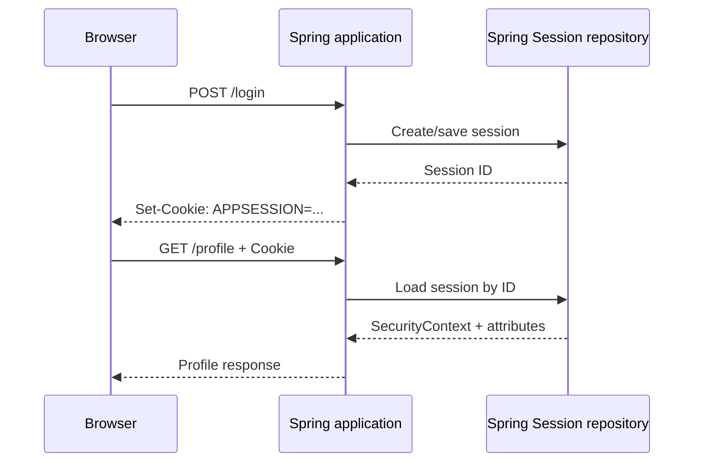
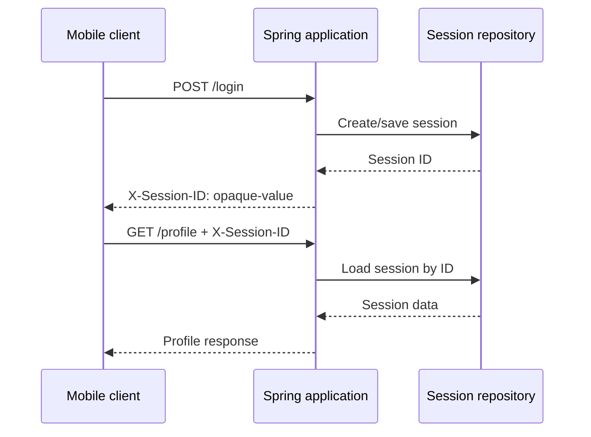

# Thiết kế cookie hoặc header phiên cho một client cụ thể

Spring Session cho phép ứng dụng Servlet lưu `HttpSession` trong Redis, JDBC hoặc một repository khác. Client cần gửi session ID ở mỗi request để server tìm lại phiên. Có hai cách truyền phổ biến: cookie và HTTP header. Chọn cách nào phụ thuộc loại client, khả năng bảo vệ credential, yêu cầu CSRF, CORS và cách client lưu trữ thông tin xác thực.

Với trình duyệt thông thường, cookie `HttpOnly`, `Secure` và `SameSite` thường là lựa chọn phù hợp vì JavaScript không cần đọc session ID. Với ứng dụng native trên mobile hoặc client không phải trình duyệt, một header riêng như `X-Session-ID` có thể dễ tích hợp hơn. Session ID luôn là bearer secret: bất kỳ ai lấy được ID còn hiệu lực đều có thể có khả năng sử dụng phiên đó. Cookie hay header chỉ là phương tiện vận chuyển; chúng không tự biến session ID thành an toàn.

## 1. Chọn transport theo loại client

Trước khi cấu hình Spring Session, xác định ai sẽ gửi request và ai có thể đọc credential.

| Loại client | Phương án thường phù hợp | Điểm cần chú ý |
|---|---|---|
| Trình duyệt server-rendered | Cookie session | `HttpOnly`, `Secure`, `SameSite`, CSRF protection |
| SPA gọi backend cùng site | Cookie session qua BFF hoặc API cùng site | Cookie không để JavaScript đọc; CSRF token và SameSite |
| SPA khác origin | Ưu tiên BFF; nếu dùng cookie cross-origin thì cấu hình CORS credentials chính xác | `SameSite=None; Secure`, allowed origin cụ thể, CSRF |
| Mobile native | Header session ID | Lưu trong Keychain/Keystore, TLS, redaction log và rotation |
| Desktop client/CLI | Header session ID hoặc token-based authentication | Bảo vệ file cấu hình, credential store và không ghi token vào shell history/log |
| Service-to-service | Thường ưu tiên OAuth2 client credentials, mTLS hoặc cơ chế service identity | Session người dùng không phải lựa chọn mặc định cho workload máy-máy |
| Webhook từ đối tác | Chữ ký webhook hoặc token riêng cho integration | Không nên dùng cookie phiên trình duyệt làm credential cho webhook |

Không chọn header chỉ vì API trả JSON, cũng không chọn cookie chỉ vì client có giao diện web. Quyết định dựa trên cách credential được lưu và gửi, threat model và khả năng triển khai CSRF/CORS.

## 2. Session ID là bí mật mang quyền truy cập

Trong mô hình session-based authentication, trình duyệt hoặc client gửi session ID. Server dùng ID đó để tải `SecurityContext` và các attribute từ repository. Người có ID hợp lệ có thể sử dụng quyền đã gắn với session mà không cần gửi lại username/password.

Vì vậy:

- Chỉ truyền session ID qua HTTPS.
- Không đưa session ID vào URL, query string hoặc path.
- Không ghi cookie, `Set-Cookie` hoặc header chứa session ID vào access log, trace hay metric.
- Không nhúng user ID, email, timestamp hoặc role vào session ID.
- Dùng generator ngẫu nhiên an toàn do Spring Session/framework cung cấp; không tự tạo ID tuần tự.
- Đặt idle timeout và absolute lifetime theo yêu cầu bảo mật.
- Invalidate session và xóa credential phía client khi logout.

Cookie và header không thay đổi bản chất bearer secret của ID. Nếu cookie bị đánh cắp hoặc header bị log, kẻ tấn công có thể dùng lại giá trị đó.

## 3. Cách cookie session hoạt động

Server gửi session ID trong `Set-Cookie`. Trình duyệt lưu cookie và tự động gửi lại trong các request phù hợp với domain, path, scheme và SameSite policy.



Cookie có lợi thế là trình duyệt quản lý việc gửi credential, còn `HttpOnly` ngăn JavaScript đọc trực tiếp giá trị. Nhược điểm quan trọng là trình duyệt có thể tự động gửi cookie trong request cross-site; vì vậy ứng dụng cookie-authenticated cần bảo vệ CSRF.

## 4. Cấu hình cookie bằng `DefaultCookieSerializer`

Trong Servlet stack, Spring Session thường dùng `CookieHttpSessionIdResolver` và `DefaultCookieSerializer` để đọc/ghi session cookie. Có thể khai báo serializer rõ ràng:

```java
import org.springframework.context.annotation.Bean;
import org.springframework.context.annotation.Configuration;
import org.springframework.session.web.http.CookieSerializer;
import org.springframework.session.web.http.DefaultCookieSerializer;

@Configuration
class BrowserSessionCookieConfiguration {

    @Bean
    CookieSerializer cookieSerializer() {
        DefaultCookieSerializer serializer = new DefaultCookieSerializer();
        serializer.setCookieName("APPSESSION");
        serializer.setCookiePath("/");
        serializer.setUseHttpOnlyCookie(true);
        serializer.setUseSecureCookie(true);
        serializer.setSameSite("Lax");
        // Không đặt Domain để cookie host-only khi chỉ cần một host.
        return serializer;
    }
}
```

Đây là cấu hình minh họa. Khi chạy production qua HTTPS, bật `Secure`. Nếu chạy HTTP local trong test, cấu hình `Secure` có thể khiến client test không gửi cookie như trình duyệt production; hãy dùng profile test riêng và không mang cấu hình yếu đó sang production.

### `HttpOnly`

`HttpOnly=true` khiến JavaScript không đọc được session cookie qua `document.cookie`. Điều này giảm nguy cơ XSS lấy trực tiếp session ID. Nó không ngăn script độc hại gửi request thay người dùng từ trình duyệt đã đăng nhập; do đó vẫn cần phòng chống XSS, output encoding và CSRF protection.

Không tắt `HttpOnly` chỉ để SPA đọc session ID. Nếu JavaScript cần biết người dùng đã đăng nhập, cung cấp endpoint trả thông tin người dùng tối thiểu thay vì trả credential.

### `Secure`

`Secure=true` yêu cầu trình duyệt chỉ gửi cookie qua HTTPS. Nếu TLS kết thúc ở reverse proxy, cấu hình ứng dụng phải nhất quán với scheme public và chỉ tin forwarded headers từ proxy được kiểm soát. Không để cookie session bị gửi qua HTTP không mã hóa.

### `SameSite`

| Giá trị | Hành vi khái quát | Trường hợp thường cân nhắc |
|---|---|---|
| `Strict` | Hạn chế gửi cookie trong điều hướng cross-site | Ứng dụng có thể chấp nhận trải nghiệm nghiêm ngặt |
| `Lax` | Cho phép một số điều hướng top-level an toàn, hạn chế nhiều request cross-site | Website thông thường cùng site |
| `None` | Cho phép cookie trong ngữ cảnh cross-site | SPA/API thực sự cần cookie cross-site; phải dùng `Secure` |

SameSite là lớp phòng vệ bổ sung, không thay thế CSRF token và kiểm tra request origin. Hành vi cụ thể còn phụ thuộc trình duyệt và ngữ cảnh site.

### `Domain` và `Path`

Nếu không đặt `Domain`, cookie thường là host-only và chỉ gửi tới host đã tạo cookie. Đây là lựa chọn có phạm vi hẹp hơn. Chỉ đặt `Domain=example.com` khi nhiều subdomain đáng tin cậy cần dùng chung cookie. Không mở domain tới toàn bộ subdomain nếu có host ít tin cậy.

`Path=/` thường cần khi nhiều endpoint trong cùng host sử dụng session. Nếu chỉ đặt path hẹp, request tới endpoint khác có thể không gửi cookie. Khi logout, cookie hết hạn cần dùng đúng `Path` và `Domain` như lúc phát hành.

## 5. CSRF khi dùng cookie

Trình duyệt tự động gửi cookie theo rule của nó. Một website bên ngoài có thể cố khiến trình duyệt nạn nhân gửi request đến ứng dụng đang đăng nhập. Đây là nền tảng của Cross-Site Request Forgery.

Với ứng dụng dùng cookie session:

- Giữ CSRF protection của Spring Security cho request thay đổi trạng thái.
- Dùng CSRF token theo cơ chế của Spring Security và frontend.
- Không coi `SameSite=Lax` là biện pháp duy nhất.
- Không cho phép GET endpoint thay đổi dữ liệu.
- Kiểm tra origin/referer phù hợp với threat model.
- Dùng CORS allowlist; CORS không tự thay thế CSRF protection.

Nếu SPA cần đọc CSRF token, có thể cấu hình một cookie riêng cho CSRF theo hướng dẫn Spring Security. Cookie CSRF có thể cần JavaScript đọc, nhưng session cookie vẫn nên `HttpOnly`. Không dùng chính session ID làm CSRF token.

## 6. SPA và backend-for-frontend (BFF)

Với SPA, mô hình BFF thường đơn giản hóa việc bảo vệ session:

1. Browser giao tiếp với backend cùng site qua cookie session.
2. Backend lưu session ID trong cookie `HttpOnly`.
3. JavaScript gọi endpoint BFF mà không đọc session ID.
4. BFF xử lý session và gọi API phía server khi cần.

Cách này giảm việc lưu bearer credential trong `localStorage` hoặc JavaScript memory. BFF vẫn phải có CSRF protection phù hợp vì browser tự động gửi cookie.

Nếu SPA gọi API cross-origin trực tiếp bằng cookie:

- Cookie có thể cần `SameSite=None; Secure`.
- Frontend phải gửi request với credentials theo API của browser client.
- Server chỉ cho phép origin cụ thể và bật credentials đúng cách.
- Không kết hợp `Access-Control-Allow-Credentials: true` với wildcard origin `*`.
- Cấu hình preflight cho method/header cần thiết.
- Vẫn bảo vệ CSRF và xác thực origin.

Không mở CORS cho mọi origin chỉ để giải quyết lỗi cookie không được gửi. CORS là chính sách truy cập của browser, không phải cơ chế xác thực client.

## 7. Cách header session hoạt động

Với header resolver, client gửi session ID trong một HTTP header. Spring Session đọc ID từ header và trả ID mới trong response header khi cần.



Header không được browser tự động gửi như cookie. Client phải lưu ID và chủ động gắn vào request. Điều này có thể giảm một số rủi ro CSRF truyền thống, nhưng tạo trách nhiệm bảo vệ token ở phía client và hạ tầng HTTP.

## 8. Cấu hình `HeaderHttpSessionIdResolver`

Spring Session cung cấp `HeaderHttpSessionIdResolver`. Có thể dùng header mặc định `X-Auth-Token` hoặc đặt tên riêng:

```java
import org.springframework.context.annotation.Bean;
import org.springframework.context.annotation.Configuration;
import org.springframework.session.web.http.HeaderHttpSessionIdResolver;
import org.springframework.session.web.http.HttpSessionIdResolver;

@Configuration
class NativeClientSessionConfiguration {

    @Bean
    HttpSessionIdResolver httpSessionIdResolver() {
        return HeaderHttpSessionIdResolver.header("X-Session-ID");
    }
}
```

Hoặc dùng:

```java
@Bean
HttpSessionIdResolver httpSessionIdResolver() {
    return HeaderHttpSessionIdResolver.xAuthToken();
}
```

Resolver dùng header để đọc session ID từ request và phát header tương ứng khi session ID cần được gửi về client. Client phải cập nhật giá trị mới khi server rotate ID, ví dụ sau đăng nhập theo session fixation protection. Khi session hết hạn hoặc logout, resolver phát tín hiệu hết hạn theo cơ chế header của nó; client cần xóa giá trị đã lưu.

Tên header cần thống nhất giữa mobile/desktop client, gateway, CORS policy và log redaction. Tránh dùng `Authorization` cho session ID nếu hệ thống cũng dùng Bearer access token; hai loại credential có semantics và vòng đời khác nhau.

## 9. Header session ID vẫn là bearer credential

Header không tự an toàn hơn cookie. Header có thể bị lộ qua:

- Reverse proxy, API gateway hoặc WAF log toàn bộ request headers.
- HTTP tracing/APM capture headers.
- Debug log ở client hoặc server.
- Crash report hoặc telemetry của mobile app.
- Lưu trữ không an toàn trong file cấu hình hoặc local storage.
- Thiết bị bị root/jailbreak hoặc malware đọc được dữ liệu app.

Biện pháp:

- Chỉ dùng HTTPS.
- Redact header session ở proxy, gateway, APM và log ứng dụng.
- Lưu trong iOS Keychain hoặc Android Keystore-backed storage; tránh plain preferences/file.
- Không đưa session ID vào URL hoặc command-line argument dễ lưu history.
- Hạn chế quyền đọc credential trên thiết bị và hỗ trợ logout/revoke từ xa.
- Rotate session ID sau đăng nhập và khi thay đổi mức xác thực nếu policy yêu cầu.
- Đặt idle timeout/absolute lifetime và rate limit.

Với browser JavaScript, nếu token header được lưu trong `localStorage`, XSS có thể đọc token. Lưu trong memory giảm thời gian tồn tại nhưng vẫn không bảo vệ được trước script đang chạy trong origin. Vì vậy BFF với HttpOnly cookie thường đáng cân nhắc hơn cho SPA.

## 10. Chọn cookie hay header cho mobile/native client

Mobile app không chịu các quy tắc cookie browser giống hệt web app, nhưng vẫn có thể dùng cookie jar. Chọn cookie nếu HTTP stack quản lý cookie ổn định và muốn dùng cùng mô hình server-rendered/session browser. Chọn header nếu app có API client rõ ràng, cần gắn credential có chủ đích và muốn kiểm soát lưu trữ/rotation.

Với header:

- Lưu ID trong secure storage của hệ điều hành.
- Gắn header trong một interceptor tập trung thay vì từng request tự thêm.
- Không gắn session ID tới host khác hoặc redirect ngoài allowlist.
- Xóa ID khi nhận tín hiệu session hết hạn hoặc logout thành công.
- Cập nhật ID mới sau login/rotation.
- Xử lý nhiều account/profile bằng kho credential riêng, không dùng một global token.

Với cookie:

- Dùng cookie jar được bảo vệ bởi platform.
- Kiểm tra domain/path và cookie persistence.
- Xử lý cookie hết hạn và logout.
- Không copy cookie vào analytics hoặc crash report.

Nếu app native có thể dùng OAuth2/OIDC authorization code flow với PKCE, access/refresh token được quản lý theo chuẩn có thể phù hợp hơn session cookie/header tự thiết kế. Chọn theo kiến trúc xác thực tổng thể.

## 11. Service-to-service và API machine client

Session người dùng thường gắn với browser/mobile identity và trạng thái tương tác. Với service-to-service, một session ID dùng chung có thể gây khó khăn cho audit, revoke và phân tách danh tính service.

Thường nên cân nhắc:

- OAuth2 client credentials hoặc workload identity.
- mTLS để xác thực workload.
- Access token ngắn hạn với audience/scope cụ thể.
- API key riêng cho integration có vòng đời và rotation rõ.

Chỉ dùng Spring Session header cho machine client nếu có lý do cụ thể, ví dụ service đang tiếp tục một workflow stateful đã thiết kế. Khi đó, session ID phải được cấp cho đúng service principal, có quyền tối thiểu và không dùng chung giữa nhiều workload.

## 12. Một ứng dụng có thể hỗ trợ cả cookie và header không?

Mặc định, một cấu hình Servlet application thường chọn một `HttpSessionIdResolver` cho `SessionRepositoryFilter`: cookie resolver hoặc header resolver. Không nên giả định chỉ cần khai báo cả hai bean là Spring Session tự động kết hợp an toàn.

Nếu có browser và native client cùng dùng một backend, có ba hướng:

1. **Tách entry point/application:** browser dùng host/BFF với cookie; native API dùng host hoặc security chain riêng với header.
2. **Tách ứng dụng theo client:** mỗi app có resolver và policy riêng nhưng có thể dùng repository chung nếu cần và đã kiểm soát trust boundary.
3. **Custom resolver có quy tắc rõ:** chỉ chấp nhận transport được phép trên từng route/client; định nghĩa precedence, response header/cookie, logout và rotation; từ chối request gửi cả hai credential nếu gây mơ hồ.

Custom resolver phải kiểm soát chặt:

- Route nào nhận cookie và route nào nhận header.
- Điều gì xảy ra khi request chứa cả cookie lẫn header.
- Không cho client chọn ID tùy ý ngoài credential đã cấp.
- Khi rotate ID, chỉ phát ID mới qua transport của client đó.
- Logout phải xóa/invalidate đúng credential và không để transport còn lại giữ session hợp lệ ngoài ý muốn.
- CORS/CSRF và log redaction theo từng transport.

Không dùng resolver lai chỉ để tiện nếu không có yêu cầu client rõ ràng. Hai cách truyền credential cùng tồn tại có thể tạo session confusion, ví dụ browser gửi cookie cũ trong khi header chứa ID mới.

## 13. Cookie và header trong cùng một hệ thống

Nếu cần hỗ trợ nhiều client, hãy định nghĩa hợp đồng:

| Thành phần | Browser cookie client | Native header client |
|---|---|---|
| Request credential | Cookie `APPSESSION` | Header `X-Session-ID` |
| Response cấp ID | `Set-Cookie` | `X-Session-ID` response header |
| JavaScript đọc ID | Không, do HttpOnly | Có thể đọc nếu là browser JS; tránh lưu lâu trong localStorage |
| CSRF | Bắt buộc có biện pháp phù hợp | Giảm CSRF truyền thống vì header không tự gửi; vẫn kiểm soát CORS/XSS |
| Storage client | Browser cookie jar | Keychain/Keystore hoặc credential store |
| Logout | Invalidate session và expire cookie | Invalidate session và xóa header token trong client |
| Rotation | Browser tự nhận cookie mới | Client phải cập nhật response header mới |

Không để cùng một session ID xuất hiện trong cookie và header nếu không cần. Nếu custom resolver cho phép cả hai, cần quy định một nguồn authoritative và kiểm thử precedence.

## 14. Cấu hình Spring Session repository

Transport ID và nơi lưu session là hai quyết định riêng. Cookie/header resolver chỉ quyết định cách client gửi ID; Redis/JDBC repository quyết định dữ liệu session được lưu ở đâu.

Ví dụ Redis Servlet session:

```java
@Configuration
@EnableRedisHttpSession(maxInactiveIntervalInSeconds = 1800)
class RedisSessionConfiguration {
}
```

Ví dụ JDBC Servlet session:

```java
@Configuration
@EnableJdbcHttpSession(maxInactiveIntervalInSeconds = 1800)
class JdbcSessionConfiguration {
}
```

Các annotation và package phụ thuộc Spring Session version. Nếu dùng Spring Boot auto-configuration, có thể cấu hình store và timeout qua property thay vì khai báo annotation thủ công. Không bật hai repository implementation cùng lúc nếu không có thiết kế rõ.

Một ứng dụng dùng cookie và một ứng dụng dùng header vẫn có thể trỏ đến cùng Redis/JDBC repository nếu chúng chia sẻ session ID và serialization contract. Tuy nhiên, khác biệt transport không giải quyết khác biệt principal/attribute schema hoặc trust boundary.

## 15. Session fixation và rotation ID

Sau khi xác thực thành công, Spring Security thường áp dụng session fixation protection để thay session ID hoặc tạo session mới theo chiến lược cấu hình. Client phải nhận và dùng ID mới.

Với cookie, trình duyệt xử lý `Set-Cookie` response. Với header, client phải đọc response header và thay ID đã lưu. Nếu client tiếp tục gửi ID cũ, request sau có thể không tìm thấy session hoặc bị xem là chưa xác thực.

Kiểm thử:

1. Gửi request trước login và ghi nhận ID nếu session đã tồn tại.
2. Đăng nhập thành công.
3. Xác nhận server phát ID mới theo chiến lược session fixation.
4. Gửi request tiếp theo bằng ID mới và xác nhận đã xác thực.
5. Gửi ID cũ và xác nhận không truy cập được phiên đã xác thực.

Không tự tắt session fixation protection chỉ vì header client khó cập nhật ID. Hãy sửa client để xử lý response header rotation.

## 16. Logout và hết hạn theo transport

Logout phải invalidate session ở repository dùng chung. Sau đó:

- Cookie client nhận cookie hết hạn với đúng name/path/domain.
- Header client xóa session ID khỏi secure storage khi nhận response logout thành công hoặc tín hiệu hết hạn.
- Request tiếp theo với ID cũ không được khôi phục `SecurityContext`.
- Các node khác cũng không còn tải được session đã invalidate.

Không chỉ xóa cookie ở browser mà bỏ session trong Redis/JDBC. Không chỉ invalidate repository mà để native app tiếp tục gửi ID cũ mãi mãi. Client cần xử lý trạng thái hết hạn và yêu cầu đăng nhập lại.

Idle timeout có thể được gia hạn khi có hoạt động. Với ứng dụng nhạy cảm, cân nhắc absolute lifetime, re-authentication cho thao tác quan trọng và thu hồi session từ trang quản lý thiết bị.

## 17. CORS khi browser dùng header session

Nếu một SPA gửi custom header session ID tới API cross-origin, browser thường thực hiện CORS preflight vì header tùy chỉnh không thuộc nhóm simple request. Server cần:

- Cho phép origin cụ thể.
- Cho phép header `X-Session-ID` trong `Access-Control-Allow-Headers`.
- Cho phép method cần thiết.
- Trả CORS response phù hợp cho preflight không mang session nếu cần.
- Không bật wildcard origin với credentials.
- Bảo vệ endpoint bằng authentication/authorization bình thường.

Header session ID không tự giải quyết XSS. Script độc hại trong origin hợp lệ có thể gửi request với header nếu lấy được token. Cần CSP, output encoding, dependency hygiene và lưu token an toàn.

Nếu dùng cookie cross-origin, cấu hình credentials và `SameSite=None; Secure` có thể cần thiết, đồng thời CSRF vẫn phải được xử lý. Đừng coi CORS là biện pháp ngăn CSRF.

## 18. Proxy, gateway và log redaction

Reverse proxy và API gateway có thể:

- Xóa hoặc đổi header không nằm trong allowlist.
- Không chuyển tiếp `X-Session-ID` nếu cấu hình thiếu.
- Ghi request/response headers vào access log.
- Ghi cookie trong tracing hoặc WAF audit.
- Cache response có `Set-Cookie` nếu cache policy sai.
- Chuyển redirect sang host khác làm cookie/header không còn được gửi.

Kiểm tra đường đi từ client đến application. Header session phải được forward rõ ràng, nhưng log phải redacted. Không cho phép gateway cache response chứa thông tin cá nhân/session; dùng `Cache-Control: no-store` cho response nhạy cảm khi phù hợp.

Với cookie, bảo đảm proxy không xóa `Set-Cookie` và không viết lại domain/path sai. Nếu TLS termination diễn ra ở proxy, kiểm tra ứng dụng phát `Secure` cookie theo cấu hình public HTTPS.

## 19. Kiểm thử cookie resolver

Với cookie client, integration test nên:

1. Gửi request tạo session qua `SessionRepositoryFilter`.
2. Xác nhận response có `Set-Cookie` với cookie name đã cấu hình.
3. Kiểm tra `Secure`, `HttpOnly`, `SameSite`, `Path` và `Domain` theo policy.
4. Gửi request tiếp theo với cookie vừa nhận.
5. Xác nhận attribute được khôi phục từ Redis/JDBC.
6. Đăng nhập và xác nhận session ID rotation nếu policy yêu cầu.
7. Logout, kiểm tra cookie hết hạn và session không còn tồn tại.

Ví dụ MockMvc:

```java
MvcResult first = mockMvc.perform(post("/test/session")
        .with(csrf())
        .param("value", "browser-state"))
    .andExpect(status().isOk())
    .andReturn();

Cookie cookie = first.getResponse().getCookie("APPSESSION");
assertThat(cookie).isNotNull();

mockMvc.perform(get("/test/session").cookie(cookie))
    .andExpect(status().isOk())
    .andExpect(content().string("browser-state"));
```

MockMvc xác minh filter/resolver trong test context nếu filter được đăng ký đúng. Với kiểm tra hành vi browser thực tế, domain, SameSite và HTTPS, cần thêm test chạy trên Servlet container và browser automation trong môi trường HTTPS test.

## 20. Kiểm thử header resolver

Với header client, kiểm tra cả response header cấp ID và request header dùng lại ID:

```java
MvcResult first = mockMvc.perform(post("/test/session")
        .param("value", "native-state"))
    .andExpect(status().isOk())
    .andReturn();

String sessionId = first.getResponse().getHeader("X-Session-ID");
assertThat(sessionId).isNotBlank();

mockMvc.perform(get("/test/session")
        .header("X-Session-ID", sessionId))
    .andExpect(status().isOk())
    .andExpect(content().string("native-state"));
```

Ví dụ giả định controller test lưu attribute, resolver dùng `HeaderHttpSessionIdResolver.header("X-Session-ID")` và repository được cấu hình. Không hardcode ID giả hoặc dùng `MockHttpSession` nếu mục tiêu là xác minh header resolver.

### Test các trường hợp lỗi

- Thiếu header: request được xử lý như không có session theo policy.
- Header rỗng hoặc định dạng không hợp lệ: không tạo quyền truy cập.
- ID hết hạn hoặc đã logout: không khôi phục authentication cũ.
- ID cũ sau rotation: bị từ chối.
- Request có cả cookie và header nếu resolver tùy chỉnh hỗ trợ: xác minh precedence hoặc từ chối ambiguity.
- Proxy bỏ header: test integration qua gateway nếu đó là topology production.
- Response header bị log: xác nhận redaction trong telemetry pipeline.

## 21. Checklist chọn transport cho một client cụ thể

Trước khi triển khai, trả lời:

- Client là browser, SPA, mobile native, desktop hay service?
- Client có tự động gửi cookie không hay cần gắn header chủ động?
- JavaScript có cần đọc credential không? Nếu có, có thể dùng BFF để tránh không?
- CSRF được xử lý thế nào nếu browser gửi cookie?
- CORS có cần không; origin và header allowlist cụ thể là gì?
- Credential được lưu ở đâu và ai có thể đọc?
- Proxy/gateway có forward và redact cookie/header đúng không?
- Session ID rotation sau login được client xử lý ra sao?
- Logout, expiration và revoke từ xa xóa credential thế nào?
- Một resolver toàn ứng dụng có đáp ứng được mọi client không, hay cần entry point riêng?
- Redis/JDBC repository, namespace và principal contract có tương thích giữa các ứng dụng không?
- Test có đi qua filter, resolver và repository thật không?

## 22. Những sai lầm thường gặp

| Sai lầm | Rủi ro | Cách làm phù hợp |
|---|---|---|
| Tắt `HttpOnly` để SPA đọc session ID | XSS có thể lấy bearer credential | Dùng BFF/HttpOnly cookie; endpoint trả thông tin người dùng |
| Dùng cookie nhưng bỏ CSRF protection | Request cross-site có thể dùng phiên người dùng | CSRF token, SameSite và kiểm tra origin phù hợp |
| Dùng `SameSite=None` mà thiếu `Secure` | Browser có thể từ chối cookie hoặc cookie không an toàn | `SameSite=None; Secure` qua HTTPS |
| Dùng domain cookie quá rộng | Subdomain ít tin cậy có thể ảnh hưởng credential | Host-only cookie nếu có thể; giới hạn domain |
| Dùng header nhưng log toàn bộ headers | Session ID lộ trong gateway/APM | Redact header trên toàn tuyến |
| Lưu header token trong plain preferences/localStorage | Credential dễ bị đọc khi thiết bị/origin bị xâm nhập | Keychain/Keystore hoặc BFF tùy client |
| Dùng `Authorization` cho session ID trong hệ có access token | Nhầm lẫn credential và middleware | Header riêng có semantics rõ |
| Nghĩ header loại bỏ mọi CSRF/XSS | XSS vẫn có thể dùng token; CORS cấu hình sai vẫn nguy hiểm | XSS defenses, CORS allowlist và bảo vệ token |
| Cấu hình cookie và header cùng lúc không có precedence | Session confusion và credential mơ hồ | Một resolver rõ hoặc custom resolver có route policy |
| Không cập nhật header sau rotation | Client tiếp tục dùng session ID cũ | Đọc response header và thay token trong secure storage |
| Chỉ xóa cookie mà không invalidate repository | Session cũ vẫn có thể bị dùng nếu ID lộ | Invalidate session và expire credential client |

## 23. Nguyên tắc thiết kế

- Chọn cookie cho browser khi muốn trình duyệt quản lý credential và giữ session ID ngoài JavaScript.
- Chọn header riêng cho native/desktop client khi client có secure storage và quản lý token chủ động.
- Ưu tiên BFF cho SPA nếu muốn giảm việc JavaScript nắm bearer credential.
- Cấu hình cookie `Secure`, `HttpOnly`, `SameSite`, `Path` và `Domain` theo đúng client/site topology.
- Giữ CSRF protection khi xác thực bằng cookie; cấu hình CORS cụ thể khi cần cross-origin.
- Dùng `HeaderHttpSessionIdResolver` cho header transport và bảo vệ header khỏi log/tracing.
- Không giả định một `HttpSessionIdResolver` mặc định tự hỗ trợ đồng thời mọi transport.
- Nếu hỗ trợ nhiều loại client, tách entry point hoặc viết resolver tùy chỉnh có quy tắc chặt.
- Xử lý session ID rotation, logout, timeout và revoke ở cả server lẫn client.
- Không dùng session ID làm access token, CSRF token hoặc service identity.
- Kiểm thử cookie/header round-trip qua `SessionRepositoryFilter` và Redis/JDBC repository thật.

Cookie và header là hai cách truyền session ID cho các loại client khác nhau. Browser thường phù hợp với cookie `HttpOnly`, `Secure` và SameSite phù hợp, đi cùng CSRF protection; native client có thể dùng header riêng nếu lưu credential trong secure storage và cập nhật ID khi rotation. Spring Session cung cấp `CookieHttpSessionIdResolver` và `HeaderHttpSessionIdResolver`, nhưng ứng dụng phải chọn transport rõ ràng, kiểm soát proxy/logging, CORS/CSRF và logout. Thiết kế tốt bắt đầu từ đặc điểm client và threat model, sau đó kiểm thử toàn bộ vòng đời tạo phiên, gửi lại ID, rotation, expiration và thu hồi.
