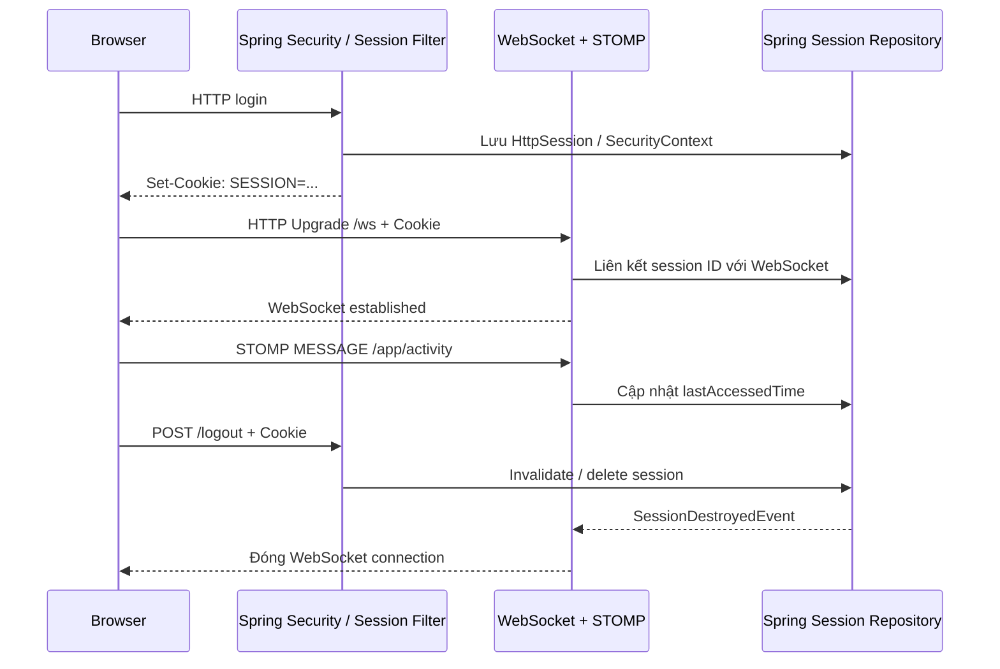
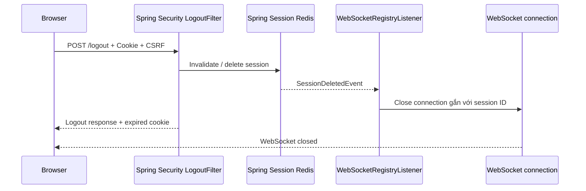

# Tích hợp WebSocket và kiểm tra hết hạn, đăng xuất

Một ứng dụng Spring có thể dùng HTTP cho đăng nhập, hồ sơ và các thao tác thông thường, đồng thời dùng WebSocket/STOMP cho chat, thông báo hoặc cập nhật trực tiếp. Khi đó, cùng một người dùng có thể vẫn gửi và nhận WebSocket message trong khi không tạo HTTP request mới. Nếu session chỉ được gia hạn bởi HTTP traffic, `HttpSession` có thể hết inactivity timeout dù kết nối WebSocket vẫn mở.

Spring Session có tích hợp với Spring WebSocket để liên kết session HTTP tại bước handshake, cập nhật thời gian hoạt động khi client gửi STOMP message và đóng các WebSocket connection gắn với session khi session bị hủy. Nhờ đó, ứng dụng có thể giữ session sống khi người dùng thực sự hoạt động qua WebSocket và ngắt kết nối khi logout hoặc session hết hạn.

Bài thực hành này tập trung vào Spring Session trên Servlet stack kết hợp Spring WebSocket/STOMP. Phần quan trọng là hiểu luồng handshake, inbound message, `SessionDestroyedEvent`, Redis event configuration và cách kiểm thử logout/expiration. Tích hợp tự động của Spring Session không áp dụng cho JSR-356 trực tiếp hoặc mọi WebSocket implementation tùy chỉnh.

## 1. Vì sao WebSocket cần phối hợp với Spring Session?

### 1.1. HTTP session và WebSocket có vòng đời khác nhau

Trình duyệt thường đăng nhập qua HTTP, nhận cookie session ID, rồi mở WebSocket connection tới server. Cookie được gửi trong HTTP upgrade handshake. Sau khi handshake thành công, WebSocket connection tồn tại lâu dài và các frame/message tiếp theo không phải là HTTP request mới.

Nếu ứng dụng chỉ cập nhật `lastAccessedTime` khi xử lý HTTP request, một người đang chat liên tục có thể bị hết session dù vẫn hoạt động. Ngược lại, nếu WebSocket không được đóng khi session bị thu hồi, người dùng đã logout vẫn có thể giữ một connection đã xác thực.

Spring Session giải quyết hai vấn đề bằng cách:

- Gắn Spring Session hiện tại vào WebSocket session khi handshake.
- Cập nhật last-access time khi nhận các STOMP message từ client theo loại message được cấu hình.
- Theo dõi WebSocket connection theo Spring Session ID.
- Đóng các WebSocket connection liên quan khi Spring Session phát sự kiện hủy session.

### 1.2. Luồng tổng quát



Sự kiện hủy session có thể đến từ logout hoặc expiration. Thời gian đóng connection sau expiration phụ thuộc repository, event notification và tác vụ cleanup; không nên kiểm thử bằng cách yêu cầu socket đóng chính xác tại mili giây TTL.

## 2. Phạm vi tích hợp được Spring Session hỗ trợ

Spring Session WebSocket integration hoạt động với Spring WebSocket support, đặc biệt là STOMP message broker integration. Nó không tích hợp tương tự với JSR-356 trực tiếp vì JSR-356 không cung cấp cơ chế để Spring Session chặn inbound message và cập nhật session theo message.

Các thành phần cốt lõi gồm:

| Thành phần | Vai trò |
|---|---|
| `AbstractSessionWebSocketMessageBrokerConfigurer` | Cấu hình STOMP broker và tự đăng ký hạ tầng Spring Session WebSocket |
| `SessionRepositoryMessageInterceptor` | Là `HandshakeInterceptor` và `ChannelInterceptor`; gắn session vào WebSocket và cập nhật last-access time khi có inbound message phù hợp |
| `WebSocketConnectHandlerDecoratorFactory` | Bổ sung thông tin WebSocket connection vào event kết nối để quản lý lifecycle |
| `WebSocketRegistryListener` | Theo dõi ánh xạ Spring Session ID tới WebSocket connection và đóng connection khi nhận `SessionDestroyedEvent` |
| `SessionDestroyedEvent` | Sự kiện nền cho việc xóa tài nguyên gắn với session; có thể là `SessionDeletedEvent` hoặc `SessionExpiredEvent` |

Không tự đăng ký thêm các interceptor tương tự nếu đã dùng `AbstractSessionWebSocketMessageBrokerConfigurer`, trừ khi có yêu cầu tùy biến rõ ràng. Đăng ký trùng có thể khiến session được cập nhật nhiều lần hoặc gây khó chẩn đoán.

## 3. Cấu hình Spring Session và WebSocket/STOMP

### 3.1. Chọn repository có phát session event

Để đóng WebSocket khi session bị xóa/hết hạn, repository phải phát `SessionDestroyedEvent`. Với Redis, cần dùng indexed repository có hỗ trợ event. `RedisSessionRepository` cơ bản không phát session event; `RedisIndexedSessionRepository` có hỗ trợ `SessionDeletedEvent` và `SessionExpiredEvent`.

Ví dụ cấu hình Servlet Redis:

```java
import org.springframework.context.annotation.Configuration;
import org.springframework.session.data.redis.config.annotation.web.http.EnableRedisIndexedHttpSession;

@Configuration
@EnableRedisIndexedHttpSession(
    maxInactiveIntervalInSeconds = 60,
    redisNamespace = "chat:session"
)
public class SessionConfiguration {
}
```

Trong ví dụ, session idle timeout là 60 giây để thuận tiện kiểm thử. Production nên chọn thời hạn theo yêu cầu bảo mật và trải nghiệm người dùng. Nếu dùng Spring Boot auto-configuration, chọn Redis repository type `indexed` bằng property tương ứng của dòng Boot đang dùng; không để ứng dụng vô tình dùng repository mặc định không phát event.

Với `@EnableRedisHttpSession`, tùy chọn `enableIndexingAndEvents = true` cũng chọn indexed repository. Không khai báo đồng thời nhiều annotation cấu hình Redis session cho cùng một ứng dụng.

### 3.2. Cấu hình STOMP endpoint với Spring Session

Thay vì chỉ implement `WebSocketMessageBrokerConfigurer`, kế thừa `AbstractSessionWebSocketMessageBrokerConfigurer<Session>`:

```java
import org.springframework.context.annotation.Configuration;
import org.springframework.session.Session;
import org.springframework.session.web.socket.config.annotation.AbstractSessionWebSocketMessageBrokerConfigurer;
import org.springframework.web.socket.config.annotation.EnableWebSocketMessageBroker;
import org.springframework.web.socket.config.annotation.MessageBrokerRegistry;
import org.springframework.web.socket.config.annotation.StompEndpointRegistry;

@Configuration
@EnableWebSocketMessageBroker
public class WebSocketConfiguration
        extends AbstractSessionWebSocketMessageBrokerConfigurer<Session> {

    @Override
    protected void configureStompEndpoints(StompEndpointRegistry registry) {
        registry.addEndpoint("/ws")
            .setAllowedOriginPatterns("https://app.example.com");
    }

    @Override
    public void configureMessageBroker(MessageBrokerRegistry registry) {
        registry.enableSimpleBroker("/topic", "/queue");
        registry.setApplicationDestinationPrefixes("/app");
    }
}
```

Điểm khác biệt là phương thức endpoint tên `configureStompEndpoints`. Cấu hình lớp cha tự thêm những thành phần sau:

1. `SessionRepositoryMessageInterceptor` làm handshake interceptor để lưu session liên quan vào WebSocket attributes.
2. `SessionRepositoryMessageInterceptor` làm inbound channel interceptor để cập nhật last-access time và chặn message nếu session đã hết hạn.
3. `WebSocketConnectHandlerDecoratorFactory` giúp event kết nối chứa WebSocket session.
4. `WebSocketRegistryListener` theo dõi connection để đóng khi session bị hủy.

`setAllowedOriginPatterns` cần giới hạn theo origin thật của frontend. Không dùng wildcard rộng cho ứng dụng có xác thực bằng cookie.

### 3.3. Dependency cần thiết

Với ứng dụng Spring Boot Servlet, các dependency thường gồm:

```xml
<dependency>
    <groupId>org.springframework.boot</groupId>
    <artifactId>spring-boot-starter-websocket</artifactId>
</dependency>
<dependency>
    <groupId>org.springframework.session</groupId>
    <artifactId>spring-session-data-redis</artifactId>
</dependency>
<dependency>
    <groupId>org.springframework.boot</groupId>
    <artifactId>spring-boot-starter-data-redis</artifactId>
</dependency>
```

Phiên bản dependency nên do Spring Boot BOM quản lý. Nếu ứng dụng dùng JDBC để lưu session, thay Redis module bằng `spring-session-jdbc` và cấu hình DataSource. Tuy nhiên, cần đọc kỹ giới hạn phát session event của JDBC repository ở phần sau.

## 4. Cách inbound STOMP message gia hạn session

### 4.1. Handshake liên kết session ID

Khi browser gửi HTTP upgrade request kèm cookie session, Spring Session filter đọc cookie và khôi phục `HttpSession`. `SessionRepositoryMessageInterceptor` tại handshake lấy Spring Session ID và gắn thông tin cần thiết vào attributes của WebSocket session.

Sau khi handshake thành công, STOMP message không mang lại HTTP cookie mới. Interceptor dùng thông tin đã gắn để tìm session trong repository và cập nhật last-access time.

### 4.2. Những message được tính là hoạt động

Mặc định, `SessionRepositoryMessageInterceptor` cập nhật last-access time cho các loại inbound STOMP message:

- `CONNECT`
- `MESSAGE`
- `SUBSCRIBE`
- `UNSUBSCRIBE`

Khi session đã hết hạn, interceptor ngăn message phù hợp tiếp tục đi vào message channel. Việc này giúp tránh xử lý một thao tác mới bằng session không còn hợp lệ.

### 4.3. Outbound message không gia hạn session

Message từ server tới browser không chứng minh người dùng đang hoạt động. Nếu một dashboard liên tục nhận dữ liệu thị trường hoặc thông báo nền nhưng người dùng không gửi message nào, session vẫn có thể hết idle timeout.

Đây là hành vi có chủ đích: chỉ hoạt động từ client mới thể hiện người dùng còn sử dụng ứng dụng. Không gia hạn session chỉ vì server đang broadcast dữ liệu.

### 4.4. Heartbeat không đồng nghĩa user activity

STOMP/WebSocket heartbeat giúp phát hiện kết nối chết hoặc proxy ngắt kết nối. Heartbeat ở tầng transport không nhất thiết là một STOMP `MESSAGE` được `SessionRepositoryMessageInterceptor` xử lý. Không dựa vào heartbeat để gia hạn session nếu chưa xác minh hành vi của phiên bản/client đang dùng.

Nếu sản phẩm muốn một người đang thao tác trong giao diện giữ session sống, gửi một application-level activity message tới destination được bảo vệ, ví dụ `/app/activity`, với tần suất hợp lý. Server cần rate limit và xác thực message; không cho client gửi ping vô hạn để giữ phiên đăng nhập mãi mãi.

### 4.5. Ví dụ message activity

```java
import org.springframework.messaging.handler.annotation.MessageMapping;
import org.springframework.stereotype.Controller;

@Controller
public class ActivityController {

    @MessageMapping("/activity")
    public void activity() {
        // Inbound STOMP MESSAGE đã được Spring Session interceptor xử lý.
        // Có thể ghi metric activity; không cần tự cập nhật lastAccessedTime.
    }
}
```

Client gửi STOMP `SEND` tới `/app/activity`. Interceptor được chạy trước handler, nên session last-access time được cập nhật theo tích hợp Spring Session. Không tự gọi repository để gia hạn session nếu cơ chế tích hợp đã xử lý.

## 5. Redis expiration event và đóng WebSocket

### 5.1. Sự kiện hủy session

`SessionDeletedEvent` và `SessionExpiredEvent` đều là dạng `SessionDestroyedEvent`:

- `SessionDeletedEvent`: session bị xóa tường minh, ví dụ logout hoặc quản trị thu hồi.
- `SessionExpiredEvent`: session hết inactivity timeout.

`WebSocketRegistryListener` nhận `SessionDestroyedEvent` và đóng các WebSocket connection được ánh xạ với session ID đó. Điều này giúp connection không tiếp tục sống sau khi phiên xác thực bị hủy.

### 5.2. Phải dùng Redis indexed repository

Với Redis, cấu hình repository hỗ trợ event, ví dụ `@EnableRedisIndexedHttpSession` hoặc `@EnableRedisHttpSession(enableIndexingAndEvents = true)`. Repository mặc định `RedisSessionRepository` không phát session lifecycle event, nên không đáp ứng tự động đóng WebSocket theo event.

Boot property thường có dạng `spring.session.redis.repository-type=indexed` ở một số dòng Boot 3 và `spring.session.data.redis.repository-type=indexed` ở Boot 4. Hãy kiểm tra property prefix đúng phiên bản đang dùng.

### 5.3. Redis Keyspace Notifications

Spring Session Redis lắng nghe keyspace notification để nhận biết key session bị xóa hoặc hết hạn. Với Redis tự quản lý, các event flag cần thiết thường bao gồm keyevent, generic và expired, ví dụ:

```bash
redis-cli CONFIG SET notify-keyspace-events Egx
```

Trong cấu hình Spring Session thông thường, việc đăng ký listener và yêu cầu Redis bật notification được tự động xử lý khi dùng indexed repository. Trên Redis managed hoặc môi trường bảo mật không cho ứng dụng gọi `CONFIG`, cần cấu hình notification ở control plane của dịch vụ và có thể khai báo:

```java
import org.springframework.context.annotation.Bean;
import org.springframework.session.data.redis.config.ConfigureRedisAction;

@Bean
ConfigureRedisAction configureRedisAction() {
    return ConfigureRedisAction.NO_OP;
}
```

Bean `ConfigureRedisAction.NO_OP` chỉ tắt việc Spring Session tự gửi lệnh cấu hình Redis. Nó không tự bật keyspace notification. Quản trị viên phải bảo đảm Redis đã được cấu hình event phù hợp.

### 5.4. Expiration event không đến đúng mili giây TTL

Redis không bảo đảm key expiration event luôn được phát chính xác tại thời điểm TTL chạm 0. Spring Session còn có cơ chế cleanup nền để xử lý session hết hạn và dữ liệu liên quan. Vì vậy, session timeout 60 giây không có nghĩa WebSocket chắc chắn bị đóng đúng giây thứ 60.

Kiểm thử nên chờ trong một deadline có dư địa cho Redis event và cleanup task. Đồng thời, request STOMP tiếp theo vẫn phải bị interceptor từ chối nếu repository xác định session đã expired.

## 6. Logout HTTP khi WebSocket vẫn đang mở

### 6.1. Logout phải hủy session phía server

Khi người dùng logout từ HTTP, Spring Security nên thực hiện đầy đủ:

- Xóa `SecurityContext`.
- Invalidate `HttpSession`.
- Xóa cookie hoặc phát cookie hết hạn cho browser.
- Thực hiện các logout handler liên quan như remember-me nếu ứng dụng dùng.

Với session-backed authentication, invalidation phía server mới là tín hiệu để Spring Session phát session destruction event. Chỉ xóa cookie trên browser mà không invalidate session không bảo đảm WebSocket connection đã được đóng.

### 6.2. Luồng logout



### 6.3. WebSocket disconnect không tự động là logout

Nếu người dùng đóng tab, mất mạng hoặc proxy đóng WebSocket, HTTP session vẫn có thể còn hiệu lực. Đây không phải logout mặc định. Khi client kết nối lại, browser có thể mở WebSocket mới bằng cookie session còn hợp lệ.

Không xóa session mỗi khi nhận `SessionDisconnectEvent` nếu sản phẩm không yêu cầu logout khi ngắt kết nối. Một người dùng có thể có nhiều tab hoặc nhiều thiết bị cùng dùng các session riêng.

### 6.4. Event disconnect có thể lặp

Spring WebSocket có thể phát `SessionDisconnectEvent` nhiều lần cho một phiên STOMP trong một số trường hợp. Logic dọn tài nguyên, cập nhật presence hoặc đếm người dùng online phải idempotent. Không trừ số người online nhiều lần chỉ vì cùng một connection phát nhiều disconnect event.

## 7. Cấu hình bảo mật cho handshake và STOMP

### 7.1. Bảo vệ HTTP handshake

Handshake là một HTTP request nâng cấp giao thức. Nếu dùng session cookie, request phải đi qua Spring Security và xác thực principal bằng session hiện tại. Chỉ cho phép origin frontend hợp lệ; bật HTTPS và cookie `Secure`, `HttpOnly`, `SameSite` phù hợp.

Không đặt session ID trong query string như `ws://host/ws?sessionId=...`; URL thường xuất hiện trong access log, tracing hoặc công cụ giám sát. Dùng cookie hoặc cơ chế credential được thiết kế rõ ràng.

### 7.2. Phân quyền message destination

Xác thực thành công ở handshake không có nghĩa mọi destination đều được phép. Cần phân quyền cho:

- STOMP `CONNECT`.
- `SEND` tới application destination `/app/**`.
- `SUBSCRIBE` tới `/topic/**` hoặc `/queue/**`.
- Destination chứa dữ liệu cá nhân, tenant hoặc quản trị.

Không tin `userId`, `role` hoặc tenant do client tự gửi trong STOMP native header. Dùng `Principal` được Spring Security xác thực và kiểm tra quyền tài nguyên ở server.

### 7.3. CSRF và origin

Với cookie-based authentication, WebSocket handshake và STOMP CONNECT cần được bảo vệ theo mô hình Spring Security WebSocket đang dùng. Không tắt CSRF toàn cục để giải quyết lỗi STOMP CONNECT; cấu hình CSRF token phù hợp cho handshake/message và kiểm tra origin cụ thể.

## 8. JDBC repository có giới hạn gì với WebSocket lifecycle?

### 8.1. `JdbcIndexedSessionRepository` không phát session event mặc định

Khác với Redis indexed repository, `JdbcIndexedSessionRepository` hiện không hỗ trợ publish session events. Vì vậy, `WebSocketRegistryListener` không tự nhận được `SessionDeletedEvent`/`SessionExpiredEvent` từ JDBC repository để đóng connection theo cùng cách Redis indexed làm.

JDBC vẫn có thể xác định session đã hết hạn khi repository được truy vấn và có cleanup job xóa row hết hạn. Tuy nhiên, xóa row vật lý qua cleanup không đồng nghĩa một `SessionDestroyedEvent` được phát tới WebSocket registry.

### 8.2. Các lựa chọn khi dùng JDBC

Nếu ứng dụng cần đóng WebSocket ngay khi logout hoặc hết hạn, cần bổ sung cơ chế riêng:

1. **Logout tường minh:** trước hoặc trong logout flow, lấy session ID đã xác minh và gửi lệnh đóng các WebSocket gắn với session đó qua connection registry của ứng dụng.
2. **Thông báo liên node:** nếu WebSocket có thể nằm trên node khác, phát lệnh invalidation qua broker/distributed topic để node đang giữ connection đóng socket cục bộ.
3. **Expiration:** tạo cơ chế phát hiện session hết hạn và phát lệnh đóng connection; không giả định JDBC cleanup tự phát event.
4. **Kiểm tra ở message path:** mọi inbound message nhạy cảm vẫn phải xác minh session/principal còn hợp lệ; không chỉ dựa vào trạng thái đã xác thực lúc handshake.

Nếu việc đóng WebSocket theo session destruction là yêu cầu bắt buộc và muốn dùng cơ chế tích hợp sẵn, Redis indexed repository là lựa chọn phù hợp hơn. Nếu chọn JDBC vì yêu cầu transaction hoặc vận hành, hãy thiết kế và kiểm thử cơ chế thông báo riêng.

## 9. Nhiều instance và WebSocket connection registry

### 9.1. HTTP session dùng chung không tự chuyển WebSocket socket

Redis/JDBC dùng chung cho phép HTTP request ở node B khôi phục session được tạo ở node A. Nhưng WebSocket TCP connection đang gắn với một process cụ thể; nó không thể tự di chuyển sang node khác.

`WebSocketRegistryListener` giữ mapping tới các WebSocket connection mà instance hiện tại đang quản lý. Khi session destruction event được gửi tới các node, mỗi node cần đóng connection cục bộ gắn với session đó.

### 9.2. Redis event phải tới đúng các node

Với Redis indexed repository, kiểm tra tất cả node đều đăng ký listener phù hợp và nhận event xóa/hết hạn. Pub/Sub có tính chất thông báo tức thời, không phải durable event log; node mất kết nối lúc event được phát có thể bỏ lỡ thông báo.

Với yêu cầu bảo mật cao, bổ sung cơ chế kiểm tra session khi xử lý inbound message hoặc distributed invalidation có thể phục hồi sau reconnect. Không chỉ dựa vào một event ephemeral để cấp quyền lâu dài cho connection.

### 9.3. Sticky session không thay thế shared session và invalidation

Sticky routing có thể giữ handshake và WebSocket trên một node, nhưng logout HTTP có thể được xử lý ở node khác. Shared repository cho phép node đó xóa session; event hoặc distributed command vẫn phải tới node giữ socket. Sticky session không tự giải quyết việc phát lệnh đóng connection liên node.

### 9.4. Node crash

Nếu node chứa WebSocket connection bị crash, TCP connection sẽ mất; client cần reconnect theo chính sách backoff. HTTP session có thể vẫn tồn tại trong Redis. Điều đó không có nghĩa người dùng đã logout. Khi reconnect, server phải xác thực session hiện tại và kiểm tra quyền lại.

## 10. Ví dụ kiểm thử tích hợp WebSocket

### 10.1. Mục tiêu test

Một bộ integration test nên chứng minh bốn hành vi:

1. HTTP login tạo session và trả cookie.
2. WebSocket handshake gửi lại cookie và được xác thực.
3. Inbound STOMP message gia hạn session; outbound message/heartbeat đơn thuần không được giả định là hoạt động người dùng.
4. Logout hoặc expiration hủy session và đóng WebSocket connection khi repository hỗ trợ session event.

### 10.2. Tạo HTTP session và lấy cookie

Trong test có thể dùng endpoint test riêng để tạo session hoặc gọi form login thật. Ví dụ khung với `TestRestTemplate`:

```java
ResponseEntity<Void> created = restTemplate.postForEntity(
    "/test/session", null, Void.class);

String setCookie = created.getHeaders().getFirst(HttpHeaders.SET_COOKIE);
assertNotNull(setCookie);

// Chỉ lấy cặp name=value, không gửi lại Path/HttpOnly/SameSite trong Cookie header.
String cookiePair = setCookie.split(";", 2)[0];
```

Endpoint test cần tạo session bằng `request.getSession(true)` và lưu một thuộc tính marker. Trong test security đầy đủ, ưu tiên thực hiện login thực để SecurityContext được lưu như production.

### 10.3. Kết nối STOMP bằng cookie vừa nhận

```java
import java.util.concurrent.TimeUnit;
import org.springframework.http.HttpHeaders;
import org.springframework.messaging.simp.stomp.StompHeaders;
import org.springframework.messaging.simp.stomp.StompSession;
import org.springframework.messaging.simp.stomp.StompSessionHandlerAdapter;
import org.springframework.web.socket.WebSocketHttpHeaders;
import org.springframework.web.socket.client.standard.StandardWebSocketClient;
import org.springframework.web.socket.messaging.WebSocketStompClient;

WebSocketStompClient stompClient = new WebSocketStompClient(
    new StandardWebSocketClient());
stompClient.start();

WebSocketHttpHeaders handshakeHeaders = new WebSocketHttpHeaders();
handshakeHeaders.add(HttpHeaders.COOKIE, cookiePair);

StompSession stompSession = stompClient.connectAsync(
    "ws://localhost:" + port + "/ws",
    handshakeHeaders,
    new StompHeaders(),
    new StompSessionHandlerAdapter() {
    }
).get(5, TimeUnit.SECONDS);

assertTrue(stompSession.isConnected());

// Sau khi hoàn tất test:
stompSession.disconnect();
stompClient.stop();
```

Đoạn mã minh họa dùng API `connectAsync` của Spring WebSocket client hiện đại. Trong test thực tế, cấu hình `TaskScheduler` và heartbeat nếu cần; đóng `WebSocketStompClient`/connection sau test để tránh rò rỉ thread và socket.

### 10.4. Kiểm thử session được giữ sống bởi inbound message

Với timeout test ngắn, gửi STOMP `SEND` tới `/app/activity` định kỳ trước khi idle timeout kết thúc:

```java
stompSession.send("/app/activity", "activity");
```

Sau khi gửi message, chờ lâu hơn một khoảng timeout ban đầu rồi gọi HTTP endpoint kiểm tra session bằng cookie cũ. Session vẫn phải còn hợp lệ nếu message inbound đã cập nhật last-access time.

Test cần gửi message từ client tới server. Chỉ subscribe và nhận broadcast từ server không chứng minh session được gia hạn.

### 10.5. Kiểm thử idle expiration và socket closure

1. Tạo session với idle timeout ngắn.
2. Kết nối WebSocket bằng cookie session.
3. Không gửi inbound STOMP application message trong thời gian dài hơn timeout.
4. Chờ Redis expiration event/cleanup task trong deadline có dư địa.
5. Xác minh WebSocket client bị disconnect.
6. Gửi HTTP request với cookie cũ và xác minh không còn Authentication/session hợp lệ.

Không assert socket đóng chính xác ở giây TTL. Redis expiration notification có thể đến trễ; cleanup task có chu kỳ riêng. Dùng Awaitility hoặc latch với timeout tổng đủ rộng.

### 10.6. Kiểm thử logout khi socket đang mở

1. Tạo session và kết nối STOMP.
2. Xác minh WebSocket đang connected.
3. Gửi HTTP POST `/logout` với cookie session và CSRF token nếu được bật.
4. Xác minh response logout thành công và cookie được xóa/hết hạn.
5. Chờ `stompSession.isConnected()` trở thành `false`.
6. Gửi HTTP request tiếp theo với cookie cũ và xác minh không còn đăng nhập.

Test này xác minh logout thực sự invalidate session phía server và event đóng socket, không chỉ xóa cookie trong browser.

### 10.7. Ví dụ chờ socket đóng

```java
await()
    .atMost(Duration.ofSeconds(30))
    .until(() -> !stompSession.isConnected());
```

Deadline 30 giây chỉ là ví dụ cho logout tường minh và môi trường test nhanh. Với expiration dựa trên Redis keyspace notification/cleanup scheduler, chọn deadline theo chu kỳ cleanup và thời gian môi trường. Nếu test dùng JDBC repository mặc định, không kỳ vọng `WebSocketRegistryListener` tự đóng socket khi session hết hạn.

## 11. Kiểm thử Redis event và cấu hình thực tế

### 11.1. Xác minh indexed repository

Trong integration test, kiểm tra ứng dụng đang dùng `RedisIndexedSessionRepository` hoặc cấu hình `repository-type=indexed`, không phải `RedisSessionRepository` cơ bản. Nếu repository không phát event, test logout có thể không đóng WebSocket dù session đã bị xóa khỏi kho.

### 11.2. Xác minh Keyspace Notifications

Trên Redis test container, kiểm tra `notify-keyspace-events` có các flag cần thiết. Nếu dùng Redis managed, cấu hình qua dịch vụ thay vì yêu cầu ứng dụng có quyền `CONFIG`. Không tắt notifications rồi chỉ kiểm tra TTL của key; như vậy không xác minh đường event đóng socket.

### 11.3. Quan sát event

Có thể thêm listener chỉ để đếm/ghi nhận event trong test:

```java
import java.util.concurrent.atomic.AtomicInteger;
import org.springframework.context.event.EventListener;
import org.springframework.session.events.SessionDestroyedEvent;
import org.springframework.stereotype.Component;

@Component
public class SessionLifecycleProbe {

    private final AtomicInteger destroyedCount = new AtomicInteger();

    @EventListener
    public void onSessionDestroyed(SessionDestroyedEvent event) {
        this.destroyedCount.incrementAndGet();
    }

    public int destroyedCount() {
        return this.destroyedCount.get();
    }
}
```

Listener này chỉ phục vụ quan sát. Trong production, không ghi raw session ID hoặc toàn bộ session attributes vào log. Event có thể được phát nhiều lần trong một số tình huống; assertion nên phù hợp với semantics và handler nên idempotent.

## 12. Các lỗi thường gặp

| Hiện tượng | Nguyên nhân có thể | Cách xử lý |
|---|---|---|
| WebSocket hoạt động nhưng HTTP session hết hạn | Không có inbound STOMP message gia hạn last-access time | Kiểm tra interceptor và gửi application activity message hợp lý |
| Client nhận broadcast nhưng session vẫn hết hạn | Outbound message không tính là hoạt động từ user | Không dựa vào server broadcast để gia hạn session |
| WebSocket không đóng khi logout | Repository không phát event, logout không invalidate session hoặc listener không nhận event | Dùng indexed Redis repository, xác minh `SessionDestroyedEvent` và logout handler |
| WebSocket không đóng khi Redis session expired | Keyspace notification thiếu hoặc event đến trễ | Kiểm tra `notify-keyspace-events`, cleanup task và deadline test |
| `SessionExpiredEvent` không xuất hiện | Dùng Redis repository mặc định không indexed | Chọn `RedisIndexedSessionRepository` |
| JDBC session hết hạn nhưng socket còn mở | `JdbcIndexedSessionRepository` không publish session event | Bổ sung distributed close/expiration mechanism hoặc chọn Redis indexed |
| Heartbeat chạy nhưng session vẫn hết hạn | Heartbeat không phải inbound application STOMP message được interceptor tính | Gửi activity message có kiểm soát hoặc điều chỉnh chính sách idle timeout |
| Logout chỉ xóa cookie | Session phía server vẫn tồn tại | Invalidate session và clear SecurityContext ở server |
| WebSocket đóng nhưng HTTP session vẫn hợp lệ | Client/network disconnect không phải logout | Giữ session cho tới timeout hoặc logout rõ ràng |
| Node A logout nhưng socket trên B còn mở | Event không tới node đang giữ socket hoặc registry chỉ cục bộ | Phát invalidation tới mọi node và kiểm thử cross-node |
| Disconnect handler chạy hai lần | `SessionDisconnectEvent` có thể được phát nhiều lần | Làm cleanup/presence update idempotent |
| Test timeout thất thường | Event/cleanup không xảy ra chính xác tại TTL | Dùng eventual assertion và deadline có headroom |
| STOMP user giả mạo được | Tin header `userId`/role từ client | Dùng Principal đã xác thực và message authorization |

## 13. Checklist triển khai production

- [ ] HTTP login tạo Spring Session và cookie an toàn.
- [ ] WebSocket handshake đi qua Spring Security và dùng cùng session cookie.
- [ ] Chỉ cho phép origin frontend đã biết.
- [ ] Dùng Spring WebSocket/STOMP support nếu cần tích hợp tự động với Spring Session.
- [ ] Cấu hình `AbstractSessionWebSocketMessageBrokerConfigurer<Session>` đúng cách.
- [ ] Redis dùng indexed repository nếu cần session lifecycle events.
- [ ] Redis Keyspace Notifications được bật đúng và có giám sát.
- [ ] Inbound STOMP message được kiểm tra và cập nhật session last-access time.
- [ ] Không coi outbound message hoặc heartbeat là user activity mặc định.
- [ ] Logout invalidate session ở server và xóa SecurityContext.
- [ ] `SessionDestroyedEvent` dẫn tới đóng WebSocket connection.
- [ ] JDBC có cơ chế đóng socket riêng nếu cần expiration event vì repository mặc định không phát session events.
- [ ] Mỗi node có thể nhận invalidation cho socket mà nó đang giữ.
- [ ] Disconnect handling idempotent.
- [ ] Message destination được phân quyền theo Principal và resource.
- [ ] Có integration test cho activity refresh, idle expiry, logout, multi-node và Redis event.
- [ ] Không log cookie, session ID hoặc token thô.

## 14. Quy trình thực hành hoàn chỉnh

1. Cấu hình Spring Session Redis indexed với idle timeout ngắn trong profile test.
2. Cấu hình WebSocket/STOMP bằng `AbstractSessionWebSocketMessageBrokerConfigurer<Session>`.
3. Tạo endpoint HTTP test để tạo session và lưu marker.
4. Lấy cookie từ response HTTP đầu tiên.
5. Dùng `WebSocketStompClient` mở handshake với cookie đó.
6. Gửi inbound STOMP message và xác minh session được gia hạn.
7. Dừng inbound message, chờ session hết hạn và xác minh WebSocket đóng.
8. Tạo session mới, mở WebSocket rồi gọi HTTP logout.
9. Xác minh session bị invalidate, cookie hết hạn và WebSocket bị đóng.
10. Lặp lại với hai node cùng Redis để xác minh event đóng socket ở node giữ connection.
11. Nếu dùng JDBC, triển khai và kiểm thử cơ chế phát lệnh đóng socket riêng cho logout/expiration.
12. Đo thời gian từ session destruction tới WebSocket close và cảnh báo khi event/cleanup bị trễ.

Spring Session và WebSocket cần phối hợp cả lúc handshake, lúc nhận message và lúc hủy session. Inbound STOMP message có thể gia hạn idle timeout; outbound message và heartbeat không nên được xem là hoạt động người dùng nếu chưa xác minh. Khi logout hoặc expiration, repository phải phát session destruction event để `WebSocketRegistryListener` đóng socket. Redis indexed repository hỗ trợ event này khi keyspace notification được cấu hình; JDBC repository mặc định không publish session event, vì vậy cần cơ chế đóng socket riêng. Kiểm thử phải bao phủ cả session HTTP, STOMP connection và việc đóng socket ở node thực sự đang giữ kết nối.

## Tài liệu tham khảo

- [Spring Session — WebSocket Integration](https://docs.spring.io/spring-session/reference/web-socket.html)
- [Spring Session — Detailed WebSocket Guide](https://docs.spring.io/spring-session/reference/guides/boot-websocket.html)
- [Spring Session — Redis Configuration and Session Events](https://docs.spring.io/spring-session/reference/configuration/redis.html)
- [Spring Session — API Documentation and Session Events](https://docs.spring.io/spring-session/reference/api.html)
- [Spring Session — JDBC Repository](https://docs.spring.io/spring-session/reference/configuration/jdbc.html)
- [Spring Framework — STOMP Events](https://docs.spring.io/spring-framework/reference/web/websocket/stomp/application-context-events.html)
- [Spring Framework — WebSocket/STOMP Monitoring](https://docs.spring.io/spring-framework/reference/web/websocket/stomp/stats.html)
- [Spring Framework — STOMP Client](https://docs.spring.io/spring-framework/reference/web/websocket/stomp/client.html)
