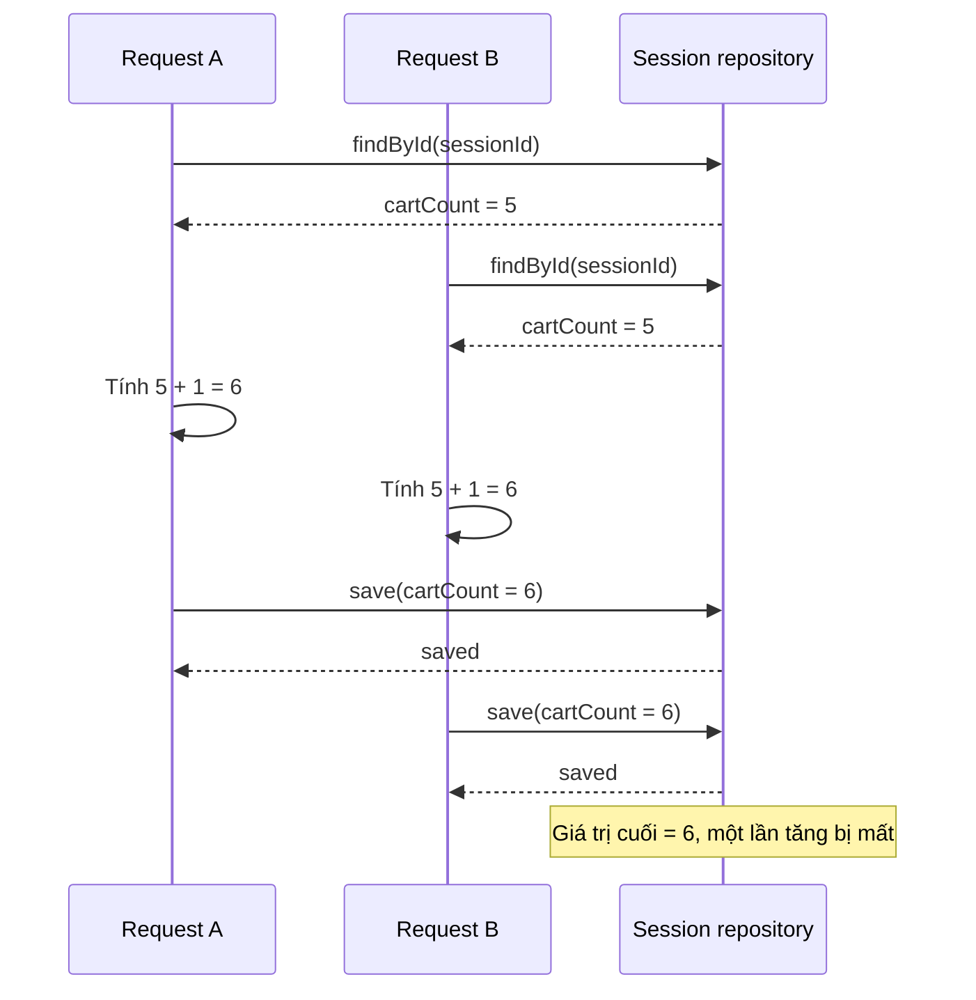

# Tái hiện cập nhật đồng thời và đánh giá các chính sách lưu

Một người dùng có thể mở nhiều tab, trình duyệt có thể gửi nhiều request AJAX cùng lúc, và load balancer có thể chuyển các request đó tới những application instance khác nhau. Nếu các request cùng dùng một session ID, chúng có thể đọc cùng một trạng thái session rồi ghi lại các phiên bản khác nhau. Kết quả có thể là cập nhật bị mất, attribute cũ ghi đè attribute mới hoặc logout cạnh tranh với một request đang lưu session.

Spring Session cung cấp các chính sách lưu như `SaveMode` và `FlushMode` để kiểm soát phạm vi và thời điểm ghi attributes. Các chính sách này ảnh hưởng tới số thao tác storage và khả năng tránh ghi đè những attribute không liên quan. Chúng không tự biến một phép đọc-sửa-ghi thành thao tác nguyên tử, không cung cấp transaction nghiệp vụ cho mọi attribute và không tự giải quyết xung đột khi hai request cùng cập nhật một giá trị.

Bài thực hành này xây dựng một race có thể tái hiện, so sánh các chính sách lưu và xác định dữ liệu nào nên nằm trong session, dữ liệu nào cần cơ chế cập nhật nguyên tử riêng.

## 1. Mô hình race condition trên session

Giả sử session có attribute `cartCount = 5`. Hai request A và B cùng mang cookie session ID và cùng đọc giá trị 5.

1. Request A đọc `cartCount = 5`.
2. Request B đọc `cartCount = 5`.
3. A tính `5 + 1 = 6` và lưu.
4. B cũng tính `5 + 1 = 6` và lưu sau A.

Kết quả cuối là 6 dù có hai thao tác tăng. Đây là lost update: lần ghi của B dựa trên snapshot cũ đã ghi đè kết quả của A.



Race này có thể xảy ra dù mỗi request chạy trên thread riêng, dù repository dùng Redis/JDBC và dù Redis hash hoặc database row có thao tác ghi riêng lẻ an toàn. Atomicity của một lệnh ghi không làm cho chuỗi đọc → tính toán → ghi trở thành atomic.

## 2. Vì sao nhiều request cùng dùng một session?

Các tình huống thường gặp:

- Trang web tải nhiều API song song sau khi render.
- Người dùng mở nhiều tab và sửa cùng giỏ hàng hoặc wizard state.
- Trình duyệt retry request do timeout trong khi request đầu vẫn đang chạy.
- Mobile app gửi request đồng thời khi đồng bộ dữ liệu.
- Một request cập nhật preferences trong khi request khác cập nhật locale.
- Logout hoặc đổi quyền diễn ra gần cùng lúc với request nghiệp vụ.
- Nhiều application nodes cùng đọc/ghi một session trong shared store.

Sticky session không loại bỏ race condition. Nó chỉ có thể giữ request trên cùng node; nhiều thread trên node đó vẫn có thể cập nhật cùng session. Với Redis/JDBC shared store, các node khác nhau cũng có thể cùng xử lý một session ID.

## 3. Phân biệt SaveMode và FlushMode

Hai chính sách này giải quyết hai câu hỏi khác nhau:

- `SaveMode` xác định những session attributes nào được ghi khi session được lưu.
- `FlushMode` xác định thay đổi session được đẩy xuống repository vào thời điểm nào.

### 3.1. SaveMode

Spring Session cung cấp các lựa chọn sau trong các repository hỗ trợ:

| SaveMode | Phạm vi attributes được lưu | Tác động đáng chú ý |
|---|---|---|
| `ALWAYS` | Lưu tất cả attributes của session | Dễ ghi đè giá trị cũ của attribute mà request không thay đổi nhưng đang giữ trong snapshot |
| `ON_GET_ATTRIBUTE` | Lưu attributes đã được đọc hoặc thay đổi trong request | Có thể ghi lại attribute chỉ được đọc, nên snapshot cũ vẫn có thể ghi đè thay đổi mới |
| `ON_SET_ATTRIBUTE` | Chỉ lưu attributes đã được đặt/thay đổi trong request | Giảm ghi thừa và giảm khả năng ghi đè attribute khác mà request không sửa |

`ON_SET_ATTRIBUTE` thường là lựa chọn mặc định của các cấu hình Spring Session Redis hiện đại, nhưng cần xác nhận default của phiên bản và repository cụ thể. Không giả định mọi repository hoặc phiên bản có cùng behavior.

Ví dụ session ban đầu:

```text
theme = light
locale = en
cartCount = 5
```

Request A chỉ thay `theme`; request B chỉ thay `locale`. Nếu mỗi request lưu toàn bộ snapshot cũ, request B có thể ghi lại `theme = light` sau khi A đã lưu `theme = dark`. Chính sách chỉ lưu attributes đã set giúp tránh ghi lại `theme` từ request B nếu B không thay attribute đó.

Tuy nhiên, nếu A và B cùng sửa `cartCount`, cả hai đều đã set cùng attribute. `ON_SET_ATTRIBUTE` không biết phép tăng nào phải được cộng trước và không tự hợp nhất hai giá trị.

### 3.2. FlushMode

| FlushMode | Thời điểm ghi | Trade-off |
|---|---|---|
| `ON_SAVE` | Ghi khi repository/filter thực hiện save theo vòng đời request | Có thể gom nhiều thay đổi trong request, giảm số lần ghi; thay đổi chưa được lưu cho tới bước save |
| `IMMEDIATE` | Đẩy thay đổi xuống repository sớm ngay khi thao tác session được thực hiện, theo semantics của repository | Có thể tăng số lần ghi và làm thay đổi xuất hiện sớm hơn, nhưng không tự cung cấp locking hay atomic read-modify-write |

Flush mode ảnh hưởng cửa sổ thời gian và chi phí I/O. Nó không phải transaction isolation level. Chuyển từ `ON_SAVE` sang `IMMEDIATE` không sửa lost update trên cùng attribute nếu hai request vẫn đọc cùng giá trị cũ rồi ghi giá trị tính toán giống nhau.

## 4. Cấu hình thử nghiệm với Redis

Ví dụ cấu hình Servlet dùng Redis indexed repository:

```java
import org.springframework.context.annotation.Configuration;
import org.springframework.session.FlushMode;
import org.springframework.session.SaveMode;
import org.springframework.session.data.redis.config.annotation.web.http.EnableRedisHttpSession;

@Configuration
@EnableRedisHttpSession(
        maxInactiveIntervalInSeconds = 1800,
        saveMode = SaveMode.ON_SET_ATTRIBUTE,
        flushMode = FlushMode.ON_SAVE)
class SessionConfiguration {
}
```

Thay `saveMode` và `flushMode` giữa các lần chạy để so sánh. Giữ nguyên Redis version, namespace, serializer, session timeout, payload, application build và số node. Annotation và các giá trị được hỗ trợ cần được đối chiếu với Spring Session version trong dự án.

Với JDBC, kiểm tra API cấu hình của `@EnableJdbcHttpSession` và repository trong đúng version. Không copy annotation Redis sang JDBC. Điều quan trọng là xác nhận repository thực sự áp dụng các policy được thử nghiệm, thay vì chỉ đổi một property mà repository không đọc.

## 5. Chuẩn bị session fixture

Tạo một session thử nghiệm với các attributes độc lập:

```text
theme = light
locale = en
cartCount = 5
lastViewedProduct = P-100
```

Dùng dữ liệu giả, không dùng session hoặc tài khoản production. Tạo session qua ứng dụng để cookie, resolver, serializer và repository đều được cấu hình giống luồng thực tế.

Trước mỗi kịch bản:

1. Tạo session mới hoặc khôi phục fixture đã biết.
2. Ghi lại session ID ở dạng test-only, không đưa vào log chia sẻ.
3. Xác nhận các attributes ban đầu đúng.
4. Gửi hai request đồng thời với cùng cookie session.
5. Đợi cả hai request hoàn tất.
6. Đọc session bằng request thứ ba và xác nhận giá trị cuối.
7. Lặp lại đủ số lần để quan sát tính lặp lại, không dựa vào một lần chạy may rủi.

Để so sánh policy, reset dữ liệu về cùng fixture trước mỗi lần chạy. Không dùng lại một session đã bị thay đổi từ kịch bản trước.

## 6. Tái hiện lost update trên cùng attribute

Tạo một endpoint chỉ dùng trong test, thực hiện các bước:

1. Lấy `HttpSession`.
2. Đọc `cartCount`.
3. Báo cho test harness biết đã đọc xong.
4. Chờ barrier cho tới khi request thứ hai cũng đọc xong.
5. Tăng giá trị đã đọc lên một.
6. Ghi lại `cartCount` và kết thúc request.

Ví dụ phần logic của test endpoint:

```java
Integer current = (Integer) session.getAttribute("cartCount");
testBarrier.afterRead(); // Chỉ dùng trong integration test.
session.setAttribute("cartCount", current + 1);
```

`testBarrier` là test helper dùng `CountDownLatch` hoặc cơ chế đồng bộ tương đương. Nó phải chờ cho tới khi hai request đều đã đọc xong rồi mới cho cả hai ghi. Chỉ đặt một `sleep` ngẫu nhiên không bảo đảm tái hiện đúng race.

Test harness gửi hai HTTP request thực sự cùng lúc, cùng cookie session. Nên chạy ứng dụng trên embedded Servlet container với thread pool đủ lớn để cả hai request có thể đi tới barrier. Không dùng barrier chặn trong production code; đây là instrumentation dành riêng cho test.

Sau khi hai request kết thúc, request thứ ba đọc `cartCount`. Kết quả thường là 6 thay vì 7. Lặp lại kịch bản với từng `SaveMode` và `FlushMode` để chứng minh các policy lưu không thay thế atomic increment.

## 7. Tái hiện ghi đè giữa hai attributes khác nhau

Kịch bản thứ hai làm rõ lợi ích của `ON_SET_ATTRIBUTE`.

Trạng thái ban đầu:

```text
theme = light
locale = en
```

Hai request đồng thời:

- A đọc session snapshot, đặt `theme = dark`.
- B đọc session snapshot, đặt `locale = vi`.

Nếu repository lưu toàn bộ attributes từ snapshot cũ, request ghi sau có thể làm mất thay đổi của request ghi trước:

```text
Kết quả mong muốn: theme = dark, locale = vi
Kết quả có thể gặp khi ghi toàn bộ snapshot: theme = light, locale = vi
```

Với repository hỗ trợ delta theo `ON_SET_ATTRIBUTE`, A chỉ ghi `theme`, B chỉ ghi `locale`; hai thay đổi độc lập có thể cùng tồn tại. Với `ON_GET_ATTRIBUTE`, nếu request đọc cả hai attributes, chúng có thể được xem là cần lưu và snapshot cũ có thể ghi đè giá trị mới. Với `ALWAYS`, toàn bộ attributes được lưu nên nguy cơ ghi đè snapshot rõ ràng hơn.

Kết quả chính xác cần xác minh trên repository implementation đang dùng. Hãy kiểm tra bằng integration test thay vì suy luận từ tên policy.

## 8. Tái hiện read-only request và ON_GET_ATTRIBUTE

Tạo hai request có cùng session:

- A đọc `theme`, sau đó một request khác thay `theme`.
- A không gọi `setAttribute` cho `theme`.
- A kết thúc request sau khi request kia đã lưu giá trị mới.

Với `ON_GET_ATTRIBUTE`, attribute đã đọc có thể được ghi lại theo snapshot của A. Với `ON_SET_ATTRIBUTE`, việc chỉ đọc không đánh dấu attribute cần ghi theo chính sách này. Đây là một lý do cần cân nhắc read-heavy endpoints khi chọn save mode.

Không phải mọi thao tác đọc đều gây cùng chi phí trong mọi repository. Hãy đo số lệnh Redis/SQL và xác nhận save semantics theo phiên bản Spring Session cụ thể.

## 9. Xung đột giữa remove và update

Một race khác xảy ra khi request A xóa attribute trong khi request B cập nhật attribute đó:

1. A đọc `cartDraft`.
2. B đọc cùng `cartDraft`.
3. A gọi `removeAttribute("cartDraft")`.
4. B gọi `setAttribute("cartDraft", updatedDraft)`.
5. Cả hai request lưu theo thứ tự không xác định trước.

Kết quả cuối phụ thuộc thứ tự ghi và semantics delete của repository. Nếu trạng thái này có ý nghĩa nghiệp vụ, không nên coi “last write wins” là quy tắc đúng mặc định. Cần xác định operation precedence hoặc dùng version/transaction để từ chối cập nhật stale.

## 10. So sánh SaveMode bằng ma trận test

Chạy cùng fixture và cùng race với từng mode:

| Kịch bản | `ALWAYS` | `ON_GET_ATTRIBUTE` | `ON_SET_ATTRIBUTE` |
|---|---|---|---|
| Hai request sửa cùng attribute | Có thể lost update | Có thể lost update | Có thể lost update |
| Hai request sửa hai attribute độc lập | Dễ ghi đè snapshot attributes khác | Có thể ghi đè nếu attributes khác đã được đọc | Giảm ghi đè nếu chỉ lưu attributes được set |
| Request chỉ đọc attribute | Có thể ghi toàn bộ snapshot | Attribute đã đọc có thể được ghi lại | Không ghi attribute chỉ đọc theo policy này |
| Request xóa attribute | Có thể lưu toàn bộ snapshot cùng thay đổi | Có thể lưu attributes đã đọc và thay đổi | Lưu thay đổi/xóa đã đánh dấu |
| Chi phí write | Thường cao hơn khi session có nhiều attributes | Phụ thuộc số attributes được đọc/set | Thường thấp hơn khi request chỉ sửa ít attributes |

Bảng mô tả xu hướng và semantics chung, không thay thế xác minh implementation. Đặc biệt, không dùng bảng này để suy ra `ON_SET_ATTRIBUTE` bảo vệ hai cập nhật đồng thời lên cùng một attribute.

## 11. So sánh FlushMode

Giữ nguyên SaveMode và chạy riêng với `ON_SAVE` và `IMMEDIATE`.

| Tiêu chí | `ON_SAVE` | `IMMEDIATE` |
|---|---|---|
| Thời điểm backend nhận thay đổi | Khi repository/filter save | Sớm hơn, theo thao tác thay đổi session |
| Số lần ghi | Có thể gom nhiều thay đổi của request | Có thể tăng do ghi nhiều lần trong request |
| Thời gian thay đổi xuất hiện ở node khác | Sau lần save | Có thể sớm hơn |
| Lost update cùng attribute | Vẫn có thể xảy ra | Vẫn có thể xảy ra |
| Chi phí I/O | Có thể thấp hơn | Có thể cao hơn |
| Failure window | Thay đổi chưa save có thể mất nếu request/process lỗi trước save | Một số thay đổi đã được ghi sớm hơn, nhưng không bảo đảm toàn bộ request thành công |

Với `IMMEDIATE`, một request có thể ghi nhiều trạng thái trung gian. Request sau có thể quan sát trạng thái chưa hoàn chỉnh nếu ứng dụng thực hiện nhiều thay đổi liên tiếp. Cần cân nhắc điều này nếu attributes có quan hệ phụ thuộc.

`IMMEDIATE` cũng không bảo đảm mọi thao tác trong một request nằm trong một transaction. Nếu cần cập nhật nhiều giá trị nguyên tử, dùng một transaction/storage model phù hợp thay vì dựa vào flush mode.

## 12. Đọc kết quả bằng số thao tác backend

Không chỉ ghi nhận giá trị cuối. Thu thập thêm:

- Số lần session lookup.
- Số lần save session.
- Số attribute được ghi, xóa hoặc serialize.
- Số Redis commands hoặc SQL statements cho mỗi request.
- Số byte đọc/ghi.
- Latency p50/p95/p99 cho request và repository.
- Số lỗi serialize, timeout, conflict hoặc retry.
- CPU application, Redis/database utilization và connection pool wait.

Ví dụ xu hướng cần xác minh:

| Policy | Write count/request | Payload bytes | Nguy cơ ghi đè attribute không sửa |
|---|---:|---:|---|
| `ALWAYS` | Có thể cao | Có thể lớn | Cao hơn khi snapshot cũ được ghi toàn bộ |
| `ON_GET_ATTRIBUTE` | Theo số attribute đọc/set | Trung bình hoặc cao với read-heavy request | Có nếu attribute đọc từ snapshot cũ được ghi lại |
| `ON_SET_ATTRIBUTE` | Theo số attribute thay đổi | Thường thấp hơn với request sửa ít field | Thấp hơn với attribute không được sửa |

Đây là xu hướng, không phải số đo. Thực hiện benchmark với payload và traffic đại diện để quyết định.

## 13. Vì sao SaveMode không giải quyết phép tăng counter?

SaveMode chỉ quyết định tập attributes được ghi. Nó không biết rằng `counter = 6` được tính từ `counter = 5` hay từ `counter = 100`. Repository nhìn thấy một giá trị cần lưu, không thấy ý định nghiệp vụ “cộng thêm một”.

Để thực hiện increment nguyên tử, thao tác phải được biểu diễn tại storage hoặc qua cơ chế concurrency control:

- SQL atomic update: `UPDATE ... SET count = count + 1 WHERE id = ?`.
- Optimistic locking: cập nhật khi `version` vẫn bằng giá trị đã đọc.
- Redis atomic command như `INCR`/`HINCRBY` hoặc Lua script nếu thao tác gồm nhiều bước.
- Transaction/locking có phạm vi và timeout rõ ràng khi cần nhiều thay đổi liên quan.

Session có thể giữ `cartId` hoặc `workflowId`; trạng thái số lượng, số dư, tồn kho hoặc dữ liệu cần không mất cập nhật nên được lưu trong kho nghiệp vụ với atomic semantics phù hợp.

## 14. Ví dụ optimistic locking cho dữ liệu nghiệp vụ

Một bảng nghiệp vụ có thể có cột `version`. Khi đọc, ứng dụng nhận version hiện tại. Khi ghi, update chỉ thành công nếu version chưa thay đổi:

```sql
UPDATE CART_STATE
SET ITEM_COUNT = ITEM_COUNT + 1,
    VERSION = VERSION + 1
WHERE CART_ID = :cartId
  AND VERSION = :expectedVersion;
```

Nếu số hàng được cập nhật là 0, một request khác đã thay đổi dữ liệu trước đó. Ứng dụng có thể đọc lại và retry theo giới hạn, hoặc trả conflict để client thử lại. Với phép tăng đơn giản, database atomic increment có thể phù hợp hơn việc đọc count rồi ghi count mới.

Ví dụ Java minh họa cách xử lý kết quả:

```java
int updated = cartRepository.incrementIfVersionMatches(cartId, expectedVersion);

if (updated == 0) {
    throw new ConcurrentCartUpdateException(cartId);
}
```

`ConcurrentCartUpdateException` là lỗi nghiệp vụ cần được ánh xạ thành response phù hợp, ví dụ `409 Conflict` nếu client có thể tải lại trạng thái. Không retry vô hạn vì có thể khuếch đại tải khi contention cao.

## 15. Khi nào cần khóa phân tán?

Khóa phân tán có thể tuần tự hóa các thao tác trên một session hoặc một aggregate, nhưng làm tăng độ phức tạp:

- Cần lock key ổn định và lease có thời hạn.
- Phải xử lý process chết khi đang giữ lock.
- Cần fencing token để ngăn owner cũ tiếp tục ghi sau khi lease hết hạn.
- Cần timeout và policy khi không lấy được lock.
- Lock theo session ID có thể làm mọi request cùng session bị tuần tự hóa, giảm throughput.
- Redis lock không tự làm các thao tác DB khác trở thành một transaction duy nhất.

Chỉ dùng distributed lock khi đã xác định rõ critical section và không có giải pháp atomic update/optimistic locking phù hợp hơn. Đối với nhiều dữ liệu nghiệp vụ, transaction ở database chuyên trách thường dễ kiểm chứng hơn khóa toàn bộ session.

## 16. Thiết kế test barrier có thể lặp lại

Một race test đáng tin cậy cần đồng bộ theo sự kiện, không dựa vào thời gian ngủ.

Mẫu test helper cho ứng dụng Servlet:

```java
final class TwoRequestBarrier {
    private final CountDownLatch readers = new CountDownLatch(2);
    private final CountDownLatch release = new CountDownLatch(1);

    void afterRead() {
        readers.countDown();
        try {
            if (!readers.await(5, TimeUnit.SECONDS)) {
                throw new IllegalStateException("Second request did not reach barrier");
            }
            if (!release.await(5, TimeUnit.SECONDS)) {
                throw new IllegalStateException("Test did not release barrier");
            }
        }
        catch (InterruptedException ex) {
            Thread.currentThread().interrupt();
            throw new IllegalStateException("Interrupted while waiting at test barrier", ex);
        }
    }

    void releaseAfterBothReadersArrive() throws InterruptedException {
        if (!readers.await(5, TimeUnit.SECONDS)) {
            throw new AssertionError("Both requests did not read the session");
        }
        release.countDown();
    }
}
```

Đây là helper minh họa; trong test thật cần bảo đảm barrier được tạo mới cho mỗi lượt chạy, có timeout, được release trong `finally` và không dùng chung giữa test cases song song. Endpoint chỉ gọi `afterRead()` sau khi đã lấy snapshot từ session.

Kịch bản test:

1. Tạo session và lấy cookie.
2. Khởi chạy hai HTTP request trên hai executor tasks.
3. Cả hai request dùng cùng cookie và cùng session ID.
4. Barrier chỉ mở sau khi cả hai đã đọc giá trị ban đầu.
5. Cả hai ghi và trả response.
6. Test đọc lại session qua request mới.
7. Ghi lại kết quả cùng SaveMode/FlushMode và repository version.

Nếu dùng MockMvc, cần xác minh cách test setup đăng ký đầy đủ Spring Session filter và concurrency behavior phù hợp. Để kiểm chứng network, Servlet container thread pool và filter lifecycle gần production hơn, có thể dùng `@SpringBootTest(webEnvironment = RANDOM_PORT)` cùng HTTP client thật.

## 17. Bộ kịch bản thực hành đầy đủ

Chạy các bài test sau với từng policy:

| ID | Kịch bản | Điều cần quan sát |
|---|---|---|
| C1 | Hai request cùng tăng `cartCount` | Lost update trên cùng attribute |
| C2 | Hai request sửa `theme` và `locale` | Ghi đè giữa attributes độc lập |
| C3 | Một request chỉ đọc, request kia cập nhật attribute đó | Tác động `ON_GET_ATTRIBUTE` |
| C4 | Một request remove, request kia set cùng attribute | Thứ tự delete/update và semantics cuối |
| C5 | Logout cạnh tranh với request ghi session | Session invalidation và request đang chạy |
| C6 | Session hết hạn trong lúc request khác save | Expiration, stale write và repository behavior |
| C7 | Cùng session được truy cập qua hai application nodes | Shared store và concurrency cross-node |
| C8 | Backend chậm hoặc lỗi trong lúc save | Timeout, response và khả năng retry |
| C9 | Payload nhỏ so với payload nhiều attributes | Serialization cost và write amplification |
| C10 | Nhiều session độc lập cùng được cập nhật | Throughput tổng thể và contention theo key |

Không chạy C5/C6 trên dữ liệu thật. Những tình huống này cần session giả và backend test riêng vì có thể làm mất trạng thái xác thực hoặc xóa session.

## 18. Bảng quyết định SaveMode và FlushMode

| Nhu cầu | Hướng cân nhắc | Lưu ý |
|---|---|---|
| Request thường chỉ sửa một vài attributes | `ON_SET_ATTRIBUTE` | Giảm ghi các attributes không thay đổi |
| Ứng dụng cần lưu cả attributes được đọc vì có logic mutate object tại chỗ | Có thể cân nhắc `ON_GET_ATTRIBUTE` hoặc đổi code sang set lại attribute rõ ràng | Đo write amplification và race trên snapshot cũ |
| Muốn hành vi lưu toàn bộ session mỗi lần save | `ALWAYS` | Dễ hiểu nhưng tăng ghi và nguy cơ stale overwrite |
| Muốn gom thay đổi tới cuối request | `ON_SAVE` | Phù hợp khi chấp nhận thay đổi chỉ bền vững ở bước save |
| Cần đẩy thay đổi sớm | `IMMEDIATE` | Tăng I/O, không cung cấp atomicity |
| Cần tăng counter không mất cập nhật | Không dựa vào SaveMode/FlushMode | Dùng atomic update hoặc optimistic concurrency ở kho nghiệp vụ |

Không có policy tốt nhất cho mọi ứng dụng. Chọn dựa trên cách code thao tác attributes, payload, tỷ lệ đọc/ghi, mức chấp nhận mất thay đổi và đặc tính repository.

## 19. Tác động tới Spring Security và logout

`SecurityContext` thường được lưu trong session. Nếu nhiều request cùng cập nhật session trong khi logout hoặc session fixation strategy thay đổi ID, có thể xuất hiện các thao tác cạnh tranh:

- Request A đang xử lý nghiệp vụ với context đã khôi phục.
- Request B logout và invalidate session.
- Request A kết thúc muộn và cố lưu session snapshot cũ.

Repository/filter/security integration có semantics riêng cho invalidation và save. Không giả định một request đang chạy bị dừng tự động khi session bị logout ở request khác. Cần kiểm thử request sau logout, request đang chạy và session ID cũ theo cấu hình Spring Security thực tế.

Không dùng session attribute như `isAdmin=true` làm nguồn quyền độc lập nếu Spring Security authorities đã thay đổi. Quyền cần được xác minh từ nguồn có thẩm quyền, và logout/revocation phải có semantics rõ giữa các node.

## 20. Đánh giá theo loại repository

### Redis

- Attributes có thể được lưu thành các field trong cấu trúc Redis session.
- `SaveMode` có thể giúp chỉ ghi delta attributes tùy implementation.
- `FlushMode.IMMEDIATE` có thể tăng số command và làm trạng thái trung gian xuất hiện sớm.
- Network latency thấp không đồng nghĩa phép read-modify-write nguyên tử.
- Redis atomic command/Lua có thể dùng cho dữ liệu nghiệp vụ riêng, nhưng không tự áp dụng cho thao tác session repository.

### JDBC

- Attributes được lưu trong bảng session/attributes theo schema của Spring Session.
- Transaction và connection pool ảnh hưởng thời gian save.
- Hai transaction có thể cùng đọc snapshot rồi cập nhật cùng attribute; cần kiểm tra isolation và câu SQL repository thực tế.
- Optimistic locking cần version column/logic kiểm tra được triển khai rõ; không giả định repository mặc định có version check cho mọi attribute.
- Tránh dùng session làm aggregate nghiệp vụ cần transaction phức tạp.

### Repository tùy chỉnh

- Xác định snapshot hay delta update.
- Xác định cách lưu remove attribute.
- Có version/CAS hay không.
- Có transaction cho nhiều attributes không.
- Có thể nhận save từ request cũ sau khi request mới đã ghi không.
- Có xử lý session expiry/delete đồng thời với save không.

## 21. Đọc kết quả và quyết định chính sách

Một báo cáo so sánh tối thiểu nên có:

| Nhóm đo | Kết quả cần ghi |
|---|---|
| Correctness | Giá trị cuối của C1-C10, số lost update và stale overwrite |
| Save behavior | Số attribute được ghi/xóa và số lần repository save |
| Backend I/O | Redis command/SQL count, bytes đọc/ghi, transaction duration |
| Latency | p50/p95/p99 theo request và repository operation |
| Reliability | Save failures, timeouts, retries và session lookup misses |
| Resource | CPU, heap/GC, Redis memory/CPU hoặc JDBC pool/DB CPU |
| Topology | Số node, số thread, load balancer và backend version |

Ví dụ bảng kết quả giả lập:

| SaveMode / FlushMode | Lost update C1 | Stale overwrite C2 | Writes/request | p95 |
|---|---:|---:|---:|---:|
| ALWAYS / ON_SAVE | Có | Có | Cao | 42 ms |
| ON_GET_ATTRIBUTE / ON_SAVE | Có | Có nếu đọc attributes cũ | Trung bình-cao | 36 ms |
| ON_SET_ATTRIBUTE / ON_SAVE | Có | Ít hơn với attributes độc lập | Thấp hơn | 31 ms |
| ON_SET_ATTRIBUTE / IMMEDIATE | Có | Ít hơn với attributes độc lập | Có thể cao | 39 ms |

Các con số chỉ minh họa cách trình bày, không phải kết quả benchmark thật. Kết luận cần dựa trên dữ liệu của repository và workload dự án.

## 22. Tiêu chí chọn giải pháp cho từng loại dữ liệu

| Dữ liệu | Có nên đặt trong session? | Cách xử lý đồng thời |
|---|---|---|
| Theme, locale, tab đang mở | Có thể phù hợp | `ON_SET_ATTRIBUTE` thường giảm ghi đè giữa các thuộc tính độc lập |
| ID giỏ hàng | Phù hợp để tham chiếu | Lưu giỏ hàng và cập nhật số lượng trong cart service/database |
| Số lượng sản phẩm trong giỏ | Có thể cache hiển thị, không nên là nguồn sự thật | Atomic update/transaction trong kho giỏ hàng |
| Số dư, hạn mức, tồn kho | Không dùng session làm nguồn sự thật | Transaction/conditional update trong database nghiệp vụ |
| SecurityContext | Spring Security thường lưu trong session stateful | Dùng repository/security lifecycle, kiểm thử logout và session fixation |
| Wizard state có nhiều request cập nhật | Có thể dùng nếu mất cập nhật được xử lý | Version/CAS hoặc merge theo bước nghiệp vụ |
| Counter analytics | Không phù hợp để cộng bằng read-modify-write session | Counter atomic hoặc event pipeline |

Session nên giữ trạng thái ngắn hạn gắn với tương tác của người dùng. Dữ liệu cần audit, tính đúng đắn tài chính hoặc cập nhật đồng thời mạnh nên nằm trong kho nghiệp vụ có concurrency control.

## 23. Checklist thực hành

- [ ] Dùng Redis/JDBC repository tương ứng môi trường mục tiêu.
- [ ] Tạo session fixture với nhiều attributes độc lập và một counter dùng chung.
- [ ] Dùng hai request thực sự với cùng cookie/session ID.
- [ ] Đồng bộ hai request sau bước đọc bằng barrier, không dựa vào `sleep` ngẫu nhiên.
- [ ] Tái hiện lost update trên cùng attribute.
- [ ] Tái hiện stale overwrite giữa hai attributes khác nhau.
- [ ] So sánh `ALWAYS`, `ON_GET_ATTRIBUTE`, `ON_SET_ATTRIBUTE`.
- [ ] So sánh `ON_SAVE` và `IMMEDIATE` riêng biệt.
- [ ] Kiểm tra remove-vs-set, logout-vs-save và expiry-vs-save.
- [ ] Lặp lại với hai application nodes.
- [ ] Thu số lần ghi, số byte, latency, errors và tài nguyên backend.
- [ ] Đưa counter/dữ liệu nghiệp vụ quan trọng sang atomic update hoặc optimistic locking.
- [ ] Lặp lại test sau khi thay Spring Session hoặc backend version.

## 24. Nguyên tắc cần nhớ

- Nhiều request cùng cookie có thể đọc cùng snapshot session và ghi đè cập nhật của nhau.
- Lost update trên cùng attribute vẫn có thể xảy ra với mọi SaveMode.
- `ON_SET_ATTRIBUTE` giúp tránh ghi lại attributes mà request không sửa, nhưng không hợp nhất hai thay đổi cùng một attribute.
- `ON_GET_ATTRIBUTE` có thể ghi lại attributes chỉ được đọc; cần đánh giá với read-heavy endpoints.
- `ALWAYS` lưu toàn bộ attributes và có thể tăng write amplification/stale overwrite.
- `FlushMode` quyết định thời điểm ghi; `IMMEDIATE` không cung cấp transaction hoặc atomic increment.
- Tái hiện race bằng barrier sau bước đọc để bảo đảm hai request cùng dùng snapshot cũ.
- Đo cả correctness lẫn số thao tác Redis/SQL, bytes, latency và tài nguyên.
- Không dùng session làm nguồn sự thật cho counter, số dư, tồn kho hoặc dữ liệu cần cập nhật nguyên tử.
- Dùng atomic database update, optimistic locking/CAS hoặc một cơ chế concurrency control phù hợp cho dữ liệu nghiệp vụ.
- Kiểm thử cùng repository, serializer, filter chain và topology gần production.
