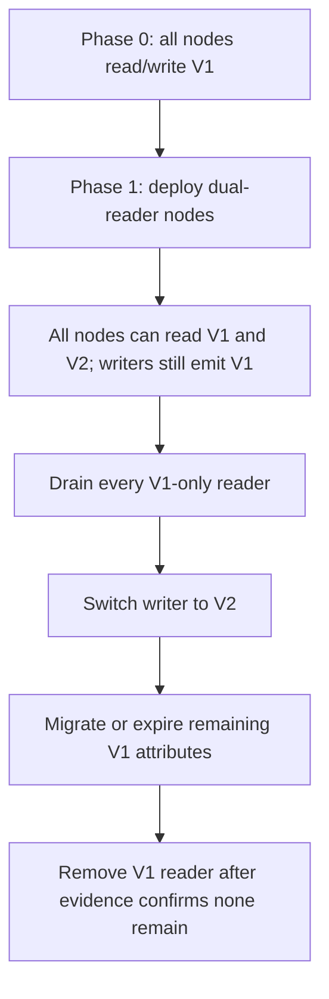
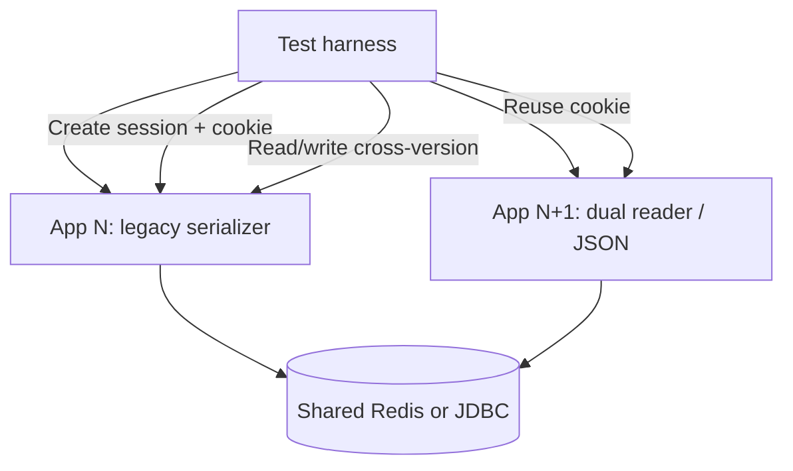

# Đổi serializer giữa hai bản ứng dụng rồi kiểm thử tương thích

Spring Session lưu các attributes của `HttpSession` hoặc `WebSession` trong Redis/JDBC để nhiều instance có thể khôi phục cùng một phiên. Serializer quyết định cách object như `SecurityContext`, principal, authorities và trạng thái nghiệp vụ được chuyển thành bytes. Khi đổi serializer giữa hai bản ứng dụng, dữ liệu đã ghi bởi bản cũ có thể không đọc được bởi bản mới; trong rolling deployment, bản cũ và bản mới còn có thể cùng truy cập một session store.

Ví dụ, phiên bản N đang dùng Java serialization, còn phiên bản N+1 chuyển sang JSON có type metadata. Nếu N ghi session rồi load balancer chuyển request sang N+1, N+1 phải đọc được payload cũ. Ngược lại, nếu N+1 ghi JSON trong khi N vẫn còn nhận request, N có thể không deserialize được session. Một thay đổi serializer vì thế là một migration dữ liệu có phối hợp writer/reader, không chỉ là thay một bean cấu hình.

Bài thực hành này xây dựng chiến lược chuyển đổi có kiểm soát, tạo hai bản ứng dụng độc lập dùng chung Redis/JDBC, kiểm tra đọc/ghi chéo phiên bản và xác minh cả trường hợp không tương thích. Trọng tâm là giữ đúng danh tính và quyền của người dùng trong `SecurityContext` trong suốt quá trình chuyển đổi.

## 1. Bài toán: cùng session store, khác định dạng dữ liệu

Giả sử hai bản ứng dụng có cấu hình như sau:

| Thuộc tính | Ứng dụng N | Ứng dụng N+1 |
|---|---|---|
| Phiên bản | Cũ | Mới |
| Repository | Spring Session Redis | Spring Session Redis |
| Namespace | `portal:session` | `portal:session` |
| Cookie | `PORTAL_SESSION` | `PORTAL_SESSION` |
| Serializer | Java serialization | JSON serializer |
| Principal | `LegacyPrincipal` | `SessionPrincipalV2` |
| Mục tiêu | Đang chạy production | Đang triển khai nâng cấp |

Hai ứng dụng dùng cùng session ID và cùng key namespace, nên chúng có thể tải cùng session record. Nhưng bytes của mỗi attribute có thể được tạo theo một format khác nhau. Nếu serializer mới không hiểu payload cũ, việc đọc session có thể lỗi ngay trong `SessionRepositoryFilter` trước khi controller chạy.

Các lỗi có thể gặp:

- `ClassNotFoundException` khi class cũ không còn trên classpath.
- `InvalidClassException` khi Java serialization metadata không tương thích.
- `SerializationException` hoặc lỗi Jackson khi type ID không được nhận diện.
- Không thể dựng `SecurityContext` hoặc principal sau deserialize.
- Session bị coi như anonymous do lỗi bị bắt và chuyển thành “không tìm thấy”.
- Một instance ghi payload mới mà instance cũ không thể đọc.

Không được che lỗi deserialize bằng cách coi mọi exception là session miss. “Không có session” là kết quả hợp lệ của repository; “không đọc được payload” là lỗi tương thích hoặc dữ liệu, cần được phát hiện và xử lý riêng.

## 2. Xác định phạm vi serializer đang thay đổi

Trước khi triển khai, lập danh sách dữ liệu thực sự được serialize:

- `SecurityContext`.
- `Authentication` implementation.
- Principal và các object lồng bên trong.
- `GrantedAuthority` hoặc custom authority.
- `WebAuthenticationDetails` và authentication details khác.
- Attributes nghiệp vụ như cart ID, workflow DTO, preference.
- Các object có thể được thêm vào session bởi thư viện khác.

Với Spring Session Redis, serializer được cấu hình cho attributes có thể quyết định cách từng giá trị được ghi vào cấu trúc session. Metadata/session key và attributes không nhất thiết có cùng định dạng. Với Spring Session JDBC, dữ liệu attributes đi qua conversion/serialization của repository và có thể được lưu trong bảng attributes; không mặc định rằng bean Redis serializer cũng điều khiển JDBC.

Hãy kiểm tra repository thực tế, bean serializer/converter đang được sử dụng và một payload được tạo từ phiên bản hiện tại. Đừng chỉ nhìn cấu hình mới rồi suy đoán format cũ.

## 3. Định nghĩa format có version

Một chiến lược an toàn là đặt marker nhận diện format trước payload mới. Ví dụ:

```text
V1: bytes theo serializer cũ, không có header ứng dụng
V2: "SSN2" + version byte + JSON payload
```

Marker giúp reader xác định parser phù hợp. Không nên chỉ thử deserialize bằng JSON, bắt exception rồi thử Java serialization cho mọi byte bất kỳ. Reader cần nhận diện chính xác các format được cho phép và từ chối payload không rõ nguồn gốc.

Format contract cần ghi rõ:

- Magic/header và version.
- Serializer được dùng cho từng version.
- Type ID hoặc schema principal/Authentication.
- Quy tắc field mới, field cũ và giá trị mặc định.
- Quy tắc xử lý payload không hợp lệ.
- Thời điểm ngừng đọc version cũ.
- Chính sách ghi: node nào được phép ghi V1/V2 trong mỗi giai đoạn.

Với Java serialization cũ, header stream thường bắt đầu bằng byte `AC ED 00 05`. Chỉ dùng nhận diện này nếu đã xác minh phiên bản cũ thực sự dùng Java serialization tương ứng. Nếu format cũ khác, phải định nghĩa detector đúng với format đó.

## 4. Chiến lược dual-read, single-write

Trong rolling deployment, cách triển khai thường an toàn là **đọc được cả V1 và V2 nhưng chỉ ghi một format tại một thời điểm**.

Giai đoạn đầu, tất cả instance vẫn ghi V1. Phiên bản mới được triển khai với reader hiểu V1 và V2, nhưng writer vẫn để V1. Khi mọi instance cũ chỉ đọc V1 đã được thay thế, chuyển writer sang V2. Từ thời điểm đó, không được đưa một instance cũ chỉ đọc V1 trở lại cùng namespace.



Không chuyển writer sang V2 khi vẫn còn instance N chỉ đọc V1. Nếu rollback về N sau khi V2 đã được ghi, N có thể không đọc được session mới. Rollback cần dùng một bản bridge vẫn đọc được cả V1/V2 hoặc quay lại trước thời điểm đổi writer bằng một kế hoạch dữ liệu đã kiểm thử.

## 5. Ví dụ wrapper serializer cho Redis

Ví dụ sau minh họa một serializer có thể đọc payload V1 và V2. Writer có thể được giữ ở V1 trong giai đoạn triển khai reader tương thích, sau đó mới chuyển sang V2. Đây là skeleton cần điều chỉnh theo serializer thực tế, phiên bản Spring Data Redis và chính sách class/type của ứng dụng.

```java
public final class VersionedSessionSerializer
        implements RedisSerializer<Object> {

    private static final byte[] MAGIC = {'S', 'S', 'N', '2'};
    private static final int VERSION_2 = 2;

    private final RedisSerializer<Object> legacySerializer;
    private final RedisSerializer<Object> jsonSerializer;
    private final boolean writeVersion2;

    public VersionedSessionSerializer(
            RedisSerializer<Object> legacySerializer,
            RedisSerializer<Object> jsonSerializer,
            boolean writeVersion2) {
        this.legacySerializer = legacySerializer;
        this.jsonSerializer = jsonSerializer;
        this.writeVersion2 = writeVersion2;
    }

    @Override
    public byte[] serialize(Object value) throws SerializationException {
        if (!this.writeVersion2) {
            return this.legacySerializer.serialize(value);
        }

        byte[] payload = this.jsonSerializer.serialize(value);
        if (payload == null) {
            return null;
        }

        ByteBuffer buffer = ByteBuffer.allocate(MAGIC.length + 1 + payload.length);
        buffer.put(MAGIC);
        buffer.put((byte) VERSION_2);
        buffer.put(payload);
        return buffer.array();
    }

    @Override
    public Object deserialize(byte[] source) throws SerializationException {
        if (source == null) {
            return null;
        }

        if (hasVersion2Header(source)) {
            int version = source[MAGIC.length] & 0xff;
            if (version != VERSION_2) {
                throw new SerializationException("Unsupported session format version");
            }
            byte[] payload = Arrays.copyOfRange(source, MAGIC.length + 1, source.length);
            return this.jsonSerializer.deserialize(payload);
        }

        if (hasExpectedLegacyHeader(source)) {
            return this.legacySerializer.deserialize(source);
        }

        throw new SerializationException("Unknown session attribute format");
    }

    private static boolean hasVersion2Header(byte[] bytes) {
        return bytes.length >= MAGIC.length + 1
                && Arrays.equals(
                        Arrays.copyOfRange(bytes, 0, MAGIC.length), MAGIC);
    }

    private static boolean hasExpectedLegacyHeader(byte[] bytes) {
        // Chỉ đúng nếu format V1 đã được xác nhận là Java serialization.
        return bytes.length >= 4
                && (bytes[0] & 0xff) == 0xAC
                && (bytes[1] & 0xff) == 0xED
                && bytes[2] == 0x00
                && bytes[3] == 0x05;
    }
}
```

Đoạn code minh họa cần bổ sung import, kiểm tra kích thước tối đa, xử lý payload rỗng, logging an toàn và test cho mọi nhánh. Nếu V1 không phải Java serialization, thay `hasExpectedLegacyHeader` bằng detector của format cũ. Không fallback sang legacy serializer khi payload không nhận diện được.

Lưu ý quan trọng: Java native serialization có rủi ro khi deserialize dữ liệu không tin cậy. Nếu buộc phải đọc V1, giới hạn class có thể deserialize theo khả năng của JDK/serializer, bảo vệ quyền ghi Redis/JDBC và lên kế hoạch loại bỏ V1. Wrapper chỉ giúp tương thích format; nó không tự làm legacy deserialization an toàn.

## 6. Cấu hình serializer JSON cho Spring Security

Nếu V2 dùng JSON, principal và `SecurityContext` cần được serialize/deserialze theo schema rõ ràng. Spring Security cung cấp Jackson modules cho các kiểu được hỗ trợ. Ví dụ cấu hình thường gặp với Spring Session Redis:

```java
@Configuration
class SessionSerializerConfiguration {

    @Bean("springSessionDefaultRedisSerializer")
    RedisSerializer<Object> springSessionDefaultRedisSerializer() {
        ObjectMapper mapper = new ObjectMapper();
        mapper.registerModules(
                SecurityJackson2Modules.getModules(
                        getClass().getClassLoader()));

        RedisSerializer<Object> json =
                new GenericJackson2JsonRedisSerializer(mapper);

        RedisSerializer<Object> legacy = new JdkSerializationRedisSerializer();

        boolean writeV2 = Boolean.parseBoolean(
                System.getProperty("session.serializer.write-v2", "false"));

        return new VersionedSessionSerializer(legacy, json, writeV2);
    }
}
```

Đây là ví dụ cấu hình khái niệm. Bean name, constructor, package và cách Spring Session lấy serializer có thể thay đổi theo phiên bản. Trong production nên dùng property được quản lý bởi cấu hình ứng dụng thay vì đọc trực tiếp system property; cần xác nhận bean này thực sự được repository sử dụng.

Nếu tự tạo `ObjectMapper`, kiểm tra type metadata, Java Time/Kotlin modules nếu principal cần chúng, constructor mapping và validator/allowlist cho polymorphic types. Không bật default typing rộng chỉ để Jackson đọc được mọi implementation `Authentication`.

Với JDBC, cấu hình serializer/converter qua extension point của `JdbcIndexedSessionRepository` và `ConversionService` phù hợp phiên bản. Không dùng bean Redis serializer làm bằng chứng JDBC đã đổi format.

## 7. Đổi principal cùng serializer

Thay serializer thường đi kèm thay class principal. Ví dụ V1:

```java
public class LegacyPrincipal implements Serializable {
    private static final long serialVersionUID = 1L;
    private String username;
    private List<String> roles;
}
```

V2 có thể dùng DTO gọn:

```java
public record SessionPrincipalV2(
        String subject,
        String tenant,
        List<String> authorityNames,
        int schemaVersion) implements Serializable {
}
```

Converter V1 sang V2 phải xác minh subject, tenant và authorities theo nguồn tin cậy. Không chỉ copy danh sách role cũ nếu quyền có thể đã thay đổi. Không chuyển password hash, email hoặc profile dư thừa sang DTO mới nếu session không cần.

Nếu JSON type metadata lưu fully qualified class name, đổi package/class có thể làm payload V2 cũng phụ thuộc tên class. Có thể dùng type alias/versioned schema và converter tường minh để giảm coupling, nhưng phải giới hạn type được phép deserialize.

## 8. Quy trình triển khai theo từng giai đoạn

### Giai đoạn 0: ghi nhận baseline V1

- Xác định serializer thực tế của Redis/JDBC.
- Lưu fixture V1 được tạo bởi đúng artifact đang chạy trong môi trường test.
- Ghi lại session attributes, principal type, SecurityContext và TTL.
- Xác định số session đang hoạt động và thời gian sống tối đa theo chính sách.
- Tạo test xác minh V1 writer/V1 reader.

### Giai đoạn 1: phát hành reader tương thích

- Triển khai V2 code có thể đọc V1 và V2.
- Giữ writer ở V1.
- Chạy N và N+1 song song trên cùng test store.
- Xác nhận V1 và V2 reader đều đọc được dữ liệu V1.
- Chưa cho bất kỳ node nào ghi V2.

### Giai đoạn 2: loại bỏ reader cũ

- Drain và xác nhận mọi instance chỉ đọc V1 đã dừng.
- Kiểm tra worker, job hoặc công cụ vận hành nào còn truy cập session store bằng serializer cũ.
- Đảm bảo phương án rollback cũng là bản dual-reader.
- Ghi nhận thời điểm cutover và trạng thái writer.

### Giai đoạn 3: chuyển writer sang V2

- Bật `writeV2` theo cấu hình/feature flag đồng nhất.
- Kiểm tra mọi node ghi cùng format.
- Theo dõi deserialize failure, session miss, authentication failure và login rate.
- Kiểm thử logout, expiry và principal index.

### Giai đoạn 4: xử lý dữ liệu V1 còn tồn tại

- Chuyển đổi các attributes cũ bằng reader tương thích rồi ghi lại V2, hoặc chờ chúng hết hạn theo chính sách có giới hạn.
- Kiểm tra session đang hoạt động lâu có thể tiếp tục giữ attribute V1 chưa được truy cập/ghi lại.
- Chỉ bỏ reader V1 khi có bằng chứng không còn payload V1.

### Giai đoạn 5: contract

- Gỡ legacy serializer và class shim sau khi không còn dữ liệu V1.
- Giữ test fixture V2 và test từ chối V1 nếu V1 không còn được hỗ trợ.
- Cập nhật runbook và tài liệu format.

## 9. Vì sao chờ một inactivity timeout có thể chưa đủ?

Session inactivity timeout thường được làm mới khi người dùng tiếp tục hoạt động. Một session hoạt động thường xuyên có thể tồn tại lâu hơn nhiều so với một khoảng timeout tính từ ngày cutover. Ngoài ra, repository có thể lưu attributes riêng; một attribute không được request chạm tới có thể chưa được serialize lại theo format mới dù session metadata đã được cập nhật.

Vì vậy, trước khi bỏ V1 reader cần một trong các bằng chứng:

- Đã migrate mọi attribute V1 còn tồn tại bằng quy trình có kiểm soát.
- Có absolute session lifetime và đã chờ quá hạn đó cộng cleanup margin.
- Đã invalidate toàn bộ session V1 theo kế hoạch được chấp thuận.
- Có inventory đáng tin cậy chứng minh không còn payload V1 trong namespace.

Không dựa vào việc Redis key TTL đã được gia hạn hay JDBC `EXPIRY_TIME` đã thay đổi để kết luận mọi attribute đã đổi format.

## 10. Kiểm thử hai bản ứng dụng độc lập

Test phải chạy hai ứng dụng hoặc hai process độc lập cùng dùng một Redis/JDBC test store. Hai Spring context trong cùng JVM có thể hữu ích, nhưng chưa luôn phản ánh khác biệt classpath, dependency và serializer thực tế giữa hai artifact.

Mô hình test:



Test harness cần điều khiển port A và B riêng, giữ cookie từ response và gửi cùng cookie tới node còn lại. Cả hai app phải dùng cùng namespace/schema, cookie name và session repository. Mỗi app nên trả `INSTANCE_ID` trong endpoint test-only để chứng minh request thực sự đi qua node dự kiến.

Không chỉ kiểm tra hai ứng dụng khởi động được. Bài kiểm tra quan trọng là bytes do một serializer ghi phải được serializer của bản còn lại đọc đúng và giữ đúng semantics.

## 11. Ma trận kiểm thử tương thích

| Writer | Reader | Kết quả cần xác minh |
|---|---|---|
| N/V1 | N/V1 | Baseline cũ hoạt động |
| N/V1 | N+1/dual-reader | N+1 đọc được payload cũ |
| N+1/dual-reader ghi V1 | N/V1 | N vẫn đọc được trong giai đoạn chuyển tiếp |
| N+1 ghi V2 | N+1/dual-reader | V2 round-trip thành công |
| N+1 ghi V2 | N/V1 | Phải thất bại theo dự đoán; không cho N/V1 nhận traffic sau cutover |
| N+1 ghi V2 | rollback bridge | Bridge đọc được V2 và V1 |
| V1 principal | V2 principal | Mapping đúng subject, tenant và authorities |
| V1 SecurityContext | V2 SecurityContext | Authentication khôi phục đúng semantics |

Thử cả hai chiều đọc/ghi trong giai đoạn mà rollout yêu cầu. Nếu kiến trúc chỉ hỗ trợ V1 writer và V2 reader trước cutover, không cần giả định V1 có thể đọc V2; thay vào đó, bảo đảm V1 đã được drain trước khi V2 writer được bật.

## 12. Kịch bản kiểm thử cụ thể

1. **V1 tạo, V2 đọc:** đăng nhập qua N, giữ cookie, gọi endpoint được bảo vệ qua N+1; xác nhận principal và authorities.
2. **V2 dual-reader ghi V1:** thay đổi một attribute qua N+1 khi write mode vẫn là V1; gọi N và xác nhận đọc được.
3. **V2 ghi V2:** sau khi chỉ còn reader tương thích, bật V2 writer; xác nhận N+1 đọc lại được payload mới.
4. **Principal conversion:** kiểm tra subject, tenant, authorities, null/default field và schema version.
5. **SecurityContext:** kiểm tra authenticated state, authentication name, authority list và authentication details cần thiết.
6. **Session ID:** xác nhận cookie/session ID không bị thay đổi ngoài chính sách session fixation.
7. **Logout:** logout qua một bản, gửi cookie cũ tới bản còn lại và xác nhận session không còn hợp lệ.
8. **Expiration:** session hết hạn logic phải bị từ chối dù cleanup vật lý chưa hoàn tất.
9. **Unknown format:** payload không có marker hợp lệ phải tạo lỗi serialization có phân loại, không bị coi là session miss.
10. **Corrupt payload:** bytes bị cắt/hỏng phải bị từ chối và được quan sát bằng metric.
11. **Rolling dependency:** chạy artifact N và N+1 với đúng dependency/classpath riêng.
12. **Rollback:** xác nhận bridge rollback đọc được format hiện có trước khi cho phép rollback.

## 13. Fixture được tạo từ artifact cũ

Fixture V1 phải được tạo bởi serializer và artifact thực sự đang dùng. Một test có thể chạy tool nhỏ bằng artifact N để serialize principal/SecurityContext test rồi lưu bytes trong `src/test/resources/legacy-session/` của dự án test.

Không tạo “fixture cũ” bằng serializer mới rồi đổi tên file. Không dùng session production thật, cookie thật hoặc thông tin người dùng thật làm fixture. Dữ liệu fixture phải giả, nhỏ, không chứa credential hoặc token thật.

Fixture nên có:

- Một principal V1 tối thiểu.
- Một `SecurityContext` có Authentication và authorities.
- Một attribute nghiệp vụ đơn giản.
- Một payload có field tùy chọn bị thiếu nếu cần kiểm tra default.
- Một payload lỗi để xác nhận rejection.

Khi fixture thay đổi, ghi lại serializer version và artifact version đã tạo nó. Test mới phải tiếp tục đọc được fixture cũ cho đến khi chính sách bỏ V1 reader đã được hoàn tất.

## 14. Kiểm thử bằng Testcontainers Redis

Một Redis container dùng chung cho hai ứng dụng giúp kiểm tra repository thật:

```java
@Testcontainers
class CrossVersionSessionIT {

    @Container
    static final GenericContainer<?> REDIS =
            new GenericContainer<>(DockerImageName.parse("redis:7.4-alpine"))
                    .withExposedPorts(6379);

    // Khởi chạy app N và N+1 bằng test harness hoặc process riêng.
    // Cả hai nhận cùng host, mapped port và namespace.
}
```

Đây là phần khung; cách khởi chạy hai artifact có thể dùng process builder, test application launcher hoặc môi trường integration riêng. Cấu hình Redis property phải phù hợp phiên bản Spring Boot đang dùng. Nếu kiểm thử event/expiration, cấu hình notifications theo yêu cầu repository và xác minh topology test tương ứng.

Không tạo hai Redis container riêng cho bài test chia sẻ session: khi đó hai ứng dụng không dùng chung kho. Ngược lại, nếu mục tiêu là kiểm thử namespace isolation, có thể dùng cùng container nhưng namespace khác nhau và xác nhận session không được chia sẻ.

## 15. Kiểm thử JDBC với hai bản ứng dụng

Với JDBC, dùng một database container cho N và N+1:

- Cả hai dùng cùng schema và bảng Spring Session.
- Schema được tạo một lần bằng migration/script đúng phiên bản.
- Hai bản dùng cùng table name và conversion contract trong giai đoạn tương thích.
- Xác minh cột attributes có thể chứa payload mới.
- Xác nhận transaction commit trước khi node kia đọc.
- Kiểm tra query/update của repository không bị một bản ghi format cũ làm lỗi toàn bộ session.

Nếu thay đổi serializer cũng thay kích thước payload, kiểm tra column type và giới hạn database. Nếu chuyển đổi dữ liệu theo batch, cập nhật session row và attributes phải nhất quán, giữ expiry và index liên quan.

Không update trực tiếp BLOB trong bảng Spring Session bằng SQL tự viết nếu chưa kiểm soát schema nội bộ và quan hệ metadata. Ưu tiên repository/converter hoặc migration tool được kiểm thử. Không chạy migration thử nghiệm trên database production.

## 16. Kiểm thử Spring Security Jackson modules

Nếu V2 dùng Jackson, xác nhận module Spring Security được đăng ký trong đúng `ObjectMapper` mà serializer thực sự sử dụng. Một mapper khác trong MVC không có nghĩa mapper của Spring Session cũng đã được cấu hình.

Test cần:

- Serialize và deserialize `SecurityContext`.
- Kiểm tra Authentication implementation cụ thể.
- Kiểm tra principal class và các field.
- Kiểm tra `GrantedAuthority` và authority ordering/semantics nếu có ý nghĩa.
- Kiểm tra kiểu details cần thiết.
- Kiểm tra Java Time/Kotlin/custom modules nếu object graph sử dụng.
- Từ chối type ID ngoài allowlist.
- Xác nhận mọi instance cùng cấu hình module và phiên bản dependency.

Không bật polymorphic default typing rộng cho mọi package chỉ để test pass. Session store phải được bảo vệ bằng ACL/TLS, nhưng serializer vẫn cần kiểm soát type và dữ liệu đầu vào.

## 17. SaveMode, FlushMode và thời điểm dữ liệu được chuyển đổi

Spring Session có thể lưu attributes theo chế độ `SaveMode` và `FlushMode`. Khi chuyển serializer, cần hiểu attribute nào thực sự được serialize lại.

Nếu writer V2 chỉ serialize những attributes được đặt lại, các attributes cũ không bị thay đổi có thể tiếp tục ở V1. Vì vậy, việc session được load và save metadata không chứng minh mọi attribute đã được migrate.

Các cách xử lý:

- Chuyển đổi khi đọc và đánh dấu lại từng attribute cần ghi theo API session.
- Chạy migration theo batch có giới hạn cho attributes còn V1.
- Giữ dual-reader cho tới khi session/attribute cũ hết hạn theo chính sách đã chứng minh.
- Invalidate session cũ nếu migration an toàn không khả thi.

Không sửa trực tiếp object mutable rồi giả định repository sẽ nhận biết thay đổi. Nếu cần ghi lại attribute, dùng `setAttribute` theo semantics của repository và kiểm tra bytes sau khi lưu.

## 18. Xử lý migration đồng thời với request người dùng

Migration job và request có thể cùng cập nhật một session. Một lịch lỗi:

1. Migration đọc snapshot V1.
2. Request người dùng cập nhật locale và ghi session mới.
3. Migration ghi lại snapshot cũ đã chuyển đổi.
4. Thay đổi locale của người dùng bị mất.

Để tránh ghi đè:

- Dùng optimistic version hoặc compare-and-set nếu repository/schema hỗ trợ.
- Giới hạn migration theo session ID và xác minh version/last-access trước khi save.
- Chuyển đổi lazy trong request có kiểm soát, tránh ghi snapshot cũ.
- Dùng maintenance window hoặc tạm ngừng ghi nếu không có cách phát hiện xung đột.
- Kiểm thử lịch đọc–ghi–migrate bằng hai instance.

Không giả định serializer migration là thao tác nguyên tử chỉ vì `save(session)` thành công. Cần xác định chính sách khi session đã thay đổi kể từ lúc job đọc.

## 19. Khi nào nên dùng namespace mới và yêu cầu đăng nhập lại?

Nếu format cũ và mới không thể đọc chéo an toàn, có thể chuyển sang namespace mới:

```text
V1 namespace: portal:session:v1
V2 namespace: portal:session:v2
```

Sau cutover, ứng dụng mới chỉ đọc V2; cookie có thể giữ cùng tên nhưng session ID cũ không tìm thấy trong namespace mới. Người dùng được yêu cầu đăng nhập lại và tạo session V2. Cần xác định rõ thời điểm xóa namespace cũ, tránh xóa nhầm dữ liệu của ứng dụng khác và truyền thông về việc phiên cũ kết thúc.

Đây là lựa chọn phù hợp khi thay serializer đồng thời thay security model hoặc principal semantics mà không thể xác minh payload cũ. Không nên giữ session chỉ vì muốn tránh yêu cầu đăng nhập lại nếu điều đó buộc phải tin dữ liệu không thể kiểm chứng.

## 20. Rollback sau khi chuyển writer

Trước cutover, rollback về N có thể an toàn nếu mọi node vẫn ghi V1. Sau khi V2 writer hoạt động, rollback về N-only reader có thể khiến session V2 không đọc được.

Kế hoạch rollback cần nêu rõ:

- Phiên bản rollback có dual-reader V1/V2 hay không.
- Có thể chuyển writer trở lại V1 không và có còn bảo toàn V2-only fields không.
- Có cần giữ V2 reader trong một bridge release không.
- Có thể đổi namespace và yêu cầu đăng nhập lại nếu rollback khẩn cấp không.
- Session V2 đã ghi trong thời gian cutover được xử lý ra sao.

Không chỉ rollback binary mà quên dữ liệu đã ghi. Artifact và session format phải được version cùng nhau trong kế hoạch release.

## 21. Metrics và log cho quá trình chuyển serializer

Theo dõi tối thiểu:

| Metric | Mục đích |
|---|---|
| Deserialize count theo format V1/V2 | Biết còn bao nhiêu payload cũ |
| Serialize count theo format | Xác nhận writer đã chuyển đúng thời điểm |
| Deserialize failure theo class/type/version | Phát hiện incompatibility |
| Session load/save latency p95/p99 | Theo dõi ảnh hưởng hiệu năng |
| Session miss và authentication failure | Phát hiện lỗi bị chuyển nhầm thành anonymous |
| Login rate và logout rate | Nhận diện người dùng bị buộc đăng nhập lại bất thường |
| Session migration backlog | Theo dõi tiến độ chuyển đổi |
| Expired/cleanup count | Xác minh vòng đời dữ liệu cũ |

Log chỉ nên chứa application version, serializer version, format marker, operation, exception class và correlation ID. Không ghi session ID, cookie, serialized bytes, principal payload, password hoặc token.

Đặt alert nếu node N+1 có deserialize failure tăng, nếu node cũ nhận payload V2, hoặc nếu tỷ lệ login tăng đột biến sau cutover. Có thể sampling format marker để xác nhận inventory nhưng phải tránh lộ dữ liệu session.

## 22. Kiểm thử lỗi và an toàn dữ liệu

Ngoài happy path, cần kiểm tra:

- Payload không có header nhận diện.
- Header version không hỗ trợ.
- JSON bị cắt hoặc sai cú pháp.
- Type ID không nằm trong allowlist.
- Java stream class không được phép.
- Principal thiếu subject hoặc tenant bắt buộc.
- Authority không hợp lệ hoặc đã bị thu hồi.
- Redis/JDBC timeout trong lúc deserialize hoặc save.
- Migration job bị dừng giữa batch rồi chạy lại.
- Session hết hạn hoặc logout trong khi migration.

Kết quả phải là lỗi có phân loại, không âm thầm tạo một `Authentication` rỗng rồi coi request như đăng nhập thất bại thông thường. Nếu không thể xác minh SecurityContext, endpoint được bảo vệ phải fail closed.

## 23. Bảng quyết định chiến lược chuyển đổi

| Điều kiện | Chiến lược |
|---|---|
| Format cũ có thể nhận diện và deserialize an toàn | Dual-read, single-write |
| Có rolling deployment, old-only nodes còn hoạt động | Giữ writer ở V1 đến khi drain hết old-only readers |
| Cần rollback sau khi bật V2 | Chuẩn bị bridge version đọc V1/V2 |
| Attributes V1 còn tồn tại lâu | Batch/lazy migration hoặc giữ dual-reader lâu hơn |
| Không thể chuyển đổi principal/authorities an toàn | Namespace mới và reauthentication |
| Serializer cũ là Java native serialization không thể bảo vệ | Giảm thời gian hỗ trợ, migrate/invalidate có kiểm soát |
| Redis/JDBC schema cũng thay đổi | Tách migration schema và serializer thành bước có kiểm thử riêng |

## 24. Checklist hoàn thành bài thực hành

| Hạng mục | Điều kiện đạt |
|---|---|
| Baseline | Có fixture được tạo bởi artifact N |
| Format contract | Có version marker và danh sách format được phép |
| Reader | Bản mới đọc được payload V1 và V2 |
| Writer phase | Không ghi V2 khi còn node chỉ đọc V1 |
| Principal | Subject, tenant và authorities giữ đúng semantics |
| SecurityContext | Round-trip đúng Authentication và quyền |
| Redis/JDBC | Serializer/converter đúng repository và cùng cấu hình giữa node |
| Two-app test | Hai artifact độc lập dùng chung store và cookie |
| Negative tests | Unknown/corrupt payload bị từ chối rõ ràng |
| Migration | Không ghi đè thay đổi request mới hơn |
| Rollback | Có bridge hoặc namespace/reauth strategy |
| Cleanup | V1 reader chỉ bị gỡ khi không còn payload V1 |
| Observability | Đo format usage và lỗi mà không log dữ liệu nhạy cảm |

## 25. Quy trình thực hiện từ đầu đến cuối

1. Xác định serializer V1 thực tế, repository backend và các kiểu được lưu trong session.
2. Tạo fixture V1 bằng đúng artifact cũ trong môi trường test.
3. Thiết kế format V2 có marker/version và serializer mới.
4. Xây reader tương thích V1/V2; giữ writer ở V1.
5. Kiểm thử V1 ghi/V2 đọc và V2 ghi V1 trong giai đoạn writer còn ở V1.
6. Khởi chạy hai artifact độc lập cùng Redis/JDBC và namespace; dùng cùng cookie để kiểm thử đọc/ghi chéo.
7. Kiểm thử SecurityContext, principal, authorities, logout, expiration và lỗi payload.
8. Drain mọi instance chỉ đọc V1 và xác nhận rollback bridge sẵn sàng.
9. Bật V2 writer đồng nhất; theo dõi format metrics và deserialize failures.
10. Migrate hoặc chờ xử lý hết attributes V1 còn tồn tại; không chỉ dựa vào inactivity timeout nếu session có thể liên tục được gia hạn.
11. Chỉ gỡ V1 reader khi inventory chứng minh không còn payload cũ.
12. Cập nhật runbook, rollback plan và fixture regression cho các release sau.

## 26. Tài liệu chính thức để đối chiếu

Tên bean, API serializer và module Jackson phụ thuộc phiên bản Spring Session, Spring Security và Spring Data Redis. Hãy đối chiếu tài liệu đúng dependency đang chạy:

- [Spring Session — Redis configuration](https://docs.spring.io/spring-session/reference/configuration/redis.html)
- [Spring Session — JDBC configuration](https://docs.spring.io/spring-session/reference/configuration/jdbc.html)
- [Spring Security — Jackson support](https://docs.spring.io/spring-security/reference/features/integrations/jackson.html)
- [Spring Security — SecurityContext persistence](https://docs.spring.io/spring-security/reference/servlet/authentication/persistence.html)
- [Spring Data Redis — Serialization](https://docs.spring.io/spring-data/redis/reference/redis/template.html)

Đổi serializer giữa hai bản ứng dụng là thay đổi format của dữ liệu session đang tồn tại. Hãy tạo reader tương thích trước, giữ writer cũ trong khi còn instance cũ, rồi mới chuyển writer sau khi đã drain mọi reader không tương thích. Kiểm thử bằng hai artifact độc lập trên cùng Redis/JDBC, cùng cookie và namespace; xác minh cả principal, SecurityContext, authorities, logout, expiry, lỗi payload và rollback. Chỉ loại bỏ serializer cũ khi đã chứng minh không còn attributes theo format cũ hoặc đã chủ động kết thúc các session đó.
