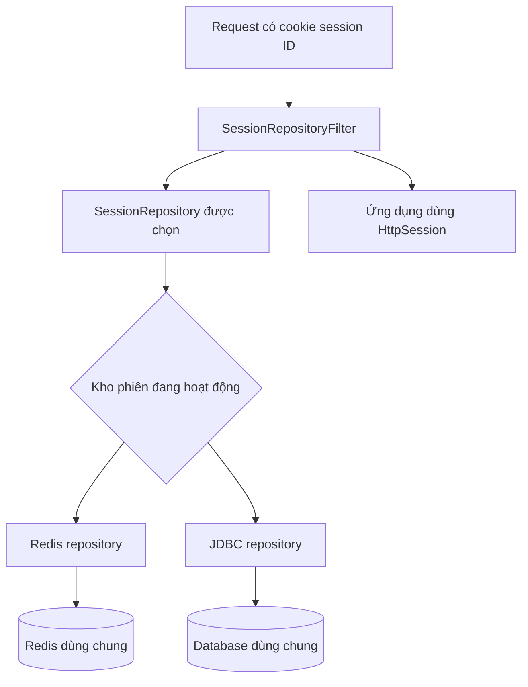

# Lựa chọn kho khi có nhiều thành phần lưu phiên trên classpath

Một ứng dụng Spring có thể đồng thời khai báo nhiều module Spring Session, chẳng hạn `spring-session-data-redis` và `spring-session-jdbc`. Điều này thường xảy ra khi dự án có nhiều starter, nhiều profile triển khai hoặc đang chuẩn bị chuyển kho lưu phiên. Tuy nhiên, việc một module có mặt trên classpath chỉ có nghĩa ứng dụng có khả năng sử dụng repository tương ứng. Nó không có nghĩa một phiên Servlet sẽ tự động được ghi đồng thời vào tất cả các kho.

Trong một ứng dụng Servlet, `SessionRepositoryFilter` kết nối API `HttpSession` với một `SessionRepository` đang được cấu hình. Repository đó quyết định nơi lưu và khôi phục phiên. Vì vậy, khi nhiều implementation cùng có mặt, ứng dụng cần chọn rõ repository đang hoạt động và bảo đảm mọi instance triển khai cùng lựa chọn đó.

## 1. Hiểu classpath, auto-configuration và SessionRepository

Classpath là tập hợp các thư viện có thể được nạp khi ứng dụng khởi động. Ví dụ, dependency Redis đưa các lớp repository Redis vào classpath; dependency JDBC đưa các lớp repository JDBC vào classpath. Spring Boot dùng classpath, các bean hạ tầng hiện có và các điều kiện cấu hình để quyết định auto-configuration nào phù hợp.

Luồng khái quát trong ứng dụng Servlet:



Filter lấy session ID từ cookie, yêu cầu repository khôi phục phiên và cung cấp `HttpSession` cho code Servlet. Khi request kết thúc, các thay đổi được ghi lại thông qua repository. Controller tiếp tục dùng `getAttribute`, `setAttribute`, `removeAttribute` và `invalidate`; controller không cần biết phiên được lưu trong Redis hay JDBC.

Một ứng dụng thông thường chỉ nên có một repository được chọn làm kho phiên của Servlet application. Có thể có nhiều loại kho dữ liệu trong cùng hệ thống cho các mục đích khác nhau, nhưng một `SessionRepositoryFilter` không tự tạo cơ chế đồng bộ hoặc ghi kép giữa Redis và JDBC.

## 2. Vì sao nhiều module lưu phiên có thể cùng xuất hiện

Ví dụ dự án khai báo cả hai nhóm dependency:

```groovy
dependencies {
    implementation("org.springframework.boot:spring-boot-starter-data-redis")
    implementation("org.springframework.session:spring-session-data-redis")

    implementation("org.springframework.boot:spring-boot-starter-jdbc")
    implementation("org.springframework.session:spring-session-jdbc")
}
```

Spring Boot dependency management nên quản lý phiên bản Spring Session tương thích với phiên bản Boot đang sử dụng. Tránh tự ghép các phiên bản Spring Session khác nhau hoặc nâng riêng một module repository mà không kiểm tra ma trận tương thích.

Có nhiều lý do hợp lệ để cả hai module cùng có mặt:

- Ứng dụng có profile local dùng JDBC và profile production dùng Redis.
- Dự án đang chuẩn bị chuyển đổi từ JDBC sang Redis hoặc ngược lại.
- Một module thư viện nội bộ kéo dependency repository vào classpath dù ứng dụng hiện tại chỉ dùng một kho.
- Nhiều cấu hình triển khai dùng chung một artifact, nhưng cần chọn kho theo môi trường.

Điểm cần quản lý là lựa chọn cuối cùng tại thời điểm khởi động. Nếu dự án dựa vào hành vi auto-detection ngầm khi nhiều implementation có sẵn, kết quả có thể phụ thuộc điều kiện auto-configuration và phiên bản Spring Boot. Cấu hình tường minh giúp người đọc, người triển khai và các instance trong cùng cụm hiểu cùng một quyết định.

## 3. Chọn kho bằng `spring.session.store-type` trong Spring Boot

Với các phiên bản Spring Boot hỗ trợ thuộc tính `spring.session.store-type`, có thể chọn loại repository bằng cấu hình ứng dụng. Ví dụ chọn Redis:

```yaml
spring:
  session:
    store-type: redis
```

Hoặc chọn JDBC:

```yaml
spring:
  session:
    store-type: jdbc
```

Đây là hai cấu hình thay thế nhau. Không đặt đồng thời hai giá trị cho cùng một lần chạy. Giá trị hợp lệ và cơ chế auto-detection cần được đối chiếu với tài liệu cấu hình của đúng phiên bản Spring Boot trong dự án.

Khi chọn Redis, ứng dụng vẫn cần có `RedisConnectionFactory` được cấu hình hợp lệ. Trong Spring Boot, factory thường được tạo tự động nếu dependency Redis và cấu hình kết nối phù hợp có mặt. Khi chọn JDBC, ứng dụng cần một `DataSource` hợp lệ; Boot thường tạo `DataSource` từ cấu hình `spring.datasource.*` và dependency driver phù hợp.

Thuộc tính `store-type` chọn loại Spring Session repository. Nó không tự cung cấp máy chủ Redis, không tạo database server, không thay thế cấu hình kết nối và không tự bảo đảm schema JDBC đã được áp dụng. Các tài nguyên hạ tầng phải sẵn sàng riêng.

Nếu chỉ có một implementation Spring Session phù hợp trên classpath, Spring Boot có thể tự phát hiện và cấu hình repository đó theo quy tắc của phiên bản. Khi có nhiều implementation, hãy khai báo lựa chọn rõ ràng thay vì phụ thuộc vào thứ tự dependency hoặc giả định rằng module xuất hiện đầu tiên sẽ được dùng.

## 4. Tách lựa chọn theo profile triển khai

Một artifact có thể được dùng ở nhiều môi trường. Có thể đặt giá trị mặc định trong `application.yml`, sau đó ghi đè trong profile cụ thể:

```yaml
# application.yml
spring:
  session:
    store-type: jdbc
```

```yaml
# application-prod.yml
spring:
  session:
    store-type: redis
```

Khi khởi động với profile `prod`, cấu hình hiệu lực chọn Redis. Có thể truyền qua biến môi trường theo quy tắc relaxed binding của Spring Boot:

```text
SPRING_SESSION_STORE_TYPE=redis
```

Phải kiểm tra thứ tự ưu tiên cấu hình của Spring Boot và cấu hình được nền tảng triển khai cung cấp. Biến môi trường, tham số dòng lệnh, file profile hoặc ConfigMap có thể ghi đè giá trị trong file đóng gói. Không nên chỉ đọc `application.yml` rồi kết luận repository đang hoạt động.

Trong một cụm nhiều instance, tất cả instance phục vụ cùng ứng dụng và cùng cookie phải nhận cùng loại repository, cùng Redis deployment hoặc cùng database/schema. Nếu instance A chọn Redis nhưng instance B chọn JDBC, cùng một cookie có thể khôi phục được phiên trên A nhưng không tìm thấy trên B. Người dùng sẽ gặp hiện tượng mất đăng nhập hoặc phiên mới được tạo liên tục khi load balancer đổi instance.

Nếu local dùng JDBC nhưng production dùng Redis, hãy kiểm thử cả hai cấu hình bằng profile riêng. Các test cần xác nhận repository thực tế được tạo ở từng profile, không chỉ xác nhận file cấu hình có chứa chuỗi `redis` hoặc `jdbc`.

## 5. Chọn repository bằng cấu hình Java tường minh

Trong ứng dụng Spring không dùng auto-configuration của Boot, hoặc khi muốn khai báo cấu hình repository trực tiếp, có thể bật cấu hình tương ứng.

Ví dụ chọn Redis:

```java
@Configuration
@EnableRedisHttpSession(maxInactiveIntervalInSeconds = 1800)
public class RedisSessionConfiguration {
}
```

Ví dụ chọn JDBC:

```java
@Configuration
@EnableJdbcHttpSession(maxInactiveIntervalInSeconds = 1800)
public class JdbcSessionConfiguration {
}
```

Hai lớp trên là các phương án thay thế cho nhau trong một Servlet application. Không bật cả `@EnableRedisHttpSession` và `@EnableJdbcHttpSession` cùng lúc với kỳ vọng Spring Session sẽ tự phân phối phiên giữa hai kho. Cấu hình `@Enable...HttpSession` nhập các thành phần cần thiết cho repository và filter tương ứng; kết hợp nhiều cấu hình có thể tạo nhiều bean hoặc filter xung đột.

Nếu đang dùng Spring Boot auto-configuration, ưu tiên một cơ chế lựa chọn nhất quán. Khi đã chọn `spring.session.store-type`, không thêm annotation `@Enable...HttpSession` chỉ để lặp lại lựa chọn đó. Nếu chuyển sang cấu hình Java tường minh, hãy hiểu rõ auto-configuration nào cần được vô hiệu hóa hoặc để điều kiện của Boot tự lùi lại. Cấu hình trùng lặp thường dẫn đến lỗi khởi động, bean trùng hoặc filter không như mong muốn.

## 6. Khi nào cần tự khai báo SessionRepository

Một ứng dụng nâng cao có thể tự tạo bean `SessionRepository` để dùng cách lưu trữ đặc thù hoặc tích hợp một hệ thống riêng. Khi Spring Boot thấy bean repository do ứng dụng cung cấp, auto-configuration repository tương ứng thường lùi lại theo điều kiện `@ConditionalOnMissingBean`.

Nguyên tắc là khai báo một repository rõ ràng cho Servlet session. Không tạo hai bean `SessionRepository` rồi hy vọng `@Primary` sẽ tự biến chúng thành một lựa chọn chuyển đổi linh hoạt. `@Primary` chỉ giúp Spring ưu tiên một bean khi cần phân giải dependency cùng kiểu; nó không tạo đồng bộ dữ liệu, không chọn kho theo request và không thiết kế cơ chế failover.

Nếu cần chuyển kho theo môi trường, chọn repository tại thời điểm khởi động bằng property hoặc profile. Nếu cần failover, replication hoặc migration giữa các kho, phải thiết kế quy trình riêng có kiểm soát dữ liệu và kiểm thử; không coi sự hiện diện của hai repository là cơ chế dự phòng tự động.

## 7. Những yếu tố cần cân nhắc khi chọn Redis hoặc JDBC

| Tiêu chí | Redis | JDBC |
|---|---|---|
| Đặc điểm truy cập | Kho key-value trong bộ nhớ, thường có độ trễ thấp | Kho quan hệ, lưu phiên qua bảng và truy vấn SQL |
| Hạ tầng cần có | Redis server hoặc dịch vụ Redis tương thích và kết nối được cấu hình | Database quan hệ, JDBC driver và `DataSource` |
| Quản lý schema | Không cần schema bảng phiên như JDBC; cần quản lý namespace và cấu hình Redis | Cần áp dụng schema Spring Session đúng hệ quản trị và quản lý migration |
| Hết hạn | Thường dựa vào TTL của Redis và cơ chế sự kiện hết hạn | Repository quản lý thời hạn phiên và cơ chế dọn các hàng hết hạn |
| Vận hành | Theo dõi bộ nhớ, eviction, kết nối, persistence và tính sẵn sàng Redis | Theo dõi connection pool, index, truy vấn, dung lượng bảng và cleanup |
| Phù hợp khi | Cần kho phiên chuyên dụng, truy cập nhanh và hạ tầng Redis sẵn có | Muốn dùng database quan hệ hiện hữu hoặc yêu cầu dữ liệu phiên nằm trong hệ sinh thái JDBC |

Không có lựa chọn tốt nhất cho mọi hệ thống. Hãy cân nhắc năng lực vận hành, yêu cầu độ sẵn sàng, mô hình tải, thời gian phản hồi, chính sách backup và chi phí hạ tầng. Dữ liệu session thường được truy cập trên nhiều request nên độ trễ và tính sẵn sàng của kho ảnh hưởng trực tiếp đến request của người dùng.

Với Redis, cần thiết lập ACL, xác thực, mạng riêng và TLS theo mô hình hạ tầng; theo dõi memory pressure và eviction. Nếu Redis loại bỏ khóa session đang hoạt động do chính sách bộ nhớ, người dùng có thể bị mất phiên. Với JDBC, cần bảo đảm schema đã được cài đặt, index phù hợp và tác vụ cleanup không làm bảng tăng không kiểm soát. Cả hai lựa chọn đều cần kho dùng chung cho mọi instance.

## 8. Phân biệt lựa chọn repository với cấu hình kết nối

Các cấu hình sau giải quyết những câu hỏi khác nhau:

| Cấu hình | Câu hỏi được trả lời |
|---|---|
| `spring.session.store-type` | Spring Session dùng loại repository nào? |
| Cấu hình Redis connection | Ứng dụng kết nối Redis server nào, bằng thông tin xác thực và TLS nào? |
| `spring.datasource.*` | Ứng dụng kết nối database nào và dùng pool/credentials ra sao? |
| `spring.session.redis.*` hoặc cấu hình JDBC tương ứng | Repository được cấu hình namespace, timeout hoặc hành vi cụ thể nào theo phiên bản? |
| Cookie serializer | Trình duyệt nhận và gửi session ID bằng cookie tên gì, path/domain/SameSite ra sao? |

Ví dụ, đặt `spring.session.store-type: redis` mà không có Redis connection hợp lệ sẽ không tạo được kết nối chỉ nhờ property đó. Tương tự, có `DataSource` không có nghĩa JDBC repository sẽ được chọn nếu cấu hình hiệu lực chọn Redis.

Các tên property phụ trợ có thể thay đổi giữa phiên bản Spring Boot và Spring Session. Luôn dùng cấu hình tham chiếu tương ứng với dependency versions thực tế. Không sao chép nguyên một file cấu hình từ dự án dùng Boot khác phiên bản mà không kiểm tra binding và điều kiện auto-configuration.

## 9. Kiểm tra repository thực sự được chọn

Sau khi khởi động, cần xác nhận ứng dụng tạo đúng repository và filter. Có thể kiểm tra theo các cách sau:

1. Đọc cấu hình hiệu lực theo profile và nguồn cấu hình bên ngoài.
2. Xem log khởi động và báo cáo điều kiện auto-configuration khi chạy với chế độ debug.
3. Kiểm tra bean `SessionRepository` trong application context hoặc qua test tích hợp.
4. Thực hiện request tạo phiên, sau đó xác minh dữ liệu xuất hiện trong đúng kho được chọn.
5. Gửi cookie đó đến instance khác trong cùng cụm và xác nhận instance thứ hai khôi phục được phiên.

Ví dụ test có thể kiểm tra kiểu repository trong context. Tên class cụ thể phụ thuộc module Spring Session và phiên bản được dùng:

```java
@SpringBootTest
class SessionStoreSelectionTest {

    @Autowired
    SessionRepository<?> sessionRepository;

    @Test
    void usesRedisRepository() {
        assertThat(sessionRepository)
                .isInstanceOf(RedisIndexedSessionRepository.class);
    }
}
```

Test trên cần chạy với profile và hạ tầng test tương ứng; ví dụ Redis phải có kết nối test hợp lệ. Nếu ứng dụng chọn JDBC, kiểm tra implementation JDBC tương ứng với phiên bản đang dùng. Không nên chỉ kiểm tra tên property trong `Environment`, vì cấu hình có thể đã bị ghi đè hoặc auto-configuration không tạo bean như dự kiến.

Ngoài kiểm tra kiểu bean, nên có integration test theo hành vi: tạo phiên ở instance A, lưu thuộc tính, dùng cookie ở instance B để đọc thuộc tính, rồi xác nhận logout hoặc hết hạn được phản ánh trên cả hai instance. Đây là bằng chứng thực tế rằng các instance dùng cùng repository và cùng kho dữ liệu.

## 10. Chuyển đổi từ kho này sang kho khác

Thay đổi `spring.session.store-type` từ `jdbc` sang `redis` chỉ thay đổi repository được dùng sau khi ứng dụng khởi động lại. Nó không tự sao chép các phiên đang tồn tại từ database sang Redis. Session ID trong cookie của người dùng có thể vẫn còn, nhưng repository mới không tìm thấy bản ghi tương ứng và ứng dụng có thể xem request là chưa có phiên.

Trước khi chuyển đổi, cần quyết định trải nghiệm người dùng và quy trình triển khai:

- Chấp nhận kết thúc phiên hiện tại và yêu cầu người dùng đăng nhập lại.
- Hoặc xây dựng một quy trình migration có kiểm soát: đọc dữ liệu từ repository cũ, chuyển đổi định dạng/serializer, ghi vào repository mới, kiểm tra đầy đủ và chỉ sau đó chuyển traffic.

Không nên để một số instance ghi Redis và một số instance ghi JDBC trong cùng một cụm khi cùng phục vụ một cookie, trừ khi đã có một lớp tương thích/migration được thiết kế và kiểm thử rõ ràng. Trong rolling deployment, tất cả node phải thống nhất kho phiên trong suốt giai đoạn chuyển tiếp. Cũng cần kiểm tra các session attribute có tương thích giữa phiên bản ứng dụng cũ và mới hay không.

Nếu chấp nhận đăng nhập lại, có thể chủ động kết thúc phiên cũ theo kế hoạch và truyền thông cho người dùng. Nếu phải giữ phiên, hãy thiết kế migration như một thay đổi dữ liệu: có bản sao lưu, đo số phiên chuyển thành công, xử lý lỗi từng bản ghi, kiểm tra quyền truy cập và phương án quay lại. Không dùng `@Primary` hoặc thêm repository thứ hai như một cách migration.

## 11. Các lỗi thường gặp khi có nhiều store trên classpath

| Triệu chứng | Nguyên nhân có thể | Hướng xử lý |
|---|---|---|
| Ứng dụng báo thiếu hoặc không tạo được repository | Store type không được chọn phù hợp, thiếu module hoặc điều kiện auto-configuration không thỏa | Kiểm tra dependency, phiên bản Boot, property và báo cáo điều kiện |
| Có lỗi nhiều bean repository hoặc filter | Cùng lúc bật auto-configuration, nhiều `@Enable...HttpSession` hoặc tự khai báo bean trùng | Chọn một cơ chế cấu hình và loại bỏ cấu hình dư thừa |
| Chọn Redis nhưng không kết nối được | Thiếu `RedisConnectionFactory`, sai host/port/credentials/TLS hoặc Redis chưa sẵn sàng | Kiểm tra cấu hình kết nối và trạng thái Redis |
| Chọn JDBC nhưng lỗi bảng không tồn tại | Schema Spring Session chưa được áp dụng hoặc không đúng hệ quản trị | Áp dụng schema/migration phù hợp và kiểm tra quyền database |
| Local hoạt động nhưng production liên tục mất phiên | Profile hoặc biến môi trường ghi đè store type; các instance dùng kho khác nhau | Kiểm tra cấu hình hiệu lực trên từng instance và thống nhất repository |
| Đổi store xong tất cả người dùng phải đăng nhập lại | Repository mới không có dữ liệu của repository cũ | Đây là hành vi dự kiến nếu không migration; lên kế hoạch kết thúc phiên hoặc chuyển dữ liệu |
| Test dùng Redis nhưng CI dùng JDBC | Profile test hoặc cấu hình môi trường không được kích hoạt như mong muốn | Kiểm tra profile, biến môi trường và bean repository trong context test |
| Hai module có mặt nhưng không rõ kho nào được dùng | Dựa vào auto-detection ngầm hoặc đọc nhầm file cấu hình không phải nguồn hiệu lực | Khai báo store type rõ ràng và kiểm tra bean thực tế |

Khi điều tra lỗi, không in session ID thật, cookie hoặc thuộc tính phiên nhạy cảm ra log. Có thể ghi loại repository, tên profile, instance ID, trạng thái kết nối và mã tương quan request để khoanh vùng.

## 12. Quy trình lựa chọn và kiểm tra trước khi triển khai

1. Kiểm kê các module Spring Session và starter đang có trên classpath.
2. Xác định môi trường chạy và kho dữ liệu phù hợp với yêu cầu vận hành.
3. Chọn một repository cho Servlet session; với Spring Boot có nhiều implementation, khai báo `spring.session.store-type` theo phiên bản đang dùng.
4. Cấu hình `RedisConnectionFactory` hoặc `DataSource` và xác minh kết nối thực tế.
5. Không kết hợp nhiều annotation `@Enable...HttpSession` hoặc nhiều repository bean ngoài một thiết kế có chủ đích.
6. Xác nhận mọi instance có cùng store type, endpoint, namespace/schema và cấu hình serializer.
7. Kiểm thử tạo, khôi phục, cập nhật, hết hạn và thu hồi phiên trên repository được chọn.
8. Nếu đổi kho, xác định rõ cách xử lý phiên cũ và kiểm thử rolling deployment.

Khi một ứng dụng có cả Redis và JDBC trên classpath, quyết định quan trọng là repository nào được gắn với `SessionRepositoryFilter` tại lần khởi động đó. Chọn tường minh theo môi trường, kiểm tra bean và hành vi thực tế, rồi giữ cấu hình nhất quán giữa các instance. Nhờ vậy, Spring Session tiếp tục cung cấp `HttpSession` ổn định cho ứng dụng trong khi nhóm phát triển kiểm soát rõ kho lưu phiên đang hoạt động.
