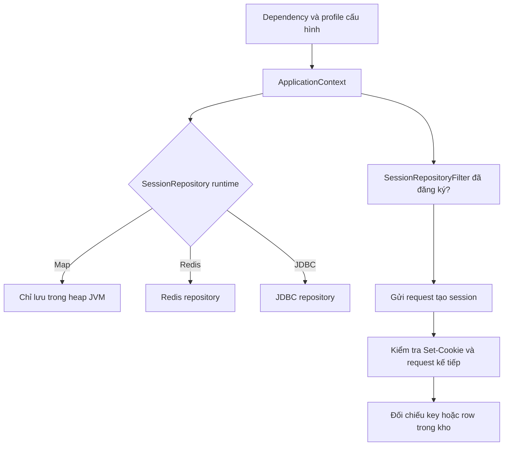

# Kiểm tra các bean thực tế và xác nhận phiên được lưu đúng nơi

Khai báo dependency hoặc đặt thuộc tính trong `application.yml` chưa đủ để chứng minh ứng dụng đang dùng đúng kho session. Một ứng dụng có thể chứa cả starter Redis và JDBC, chạy với nhiều profile, có cấu hình tự động của Spring Boot hoặc có bean do ứng dụng tự khai báo. Khi đó điều cần xác nhận là **repository nào thực sự được tạo trong ApplicationContext, filter session có tham gia vào request hay không, và dữ liệu của một phiên HTTP thực tế xuất hiện ở kho mong muốn hay không**.

Bài học này hướng dẫn kiểm tra các bean Spring Session khi ứng dụng khởi động, xem điều kiện auto-configuration, kiểm tra filter Servlet, tạo một phiên thử qua HTTP và đối chiếu dữ liệu trong Redis/JDBC. Quy trình cũng chỉ ra cách nhận biết khi ứng dụng vẫn dùng `MapSessionRepository`, khi cấu hình bị ghi đè bởi profile, hoặc khi session chưa được lưu do request chưa kết thúc.

## 1. Phân biệt cấu hình khai báo và trạng thái runtime

Spring Boot có thể tạo repository dựa trên dependency, thuộc tính cấu hình, loại ứng dụng và các bean đã tồn tại. Ví dụ, có dependency Spring Session Redis không tự chứng minh Redis repository đang hoạt động: một bean repository tự khai báo có thể khiến auto-configuration tương ứng không chạy, hoặc profile hiện tại có thể cung cấp cấu hình khác.

Các lớp cần phân biệt:

| Thành phần | Vai trò | Điều cần kiểm tra |
| --- | --- | --- |
| Dependency | Đưa implementation và auto-configuration vào classpath | Có đúng starter và phiên bản tương thích không? |
| `SessionRepository` | Đọc, lưu, tìm và xóa session | Bean runtime thuộc implementation nào? |
| `SessionRepositoryFilter` | Nối Servlet API với repository | Filter có được đăng ký trong Servlet container và chạy trên request không? |
| `CookieSerializer` | Đọc và ghi cookie mang session ID | Tên, domain, path và thuộc tính bảo mật có đúng không? |
| Kho dữ liệu | Lưu session thực tế | Có key Redis hoặc bản ghi JDBC tương ứng sau request không? |

Luồng kiểm tra nên đi từ ApplicationContext đến HTTP request rồi đến kho dữ liệu. Mỗi bước trả lời một câu hỏi khác nhau: bean cho biết ứng dụng chọn implementation nào; filter cho biết request có đi qua Spring Session; cookie cho biết trình duyệt gửi lại đúng định danh; dữ liệu trong kho cho biết phiên đã được ghi vào nơi cần dùng.



Không kết luận chỉ từ một dấu hiệu. Chẳng hạn, thấy Redis có key không chứng minh request hiện tại đã dùng key đó; key có thể thuộc ứng dụng khác hoặc session cũ. Ngược lại, thấy bean Redis repository không chứng minh response đã lưu thay đổi nếu filter không được đăng ký đúng hoặc request bị lỗi trước khi hoàn tất.

## 2. Kiểm tra `SessionRepository` trong ApplicationContext

Cách trực tiếp là hỏi Spring container những bean có kiểu `SessionRepository`. Có thể thêm một `ApplicationRunner` tạm thời trong profile chẩn đoán để ghi tên bean và lớp runtime:

```java
import org.slf4j.Logger;
import org.slf4j.LoggerFactory;
import org.springframework.boot.ApplicationRunner;
import org.springframework.context.ConfigurableApplicationContext;
import org.springframework.context.annotation.Bean;
import org.springframework.context.annotation.Configuration;
import org.springframework.context.annotation.Profile;
import org.springframework.session.SessionRepository;

@Configuration
@Profile("session-diagnostics")
public class SessionBeanDiagnostics {

    private static final Logger log =
            LoggerFactory.getLogger(SessionBeanDiagnostics.class);

    @Bean
    ApplicationRunner logSessionRepository(
            ConfigurableApplicationContext context) {
        return args -> {
            String[] names = context.getBeanNamesForType(SessionRepository.class);

            if (names.length == 0) {
                log.warn("No SessionRepository bean found");
                return;
            }

            for (String name : names) {
                Class<?> type = context.getType(name);
                log.info("SessionRepository bean={} implementation={}",
                        name, type == null ? "unknown" : type.getName());
            }
        };
    }
}
```

Ví dụ này chỉ ghi tên bean và tên lớp, không ghi session ID, cookie, thông tin xác thực Redis hoặc thuộc tính session. Sau khi xác định được implementation, so sánh với mục tiêu cấu hình:

- Nếu lớp runtime là `MapSessionRepository`, session đang nằm trong một map trong heap của JVM. Thêm dependency Redis mà vẫn nhận được lớp này có thể là dấu hiệu cấu hình Redis chưa được kích hoạt hoặc một bean khác đã thay thế lựa chọn mặc định.
- Nếu lớp runtime thuộc nhóm Redis repository, kiểm tra tiếp connection factory, namespace và kết nối đến đúng Redis database/cluster.
- Nếu lớp runtime thuộc nhóm JDBC repository, kiểm tra `DataSource`, schema và database thực tế.

Tên lớp cụ thể có thể thay đổi theo phiên bản Spring Session và loại repository được chọn, ví dụ repository có hỗ trợ tra cứu theo principal/index hoặc implementation đơn giản hơn. Hãy ghi nhận tên lớp thực tế từ tiến trình đang chạy thay vì đoán từ tên dependency.

Nếu có nhiều bean `SessionRepository`, kiểm tra bean nào được chọn để tạo filter. Một số cấu hình có thể gặp lỗi không xác định được bean phù hợp; cấu hình khác có thể dùng `@Primary` hoặc wiring tùy chỉnh. Một danh sách bean không tự nói lên bean nào đang được request sử dụng. Cần kiểm tra cấu hình filter và thử request end-to-end.

Đặt lớp chẩn đoán dưới profile riêng, ví dụ `session-diagnostics`, và chỉ bật trong môi trường phát triển hoặc kiểm thử. Không nhất thiết giữ runner này trong production sau khi hoàn tất điều tra.

## 3. Kiểm tra `SessionRepositoryFilter` và thứ tự filter

`SessionRepositoryFilter` là cầu nối giữa `HttpSession` của Servlet và repository. Nếu filter không được đăng ký trong Servlet container, controller có thể tiếp tục dùng session mặc định của container dù trong ApplicationContext có một repository Spring Session.

Có thể kiểm tra bean filter tương tự:

```java
import org.springframework.session.web.http.SessionRepositoryFilter;

String[] filterNames = context.getBeanNamesForType(SessionRepositoryFilter.class);
for (String name : filterNames) {
    Class<?> type = context.getType(name);
    log.info("Session filter bean={} implementation={}",
            name, type == null ? "unknown" : type.getName());
}
```

Trong ứng dụng Spring Boot Servlet, auto-configuration thường đăng ký filter khi có repository phù hợp. Với ứng dụng WAR hoặc cấu hình Servlet thủ công, cần kiểm tra cơ chế initializer/registration của ứng dụng để bảo đảm filter được đưa vào chuỗi filter của container. Tránh đăng ký cùng filter hai lần bằng cả auto-configuration và cấu hình thủ công.

Spring Session filter cần chạy trước các filter cần đọc hoặc ghi `HttpSession`, đặc biệt là Spring Security filter chain. Nếu filter chạy sau thành phần bảo mật, Spring Security có thể đọc session theo cơ chế khác trước khi Spring Session bọc request. Khi chẩn đoán, kiểm tra thứ tự filter trong Servlet container và kiểm tra hành vi xác thực thực tế.

Một bean filter có mặt trong context vẫn chưa chứng minh filter đã được container gọi. Dấu hiệu mạnh hơn là request HTTP đi qua filter, cookie session được phát hành và request kế tiếp dùng cookie đó đọc được cùng trạng thái. Vì vậy cần kết hợp kiểm tra bean với phép thử HTTP ở phần 6.

## 4. Dùng Spring Boot Actuator để xem điều kiện cấu hình

Nếu dự án đã dùng Spring Boot Actuator, các endpoint sau hỗ trợ điều tra:

| Endpoint | Thông tin hữu ích |
| --- | --- |
| `/actuator/beans` | Danh sách bean, tên và quan hệ phụ thuộc trong ApplicationContext |
| `/actuator/conditions` | Các điều kiện auto-configuration đã khớp hoặc không khớp, kèm lý do |
| `/actuator/configprops` | Các thuộc tính cấu hình đã bind vào bean `@ConfigurationProperties` |
| `/actuator/env` | Giá trị property và nguồn cấu hình, hữu ích để tìm profile hoặc biến môi trường ghi đè |

Chỉ bật các endpoint thực sự cần trong môi trường chẩn đoán. Ví dụ:

```yaml
management:
  endpoints:
    web:
      exposure:
        include: health,info,beans,conditions,configprops,env
```

Các endpoint có thể chứa tên bean nội bộ, đường dẫn, giá trị cấu hình và thông tin hạ tầng. Hạn chế truy cập bằng Spring Security, mạng quản trị hoặc cấu hình Actuator riêng; không công khai `/beans`, `/env` hay `/configprops` ra Internet. Tránh đưa mật khẩu, token hoặc session ID vào cấu hình hiển thị.

Trong `/actuator/conditions`, tìm các auto-configuration liên quan đến Spring Session và Redis/JDBC. Nếu một cấu hình không được áp dụng, đọc lý do như thiếu class trên classpath, thiếu bean cần thiết, property không phù hợp hoặc đã có bean do ứng dụng khai báo. `/actuator/env` có thể giúp xác định profile nào cung cấp giá trị `spring.session.*`, `spring.data.redis.*` hoặc `spring.datasource.*`.

Actuator hỗ trợ giải thích vì sao cấu hình được chọn; nó không thay thế phép thử lưu phiên. Sau khi đọc điều kiện, vẫn cần xác minh repository runtime và dữ liệu được ghi trong kho.

## 5. Kiểm tra cấu hình theo từng loại repository

### 5.1. Khi mục tiêu là Redis

Kiểm tra những điểm sau:

1. Dependency Spring Session Redis và Spring Data Redis có trong runtime classpath.
2. Profile đang chạy chứa host/port hoặc cấu hình cluster đúng; giá trị cuối cùng sau khi bind không bị biến môi trường hoặc profile khác ghi đè.
3. `RedisConnectionFactory` được tạo và có thể kết nối đến đúng máy chủ/database.
4. Bean `SessionRepository` runtime là implementation Redis mong muốn.
5. Namespace riêng cho ứng dụng và môi trường được cấu hình thống nhất trên mọi instance.

Ví dụ cấu hình:

```yaml
spring:
  data:
    redis:
      host: redis.internal
      port: 6379
  session:
    timeout: 30m
    redis:
      namespace: orders:session:prod
```

Nếu ứng dụng có nhiều môi trường hoặc nhiều module dùng chung Redis, namespace giúp tách key. Mọi instance thuộc cùng một cụm ứng dụng phải dùng cùng namespace, cùng kiểu serializer tương thích và cùng cấu hình cookie. Hai instance dùng namespace khác nhau sẽ không tìm thấy cùng session dù kết nối đến cùng Redis.

Sau khi tạo session qua HTTP và để response hoàn tất, dùng `SCAN` hoặc công cụ quản trị Redis để tìm key theo namespace. Với namespace ví dụ ở trên, có thể bắt đầu bằng:

```bash
redis-cli --scan --pattern 'orders:session:prod:sessions:*'
```

Không dùng `KEYS *` trên Redis production vì thao tác đó có thể chặn server khi keyspace lớn. Cấu trúc key chính xác là chi tiết implementation và có thể thay đổi theo phiên bản; dùng namespace và hướng dẫn của phiên bản đang chạy. Khi cần kiểm tra TTL, lấy một key session từ kết quả scan rồi xem thời gian còn lại bằng `PTTL`. Không in toàn bộ giá trị session ra terminal hoặc log vì thuộc tính có thể chứa thông tin nhạy cảm.

Nếu không có key, kiểm tra request đã tạo session hay chưa, response đã hoàn tất chưa, filter có chạy không, repository có kết nối đúng Redis không và namespace có trùng với nơi đang quan sát không. Nếu có key nhưng TTL hoặc dữ liệu không như mong đợi, kiểm tra timeout, flush mode, save mode và cách ứng dụng thay đổi thuộc tính.

### 5.2. Khi mục tiêu là JDBC

Kiểm tra:

1. Spring Session JDBC, Spring JDBC và driver của database có trong runtime classpath.
2. `DataSource` đang kết nối đúng database/schema theo profile hiện tại.
3. Bean `SessionRepository` runtime là implementation JDBC mong muốn.
4. Schema Spring Session đã được tạo đúng phiên bản, có các bảng session và thuộc tính session.
5. Quyền database cho phép đọc, ghi và dọn session hết hạn.

Spring Session JDBC thường dùng các bảng `SPRING_SESSION` và `SPRING_SESSION_ATTRIBUTES`. Sau khi tạo session bằng request thử nghiệm, có thể kiểm tra metadata bằng truy vấn có tham số:

```sql
SELECT SESSION_ID, EXPIRY_TIME, MAX_INACTIVE_INTERVAL
FROM SPRING_SESSION
WHERE SESSION_ID = :session_id;
```

`:session_id` là tham số bind chứa session ID thô của phiên thử nghiệm; không nối chuỗi trực tiếp từ đầu vào HTTP vào câu SQL. Giá trị cookie có thể được `CookieSerializer` encode, vì vậy không mặc định dùng nguyên chuỗi cookie làm `SESSION_ID` trong database. Lấy ID thô qua instrumentation chỉ dùng trong test hoặc giải mã theo đúng serializer, và không ghi ID đó vào log. Truy vấn chỉ lấy metadata cần thiết để xác minh phiên. Không xuất nội dung attribute hoặc thông tin người dùng nếu không cần.

Nếu không có row, kiểm tra database/schema đang quan sát có đúng với `DataSource` runtime hay không, schema có tương thích phiên bản Spring Session không và request đã hoàn tất để ghi session chưa. Nếu row xuất hiện nhưng thời gian hết hạn sai, xem lại idle timeout, thời điểm truy cập và cấu hình timeout.

Trong production, nên quản lý schema bằng công cụ migration. Không bật tự khởi tạo schema một cách tùy tiện trên mọi instance production; nhiều instance cùng khởi động có thể tạo xung đột DDL hoặc phụ thuộc quyền quá rộng.

### 5.3. Khi runtime vẫn là `MapSessionRepository`

`MapSessionRepository` lưu session trong bộ nhớ của JVM. Không có key Redis hoặc row JDBC nào được mong đợi cho phiên đó. Đây có thể là lựa chọn đúng trong unit test hoặc prototype, nhưng không đáp ứng yêu cầu chia sẻ session giữa các instance độc lập hay giữ phiên qua restart.

Nếu production dự kiến dùng Redis/JDBC nhưng runtime lại là Map, rà soát:

- Profile thực tế (`spring.profiles.active`) và các file cấu hình được nạp.
- Dependency có bị khai báo ở scope chỉ dùng khi test hoặc bị loại khỏi runtime artifact không.
- Có bean `SessionRepository` tự khai báo hoặc cấu hình `@EnableSpringHttpSession` nào đang thay auto-configuration không.
- Điều kiện auto-configuration có bị vô hiệu bởi property hoặc bean khác không.
- Ứng dụng đang chạy đúng artifact/container image vừa build hay vẫn là phiên bản cũ.

Sau khi điều chỉnh, khởi động lại ứng dụng và xác minh lại tên lớp bean runtime. Không chỉ nhìn file YAML đã sửa rồi kết luận tiến trình đang chạy đã nhận cấu hình mới.

## 6. Tạo một phiên HTTP thử nghiệm và xác minh cookie

Một phép thử end-to-end nên tạo một thuộc tính có giá trị ngẫu nhiên, gửi cookie trở lại trong request kế tiếp và xác nhận server đọc được đúng giá trị. Chỉ dùng endpoint chẩn đoán này trong profile phát triển hoặc kiểm thử; không để endpoint ghi/đọc tùy ý session tồn tại trong production.

Ví dụ controller:

```java
import java.util.Map;
import java.util.UUID;

import jakarta.servlet.http.HttpServletRequest;
import jakarta.servlet.http.HttpSession;
import org.springframework.context.annotation.Profile;
import org.springframework.web.bind.annotation.GetMapping;
import org.springframework.web.bind.annotation.PostMapping;
import org.springframework.web.bind.annotation.RequestMapping;
import org.springframework.web.bind.annotation.RestController;

@RestController
@RequestMapping("/_test/session")
@Profile("session-diagnostics")
public class SessionDiagnosticsController {

    @PostMapping("/write")
    public Map<String, Object> write(HttpServletRequest request) {
        HttpSession session = request.getSession();
        String marker = UUID.randomUUID().toString();
        session.setAttribute("diagnosticMarker", marker);
        return Map.of("stored", true, "marker", marker);
    }

    @GetMapping("/read")
    public Map<String, Object> read(HttpServletRequest request) {
        HttpSession session = request.getSession(false);
        if (session == null) {
            return Map.of("stored", false);
        }

        Object marker = session.getAttribute("diagnosticMarker");
        return marker == null
                ? Map.of("stored", false)
                : Map.of("stored", true, "marker", marker);
    }
}
```

Endpoint `/write` gọi `getSession()` để tạo hoặc lấy session, rồi đặt một marker thử nghiệm. Endpoint `/read` dùng `getSession(false)` để không vô tình tạo session mới khi cookie thiếu hoặc không hợp lệ. Marker không đại diện dữ liệu người dùng và chỉ tồn tại để đối chiếu.

Gửi hai request bằng cùng cookie jar:

```bash
curl -i -c cookies.txt -X POST http://localhost:8080/_test/session/write
curl -i -b cookies.txt http://localhost:8080/_test/session/read
```

Ở response đầu, kiểm tra header `Set-Cookie`: tên cookie phải khớp với `CookieSerializer` đã cấu hình, ví dụ `SESSION` theo mặc định Spring Session hoặc tên tùy chỉnh của ứng dụng. Kiểm tra các thuộc tính `Path`, `HttpOnly`, `Secure`, `SameSite` theo yêu cầu. Request thứ hai phải gửi lại cookie đó và trả về cùng marker. Không sao chép cookie thật của người dùng vào ticket, chat hoặc log.

Nếu request đầu trả marker nhưng không có `Set-Cookie`, kiểm tra session có thực sự được tạo và response có bị thay thế bởi redirect/proxy không. Nếu request thứ hai không thấy marker, kiểm tra cookie có được gửi lại, host/path/domain có khớp, session có hết hạn, filter có chạy và repository có lưu thay đổi hay không. Cũng cần chờ request đầu kết thúc trước khi kiểm tra key hoặc row, vì một số chế độ lưu ghi thay đổi ở cuối request.

## 7. Xác minh hai instance dùng chung đúng một session

Khi triển khai nhiều instance, cần chứng minh request có thể đi qua hai tiến trình khác nhau mà vẫn đọc được cùng phiên. Chạy instance A và B trên hai cổng, cùng repository, cùng namespace, cùng cookie serializer và cùng cấu hình timeout. Tạo session ở A rồi dùng cùng cookie để đọc ở B.

Ví dụ nếu A chạy ở cổng 8081 và B ở 8082:

```bash
curl -i -c shared-cookies.txt -X POST http://localhost:8081/_test/session/write
curl -i -b shared-cookies.txt http://localhost:8082/_test/session/read
```

Kết quả đọc ở B phải trả `stored: true` và marker giống kết quả A. Bảo đảm hai request thực sự đến hai tiến trình; có thể dùng log instance ID không nhạy cảm hoặc gọi trực tiếp từng cổng trong môi trường test. Cookie không gắn với port, nhưng phải dùng cùng host, path và domain hợp lệ.

Nếu A đọc được nhưng B không đọc được, kiểm tra lần lượt:

1. Hai tiến trình có thực sự dùng cùng loại repository và cùng Redis/database không?
2. Namespace Redis hoặc schema/database JDBC có giống nhau không?
3. Cookie có cùng tên, domain, path và serializer không?
4. Hai tiến trình có dùng serializer/định dạng dữ liệu tương thích không?
5. Request đến B có dùng đúng cookie được A phát hành không?
6. Session có bị xóa, hết hạn hoặc bị logout giữa hai request không?

Nếu hai instance cùng dùng `MapSessionRepository`, phép thử này sẽ thất bại vì mỗi JVM có map riêng. Sticky session có thể che giấu vấn đề khi mọi request tình cờ về A; kiểm thử trực tiếp A rồi B sẽ làm rõ việc chia sẻ dữ liệu thực sự.

## 8. Đối chiếu cấu hình, cookie và dữ liệu kho khi có lỗi

Bảng sau giúp khoanh vùng nguyên nhân theo dấu hiệu quan sát được:

| Dấu hiệu | Nguyên nhân có thể | Bước xác minh tiếp theo |
| --- | --- | --- |
| Không có `SessionRepository` bean | Chưa kích hoạt cấu hình Spring Session hoặc dependency không có ở runtime | Kiểm tra classpath, điều kiện auto-configuration và cấu hình Servlet |
| Repository runtime là Map nhưng mong đợi Redis/JDBC | Profile/bean tùy chỉnh ghi đè, auto-configuration không khớp hoặc artifact cũ | Xem `/actuator/conditions`, profile và lớp runtime |
| Có repository nhưng không có filter | Filter chưa được đăng ký hoặc cấu hình Servlet bị trùng/sai | Kiểm tra registration, initializer và thứ tự filter |
| Có `Set-Cookie` nhưng không có key/row | Cookie chỉ chứng minh server phát ID; session có thể chưa được lưu hoặc đang quan sát nhầm kho | Đợi request hoàn tất, kiểm tra repository, namespace/schema và connection runtime |
| Có key/row nhưng request kế tiếp tạo session mới | Cookie không được gửi lại, sai tên/path/domain, serializer không tương thích hoặc session đã hết hạn | Kiểm tra request header `Cookie`, response `Set-Cookie`, TTL và cấu hình cookie |
| A đọc được, B không đọc được | Hai node dùng kho/namespace khác nhau hoặc một node đang dùng Map | So sánh bean runtime, cấu hình cuối cùng và kho dữ liệu của cả hai node |
| Session mất sau restart | Đang dùng Map hoặc kho dùng chung không có độ bền như yêu cầu | Kiểm tra repository runtime và cấu hình persistence/failover của kho |

Lưu ý rằng cookie mang session ID và serializer có thể encode giá trị này; không mặc định rằng cookie được mã hóa hoặc ký để bảo vệ nội dung. Dữ liệu session thực tế nằm ở server-side repository. Không ghi log hoặc gửi cookie thật cho người khác để chẩn đoán. Khi cần chia sẻ bằng chứng, chỉ gửi tên bean, loại repository, tên profile, trạng thái kết nối và marker thử nghiệm không nhạy cảm.

## 9. Checklist xác nhận trước khi triển khai

Trước khi đưa cấu hình session vào production, hãy xác nhận từng điểm sau:

- [ ] Profile và nguồn property đang hoạt động đúng môi trường.
- [ ] Có đúng một repository được lựa chọn cho ứng dụng và tên lớp runtime đúng mục tiêu.
- [ ] `SessionRepositoryFilter` được đăng ký một lần và chạy trước các filter cần `HttpSession`.
- [ ] Cookie có tên, domain, path, `HttpOnly`, `Secure` và `SameSite` phù hợp.
- [ ] Request tạo session phát cookie; request kế tiếp gửi lại cookie và đọc được marker đã lưu.
- [ ] Redis key hoặc JDBC row xuất hiện trong đúng kho dữ liệu, đúng namespace/schema và có thời hạn phù hợp.
- [ ] Hai instance độc lập có thể đọc cùng session bằng cùng cookie.
- [ ] Logout và hết hạn làm session không còn được chấp nhận trên mọi instance.
- [ ] Endpoint chẩn đoán và Actuator nhạy cảm được tắt hoặc giới hạn truy cập sau khi hoàn tất điều tra.
- [ ] Log và báo cáo không chứa cookie, session ID, mật khẩu hoặc payload session.

## 10. Tự kiểm tra kiến thức

Bạn đã hiểu cách xác nhận cấu hình khi có thể trả lời:

- Vì sao dependency Redis và thuộc tính `spring.session.*` chưa chứng minh Redis repository đang được dùng?
- Làm thế nào lấy tên và lớp runtime của `SessionRepository` từ ApplicationContext?
- Vì sao có bean `SessionRepositoryFilter` vẫn chưa đủ chứng minh filter được Servlet container gọi?
- `/actuator/conditions` giúp tìm nguyên nhân auto-configuration không khớp như thế nào?
- Cần quan sát những gì ở `Set-Cookie`, request `Cookie`, Redis hoặc bảng JDBC để xác nhận cùng một phiên?
- Vì sao cần thử request qua A rồi B thay vì chỉ thử qua load balancer với sticky session?
- Làm thế nào chia sẻ kết quả chẩn đoán mà không để lộ session ID hoặc dữ liệu nhạy cảm?

Một cấu hình Spring Session chỉ được xác nhận khi implementation runtime đúng, filter thực sự xử lý request, cookie duy trì cùng định danh và kho dữ liệu mục tiêu chứa trạng thái có thể đọc lại. Kiểm tra đủ các lớp này giúp phân biệt lỗi cấu hình bean, lỗi tích hợp Servlet, lỗi cookie và lỗi lưu trữ, đồng thời xác nhận rằng nhiều instance đang sử dụng cùng một nguồn session như thiết kế.
