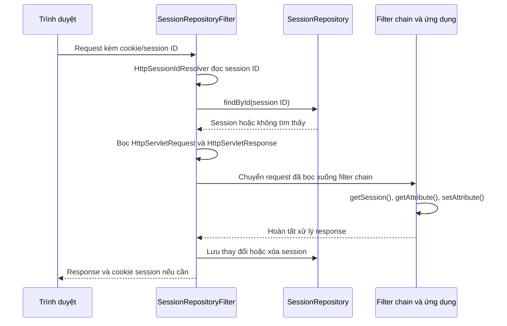

# SessionRepositoryFilter và thay thế HttpSession qua request wrapper

Ứng dụng Servlet thường dùng `HttpSession` để giữ thông tin đăng nhập, giỏ hàng hoặc trạng thái làm việc giữa nhiều request. Mặc định, Servlet container quản lý session trong bộ nhớ hoặc kho riêng của từng máy chủ. Khi triển khai nhiều instance, dữ liệu đó có thể không được chia sẻ. Spring Session giải quyết vấn đề bằng cách lưu session qua một `SessionRepository` dùng chung như Redis hoặc JDBC, đồng thời giữ nguyên phần lớn API Servlet mà mã ứng dụng đang sử dụng.

Thành phần kết nối hai thế giới này là `SessionRepositoryFilter`. Filter chặn request trước khi request đi vào Spring Security, DispatcherServlet và các thành phần ứng dụng. Nó bọc request và response để lời gọi `HttpServletRequest.getSession()` làm việc với session do Spring Session quản lý thay vì session cục bộ của container.

## 1. Vai trò của SessionRepositoryFilter

`SessionRepositoryFilter<S extends Session>` là một Servlet filter dùng `SessionRepository<S>` để nạp, tạo, lưu và xóa session. Filter tạo ranh giới tương thích giữa Servlet API và kho dữ liệu Spring Session.

Khi một request đi vào ứng dụng, luồng xử lý khái quát như sau:



Các bước cụ thể về thời điểm flush và commit phụ thuộc `FlushMode`, `SaveMode` và repository đang dùng. Điểm cốt lõi là các thành phần phía sau filter nhìn thấy một `HttpSession` được Spring Session điều khiển; repository quyết định nơi dữ liệu được lưu.

Nếu request mang session ID hợp lệ, filter dùng `HttpSessionIdResolver` để lấy ID và hỏi repository tìm session. Nếu không có session hợp lệ, ứng dụng có thể tiếp tục mà không có session hoặc tạo session mới khi code gọi `getSession()`/`getSession(true)`. Khi cần truyền ID mới về trình duyệt, resolver ghi cookie hoặc header phù hợp vào response.

## 2. Request wrapper thay thế HttpSession như thế nào?

Trong Servlet API, `HttpServletRequest` có các phương thức quen thuộc như `getSession()`, `getSession(boolean)`, `getRequestedSessionId()` và `changeSessionId()`. `SessionRepositoryFilter` bọc request bằng một wrapper dựa trên `HttpServletRequestWrapper`. Wrapper cung cấp một đối tượng `HttpSession` tương thích Servlet nhưng được ánh xạ tới đối tượng `Session` của Spring Session.

Khi controller hoặc filter phía sau gọi `request.getSession()`, wrapper thực hiện các công việc chính:

1. Kiểm tra session đã được nạp từ repository trong request hiện tại hay chưa.
2. Nếu có session hợp lệ, trả về đối tượng `HttpSession` đại diện cho session đó.
3. Nếu chưa có và lời gọi cho phép tạo mới, yêu cầu repository tạo session mới rồi trả về wrapper tương ứng.
4. Nếu gọi `getSession(false)` và không có session, trả về `null`, không tạo session mới.
5. Chuyển các thao tác như `getAttribute`, `setAttribute`, `removeAttribute`, `invalidate` và `setMaxInactiveInterval` tới session được Spring Session quản lý.

Nhờ đó, mã ứng dụng thường không phải phụ thuộc trực tiếp vào `RedisSession`, `JdbcSession` hay một lớp session cụ thể. Ví dụ sau vẫn dùng API Servlet bình thường:

```java
import jakarta.servlet.http.HttpServletRequest;
import jakarta.servlet.http.HttpSession;
import org.springframework.http.ResponseEntity;
import org.springframework.web.bind.annotation.PostMapping;
import org.springframework.web.bind.annotation.RestController;

@RestController
class CartController {

    @PostMapping("/cart/start")
    ResponseEntity<String> startCart(HttpServletRequest request) {
        HttpSession session = request.getSession();
        session.setAttribute("cartStarted", Boolean.TRUE);
        session.setMaxInactiveInterval(30 * 60);
        return ResponseEntity.ok("Cart session started");
    }

    @PostMapping("/cart/check")
    ResponseEntity<Boolean> checkCart(HttpServletRequest request) {
        HttpSession session = request.getSession(false);
        if (session == null) {
            return ResponseEntity.ok(false);
        }
        return ResponseEntity.ok(
                Boolean.TRUE.equals(session.getAttribute("cartStarted")));
    }
}
```

Request đầu tiên tạo session nếu chưa có và ghi thuộc tính. Request sau gửi cookie session ID; filter nạp lại cùng session từ repository, vì vậy controller có thể đọc thuộc tính đã lưu. Ví dụ giả định request được gửi cùng cookie do trình duyệt quản lý.

### Khác biệt giữa getSession() và getSession(false)

| Lời gọi | Có session hợp lệ | Không có session |
|---|---|---|
| `getSession()` | Trả về session hiện có | Tạo session mới và trả về |
| `getSession(true)` | Trả về session hiện có | Tạo session mới và trả về |
| `getSession(false)` | Trả về session hiện có | Trả về `null` |

Với endpoint chỉ kiểm tra trạng thái đăng nhập, `getSession(false)` thường phù hợp hơn vì tránh tạo session rỗng cho mỗi request. Với endpoint bắt đầu một luồng làm việc cần lưu trạng thái, `getSession()` có thể là lựa chọn đúng.

## 3. Response wrapper và vòng đời session ID

Filter cũng bọc `HttpServletResponse` bằng một wrapper dựa trên `HttpServletResponseWrapper`. Response wrapper phối hợp với `HttpSessionIdResolver` để bảo đảm session ID được gửi về client đúng thời điểm, trước khi response commit khiến header không thể thay đổi.

Resolver chịu trách nhiệm đọc ID từ request và ghi hoặc xóa ID trên response. Cách phổ biến nhất là cookie thông qua `CookieHttpSessionIdResolver`; Spring Session cũng có resolver dùng header cho một số ứng dụng API. Với cấu hình cookie mặc định thường gặp, tên cookie là `SESSION`; ứng dụng có thể tùy chỉnh tên và thuộc tính cookie.

Các tình huống thường gặp:

- **Tạo session mới:** repository tạo session; khi response cần phát hành ID, resolver ghi cookie hoặc header chứa ID.
- **Dùng session hiện có:** trình duyệt gửi ID ở request kế tiếp; resolver đọc ID để filter nạp session.
- **Đăng xuất hoặc invalidate:** session được đánh dấu hết hiệu lực và repository xóa dữ liệu; resolver phát tín hiệu hết hạn cookie để trình duyệt ngừng gửi ID cũ.
- **Thay đổi session ID:** khi ứng dụng hoặc Spring Security gọi `changeSessionId()` theo chính sách chống session fixation, wrapper phối hợp với repository và resolver để ID mới được dùng cho những request sau.

Session ID là thông tin xác thực dạng bearer. Hãy bảo vệ cookie bằng HTTPS và các thuộc tính phù hợp như `Secure`, `HttpOnly`, `SameSite`, `Path` và `Domain`. Không đặt session ID trong URL hoặc log. Nếu ứng dụng dùng header thay cookie, phải bảo vệ header đó tương tự một credential.

## 4. Đăng ký filter trong ứng dụng Servlet

Filter phải được đăng ký và chạy trước mọi thành phần cần sử dụng `HttpSession`. Đặc biệt, Spring Security thường đọc hoặc ghi `SecurityContext` trong session; nếu security filter chạy trước `SessionRepositoryFilter`, nó có thể vô tình sử dụng session cục bộ của container.

### 4.1. Ứng dụng Spring Boot

Khi dùng starter Spring Session tương ứng với Redis hoặc JDBC, Spring Boot có thể tự cấu hình repository và đăng ký filter dựa trên dependency cùng cấu hình ứng dụng. Ví dụ cấu hình Redis theo kiểu Java:

```java
import org.springframework.context.annotation.Configuration;
import org.springframework.session.data.redis.config.annotation.web.http.EnableRedisHttpSession;

@Configuration
@EnableRedisHttpSession(maxInactiveIntervalInSeconds = 1800)
class SessionConfiguration {
    // Cần có RedisConnectionFactory trong application context.
}
```

Với JDBC, có thể dùng `@EnableJdbcHttpSession` cùng `DataSource` và schema Spring Session phù hợp. Trong ứng dụng Spring Boot, hãy kiểm tra hướng dẫn của phiên bản Spring Boot/Spring Session đang dùng để xác nhận auto-configuration nào đang sở hữu repository và filter. Tránh vừa bật cơ chế tự đăng ký của Boot vừa tự đăng ký thêm một filter khác cho cùng repository.

### 4.2. Ứng dụng Servlet không dùng auto-configuration của Boot

Với ứng dụng Servlet truyền thống, Spring Session cung cấp `AbstractHttpSessionApplicationInitializer` để đăng ký filter có tên `springSessionRepositoryFilter` và ánh xạ nó tới request của ứng dụng. Ví dụ:

```java
import org.springframework.session.web.context.AbstractHttpSessionApplicationInitializer;

public class SessionInitializer
        extends AbstractHttpSessionApplicationInitializer {
}
```

Lớp cấu hình Spring chứa `@EnableRedisHttpSession` hoặc `@EnableJdbcHttpSession` phải được nạp vào application context phù hợp. Initializer chịu trách nhiệm kết nối filter của Spring Session với Servlet container.

Nếu tự đăng ký bằng `DelegatingFilterProxy`, tên target bean phải trỏ tới `springSessionRepositoryFilter`. Filter mapping phải bao phủ những URL cần dùng session và phải đứng trước Spring Security cùng các filter khác có gọi `getSession()`. Việc đăng ký trùng lặp hoặc đặt sai thứ tự là nguyên nhân phổ biến khiến ứng dụng có hai session khác nhau trong cùng một request.

## 5. Thứ tự filter và phạm vi của wrapper

Servlet container gọi các filter theo thứ tự mapping/registration. `SessionRepositoryFilter` cần nằm trước:

- Spring Security filter chain nếu security context được lưu trong `HttpSession`.
- Filter tự viết có đọc hoặc ghi session.
- DispatcherServlet và controller dùng `HttpSession`.
- Thành phần logging hoặc tracing nếu chúng cần đọc metadata session.

Ví dụ thứ tự khái niệm:

```text
Servlet container
  └─ SessionRepositoryFilter
       └─ Spring Security filter chain
            └─ Các filter ứng dụng
                 └─ DispatcherServlet
                      └─ Controller / Service
```

Wrapper chỉ có hiệu lực với các thành phần nằm phía sau filter trong cùng chuỗi xử lý request. Một filter chạy trước nó có thể nhìn thấy session do container quản lý. Tương tự, một servlet hoặc endpoint nằm ngoài mapping của filter có thể không dùng repository Spring Session. Vì vậy, cần kiểm tra toàn bộ đường đi request, không chỉ kiểm tra controller.

Không tạo một session container bằng cách gọi API riêng của server rồi giả định Spring Session sẽ tự đồng bộ nó với repository. Hãy sử dụng `HttpServletRequest` đã được bọc và API Servlet tiêu chuẩn trong phạm vi filter.

## 6. Lưu session và thời điểm thay đổi được ghi xuống repository

Wrapper cung cấp cảm giác sử dụng `HttpSession` như trước, nhưng session được lưu ở repository. Thời điểm thay đổi được ghi xuống kho dữ liệu phụ thuộc cấu hình flush/save và loại repository.

### FlushMode

`FlushMode` điều khiển thời điểm thay đổi session được đẩy tới repository:

| Chế độ | Ý nghĩa khái quát | Khi phù hợp |
|---|---|---|
| `ON_SAVE` | Gom thay đổi và lưu khi session được commit/lưu ở cuối vòng đời request | Thường phù hợp với xử lý request thông thường, giảm số lần ghi |
| `IMMEDIATE` | Đẩy thay đổi xuống repository sớm ngay khi có cập nhật | Khi cần thay đổi được ghi sớm hơn trong quá trình request, chấp nhận nhiều thao tác ghi hơn |

### SaveMode

`SaveMode` điều khiển cách repository phát hiện và lưu thuộc tính session:

| Chế độ | Hành vi |
|---|---|
| `ON_SET_ATTRIBUTE` | Lưu các thuộc tính được gán bằng `setAttribute` hoặc cập nhật theo cơ chế tương ứng |
| `ON_GET_ATTRIBUTE` | Có thể lưu thuộc tính được truy cập, hữu ích khi đối tượng mutable thay đổi sau khi đọc |
| `ALWAYS` | Lưu tất cả thuộc tính theo chính sách của repository |

Nếu lưu một object mutable vào session rồi sửa trực tiếp object đó mà không gọi `setAttribute` lại, chế độ phát hiện thay đổi có thể ảnh hưởng việc cập nhật có được lưu hay không. Để dễ dự đoán, ưu tiên object bất biến hoặc gọi `setAttribute` sau khi thay đổi. Chỉ chọn chế độ lưu rộng hơn khi hiểu chi phí tuần tự hóa và ghi dữ liệu.

Response wrapper phối hợp việc commit session với response. Khi response được flush hoặc commit, header cookie phải được thiết lập trước khi header bị gửi đi. Vì vậy, không nên tự viết filter phía sau commit response rồi mới cố gắng thay đổi session ID hoặc cookie.

## 7. SessionRepositoryFilter làm việc với Spring Security

Spring Security có thể lưu `SecurityContext` trong `HttpSession` thông qua `SecurityContextRepository`. Khi `SessionRepositoryFilter` đứng trước security filter chain, các thao tác đọc/ghi session của Spring Security được chuyển qua wrapper và lưu vào Redis/JDBC repository.

Điều này giúp request tiếp theo có thể đến instance khác mà vẫn nạp được security context từ cùng kho session dùng chung. Tuy nhiên, điều đó chỉ đúng khi mọi instance dùng cùng repository, namespace/schema, serializer tương thích và cấu hình cookie nhất quán.

Các chiến lược bảo vệ session fixation của Spring Security có thể đổi session ID sau khi xác thực. Wrapper cần nhận được lời gọi thay đổi ID để resolver gửi ID mới về client. Không tự giữ session ID cũ trong biến ứng dụng hoặc cache phía client sau khi luồng xác thực đã thay ID.

Nếu dùng xác thực stateless bằng bearer token và không lưu `SecurityContext` trong `HttpSession`, ứng dụng có thể không cần tạo session cho request đó. Hãy cấu hình security policy và `SessionCreationPolicy` phù hợp để tránh tạo session ngoài ý muốn.

## 8. Những giới hạn cần hiểu khi thay thế HttpSession

Spring Session giữ tương thích với API Servlet, nhưng không có nghĩa mọi tính năng gắn với session của container đều tự động hoạt động giống hệt.

- **Session listener của container:** `HttpSessionListener` hoặc cơ chế quản lý session riêng của server có thể không quan sát đầy đủ vòng đời session do Spring Session quản lý. Với logic vòng đời, cân nhắc dùng sự kiện Spring Session như `SessionCreatedEvent`, `SessionDeletedEvent` và `SessionExpiredEvent`.
- **Session attribute:** thuộc tính được lưu phải tuần tự hóa được theo repository/backend đang dùng. Đối tượng không tuần tự hóa được hoặc phụ thuộc tài nguyên như socket, stream, request có thể gây lỗi khi lưu.
- **Đối tượng trong session:** tránh lưu object lớn, object có vòng đời ngắn hoặc dữ liệu có thể thay đổi đồng thời. Nên lưu định danh và dữ liệu nhỏ cần thiết.
- **Async/background work:** không giữ đối tượng request/session để sử dụng tùy ý sau khi request đã hoàn tất. Hãy truyền dữ liệu nghiệp vụ cần thiết sang tác vụ nền và dùng service/repository có kiểm soát nếu cần cập nhật session.
- **Request đồng thời:** nhiều request có thể cùng đọc một session rồi ghi thay đổi gần như đồng thời. Không coi session như một cơ chế transaction hoặc khóa đồng bộ cho dữ liệu nghiệp vụ.
- **Thành phần chạy trước filter:** các filter chạy trước `SessionRepositoryFilter` có thể truy cập session container. Sắp xếp lại filter hoặc chuyển phần đọc session xuống sau filter.
- **Nhiều ứng dụng dùng chung kho:** dùng namespace Redis hoặc cấu hình bảng/schema riêng để tránh xung đột session giữa các ứng dụng không cùng miền bảo mật.

## 9. Kiểm thử việc thay thế HttpSession

Một bài kiểm thử controller dùng `MockHttpSession` có thể xác nhận logic controller, nhưng chưa đủ để chứng minh `SessionRepositoryFilter` thực sự chuyển session sang Redis/JDBC. Cần có kiểm thử tích hợp qua filter và repository thực tế.

Kịch bản cơ bản:

1. Khởi động ứng dụng với `SessionRepositoryFilter` và repository thử nghiệm.
2. Gửi request tạo session, ghi một thuộc tính và lấy cookie session ID từ response.
3. Gửi request tiếp theo với cookie đó; xác nhận thuộc tính cũ được đọc lại.
4. Xác nhận `getSession(false)` trả về `null` khi không có cookie hợp lệ và không tự tạo session.
5. Gọi endpoint invalidate; xác nhận session không còn được nạp ở request tiếp theo và cookie được xóa/hết hạn.
6. Kiểm tra session ID thay đổi sau luồng xác thực nếu ứng dụng dùng chính sách chống session fixation.
7. Chạy hai instance dùng cùng repository; tạo session qua instance A rồi gửi cookie tới instance B và xác nhận dữ liệu được đọc đúng.
8. Kiểm tra response đã commit vẫn có cookie session mới khi request tạo session trong quá trình xử lý.

Với kiểm thử Servlet, có thể dùng `MockMvc` cùng filter trong test context hoặc khởi động embedded Servlet container để xác minh thứ tự filter và cookie thực tế. Với Redis/JDBC, dùng container hoặc database kiểm thử phù hợp để kiểm tra tuần tự hóa, TTL và khả năng đọc chéo giữa instance.

## 10. Lỗi thường gặp và cách chẩn đoán

| Hiện tượng | Nguyên nhân thường gặp | Cách kiểm tra |
|---|---|---|
| Mỗi request tạo session mới | Cookie không được gửi lại, resolver không đọc đúng cookie/header hoặc filter mapping thiếu URL | Kiểm tra request/response cookie, domain/path/SameSite và filter mapping |
| Spring Security không giữ đăng nhập | Security filter chạy trước `SessionRepositoryFilter` hoặc security context không được lưu vào session | Kiểm tra thứ tự filter và `SecurityContextRepository` |
| Controller thấy session nhưng repository không có dữ liệu | Controller đang dùng session container vì request chưa được wrapper hoặc filter bị đăng ký sai | Kiểm tra filter chain, filter bean và repository được inject |
| Cookie mới không xuất hiện | Response đã commit trước khi session ID được thiết lập, hoặc resolver/cookie policy sai | Kiểm tra thời điểm flush response và cấu hình `HttpSessionIdResolver` |
| Đăng xuất nhưng trình duyệt vẫn gửi cookie cũ | Cookie chưa được expire do sai path/domain hoặc client còn giữ cookie | Kiểm tra thuộc tính cookie khi phát hành và khi xóa |
| Lỗi tuần tự hóa khi lưu | Session chứa object không tương thích serializer hoặc object có tham chiếu không phù hợp | Kiểm tra stack trace, kiểu thuộc tính và cấu hình serializer |
| Dữ liệu mất khi có request đồng thời | Hai request ghi session gần như đồng thời hoặc save mode không phát hiện thay đổi mutable | Kiểm tra cách cập nhật thuộc tính và thiết kế xử lý đồng thời |
| Chỉ một số instance nhận ra session | Instance dùng repository/namespace/schema/cookie serializer khác nhau | So sánh cấu hình giữa các instance và thử request luân phiên |

Khi chẩn đoán, có thể ghi nhận mã tương quan request, tên instance, loại repository và kết quả có/không có session. Tránh ghi session ID thô hoặc giá trị thuộc tính xác thực. Nếu cần liên kết log theo phiên, dùng fingerprint đã băm với quyền truy cập log được giới hạn.

## 11. Quy tắc triển khai cần nhớ

- `SessionRepositoryFilter` là cầu nối giữa Servlet API và `SessionRepository`; request wrapper làm cho `getSession()` sử dụng session của Spring Session.
- Đăng ký filter cho đúng URL và đặt nó trước Spring Security cùng mọi filter có truy cập `HttpSession`.
- `getSession(false)` kiểm tra session hiện có mà không tạo mới; `getSession()` tạo session khi cần.
- Response wrapper phối hợp với `HttpSessionIdResolver` để phát hành, thay đổi hoặc xóa session ID qua cookie/header.
- Hiểu `FlushMode` và `SaveMode` để dự đoán thời điểm thay đổi được lưu và cách thuộc tính mutable được phát hiện.
- Dùng sự kiện Spring Session khi cần theo dõi vòng đời session do repository quản lý; không phụ thuộc hoàn toàn vào listener của Servlet container.
- Kiểm thử qua filter và repository thật, bao gồm cookie, invalidate, thay ID, request đồng thời và hai instance dùng chung dữ liệu.
