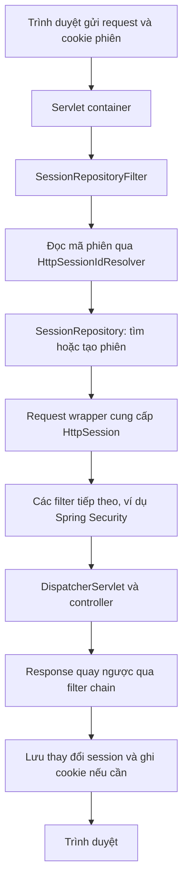
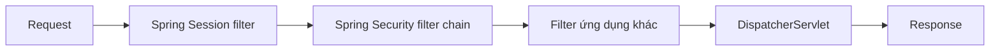

# Bean `springSessionRepositoryFilter` và cách đăng ký vào chuỗi filter

Trong ứng dụng Spring chạy trên Servlet container, Spring Session thay cách `HttpSession` được tạo và lưu bằng cách đặt một Servlet filter ở phía trước các thành phần xử lý request. Filter này có tên bean mặc định quan trọng là **`springSessionRepositoryFilter`** và có kiểu `SessionRepositoryFilter`. Nó dùng một `SessionRepository` để tìm, tạo, cập nhật và xóa phiên trong kho dữ liệu như Redis hoặc JDBC.

Khi filter được đăng ký đúng vào Servlet filter chain, controller và các thành phần Servlet tiếp tục sử dụng API quen thuộc như `HttpServletRequest.getSession()`. Spring Session cung cấp một request wrapper để các lời gọi đó làm việc với session trong repository chia sẻ. Nhờ vậy, nhiều instance ứng dụng có thể đọc cùng một phiên khi chúng dùng chung kho dữ liệu và cấu hình tương thích.

Chủ đề này thuộc tích hợp Servlet của `SPRING_SESSION`: quản lý session ứng dụng Spring độc lập với một máy chủ bằng kho dữ liệu chia sẻ. Cần hiểu rõ bean filter được tạo ở đâu, Servlet container tìm thấy nó thế nào và thứ tự filter ảnh hưởng ra sao, đặc biệt khi ứng dụng có Spring Security.

## 1. Vai trò của `SessionRepositoryFilter`

Servlet container nhận request rồi gọi lần lượt các filter đã đăng ký trước khi chuyển request đến Servlet, thường là `DispatcherServlet` của Spring MVC. Mỗi filter có thể kiểm tra hoặc bọc request/response rồi chuyển tiếp bằng `chain.doFilter`.

`SessionRepositoryFilter` là điểm tích hợp giữa Servlet API và Spring Session. Về cơ bản, filter thực hiện các việc sau:

1. Đọc mã định danh phiên từ request thông qua `HttpSessionIdResolver`.
2. Tìm session tương ứng bằng `SessionRepository`.
3. Bọc request để những lời gọi `getSession()`, `getSession(boolean)` và các thao tác session liên quan làm việc với session do Spring Session quản lý.
4. Chuyển request và response đã được bọc cho các filter tiếp theo và Servlet.
5. Khi request kết thúc, lưu các thay đổi session theo cơ chế của repository và xử lý việc phát mã phiên qua response nếu cần.

Sơ đồ xử lý rút gọn:



Filter này không phải controller, `HandlerInterceptor` hay một bean service mà ứng dụng tự gọi trong từng endpoint. Servlet container gọi filter theo mapping đã đăng ký. Nhờ request wrapper, mã nghiệp vụ tiếp tục sử dụng `HttpSession` mà không cần biết session được lưu trong bộ nhớ của container hay trong Redis/JDBC.

## 2. Bean phải có tên `springSessionRepositoryFilter`

Spring Session tạo một bean `SessionRepositoryFilter` để kết nối `SessionRepository` với Servlet API. Tên bean mặc định là `springSessionRepositoryFilter`. Tên này có ý nghĩa khi Servlet container dùng `DelegatingFilterProxy`: proxy cần tìm đúng bean trong Spring `WebApplicationContext`.

Khi dùng cấu hình hỗ trợ sẵn như `@EnableRedisHttpSession` hoặc `@EnableJdbcHttpSession`, Spring Session đăng ký các thành phần repository và filter cần thiết. Ví dụ với Redis:

```java
import org.springframework.context.annotation.Configuration;
import org.springframework.session.data.redis.config.annotation.web.http.EnableRedisHttpSession;

@Configuration
@EnableRedisHttpSession
public class HttpSessionConfiguration {
    // Ứng dụng cung cấp RedisConnectionFactory theo cấu hình triển khai.
}
```

Với JDBC, ứng dụng có thể dùng `@EnableJdbcHttpSession` khi đã có `DataSource` và dependency Spring Session JDBC phù hợp. Cả hai cấu hình trên dành cho Servlet session. Hãy chọn một cấu hình repository phù hợp với kiến trúc ứng dụng và phiên bản thư viện đang dùng.

`@EnableRedisHttpSession` không phải lệnh để controller tự tạo session. Annotation này kích hoạt cấu hình Spring Session; filter được đăng ký vào chuỗi Servlet để request đi qua cơ chế session của repository.

### 2.1. Khai báo filter thủ công khi cần repository tùy chỉnh

Nếu ứng dụng tự xây dựng `SessionRepository`, có thể khai báo `SessionRepositoryFilter` với tên bean chính xác. Ví dụ dưới đây dùng `MapSession` để minh họa kiểu generic:

```java
import org.springframework.context.annotation.Bean;
import org.springframework.context.annotation.Configuration;
import org.springframework.session.MapSession;
import org.springframework.session.SessionRepository;
import org.springframework.session.web.http.SessionRepositoryFilter;

@Configuration
public class CustomSessionConfiguration {

    @Bean(name = "springSessionRepositoryFilter")
    public SessionRepositoryFilter<MapSession> springSessionRepositoryFilter(
            SessionRepository<MapSession> sessionRepository) {
        return new SessionRepositoryFilter<>(sessionRepository);
    }
}
```

Đây chỉ là ví dụ về cách tạo filter từ repository. `MapSession` cùng repository trong bộ nhớ không chia sẻ trạng thái giữa nhiều instance và không phù hợp làm kho session phân tán trong môi trường production. Khi dùng Redis/JDBC, ưu tiên cấu hình Spring Session tương ứng thay vì tạo thêm một filter thủ công cạnh filter mà annotation đã cung cấp.

Nếu tự đặt tên bean khác, phải cấu hình `DelegatingFilterProxy` trỏ đúng tên đó. Tuy nhiên, dùng tên mặc định `springSessionRepositoryFilter` giúp tương thích với cách tích hợp chuẩn và dễ vận hành hơn.

## 3. Đăng ký filter trong Spring Boot

Trong ứng dụng Spring Boot dùng Servlet stack và Spring Session, bean filter được Boot phát hiện và đăng ký với Servlet container. Khi cấu hình repository bằng `@EnableRedisHttpSession` hoặc cơ chế auto-configuration phù hợp, thông thường không cần tự thêm `DelegatingFilterProxy` trong `web.xml`.

Ví dụ cấu hình Redis ở mức tối thiểu:

```java
@Configuration
@EnableRedisHttpSession
public class SessionConfiguration {
}
```

Ứng dụng vẫn cần cung cấp `RedisConnectionFactory`, thường được Spring Boot auto-configure khi có starter và thuộc tính kết nối Redis phù hợp. Khi khởi động, Spring Session tạo bean filter; Spring Boot đăng ký filter bean vào Servlet container.

Với ứng dụng Boot, cần kiểm tra các điểm sau:

- Có dependency Spring Session tương ứng với kho lưu trữ đã chọn, ví dụ Spring Session Data Redis hoặc Spring Session JDBC.
- Ứng dụng đang chạy Servlet stack nếu muốn dùng `SessionRepositoryFilter`.
- Bean `springSessionRepositoryFilter` được tạo đúng một lần.
- Không đăng ký thêm một `DelegatingFilterProxy` trùng lặp qua `web.xml`, `WebApplicationInitializer` hoặc `FilterRegistrationBean` nếu Boot đã thực hiện đăng ký.
- Nếu thay đổi thứ tự filter, phải xác minh thứ tự thực tế trong Servlet container, đặc biệt vị trí so với Spring Security.

Không nhầm cấu hình Servlet này với WebFlux. Ứng dụng WebFlux dùng `WebSession` và `WebSessionManager`; nó không đăng ký `SessionRepositoryFilter` vào Servlet filter chain.

## 4. Đăng ký bằng `web.xml` trong ứng dụng Servlet truyền thống

Với ứng dụng không dùng Spring Boot hoặc không dựa vào cơ chế tự đăng ký filter của Boot, có thể dùng `DelegatingFilterProxy` trong `web.xml`. Proxy nhận tên filter làm tên bean mục tiêu trong Spring context.

```xml
<filter>
    <filter-name>springSessionRepositoryFilter</filter-name>
    <filter-class>org.springframework.web.filter.DelegatingFilterProxy</filter-class>
</filter>

<filter-mapping>
    <filter-name>springSessionRepositoryFilter</filter-name>
    <url-pattern>/*</url-pattern>
</filter-mapping>
```

Trong ví dụ này:

- `filter-name` là `springSessionRepositoryFilter`, trùng với tên bean Spring Session.
- `DelegatingFilterProxy` là filter do Servlet container tạo và quản lý ở lớp Servlet.
- Proxy tìm bean mục tiêu trong `WebApplicationContext` rồi ủy quyền việc xử lý request cho filter đó.
- Mapping `/*` giúp filter áp dụng cho các request trong ứng dụng. Có thể thu hẹp mapping nếu kiến trúc yêu cầu, nhưng phải bảo đảm mọi endpoint cần session đều đi qua filter.

Nếu dùng Spring Security, mapping của `springSessionRepositoryFilter` phải đứng trước mapping của `springSecurityFilterChain` trong chuỗi filter. Servlet container xây dựng chuỗi dựa trên thứ tự đăng ký/mapping, vì vậy vị trí trong `web.xml` là điều cần kiểm tra.

`DelegatingFilterProxy` cần nhìn thấy bean trong Spring context. Theo cấu hình mặc định, proxy tra cứu root `WebApplicationContext` gắn với Servlet context. Vì vậy, cấu hình tạo `SessionRepositoryFilter` nên được nạp vào root context hoặc proxy phải được cấu hình rõ ràng để tra cứu context phù hợp. Đặt bean chỉ trong context con của `DispatcherServlet` có thể khiến proxy không tìm thấy bean.

Ứng dụng truyền thống cũng cần khởi tạo root context, ví dụ bằng `ContextLoaderListener`, và nạp lớp cấu hình có `@EnableRedisHttpSession` hoặc `@EnableJdbcHttpSession` vào context đó. Cấu hình root context và thứ tự khai báo listener/filter cần phù hợp với cách triển khai của ứng dụng.

## 5. Đăng ký bằng Java Servlet initializer

Khi ứng dụng dùng Java-based Servlet initialization, Spring Session cung cấp `AbstractHttpSessionApplicationInitializer` để đăng ký `DelegatingFilterProxy` trỏ tới bean `springSessionRepositoryFilter`.

```java
import org.springframework.session.web.context.AbstractHttpSessionApplicationInitializer;

public class SessionInitializer extends AbstractHttpSessionApplicationInitializer {
}
```

Initializer này là cách tích hợp dành cho ứng dụng Servlet không dựa vào Spring Boot auto-registration. Cấu hình Spring tạo repository và bean filter vẫn phải được nạp vào root `WebApplicationContext` bởi cơ chế khởi tạo context của ứng dụng. Ví dụ, nếu ứng dụng đang dùng `AbstractAnnotationConfigDispatcherServletInitializer`, hãy khai báo session configuration trong root config classes của initializer hiện có.

Không tạo đồng thời nhiều initializer cùng đăng ký filter. Nếu đã kế thừa hoặc cấu hình `AbstractHttpSessionApplicationInitializer`, không cần thêm một `DelegatingFilterProxy` thủ công cho cùng bean qua `web.xml` hoặc một initializer khác.

## 6. Thứ tự filter và tích hợp Spring Security

Thứ tự là một trong những phần dễ cấu hình sai nhất. Spring Security thường đọc hoặc tạo `HttpSession` để lưu `SecurityContext`, lưu yêu cầu ban đầu trước khi đăng nhập hoặc duy trì các thuộc tính bảo mật. Nếu Spring Security chạy trước `SessionRepositoryFilter`, nó có thể nhận `HttpSession` gốc của Servlet container. Khi đó, một phần trạng thái được lưu ở session nội bộ của container trong khi ứng dụng mong đợi session dùng repository chia sẻ.

Vì vậy, `springSessionRepositoryFilter` phải chạy trước mọi filter cần sử dụng `HttpSession`, đặc biệt là `springSecurityFilterChain`.



Với `web.xml`, đặt filter mapping của Spring Session trước filter mapping của Spring Security. Với Spring Boot, Spring Session có thứ tự đăng ký mặc định được thiết kế để filter chạy sớm. Nếu ứng dụng tùy chỉnh `FilterRegistrationBean` hoặc thứ tự filter, hãy dùng cơ chế/thứ tự được tài liệu của phiên bản Spring Session và Boot đang dùng khuyến nghị, sau đó kiểm chứng chuỗi filter thực tế.

Không nên tùy tiện đặt một số thứ tự tùy ý hoặc đăng ký filter hai lần để “đảm bảo chạy trước”. Một filter chạy hai lần có thể gây hành vi khó dự đoán, nhất là khi request/response đã được bọc và session đã được lưu trong một lượt xử lý.

## 7. Điều gì xảy ra khi filter xử lý request?

### 7.1. Đọc mã phiên

Spring Session dùng `HttpSessionIdResolver` để xác định cách lấy mã phiên từ request. Cách phổ biến là cookie; ứng dụng cũng có thể cấu hình chiến lược header trong một số trường hợp tích hợp API.

`HttpSessionIdResolver` chịu trách nhiệm phân tích mã phiên từ request và ghi/xóa mã phiên trong response. Nó không phải repository và không chứa các thuộc tính session. Repository lưu dữ liệu session phía máy chủ; resolver quyết định cách trình duyệt gửi lại mã định danh.

### 7.2. Bọc request và cung cấp `HttpSession`

Filter bọc request để lời gọi `request.getSession()` được định tuyến qua Spring Session. Khi request mang một mã phiên hợp lệ, filter yêu cầu repository tìm phiên. Nếu endpoint yêu cầu tạo phiên và chưa có phiên hợp lệ, một session mới có thể được tạo.

Các controller và service dùng `HttpSession` như thông thường:

```java
@RestController
public class ProfilePreferenceController {

    @PostMapping("/profile/time-zone")
    public void saveTimeZone(
            @RequestParam String timeZone,
            HttpServletRequest request) {
        HttpSession session = request.getSession(true);
        session.setAttribute("app.profile.time-zone", timeZone);
    }
}
```

Đoạn code không gọi repository trực tiếp. `SessionRepositoryFilter` đã thay đổi cách `HttpSession` được cung cấp cho request. Vì thế, thuộc tính được lưu thông qua session do Spring Session quản lý.

### 7.3. Lưu session và ghi mã phiên vào response

Khi xử lý request hoàn tất, filter phối hợp lưu trạng thái session qua repository. Nếu cần tạo hoặc thay đổi mã định danh phiên, resolver ghi thông tin tương ứng vào response, thường dưới dạng `Set-Cookie` khi dùng cookie resolver.

Việc lưu session và phát cookie phải diễn ra trong vòng đời response. Vì vậy, filter khác không nên tự ghi cookie session theo một quy ước riêng hoặc sửa response theo cách làm mất header `Set-Cookie` do Spring Session tạo. Nếu ứng dụng có filter nén, cache hoặc response wrapper khác, hãy kiểm tra chúng có giữ lại các header cookie hay không.

## 8. Tùy chỉnh resolver và cookie session

Trong triển khai Servlet, session ID là thông tin nhạy cảm. Cấu hình cookie cần phù hợp với môi trường triển khai và chính sách bảo mật. Spring Session hỗ trợ cấu hình `HttpSessionIdResolver`; với cookie, `CookieHttpSessionIdResolver` cho phép tùy chỉnh thuộc tính cookie.

Ví dụ cấu hình cookie resolver:

```java
import org.springframework.context.annotation.Bean;
import org.springframework.context.annotation.Configuration;
import org.springframework.session.web.http.CookieHttpSessionIdResolver;
import org.springframework.session.web.http.DefaultCookieSerializer;
import org.springframework.session.web.http.HttpSessionIdResolver;

@Configuration
public class SessionCookieConfiguration {

    @Bean
    public HttpSessionIdResolver httpSessionIdResolver() {
        CookieHttpSessionIdResolver resolver =
                new CookieHttpSessionIdResolver();
        DefaultCookieSerializer serializer = new DefaultCookieSerializer();
        serializer.setCookieName("APPSESSION");
        serializer.setCookiePath("/");
        serializer.setUseHttpOnlyCookie(true);
        serializer.setUseSecureCookie(true);
        serializer.setSameSite("Lax");
        resolver.setCookieSerializer(serializer);
        return resolver;
    }
}
```

Ví dụ đặt `Secure` thành `true`, phù hợp khi ứng dụng chỉ được truy cập qua HTTPS. Nếu có môi trường phát triển HTTP cục bộ, hãy cấu hình riêng theo môi trường để trình duyệt không từ chối cookie. Kiểm tra API của phiên bản Spring Session đang dùng vì các tùy chọn serializer có thể thay đổi theo phiên bản. Cân nhắc `SameSite` theo luồng đăng nhập, SSO và điều hướng liên site. Không đưa dữ liệu session vào cookie nếu ứng dụng dùng repository phía máy chủ; cookie chỉ cần mang mã định danh.

Nếu dùng header resolver, cần đánh giá nguy cơ lộ session ID qua log, lịch sử proxy, tracing và cache. Cookie thường thuận tiện cho trình duyệt; header có thể phù hợp với một số API client nhưng phải được quản lý như thông tin xác thực.

## 9. Phạm vi mapping và dispatcher type

Filter chỉ có thể can thiệp những request được Servlet container ánh xạ tới nó. Mapping `/*` là lựa chọn phổ biến vì session có thể cần ở nhiều đường dẫn: trang đăng nhập, API, trang nội dung và endpoint đăng xuất.

Khi thay đổi mapping, hãy xác minh:

- Các URL cần session đều đi qua filter.
- Các request được forward hoặc include có hành vi đúng với dispatcher type đã đăng ký.
- Luồng async và error dispatch của ứng dụng không làm mất trạng thái hoặc bỏ qua logic cần thiết.
- Filter không bị đăng ký trùng bởi cả container descriptor, initializer và Boot.

Servlet API cho phép filter được ánh xạ theo URL pattern và dispatcher type như `REQUEST`, `ASYNC`, `ERROR`, `FORWARD` hoặc `INCLUDE`. Chọn dispatcher type dựa trên cách ứng dụng xử lý request và hướng dẫn của phiên bản Spring Session đang sử dụng; không thêm mọi loại một cách máy móc. Với các luồng async, cần kiểm tra cách filter và request wrapper được duy trì qua lần dispatch tiếp theo.

## 10. Các lỗi cấu hình thường gặp

| Triệu chứng | Nguyên nhân có thể | Hướng kiểm tra |
|---|---|---|
| `DelegatingFilterProxy` không tìm thấy bean | Bean sai tên hoặc nằm trong context không được proxy tra cứu | Kiểm tra tên `springSessionRepositoryFilter` và root `WebApplicationContext` |
| Controller vẫn thấy session cục bộ của container | Spring Session filter không chạy hoặc chạy sau filter đã tạo session | Kiểm tra filter mapping và thứ tự trong chain |
| Spring Security không dùng session chia sẻ | `springSecurityFilterChain` chạy trước Spring Session | Đặt Spring Session filter trước Spring Security |
| Session không được lưu sau response | Repository lỗi, filter không được gọi, response commit bất thường hoặc cấu hình không đúng | Kiểm tra log, repository, filter mapping và response wrapper |
| Trình duyệt không giữ session | Cookie bị mất, path/domain/SameSite/Secure không phù hợp hoặc response header bị ghi đè | Kiểm tra `Set-Cookie`, request cookie và cấu hình resolver |
| Filter chạy hai lần | Đăng ký trùng qua Boot và cấu hình Servlet thủ công | Chỉ giữ một cơ chế đăng ký |
| Một số endpoint có session, endpoint khác không | URL pattern hoặc dispatcher mapping không bao phủ đủ request | Kiểm tra mapping và đường đi thực tế của request |
| Bean filter được tạo nhưng không được gọi | Chỉ khai báo bean Spring mà chưa đăng ký vào Servlet container trong ứng dụng không có Boot | Đăng ký `DelegatingFilterProxy` hoặc dùng initializer phù hợp |

## 11. Kiểm thử việc đăng ký filter

Kiểm thử unit cho controller có thể xác nhận ứng dụng gọi `HttpSession.setAttribute`, nhưng chưa chứng minh Servlet container đã đăng ký `SessionRepositoryFilter`. Cần có kiểm thử tích hợp ở mức ứng dụng để xác minh chuỗi filter và repository.

Các kiểm tra hữu ích:

1. Khởi động ứng dụng trong Servlet test environment với cấu hình Spring Session và repository tương ứng.
2. Gửi request tạo session; xác nhận response có cookie hoặc mã phiên theo resolver đã cấu hình.
3. Gửi request tiếp theo với cookie đó; xác nhận controller đọc được thuộc tính đã lưu.
4. Xác minh thuộc tính được ghi vào repository thay vì session nội bộ không chia sẻ của container.
5. Nếu dùng Spring Security, kiểm thử đăng nhập, request được xác thực và đăng xuất để xác nhận SecurityContext đi qua session do Spring Session quản lý.
6. Trong cấu hình nhiều instance, tạo session qua instance A rồi gửi cùng cookie tới instance B; kiểm tra B đọc được trạng thái.
7. Kiểm tra cookie khi logout hoặc invalidate để bảo đảm resolver xóa mã phiên phía client theo chính sách đã cấu hình.

`MockHttpSession` hữu ích cho kiểm thử logic Servlet, nhưng bản thân nó không xác minh filter registration hay tích hợp repository. Dùng `MockMvc` với cấu hình filter đầy đủ hoặc chạy ứng dụng trong embedded Servlet container để kiểm tra đường đi request thực tế. Với Redis/JDBC, cần integration test sử dụng datastore tương ứng.

## 12. Checklist triển khai

Trước khi phát hành cấu hình Spring Session cho ứng dụng Servlet, hãy xác minh:

- `SessionRepository` phù hợp đã được cấu hình và kết nối được tới kho dữ liệu.
- Có đúng một bean `springSessionRepositoryFilter`.
- Filter được đăng ký vào Servlet container bằng cơ chế phù hợp: Boot auto-registration, `DelegatingFilterProxy` trong `web.xml`, hoặc Java initializer.
- Bean filter có thể được proxy tìm thấy trong đúng `WebApplicationContext`.
- Filter chạy trước Spring Security và mọi filter khác cần `HttpSession`.
- URL pattern và dispatcher type bao phủ các request cần session.
- Cookie/resolver có tên, path, domain, `Secure`, `HttpOnly` và `SameSite` phù hợp.
- Không có cơ chế đăng ký trùng lặp.
- Kiểm thử đã xác nhận cookie, đọc/ghi session, logout và truy cập qua nhiều instance.

`springSessionRepositoryFilter` là cầu nối để Servlet container sử dụng session do Spring Session quản lý. Khi bean được tạo đúng, proxy trỏ đúng context và filter được đặt đúng vị trí trong chuỗi, các thành phần Servlet như Spring MVC và Spring Security có thể tiếp tục dùng `HttpSession` trong khi trạng thái phiên được lưu ở kho chia sẻ như Redis hoặc JDBC. Đây là nền tảng để ứng dụng Spring chạy ổn định trên nhiều instance mà không phụ thuộc session cục bộ của một máy chủ.
