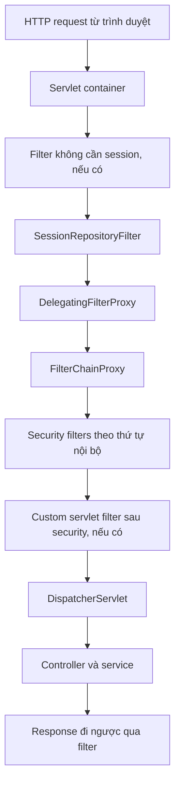

# Thứ tự filter trước Spring Security và các thành phần sử dụng phiên

Trong ứng dụng Spring chạy trên Servlet, thứ tự các filter quyết định thành phần nào nhìn thấy request và response trước, cũng như phiên HTTP nào được sử dụng. Khi tích hợp Spring Session, `SessionRepositoryFilter` phải chạy trước Spring Security và mọi filter hoặc thành phần cần đọc, tạo hay thay đổi `HttpSession`. Filter này bọc request/response để chuyển thao tác phiên sang repository dùng chung như Redis hoặc JDBC. Nếu một filter chạy trước nó và gọi `getSession()`, filter đó có thể làm việc với phiên Servlet mặc định của container thay vì phiên do Spring Session quản lý.

Để sắp xếp đúng, cần phân biệt thứ tự filter do Servlet container quản lý với thứ tự các filter bên trong Spring Security. `SessionRepositoryFilter` là một filter ở cấp container; `springSecurityFilterChain` là một `DelegatingFilterProxy` nối container với `FilterChainProxy` của Spring Security. Các filter bảo mật bên trong `FilterChainProxy` lại có thứ tự riêng. Hiểu hai lớp này giúp tránh đăng ký trùng filter hoặc đặt filter vào sai vị trí.

## 1. Hai lớp thứ tự filter trong ứng dụng Servlet

Servlet container như Tomcat, Jetty hoặc Undertow gọi các filter đã đăng ký theo thứ tự mapping/registration trước khi chuyển request tới servlet đích, thường là `DispatcherServlet`. Mỗi filter có thể xử lý trước khi gọi `chain.doFilter(request, response)`, rồi tiếp tục xử lý response khi lời gọi phía sau trả về. Vì vậy, filter đứng trước có thể bọc request/response để các filter phía sau nhìn thấy hành vi đã được mở rộng.

Trong Spring Boot, các filter được đăng ký bằng `FilterRegistrationBean` có thể chỉ định thứ tự bằng `setOrder(...)`. Giá trị order nhỏ hơn được gọi sớm hơn. Trong cấu hình Servlet khai báo trực tiếp bằng `web.xml`, thứ tự mapping được container thực thi theo cấu hình deployment. Với cấu hình Spring Security, Boot đăng ký `DelegatingFilterProxy` cho filter chain bảo mật; filter proxy này nằm trong thứ tự container cùng các filter khác.

Bên trong `DelegatingFilterProxy`, `FilterChainProxy` chọn `SecurityFilterChain` phù hợp với request và chạy các security filter theo thứ tự nội bộ đã cấu hình. Các phương thức như `HttpSecurity.addFilterBefore(...)` và `addFilterAfter(...)` điều chỉnh vị trí trong chuỗi nội bộ này. Chúng không thay đổi vị trí của `SessionRepositoryFilter` hoặc một servlet filter được đăng ký riêng ở container.

Sơ đồ đơn giản của một request dùng Spring Session và Spring Security:



Vị trí của các filter không sử dụng phiên có thể thay đổi theo mục đích, chẳng hạn filter mã hóa request hoặc xử lý CORS. Điểm bắt buộc là mọi thành phần cần dùng `HttpSession` do Spring Session quản lý phải chạy sau `SessionRepositoryFilter` trong cùng chuỗi xử lý. Trong nhiều ứng dụng, cấu hình mặc định đã đặt Spring Session trước Spring Security; không nên tùy tiện thay đổi thứ tự mặc định đó.

## 2. Vì sao SessionRepositoryFilter phải chạy trước?

`SessionRepositoryFilter` là ranh giới tích hợp giữa Servlet API và Spring Session. Nó dùng repository để tải phiên theo session ID trong request, sau đó bọc `HttpServletRequest` và `HttpServletResponse`. Các lời gọi như `getSession()`, `getSession(false)`, thao tác session ID và việc commit dữ liệu phiên được chuyển qua cơ chế Spring Session.

Điều này có nghĩa là filter phía sau có thể tiếp tục dùng Servlet API quen thuộc mà không cần biết phiên được lưu trong Redis hay JDBC. Ví dụ, Spring Security có thể lưu `SecurityContext` vào `HttpSession` thông qua `HttpSessionSecurityContextRepository`; request wrapper do Spring Session cung cấp đảm bảo phiên đó thuộc repository dùng chung.

Nếu filter chạy trước `SessionRepositoryFilter` gọi `request.getSession()` hoặc `request.getSession(true)`, nó đang thao tác trên request chưa được Spring Session bọc. Tùy container và luồng request, việc này có thể tạo hoặc sử dụng phiên Servlet cục bộ. Hệ quả thường thấy là dữ liệu phiên không được chia sẻ giữa các instance, cookie/session ID không nhất quán, hoặc trạng thái đăng nhập không được khôi phục như dự kiến.

Các thành phần thường cần chạy sau `SessionRepositoryFilter` gồm:

- Spring Security filter chain khi dùng xác thực dựa trên `HttpSession`, lưu `SecurityContext`, request cache hoặc CSRF token trong session.
- Filter tùy chỉnh đọc thông tin người dùng, tạo thuộc tính phiên, lưu dấu vết điều hướng hoặc kiểm tra trạng thái phiên.
- Servlet, controller, interceptor và các thành phần ứng dụng gọi `request.getSession()` hoặc nhận `HttpSession`.
- Filter audit hoặc kiểm soát truy cập cần đọc session ID hợp lệ hay kiểm tra thuộc tính phiên.

Một filter chỉ xử lý nội dung request và không truy cập session có thể đứng trước Spring Session nếu có lý do phù hợp. Tuy nhiên, cần kiểm tra toàn bộ filter chain và các thư viện được gọi bên trong filter đó; một filter tưởng như không dùng session vẫn có thể kích hoạt việc tạo session qua một helper hoặc thành phần phụ thuộc.

## 3. Vị trí của Spring Session và Spring Security trong Spring Boot

Spring Boot cùng Spring Session có thể tự đăng ký `SessionRepositoryFilter` khi dependency và repository được cấu hình phù hợp. `SessionRepositoryFilter` cung cấp hằng số `DEFAULT_ORDER` để biểu thị vị trí mặc định của filter trong Servlet chain. Giá trị này được đặt rất sớm để filter bọc request trước các thành phần sử dụng session.

Spring Security được đưa vào Servlet chain thông qua filter proxy có tên mặc định `springSecurityFilterChain`. Trong cấu hình Boot thông thường, filter proxy bảo mật chạy sau `SessionRepositoryFilter`. Vì vậy, `HttpSessionSecurityContextRepository` và các thành phần bảo mật cần session nhìn thấy request wrapper của Spring Session.

Không nên tự đăng ký thêm một `SessionRepositoryFilter` thứ hai nếu Spring Boot đã tự cấu hình filter này. Việc có hai filter quản lý cùng request có thể tạo ra hai lớp wrapper, gây khó hiểu về session ID và vòng đời lưu phiên. Khi cần tùy chỉnh, hãy điều chỉnh cấu hình Spring Session được hỗ trợ hoặc kiểm tra bean/registration hiện có trước khi thêm filter.

Ví dụ sau minh họa cách đăng ký một servlet filter tùy chỉnh cần đọc session. Filter được đặt sau Spring Session để `getSession(false)` truy cập repository-backed session, nhưng vẫn ở phía trước Spring Security trong cấu hình Boot mặc định:

```java
import java.io.IOException;

import jakarta.servlet.FilterChain;
import jakarta.servlet.ServletException;
import jakarta.servlet.http.HttpServletRequest;
import jakarta.servlet.http.HttpServletResponse;
import jakarta.servlet.http.HttpSession;

import org.springframework.boot.web.servlet.FilterRegistrationBean;
import org.springframework.context.annotation.Bean;
import org.springframework.context.annotation.Configuration;
import org.springframework.session.web.http.SessionRepositoryFilter;
import org.springframework.web.filter.OncePerRequestFilter;

class SessionPresenceFilter extends OncePerRequestFilter {

    @Override
    protected void doFilterInternal(
            HttpServletRequest request,
            HttpServletResponse response,
            FilterChain filterChain) throws ServletException, IOException {

        HttpSession session = request.getSession(false);
        request.setAttribute("sessionAlreadyExists", session != null);

        filterChain.doFilter(request, response);
    }
}

@Configuration
class ServletFilterConfiguration {

    @Bean
    FilterRegistrationBean<SessionPresenceFilter> sessionPresenceFilter() {
        FilterRegistrationBean<SessionPresenceFilter> registration =
                new FilterRegistrationBean<>(new SessionPresenceFilter());
        registration.setName("sessionPresenceFilter");
        registration.addUrlPatterns("/*");
        registration.setOrder(SessionRepositoryFilter.DEFAULT_ORDER + 10);
        return registration;
    }
}
```

`getSession(false)` chỉ kiểm tra phiên hiện có và không tạo phiên mới. Ví dụ đặt filter ngay sau thứ tự mặc định của Spring Session để request đã được bọc trước khi filter kiểm tra. Giá trị order cụ thể cần được đối chiếu với cấu hình bảo mật và các filter khác trong ứng dụng; hãy giữ filter này trước Spring Security nếu nó chỉ cần đọc session trước khi xác thực. Nếu filter cần principal đã được xác thực, vị trí phù hợp thường là bên trong security chain sau filter xác thực, như phần tiếp theo.

Khi ứng dụng dùng nhiều `SecurityFilterChain` với các matcher khác nhau, thứ tự container của `DelegatingFilterProxy` vẫn chỉ là một vị trí. `FilterChainProxy` sẽ chọn security chain phù hợp cho request. Spring Session phải đứng trước proxy này để mọi chain dùng `HttpSession` đều nhìn thấy phiên được quản lý tập trung.

## 4. Chọn đúng nơi đặt filter tùy chỉnh

Không phải filter nào cũng nên được đăng ký như một servlet filter độc lập. Hãy quyết định vị trí dựa trên dữ liệu mà filter cần và thời điểm dữ liệu đó có sẵn.

| Nhu cầu của filter | Vị trí phù hợp | Lý do |
| --- | --- | --- |
| Đọc session hoặc tạo thuộc tính session | Sau `SessionRepositoryFilter` ở container | Request đã được bọc bởi Spring Session |
| Đọc `Authentication` đã được khôi phục hoặc xác thực | Bên trong Spring Security chain, sau filter thiết lập authentication phù hợp | Security context có sẵn trong phạm vi chain |
| Áp dụng quy tắc phân quyền | Dùng cơ chế authorization của Spring Security hoặc filter ở vị trí bảo mật phù hợp | Tránh tự triển khai lại chính sách truy cập |
| Kiểm tra dữ liệu handler/controller | Spring MVC `HandlerInterceptor` hoặc argument resolver | Thành phần chạy trong ngữ cảnh MVC sau khi mapping handler |
| Xử lý request/response chung, không cần session | Servlet filter ở vị trí phù hợp với mục đích | Có thể áp dụng trước hoặc sau Spring Session tùy phụ thuộc |

Nếu filter cần người dùng đã đăng nhập, thêm nó vào `HttpSecurity` bằng `addFilterBefore` hoặc `addFilterAfter` tương ứng với security filter mà nó phụ thuộc. Ví dụ khái quát:

```java
@Bean
SecurityFilterChain applicationSecurity(
        HttpSecurity http,
        AuthenticatedSessionAuditFilter auditFilter) throws Exception {

    http
        .authorizeHttpRequests(authorize -> authorize
            .anyRequest().authenticated()
        )
        .addFilterAfter(auditFilter, AnonymousAuthenticationFilter.class);

    return http.build();
}
```

Ví dụ giả định `AuthenticatedSessionAuditFilter` là filter phù hợp để chạy sau `AnonymousAuthenticationFilter`, khi `SecurityContext` đã được thiết lập cho request (có thể là authentication thực hoặc anonymous authentication). Nếu filter chỉ chấp nhận người dùng đã đăng nhập, nó vẫn phải phân biệt token ẩn danh và xác minh quyền phù hợp. Trong Spring Security, vị trí filter cần được chọn theo mục đích; không nên sao chép một vị trí mẫu mà không kiểm tra thứ tự thực tế của security chain.

Một filter được thêm vào `HttpSecurity` thuộc security chain. Nếu cùng filter đó cũng được đăng ký tự động như servlet filter của container, nó có thể chạy hai lần: một lần ở container và một lần bên trong `FilterChainProxy`. Với filter là Spring bean, có thể tắt đăng ký container bằng `FilterRegistrationBean`:

```java
@Bean
FilterRegistrationBean<AuthenticatedSessionAuditFilter>
disableContainerRegistration(AuthenticatedSessionAuditFilter filter) {
    FilterRegistrationBean<AuthenticatedSessionAuditFilter> registration =
            new FilterRegistrationBean<>(filter);
    registration.setEnabled(false);
    return registration;
}
```

Khi đó filter chỉ chạy ở vị trí đã khai báo trong `HttpSecurity`. Kiểm tra cấu hình để tránh đồng thời khai báo filter qua `@Component`, `FilterRegistrationBean`, `web.xml` và security chain mà không chủ ý.

## 5. Đăng ký filter bằng các cơ chế khác nhau

Trong Spring Boot, `FilterRegistrationBean` là cách tường minh để khai báo URL pattern, dispatcher type, tên filter và thứ tự container. Nếu filter được khai báo như bean kiểu `Filter`, Boot có thể tự đăng ký nó vào Servlet container. Khi cần kiểm soát thứ tự, hãy dùng `FilterRegistrationBean` để chỉ rõ cấu hình và tránh đăng ký trùng.

Ví dụ cấu hình các thuộc tính cơ bản:

```java
@Bean
FilterRegistrationBean<RequestAuditFilter> requestAuditFilter() {
    FilterRegistrationBean<RequestAuditFilter> registration =
            new FilterRegistrationBean<>(new RequestAuditFilter());
    registration.setName("requestAuditFilter");
    registration.addUrlPatterns("/api/*");
    registration.setOrder(100);
    registration.setAsyncSupported(true);
    return registration;
}
```

Giá trị `100` chỉ là ví dụ. Order cần được chọn sau khi xem toàn bộ filter registration, đặc biệt là `SessionRepositoryFilter` và `springSecurityFilterChain`. Giá trị order thấp chạy trước; vì vậy không thể chọn số theo cảm tính hoặc nghĩ rằng số lớn hơn có nghĩa ưu tiên cao hơn.

Trong ứng dụng Servlet cấu hình bằng `web.xml`, filter và filter mapping được khai báo theo thứ tự. Nếu có cả cấu hình container và cấu hình Spring Boot, hãy kiểm tra thứ tự hợp nhất mà container nhận được. Không dựa vào thứ tự khai báo các phương thức `@Bean` để suy ra thứ tự thực thi filter; thứ tự cần được thể hiện qua cơ chế registration của container.

`@Order` có thể ảnh hưởng tới một số cơ chế sắp xếp bean, nhưng với servlet filter, điều quan trọng là thứ tự đăng ký thực tế của container. `FilterRegistrationBean#setOrder` thể hiện rõ ý định hơn trong cấu hình Boot. Với filter nằm trong Spring Security, dùng API của `HttpSecurity` thay vì cố điều khiển vị trí nội bộ bằng order của servlet container.

## 6. Dispatcher type, async request và vòng đời filter

Servlet filter có thể được gọi cho nhiều loại dispatch: `REQUEST`, `ASYNC`, `ERROR`, `FORWARD` hoặc `INCLUDE`. Một request bắt đầu ở `REQUEST` có thể được dispatch lại khi xử lý bất đồng bộ hoặc chuyển tới trang lỗi. Filter registration quyết định những dispatcher type nào được áp dụng.

`OncePerRequestFilter` giúp một filter tùy chỉnh tránh xử lý lặp trong một request dispatch theo quy tắc của lớp này. Tuy nhiên, “once” không có nghĩa filter chắc chắn chỉ chạy đúng một lần qua mọi loại dispatch. Các phương thức như `shouldNotFilterAsyncDispatch()` và `shouldNotFilterErrorDispatch()` cho phép xác định cách xử lý async/error dispatch; cần chọn dựa trên yêu cầu thực tế.

Với Spring Session, bảo đảm các dispatch cần truy cập phiên đều đi qua cơ chế bọc request phù hợp. Không giữ một tham chiếu `HttpSession` hoặc mutable session attribute rồi dùng tùy tiện sau khi request đã kết thúc. Với async processing, xác định thời điểm hoàn tất và cập nhật session; không giả định response đã commit hoặc session đã lưu chỉ vì controller trả về một publisher.

Nếu filter tạo session trong mỗi dispatch hoặc mỗi request mà không cần thiết, số phiên ẩn danh có thể tăng nhanh. Dùng `getSession(false)` khi chỉ cần kiểm tra, và chỉ gọi `getSession()` khi thực sự cần lưu trạng thái. Đặc biệt, filter audit, metrics hoặc logging thường không cần tạo session mới.

## 7. Các lỗi do thứ tự filter không đúng

**Phiên không được chia sẻ giữa các instance.** Tìm filter hoặc thư viện chạy trước `SessionRepositoryFilter` và gọi `getSession()`. Kiểm tra security proxy có nằm sau Spring Session không. Nếu một thành phần tạo container session trước khi request được bọc, dữ liệu có thể không được lưu ở repository chung như mong muốn.

**Đăng nhập thành công nhưng request sau không có `SecurityContext`.** Xác nhận `SessionRepositoryFilter` chạy trước `springSecurityFilterChain`, cookie session được gửi lại và security context repository dùng đúng `HttpSession`. Nếu có custom authentication filter, kiểm tra nó chạy ở vị trí đúng trong security chain và context được lưu theo cấu hình Spring Security.

**Một filter chạy hai lần.** Kiểm tra filter vừa được Boot đăng ký như servlet filter vừa được thêm vào `HttpSecurity`, hoặc được khai báo qua nhiều cơ chế khác nhau. Chọn một nơi thực thi và tắt registration dư thừa.

**Session ID thay đổi không như dự kiến.** Xem filter nào gọi `getSession()`, `changeSessionId()` hoặc invalidate session; kiểm tra filter đó nhận request wrapper của Spring Session hay không. Không tự sửa cookie session ở một filter khác nếu không đồng bộ với `HttpSessionIdResolver` hoặc `CookieSerializer` đang dùng.

**Tạo nhiều phiên ẩn danh.** Tìm lời gọi `getSession()` trong filter dùng cho mọi URL, bao gồm filter metrics, audit, locale hoặc CSRF. Dùng `getSession(false)` nếu chỉ cần kiểm tra và giới hạn URL mapping nếu filter không cần chạy toàn ứng dụng.

**Filter hoạt động trong request thường nhưng lỗi với async/error dispatch.** Kiểm tra dispatcher types trong registration, hỗ trợ async, logic của `OncePerRequestFilter` và cách request wrapper được sử dụng qua các dispatch. Kiểm thử riêng các luồng async và lỗi thay vì suy ra từ kết quả của request đồng bộ.

## 8. Kiểm thử và xác minh thứ tự thực thi

Kiểm thử filter order cần chứng minh thành phần phía sau nhìn thấy session được Spring Session quản lý. Có thể gắn một thuộc tính request trong filter thăm dò, kiểm tra cookie/session ID và quan sát repository trong một kiểm thử tích hợp.

Các trường hợp nên kiểm tra:

| Kịch bản | Điều cần xác minh |
| --- | --- |
| Request chưa có cookie session | Filter sau Spring Session thấy không có session khi dùng `getSession(false)` |
| Request tạo session | Session được lưu vào repository và cookie được trả về theo cấu hình |
| Request tiếp theo có cookie | Filter tùy chỉnh và Spring Security đọc cùng session đã lưu |
| Đăng nhập bằng form | Security context tồn tại ở request tiếp theo và session fixation được xử lý theo cấu hình |
| Request tới instance khác | Session được khôi phục từ Redis/JDBC dùng chung |
| Filter được thêm vào security chain | Filter chỉ chạy một lần tại vị trí nội bộ dự kiến |
| Async hoặc error dispatch | Filter và session wrapper có hành vi đúng theo dispatcher type |

Một kiểm thử tích hợp với `@SpringBootTest(webEnvironment = SpringBootTest.WebEnvironment.RANDOM_PORT)` hoặc môi trường embedded Servlet container giúp xác nhận thứ tự đăng ký thực tế tốt hơn kiểm thử đơn vị filter. `MockMvc` hữu ích để kiểm tra hành vi MVC và security, nhưng một cấu hình mock có thể không tái hiện đầy đủ thứ tự registration của container production. Khi cần xác nhận Redis/JDBC, dùng repository thật trong môi trường kiểm thử và kiểm tra phiên từ một request khác hoặc instance khác.

Để quan sát khi chạy ứng dụng, bật log khởi tạo phù hợp cho Spring Boot, Spring Security và Spring Session; xem danh sách filter được đăng ký và thứ tự trong startup log hoặc cấu hình container. Có thể thêm log tạm ở đầu filter với tên filter và dispatcher type, nhưng không ghi session ID thô, cookie hoặc dữ liệu xác thực. Sau khi điều tra, bỏ log chẩn đoán quá chi tiết hoặc chuyển thành metrics an toàn.

## 9. Quy trình cấu hình đề xuất

1. Xác định ứng dụng dùng Servlet stack và repository Spring Session nào; xác nhận `SessionRepositoryFilter` thực sự được đăng ký.
2. Giữ `SessionRepositoryFilter` trước `springSecurityFilterChain` và mọi filter có thể gọi `getSession()`.
3. Liệt kê filter tùy chỉnh, thư viện bảo mật, audit, request cache và các thành phần có thể tạo hoặc đọc session.
4. Với filter chỉ cần session, đăng ký ở container sau Spring Session và đặt URL pattern/dispatcher type phù hợp.
5. Với filter cần authentication, thêm filter vào đúng vị trí trong `HttpSecurity`; tắt đăng ký container của cùng filter nếu Boot cũng nhận diện nó như servlet filter.
6. Kiểm tra không có filter đăng ký trùng và không có thành phần tạo session ngoài ý muốn.
7. Kiểm thử đăng nhập, request tiếp theo, logout, session ID, async/error dispatch và request qua instance khác.

Thứ tự filter đúng bảo đảm mọi thành phần trong ứng dụng Servlet nhìn thấy cùng một `HttpSession` do Spring Session quản lý. Khi `SessionRepositoryFilter` chạy trước Spring Security và các thành phần dùng phiên, `SecurityContext`, dữ liệu nghiệp vụ trong session và thao tác thu hồi có thể được lưu trong repository dùng chung, giúp các instance xử lý request nhất quán.
