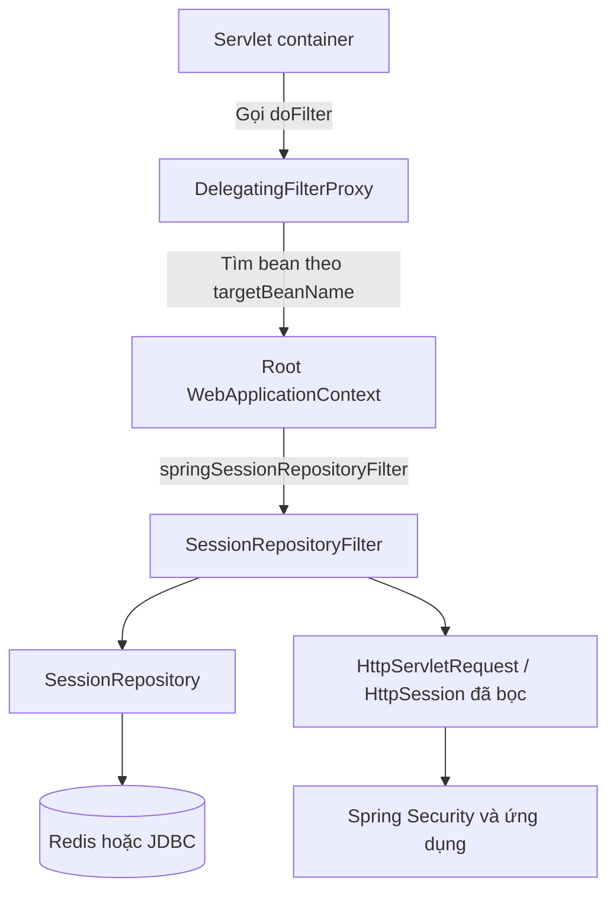

# DelegatingFilterProxy và ứng dụng không dùng Spring Boot

Trong ứng dụng Spring MVC chạy trên Servlet container mà không dùng Spring Boot, Spring Session vẫn có thể thay thế session mặc định của container và lưu phiên trong Redis hoặc JDBC. Điểm cần cấu hình thủ công là kết nối filter của Spring Session với vòng đời filter do Servlet container quản lý. `DelegatingFilterProxy` đảm nhiệm cầu nối đó: container gọi proxy, còn proxy chuyển request đến filter bean do Spring quản lý trong `WebApplicationContext`.

Hiểu đúng cơ chế này giúp ứng dụng truyền cùng một session qua nhiều instance, giữ `HttpSession` API trong controller và bảo đảm Spring Security nhìn thấy session đã được tải. Các bước cốt lõi là khai báo repository trong Spring context, đăng ký `DelegatingFilterProxy` với Servlet container, đặt filter đúng vị trí trong chuỗi filter và kiểm tra cấu hình trong môi trường triển khai thực tế.

## 1. Vì sao cần `DelegatingFilterProxy`?

Servlet container chỉ biết các đối tượng triển khai `jakarta.servlet.Filter` đã được đăng ký trong ứng dụng web. Trong khi đó, Spring Session tạo filter như một bean Spring có tên chuẩn `springSessionRepositoryFilter`. Bean này cần các thành phần Spring như `SessionRepository`, cấu hình Redis/JDBC và các dependency khác. Việc tạo filter trực tiếp trong `web.xml` không cung cấp đầy đủ cơ chế dependency injection và vòng đời của Spring.

`DelegatingFilterProxy` là một Servlet filter thật được container khởi tạo. Khi nhận request, nó tìm một bean Spring có kiểu tương thích với `Filter` rồi chuyển lời gọi `doFilter` đến bean đó. Nhờ vậy, Servlet container quản lý proxy còn Spring quản lý filter đích.



Các thành phần có vai trò khác nhau:

- **Servlet container** đăng ký và gọi `DelegatingFilterProxy` theo URL pattern và dispatcher type.
- **`DelegatingFilterProxy`** tìm filter bean trong Spring context rồi chuyển request đến filter đó.
- **`SessionRepositoryFilter`** đọc session ID, tải session, bọc Servlet request/response và lưu thay đổi về repository.
- **`SessionRepository`** tạo, tìm, lưu và xóa session trong Redis, JDBC hoặc kho được hỗ trợ.

`DelegatingFilterProxy` không phải repository và cũng không tự lưu session. Nó chỉ kết nối vòng đời filter của Servlet với bean filter trong Spring.

## 2. Tên filter và bean đích phải khớp

Khi Spring Session được bật bằng cấu hình Servlet như `@EnableRedisHttpSession` hoặc `@EnableJdbcHttpSession`, hạ tầng Spring Session đăng ký một filter bean có tên mặc định `springSessionRepositoryFilter`. Đây là bean mà `DelegatingFilterProxy` cần tìm.

`DelegatingFilterProxy` có thể lấy tên bean đích từ tham số khởi tạo `targetBeanName`. Nếu không cấu hình tham số này, proxy thường dùng tên filter đăng ký trong Servlet container làm tên bean đích. Vì vậy cách cấu hình dễ đọc nhất là dùng cùng tên `springSessionRepositoryFilter` ở cả hai nơi.

| Thành phần | Giá trị cần dùng |
|---|---|
| Tên filter trong Servlet container | `springSessionRepositoryFilter` |
| `targetBeanName` của proxy | `springSessionRepositoryFilter` |
| Tên bean Spring Session | `springSessionRepositoryFilter` |
| URL pattern thường dùng | `/*` |

Nếu ứng dụng chủ động dùng tên khác, phải đặt `targetBeanName` trỏ chính xác đến bean filter. Một proxy đăng ký thành công nhưng không tìm thấy bean đích sẽ gây lỗi khi khởi tạo hoặc khi xử lý request đầu tiên, tùy thời điểm proxy phân giải delegate.

## 3. Đặt cấu hình session trong root `WebApplicationContext`

Ứng dụng Spring MVC truyền thống thường có hai tầng context:

- **Root `WebApplicationContext`** được tạo bởi `ContextLoaderListener`, chứa các bean dùng chung như service, repository, cấu hình bảo mật và hạ tầng session.
- **Context của `DispatcherServlet`** là context con, thường chứa controller, handler mapping, view resolver và cấu hình web MVC.

Theo mặc định, `DelegatingFilterProxy` tìm root web application context thông qua thuộc tính Servlet context chuẩn. Vì vậy, cấu hình tạo bean `springSessionRepositoryFilter` nên được đặt trong root context. Nếu chỉ khai báo cấu hình Spring Session trong context con của `DispatcherServlet`, proxy tìm ở root context có thể không thấy bean đó.

Ví dụ cấu hình Redis không phụ thuộc Spring Boot:

```java
import org.springframework.context.annotation.Configuration;
import org.springframework.session.data.redis.config.annotation.web.http.EnableRedisHttpSession;

@Configuration
@EnableRedisHttpSession(maxInactiveIntervalInSeconds = 1800)
public class SessionConfiguration {
    // RedisConnectionFactory phải được khai báo trong root context.
    // Có thể cấu hình Lettuce/Jedis và thông tin kết nối tại đây
    // hoặc import một lớp cấu hình hạ tầng Redis riêng.
}
```

Nếu chọn JDBC, dùng cấu hình tương ứng và cung cấp `DataSource` trong root context:

```java
import org.springframework.context.annotation.Configuration;
import org.springframework.session.jdbc.config.annotation.web.http.EnableJdbcHttpSession;

@Configuration
@EnableJdbcHttpSession(maxInactiveIntervalInSeconds = 1800)
public class JdbcSessionConfiguration {
    // DataSource và schema Spring Session phải sẵn sàng trong root context.
}
```

Hai ví dụ trên là hai lựa chọn thay thế; một ứng dụng thường chọn một repository chính cho session. `@EnableRedisHttpSession` cần `RedisConnectionFactory`, còn `@EnableJdbcHttpSession` cần `DataSource` và schema phù hợp với phiên bản Spring Session. Các dependency Spring Session, Spring Data tương ứng và driver/client của kho dữ liệu phải có trên classpath.

Giữ `SessionConfiguration` trong root context cũng giúp filter và Spring Security sử dụng cùng một repository. Không cần đưa cấu hình session vào từng controller hoặc gọi Redis/JDBC trực tiếp từ mã xử lý request.

## 4. Đăng ký proxy bằng `web.xml`

Với ứng dụng WAR dùng `web.xml`, cần khai báo root context, `ContextLoaderListener`, filter proxy và mapping của filter. Ví dụ dưới đây dùng Java config cho root context:

```xml
<web-app>
    <context-param>
        <param-name>contextClass</param-name>
        <param-value>
            org.springframework.web.context.support.AnnotationConfigWebApplicationContext
        </param-value>
    </context-param>

    <context-param>
        <param-name>contextConfigLocation</param-name>
        <param-value>
            com.example.config.RootConfiguration,
            com.example.config.SessionConfiguration,
            com.example.config.SecurityConfiguration
        </param-value>
    </context-param>

    <listener>
        <listener-class>
            org.springframework.web.context.ContextLoaderListener
        </listener-class>
    </listener>

    <filter>
        <filter-name>springSessionRepositoryFilter</filter-name>
        <filter-class>
            org.springframework.web.filter.DelegatingFilterProxy
        </filter-class>
        <init-param>
            <param-name>targetBeanName</param-name>
            <param-value>springSessionRepositoryFilter</param-value>
        </init-param>
    </filter>

    <filter-mapping>
        <filter-name>springSessionRepositoryFilter</filter-name>
        <url-pattern>/*</url-pattern>
    </filter-mapping>

    <!-- Các filter khác, ví dụ springSecurityFilterChain, được map sau filter session. -->
</web-app>
```

Trong ví dụ, `targetBeanName` được khai báo tường minh để người đọc thấy rõ proxy trỏ đến bean nào. Khi tên filter và tên bean giống nhau, có thể bỏ init-param này. `contextConfigLocation` phải trỏ đến các lớp cấu hình hợp lệ trong ứng dụng; nếu dùng XML context thay cho Java config, hãy khai báo `XmlWebApplicationContext` và các file cấu hình XML tương ứng.

Thứ tự các phần tử `<filter-mapping>` rất quan trọng. Mapping của `springSessionRepositoryFilter` cần xuất hiện trước mapping của `springSecurityFilterChain` và trước các filter khác có đọc hoặc tạo session. Thứ tự khai báo bean trong Spring không quyết định thứ tự filter do Servlet container gọi; thứ tự mapping mới là yếu tố cần kiểm tra.

Nếu muốn cấu hình `contextAttribute` của `DelegatingFilterProxy`, tham số này phải trỏ đến thuộc tính chứa đúng `WebApplicationContext`. Mặc định proxy tìm root context. Hãy ưu tiên root context cho hạ tầng session thay vì chuyển filter sang context con chỉ để khắc phục lỗi đặt cấu hình sai tầng.

## 5. Đăng ký proxy bằng Java Servlet initializer

Ứng dụng không dùng `web.xml` có thể dùng `WebApplicationInitializer` hoặc lớp kế thừa `AbstractAnnotationConfigDispatcherServletInitializer`. Đây là cách đăng ký ứng dụng Servlet bằng Java config, vẫn không yêu cầu Spring Boot.

Ví dụ dùng `AbstractAnnotationConfigDispatcherServletInitializer`:

```java
import jakarta.servlet.Filter;
import org.springframework.web.filter.DelegatingFilterProxy;
import org.springframework.web.servlet.support.AbstractAnnotationConfigDispatcherServletInitializer;

public class ApplicationInitializer
        extends AbstractAnnotationConfigDispatcherServletInitializer {

    @Override
    protected Class<?>[] getRootConfigClasses() {
        return new Class<?>[] {
            RootConfiguration.class,
            SessionConfiguration.class,
            SecurityConfiguration.class
        };
    }

    @Override
    protected Class<?>[] getServletConfigClasses() {
        return new Class<?>[] { WebMvcConfiguration.class };
    }

    @Override
    protected String[] getServletMappings() {
        return new String[] { "/" };
    }

    @Override
    protected Filter[] getServletFilters() {
        return new Filter[] {
            new DelegatingFilterProxy("springSessionRepositoryFilter")
        };
    }
}
```

Initializer tạo root context từ `getRootConfigClasses()` và context MVC con từ `getServletConfigClasses()`. Cấu hình session nằm trong root context, còn `getServletFilters()` cung cấp proxy để Spring đăng ký với Servlet container. Cách này thay cho việc khai báo `web.xml`; không cần đăng ký cùng một proxy bằng cả hai cơ chế.

Nếu Spring Security được đăng ký bằng một initializer riêng, cần kiểm tra thứ tự đăng ký thực tế giữa proxy session và `springSecurityFilterChain`. Khi tự quản lý cả hai filter trong cùng cơ chế đăng ký, đặt proxy session trước proxy bảo mật. Với cấu hình dùng initializer bảo mật riêng, hãy dùng điểm mở rộng/thứ tự đăng ký phù hợp của ứng dụng và xác minh bằng integration test hoặc log khởi tạo filter. Đừng giả định thứ tự bean trong context tự động quyết định thứ tự filter.

## 6. Điều khiển vòng đời delegate và context lookup

`DelegatingFilterProxy` cung cấp một số thuộc tính quan trọng:

- **`targetBeanName`** xác định tên bean Spring được gọi. Nên cấu hình tường minh khi tên filter container khác tên bean.
- **`contextAttribute`** chỉ định thuộc tính Servlet context chứa `WebApplicationContext` cần tra cứu. Mặc định proxy dùng root web application context.
- **`targetFilterLifecycle`** quyết định có chuyển các lời gọi vòng đời `init` và `destroy` của Servlet container đến filter đích hay không.

Mặc định, `targetFilterLifecycle` là `false`: Spring quản lý vòng đời bean đích, còn Servlet container quản lý proxy. Đây thường là lựa chọn phù hợp vì filter đích là bean Spring và có thể dùng dependency injection, `InitializingBean`, `DisposableBean` hoặc các callback lifecycle của Spring. Chỉ bật chế độ container quản lý lifecycle của delegate khi có lý do cụ thể và đã hiểu rõ tác động; tránh để cả Spring và container cùng quản lý vòng đời một đối tượng theo cách không nhất quán.

Trong `web.xml`, các thuộc tính có thể được truyền qua init-param. Ví dụ, khi cần trỏ đến bean có tên tùy chỉnh:

```xml
<filter>
    <filter-name>sessionProxy</filter-name>
    <filter-class>org.springframework.web.filter.DelegatingFilterProxy</filter-class>
    <init-param>
        <param-name>targetBeanName</param-name>
        <param-value>springSessionRepositoryFilter</param-value>
    </init-param>
</filter>
```

Ở đây tên filter container là `sessionProxy`, còn bean đích vẫn là `springSessionRepositoryFilter`. Cách này hợp lệ nhưng cần giữ nhất quán giữa cấu hình và log vận hành; nếu không có nhu cầu đổi tên, dùng cùng tên ở cả hai phía sẽ giảm nhầm lẫn.

## 7. Thứ tự filter và tích hợp Spring Security

Spring Session cần chạy trước filter nào cần đọc hoặc tạo `HttpSession`. Trường hợp quan trọng nhất là Spring Security: filter bảo mật tải `SecurityContext` và có thể lưu trạng thái xác thực vào session. Nếu `springSecurityFilterChain` chạy trước `springSessionRepositoryFilter`, Security có thể nhìn thấy session mặc định của container thay vì session được quản lý bởi Spring Session.

Với `web.xml`, hãy đặt mapping theo thứ tự:

1. `springSessionRepositoryFilter`.
2. `springSecurityFilterChain`.
3. Các filter ứng dụng khác tùy theo nhu cầu.

Không phải mọi filter đều cần truy cập session. Chỉ thêm các filter cần thiết và đặt thứ tự dựa trên trách nhiệm thực tế. Khi có filter xử lý encoding, CORS, logging hoặc tracing, hãy xem xét filter đó có đọc request body, response hay session không để chọn vị trí phù hợp.

Ngoài thứ tự, URL pattern cũng phải bao phủ các endpoint cần session. Mapping `/*` thường được dùng để filter session xử lý request web của ứng dụng. Nếu ứng dụng có nhiều servlet hoặc tài nguyên được phục vụ theo mapping riêng, cần kiểm tra mọi đường đi đến servlet có sử dụng session.

Với async request hoặc các dispatcher type như `ASYNC`, `ERROR`, `FORWARD`, cấu hình mapping và khả năng async của toàn bộ chuỗi filter cần phù hợp với cách ứng dụng thực sự dispatch request. Không bật async cho một filter riêng lẻ nếu các filter khác trong chain không hỗ trợ. Kiểm tra hành vi cụ thể theo phiên bản Spring Session và Servlet container mà ứng dụng triển khai.

## 8. Cấu hình cookie và kho lưu trữ trong ứng dụng truyền thống

Việc dùng `DelegatingFilterProxy` không thay đổi cách Spring Session quản lý cookie hoặc repository. Nếu dùng trình duyệt, có thể cấu hình `HttpSessionIdResolver` và `CookieSerializer` trong root context để chọn tên cookie, path, domain, `HttpOnly`, `Secure` và `SameSite`. Nếu dùng API client tự quản lý header, có thể thay resolver bằng `HeaderHttpSessionIdResolver`.

Cookie cần được cấu hình theo môi trường triển khai. Production thường dùng HTTPS và cookie `Secure`; `HttpOnly` giúp JavaScript không đọc được cookie theo API thông thường; `SameSite` cần phù hợp với cách frontend và backend tương tác. Nếu ứng dụng chạy sau reverse proxy, cấu hình forwarded headers phải tin cậy để Spring và Servlet container nhận diện đúng scheme HTTPS.

Repository cũng phải được cấu hình cho nhiều instance dùng chung. Với Redis, các instance cần kết nối cùng cụm/namespace và cấu hình serialization tương thích. Với JDBC, chúng cần dùng cùng schema và cơ sở dữ liệu session. `DelegatingFilterProxy` không đồng bộ dữ liệu giữa các instance; nhiệm vụ đó thuộc repository dùng chung.

TTL của session phía máy chủ là chính sách repository. Tuổi thọ cookie là chính sách phía trình duyệt. Hai giá trị nên được thiết kế nhất quán với trải nghiệm đăng nhập và yêu cầu bảo mật. Khi người dùng đăng xuất, ứng dụng phải invalidate session qua API và bảo đảm resolver hết hạn cookie hoặc client xóa header ID. Chỉ xóa cookie mà không xóa session phía server có thể để lại dữ liệu cho đến khi TTL dọn dẹp.

## 9. Những lỗi cấu hình thường gặp

| Hiện tượng | Nguyên nhân thường gặp | Cách kiểm tra |
|---|---|---|
| Không tìm thấy bean `springSessionRepositoryFilter` | Cấu hình session không được nạp, đặt trong context con hoặc tên bean sai | Kiểm tra root context, `@EnableRedisHttpSession`/`@EnableJdbcHttpSession` và `targetBeanName` |
| Proxy báo không tìm thấy `WebApplicationContext` | `ContextLoaderListener` chưa cấu hình, context khởi tạo thất bại hoặc `contextAttribute` sai | Kiểm tra listener, log khởi động và thuộc tính context |
| Ứng dụng chạy nhưng mỗi request có session mới | Filter chưa map vào URL, client không gửi cookie/header hoặc resolver không khớp | Kiểm tra mapping `/*`, response cookie/header và request kế tiếp |
| Spring Security không giữ đăng nhập | Security filter chạy trước session filter | Kiểm tra thứ tự `<filter-mapping>` hoặc thứ tự đăng ký filter bằng Java |
| Session có ở instance A nhưng mất ở instance B | Các instance dùng repository cục bộ hoặc cấu hình Redis/JDBC khác nhau | Kiểm tra connection, database/schema, namespace và serialization |
| Filter chạy hai lần | Đăng ký proxy trùng bằng `web.xml` và initializer hoặc nhiều cơ chế cấu hình cùng tạo filter | Kiểm tra toàn bộ nơi đăng ký Servlet filter |
| Lỗi tuần tự hóa sau khi deploy | Attribute không tương thích giữa các phiên bản ứng dụng | Giữ attribute đơn giản, có chiến lược chuyển đổi/xóa session cũ |

Khi điều tra, không ghi giá trị session ID đầy đủ vào log. Có thể ghi request ID, tên filter, trạng thái tìm thấy session và mã định danh đã che một phần để đối chiếu an toàn.

## 10. Kiểm thử ứng dụng không dùng Spring Boot

Kiểm thử đơn vị riêng `SessionRepository` không xác nhận proxy đã được đăng ký đúng trong Servlet container. Cần có ít nhất một bài kiểm thử tích hợp chạy cấu hình gần với môi trường triển khai:

1. Khởi động ứng dụng và xác nhận root context tạo được bean `springSessionRepositoryFilter`.
2. Gửi request đến endpoint tạo session; xác nhận filter chạy và response phát hành cookie hoặc header theo resolver.
3. Gửi request tiếp theo với cùng định danh; xác nhận controller đọc được attribute đã lưu.
4. Xác nhận Spring Security đọc được `SecurityContext` qua session sau khi đăng nhập.
5. Đăng xuất hoặc invalidate session; xác nhận request sau không còn khôi phục phiên cũ và client nhận chỉ thị hết hạn cookie/header.
6. Gửi request qua hai instance cùng dùng Redis/JDBC; xác nhận session tạo ở instance thứ nhất có thể được đọc ở instance thứ hai.

Trong kiểm thử, cần phân biệt lỗi cấu hình proxy với lỗi repository. Nếu filter không chạy, kiểm tra Servlet mapping và thứ tự. Nếu filter chạy nhưng không tải được phiên, kiểm tra resolver và session ID. Nếu ID được đọc đúng nhưng repository không tìm thấy phiên, kiểm tra TTL, kho dữ liệu và namespace. Phân tách các bước này giúp tìm nguyên nhân nhanh hơn.

## 11. Danh sách kiểm tra trước khi triển khai

- Có đúng một cấu hình repository session được bật và các dependency tương ứng đã có trên classpath.
- `SessionRepositoryFilter` được tạo thành bean Spring có tên `springSessionRepositoryFilter`.
- `DelegatingFilterProxy` được đăng ký đúng một lần trong Servlet container và trỏ đến bean filter chính xác.
- Cấu hình session nằm trong root `WebApplicationContext`, hoặc `contextAttribute` được đặt rõ nếu có lý do dùng context khác.
- Filter được map đến các URL cần session và chạy trước Spring Security cùng các filter cần đọc `HttpSession`.
- Cookie/header resolver, TLS, `Secure`, `HttpOnly`, `SameSite`, domain và path phù hợp với môi trường.
- Các instance ứng dụng dùng cùng repository và cấu hình serialization tương thích.
- Đã kiểm thử tạo, đọc, cập nhật, hết hạn, đăng xuất và request qua nhiều instance.

Không dùng Spring Boot không làm thay đổi mô hình session của Spring Session; ứng dụng chỉ phải tự đảm nhiệm việc đăng ký filter với Servlet container. Khi root context chứa đúng repository và `SessionRepositoryFilter`, còn `DelegatingFilterProxy` được map đúng thứ tự, controller tiếp tục sử dụng `HttpSession` quen thuộc trong khi Redis hoặc JDBC cung cấp trạng thái phiên dùng chung cho nhiều instance.
