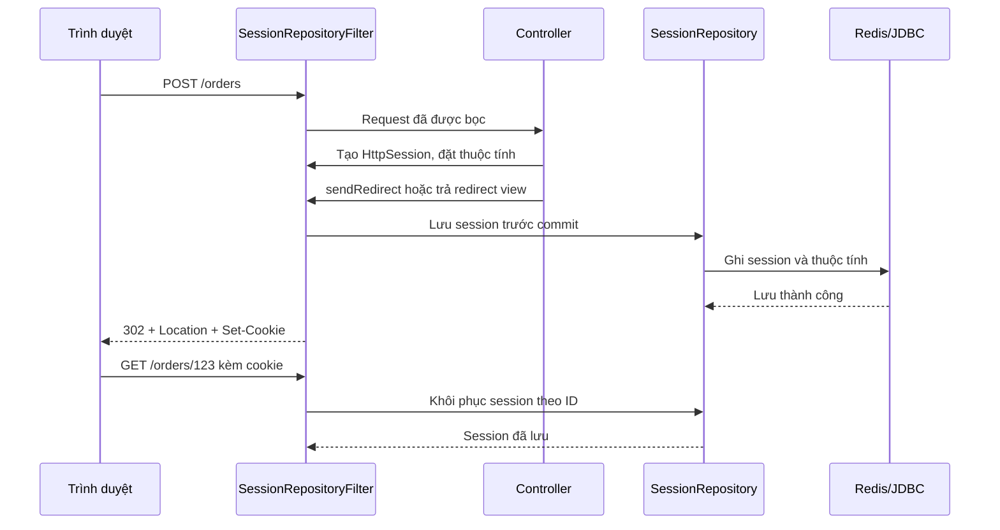

# Redirect, ghi phản hồi sớm và lỗi tạo phiên sau khi đã commit

Trong ứng dụng Servlet, trình duyệt nhận session ID qua cookie, còn Spring Session lưu dữ liệu phiên trong repository như Redis hoặc JDBC. Để phiên mới được sử dụng ở request tiếp theo, máy chủ phải lưu phiên và gửi header `Set-Cookie` trước khi response được commit. Nếu response đã gửi header hoặc một phần body xuống client, ứng dụng không thể bổ sung cookie, đổi status hay thay response thành một redirect khác.

Vấn đề này thường xuất hiện ở các luồng redirect sau POST, ghi response sớm, tải file, streaming, xử lý bất đồng bộ hoặc filter tự gọi `flushBuffer()`. Hiểu đúng thời điểm commit giúp tránh lỗi tạo phiên sau khi response đã commit và tránh tình trạng request tiếp theo không khôi phục được phiên vừa tạo.

## 1. Response commit là gì?

Servlet container thường giữ status, header và một phần body trong response buffer. Khi response được commit, container đã bắt đầu gửi thông tin đó đến client. Từ thời điểm này, ứng dụng không còn tự do thay đổi status hoặc header, chẳng hạn thêm `Set-Cookie`, thay `Location` hay đổi mã lỗi.

Các thao tác phổ biến có thể làm response commit:

- Gọi `HttpServletResponse.flushBuffer()`.
- Gọi `flush()` trên writer hoặc output stream; việc ghi đủ làm đầy buffer cũng có thể khiến container tự flush.
- Gọi `sendRedirect()` để gửi status redirect và header `Location`.
- Gọi `sendError()` để gửi response lỗi.
- Một số luồng streaming hoặc async ghi và flush body trước khi phần xử lý khác hoàn tất.

Kiểm tra `response.isCommitted()` cho biết response đã commit tại thời điểm kiểm tra hay chưa. Kết quả `false` không bảo đảm response sẽ chưa commit ở dòng code tiếp theo: một lần ghi body khác hoặc một filter phía sau vẫn có thể làm buffer đầy.

Ví dụ minh họa:

```java
response.getWriter().write("Processing...");
response.flushBuffer();

// Từ đây response đã commit.
// Không thể thêm Set-Cookie hoặc chuyển response thành redirect mới.
```

`flushBuffer()` không chỉ đẩy dữ liệu ra sớm mà còn khóa khả năng thay đổi header. Trong khi response chưa commit, ứng dụng có thể thiết lập status và header. Sau khi commit, việc gọi các phương thức sửa header có thể bị bỏ qua hoặc không có hiệu lực theo Servlet API và container.

## 2. Vì sao thời điểm commit quan trọng với Spring Session

Khi ứng dụng gọi `request.getSession(true)` và chưa có phiên hợp lệ, Spring Session tạo một session trong repository. Session ID phải được đưa vào response dưới dạng cookie, ví dụ:

```http
HTTP/1.1 302 Found
Location: /orders/123
Set-Cookie: SESSION=opaque-session-id; Path=/; HttpOnly; Secure; SameSite=Lax
```

Trình duyệt nhận response redirect, lưu cookie rồi gửi cookie trong request tiếp theo đến cùng ứng dụng. Nếu session đã được tạo nhưng response commit trước khi cookie được thiết lập, trình duyệt không nhận được session ID mới. Dữ liệu phiên có thể đã được ghi ở kho nhưng client không có cookie để tìm lại; hoặc phiên chưa được lưu thành công tùy thời điểm lỗi và repository.

Trong tích hợp Servlet tiêu chuẩn, `SessionRepositoryFilter` bọc request và response. Response wrapper của Spring Session theo dõi các điểm commit thông dụng và yêu cầu lưu session trước khi chuyển thao tác commit xuống Servlet container. Cuối request cũng có cơ chế lưu session. Cơ chế này giúp các thao tác như `sendRedirect`, `sendError` và `flushBuffer` lưu thay đổi phiên trước khi response thực sự được commit, miễn là filter đã được cài đặt đúng và response wrapper chưa bị bỏ qua.

Luồng redirect điển hình:



Điểm mấu chốt là repository phải được gọi trước khi container phát response đã commit. Không nên tự suy luận rằng chỉ vì đã gọi `setAttribute()` thì cookie và dữ liệu chắc chắn đã đến nơi lưu trữ; thời điểm ghi phụ thuộc repository, flush mode và vòng đời response.

## 3. Tạo hoặc cập nhật session trước khi redirect

Với Servlet API, hãy lấy session và hoàn tất các thay đổi cần thiết trước khi gọi `sendRedirect()`:

```java
@PostMapping("/orders")
public void createOrder(HttpServletRequest request,
                       HttpServletResponse response) throws IOException {
    Order order = orderService.createOrder();

    HttpSession session = request.getSession(true);
    session.setAttribute("lastOrderId", order.getId());

    response.sendRedirect(
            request.getContextPath() + "/orders/" + order.getId());
    return;
}
```

`getSession(true)` tạo phiên nếu chưa có. `setAttribute()` cập nhật dữ liệu phiên. `sendRedirect()` sau đó bắt đầu quá trình commit response; Spring Session có thể lưu phiên thông qua response wrapper trước khi container gửi redirect. Lệnh `return` giúp luồng xử lý kết thúc tại điểm redirect, tránh tiếp tục ghi body hoặc thay đổi session sau đó.

Nếu chỉ muốn đọc phiên mà không tạo phiên mới, dùng `getSession(false)`:

```java
HttpSession session = request.getSession(false);
if (session == null) {
    response.sendRedirect(request.getContextPath() + "/login");
    return;
}

Object orderId = session.getAttribute("lastOrderId");
```

Điều này hữu ích cho các endpoint chỉ kiểm tra trạng thái hiện có. Gọi `getSession()` không tham số tương đương yêu cầu tạo phiên khi chưa có; vì thế, không nên gọi nó một cách vô thức trong filter hoặc controller chỉ để kiểm tra xem người dùng đã có session hay chưa.

Với Spring MVC, có thể trả về tên view redirect:

```java
@PostMapping("/profile/save")
public String saveProfile(HttpServletRequest request,
                          RedirectAttributes redirectAttributes) {
    Profile profile = profileService.saveCurrentProfile();

    request.getSession(true).setAttribute("profileId", profile.getId());
    redirectAttributes.addFlashAttribute("notice", "Đã lưu hồ sơ");

    return "redirect:/profile";
}
```

Spring MVC xử lý redirect sau khi controller trả về. Flash attributes thường được `SessionFlashMapManager` lưu tạm trong session để hiển thị ở request kế tiếp. Vì vậy, `addFlashAttribute()` có thể khiến ứng dụng cần session ngay cả khi controller không gọi `getSession()` trực tiếp. Nếu endpoint phải giữ tính stateless, hãy cân nhắc cơ chế thông báo không cần session; không đưa thông tin nhạy cảm vào query string.

## 4. Redirect không phải là nơi để tiếp tục ghi response

Sau khi gọi `sendRedirect()`, không tiếp tục ghi nội dung vào writer hoặc output stream. `sendRedirect()` đã thiết lập response redirect và commit theo hợp đồng Servlet. Việc ghi thêm body sau đó không tạo ra một response thứ hai; nội dung có thể bị bỏ qua hoặc gây hành vi khó dự đoán tùy container.

Không nên viết theo kiểu:

```java
response.sendRedirect("/login");
response.getWriter().write("Please log in"); // Sai thứ tự xử lý
```

Hãy kết thúc nhánh xử lý ngay sau redirect, hoặc trả về view redirect từ controller. Nếu cần thông báo cho người dùng, dùng flash attribute, trang đích hoặc một mã trạng thái phù hợp với giao thức API.

Trong API không dùng trình duyệt điều hướng, thường nên trả status và body JSON phù hợp thay vì redirect HTML. Quyết định đó cần được đưa ra trước khi ghi body. Một khi response đã commit, không thể đổi một response JSON một phần thành 302 hoặc 401 hoàn chỉnh.

## 5. Ghi response sớm và session được tạo muộn

Một lỗi thường gặp là filter hoặc controller ghi dữ liệu và flush trước, rồi một thành phần khác mới gọi `getSession(true)`:

```java
@GetMapping("/report")
public void report(HttpServletRequest request,
                  HttpServletResponse response) throws IOException {
    response.setContentType("text/plain;charset=UTF-8");
    response.getWriter().write("Báo cáo đang được tạo\n");
    response.flushBuffer();

    // Quá muộn nếu cần tạo session và gửi cookie mới.
    request.getSession(true).setAttribute("reportStarted", true);
}
```

Tùy Servlet container và wrapper đang hoạt động, việc tạo session sau commit có thể ném `IllegalStateException` với thông báo tương tự `Cannot create a session after the response has been committed`. Ngay cả khi một implementation cho phép tạo đối tượng session nội bộ, ứng dụng cũng không thể dựa vào việc gửi thêm cookie sau khi response đã commit. Không nên phụ thuộc vào khác biệt hành vi giữa Tomcat, Jetty hoặc container khác.

Sửa thứ tự bằng cách tạo session và lưu trạng thái trước khi ghi hoặc flush response:

```java
@GetMapping("/report")
public void report(HttpServletRequest request,
                  HttpServletResponse response) throws IOException {
    HttpSession session = request.getSession(true);
    session.setAttribute("reportStarted", true);

    response.setContentType("text/plain;charset=UTF-8");
    response.getWriter().write("Báo cáo đang được tạo\n");
    response.flushBuffer();
}
```

Nếu không cần tạo phiên, tránh gọi `getSession(true)`. Việc loại bỏ nhu cầu session thường tốt hơn tạo phiên cho mọi request, đặc biệt ở endpoint tải tài nguyên tĩnh, health check, streaming hoặc API stateless.

## 6. Các điểm commit ẩn trong filter và thư viện

Không phải lúc nào code ứng dụng cũng gọi `flushBuffer()` trực tiếp. Response có thể bị commit bởi:

- Filter ghi nội dung chẩn đoán hoặc banner rồi flush writer.
- Filter nén response hoặc filter logging bọc output stream và đóng/flush sớm.
- Thành phần xử lý lỗi gọi `sendError()`.
- Framework gửi redirect hoặc hoàn tất response khi xử lý exception.
- Response body lớn hơn buffer, khiến container tự flush trước khi controller kết thúc.
- Code tải file, streaming, server-sent events hoặc callback async ghi dữ liệu liên tục.

`SessionRepositoryFilter` phải được đăng ký đủ sớm để bọc request/response trước các filter khác có thể truy cập `HttpSession` hoặc commit response. Trong Spring Boot, auto-configuration thường quản lý thứ tự filter. Nếu tự đăng ký filter, cần kiểm tra thứ tự và tránh một filter chạy trước Spring Session tạo session container gốc hoặc commit response khi session wrapper chưa được áp dụng.

Không tự lấy response gốc từ wrapper hoặc dùng API riêng của container để ghi trực tiếp xuống socket. Việc bỏ qua wrapper có thể khiến Spring Session không nhận biết điểm commit và không kịp lưu session. Với thư viện bên thứ ba, kiểm tra xem nó có giữ và dùng đúng `HttpServletRequest`/`HttpServletResponse` đã được filter bọc hay không.

## 7. Redirect và flash attributes trong Spring MVC

Spring MVC cung cấp hai kiểu dữ liệu redirect thường gặp:

| Cách truyền | Cơ chế | Có dùng session không? | Lưu ý |
|---|---|---|---|
| `RedirectAttributes.addAttribute()` | Đưa giá trị vào URL dưới dạng path/query parameter | Không cần session chỉ để lưu giá trị này | URL có thể nằm trong history, log, referrer; chỉ truyền dữ liệu không nhạy cảm |
| `RedirectAttributes.addFlashAttribute()` | Lưu tạm trong `FlashMap` cho request kế tiếp | `SessionFlashMapManager` mặc định thường dùng session | Phù hợp thông báo ngắn hạn; cần tính đến việc tạo session |

Ví dụ:

```java
@PostMapping("/settings")
public String updateSettings(RedirectAttributes attributes) {
    settingsService.update();
    attributes.addFlashAttribute("message", "Cài đặt đã được cập nhật");
    return "redirect:/settings";
}
```

Thông báo flash được tiêu thụ ở request redirect tiếp theo và không phải dữ liệu lưu lâu dài. Tránh đặt token, thông tin cá nhân hoặc nội dung bí mật vào flash map; dữ liệu vẫn được lưu trong session repository trong khoảng thời gian ngắn.

Nếu không muốn endpoint tạo session, có thể trả về redirect với một mã thông báo không nhạy cảm trong URL, sau đó trang đích tải trạng thái từ dịch vụ. Không dùng query string để truyền bí mật hoặc dữ liệu lớn. Nếu cần trạng thái dùng một lần, có thể dùng kho server-side chuyên biệt với khóa ngẫu nhiên, TTL ngắn và cơ chế tiêu thụ nguyên tử.

## 8. Streaming, tải file và xử lý bất đồng bộ

Các endpoint streaming thường commit response sớm vì cần gửi dữ liệu liên tục. Ví dụ `StreamingResponseBody`, `ResponseBodyEmitter`, `SseEmitter` hoặc servlet async có thể bắt đầu ghi body trước khi một callback khác chạy. Nếu callback sau đó mới tạo session hoặc thay đổi thuộc tính cần được lưu, response có thể đã commit và cookie không thể được thêm.

Với streaming, nên hoàn tất các thao tác cần session trước khi bắt đầu stream:

1. Xác thực người dùng và kiểm tra quyền.
2. Đọc hoặc tạo session khi response chưa commit.
3. Lấy các giá trị cần thiết cho tác vụ và lưu thay đổi session.
4. Sau đó mới bắt đầu ghi response hoặc chuyển quyền điều khiển cho callback streaming.

Ví dụ khái niệm:

```java
@GetMapping("/export")
public StreamingResponseBody export(HttpServletRequest request) {
    HttpSession session = request.getSession(false);
    if (session == null) {
        throw new ResponseStatusException(HttpStatus.UNAUTHORIZED);
    }

    String userId = (String) session.getAttribute("userId");
    if (userId == null) {
        throw new ResponseStatusException(HttpStatus.UNAUTHORIZED);
    }

    return outputStream -> exportService.writeForUser(userId, outputStream);
}
```

Callback chỉ nhận `userId` đã được kiểm tra và không tạo session sau khi stream bắt đầu. Trong ứng dụng thực tế, nên dùng principal đã xác thực và kiểm tra quyền ở tầng dịch vụ; ví dụ chỉ thể hiện ranh giới giữa xử lý session và ghi stream.

Đối với tác vụ async kéo dài, không nên giữ một object `HttpSession` để sửa tùy ý từ nhiều thread. Session có thể được truy cập đồng thời bởi request khác; thao tác cập nhật mutable attribute có thể bị ghi đè. Hãy trích xuất dữ liệu cần thiết trước khi bắt đầu async, dùng kho nghiệp vụ cho trạng thái tác vụ dài hạn và kiểm soát quyền truy cập khi người dùng truy vấn kết quả.

## 9. Flush mode và thời điểm ghi repository

Spring Session có khái niệm `FlushMode` để điều khiển thời điểm ghi thay đổi vào kho dữ liệu. Các repository hỗ trợ chế độ này thường phân biệt:

- `ON_SAVE`: thay đổi được ghi khi Spring Session gọi thao tác lưu session, thường ở điểm lưu do filter quản lý.
- `IMMEDIATE`: thay đổi được ghi sớm hơn khi session được tạo hoặc cập nhật, tùy implementation.

`IMMEDIATE` có thể giúp lỗi ghi kho dữ liệu xuất hiện gần thao tác cập nhật hơn, nhưng có thể làm tăng số lần I/O và độ trễ. Nó không làm response đã commit có khả năng nhận thêm cookie, không thay thế việc cấu hình filter đúng và không biến một request thành giao dịch nguyên tử.

Với `ON_SAVE`, lỗi ghi có thể xuất hiện gần cuối request hoặc khi response wrapper chuẩn bị commit. Vì vậy, cần kiểm tra cách repository cụ thể thực hiện `save`, chính sách retry và xử lý lỗi. Không nên bắt exception ghi session rồi vẫn trả redirect thành công, vì request tiếp theo có thể không khôi phục được trạng thái vừa tạo.

`FlushMode` và `SaveMode` là hai khái niệm khác nhau: flush mode điều khiển thời điểm lưu; save mode điều khiển phần dữ liệu session được ghi trong lần lưu. Tên tùy chọn, mặc định và hỗ trợ cụ thể phụ thuộc phiên bản Spring Session và repository đang dùng. Đọc tài liệu của đúng phiên bản trước khi thay đổi cấu hình.

## 10. Xử lý lỗi lưu session trước và sau commit

Có thể phân loại lỗi theo thời điểm:

| Thời điểm lỗi | Khả năng xử lý | Hướng xử lý |
|---|---|---|
| Repository lỗi trước khi response commit | Response có thể vẫn chưa gửi xuống client | Ghi nhận lỗi, trả lỗi phù hợp nếu response còn có thể sửa; không redirect thành công |
| Repository lỗi khi wrapper chuẩn bị commit | Việc commit có thể bị chặn bởi exception lưu session | Đưa lỗi vào exception handling và kiểm tra trạng thái response trước khi tạo error response |
| Response đã commit rồi mới phát hiện cần tạo session | Không thể thêm cookie hoặc thay status/header | Không cố redirect hoặc gọi `sendError`; kết thúc xử lý và ghi nhận lỗi an toàn |
| Session đã lưu nhưng cookie không đến client | Client không thể tìm phiên bằng ID mới | Kiểm tra thứ tự commit, wrapper, proxy và header `Set-Cookie`; xử lý request sau như không có phiên |
| Cookie đến client nhưng session store không lưu được dữ liệu | Request sau có ID nhưng repository không khôi phục được session | Kiểm tra exception, flush mode, kết nối và khả năng ghi của repository |

Nếu response chưa commit, exception handler có thể thiết lập status lỗi và body phù hợp. Trước khi gọi `sendError()` hoặc ghi error body, kiểm tra `response.isCommitted()`. Nếu đã commit, không thể dùng `reset()` hoặc `sendError()` để quay lại trạng thái ban đầu; các thao tác đó có thể ném `IllegalStateException` hoặc không có tác dụng.

Không che giấu lỗi repository để tiếp tục redirect như thể thao tác đã thành công. Với thao tác nghiệp vụ quan trọng, cần xác định liệu nghiệp vụ đã được commit hay chưa và có thể retry an toàn hay không. Việc tạo đơn hàng thành công nhưng lưu session thất bại là hai kết quả riêng; không tự động tạo lại đơn hàng chỉ vì redirect/session lỗi. Dùng idempotency key hoặc cơ chế truy vấn trạng thái nghiệp vụ để tránh tạo giao dịch trùng.

## 11. Chẩn đoán `Cannot create a session after the response has been committed`

Khi gặp lỗi này, điều tra theo thứ tự:

1. Tìm lần gọi đầu tiên tới `getSession()` hoặc `getSession(true)` trong request.
2. Tìm các thao tác commit chạy trước đó: `sendRedirect`, `sendError`, `flushBuffer`, `flush()` hoặc ghi response đủ lớn.
3. Xem thứ tự filter; xác nhận `SessionRepositoryFilter` đã bọc request/response trước filter có thể commit.
4. Kiểm tra code async, streaming và callback; xác nhận session không được tạo hoặc sửa sau khi response đã gửi.
5. Kiểm tra redirect view và flash attributes có tạo session ngầm hay không.
6. Kiểm tra response wrapper có bị bỏ qua do code dùng response gốc hoặc API container riêng hay không.
7. Xem log repository để phân biệt lỗi tạo session, lỗi lưu dữ liệu và lỗi phát header cookie.

Không ghi session ID, cookie hoặc thuộc tính nhạy cảm vào log để chẩn đoán. Ghi mã tương quan request, endpoint, tên filter, instance, thời điểm commit, loại repository và trạng thái `isCommitted()` là đủ để định vị phần lớn vấn đề.

## 12. Kiểm thử redirect và commit

Nên kiểm thử cả hành vi HTTP lẫn repository:

| Ca kiểm thử | Cách thực hiện | Điều cần xác nhận |
|---|---|---|
| Redirect tạo session mới | Gửi POST tạo session và redirect | Response có redirect và cookie session theo cấu hình |
| Khôi phục sau redirect | Gửi request tiếp theo với cookie nhận từ response trước | Thuộc tính session được khôi phục |
| Flash attribute | Thêm flash attribute rồi redirect | Request đích nhận được thông báo; flash được tiêu thụ theo hành vi cấu hình |
| `flushBuffer()` sau khi tạo session | Tạo session, đặt thuộc tính rồi flush | Spring Session lưu session trước khi response commit |
| Tạo session sau commit | Flush response trước, sau đó thử tạo session trong test riêng | Ứng dụng không dựa vào việc thêm cookie sau commit; hành vi exception được ghi nhận theo container |
| Lỗi repository | Dùng repository giả lập lỗi khi save | Request không báo thành công giả; error handling kiểm tra trạng thái commit |
| Nhiều instance | Tạo phiên ở A, redirect, dùng cookie gọi B | B đọc được phiên từ kho chung |
| Streaming | Tạo/đọc session trước khi bắt đầu stream | Callback không cần tạo session sau khi response commit |

Ví dụ với MockMvc có thể kiểm tra redirect và cookie:

```java
MvcResult result = mockMvc.perform(post("/orders"))
        .andExpect(status().is3xxRedirection())
        .andReturn();

Cookie sessionCookie = result.getResponse().getCookie("SESSION");
assertThat(sessionCookie).isNotNull();

mockMvc.perform(get("/orders/current").cookie(sessionCookie))
        .andExpect(status().isOk())
        .andExpect(content().string("order-123"));
```

Tên cookie và endpoint trong ví dụ phải khớp cấu hình ứng dụng. Với Spring Session thực, integration test nên dùng Redis hoặc database test để xác nhận dữ liệu được ghi vào repository. Mock session trong bộ nhớ có thể giúp kiểm tra controller nhưng không chứng minh cookie, filter và repository đã phối hợp đúng.

Lỗi tạo session sau commit có thể phụ thuộc Servlet container, vì vậy không nên ràng buộc test vào nguyên văn exception message. Hãy kiểm tra điều kiện gây lỗi và bảo đảm code không cố thêm header sau commit. Nên có ít nhất một bài test chạy trên container tương tự môi trường production nếu ứng dụng dùng streaming hoặc filter tùy chỉnh.

## 13. Nguyên tắc triển khai

- Tạo hoặc lấy session trước khi gọi `sendRedirect`, `sendError`, `flushBuffer` hoặc bắt đầu streaming nếu request cần session.
- Dùng `getSession(false)` khi chỉ muốn kiểm tra phiên hiện có.
- Để `SessionRepositoryFilter` bọc request và response trước các filter truy cập session hoặc commit response.
- Không ghi thêm body sau redirect và không tiếp tục thay đổi session sau khi đã hoàn tất response.
- Tính đến flash attributes vì chúng có thể sử dụng session ngầm.
- Với async/streaming, hoàn tất các thay đổi session trước khi response bắt đầu được gửi và không sửa session từ nhiều thread tùy tiện.
- Theo dõi exception khi repository lưu session; không trả kết quả thành công nếu trạng thái cần thiết chưa được lưu.
- Kiểm thử cookie, redirect, flush, lỗi repository và khôi phục session qua nhiều instance.

Trong Spring Session, redirect và ghi response sớm là các điểm quan trọng của vòng đời session vì chúng quyết định khi nào header có thể được gửi đi. Khi session được tạo và cập nhật trước điểm commit, response wrapper có cơ hội lưu session và thêm cookie. Khi response đã commit, ứng dụng phải coi header và body đã được gửi là bất biến; mọi luồng cần session phải được thiết kế để hoàn tất phần việc đó trước thời điểm này.
