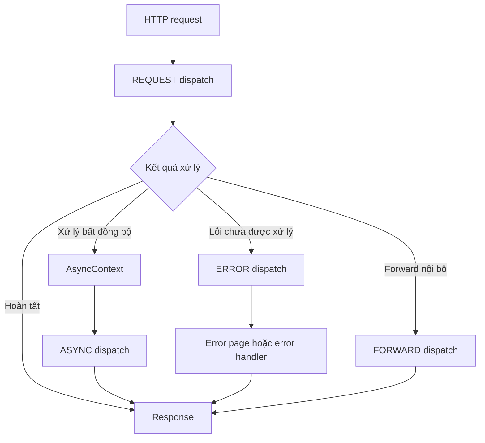

# Error dispatch, xử lý bất đồng bộ và phạm vi hỗ trợ theo cấu hình

Trong ứng dụng Servlet, một HTTP request không phải lúc nào cũng được xử lý trong đúng một lần dispatch. Servlet container có thể tiếp tục request bằng `ASYNC` dispatch, chuyển sang trang lỗi bằng `ERROR` dispatch, hoặc chuyển tiếp bằng `FORWARD`. Mỗi dispatch có thể đi qua một tập filter khác nhau tùy cấu hình. Điều này ảnh hưởng trực tiếp đến Spring Session vì `SessionRepositoryFilter` bọc request và response để thay `HttpSession` của container bằng phiên được lưu trong repository.

Khi ứng dụng dùng Spring Session với Redis hoặc JDBC, cần bảo đảm các filter và servlet có truy cập session đều nhìn thấy cùng một phiên trong suốt vòng đời request. Nếu cấu hình chỉ phù hợp với dispatch ban đầu nhưng bỏ qua dispatch lỗi hoặc bất đồng bộ, trang lỗi hay phần xử lý tiếp theo có thể đọc sai session, tạo phiên mới ngoài ý muốn hoặc làm mất thay đổi. Phạm vi hỗ trợ thực tế phụ thuộc loại dispatch, đăng ký filter, khả năng async của servlet/filter, thứ tự filter, container và phiên bản Spring Session.

## 1. Một request Servlet có thể có nhiều dispatch

Servlet API định nghĩa `DispatcherType` để chỉ ra request đang được xử lý theo cách nào. Những loại thường gặp gồm:

| Dispatcher type | Ý nghĩa | Ví dụ |
|---|---|---|
| `REQUEST` | Request HTTP ban đầu từ client | Người dùng mở `/account` |
| `ASYNC` | Request được dispatch lại sau khi xử lý bất đồng bộ | `Callable`, `DeferredResult` hoặc `AsyncContext.dispatch()` hoàn tất và quay lại container |
| `ERROR` | Container chuyển request sang error page hoặc error handler | Servlet ném exception chưa được xử lý hoặc gọi `sendError()` |
| `FORWARD` | Server chuyển tiếp nội bộ sang resource khác | `RequestDispatcher.forward()` |
| `INCLUDE` | Server đưa nội dung của resource khác vào response hiện tại | `RequestDispatcher.include()` |

Một filter chỉ được gọi cho các dispatcher type được khai báo trong filter mapping. Ngoài mapping, chính filter còn có thể quyết định bỏ qua một số dispatch. Vì vậy, việc filter được đăng ký cho URL `/*` chưa đủ để kết luận nó sẽ chạy trong mọi lần dispatch.



Sơ đồ mô tả các nhánh có thể xảy ra. Một request không nhất thiết đi qua tất cả các nhánh; một số framework có thể xử lý lỗi trong dispatch ban đầu mà không tạo `ERROR` dispatch riêng.

## 2. Spring Session tham gia vào chuỗi filter như thế nào?

Trong ứng dụng Servlet, `SessionRepositoryFilter` là điểm tích hợp để thay thế cách container lưu `HttpSession` bằng repository của Spring Session. Filter đọc session ID từ request thông qua `HttpSessionIdResolver`, tra cứu `SessionRepository`, rồi cung cấp một request wrapper để mã ứng dụng sử dụng API `HttpSession` quen thuộc.

Luồng đơn giản trong `REQUEST` dispatch:

1. Trình duyệt gửi cookie chứa session ID.
2. `SessionRepositoryFilter` đọc ID và tìm phiên trong Redis, JDBC hoặc repository đã cấu hình.
3. Request wrapper cung cấp phiên cho controller, filter bảo mật và các thành phần dùng `HttpSession`.
4. Khi request kết thúc theo vòng đời mà filter quản lý, thay đổi của phiên được lưu vào repository và response có thể cập nhật cookie khi cần.

Filter phải đứng trước các filter có truy cập `HttpSession`, đặc biệt là Spring Security. Nếu một filter chạy trước Spring Session và gọi API session của request gốc, nó có thể nhận phiên do container quản lý thay vì phiên trong repository. Kết quả có thể là một phần ứng dụng thấy người dùng đã đăng nhập trong khi phần khác lại thấy session rỗng.

Với request có nhiều dispatch, cần xem xét cả hai lớp sau:

- **Filter mapping:** filter có được container gọi cho `ASYNC` hoặc `ERROR` hay không?
- **Chính sách của filter:** filter có bỏ qua loại dispatch đó hay không? Một số base class như `OncePerRequestFilter` có cơ chế quyết định có chạy lại trong async/error dispatch; hành vi phụ thuộc override của filter cụ thể.

Không nên tự đăng ký thêm một `SessionRepositoryFilter` nếu Spring Boot hoặc cấu hình Spring Session đã đăng ký filter này. Hai filter quản lý session có thể tạo wrapper chồng chéo và làm trạng thái phiên khó dự đoán. Hãy kiểm tra cấu hình đăng ký thực tế trước khi thay đổi.

## 3. Error dispatch và phiên trong trang lỗi

### 3.1. Khi nào xảy ra ERROR dispatch?

`ERROR` dispatch thường xảy ra khi Servlet container cần chuyển request sang error page đã cấu hình. Các nguyên nhân phổ biến gồm:

- Một servlet hoặc filter ném exception không được xử lý trong chuỗi hiện tại.
- Ứng dụng gọi `HttpServletResponse.sendError(...)`.
- Container chọn error page dựa trên mã trạng thái hoặc loại exception.

Trong Spring MVC, `@ExceptionHandler`, `@ControllerAdvice` hoặc `HandlerExceptionResolver` có thể xử lý exception ngay trong quá trình xử lý của `DispatcherServlet`. Khi đó, ứng dụng có thể trả response lỗi mà không cần container tạo một `ERROR` dispatch riêng. Vì thế, không phải mọi HTTP 4xx hoặc 5xx đều đồng nghĩa với `DispatcherType.ERROR`.

### 3.2. Vì sao error page có thể cần session?

Trang lỗi đôi khi cần đọc ngôn ngữ người dùng, mã tương quan, thông tin hiển thị hoặc trạng thái đăng nhập để tạo thông báo phù hợp. Nếu error page gọi `request.getSession(false)`, request cần được bọc đúng bởi Spring Session để tra cứu phiên trong repository.

Nếu `ERROR` dispatch không đi qua cơ chế quản lý session phù hợp, error page có thể thấy một session khác với session trong request ban đầu. Trong trường hợp nó gọi `getSession()` thay vì `getSession(false)`, container có thể tạo một session cục bộ mới. Cookie mới có thể ghi đè cookie cũ hoặc làm client gửi ID không trỏ đến repository Spring Session.

Error page nên ưu tiên dữ liệu sẵn có trong request attributes và chỉ đọc session khi thật sự cần. Nếu chỉ cần kiểm tra phiên, dùng `getSession(false)` để tránh tạo phiên mới trong luồng xử lý lỗi.

### 3.3. Filter mapping cho ERROR dispatch

Với ứng dụng khai báo filter trong `web.xml`, mapping có thể liệt kê rõ các dispatcher type cần xử lý:

```xml
<filter>
    <filter-name>springSessionRepositoryFilter</filter-name>
    <filter-class>org.springframework.web.filter.DelegatingFilterProxy</filter-class>
    <async-supported>true</async-supported>
</filter>

<filter-mapping>
    <filter-name>springSessionRepositoryFilter</filter-name>
    <url-pattern>/*</url-pattern>
    <dispatcher>REQUEST</dispatcher>
    <dispatcher>ASYNC</dispatcher>
    <dispatcher>ERROR</dispatcher>
</filter-mapping>
```

Đây là ví dụ cho cách đăng ký thủ công trong Servlet container. Bean đích mà `DelegatingFilterProxy` tìm phải có tên `springSessionRepositoryFilter`. Nếu Spring Boot đã tự đăng ký filter, không thêm một mapping thứ hai chỉ để sao chép ví dụ này; hãy điều chỉnh registration hiện có theo cơ chế mà ứng dụng đang dùng.

Trong cấu hình Java hoặc Spring Boot, `FilterRegistrationBean` có thuộc tính dispatcher types. Ví dụ khái niệm cho một filter tùy chỉnh cần chạy trên request, async và error:

```java
registration.setDispatcherTypes(
    DispatcherType.REQUEST,
    DispatcherType.ASYNC,
    DispatcherType.ERROR
);
registration.setAsyncSupported(true);
```

Đoạn mã chỉ minh họa cách đặt dispatcher types và async support cho registration. Không dùng nó để tạo một registration thứ hai cho `SessionRepositoryFilter` nếu Spring Session đã đăng ký filter đó. Cần sửa registration thực tế hoặc cấu hình container hiện có.

### 3.4. Nested error dispatch

Một số container có thể thực hiện error dispatch lồng trong cùng thread và cùng chuỗi filter, thay vì bắt đầu một dispatch hoàn toàn mới. `OncePerRequestFilter` có xử lý riêng cho trường hợp error dispatch lồng; filter con có thể cần bảo đảm request/response wrapper vẫn được áp dụng trong nhánh này.

Không nên tự suy luận rằng chỉ cần thêm `ERROR` vào mapping là mọi trường hợp nested error đã được xử lý. Hành vi phụ thuộc container, phiên bản framework và cách filter triển khai `doFilterNestedErrorDispatch` hoặc chính sách dispatch tương ứng. Nếu ứng dụng có error page truy cập `HttpSession`, cần kiểm thử trên đúng Servlet container được triển khai.

## 4. Xử lý bất đồng bộ trong Servlet

### 4.1. Async request là gì?

Servlet asynchronous processing cho phép request bắt đầu công việc rồi trả thread xử lý ban đầu về container trước khi response hoàn tất. Khi kết quả sẵn sàng, ứng dụng có thể hoàn tất async context hoặc dispatch lại để tiếp tục xử lý trong container.

Spring MVC hỗ trợ một số kiểu xử lý bất đồng bộ như `Callable`, `DeferredResult` và `WebAsyncTask`. Ở tầng Servlet thấp hơn, ứng dụng có thể dùng `request.startAsync()` và `AsyncContext`.

Ví dụ minh họa với Servlet API:

```java
@GetMapping("/report/async")
public void reportAsync(HttpServletRequest request,
                       HttpServletResponse response) {
    AsyncContext asyncContext = request.startAsync();
    asyncContext.start(() -> {
        try {
            HttpServletRequest asyncRequest =
                (HttpServletRequest) asyncContext.getRequest();
            HttpSession session = asyncRequest.getSession(false);
            String userId = session == null
                ? "anonymous"
                : String.valueOf(session.getAttribute("userId"));

            HttpServletResponse asyncResponse =
                (HttpServletResponse) asyncContext.getResponse();
            asyncResponse.getWriter().write("Report for " + userId);
            asyncContext.complete();
        }
        catch (IOException ex) {
            asyncContext.complete();
        }
    });
}
```

Ví dụ tập trung vào việc truy cập request/session trong async context; trong ứng dụng thực tế cần xử lý exception, timeout, cancellation và response lifecycle đầy đủ. Không giữ `HttpServletResponse` hoặc writer để ghi sau khi async context đã hoàn tất.

### 4.2. asyncSupported phải được bật trong toàn bộ chuỗi liên quan

Để gọi `startAsync()`, Servlet và các filter trong chuỗi xử lý cần cho phép asynchronous processing. Nếu một filter không hỗ trợ async, container có thể từ chối việc bắt đầu async và ném `IllegalStateException`.

Với filter đăng ký bằng `web.xml`, thuộc tính là:

```xml
<filter>
    <filter-name>exampleFilter</filter-name>
    <filter-class>com.example.ExampleFilter</filter-class>
    <async-supported>true</async-supported>
</filter>
```

Với filter registration bằng Java, dùng `setAsyncSupported(true)` trên registration. Chỉ bật async cho filter khi implementation của filter an toàn với vòng đời async và không giữ tài nguyên theo cách giả định request luôn kết thúc ngay khi `doFilter` trả về.

### 4.3. Async dispatch và dispatcher type

Khi async context dispatch lại request, container tạo một lần dispatch với `DispatcherType.ASYNC`. Filter mapping cần bao gồm `ASYNC` nếu filter cần chạy trong lần dispatch này. Một filter có thể tiếp tục bỏ qua async dispatch theo chính sách nội bộ, ngay cả khi mapping cho phép container gọi nó.

Các filter dựa trên `OncePerRequestFilter` có thể kiểm soát việc chạy trong async dispatch thông qua `shouldNotFilterAsyncDispatch()`. Mặc định của base class này là bỏ qua async dispatch; lớp con có thể override để thay đổi hành vi. Không nên override tùy tiện đối với filter của framework. Hãy xem hành vi của đúng filter và phiên bản Spring Session đang dùng.

`SessionRepositoryFilter` phải bảo đảm các thao tác `HttpSession` trong suốt vòng đời async vẫn được ánh xạ đến repository Spring Session. Các request wrapper có thể được chuyển tiếp qua `AsyncContext`; cách container giữ wrapper và cách filter xử lý dispatch tiếp theo cần được xác minh bằng kiểm thử tích hợp. Đặc biệt, nếu code async truy cập session sau khi filter ban đầu đã hoàn tất, cần xác định thời điểm thay đổi được lưu và bảo đảm không truy cập session sau khi request lifecycle kết thúc.

### 4.4. AsyncListener và vòng đời hoàn tất

Servlet API cung cấp `AsyncListener` với các callback:

| Callback | Thời điểm |
|---|---|
| `onComplete` | Async processing đã hoàn tất |
| `onTimeout` | Async context vượt quá thời hạn |
| `onError` | Có lỗi trong quá trình async |
| `onStartAsync` | Một chu kỳ async mới được bắt đầu từ dispatch đang chạy |

Ví dụ đăng ký listener để ghi nhận kết quả:

```java
asyncContext.addListener(new AsyncListener() {
    @Override
    public void onComplete(AsyncEvent event) {
        // Ghi nhận request async đã hoàn tất.
    }

    @Override
    public void onTimeout(AsyncEvent event) {
        // Ghi nhận timeout và áp dụng chính sách ứng dụng.
    }

    @Override
    public void onError(AsyncEvent event) {
        // Ghi nhận lỗi async.
    }

    @Override
    public void onStartAsync(AsyncEvent event) {
        // Nếu chu kỳ async mới cần listener, đăng ký lại tại đây.
    }
});
```

Listener là nơi thích hợp để quan sát vòng đời và giải phóng tài nguyên do ứng dụng quản lý. Không nên dùng callback này để tự lưu session theo một cơ chế riêng song song với Spring Session, trừ khi đã thiết kế rõ đồng bộ và xử lý cạnh tranh. Spring Session quản lý repository theo cơ chế của nó; ứng dụng nên thao tác qua `HttpSession` được bọc và kiểm thử thời điểm commit.

## 5. Truy cập session trong xử lý bất đồng bộ

### 5.1. Không giữ giả định về thread

Async processing có thể chạy trên thread khác với thread xử lý request ban đầu. Không giả định `ThreadLocal` của request ban đầu tự động tồn tại trong thread async. Nếu cần thông tin như user ID, correlation ID hoặc security context, hãy dùng cơ chế truyền context phù hợp với Spring MVC/Spring Security hoặc truyền dữ liệu cần thiết một cách tường minh.

Không giữ đối tượng request/session để sử dụng sau khi async context đã complete. Sau khi response hoàn tất, container có thể tái sử dụng hoặc giải phóng các đối tượng liên quan. Mọi truy cập phải nằm trong thời gian hợp lệ của request/async lifecycle.

### 5.2. Không coi thuộc tính session là dữ liệu thread-safe

Một session có thể được truy cập đồng thời bởi request chính, async task hoặc một request khác từ cùng trình duyệt. Container có trách nhiệm bảo vệ cấu trúc nội bộ của tập thuộc tính session theo hợp đồng Servlet, nhưng ứng dụng vẫn phải tự bảo vệ các object mutable được lưu trong thuộc tính.

Ví dụ, nếu session chứa một `ArrayList` và hai request cùng thêm phần tử, việc truy cập đồng thời có thể gây mất cập nhật hoặc lỗi dữ liệu. Có thể thay bằng dữ liệu bất biến, cấu trúc đồng thời phù hợp, hoặc chuyển trạng thái nghiệp vụ cần cập nhật nhất quán sang database/service có giao dịch.

Với repository dùng chung, nhiều instance còn có thể đọc cùng một phiên rồi ghi các snapshot theo thứ tự khác nhau. Không giả định mọi thao tác trên `HttpSession` là một giao dịch nguyên tử. Hãy giữ dữ liệu session nhỏ, gọi `setAttribute` rõ ràng sau khi tạo giá trị mới và dùng cơ chế đồng bộ nghiệp vụ ở nơi cần tính nhất quán.

### 5.3. Không tạo session không cần thiết

Trong filter kiểm tra quyền hoặc error handler, dùng `request.getSession(false)` nếu chỉ cần kiểm tra xem phiên hiện có hay không. `getSession()` có thể tạo phiên mới nếu không tìm thấy phiên hợp lệ. Trong async flow, việc vô tình tạo phiên mới có thể làm phát sinh cookie mới và gây nhầm lẫn khi xử lý lỗi hoặc timeout.

## 6. Dispatcher type và cấu hình filter trong Spring Boot

Với Spring Boot, Spring Session thường đăng ký `SessionRepositoryFilter` thông qua `DelegatingFilterProxy` và cơ chế auto-configuration. Không nên sao chép toàn bộ cấu hình `web.xml` vào dự án Boot một cách máy móc. Thay vào đó, xác định filter registration đang được Boot tạo và cấu hình dispatcher types/async support trên registration đó nếu ứng dụng thực sự cần điều chỉnh.

Các điểm cần xác minh:

1. Bean `springSessionRepositoryFilter` được tạo đúng một lần.
2. Filter registration ánh xạ URL đúng và có thứ tự trước Spring Security cùng các filter truy cập `HttpSession`.
3. Dispatcher types bao gồm `REQUEST`, `ASYNC` hoặc `ERROR` theo các luồng ứng dụng cần hỗ trợ.
4. `asyncSupported` được bật cho servlet và tất cả filter trong chuỗi cần tham gia async.
5. Chính sách `OncePerRequestFilter` của filter cụ thể không bỏ qua dispatch mà ứng dụng kỳ vọng nó xử lý.
6. Các custom filter truy cập session cũng được đăng ký cho dispatcher type phù hợp.

Không phải filter nào cũng cần chạy ở mọi dispatcher type. Một filter ghi log request ban đầu có thể chỉ cần `REQUEST`; filter xác thực hoặc filter truy cập session có thể cần xử lý thêm `ASYNC` và `ERROR` tùy cách ứng dụng hoạt động. Chọn phạm vi tối thiểu nhưng đầy đủ, tránh chạy lặp logic không idempotent ở nhiều dispatch.

## 7. FORWARD và INCLUDE

`FORWARD` và `INCLUDE` thường xảy ra trong cùng request xử lý ở server. Nếu resource đích hoặc filter trong quá trình forward/include truy cập session, cần bảo đảm request wrapper vẫn được giữ. Filter mapping có thể giới hạn ở `REQUEST` nếu không cần chạy lại khi forward/include và wrapper gốc vẫn được truyền đúng. Nếu ứng dụng cần filter chạy lại trong các dispatch này, phải khai báo dispatcher types tương ứng.

Không nên thêm `FORWARD` và `INCLUDE` một cách mặc định cho mọi filter. Việc chạy lại authentication, audit hoặc logic ghi session có thể tạo side effect lặp. Hãy phân biệt nhu cầu giữ wrapper (để API session tiếp tục hoạt động) với nhu cầu chạy lại filter logic (để áp dụng xử lý ở dispatch mới).

## 8. Phạm vi hỗ trợ và những giới hạn cần hiểu

Spring Session cung cấp tích hợp cho Servlet session, nhưng hành vi cuối cùng được quyết định bởi tổ hợp cấu hình:

| Thành phần | Điều gì cần đúng | Rủi ro nếu thiếu |
|---|---|---|
| Servlet container | Hỗ trợ phiên bản Servlet và async API mà ứng dụng sử dụng | Async hoặc dispatcher behavior khác kỳ vọng |
| Filter mapping | Bao gồm dispatcher types cần được filter xử lý | Filter không được gọi trong error/async dispatch |
| Filter implementation | Chính sách skip/once-per-request phù hợp dispatch | Filter bị bỏ qua dù mapping đã cho phép |
| Async support | Servlet và filter trong chain cho phép async | `startAsync()` có thể thất bại |
| Filter ordering | Spring Session chạy trước thành phần truy cập `HttpSession` | Một phần ứng dụng dùng session của container |
| Request/response wrapper | Wrapper được duy trì qua async/error lifecycle theo container | Request phụ có thể không thấy session repository |
| Repository | Redis/JDBC truy cập được và cấu hình đồng nhất | Không thể khôi phục hoặc lưu trạng thái phiên |
| Session concurrency | Code xử lý nhiều request đồng thời an toàn | Mất cập nhật hoặc trạng thái phiên không nhất quán |

Không nên suy ra rằng chỉ cần dùng `@EnableRedisHttpSession` hoặc `@EnableJdbcHttpSession` thì mọi error page, async callback và custom filter tự động được cấu hình đúng. Annotation bật tích hợp repository; nó không thay thế việc xác định dispatcher type, async support và vòng đời của các thành phần Servlet khác.

## 9. Kiểm thử error dispatch

Kiểm thử lỗi cần phân biệt exception được xử lý trong Spring MVC với error dispatch của container.

### 9.1. Trường hợp exception được xử lý trong DispatcherServlet

Tạo endpoint ném exception và xử lý bằng `@ControllerAdvice`. Xác nhận handler có thể đọc thuộc tính session nếu request đã xác thực. Đây thường là xử lý trong dispatch ban đầu; không được coi kết quả này là bằng chứng rằng `ERROR` mapping đã hoạt động.

### 9.2. Trường hợp container ERROR dispatch

Tạo một endpoint gọi `sendError` hoặc để exception thoát khỏi chuỗi filter/servlet theo cấu hình test. Đăng ký error page hoặc error handler có thể kiểm tra `request.getDispatcherType()` và đọc `getSession(false)`. Xác nhận:

- Dispatcher type ở error handler là `ERROR`.
- Error handler thấy phiên Spring Session mong đợi.
- Không phát sinh session container mới ngoài ý muốn.
- Cookie và response status vẫn đúng sau khi error page hoàn tất.

Chạy kiểm thử trên đúng container production (ví dụ Tomcat, Jetty hoặc Undertow) nếu hành vi nested error dispatch có ảnh hưởng đến ứng dụng.

## 10. Kiểm thử async dispatch và session

Một bộ kiểm thử async nên xác nhận cả request wrapper, repository và thời điểm response hoàn tất:

1. Gửi request tạo session và lưu một thuộc tính, ví dụ `userId`.
2. Khởi chạy một endpoint async dùng `Callable`, `DeferredResult` hoặc `AsyncContext`.
3. Trong phần xử lý async, đọc session bằng request được truyền qua async context.
4. Cập nhật một thuộc tính đơn giản trong thời gian async còn hợp lệ.
5. Hoàn tất hoặc dispatch lại async request và xác nhận thay đổi được lưu vào repository.
6. Gửi request mới với cùng cookie, có thể qua instance khác, và xác nhận thuộc tính đã được lưu.
7. Kiểm tra timeout, cancel và error của async context; xác nhận tài nguyên được giải phóng và response không bị ghi sau khi complete.

Ngoài ra, thử hai request đồng thời cùng cập nhật session để phát hiện race condition. Kiểm tra `asyncSupported` trên servlet và từng filter; nếu không, lỗi có thể xuất hiện trước cả khi logic session được chạy.

## 11. Các lỗi thường gặp

| Biểu hiện | Nguyên nhân có thể | Cách điều tra |
|---|---|---|
| Error page không đọc được phiên | `ERROR` dispatch không đi qua filter hoặc wrapper không được giữ | Kiểm tra dispatcher mapping, filter policy và container |
| Error page tạo cookie phiên mới | Handler gọi `getSession()` khi phiên không được khôi phục | Dùng `getSession(false)` nếu chỉ cần tra cứu |
| Async request ném `IllegalStateException` khi start | Servlet hoặc một filter trong chain chưa bật async support | Kiểm tra `asyncSupported` toàn chuỗi |
| Async callback không thấy thuộc tính phiên | Request wrapper không được truyền đúng hoặc callback chạy ngoài request lifecycle | Kiểm tra AsyncContext, wrapper và cách truyền context |
| Session thay đổi không được lưu | Response/async lifecycle kết thúc trước khi thay đổi được commit | Kiểm tra thời điểm cập nhật và hoàn tất async |
| Một filter chạy hai lần ngoài dự kiến | Mapping nhiều dispatcher type và logic không kiểm tra dispatch | Kiểm tra `DispatcherType` và idempotency |
| Security context không nhất quán | Filter order hoặc async security context propagation chưa đúng | Kiểm tra thứ tự filter và cấu hình Spring Security async |
| Lỗi chỉ xuất hiện trên production | Container hoặc registration khác môi trường test | Tái hiện trên đúng Servlet container và cấu hình deploy |

## 12. Nguyên tắc triển khai

- Hiểu rõ sự khác nhau giữa `REQUEST`, `ASYNC`, `ERROR`, `FORWARD` và `INCLUDE`.
- Đặt Spring Session filter trước filter truy cập `HttpSession`, đặc biệt Spring Security.
- Chỉ thêm dispatcher types mà ứng dụng cần, đồng thời kiểm tra chính sách skip của filter.
- Bật `asyncSupported` cho servlet và toàn bộ filter trong chuỗi async.
- Giữ request/response wrapper hợp lệ trong async lifecycle và không dùng đối tượng sau khi complete.
- Dùng `getSession(false)` trong error handler và logic chỉ kiểm tra phiên.
- Xử lý thread safety cho object mutable trong session; không xem session là giao dịch nguyên tử.
- Kiểm thử error dispatch riêng với exception handler của Spring MVC; kiểm thử async qua repository thực.
- Xác minh hành vi trên Servlet container và phiên bản Spring Session đang triển khai.

Spring Session giúp Servlet application lưu `HttpSession` trong repository dùng chung, nhưng các dispatch bất đồng bộ và lỗi vẫn tuân theo vòng đời Servlet. Để session nhất quán trong mọi nhánh xử lý, cần cấu hình filter mapping, async support, thứ tự filter và request wrapper phù hợp; sau đó kiểm thử trên đúng container và repository mà hệ thống sẽ vận hành.
