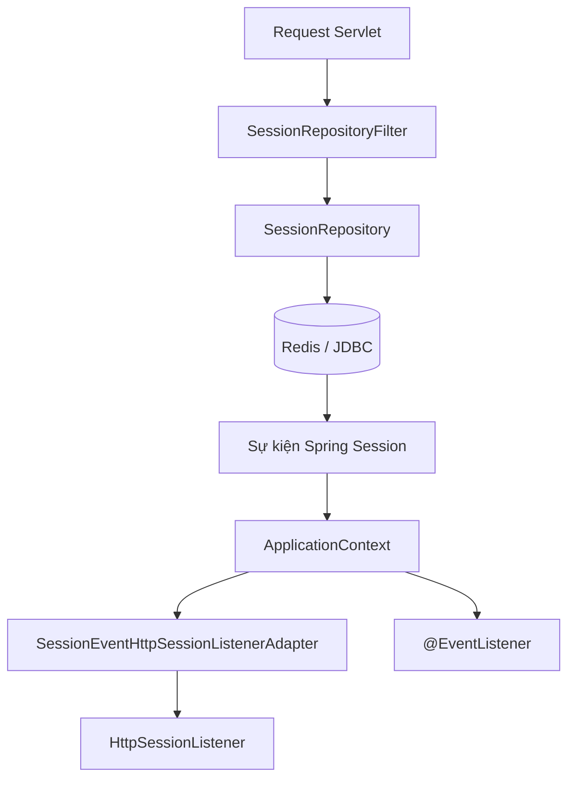
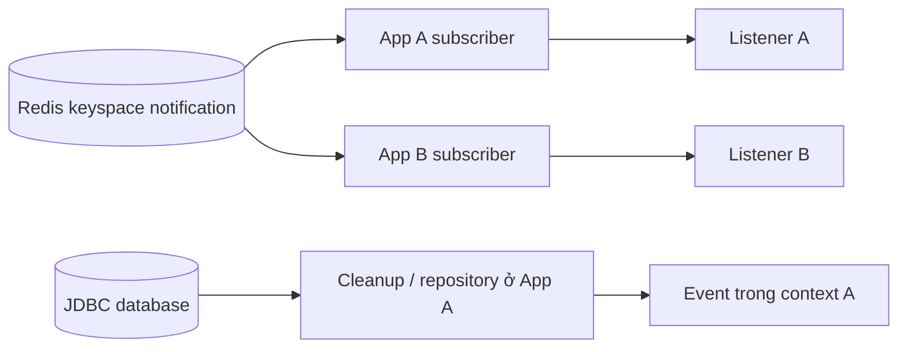

# HttpSessionListener, sự kiện Spring Session và khác biệt giữa các repository

Servlet cung cấp `HttpSessionListener` để ứng dụng nhận biết khi một phiên được tạo hoặc bị hủy. Spring Session thay đổi nơi lưu trữ và quản lý vòng đời của phiên, vì vậy các thông báo vòng đời không còn chỉ do bộ chứa Servlet trong một tiến trình phát ra. Spring Session cung cấp các sự kiện ứng dụng như `SessionCreatedEvent`, `SessionDeletedEvent` và `SessionExpiredEvent`; một adapter có thể chuyển các sự kiện tương ứng thành callback Servlet để mã cũ tiếp tục sử dụng listener.

Cách phát và chuyển tiếp sự kiện phụ thuộc repository đang dùng. Redis, JDBC và repository trong bộ nhớ khác nhau về cách phát hiện session hết hạn, khả năng lập chỉ mục và phạm vi phân phối sự kiện. Vì vậy, khi viết listener cho ứng dụng chạy nhiều instance, cần hiểu nguồn sự kiện và kiểm thử với đúng repository cùng cấu hình thực tế.

## 1. Vòng đời HttpSession trong Servlet

`HttpSession` là API Servlet để lưu trạng thái gắn với một người dùng qua nhiều request. Một session có mã định danh, thời điểm truy cập, thời hạn không hoạt động và tập hợp thuộc tính do ứng dụng lưu.

`HttpSessionListener` là giao diện lắng nghe hai mốc vòng đời:

- `sessionCreated(HttpSessionEvent event)` được gọi khi một session được tạo.
- `sessionDestroyed(HttpSessionEvent event)` được gọi khi một session bị hủy, chẳng hạn do `invalidate()` hoặc hết thời hạn không hoạt động.

Ví dụ một listener đơn giản:

```java
public class AccessSessionListener implements HttpSessionListener {

    @Override
    public void sessionCreated(HttpSessionEvent event) {
        HttpSession session = event.getSession();
        // Ghi nhận việc tạo session hoặc khởi tạo dữ liệu nhẹ.
    }

    @Override
    public void sessionDestroyed(HttpSessionEvent event) {
        HttpSession session = event.getSession();
        // Ghi nhận việc kết thúc session hoặc giải phóng tài nguyên.
    }
}
```

Listener không được gọi mỗi khi một thuộc tính session thay đổi. Các callback `HttpSessionAttributeListener` có mục đích riêng cho việc thêm, xóa hoặc thay thế thuộc tính trong môi trường Servlet. `HttpSessionBindingListener` lại thông báo cho chính đối tượng được bind vào session khi đối tượng được gắn hoặc tháo khỏi session. Không nên dùng `HttpSessionListener` để theo dõi mọi thao tác dữ liệu trong phiên.

Trong ứng dụng Spring Boot Servlet, listener có thể được khai báo thành bean để bộ khởi tạo Servlet đăng ký, hoặc đăng ký tường minh bằng `ServletListenerRegistrationBean`. Với ứng dụng triển khai trực tiếp trên container, có thể dùng `@WebListener` nếu cơ chế quét annotation của container được bật, hoặc khai báo listener trong cấu hình triển khai phù hợp.

## 2. Vì sao Spring Session cần cầu nối sự kiện?

Khi không dùng Spring Session, container Servlet thường sở hữu session và quản lý vòng đời của nó trong bộ nhớ của instance. Container vì thế có thể trực tiếp gọi `HttpSessionListener`.

Khi dùng Spring Session, `SessionRepositoryFilter` bọc request và cung cấp một `HttpSession` được quản lý bởi repository. Dữ liệu có thể được lưu trong Redis hoặc JDBC. Vòng đời session lúc này gắn với repository và kho dữ liệu dùng chung, không chỉ với bộ nhớ của container đang xử lý request.

Spring Session phát các sự kiện ở tầng Spring ApplicationContext. Để listener Servlet hiện có tiếp tục hoạt động, Spring Session cung cấp `SessionEventHttpSessionListenerAdapter`. Adapter nhận sự kiện vòng đời của Spring Session và chuyển chúng thành `HttpSessionEvent` cho các `HttpSessionListener` đã đăng ký.

Với ứng dụng Spring Boot được cấu hình Spring Session theo cách tiêu chuẩn, phần tích hợp adapter thường được cấu hình tự động khi có listener phù hợp. Nếu tự cấu hình Servlet hoặc tự đăng ký filter và listener, hãy xác nhận adapter thực sự có mặt và được kết nối với các listener cần dùng. Việc chỉ tạo một listener bean không tự chứng minh rằng mọi sự kiện do repository phát ra đều được chuyển tiếp đúng.

Luồng khái quát:



Adapter là lớp tương thích giữa mô hình sự kiện Spring Session và API listener Servlet. Nó không làm cho mọi loại sự kiện thuộc tính hoặc mọi hành vi riêng của container được mô phỏng đầy đủ. Hãy dùng sự kiện Spring Session khi cần phân biệt nguyên nhân kết thúc phiên hoặc cần xử lý theo mô hình ứng dụng Spring.

## 3. Các sự kiện vòng đời của Spring Session

Các sự kiện thường gặp gồm:

| Sự kiện | Ý nghĩa |
|---|---|
| `SessionCreatedEvent` | Repository ghi nhận một session mới |
| `SessionDeletedEvent` | Session bị xóa hoặc vô hiệu hóa một cách tường minh |
| `SessionExpiredEvent` | Session hết hạn theo thời hạn không hoạt động hoặc chính sách hết hạn của store |

`SessionDeletedEvent` và `SessionExpiredEvent` thuộc nhóm sự kiện kết thúc session. Nếu chỉ dùng `HttpSessionListener`, callback `sessionDestroyed` thường không cho biết phiên kết thúc do logout hay timeout. Sự kiện Spring Session cụ thể giúp phân biệt hai trường hợp đó.

Có thể lắng nghe các sự kiện bằng `@EventListener`:

```java
@Component
public class SessionLifecycleEvents {

    @EventListener
    public void onCreated(SessionCreatedEvent event) {
        String sessionId = event.getSession().getId();
        // Ghi nhận session mới.
    }

    @EventListener
    public void onDeleted(SessionDeletedEvent event) {
        String sessionId = event.getSession().getId();
        // Ghi nhận session bị xóa hoặc invalidate.
    }

    @EventListener
    public void onExpired(SessionExpiredEvent event) {
        String sessionId = event.getSession().getId();
        // Ghi nhận session hết hạn.
    }
}
```

Các ví dụ giả định phiên bản Spring Session đang dùng cung cấp API `getSession()` trên sự kiện tương ứng. Khi nâng cấp phiên bản, hãy đối chiếu chữ ký API thực tế. Không nên ghi toàn bộ thuộc tính session vào log hoặc audit; thuộc tính có thể chứa thông tin cá nhân, token hay dữ liệu nhạy cảm. Session ID cũng là thông tin xác thực dạng bearer, nên tránh ghi nguyên văn ID vào log.

Một session object có thể được tạo trong bộ nhớ trước khi được lưu vào repository. Do đó, không nên hiểu `SessionCreatedEvent` là thông báo cho mọi lần gọi `request.getSession()` ở bất kỳ thời điểm nào; sự kiện gắn với việc repository tạo/lưu session theo triển khai cụ thể.

## 4. Dùng HttpSessionListener khi cần tương thích mã Servlet

Một listener hiện có có thể được giữ lại khi ứng dụng chuyển sang Spring Session:

```java
@Component
public class LegacySessionListener implements HttpSessionListener {

    @Override
    public void sessionCreated(HttpSessionEvent event) {
        // Logic tương thích Servlet khi session được tạo.
    }

    @Override
    public void sessionDestroyed(HttpSessionEvent event) {
        // Logic tương thích Servlet khi session kết thúc.
    }
}
```

Trong ứng dụng dùng Spring Session, `SessionEventHttpSessionListenerAdapter` đóng vai trò chuyển `SessionCreatedEvent` và sự kiện kết thúc session thành các callback tương ứng. Cấu hình tích hợp cụ thể có thể phụ thuộc Spring Boot, Spring Session và cách listener được đăng ký.

Nếu listener không được gọi, hãy kiểm tra lần lượt:

1. Listener có được đăng ký với Servlet container hoặc Spring Session adapter hay không.
2. Adapter có được tạo và nhận đúng các listener hay không.
3. Repository đang dùng có phát sự kiện vòng đời cần thiết hay không.
4. Store có được cấu hình để phát sự kiện hết hạn hay không.
5. Ứng dụng có đang chạy đúng profile, dependency và cấu hình repository dự kiến hay không.

Không nên đồng thời đăng ký nhiều adapter hoặc nhiều listener có cùng side effect mà không có chủ đích. Khi chuyển từ session cục bộ sang session chia sẻ, hãy kiểm tra callback thực tế để tránh một hành động nghiệp vụ bị thực hiện hai lần.

## 5. Sự khác nhau giữa các loại repository

Spring Session tách API truy cập session khỏi cách lưu trữ. `SessionRepository` cung cấp các thao tác cơ bản như tạo, lưu, tìm và xóa session. Một số implementation bổ sung khả năng tra cứu theo chỉ mục, thường là tên principal của người dùng.

`FindByIndexNameSessionRepository` mở rộng khả năng truy vấn session theo tên chỉ mục và giá trị. Đây là tính năng quan trọng nếu ứng dụng cần tìm các phiên đang hoạt động của một người dùng, ví dụ để triển khai đăng xuất khỏi tất cả thiết bị. Không phải mọi repository đều hỗ trợ cùng một tập tính năng.

| Repository | Nơi lưu và phạm vi | Chỉ mục / truy vấn | Sự kiện và lưu ý |
|---|---|---|---|
| `MapSessionRepository` | Bộ nhớ của tiến trình; phù hợp kiểm thử hoặc phát triển đơn giản | Tập tính năng cơ bản, không nên giả định có chỉ mục principal như repository indexed | Không có thông báo phân tán giữa các instance; dữ liệu mất khi tiến trình dừng |
| `RedisIndexedSessionRepository` | Redis dùng chung; phù hợp nhiều instance | Hỗ trợ chỉ mục để tìm session theo principal | Có thể phát sự kiện qua Redis keyspace notifications; cần cấu hình và kiểm tra thông báo hết hạn |
| `RedisSessionRepository` | Redis dùng chung, theo implementation và phiên bản hỗ trợ | Tập trung vào thao tác session cơ bản; khả năng index khác với implementation indexed | Không được giả định có cùng tính năng index và event như `RedisIndexedSessionRepository` |
| `JdbcIndexedSessionRepository` | Bảng quan hệ dùng chung; phù hợp khi hệ thống chọn JDBC | Hỗ trợ tra cứu theo chỉ mục principal | Dựa vào thao tác database và cơ chế dọn session hết hạn; thời điểm và phạm vi event khác Redis |

Tên lớp và tính năng có thể thay đổi theo phiên bản Spring Session. Trước khi chọn implementation, hãy kiểm tra phiên bản dependency thực tế và contract mà ứng dụng cần. Điểm quan trọng là không suy luận rằng mọi lớp thực thi `SessionRepository` đều phát đủ ba loại sự kiện hoặc hỗ trợ truy vấn theo principal.

### 5.1. Repository trong bộ nhớ

`MapSessionRepository` lưu session trong cấu trúc dữ liệu của tiến trình. Nó tiện cho unit test, ví dụ minh họa và ứng dụng đơn giản. Nhưng hai instance ứng dụng có hai vùng nhớ khác nhau; session tạo ở instance A không tự xuất hiện ở instance B.

Khi tiến trình khởi động lại, dữ liệu session trong bộ nhớ bị mất. Vì thế, repository này không phù hợp làm kho session chia sẻ cho một cụm production. Nó cũng không cung cấp một kênh sự kiện phân tán để các instance khác nhận biết phiên vừa bị xóa hoặc hết hạn.

### 5.2. Repository Redis có chỉ mục

`RedisIndexedSessionRepository` lưu dữ liệu phiên trong Redis và duy trì các cấu trúc chỉ mục để hỗ trợ tra cứu. Ví dụ, ứng dụng có thể tìm session theo principal để hiển thị thiết bị đang đăng nhập hoặc thu hồi các phiên của một tài khoản.

Repository này có thể nhận thông báo tạo, xóa và hết hạn thông qua Redis keyspace notifications. Để nhận thông báo hết hạn, Redis phải bật loại notification phù hợp. Trong nhiều cấu hình, Spring Session có thể thử cấu hình `notify-keyspace-events`, nhưng dịch vụ Redis được quản lý có thể chặn lệnh `CONFIG SET`. Khi đó, quản trị viên phải cấu hình notification ở cấp dịch vụ theo hướng dẫn của nhà cung cấp. Nếu chủ động tắt hành vi tự cấu hình, cần bảo đảm cấu hình Redis đã được đặt trước.

Thông báo hết hạn từ Redis là bất đồng bộ. Một session có thể hết TTL tại một thời điểm nhưng listener nhận thông báo sau đó. Redis keyspace notifications cũng không phải hàng đợi bền vững: subscriber ngắt kết nối có thể bỏ lỡ thông báo trong thời gian ngừng nhận. Vì vậy, không dùng riêng notification để bảo đảm một nghiệp vụ quan trọng chỉ chạy đúng một lần.

### 5.3. Repository Redis không có chỉ mục

Một implementation Redis không indexed có thể giảm phần chi phí duy trì các cấu trúc chỉ mục nếu ứng dụng chỉ cần tìm session theo ID. Đổi lại, ứng dụng không có cùng khả năng truy vấn session theo principal như repository indexed.

Khả năng phát và chuyển tiếp session events cũng không nên được mặc định giống implementation indexed. Nếu ứng dụng phụ thuộc vào `SessionExpiredEvent` hoặc `SessionDeletedEvent`, hãy xác minh implementation của phiên bản đang dùng thực sự phát các sự kiện đó và chạy integration test với Redis thật.

### 5.4. Repository JDBC có chỉ mục

`JdbcIndexedSessionRepository` lưu session và thuộc tính vào các bảng quan hệ, đồng thời hỗ trợ chỉ mục principal. Đây là lựa chọn phù hợp khi hệ thống đã có database quan hệ được vận hành ổn định hoặc muốn quản lý session trong cùng nền tảng lưu trữ.

Khác với Redis, database quan hệ thường không gửi key-expiration notification tương tự Redis. Repository JDBC dùng các truy vấn và cơ chế dọn bản ghi hết hạn theo implementation. Do đó, thời điểm phát hiện session hết hạn có thể phụ thuộc vào lần truy cập hoặc chu kỳ cleanup. Event do một ApplicationContext phát ra cũng không mặc nhiên trở thành thông báo broadcast cho mọi instance đang kết nối cùng database.

Khi cần listener chạy trên nhiều instance, phải xác định rõ event nào được phát ở instance nào. Không nên dựa vào một event cục bộ của JDBC để giả định mọi node trong cụm đều đã nhận thông báo.

## 6. Redis keyspace notifications và sự kiện hết hạn

Redis hỗ trợ keyspace notifications để gửi thông báo khi một key được tạo, xóa hoặc hết hạn. Spring Session có thể sử dụng các thông báo này để phát sự kiện vòng đời.

Thuộc tính Redis thường được nhắc đến là `notify-keyspace-events`. Một cấu hình cần nhóm sự kiện hết hạn và các sự kiện thao tác key phù hợp; ví dụ `Egx` thường được dùng trong cấu hình Spring Session Redis. Hãy đối chiếu yêu cầu của phiên bản Spring Session và Redis đang chạy trước khi thay đổi giá trị hiện có, vì cấu hình này có thể được chia sẻ với ứng dụng khác.

Khi sử dụng dịch vụ Redis managed:

- Kiểm tra nhà cung cấp có cho phép keyspace notifications hay không.
- Nếu lệnh `CONFIG` bị hạn chế, cấu hình thông qua console hoặc tham số của dịch vụ.
- Nếu ứng dụng không được phép thay đổi cấu hình Redis lúc khởi động, cấu hình hành vi `ConfigureRedisAction` theo hướng dẫn của phiên bản và bảo đảm notification đã được bật từ trước.
- Theo dõi kết nối của message listener container và lỗi subscribe.
- Kiểm thử hết hạn thực tế bằng TTL ngắn trong môi trường tích hợp.

Sự kiện `SessionExpiredEvent` không nên được coi là đồng hồ chính xác đến từng mili giây. TTL xác định thời điểm key đủ điều kiện hết hạn; việc Redis phát notification và ứng dụng nhận notification còn phụ thuộc hoạt động của Redis và kết nối subscriber.

## 7. JDBC cleanup và độ trễ sự kiện

Với JDBC, dữ liệu session hết hạn được xác định dựa trên thời gian hết hạn được lưu trong database. Các implementation có thể sử dụng truy vấn kiểm tra hoặc tác vụ cleanup định kỳ để tìm và xóa bản ghi hết hạn.

Điều này tạo ra một khác biệt vận hành so với Redis:

- Redis có cơ chế TTL trên key và keyspace notifications để thông báo hết hạn.
- JDBC dùng timestamp và truy vấn database; cleanup có thể chạy theo lịch hoặc theo cơ chế repository.
- Một session hết hạn theo logic không có nghĩa bản ghi vật lý đã bị xóa ngay lập tức.
- Một event được phát trong ApplicationContext của instance xử lý cleanup không tự động được truyền sang ApplicationContext ở instance khác.

Nếu ứng dụng cần xử lý sau khi session hết hạn, hãy xác định chu kỳ cleanup, cách phát event và nơi listener được chạy. Nếu cần bảo đảm audit hoặc đồng bộ trạng thái nghiệp vụ trên toàn cụm, dùng một cơ chế sự kiện bền vững riêng, chẳng hạn outbox kết hợp message broker, thay vì phụ thuộc hoàn toàn vào callback session.

## 8. Phạm vi phân phối sự kiện trong cụm nhiều instance

Sự kiện Spring ApplicationContext mặc định là sự kiện trong một context. Việc nhiều instance dùng cùng Redis hoặc database không tự biến mọi sự kiện thành broadcast.

Với Redis keyspace notifications, mỗi instance có kết nối subscribe phù hợp có thể nhận cùng một thông báo từ Redis. Nếu mỗi instance đều có listener thực hiện cùng side effect, hành động đó có thể chạy nhiều lần. Đây là điều cần tính đến khi listener gửi thông báo, giải phóng tài nguyên dùng chung hoặc ghi audit.

Với JDBC, một event được phát bởi repository trong một instance thường chỉ được listener trong ApplicationContext đó nhận, trừ khi ứng dụng có thêm cơ chế truyền sự kiện giữa các node.



Thiết kế listener theo các nguyên tắc sau:

- Listener nên idempotent: xử lý cùng một thông báo nhiều lần không gây kết quả sai.
- Không giả định event được giao đúng một lần hoặc chắc chắn không bị mất.
- Side effect quan trọng nên được bảo vệ bằng khóa nghiệp vụ, unique constraint, idempotency key hoặc hàng đợi bền vững.
- Nếu chỉ cần metric hoặc log chẩn đoán, chấp nhận được việc event có độ trễ và có thể thiếu trong thời gian gián đoạn, miễn là hệ thống quan sát có nguồn dữ liệu bổ sung.
- Không giữ tài nguyên quan trọng chỉ trong listener; sự kiện session có thể đến muộn hoặc không được chuyển tiếp khi ứng dụng ngừng hoạt động.

## 9. Phân biệt logout, xóa session và session hết hạn

Ba khái niệm này liên quan nhưng không đồng nghĩa:

| Tình huống | Ý nghĩa | Sự kiện thường cần quan sát |
|---|---|---|
| Người dùng logout | Ứng dụng chủ động kết thúc phiên hiện tại | `SessionDeletedEvent` |
| Quản trị viên thu hồi phiên | Ứng dụng hoặc tác vụ quản trị xóa session | `SessionDeletedEvent` |
| Session không hoạt động quá timeout | Phiên hết hạn theo chính sách lưu trữ | `SessionExpiredEvent` |
| Cookie bị xóa ở trình duyệt | Trình duyệt không gửi ID trong request tiếp theo | Không bảo đảm repository đã xóa session |
| Instance ứng dụng dừng | Một tiến trình ngừng hoạt động | Không đồng nghĩa session trong kho dùng chung đã bị xóa |

Để logout đúng, ứng dụng cần vô hiệu hóa session phía máy chủ và xóa cookie ở response. Chỉ xóa cookie không xóa bản ghi session trong repository. Ngược lại, xóa session trong repository khiến ID cũ không còn tra cứu được dù cookie vẫn nằm trong trình duyệt.

Nếu cần thu hồi mọi phiên của một người dùng, repository phải hỗ trợ tra cứu theo principal hoặc ứng dụng phải duy trì một chỉ mục riêng. Khi dùng `FindByIndexNameSessionRepository`, hãy xác minh principal index được ghi đúng và việc xóa nhiều session được thực hiện an toàn khi có request đồng thời.

## 10. Thiết kế listener an toàn và dễ vận hành

Listener nên thực hiện công việc nhẹ, có thời gian xử lý ngắn. Ví dụ, ghi một metric, cập nhật một dấu mốc audit hoặc gửi một thông điệp đến hàng đợi. Nếu listener gọi dịch vụ mạng chậm ngay trong luồng xử lý sự kiện, việc tạo hoặc hủy session có thể kéo dài theo.

Không dùng listener session để lưu toàn bộ hồ sơ người dùng hoặc làm nguồn dữ liệu nghiệp vụ chính. Session là trạng thái tạm thời phục vụ điều hướng request; dữ liệu nghiệp vụ lâu dài nên được lưu trong domain repository riêng.

Một số thực hành nên áp dụng:

1. Chỉ ghi nhận ID đã được băm hoặc mã tham chiếu không nhạy cảm.
2. Thiết kế xử lý idempotent để chống event lặp.
3. Giới hạn retry và timeout cho side effect bên ngoài.
4. Đưa tác vụ dài vào executor hoặc message broker có giám sát.
5. Đo số event tạo, xóa, hết hạn, lỗi listener và độ trễ xử lý.
6. Có tác vụ đối soát định kỳ nếu nghiệp vụ cần phát hiện phiên hoặc tài nguyên bị bỏ sót.
7. Không dùng event hết hạn làm cơ chế duy nhất để thu hồi quyền truy cập nhạy cảm; request vẫn phải kiểm tra session và quyền ở thời điểm truy cập.

## 11. Kiểm thử listener và khác biệt repository

Unit test listener bằng event giả lập giúp kiểm tra logic xử lý, nhưng không chứng minh repository thật phát sự kiện đúng. Cần có integration test riêng cho từng store mà ứng dụng triển khai.

### Kiểm thử HttpSessionListener

- Tạo session qua request và xác nhận `sessionCreated` được gọi.
- Gọi logout hoặc `invalidate()` và xác nhận callback kết thúc phiên.
- Để session hết hạn trong môi trường timeout ngắn và kiểm tra callback sau khi repository phát hiện hết hạn.
- Xác nhận adapter không gọi listener hai lần khi listener được đăng ký qua nhiều cơ chế.

### Kiểm thử Redis

- Chạy Redis thật hoặc môi trường tương đương production.
- Kiểm tra `notify-keyspace-events` và kết nối subscriber.
- Tạo, xóa và hết hạn session, sau đó quan sát các sự kiện tương ứng.
- Ngắt subscriber tạm thời rồi kết nối lại để hiểu hành vi khi bỏ lỡ notification.
- Chạy hai instance cùng Redis để xác định node nào nhận event và listener có bị thực hiện lặp hay không.
- Kiểm tra index principal nếu ứng dụng cần tìm các session theo người dùng.

### Kiểm thử JDBC

- Tạo schema bằng migration tương ứng với phiên bản Spring Session.
- Tạo và xóa session qua repository, xác nhận bản ghi trong database thay đổi.
- Dùng timeout ngắn và kích hoạt hoặc chờ cơ chế cleanup để kiểm tra hành vi hết hạn.
- Chạy hai application context cùng database và xác định event được phát ở context nào.
- Kiểm tra truy vấn theo principal nếu dùng `JdbcIndexedSessionRepository`.

Một test tốt cần xác nhận kết quả nghiệp vụ, không chỉ kiểm tra callback đã được gọi. Ví dụ, khi nhận sự kiện logout, phiên cũ phải thực sự không còn được chấp nhận ở instance khác.

## 12. Chọn listener và repository theo nhu cầu

Dùng `HttpSessionListener` khi cần tương thích với mã Servlet hiện có và chỉ cần biết thời điểm tạo/kết thúc phiên ở mức tổng quát. Dùng Spring Session events khi cần phân biệt tạo, xóa và hết hạn, hoặc khi cần tích hợp với repository và ApplicationContext.

Chọn repository theo nhu cầu dữ liệu và vận hành:

- Chọn repository trong bộ nhớ cho kiểm thử hoặc ứng dụng đơn giản chỉ chạy một tiến trình.
- Chọn Redis indexed khi cần kho chia sẻ tốc độ cao, tra cứu session theo principal và có thể cấu hình keyspace notifications.
- Chọn Redis repository không indexed khi chỉ cần thao tác theo session ID và phiên bản đang dùng hỗ trợ implementation này; xác minh rõ khả năng phát event.
- Chọn JDBC indexed khi muốn lưu trong database quan hệ và cần tra cứu session theo principal; kiểm thử chu kỳ cleanup cùng phạm vi event.

Trước khi triển khai, hãy xác nhận listener được đăng ký đúng, adapter Servlet có mặt khi cần, repository phát loại event nào, và các side effect có thể được gọi nhiều lần hay không. Với hệ thống nhiều instance, event vòng đời session là tín hiệu hữu ích để quan sát và phối hợp xử lý, còn các nghiệp vụ quan trọng vẫn cần cơ chế lưu trữ và truyền thông điệp có độ bền phù hợp.

