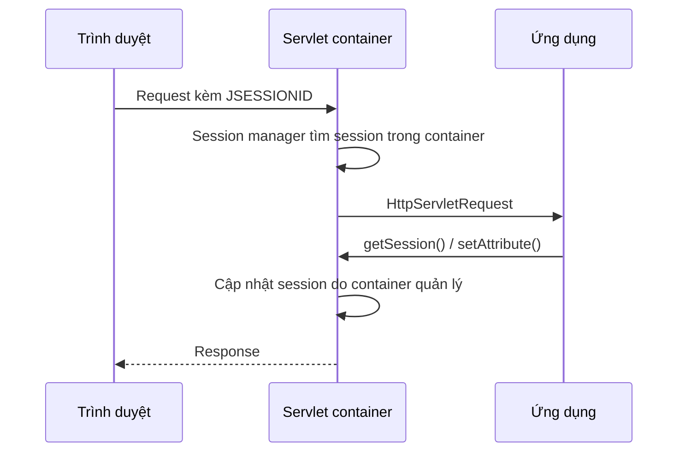
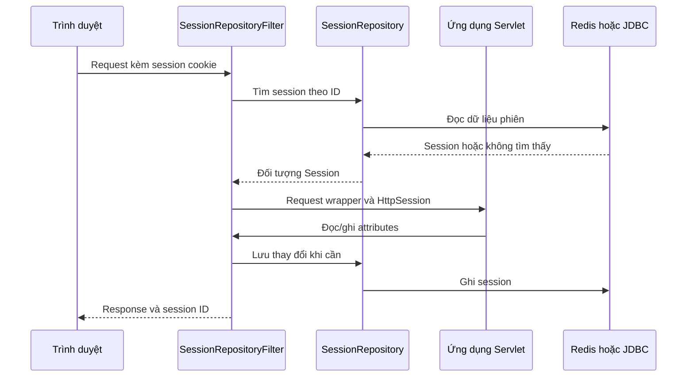
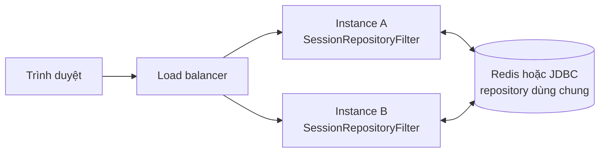

# Phân biệt HttpSession của container với phiên do Spring Session quản lý

Trong ứng dụng Servlet, mã Java thường thao tác với session qua interface `jakarta.servlet.http.HttpSession`. Tuy nhiên, interface này không quyết định dữ liệu phiên được lưu ở đâu. Khi không tích hợp Spring Session, servlet container thường quản lý session bằng session manager của chính nó. Khi tích hợp Spring Session, ứng dụng vẫn dùng API `HttpSession`, nhưng Spring Session chuyển việc tạo, tìm, lưu và xóa dữ liệu phiên sang một `SessionRepository` như Redis hoặc JDBC.

Vì vậy, cần phân biệt **API mà ứng dụng nhìn thấy** với **thành phần thực sự quản lý dữ liệu phiên**. Hiểu đúng ranh giới này giúp tránh tạo hai session độc lập, cấu hình nhầm cookie, mất trạng thái khi request chuyển sang instance khác hoặc đăng xuất không thu hồi phiên ở nơi lưu trữ.

## 1. HttpSession là hợp đồng của Servlet

`HttpSession` là interface trong Servlet API, cung cấp cách làm việc với dữ liệu gắn với một người dùng qua nhiều request. Ứng dụng có thể lấy session từ `HttpServletRequest`, đọc và ghi attributes, kiểm tra ID, đặt thời gian không hoạt động tối đa hoặc vô hiệu hóa session.

```java
@GetMapping("/cart")
public String cart(HttpServletRequest request) {
    HttpSession session = request.getSession();

    Integer count = (Integer) session.getAttribute("itemCount");
    count = (count == null) ? 1 : count + 1;
    session.setAttribute("itemCount", count);

    return "cart";
}
```

Đoạn controller này chỉ phụ thuộc Servlet API. Nó không gọi trực tiếp Redis, JDBC hoặc API riêng của servlet container. Khi request được xử lý, implementation đứng sau `HttpSession` sẽ quyết định dữ liệu được đọc và ghi theo cơ chế nào.

Hai cách lấy session có ngữ nghĩa khác nhau:

```java
HttpSession existing = request.getSession(false);
HttpSession current = request.getSession();
```

- `getSession(false)` trả về session hiện có nếu request đã được gắn với một session hợp lệ; nếu không có thì trả về `null` và không tạo mới.
- `getSession()` tương đương yêu cầu lấy session hiện tại hoặc tạo một session mới nếu request chưa có session.

Điểm này vẫn đúng khi Spring Session quản lý phiên. Controller có thể giữ nguyên cách sử dụng `HttpSession` trong cả hai mô hình.

## 2. Khi chỉ dùng servlet container

Nếu ứng dụng không cài đặt Spring Session, servlet container (ví dụ Tomcat, Jetty hoặc một container tương thích Servlet khác) thường cung cấp session manager mặc định. Khi request gọi `getSession()`, container tạo hoặc khôi phục session và quản lý vòng đời của nó.

Trong cấu hình mặc định phổ biến, dữ liệu session nằm trong bộ nhớ của tiến trình container. Container ánh xạ session ID nhận từ client sang đối tượng session tương ứng trong bộ nhớ. Cookie mặc định thường mang tên `JSESSIONID`; cookie này mang ID, không chứa toàn bộ attributes của session.



Mô hình này đơn giản và phù hợp với ứng dụng chạy một instance hoặc chấp nhận cơ chế quản lý session riêng của container. Tuy nhiên, nếu load balancer phân phối hai request liên tiếp đến hai instance độc lập, instance thứ hai thường không có dữ liệu session nằm trong bộ nhớ instance thứ nhất.

Một số servlet container hỗ trợ lưu session xuống đĩa, sao chép session trong cụm hoặc tích hợp một cơ chế clustering riêng. Những khả năng đó phụ thuộc container và cấu hình triển khai. Không nên mặc định mọi container đều tự chia sẻ session giữa các instance.

## 3. Khi dùng Spring Session trong ứng dụng Servlet

Spring Session thay thế phần quản lý dữ liệu session phía sau API Servlet. `SessionRepositoryFilter` là điểm tích hợp chính. Filter này bọc `HttpServletRequest` và `HttpServletResponse`; request wrapper cung cấp cách truy cập `HttpSession` được Spring Session quản lý.

Khi ứng dụng gọi `request.getSession()`, wrapper làm việc với `SessionRepository` để tạo hoặc khôi phục một đối tượng `Session`. Các thao tác trên `HttpSession` được ánh xạ sang đối tượng session đó. Khi cần lưu thay đổi, Spring Session ghi dữ liệu qua repository đã cấu hình.



Điểm quan trọng là `HttpSession` vẫn là giao diện lập trình của ứng dụng, nhưng dữ liệu không còn do session manager mặc định của container làm nguồn chính. Repository có thể dùng Redis hoặc JDBC, nên nhiều instance ứng dụng có thể đọc cùng dữ liệu phiên nếu được cấu hình dùng chung kho và cùng cách diễn giải session.

Trong cấu hình Spring Boot tiêu chuẩn, dependency Spring Session phù hợp và thông tin kết nối kho dữ liệu thường đủ để Boot cấu hình repository cùng filter. Ví dụ với Redis:

```java
@Configuration
@EnableRedisHttpSession
class SessionConfiguration {
    // Cần có RedisConnectionFactory được cấu hình.
}
```

Đây là cách bật Spring Session Redis ở mức Spring Session. Trong ứng dụng Boot đã dùng auto-configuration tương ứng, thường không cần thêm annotation này. Chỉ chọn một cơ chế cấu hình để tránh đăng ký trùng repository hoặc filter.

## 4. So sánh hai mô hình

| Khía cạnh | HttpSession do container quản lý | HttpSession do Spring Session quản lý |
|---|---|---|
| API controller | `HttpSession` | `HttpSession` |
| Thành phần quản lý dữ liệu | Session manager của servlet container | `SessionRepository` của Spring Session |
| Nơi lưu phổ biến | Bộ nhớ của tiến trình container | Redis, JDBC hoặc repository được hỗ trợ |
| Phạm vi chia sẻ | Thường gắn với một container; clustering tùy nhà cung cấp | Có thể chia sẻ giữa nhiều instance cùng dùng kho và cấu hình tương thích |
| Session ID | Thường do container quản lý, cookie mặc định thường là `JSESSIONID` | Do Spring Session/repository quản lý; cookie mặc định thường là `SESSION` |
| Vòng đời và lưu trữ | Theo session manager và cấu hình container | Theo repository, TTL và cấu hình Spring Session |
| Đăng xuất | Vô hiệu hóa session trong container | Vô hiệu hóa session và xóa dữ liệu qua repository |
| Vận hành | Phụ thuộc container, memory và clustering | Phụ thuộc thêm kho dữ liệu, kết nối, serializer, TTL và giám sát |

Tên cookie trong bảng là giá trị mặc định phổ biến, không phải một phần bắt buộc của hợp đồng `HttpSession`. Spring Session có thể được cấu hình dùng tên cookie khác, kể cả `JSESSIONID`, nếu cần tương thích với hệ thống hiện có. Dù dùng tên cookie nào, phải xác định rõ thành phần nào đang đọc ID và repository nào đang quản lý dữ liệu tương ứng.

## 5. Cookie và session ID không cho biết nơi lưu dữ liệu

Cookie chỉ là cách trình duyệt gửi lại một định danh phiên. Khi dùng container mặc định, cookie thường là `JSESSIONID`. Khi dùng Spring Session, cookie mặc định thường là `SESSION`, được tạo và phân giải bởi `HttpSessionIdResolver` (mặc định dùng cookie resolver).

Luồng cookie của Spring Session có thể được cấu hình bằng `CookieSerializer`. Ví dụ đổi tên cookie Spring Session thành `JSESSIONID`:

```java
@Bean
DefaultCookieSerializer cookieSerializer() {
    DefaultCookieSerializer serializer = new DefaultCookieSerializer();
    serializer.setCookieName("JSESSIONID");
    serializer.setUseHttpOnlyCookie(true);
    serializer.setUseSecureCookie(true);
    serializer.setSameSite("Lax");
    return serializer;
}
```

Ví dụ này minh họa cấu hình cookie serializer cho Spring Session. Trong thực tế, chỉ bật `Secure` khi ứng dụng được truy cập qua HTTPS; nếu chạy sau reverse proxy, cần cấu hình forwarded headers và scheme một cách đáng tin cậy để ứng dụng nhận biết đúng request gốc là HTTPS. `HttpOnly` giúp JavaScript phía trình duyệt không đọc cookie; `SameSite` cần được chọn theo luồng điều hướng và yêu cầu cross-site của ứng dụng.

Đổi tên cookie thành `JSESSIONID` không biến repository Spring Session thành session manager của container. Tên cookie chỉ là tên trường trong HTTP. Cơ chế tìm ID và nơi lưu session vẫn do `HttpSessionIdResolver` và `SessionRepository` quyết định.

Khi container session và Spring Session cùng tồn tại trong một ứng dụng, tránh để cả hai cơ chế sử dụng cùng cookie name mà không có kế hoạch rõ ràng. Nếu hai thành phần cùng ghi cookie `JSESSIONID`, một response có thể ghi đè giá trị của thành phần kia hoặc request tiếp theo bị giải mã theo repository sai. Nếu cần chuyển đổi, hãy lên kế hoạch cutover, chọn một nguồn session duy nhất và xác định cách xử lý session ID cũ.

## 6. Filter phải chạy trước thành phần truy cập session

`SessionRepositoryFilter` cần bọc request trước khi các filter hoặc thành phần khác gọi `getSession()`. Nếu một filter xác thực, logging, audit hoặc custom filter tạo session trước khi request đi qua Spring Session, servlet container có thể tạo một session native. Khi đó request có thể đồng thời mang một session do container quản lý và một session do Spring Session quản lý.

Hậu quả có thể gồm:

- Container phát `JSESSIONID` trong khi Spring Session phát `SESSION`.
- Một filter đọc attributes từ session container, còn controller đọc attributes từ session Spring Session.
- Đăng xuất chỉ vô hiệu hóa một session, khiến session còn lại tiếp tục tồn tại.
- Session native tiêu tốn bộ nhớ container dù ứng dụng dự định lưu toàn bộ phiên trong Redis hoặc JDBC.

Spring Boot tự đăng ký filter với thứ tự phù hợp khi dùng auto-configuration. Nếu đăng ký thủ công hoặc có filter registration tùy chỉnh, cần bảo đảm `springSessionRepositoryFilter` chạy trước mọi filter truy cập `HttpSession`. Cũng cần tránh gọi `request.getSession()` trong code chạy trước filter, chẳng hạn một listener hoặc filter tự viết được đăng ký sai thứ tự.

Một dấu hiệu chẩn đoán là log hoặc response xuất hiện cả cookie `JSESSIONID` và `SESSION` trong khi ứng dụng chỉ dự định dùng Spring Session. Đây không phải lúc nào cũng là lỗi (ứng dụng có thể cố ý có hai cơ chế độc lập), nhưng cần kiểm tra thứ tự filter và nơi tạo session trước khi kết luận.

## 7. API HttpSession được giữ lại, nhưng nguồn dữ liệu thay đổi

Các thao tác phổ biến như `getAttribute`, `setAttribute`, `removeAttribute`, `getId`, `getCreationTime`, `getLastAccessedTime`, `setMaxInactiveInterval` và `invalidate` vẫn thuộc API `HttpSession`. Mã nghiệp vụ thông thường không cần biết session được lưu trong container hay repository.

Ví dụ đăng xuất:

```java
@PostMapping("/logout")
public String logout(HttpServletRequest request) {
    HttpSession session = request.getSession(false);
    if (session != null) {
        session.invalidate();
    }
    return "redirect:/login";
}
```

Khi dùng container mặc định, `invalidate()` vô hiệu hóa session do container quản lý. Khi request đã được bọc bởi Spring Session, thao tác này được chuyển thành việc vô hiệu hóa session Spring Session và xóa dữ liệu tương ứng khỏi repository theo implementation. Response cũng cần xóa cookie ID thông qua resolver để trình duyệt ngừng gửi ID cũ.

Không nên chỉ xóa cookie ở trình duyệt mà bỏ qua việc thu hồi session phía máy chủ. Nếu dữ liệu phiên vẫn tồn tại và ID bị lộ, phiên có thể tiếp tục được sử dụng bởi client khác. Ngược lại, sau khi repository đã xóa session, cookie cũ gửi lại không thể khôi phục dữ liệu phiên đã bị thu hồi.

## 8. Thời hạn phiên và cách hết hạn

Với session do container quản lý, timeout thường được cấu hình trong ứng dụng hoặc qua cấu hình của container. Với Spring Session, thời hạn không hoạt động được lưu trên session và repository hiện thực hóa chính sách hết hạn. Redis có thể dùng TTL cho key; JDBC lưu thông tin hết hạn và có cơ chế dọn bản ghi cũ.

Đặt `maxInactiveInterval` qua API Servlet:

```java
HttpSession session = request.getSession();
session.setMaxInactiveInterval(30 * 60); // 30 phút, đơn vị giây
```

Hoặc đặt timeout mặc định cho Spring Session qua cấu hình Boot phù hợp với phiên bản:

```yaml
spring:
  session:
    timeout: 30m
```

Cookie max-age và session timeout là hai giá trị riêng. Cookie có thể còn nằm trong trình duyệt sau khi session đã hết hạn ở repository; request kế tiếp gửi ID cũ nhưng Spring Session không tìm thấy session hợp lệ. Ngược lại, cookie có thể hết hạn trước khi dữ liệu session bị dọn vật lý. Logic xác thực phải dựa vào session hợp lệ và trạng thái bảo mật phía máy chủ, không chỉ dựa vào việc cookie còn tồn tại.

## 9. Chuyển từ container session sang Spring Session

Khi thêm Spring Session vào một ứng dụng đang chạy, không nên giả định các session hiện có trong bộ nhớ container tự động được chuyển sang Redis hoặc JDBC. Spring Session cần tìm session trong repository của nó. Một ID do container phát trước đó không tự động có bản ghi tương ứng trong repository mới.

Một kế hoạch chuyển đổi thường gồm:

1. Chọn thời điểm chuyển đổi và xác định có chấp nhận người dùng đăng nhập lại hay cần cơ chế di trú phiên.
2. Chọn cookie name cho Spring Session. Có thể giữ tên `JSESSIONID` để giảm thay đổi phía client, nhưng phải bảo đảm không có hai thành phần cùng quản lý cookie đó.
3. Cấu hình repository và kết nối dùng chung cho tất cả instance.
4. Đặt filter đúng thứ tự để mọi thành phần dùng cùng một nguồn session.
5. Triển khai đồng bộ cấu hình và kiểm thử đăng nhập, request tiếp theo, đăng xuất và chuyển request giữa các instance.
6. Theo dõi số lượng session, lỗi đọc/ghi repository, tỷ lệ session không tìm thấy và lỗi kết nối trong giai đoạn chuyển đổi.

Nếu cần giữ các phiên đang hoạt động, phải thiết kế quá trình di trú có kiểm soát, bao gồm ánh xạ ID, attributes, thời hạn và định dạng dữ liệu. Không thể chỉ đổi cookie name rồi kỳ vọng container session cũ xuất hiện trong Redis/JDBC.

## 10. Sự kiện vòng đời và listener

Khi dùng session manager mặc định, ứng dụng có thể đăng ký các listener Servlet như `HttpSessionListener` để nhận sự kiện tạo và hủy session do container phát. Đây là sự kiện của session manager container.

Khi Spring Session quản lý dữ liệu, vòng đời session gắn với repository. Spring Session có thể phát các application event như `SessionCreatedEvent`, `SessionDeletedEvent` và `SessionExpiredEvent` tùy implementation và cấu hình. Ứng dụng có thể lắng nghe bằng Spring event listener:

```java
@Component
class SessionLifecycleListener {

    @EventListener
    public void onCreated(SessionCreatedEvent event) {
        // Ghi nhận phiên mới; tránh log session ID dạng rõ.
    }

    @EventListener
    public void onExpired(SessionExpiredEvent event) {
        // Xử lý nghiệp vụ phù hợp khi phiên hết hạn.
    }
}
```

Việc nhận sự kiện xóa hoặc hết hạn phụ thuộc repository. Ví dụ với Redis, việc phát hiện key hết hạn và thông báo về ứng dụng liên quan đến keyspace notifications và message listener; môi trường Redis cần cho phép cấu hình tương ứng. Với JDBC, sự kiện có thể gắn với đường đi xóa session do Spring Session thực hiện; việc dọn dữ liệu cũ theo lịch không nên bị hiểu nhầm là một callback nghiệp vụ đảm bảo chạy đúng một lần cho mọi session.

Nếu ứng dụng cần tương thích với listener Servlet cũ, Spring Session cung cấp adapter để chuyển một số sự kiện Spring Session sang API `HttpSessionListener`. Cần cấu hình adapter và xác minh repository thực sự phát các event cần thiết. Không giả định `HttpSessionListener` của container tự động nhận đầy đủ các sự kiện từ một kho Redis dùng chung.

Sự kiện vòng đời phù hợp cho audit, cập nhật chỉ số hoặc dọn dữ liệu phụ trợ. Với nghiệp vụ quan trọng, listener cần xử lý lặp an toàn, có log và có khả năng phục hồi; không nên coi một event hết hạn là cơ chế giao dịch đảm bảo thực thi chính xác một lần.

## 11. Nhiều instance và tính đồng thời

Với container session cục bộ, hai instance có thể có hai bản session riêng cho cùng một người dùng nếu không có clustering hoặc replication. Sticky session có thể khiến request thường quay về cùng instance, nhưng khi instance chết, được thay thế hoặc load balancer đổi định tuyến, dữ liệu cục bộ có thể không còn truy cập được.

Với Spring Session và repository dùng chung, request đến instance A có thể tạo hoặc cập nhật session trong Redis/JDBC; request tiếp theo đến instance B dùng cùng session ID để đọc dữ liệu từ repository. Đây là cơ sở để mở rộng ngang và giảm phụ thuộc vào bộ nhớ của một instance.



Repository dùng chung không tự giải quyết mọi xung đột cập nhật. Hai request đồng thời có thể cùng đọc một giá trị attribute rồi ghi hai giá trị mới; kết quả có thể là lost update. Servlet API cũng không làm cho các object mutable lưu trong session trở nên thread-safe. Nếu nhiều request cập nhật cùng dữ liệu, cần thiết kế đồng bộ, thao tác nguyên tử hoặc chuyển dữ liệu nghiệp vụ cạnh tranh cao sang kho có transaction phù hợp.

## 12. Kiểm thử để xác nhận ứng dụng đang dùng đúng session

Một kiểm thử controller chạy thành công chưa đủ để chứng minh session được lưu đúng nơi. Nên kiểm tra cả API và nơi lưu trữ.

**Kiểm thử với container session:** tạo session, ghi attribute, gửi request tiếp theo qua cùng container và xác nhận attribute được đọc lại. Nếu ứng dụng chạy nhiều instance, kiểm tra hành vi khi request được chuyển đến instance khác và xác nhận clustering/replication có được cấu hình hay không.

**Kiểm thử với Spring Session:**

1. Gửi request tạo session và kiểm tra cookie do Spring Session phát.
2. Xác nhận dữ liệu được ghi vào repository Redis hoặc JDBC.
3. Gửi request tiếp theo kèm cookie và xác nhận attribute được khôi phục.
4. Gửi request đến instance khác và xác nhận vẫn đọc được cùng session.
5. Gọi `invalidate()` và xác nhận repository không còn session hợp lệ, đồng thời response xóa cookie.
6. Chờ quá TTL trong môi trường kiểm thử và xác nhận session hết hạn.
7. Kiểm tra không có filter nào tạo container session trước `SessionRepositoryFilter`.

Khi chuyển đổi, nên kiểm tra response header `Set-Cookie`, cookie được gửi ở request tiếp theo, log của filter và dữ liệu trong kho. Nếu thấy cả `JSESSIONID` và `SESSION`, hãy xác định cookie nào thuộc container, cookie nào thuộc Spring Session và thành phần nào đã tạo chúng.

## 13. Khi nào chọn mỗi mô hình?

Session do container quản lý phù hợp với ứng dụng nhỏ, triển khai đơn instance hoặc môi trường đã có cơ chế clustering của container được vận hành và kiểm thử đầy đủ. Cách này có ít thành phần hạ tầng hơn, nhưng phạm vi chia sẻ và khả năng phục hồi phụ thuộc container.

Spring Session phù hợp khi cần giữ API `HttpSession` nhưng muốn lưu phiên trong kho dùng chung, triển khai nhiều instance độc lập hoặc kiểm soát session bằng Redis/JDBC. Mô hình này bổ sung yêu cầu vận hành cho kho dữ liệu, kết nối, serializer, TTL, cookie và theo dõi lỗi.

Khi thiết kế, hãy trả lời rõ ba câu hỏi: API nào mà controller sử dụng, thành phần nào tạo và phân giải session ID, và kho nào là nguồn dữ liệu chính của session. Nếu cả ba câu trả lời nhất quán giữa mọi instance, ứng dụng sẽ tránh được phần lớn lỗi do trộn session của container với session do Spring Session quản lý.
