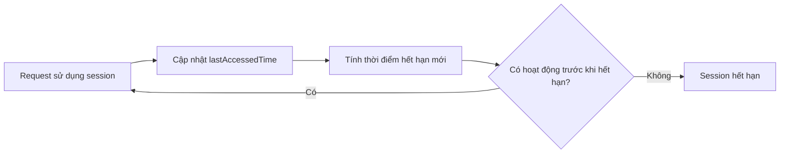

# `maxInactiveInterval`, thời hạn mặc định và tùy chỉnh cho từng phiên

Spring Session quản lý session theo vòng đời của từng phiên làm việc. Một thuộc tính quan trọng là `maxInactiveInterval`: khoảng thời gian tối đa mà session được phép không có hoạt động trước khi bị xem là hết hạn. Giá trị này quyết định idle timeout của phiên, ảnh hưởng trực tiếp đến thời gian người dùng có thể tiếp tục sử dụng trạng thái đăng nhập hoặc luồng thao tác.

Ứng dụng Spring có thể đặt thời hạn mặc định cho các session mới, sau đó điều chỉnh riêng từng session theo nhu cầu nghiệp vụ. Ví dụ, phiên đăng nhập thông thường có thể cho phép không hoạt động 30 phút, trong khi một luồng xác nhận thao tác nhạy cảm chỉ tồn tại 5 phút. Bài học này trình bày ý nghĩa của `maxInactiveInterval`, cách cấu hình thời hạn toàn cục và riêng từng phiên, sự khác nhau giữa idle timeout với cookie max-age và absolute lifetime, cũng như cách xác minh TTL trên Redis/JDBC và kiểm thử hết hạn.

## 1. `maxInactiveInterval` biểu diễn điều gì?

HTTP là giao thức không lưu trạng thái giữa các request. Session giúp server nhận ra các request thuộc cùng một phiên thông qua session ID, thường được gửi trong cookie. Mỗi session có thời điểm tạo, thời điểm truy cập gần nhất và khoảng thời gian không hoạt động tối đa.

`maxInactiveInterval` là khoảng thời gian tính từ lần truy cập gần nhất. Nếu phiên không được sử dụng vượt quá khoảng thời gian đó, session được xem là hết hạn. Có thể hình dung thời điểm hết hạn dự kiến như sau:

\[
T_{expiry} = T_{lastAccessed} + maxInactiveInterval
\]

Ví dụ, một session có `lastAccessedTime` lúc 10:00 và `maxInactiveInterval` là 30 phút thì session hết hạn sau khoảng 10:30 nếu không có request nào tiếp tục sử dụng phiên. Khi một request hợp lệ tiếp tục sử dụng session, thời điểm truy cập gần nhất được cập nhật và thời điểm hết hạn được tính lại.



Điều này có nghĩa `maxInactiveInterval` là idle timeout, không phải thời gian sống tuyệt đối kể từ khi đăng nhập. Người dùng hoạt động đều đặn có thể giữ phiên lâu hơn nhiều so với con số timeout, trừ khi ứng dụng đặt thêm giới hạn tuyệt đối.

## 2. Giá trị mặc định của session

Spring Session lưu khoảng thời gian không hoạt động trên từng session. Repository cũng có giá trị mặc định để áp dụng khi tạo session mới. Với `MapSessionRepository`, có thể cấu hình giá trị mặc định bằng `setDefaultMaxInactiveInterval`. Các repository khác có cơ chế cấu hình tương ứng hoặc nhận giá trị từ Spring Boot.

Trong ứng dụng Spring Boot, thuộc tính thường dùng để cấu hình thời hạn session là `spring.session.timeout`:

```yaml
spring:
  session:
    timeout: 30m
```

Giá trị `30m` nghĩa là 30 phút. Spring Boot hỗ trợ biểu diễn thời lượng bằng các hậu tố như `s`, `m`, `h` hoặc `d`; nên ghi rõ đơn vị để tránh nhầm lẫn. Nếu không khai báo, thời hạn có thể lấy theo mặc định của repository hoặc servlet container tùy cách ứng dụng được cấu hình và phiên bản Spring Boot/Spring Session đang sử dụng. Trong ứng dụng production, nên đặt rõ thời hạn mong muốn và xác minh giá trị thực tế trên session thay vì dựa vào giả định về mặc định.

Ví dụ với Redis:

```yaml
spring:
  data:
    redis:
      host: localhost
      port: 6379
  session:
    timeout: 30m
    redis:
      namespace: shop:session
```

Với JDBC, cấu hình timeout có thể dùng cùng thuộc tính session:

```yaml
spring:
  datasource:
    url: jdbc:postgresql://localhost:5432/shop
    username: shop_app
    password: ${DB_PASSWORD}
  session:
    timeout: 30m
```

`spring.session.timeout` là giá trị cấu hình ở cấp ứng dụng. `server.servlet.session.timeout` là thuộc tính của servlet container và có thể làm giá trị fallback trong một số cấu hình Spring Boot khi thuộc tính session riêng không được đặt. Khi dùng Spring Session, hãy ưu tiên cấu hình rõ `spring.session.timeout`, kiểm tra cách Boot phiên bản dự án bind giá trị đó vào repository và tránh đặt hai thuộc tính với giá trị mâu thuẫn.

### 2.1. Đặt mặc định trực tiếp trên repository

Khi tự cấu hình `MapSessionRepository`, có thể đặt thời hạn mặc định cho session được tạo bởi repository:

```java
import java.time.Duration;
import java.util.concurrent.ConcurrentHashMap;

import org.springframework.context.annotation.Bean;
import org.springframework.context.annotation.Configuration;
import org.springframework.session.MapSessionRepository;
import org.springframework.session.config.annotation.web.http.EnableSpringHttpSession;

@Configuration
@EnableSpringHttpSession
public class SessionConfiguration {

    @Bean
    MapSessionRepository sessionRepository() {
        MapSessionRepository repository =
                new MapSessionRepository(new ConcurrentHashMap<>());
        repository.setDefaultMaxInactiveInterval(Duration.ofMinutes(30));
        return repository;
    }
}
```

Ví dụ dùng API Spring Session 3.x, trong đó khoảng thời gian được biểu diễn bằng `java.time.Duration`. Ở các phiên bản cũ hơn, chữ ký API có thể dùng số giây; cần đối chiếu đúng phiên bản thư viện được dự án quản lý. Nếu dùng Spring Boot auto-configuration với Redis hoặc JDBC, thông thường chỉ cần cấu hình property tương ứng và không tự tạo thêm repository bean nếu không có lý do cụ thể.

Giá trị mặc định của repository được dùng khi tạo session mới. Nó không nên được hiểu là lệnh tự động viết lại timeout của tất cả session đã tồn tại. Những phiên cũ có thể tiếp tục giữ khoảng thời gian đã được lưu trước đó cho đến khi hết hạn hoặc được ứng dụng cập nhật. Khi thay đổi chính sách timeout toàn hệ thống, hãy quyết định rõ cách xử lý session đang hoạt động.

## 3. Tùy chỉnh thời hạn cho từng session qua Servlet API

Trong controller hoặc service làm việc với Servlet API, ứng dụng có thể tùy chỉnh idle timeout của một session bằng `HttpSession.setMaxInactiveInterval(int seconds)`. Giá trị được truyền vào tính bằng giây.

Ví dụ đặt timeout 5 phút cho một luồng xác nhận thao tác:

```java
import jakarta.servlet.http.HttpServletRequest;
import jakarta.servlet.http.HttpSession;
import org.springframework.web.bind.annotation.PostMapping;
import org.springframework.web.bind.annotation.RestController;

@RestController
public class ConfirmationController {

    @PostMapping("/confirmation/start")
    public String startConfirmation(HttpServletRequest request) {
        HttpSession session = request.getSession();
        session.setAttribute("confirmationPending", true);
        session.setMaxInactiveInterval(5 * 60); // 5 phút, đơn vị giây
        return "Confirmation started";
    }
}
```

Khi Spring Session filter đã bọc request, thao tác trên `HttpSession` được chuyển đến session do Spring Session quản lý. Timeout tùy chỉnh được lưu cùng trạng thái session và có hiệu lực với phiên đó. Những session khác tiếp tục dùng thời hạn mặc định hoặc thời hạn riêng mà chúng đã được đặt.

Có thể đọc lại giá trị hiện tại bằng `getMaxInactiveInterval()`:

```java
HttpSession session = request.getSession(false);
if (session != null) {
    int timeoutSeconds = session.getMaxInactiveInterval();
    log.debug("Session idle timeout is {} seconds", timeoutSeconds);
}
```

Không ghi session ID hoặc cookie vào log để chẩn đoán. Thời hạn không phải dữ liệu bí mật, nhưng vẫn nên tránh log quá nhiều thông tin về phiên người dùng trong môi trường production.

### 3.1. Tùy chỉnh theo loại người dùng hoặc nghiệp vụ

Một ứng dụng có thể áp dụng thời hạn khác nhau theo loại phiên:

| Loại phiên | Ví dụ idle timeout | Lý do |
| --- | ---: | --- |
| Phiên đăng nhập thông thường | 30 phút | Cân bằng trải nghiệm và rủi ro phiên bị bỏ quên |
| Luồng xác nhận thao tác nhạy cảm | 5 phút | Giảm thời gian trạng thái chờ xác nhận còn hiệu lực |
| Quy trình nhập liệu nhiều bước | 20 phút | Cho phép người dùng tạm dừng trong thời gian hợp lý |
| Phiên kiosk hoặc thiết bị dùng chung | 2–5 phút | Hạn chế người tiếp theo tiếp tục phiên bị bỏ quên |

Các con số chỉ là ví dụ để minh họa cách phân loại. Chính sách thật cần dựa trên mức độ nhạy cảm của thao tác, cách xác thực lại, thời gian hoàn thành công việc và yêu cầu bảo mật của sản phẩm.

Không nên đặt timeout rất dài cho toàn bộ session chỉ vì một vài luồng cần thêm thời gian. Thay vào đó, giữ mặc định phù hợp và chỉ điều chỉnh session hoặc trạng thái con cần thiết. Nếu chỉ một bước xác nhận cần sống 5 phút, có thể lưu thời điểm hết hạn của bước xác nhận riêng trong session và kiểm tra nó khi xử lý request; điều này giúp giới hạn nghiệp vụ rõ ràng ngay cả khi session đăng nhập còn hoạt động.

## 4. Tùy chỉnh thời hạn bằng Spring Session `Session` API

Spring Session định nghĩa abstraction `Session` với phương thức dùng `Duration`. Cách này hữu ích khi viết adapter, service hoặc test làm việc trực tiếp với `SessionRepository`, thay vì thông qua `HttpSession`.

```java
import java.time.Duration;
import java.util.concurrent.ConcurrentHashMap;

import org.springframework.session.MapSession;
import org.springframework.session.MapSessionRepository;

public class SessionTimeoutExample {

    public void createShortSession() {
        MapSessionRepository repository =
                new MapSessionRepository(new ConcurrentHashMap<>());

        MapSession session = repository.createSession();
        session.setMaxInactiveInterval(Duration.ofMinutes(5));
        session.setAttribute("purpose", "confirm-payment");

        repository.save(session);
    }
}
```

Trong ví dụ này, `createSession()` tạo một đối tượng session với giá trị mặc định của repository. `setMaxInactiveInterval(Duration)` ghi đè thời hạn cho đối tượng cụ thể. `save(session)` lưu thay đổi vào repository. Trong ứng dụng web, controller thường tiếp tục dùng `HttpSession`; không cần truy cập trực tiếp repository chỉ để đặt timeout của request hiện tại.

Khi dùng `HttpSession`, Servlet API nhận số giây; khi dùng Spring Session `Session`, API nhận `Duration`. Không nhầm hai kiểu tham số. Có thể chuyển đổi rõ ràng:

```java
Duration idleTimeout = Duration.ofMinutes(5);
session.setMaxInactiveInterval(Math.toIntExact(idleTimeout.toSeconds()));
```

`Math.toIntExact` giúp phát hiện nếu số giây vượt giới hạn kiểu `int` của Servlet API, thay vì âm thầm tràn số.

## 5. Ý nghĩa của giá trị âm, bằng không và thời hạn rất dài

Với Servlet API, `HttpSession.setMaxInactiveInterval` nhận số giây. Giá trị âm biểu thị session không tự hết hạn do inactivity. Không dùng `0` để biểu thị “vô hạn”: cách xử lý giá trị bằng không có thể khác nhau giữa Servlet container và repository, và trong một số implementation của Spring Session nó khiến phiên được xem là hết hạn gần như ngay lập tức. Với Spring Session `Duration`, giá trị âm thường được dùng để biểu thị không hết hạn theo idle timeout; hành vi chính xác nên được kiểm tra theo implementation và phiên bản repository.

Không nên dùng session không hết hạn cho tài khoản người dùng thông thường. Một session tồn tại vô hạn làm tăng tác động nếu cookie bị lộ hoặc thiết bị bị bỏ quên. Nếu sản phẩm cần “ghi nhớ đăng nhập”, hãy thiết kế cơ chế persistent login có token được quản lý, thu hồi và xoay vòng riêng; không đơn giản đặt idle timeout thành vô hạn.

Thời hạn rất dài cũng làm tăng số phiên tồn tại đồng thời và dung lượng kho dữ liệu. Với Redis, điều này ảnh hưởng bộ nhớ và chính sách eviction. Với JDBC, nó làm tăng số bản ghi và chi phí dọn dữ liệu. Với Map repository, nó giữ object trong heap lâu hơn và có thể làm tăng áp lực garbage collection.

## 6. Phân biệt idle timeout, cookie max-age và absolute lifetime

Ba khái niệm này thường bị nhầm lẫn nhưng điều khiển những phần khác nhau:

| Khái niệm | Áp dụng ở đâu | Ý nghĩa |
| --- | --- | --- |
| Idle timeout (`maxInactiveInterval`) | Server-side session/repository | Thời gian không hoạt động tối đa trước khi session hết hạn |
| Cookie `Max-Age` hoặc `Expires` | Trình duyệt | Thời gian trình duyệt giữ cookie chứa session ID |
| Absolute lifetime | Chính sách ứng dụng/xác thực | Tổng thời gian tối đa từ lúc xác thực hoặc tạo phiên, kể cả khi người dùng vẫn hoạt động |

Ví dụ, cookie có thể được giữ trong trình duyệt 7 ngày, nhưng session phía server có idle timeout 30 phút. Sau 30 phút không hoạt động, cookie vẫn có thể được gửi lên, nhưng repository từ chối session đã hết hạn và ứng dụng yêu cầu xác thực lại. Ngược lại, trình duyệt có thể xóa cookie khi đóng cửa sổ dù dữ liệu session phía server vẫn tồn tại cho đến khi TTL kết thúc.

Absolute lifetime cần được kiểm tra riêng. Khi xác thực thành công, ứng dụng có thể lưu thời điểm xác thực vào session:

```java
session.setAttribute("authenticatedAt", Instant.now());
```

Trong mỗi request được bảo vệ, kiểm tra thời điểm này với giới hạn tuyệt đối, ví dụ 8 giờ. Nếu đã vượt quá giới hạn, thực hiện logout/invalidate và yêu cầu xác thực lại. Không chỉ dựa vào `maxInactiveInterval`, vì hoạt động liên tục có thể gia hạn idle timeout.

Một chính sách thường gặp là kết hợp idle timeout 30 phút với absolute lifetime 8 giờ. Khi người dùng không hoạt động, phiên hết hạn sớm sau 30 phút. Nếu người dùng liên tục hoạt động, phiên vẫn bị buộc xác thực lại khi đạt 8 giờ. Con số thực tế tùy thuộc vào mức độ rủi ro và yêu cầu sản phẩm.

## 7. Timeout được áp dụng thế nào ở Redis và JDBC?

Spring Session giữ semantics của idle timeout ở lớp `Session`, còn repository chuyển trạng thái đó thành cơ chế lưu trữ phù hợp.

### 7.1. Redis

Với Redis, session được lưu thành các key và có TTL do repository quản lý. Khi session được truy cập và lưu lại, thời hạn có thể được làm mới dựa trên `maxInactiveInterval`. TTL giúp Redis tự loại bỏ dữ liệu sau khi hết hạn, nhưng việc phát hiện expiration và phát sự kiện hết hạn có thể không xảy ra chính xác tại thời điểm TTL về 0.

Ví dụ:

```yaml
spring:
  session:
    timeout: 30m
    redis:
      namespace: app:session
```

Để kiểm tra TTL, tìm key session trong namespace và dùng `PTTL` trên một key cụ thể. Không dùng `KEYS *` trên production. Cấu trúc key nội bộ có thể thay đổi theo phiên bản; hãy dựa trên namespace và tài liệu đúng phiên bản. Cũng cần phân biệt key dữ liệu session với key phụ trợ cho expiration/index nếu repository đang sử dụng.

### 7.2. JDBC

Với JDBC, repository lưu thời điểm hết hạn hoặc thông tin thời hạn trong bảng session. Khi truy cập session, thời gian truy cập gần nhất và thời điểm hết hạn được cập nhật theo chính sách repository. Các bản ghi hết hạn có thể được dọn bởi tác vụ cleanup; không giả định row biến mất chính xác ngay giây đầu tiên sau khi hết hạn.

Ví dụ cấu hình:

```yaml
spring:
  session:
    timeout: 30m
    jdbc:
      cleanup-cron: "0 * * * * *"
```

Biểu thức cron trên chỉ là ví dụ chạy mỗi phút; property và khả năng cấu hình cleanup cần được xác nhận theo phiên bản Spring Boot/Spring Session đang dùng. Nếu dự án quản lý cleanup bằng scheduler hoặc migration/job riêng, bảo đảm không có nhiều cơ chế xung đột xóa session.

### 7.3. Map trong bộ nhớ

`MapSessionRepository` kiểm tra thời hạn khi tìm session và giữ dữ liệu trong heap của JVM. Nó không cung cấp TTL phân tán của một kho dữ liệu chuyên dụng. Session hết hạn về mặt logic có thể không còn được trả về như một phiên hợp lệ, nhưng việc dọn các entry cũ khỏi map và giải phóng heap phụ thuộc vào implementation. Cần theo dõi dung lượng và số lượng session trong môi trường chạy dài ngày.

## 8. Điều gì xảy ra khi thay đổi timeout toàn cục?

Thay đổi `spring.session.timeout` rồi restart ứng dụng sẽ ảnh hưởng đến giá trị mặc định được cấu hình cho session mới theo cách auto-configuration của phiên bản đang dùng. Không nên giả định mọi session đã lưu trong Redis hoặc JDBC được cập nhật lại ngay lập tức.

Ví dụ, hôm nay ứng dụng tạo session với timeout 60 phút. Ngày mai cấu hình giảm xuống 20 phút. Những session cũ có thể vẫn mang timeout 60 phút nếu repository đã lưu giá trị này trên từng session. Các session mới được tạo sau khi cấu hình mới có hiệu lực sẽ dùng 20 phút. Hành vi cụ thể còn tùy repository và cách phiên được cập nhật khi request đến.

Nếu chính sách bảo mật yêu cầu giảm thời hạn cho cả session đang hoạt động, cần một kế hoạch chuyển đổi rõ ràng:

1. Quyết định có chấp nhận đăng xuất toàn bộ người dùng hay không.
2. Nếu phải giữ phiên, xây dựng công việc cập nhật timeout cho session đang tồn tại bằng API hoặc công cụ quản trị phù hợp với repository.
3. Kiểm thử với dữ liệu phiên thực tế và xác minh các instance đều áp dụng cùng chính sách.
4. Theo dõi số phiên bị hết hạn và số lần người dùng phải xác thực lại sau thay đổi.

Không sửa trực tiếp key Redis hoặc row JDBC theo cách phụ thuộc cấu trúc nội bộ nếu không có kế hoạch tương thích và kiểm thử. Dùng API repository hoặc công cụ được Spring Session hỗ trợ để tránh làm hỏng định dạng lưu trữ.

## 9. Kiểm thử timeout và thời hạn riêng từng session

Kiểm thử cần xác minh cả giá trị cấu hình và hành vi hết hạn. Một unit test có thể kiểm tra session được tạo với timeout mặc định rồi ghi đè bằng timeout riêng:

```java
import static org.assertj.core.api.Assertions.assertThat;

import java.time.Duration;
import java.util.concurrent.ConcurrentHashMap;

import org.junit.jupiter.api.Test;
import org.springframework.session.MapSession;
import org.springframework.session.MapSessionRepository;

class SessionTimeoutTest {

    @Test
    void usesDefaultAndAllowsPerSessionOverride() {
        MapSessionRepository repository =
                new MapSessionRepository(new ConcurrentHashMap<>());
        repository.setDefaultMaxInactiveInterval(Duration.ofMinutes(30));

        MapSession standard = repository.createSession();
        assertThat(standard.getMaxInactiveInterval())
                .isEqualTo(Duration.ofMinutes(30));

        MapSession shortLived = repository.createSession();
        shortLived.setMaxInactiveInterval(Duration.ofMinutes(5));
        repository.save(shortLived);

        MapSession loaded = repository.findById(shortLived.getId());
        assertThat(loaded).isNotNull();
        assertThat(loaded.getMaxInactiveInterval())
                .isEqualTo(Duration.ofMinutes(5));
    }
}
```

Test trên kiểm tra giá trị mặc định và override, không phải kiểm thử TTL vật lý của Redis/JDBC. Đối với integration test, hãy dùng repository thật trong Testcontainers hoặc môi trường test riêng:

1. Tạo session với timeout ngắn, ví dụ 3–5 giây.
2. Gửi request tạo session và giữ cookie.
3. Gửi request tiếp theo trước khi hết hạn để xác nhận hoạt động làm mới idle timeout theo thiết kế.
4. Ngừng gửi request lâu hơn timeout rồi gửi lại cookie; ứng dụng phải xem phiên là hết hạn.
5. Tạo một session khác với timeout riêng, xác minh phiên đó hết hạn theo thời hạn riêng mà không ảnh hưởng session khác.
6. Kiểm tra trạng thái key TTL trên Redis hoặc expiry metadata/cleanup trên JDBC.

Không nên dựa vào `Thread.sleep` dài và thời điểm chính xác tuyệt đối trong unit test vì scheduler, clock và độ trễ hạ tầng có thể làm test chập chờn. Dùng timeout ngắn ở integration test, polling có giới hạn và khoảng dung sai hợp lý. Với kiểm thử chính xác thời gian, thiết kế abstraction clock nếu logic ứng dụng tự quản lý absolute lifetime.

## 10. Các lỗi thường gặp khi cấu hình timeout

- **Nhầm đơn vị:** `HttpSession.setMaxInactiveInterval` nhận giây, còn Spring Session `Session#setMaxInactiveInterval` nhận `Duration` ở API hiện đại. Truyền `30` với ý định 30 phút sẽ thành 30 giây ở Servlet API.
- **Chỉ thay timeout mặc định nhưng quên session cũ:** các session đã lưu có thể tiếp tục giữ giá trị cũ. Cần kế hoạch cập nhật hoặc thu hồi.
- **Dùng idle timeout thay absolute lifetime:** request liên tục có thể kéo dài phiên vô hạn nếu không có giới hạn tuyệt đối.
- **Nhầm cookie còn hạn với session còn hiệu lực:** cookie chỉ mang ID; repository vẫn có thể từ chối session đã hết hạn.
- **Đặt timeout âm để tránh người dùng đăng nhập lại:** phiên không tự hết hạn làm tăng rủi ro khi thiết bị bị bỏ quên hoặc cookie bị lộ.
- **Cho rằng TTL đồng nghĩa sự kiện chạy đúng giây hết hạn:** Redis expiration và JDBC cleanup có thể bất đồng bộ hoặc trễ.
- **Không kiểm tra timeout riêng từng phiên:** một luồng nghiệp vụ đặt timeout dài có thể vô tình kéo dài cả phiên đăng nhập nếu dùng chung session.
- **Không kiểm tra giá trị runtime:** cấu hình property có thể bị profile khác hoặc bean tự khai báo ghi đè.

## 11. Checklist thiết kế chính sách thời hạn

Trước khi phát hành, hãy xác nhận:

- [ ] Đã xác định idle timeout mặc định phù hợp với loại ứng dụng và mức độ nhạy cảm.
- [ ] Đã đặt rõ `spring.session.timeout` hoặc xác minh fallback được sử dụng.
- [ ] Đã phân biệt timeout mặc định của repository với timeout riêng của session.
- [ ] Các API đặt timeout dùng đúng đơn vị: giây với `HttpSession`, `Duration` với Spring Session `Session`.
- [ ] Session cũ được xử lý khi chính sách timeout thay đổi.
- [ ] Cookie `Max-Age`/`Expires` không bị nhầm với thời hạn server-side.
- [ ] Có absolute lifetime nếu yêu cầu bảo mật cần giới hạn tổng thời gian đăng nhập.
- [ ] Đã kiểm thử timeout trên repository thực tế và nhiều instance nếu triển khai phân tán.
- [ ] Có giám sát session hết hạn, dung lượng Redis/JDBC và tác động đến trải nghiệm đăng nhập.

## 12. Tự kiểm tra kiến thức

Bạn đã nắm được nội dung nếu có thể giải thích:

- `maxInactiveInterval` được tính từ thời điểm nào và vì sao nó có thể được làm mới?
- `spring.session.timeout` khác với `MapSessionRepository#setDefaultMaxInactiveInterval` như thế nào?
- Làm thế nào đặt timeout 5 phút cho một session qua `HttpSession` và qua Spring Session `Session` API?
- Vì sao đổi timeout mặc định không nhất thiết cập nhật ngay những session đã tồn tại?
- Idle timeout khác cookie max-age và absolute lifetime ở điểm nào?
- Redis, JDBC và Map repository thể hiện thời hạn và cleanup khác nhau ra sao?
- Cần kiểm thử những tình huống nào để xác nhận timeout mặc định và timeout riêng?

`maxInactiveInterval` giúp kiểm soát thời gian một phiên được phép không hoạt động. Cấu hình mặc định tạo chính sách chung, còn override theo từng session cho phép điều chỉnh theo nhu cầu nghiệp vụ. Để chính sách có hiệu lực đúng, cần phân biệt idle timeout với cookie và absolute lifetime, hiểu cách repository triển khai TTL, đồng thời xác minh bằng request thực tế và dữ liệu của kho đang dùng.
