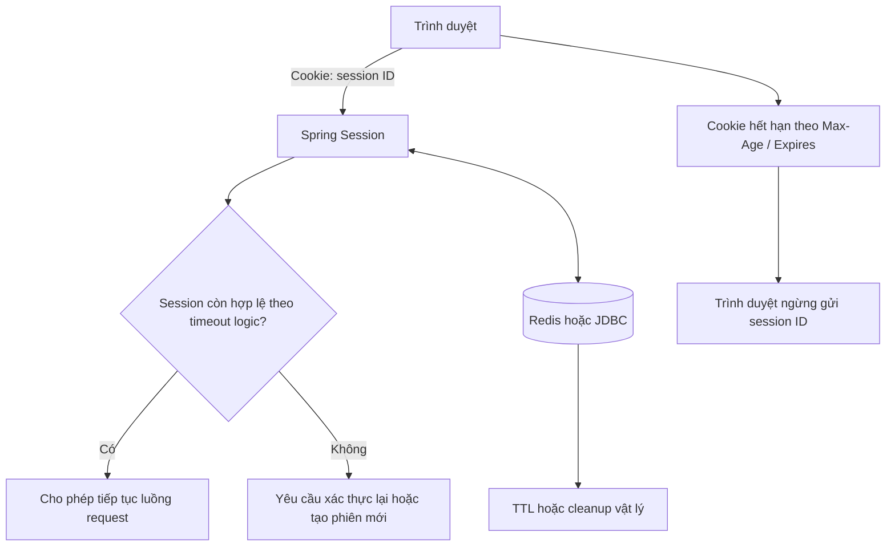

# Thời hạn cookie, thời hạn logic của phiên và TTL của kho lưu trữ

Một phiên Spring Session có nhiều mốc thời gian khác nhau. Trình duyệt giữ cookie chứa mã định danh phiên trong bao lâu, ứng dụng coi phiên còn hợp lệ trong bao lâu và kho Redis/JDBC giữ dữ liệu vật lý đến khi nào là ba câu hỏi liên quan nhưng không đồng nghĩa.

Khi vận hành nhiều instance, cần cấu hình và kiểm tra cả ba lớp. Cookie hết hạn không tự xóa dữ liệu trong Redis/JDBC; dữ liệu còn tồn tại trong kho cũng không có nghĩa phiên vẫn hợp lệ; timeout logic có thể đã đến trước khi kho dọn bản ghi vật lý. Hiểu rõ sự khác nhau này giúp tránh đăng xuất bất ngờ, phiên tồn tại quá lâu và dữ liệu session cũ tích tụ.

Trong `SPRING_SESSION`, Spring Session quản lý session Servlet qua API `HttpSession` và repository chia sẻ như Redis hoặc JDBC. Cookie thường chỉ mang session ID; trạng thái người dùng được lưu phía máy chủ. Bài học này tập trung vào thời hạn của cookie, timeout logic và TTL lưu trữ, cùng cách phối hợp chúng trong một hệ thống Spring.

## 1. Ba lớp thời hạn cần phân biệt

| Lớp | Được quyết định bởi | Ý nghĩa | Điều xảy ra khi hết hạn |
|---|---|---|---|
| Thời hạn cookie | Thuộc tính `Max-Age` hoặc `Expires`, hoặc cookie phiên không có hạn cố định | Trình duyệt còn giữ và gửi session ID hay không | Trình duyệt ngừng gửi cookie theo quy tắc của nó; dữ liệu server-side không tự bị xóa |
| Thời hạn logic của session | `maxInactiveInterval`, thời điểm truy cập gần nhất và quy tắc kiểm tra của Spring Session | Ứng dụng có chấp nhận session là hợp lệ hay không | Session được xem là hết hạn; request cần xác thực lại hoặc tạo phiên mới theo luồng ứng dụng |
| TTL của kho lưu trữ | Repository và cơ chế hết hạn/dọn dữ liệu của Redis, JDBC hoặc kho khác | Dữ liệu session vật lý còn được giữ trong kho bao lâu | Khóa Redis có thể bị xóa theo TTL; bản ghi JDBC có thể được dọn bởi cơ chế cleanup |

Ba lớp này có thể được minh họa như sau:



Ví dụ: cookie vẫn còn trong trình duyệt nhưng session đã hết hạn do không hoạt động. Khi request tiếp theo gửi mã phiên cũ, repository không còn trả về một session hợp lệ. Ngược lại, người dùng có thể đóng trình duyệt khiến cookie phiên không còn được gửi, trong khi dữ liệu session phía máy chủ vẫn còn cho tới khi timeout logic và cơ chế lưu trữ xử lý nó.

## 2. Thời hạn cookie ở phía trình duyệt

Cookie session thường mang một mã định danh, ví dụ cookie `SESSION` hoặc tên được ứng dụng cấu hình. Trình duyệt gửi cookie đó trong các request phù hợp với domain, path, `Secure` và `SameSite` đã khai báo.

Cookie có hai cách thiết lập thời hạn phổ biến:

- **Session cookie:** không có `Max-Age` hoặc `Expires`. Trình duyệt thường giữ cookie trong phạm vi phiên trình duyệt. Hành vi khôi phục phiên trình duyệt có thể khiến cookie được phục hồi sau khi khởi động lại; không nên dùng việc người dùng đóng trình duyệt làm cơ chế đăng xuất bảo đảm.
- **Persistent cookie:** có `Max-Age` tính bằng giây hoặc `Expires` là thời điểm hết hạn. Trình duyệt có thể lưu cookie qua nhiều lần đóng/mở trình duyệt cho đến khi cookie hết hạn hoặc bị xóa.

Khi cả `Max-Age` và `Expires` được gửi, trình duyệt hiện đại thường ưu tiên `Max-Age`. `Max-Age` là khoảng thời gian tính từ lúc cookie được thiết lập; `Expires` là mốc thời gian tuyệt đối. Cả hai đều điều khiển việc trình duyệt lưu cookie, không trực tiếp đặt timeout cho session trong repository.

### 2.1. Cấu hình cookie bằng Spring Session

Với cookie resolver, Spring Session dùng `CookieHttpSessionIdResolver` và `DefaultCookieSerializer`. Có thể cấu hình tên cookie, path, thời hạn và các cờ bảo mật:

```java
import org.springframework.context.annotation.Bean;
import org.springframework.context.annotation.Configuration;
import org.springframework.session.web.http.CookieHttpSessionIdResolver;
import org.springframework.session.web.http.DefaultCookieSerializer;
import org.springframework.session.web.http.HttpSessionIdResolver;

@Configuration
public class SessionCookieConfiguration {

    @Bean
    public HttpSessionIdResolver httpSessionIdResolver() {
        CookieHttpSessionIdResolver resolver =
                new CookieHttpSessionIdResolver();

        DefaultCookieSerializer serializer = new DefaultCookieSerializer();
        serializer.setCookieName("APPSESSION");
        serializer.setCookiePath("/");
        serializer.setCookieMaxAge(1800);
        serializer.setUseHttpOnlyCookie(true);
        serializer.setUseSecureCookie(true);
        serializer.setSameSite("Lax");

        resolver.setCookieSerializer(serializer);
        return resolver;
    }
}
```

Ví dụ trên đặt cookie persistent có `Max-Age` 1.800 giây, bật `HttpOnly`, `Secure` và `SameSite=Lax`. `Secure=true` phù hợp với môi trường HTTPS; môi trường phát triển HTTP cần cấu hình riêng. Hãy kiểm tra API của phiên bản Spring Session đang dùng vì một số tùy chọn serializer có thể khác giữa các phiên bản.

Nếu muốn dùng session cookie, không đặt `cookieMaxAge` hoặc để giá trị mặc định theo API của phiên bản. Nếu muốn trình duyệt giữ cookie trong một khoảng thời gian, đặt `cookieMaxAge` rõ ràng. Không nên đặt cookie tồn tại nhiều ngày chỉ vì muốn người dùng đăng nhập lâu hơn: timeout logic và chính sách xác thực vẫn phải được kiểm soát ở server.

### 2.2. Cookie hết hạn không xóa session ở server

Giả sử cookie có `Max-Age=1800`. Sau 30 phút, trình duyệt ngừng gửi cookie đó. Redis/JDBC không nhận được thông báo chắc chắn rằng người dùng đã đóng trình duyệt hay cookie đã hết hạn. Session ở server sẽ tiếp tục tồn tại cho tới khi logic timeout và cơ chế lưu trữ dọn nó.

Do đó:

- Không dùng cookie expiration làm cơ chế thu hồi phiên bảo mật.
- Khi logout, ứng dụng cần kết thúc session ở server và xóa cookie phía client theo đúng resolver.
- Nếu người dùng xóa cookie thủ công, session server-side có thể vẫn tồn tại đến khi hết hạn.
- Nếu cookie bị sao chép sang một client khác trước khi hết hạn, client đó có thể sử dụng session ID nếu session server-side vẫn hợp lệ.

## 3. Thời hạn logic của session

Thời hạn logic thường được biểu diễn bằng `maxInactiveInterval`: khoảng thời gian tối đa mà session không được truy cập trước khi bị xem là hết hạn. Đây là idle timeout, hay thời hạn không hoạt động.

Ví dụ, nếu `maxInactiveInterval` là 30 phút và session được truy cập hợp lệ lúc 10:00, session có thể hết hạn sau 10:30 nếu không có hoạt động tiếp theo. Nếu người dùng tiếp tục request lúc 10:20 và repository ghi nhận lần truy cập mới, mốc hết hạn có thể được đẩy tới 10:50. Đây là kiểu timeout trượt (sliding timeout).

`HttpSession` cung cấp `getMaxInactiveInterval()` và `setMaxInactiveInterval(int seconds)`. Spring Session lưu thông tin timeout trong session và repository dùng nó để xác định thời điểm hết hạn. Thời điểm truy cập gần nhất cũng được cập nhật theo vòng đời request và cách implementation quản lý việc lưu session.

### 3.1. Cấu hình timeout cho Spring Session

Với Spring Session Redis, có thể đặt thời hạn không hoạt động qua annotation:

```java
import org.springframework.context.annotation.Configuration;
import org.springframework.session.data.redis.config.annotation.web.http.EnableRedisHttpSession;

@Configuration
@EnableRedisHttpSession(maxInactiveIntervalInSeconds = 1800)
public class RedisSessionConfiguration {
}
```

Với ứng dụng Spring Boot, cũng có thể cấu hình thời gian session qua thuộc tính cấu hình Servlet phù hợp với phiên bản Boot và cách tích hợp Spring Session, ví dụ:

```properties
server.servlet.session.timeout=30m
```

Chỉ nên có một nguồn cấu hình rõ ràng cho timeout hiệu lực. Nếu đồng thời dùng annotation, thuộc tính Boot và logic tùy chỉnh, hãy xác định giá trị nào thực sự được áp dụng bằng cách kiểm tra `getMaxInactiveInterval()` trong một integration test. Tên property và mức ưu tiên có thể khác theo phiên bản Spring Boot/Spring Session.

Nếu cần đặt timeout riêng cho một session, có thể thay đổi `maxInactiveInterval` trên `HttpSession`:

```java
@PostMapping("/session/short-lived")
public void createShortLivedSession(HttpServletRequest request) {
    HttpSession session = request.getSession(true);
    session.setMaxInactiveInterval(5 * 60);
    session.setAttribute("app.workflow", "temporary");
}
```

Giá trị trong ví dụ là 5 phút, tính bằng giây. Hãy chỉ dùng timeout riêng khi có yêu cầu nghiệp vụ cụ thể; việc đặt timeout quá ngắn có thể khiến người dùng mất tiến trình đang làm, còn timeout quá dài làm tăng thời gian một session bị đánh cắp có thể được sử dụng.

### 3.2. Idle timeout khác với absolute timeout

Idle timeout được gia hạn khi có hoạt động hợp lệ. Nó không giới hạn tổng thời gian tồn tại của một phiên nếu người dùng liên tục gửi request.

Nếu yêu cầu bảo mật quy định phiên phải kết thúc sau tối đa 8 giờ kể từ lúc đăng nhập, dù người dùng vẫn hoạt động, cần có **absolute timeout** riêng. Có thể lưu thời điểm tạo hoặc thời điểm xác thực trong session, rồi kiểm tra trên mỗi request nhạy cảm:

```java
public boolean isAbsoluteTimeoutReached(
        Instant authenticatedAt,
        Instant now) {
    Duration maximumLifetime = Duration.ofHours(8);
    return !now.isBefore(authenticatedAt.plus(maximumLifetime));
}
```

Khi đạt absolute timeout, ứng dụng cần kết thúc phiên hoặc yêu cầu xác thực lại. Không dựa riêng vào `maxInactiveInterval` để thực thi giới hạn tổng thời gian. Nếu có nhiều instance, dùng đồng hồ hệ thống được đồng bộ và lưu mốc thời gian phía server; không lấy timestamp do client tự gửi làm căn cứ bảo mật.

## 4. TTL của kho lưu trữ

TTL (time to live) là thời gian một khóa hoặc bản ghi được giữ trong kho dữ liệu trước khi hết hạn hoặc được phép dọn. TTL giúp thu hồi dữ liệu session không còn cần thiết và hạn chế dữ liệu cũ tích tụ.

Repository có trách nhiệm chuyển chính sách hết hạn logic thành thao tác phù hợp với datastore:

- Với Redis, repository có thể đặt expiration/TTL trên khóa session và dùng thêm khóa phụ hoặc cấu trúc expiration để hỗ trợ sự kiện hết hạn. Cách lưu cụ thể phụ thuộc implementation và phiên bản Spring Session.
- Với JDBC, repository có thể lưu thời điểm hết hạn trong cột dữ liệu session. Một truy vấn tìm session cần loại bỏ hoặc từ chối bản ghi đã hết hạn; việc xóa vật lý các hàng cũ có thể do tác vụ cleanup thực hiện.
- Với kho tùy chỉnh, implementation phải bảo đảm session hết hạn không được trả về như một phiên hợp lệ, kể cả khi dữ liệu vật lý chưa được dọn.

Không nên suy ra thời hạn logic chỉ từ TTL hiển thị trên một khóa Redis. Một số implementation tạo khóa phụ cho expiration hoặc giữ dữ liệu phụ trong một khoảng grace period để xử lý sự kiện; do đó TTL của từng khóa có thể khác nhau. Hãy dựa vào hợp đồng repository và tài liệu của implementation đang dùng.

### 4.1. TTL cần theo sát thời hạn logic

Nếu timeout logic của session là 30 phút, TTL lưu trữ phải đủ để repository có thể tìm và kiểm tra session trong thời gian session còn hợp lệ. Repository cũng phải cập nhật thời hạn lưu trữ khi session được gia hạn. Nếu TTL vật lý ngắn hơn timeout logic, dữ liệu có thể biến mất khi ứng dụng vẫn coi phiên hợp lệ. Nếu TTL dài hơn, dữ liệu hết hạn có thể còn tồn tại vật lý sau khi ứng dụng đã từ chối phiên.

TTL dài hơn timeout logic đôi khi là lựa chọn có chủ đích để hỗ trợ sự kiện hết hạn, cleanup trễ hoặc thao tác vận hành. Điều kiện bắt buộc là repository phải kiểm tra hạn logic và không cho phép sử dụng lại session đã hết hạn. Dữ liệu còn tồn tại vật lý không được coi là quyền truy cập hợp lệ.

Với Redis, cần xem xét cách repository gia hạn TTL mỗi lần lưu và cập nhật last-accessed time. Với JDBC, cần xem thời điểm hết hạn được ghi và cách tác vụ cleanup chạy. Trong cả hai trường hợp, kiểm thử hành vi ở mức repository quan trọng hơn việc chỉ kiểm tra một con số cấu hình.

## 5. Cookie Max-Age và sliding timeout không tự đồng bộ

Một lỗi thiết kế phổ biến là đặt cookie `Max-Age=1800` và session idle timeout 30 phút rồi giả định cả hai luôn trượt cùng nhau. Hai cơ chế có chủ thể quản lý khác nhau:

- Repository có thể gia hạn thời hạn logic khi session được truy cập.
- Cookie chỉ được gia hạn nếu response gửi lại `Set-Cookie` với hạn mới. Không nên giả định Spring Session phát lại cookie trong mọi request bình thường.

Ví dụ, cookie được phát lúc 09:00 với `Max-Age=1800`, nên trình duyệt dự kiến hết hạn cookie lúc 09:30. Người dùng tiếp tục hoạt động lúc 09:25; repository có thể gia hạn session logic đến 09:55. Nếu response lúc 09:25 không làm mới cookie, trình duyệt vẫn có thể ngừng gửi cookie lúc 09:30. Session ở server còn hợp lệ nhưng người dùng mất khả năng tham chiếu tới nó qua trình duyệt đó.

Có ba lựa chọn thiết kế thường gặp:

1. **Dùng session cookie:** trình duyệt giữ cookie trong phiên trình duyệt; server thực thi idle timeout và absolute timeout. Đây là lựa chọn đơn giản khi không cần ghi nhớ đăng nhập qua lần đóng/mở trình duyệt.
2. **Dùng persistent cookie có thời hạn dài hơn idle timeout:** server vẫn kiểm soát session bằng timeout logic; cookie tồn tại đủ lâu để người dùng hoạt động trở lại, nhưng không có nghĩa phiên được phép tồn tại đến hết hạn cookie.
3. **Chủ động làm mới cookie:** nếu yêu cầu cookie cũng phải có sliding lifetime, ứng dụng cần một cơ chế phát lại `Set-Cookie` và cập nhật Max-Age theo hoạt động, đồng thời kiểm tra tác động tới cache, response commit và các phiên bản Spring Session.

Không dùng cookie Max-Age dài để thay thế cơ chế “remember me” an toàn. Với đăng nhập được ghi nhớ, cần thiết kế token riêng có thể thu hồi, giới hạn thời hạn và ràng buộc với thiết bị hoặc tài khoản theo chính sách bảo mật.

## 6. Điều gì xảy ra khi ba thời hạn không khớp?

| Tình huống | Hành vi có thể thấy | Hệ quả |
|---|---|---|
| Cookie ngắn hơn timeout logic | Trình duyệt ngừng gửi ID trong khi session còn hợp lệ ở server | Session mồ côi tồn tại đến khi timeout/cleanup; người dùng có thể phải tạo phiên mới |
| Cookie dài hơn timeout logic | Trình duyệt gửi ID cũ sau khi session đã hết hạn | Repository từ chối hoặc không tìm thấy phiên; người dùng cần xác thực lại |
| TTL ngắn hơn timeout logic | Kho xóa dữ liệu khi session vẫn còn hạn logic | Phiên bị mất sớm, request sau có thể bị xem là phiên mới |
| TTL dài hơn timeout logic | Dữ liệu cũ còn nằm trong kho sau khi logic đã hết hạn | Tăng dung lượng lưu trữ; nguy hiểm nếu repository không kiểm tra hết hạn |
| Cookie và timeout đều dài | Mã phiên có thể được gửi và chấp nhận trong thời gian dài nếu không có absolute timeout | Tăng cửa sổ rủi ro khi session ID bị lộ |
| Cookie phiên bị xóa nhưng server không invalidate | Trình duyệt không còn ID, kho vẫn giữ session | Có dữ liệu chưa được tham chiếu cho đến khi hết hạn |

Mục tiêu thiết kế là để session logic hết hạn theo chính sách bảo mật, cookie còn khả năng mang ID trong thời gian người dùng dự kiến sử dụng, và TTL hỗ trợ repository dọn dữ liệu mà không xóa sớm một phiên còn hợp lệ.

## 7. Logout, invalidate và xóa cookie

Đăng xuất là một thao tác ở cả server và client. Khi người dùng logout, ứng dụng cần kết thúc session trong repository và xóa cookie mang session ID. Xóa cookie trong trình duyệt mà không invalidate session ở server không thu hồi được bản sao cookie mà kẻ khác có thể đã lấy trước đó.

Với Servlet API, có thể gọi `invalidate()` trên session hiện tại:

```java
@PostMapping("/logout")
public void logout(HttpServletRequest request) {
    HttpSession session = request.getSession(false);
    if (session != null) {
        session.invalidate();
    }
}
```

Trong ứng dụng dùng Spring Security, nên sử dụng logout flow của Spring Security để xóa `SecurityContext`, invalidate session và chạy các logout handler đã cấu hình. Spring Session tích hợp với Servlet response để resolver xóa cookie session tương ứng. Kiểm tra tên cookie, path và domain để cookie xóa có cùng phạm vi với cookie đã tạo.

Không chỉ gọi `Max-Age=0` ở client rồi coi phiên đã bị thu hồi. Cũng không nên xóa trực tiếp một khóa Redis bằng tên suy đoán trong controller; hãy dùng API session/repository để implementation xử lý cả dữ liệu phụ và sự kiện liên quan.

## 8. Sự kiện hết hạn và cleanup vật lý

Spring Session có thể phát các sự kiện vòng đời như tạo, xóa hoặc hết hạn session tùy repository và cấu hình. Các sự kiện này hữu ích cho logging, metrics, dọn dữ liệu phụ và cập nhật trạng thái không nhạy cảm về thời gian.

Tuy nhiên, sự kiện hết hạn không phải đồng hồ chính xác đảm bảo callback chạy đúng tại thời điểm timeout logic. Redis keyspace notifications cần được bật và cấu hình đúng nếu implementation dựa vào chúng; notification có thể đến trễ hoặc bị mất trong một số điều kiện vận hành. Với JDBC, tác vụ cleanup có thể chạy theo chu kỳ nên bản ghi vật lý không biến mất ngay khi hết hạn.

Do đó:

- Kiểm tra hết hạn khi đọc session, không chỉ dựa vào listener.
- Dùng listener cho tác vụ phụ có thể retry hoặc thực hiện lại.
- Không hoàn tất thanh toán, thu hồi quyền quan trọng hoặc thực hiện giao dịch không thể đảo ngược chỉ vì nhận một sự kiện hết hạn session.
- Theo dõi số lượng session hết hạn, số bản ghi cleanup, độ trễ cleanup và lỗi kết nối datastore.
- Đảm bảo quyền truy cập Redis/JDBC được giới hạn; TTL không thay thế việc bảo vệ kho dữ liệu.

## 9. Cách chọn giá trị thời hạn

Giá trị cụ thể cần dựa trên độ nhạy cảm của ứng dụng, trải nghiệm người dùng và yêu cầu tuân thủ. Một số nguyên tắc thực hành:

- Ứng dụng quản trị hoặc chứa dữ liệu nhạy cảm thường cần idle timeout ngắn và absolute timeout rõ ràng.
- Quy trình biểu mẫu dài có thể cần timeout đủ để người dùng hoàn thành, nhưng bản nháp quan trọng nên được lưu riêng để tránh mất dữ liệu khi session hết hạn.
- Ứng dụng mua sắm có thể giữ `cartId` trong session nhưng lưu giỏ hàng trong kho nghiệp vụ có thời hạn riêng.
- Cookie persistent cần thời hạn phù hợp với trải nghiệm “ghi nhớ đăng nhập”; không kéo dài thời hạn server-side chỉ để tránh người dùng đăng nhập lại.
- TTL của kho phải phù hợp với semantics của repository, không nên tự đặt TTL độc lập ở tầng Redis/JDBC mà không hiểu cách Spring Session cập nhật nó.

Ví dụ một cấu hình mục tiêu có thể là idle timeout 30 phút, cookie session (không có Max-Age), và absolute timeout 8 giờ được kiểm tra ở tầng xác thực. Kho Redis được cấu hình qua Spring Session để TTL theo đúng session timeout; implementation có thể giữ dữ liệu phụ trong khoảng grace period theo thiết kế riêng. Đây là ví dụ chính sách, không phải giá trị mặc định bắt buộc cho mọi ứng dụng.

## 10. Kiểm thử thời hạn cookie, session và TTL

Kiểm thử cần xác minh hành vi từ trình duyệt/HTTP tới repository. Một số trường hợp quan trọng:

| Trường hợp | Cách kiểm tra | Kết quả mong đợi |
|---|---|---|
| Session cookie | Tạo session và xem `Set-Cookie` | Không có `Max-Age`/`Expires` nếu chủ đích dùng session cookie |
| Persistent cookie | Tạo session và xem `Set-Cookie` | `Max-Age` hoặc `Expires` đúng cấu hình |
| Cookie hết hạn | Gửi request không còn cookie | Request không tiếp tục sử dụng session cũ chỉ nhờ dữ liệu server còn tồn tại |
| Idle timeout | Tạo session, chờ vượt timeout rồi gửi lại cookie | Session bị xem là hết hạn |
| Sliding timeout | Truy cập session trước khi timeout, sau đó tiếp tục kiểm tra | Mốc hết hạn logic được gia hạn theo chính sách repository |
| Absolute timeout | Gửi request liên tục nhưng vượt thời hạn tuyệt đối | Ứng dụng vẫn kết thúc phiên hoặc yêu cầu xác thực lại |
| TTL Redis | Kiểm tra TTL của dữ liệu session và khóa phụ theo implementation | Dữ liệu không biến mất trước khi session hợp lệ; cleanup đúng chính sách |
| JDBC expiration | Kiểm tra thời điểm hết hạn và tác vụ cleanup | Session hết hạn không được trả về; hàng cũ được dọn theo lịch |
| Logout | Gọi logout rồi gửi lại cookie cũ | Session bị từ chối và cookie bị xóa theo resolver |
| Nhiều instance | Tạo session ở instance A, đọc ở B và kiểm tra gia hạn | Cả hai dùng cùng chính sách timeout và repository |

Với test timeout, dùng `Clock` có thể thay thế hoặc cơ chế điều khiển thời gian trong lớp nghiệp vụ để tránh phải chờ thời gian thật quá lâu. Tuy nhiên, integration test của Redis/JDBC vẫn cần kiểm tra TTL và cleanup thực tế vì mock clock không điều khiển đồng hồ của datastore.

Không chỉ kiểm tra cookie bằng cách đọc response đầu tiên. Hãy gửi request tiếp theo với cookie, mô phỏng cookie hết hạn hoặc bị xóa, và xác minh trạng thái ở repository. Khi test nhiều instance, bảo đảm hai instance dùng cùng cấu hình serializer và repository để kết quả có ý nghĩa.

## 11. Lỗi vận hành thường gặp

| Triệu chứng | Nguyên nhân có thể | Cách xử lý |
|---|---|---|
| Người dùng bị đăng xuất dù vẫn hoạt động | Cookie persistent hết hạn theo thời gian cố định trong khi idle timeout được gia hạn | Dùng session cookie, cookie có hạn dài hơn hoặc cơ chế làm mới cookie có kiểm soát |
| Cookie vẫn gửi nhưng ứng dụng tạo session mới | Session đã hết hạn logic hoặc TTL đã xóa dữ liệu | Kiểm tra `maxInactiveInterval`, last-accessed time và TTL repository |
| Redis còn khóa nhưng request bị từ chối | Logic timeout đã hết hạn; khóa còn vì grace period hoặc cleanup trễ | Kiểm tra semantics repository, không kết luận phiên hợp lệ từ TTL khóa |
| Session biến mất trước thời gian dự kiến | TTL bị đặt ngắn hơn timeout logic hoặc không được gia hạn | Kiểm tra cách repository ghi TTL mỗi lần save/access |
| Redis/JDBC có nhiều dữ liệu session cũ | Cleanup không chạy, notification bị tắt hoặc TTL dài hơn chính sách | Kiểm tra cleanup job, keyspace notifications nếu cần, metrics và quyền datastore |
| Logout xong cookie vẫn xuất hiện | Cookie path/domain không khớp hoặc response không ghi header xóa cookie | Kiểm tra `Set-Cookie` khi logout và cấu hình resolver |
| Session sống lâu hơn chính sách | Chỉ cấu hình cookie expiration, quên timeout logic hoặc absolute timeout | Cấu hình timeout server-side và kiểm tra trên mỗi request cần thiết |

## 12. Quy trình thiết kế ba thời hạn

Khi triển khai Spring Session, có thể làm theo thứ tự sau:

1. Xác định thời gian không hoạt động tối đa mà người dùng được phép giữ phiên.
2. Xác định có cần absolute timeout độc lập với idle timeout hay không.
3. Chọn session cookie hoặc persistent cookie dựa trên trải nghiệm và chính sách bảo mật.
4. Nếu dùng persistent cookie, kiểm tra Max-Age có cần được làm mới khi hoạt động hay không; không giả định cookie tự trượt theo session.
5. Cấu hình `maxInactiveInterval` trong Spring Session và kiểm tra giá trị hiệu lực trên session thực tế.
6. Để repository quản lý TTL hoặc thời điểm hết hạn trong datastore; không tự đặt TTL mâu thuẫn với timeout logic.
7. Thiết kế logout để invalidate server-side và xóa cookie đúng phạm vi.
8. Kiểm thử hết hạn, gia hạn, cleanup, logout và truy cập qua nhiều instance.

Cookie quyết định trình duyệt có gửi session ID hay không; timeout logic quyết định server có chấp nhận session hay không; TTL quyết định dữ liệu vật lý được giữ trong kho bao lâu. Khi ba lớp được cấu hình theo cùng một chính sách, Spring Session có thể duy trì phiên ổn định giữa nhiều instance, đồng thời giới hạn thời gian sử dụng session và thu hồi dữ liệu cũ đúng cách.
