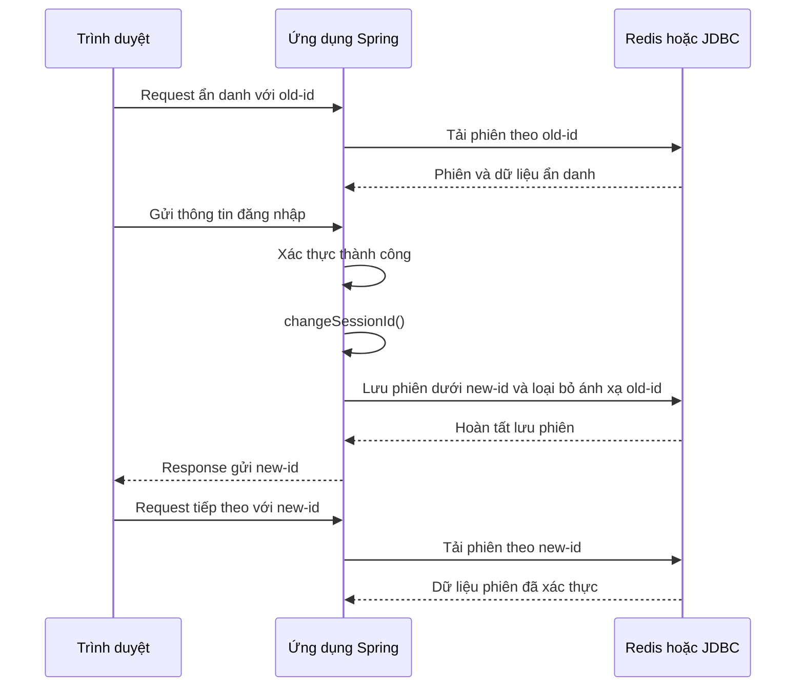

# Đổi định danh bằng changeSessionId và quan hệ với dữ liệu đang lưu

Session ID là mã định danh mà trình duyệt gửi trong mỗi request để máy chủ tìm đúng phiên HTTP. Khi người dùng đăng nhập thành công, ứng dụng cần đổi ID để ngăn session fixation: kẻ tấn công không thể chuẩn bị trước một ID rồi tiếp tục dùng ID đó sau khi nạn nhân đăng nhập. Với Servlet 3.1 trở lên, API `HttpServletRequest.changeSessionId()` đổi định danh của phiên hiện tại.

Điểm quan trọng là `changeSessionId()` đổi mã định danh, còn phiên về mặt logic vẫn là phiên đang tồn tại. Các thuộc tính đã lưu trong `HttpSession` được giữ lại, chẳng hạn giỏ hàng hoặc lựa chọn ngôn ngữ. Spring Session tích hợp thao tác này với repository như Redis hoặc JDBC để phiên được nhận diện bằng ID mới và các instance khác có thể tiếp tục đọc dữ liệu. Hiểu sự khác biệt giữa ID, nội dung phiên và bản ghi lưu trữ giúp tránh mất dữ liệu, giữ đúng chính sách bảo mật và xử lý được các request đồng thời.

## 1. Session ID và dữ liệu phiên là hai phần khác nhau

Một phiên HTTP có thể hình dung gồm hai thành phần:

- **Định danh phiên (session ID):** giá trị opaque được trình duyệt gửi qua cookie hoặc cơ chế truyền ID đã cấu hình. Máy chủ dùng nó để tìm phiên tương ứng.
- **Dữ liệu phiên (session attributes và metadata):** các thuộc tính ứng dụng, thời điểm tạo, thời điểm truy cập gần nhất, thời gian không hoạt động tối đa và dữ liệu bảo mật được lưu trong phiên.

Với Spring Session, repository lưu trạng thái phiên bên ngoài bộ nhớ của một Servlet container, ví dụ trong Redis hoặc JDBC. `SessionRepositoryFilter` bọc request và response để các thành phần vẫn dùng `HttpSession` như thông thường, trong khi thao tác đọc/ghi được chuyển tới repository. Nhiều instance có thể dùng chung kho dữ liệu và cùng xử lý một phiên.

Ví dụ, một người dùng chưa đăng nhập đã thêm sản phẩm vào giỏ hàng. Ứng dụng có thể lưu giỏ hàng trong phiên ẩn danh. Khi người dùng đăng nhập, ứng dụng muốn giữ giỏ hàng nhưng cần thay ID để bảo vệ ranh giới xác thực. `changeSessionId()` thực hiện đúng mục tiêu đó: ID thay đổi, dữ liệu thuộc phiên hiện tại tiếp tục được dùng.

| Thành phần | Trước khi đổi ID | Sau `changeSessionId()` |
| --- | --- | --- |
| Session ID | ID cũ | ID mới do container/session integration tạo |
| Đối tượng phiên về mặt logic | Phiên hiện tại | Tiếp tục là phiên hiện tại |
| Session attributes | Giỏ hàng, locale, CSRF hoặc dữ liệu khác | Được giữ lại theo ngữ nghĩa đổi ID |
| Thời điểm tạo phiên | Đã được ghi nhận | Không phải một phiên mới chỉ vì ID đổi |
| Thời hạn không hoạt động | Theo cấu hình hiện tại | Tiếp tục theo metadata và chính sách repository |
| ID cũ | Đang trỏ tới phiên | Không còn là ID hợp lệ của phiên sau khi thao tác hoàn tất |

Đổi ID không mã hóa dữ liệu phiên, không làm sạch các thuộc tính và không tự thay thế chính sách hết hạn. Nó thay đổi định danh dùng để truy cập phiên. Vì dữ liệu được giữ lại, ứng dụng cần quyết định thuộc tính nào từ giai đoạn ẩn danh được phép tồn tại sau khi đăng nhập.

## 2. Session fixation và thời điểm cần đổi ID

Session fixation xảy ra khi kẻ tấn công khiến nạn nhân sử dụng một session ID mà kẻ tấn công đã biết hoặc có thể dự đoán. Nếu ứng dụng giữ nguyên ID đó sau khi xác thực, kẻ tấn công có thể dùng ID đã biết để truy cập phiên đã đăng nhập.

Luồng rủi ro và cách bảo vệ:

1. Trình duyệt bắt đầu bằng phiên ẩn danh có ID `old-id`.
2. Kẻ tấn công tìm cách khiến trình duyệt sử dụng ID đó hoặc biết được ID đó.
3. Nạn nhân đăng nhập thành công.
4. Nếu ứng dụng giữ nguyên ID, phiên đã xác thực vẫn có thể được truy cập bằng ID cũ.
5. Khi đổi ID thành `new-id`, ứng dụng gửi ID mới về trình duyệt; ID cũ không còn dùng để truy cập phiên đã xác thực.

Sơ đồ luồng:



Với Spring Security, bảo vệ session fixation được tích hợp vào quy trình quản lý phiên sau xác thực. Trên Servlet 3.1 trở lên, chiến lược `changeSessionId` thường là lựa chọn mặc định. Có thể khai báo rõ ràng để người đọc cấu hình hiểu ý định:

```java
@Bean
SecurityFilterChain securityFilterChain(HttpSecurity http) throws Exception {
    http
        .authorizeHttpRequests(authorize -> authorize
            .requestMatchers("/login", "/public/**").permitAll()
            .anyRequest().authenticated()
        )
        .formLogin(Customizer.withDefaults())
        .sessionManagement(session -> session
            .sessionFixation(fixation -> fixation.changeSessionId())
        );

    return http.build();
}
```

Khi dùng cơ chế xác thực dựng sẵn như form login, Spring Security gọi chiến lược session fixation trong quy trình xác thực. Không cần gọi thêm `request.changeSessionId()` một lần nữa nếu chiến lược này đã thực hiện việc đổi ID. Gọi lặp có thể tạo thêm một lần đổi ID không cần thiết và khiến việc theo dõi ID trở nên khó hiểu.

Nếu ứng dụng tự triển khai luồng đăng nhập ngoài các cơ chế xác thực của Spring Security, hãy chỉ đổi ID sau khi thông tin xác thực đã được xác minh thành công và trước khi trả response đăng nhập. Đảm bảo request đã đi qua `SessionRepositoryFilter` để thao tác với phiên Spring Session.

## 3. Cách gọi changeSessionId trong Servlet API

`changeSessionId()` là phương thức của `HttpServletRequest`, không phải phương thức của `HttpSession`. Phương thức trả về ID mới. Nó yêu cầu request đang gắn với một phiên hợp lệ; vì vậy, nếu cần kiểm tra trước, dùng `getSession(false)` để tránh tạo phiên ngoài ý muốn.

```java
HttpSession session = request.getSession(false);
if (session == null) {
    throw new IllegalStateException("Không có phiên hiện tại để đổi ID");
}

String oldId = session.getId();
String newId = request.changeSessionId();

// Đọc lại session sau thao tác để làm việc với ID hiện tại.
HttpSession currentSession = request.getSession(false);
Object cart = currentSession.getAttribute("cart");
```

Sau khi đổi ID, `currentSession.getId()` phản ánh định danh mới. Biến `oldId` trong mã vẫn chỉ là chuỗi cũ đã được lưu trước thao tác; đổi ID không tự cập nhật những chuỗi ID mà ứng dụng đã sao chép vào biến, cache hoặc cơ sở dữ liệu riêng.

Với Spring Session, `SessionRepositoryFilter` cung cấp request wrapper để các thao tác Servlet session được chuyển qua repository. Do đó, lời gọi `request.changeSessionId()` trong chuỗi filter đã tích hợp Spring Session sẽ tác động tới phiên do repository quản lý. Nếu một filter chạy trước `SessionRepositoryFilter`, nó có thể đang thao tác với phiên của container; đây là lý do thứ tự filter rất quan trọng.

Không tự tạo một chuỗi ID rồi gán vào cookie để thay thế `changeSessionId()`. Session ID phải được sinh bởi cơ chế quản lý phiên có đủ entropy và được repository nhận diện. Việc chỉ sửa cookie ở trình duyệt không đổi định danh bản ghi phía máy chủ và có thể làm mất khả năng truy cập phiên hoặc tạo ra một ID không hợp lệ.

## 4. Dữ liệu nào được giữ lại sau khi đổi ID?

Vì `changeSessionId()` thay ID của phiên đang tồn tại, các session attributes thông thường được giữ lại. Ví dụ:

```java
HttpSession session = request.getSession();
session.setAttribute("cart", cart);
session.setAttribute("preferredLanguage", "vi");

String previousId = session.getId();
String currentId = request.changeSessionId();

// Các thuộc tính của phiên hiện tại vẫn có thể được đọc.
ShoppingCart savedCart = (ShoppingCart) session.getAttribute("cart");
String language = (String) session.getAttribute("preferredLanguage");
```

Đây là khác biệt đáng kể so với chiến lược tạo phiên mới. Trong Spring Security, các lựa chọn session fixation thường được hiểu như sau:

| Chiến lược | Cách xử lý | Quan hệ với dữ liệu phiên |
| --- | --- | --- |
| `changeSessionId()` | Đổi ID của phiên hiện tại bằng Servlet API | Giữ phiên và các thuộc tính đang có |
| `migrateSession()` | Tạo phiên mới, chuyển các thuộc tính từ phiên cũ rồi vô hiệu hóa phiên cũ | Dữ liệu được sao chép sang phiên mới theo chiến lược |
| `newSession()` | Tạo phiên sạch cho trạng thái sau xác thực | Không mang toàn bộ thuộc tính ứng dụng từ phiên cũ; các thuộc tính cần thiết cho Spring Security được xử lý theo chiến lược |

`changeSessionId()` thường phù hợp khi ứng dụng muốn giữ giỏ hàng, lựa chọn giao diện hoặc dữ liệu điều hướng qua thời điểm đăng nhập. `newSession()` có thể phù hợp với chính sách cần loại bỏ dữ liệu phiên trước xác thực. Lựa chọn phải dựa trên yêu cầu bảo mật và trải nghiệm, không chỉ dựa vào việc chiến lược nào có tên ngắn hơn.

Việc giữ thuộc tính không đồng nghĩa mọi dữ liệu cũ đều đáng tin cậy. Ví dụ, một thuộc tính `isAdmin` do ứng dụng tự đặt trong giai đoạn ẩn danh là thiết kế nguy hiểm; quyền quản trị phải được suy ra từ `Authentication` và authorities đã được xác thực. Không dùng các cờ nghiệp vụ từ phiên ẩn danh để quyết định quyền truy cập sau đăng nhập. Kiểm tra và xác thực lại dữ liệu do client tác động trước khi sử dụng trong thao tác nhạy cảm.

Một số thành phần bảo mật có thể chủ động làm mới hoặc xóa token/thuộc tính riêng tại ranh giới xác thực. Vì vậy, hãy kiểm tra vòng đời CSRF token, request cache, remember-me và dữ liệu bảo mật theo cấu hình Spring Security đang dùng. Việc `changeSessionId()` giữ session attributes không có nghĩa mọi cơ chế bảo mật đều giữ nguyên mọi giá trị theo cùng một cách.

## 5. ID mới được lưu trong repository và gửi tới trình duyệt

Ở mức ứng dụng, có thể xem thao tác đổi ID như một cập nhật định danh cho phiên đang tồn tại. Repository phải bảo đảm ID mới có thể tìm được phiên cùng dữ liệu, đồng thời ID cũ không còn là định danh hợp lệ của phiên đó. Chi tiết lưu trữ vật lý phụ thuộc implementation.

Với Redis, implementation có thể cần tạo/cập nhật dữ liệu theo ID mới, cập nhật cấu trúc index liên quan và xóa dữ liệu gắn với ID cũ. Với JDBC, repository cần cập nhật bản ghi hoặc khóa tương ứng theo schema của Spring Session. Ứng dụng không nên tự `RENAME` key Redis, tự sửa bảng Spring Session hoặc tự sao chép các cột nội bộ để đổi ID. Các cấu trúc này là chi tiết triển khai và có thể thay đổi theo phiên bản.

Việc gửi ID mới cho trình duyệt được thực hiện thông qua cơ chế phân giải session ID (`HttpSessionIdResolver`). Với cấu hình cookie thông thường, Spring Session ghi cookie session trong response. Nếu ứng dụng dùng header resolver hoặc cơ chế tùy chỉnh, ID mới phải được trả về đúng cách mà client sẽ gửi lại trong request tiếp theo.

Ví dụ cấu hình cookie cơ bản:

```properties
server.servlet.session.cookie.name=SESSION
server.servlet.session.cookie.http-only=true
server.servlet.session.cookie.secure=true
server.servlet.session.cookie.same-site=lax
```

`HttpOnly` giúp JavaScript phía trình duyệt không đọc cookie; `Secure` giới hạn cookie ở kết nối HTTPS; `SameSite` cần được chọn theo luồng điều hướng và tích hợp liên miền. Những thuộc tính cookie bảo vệ cách truyền ID, còn `changeSessionId()` bảo vệ việc thay ID tại ranh giới xác thực. Hai lớp bảo vệ này bổ sung cho nhau.

ID cũ có thể vẫn xuất hiện trong log cũ hoặc audit record, nhưng không được dùng lại làm credential. Không ghi session ID đầy đủ vào log, URL, analytics hoặc thông tin hỗ trợ. Nếu cần liên kết các sự kiện trước và sau khi đổi ID, dùng correlation ID riêng và tuân thủ chính sách dữ liệu nhạy cảm.

## 6. TTL, thời điểm tạo và thời gian truy cập

Đổi session ID không đồng nghĩa tạo một phiên mới về mặt nghiệp vụ. Vì vậy, không nên xem thao tác này là cách tự động gia hạn vô hạn phiên đăng nhập hoặc khởi động lại mọi bộ đếm thời gian.

Các mốc thời gian cần phân biệt:

- **Creation time:** thời điểm phiên được tạo. Đổi ID không phải là tạo phiên mới, vì vậy không nên coi lần đổi ID là thời điểm tạo lại phiên.
- **Last accessed time:** thời điểm truy cập gần nhất, được repository cập nhật theo quy trình request và lưu phiên.
- **Max inactive interval:** khoảng thời gian không hoạt động tối đa trước khi phiên hết hạn.
- **Absolute session lifetime:** giới hạn tuổi thọ tổng thể tính từ một mốc như lúc đăng nhập. Đây là chính sách bổ sung; idle timeout không tự thay thế giới hạn này.

Redis thường biểu diễn thời hạn bằng TTL của key; JDBC lưu metadata hết hạn và có cơ chế dọn dữ liệu hết hạn. Khi ID thay đổi, implementation cần duy trì thời hạn phù hợp với phiên hiện tại. Hành vi TTL chính xác và thời điểm ghi dữ liệu phụ thuộc repository, flush mode và phiên bản Spring Session. Không giả định đổi ID sẽ reset TTL hoặc giữ nguyên TTL vật lý tới từng mili giây nếu chưa kiểm thử implementation.

Nếu nghiệp vụ yêu cầu absolute timeout, lưu mốc đăng nhập đã được xác thực và kiểm tra nó ở các request tiếp theo. Có thể buộc người dùng đăng nhập lại sau một khoảng thời gian tối đa ngay cả khi session vẫn hoạt động. Khi đổi ID, giữ nguyên hoặc cập nhật mốc này theo chính sách đã định; không dùng riêng `getCreationTime()` nếu yêu cầu của nghiệp vụ là tuổi thọ kể từ lần xác thực gần nhất.

## 7. Quan hệ với cache, index và dữ liệu phụ thuộc session ID

Một số hệ thống lưu tham chiếu tới session ID ở ngoài repository: cache, bảng audit, registry WebSocket, hệ thống quản lý thiết bị hoặc bản ghi tác vụ nền. Khi ID đổi, các tham chiếu đó có thể trở nên cũ. Thiết kế tốt là hạn chế lưu session ID thô ở nhiều nơi và dùng một định danh nghiệp vụ ổn định cho thiết bị hoặc phiên đăng nhập nếu cần theo dõi lâu dài.

Nếu repository có index theo principal, implementation phải giữ cho index tiếp tục trỏ tới phiên sau khi ID đổi. Ví dụ, tìm các phiên của principal sau đăng nhập vẫn phải trả về phiên đó với ID mới. Không tự cập nhật cấu trúc index nội bộ bằng lệnh Redis hoặc SQL; dùng API Spring Session và kiểm thử implementation thực tế.

Nếu ứng dụng có bảng riêng lưu ánh xạ `sessionId -> device`, cần xác định cách cập nhật khi ID đổi. Một phương án là dùng sự kiện hoặc hook được hỗ trợ trong phiên bản Spring Session đang dùng; phương án khác là không dùng session ID làm khóa nghiệp vụ mà tạo `deviceSessionKey` riêng. Dù chọn cách nào, không để lỗi cập nhật một hệ thống phụ trợ khiến ứng dụng chấp nhận lại ID cũ.

WebSocket là trường hợp cần thiết kế riêng: kết nối đã mở có thể giữ principal hoặc thông tin phiên tại thời điểm handshake. Đổi ID trong HTTP session không tự động đóng mọi WebSocket đã kết nối hoặc cập nhật mọi state nằm trong bộ nhớ. Nếu chính sách bảo mật yêu cầu thu hồi ngay, cần cơ chế quản lý kết nối và xác thực lại phù hợp.

## 8. Request đồng thời và tính nhất quán trong hệ thống nhiều instance

Trong trình duyệt, nhiều request có thể được gửi gần như đồng thời. Một request đang dùng ID cũ có thể vẫn xử lý khi request đăng nhập đổi ID. Ví dụ, request A tải giỏ hàng với `old-id`; request B xác thực thành công và đổi sang `new-id`; request A có thể hoàn tất sau request B.

Đổi ID không tự hủy những request đang chạy. Hành vi lưu cuối cùng khi hai request cùng sửa session phụ thuộc repository, thời điểm commit, cơ chế đồng bộ và cách implementation xử lý phiên đã đổi ID. Do đó:

1. Không giả định mọi request đang bay với ID cũ tự động bị dừng ngay tại thời điểm đăng nhập.
2. Tránh để các request đồng thời ghi đè toàn bộ session attributes dựa trên một snapshot cũ.
3. Lưu các cập nhật nghiệp vụ quan trọng bằng giao dịch hoặc cơ chế nguyên tử ở database/dịch vụ chuyên trách, không dựa vào session như kho giao dịch.
4. Kiểm thử hai request đồng thời quanh thời điểm đăng nhập và đổi ID với repository thật.
5. Với nhiều instance, xác minh mọi node dùng cùng repository, namespace và cấu hình serializer.

Trong hệ thống có replication hoặc cache phía trước repository, cần đánh giá độ trễ nhất quán. Nếu một node vẫn đọc được dữ liệu cũ theo ID cũ trong một khoảng thời gian, ranh giới thu hồi có thể không đạt kỳ vọng bảo mật. Hãy kiểm tra cách repository đảm bảo ID cũ không còn được chấp nhận, và cấu hình kho dữ liệu để thao tác đổi ID phù hợp với yêu cầu consistency của hệ thống.

## 9. Kiểm thử hành vi changeSessionId

Một kiểm thử tốt cần xác minh đồng thời ba điều: ID thay đổi, dữ liệu cần giữ vẫn tồn tại và ID cũ không còn truy cập được. Kiểm tra chỉ `Set-Cookie` là chưa đủ vì cookie có thể đổi trong khi repository chưa được cập nhật đúng.

Ví dụ các điều kiện cần kiểm tra:

| Kịch bản | Kết quả mong đợi |
| --- | --- |
| Tạo phiên và lưu attribute | Có thể đọc lại attribute bằng session ID hiện tại |
| Gọi `changeSessionId()` | ID trả về khác ID cũ |
| Đọc session sau đổi ID | Các attribute cần giữ vẫn còn |
| Tìm theo ID cũ | Không khôi phục được phiên đã đổi ID |
| Tìm theo ID mới | Repository trả về phiên và dữ liệu tương ứng |
| Request tiếp theo từ client | Client gửi ID mới và tiếp tục được nhận diện |
| Tra cứu index principal | Phiên xuất hiện dưới ID mới nếu implementation hỗ trợ index đó |
| Chờ tới timeout | Phiên hết hạn theo chính sách đã cấu hình |

Ví dụ kiểm thử tích hợp ở mức Servlet có thể mô tả bằng các bước sau:

```java
// Pseudocode: chạy trong integration test với Servlet container thật.
HttpSession before = request.getSession(true);
before.setAttribute("cart", expectedCart);
String oldId = before.getId();

String newId = request.changeSessionId();

assertNotEquals(oldId, newId);
assertEquals(expectedCart,
        request.getSession(false).getAttribute("cart"));

assertNull(sessionRepository.findById(oldId));
assertNotNull(sessionRepository.findById(newId));
```

Đoạn trên là pseudocode để thể hiện các khẳng định cần kiểm tra; trong kiểm thử thực tế, `HttpServletRequest` thường được thao tác qua endpoint test hoặc filter tùy chỉnh, còn `SessionRepository` có thể trả kiểu reactive nếu dùng repository reactive. Không gọi `.block()` trên event-loop của ứng dụng WebFlux khi kiểm thử hoặc xử lý request reactive.

Với Spring Security, kiểm thử đăng nhập qua endpoint thật để xác nhận session fixation strategy được gọi. Có thể dùng MockMvc để kiểm tra hành vi bảo mật, nhưng khi cần xác minh việc lưu Redis/JDBC, TTL, index hoặc tương tác nhiều instance, hãy dùng repository thật trong môi trường kiểm thử tích hợp. Một kịch bản hữu ích là đăng nhập qua instance A, lấy cookie mới, gửi request tới instance B, rồi gửi lại cookie cũ và xác minh nó không còn được chấp nhận.

## 10. Lỗi thường gặp và cách xử lý

**Đổi ID xong mất giỏ hàng hoặc thuộc tính phiên.** Xác minh ứng dụng đang dùng `changeSessionId()` thay vì tự invalidate rồi tạo phiên mới. Kiểm tra filter order để request đã được Spring Session bọc, và xem có code nào xóa thuộc tính hoặc tạo session mới trong cùng luồng đăng nhập không.

**Cookie đổi nhưng request sau vẫn không đăng nhập.** Kiểm tra response có gửi đúng ID mới, trình duyệt có lưu cookie với đúng `Path`, `Domain`, `Secure` và `SameSite`, repository có lưu phiên theo ID mới, và `SecurityContext` đã được lưu vào session. Kiểm tra cả request đi tới instance khác.

**ID cũ vẫn truy cập được.** Kiểm tra repository implementation, thao tác lưu/xóa, replica/cache và các node đang chạy. Thử gửi cookie cũ trực tiếp tới mọi instance. Không chỉ xóa cookie ở trình duyệt; cần xác nhận ID cũ không còn được repository chấp nhận.

**Phiên bị đổi ID nhiều lần.** Kiểm tra Spring Security đã tự áp dụng session fixation strategy chưa và custom login handler có gọi `changeSessionId()` thêm lần nữa không. Chỉ có một thành phần chịu trách nhiệm đổi ID tại mỗi ranh giới xác thực.

**Dữ liệu phiên bị ghi đè trong lúc đăng nhập.** Kiểm tra request đồng thời đang dùng ID cũ và có cập nhật session attributes sau khi ID đổi hay không. Di chuyển dữ liệu nghiệp vụ quan trọng sang nơi có kiểm soát giao dịch; giảm số request cùng ghi các cấu trúc session lớn.

**Ứng dụng phụ thuộc ID cũ trong cache hoặc WebSocket.** Tìm các nơi lưu session ID ngoài repository. Thay bằng định danh ổn định hơn nếu có thể; nếu phải cập nhật tham chiếu, dùng cơ chế vòng đời được hỗ trợ và kiểm thử cả khi cập nhật phụ trợ thất bại.

## 11. Quy trình áp dụng trong production

- Bật session fixation protection trong Spring Security; dùng `changeSessionId()` khi Servlet container hỗ trợ và chính sách yêu cầu giữ dữ liệu phiên.
- Bảo đảm `SessionRepositoryFilter` chạy trước Spring Security và mọi filter cần thao tác `HttpSession`.
- Chọn rõ dữ liệu ẩn danh nào được phép mang sang phiên đã xác thực; không dùng thuộc tính do client tác động làm căn cứ phân quyền.
- Xác nhận cookie hoặc resolver gửi ID mới về client và cookie có thuộc tính bảo mật phù hợp.
- Không tự sửa ID, cookie, Redis key hoặc bảng Spring Session bằng mã ứng dụng.
- Kiểm thử ID cũ/ID mới, dữ liệu attributes, TTL, index, logout, request đồng thời và request qua nhiều instance.
- Theo dõi lỗi lưu repository và thao tác đổi ID; không ghi session ID hoặc cookie đầy đủ vào log.

`changeSessionId()` bảo vệ ranh giới xác thực bằng cách thay ID của phiên hiện tại trong khi giữ lại dữ liệu phiên theo ngữ nghĩa Servlet. Khi repository, filter order, cookie resolver và chính sách bảo mật được cấu hình nhất quán, ứng dụng có thể duy trì trạng thái cần thiết cho người dùng mà vẫn vô hiệu hóa định danh đã được dùng trước khi đăng nhập.
