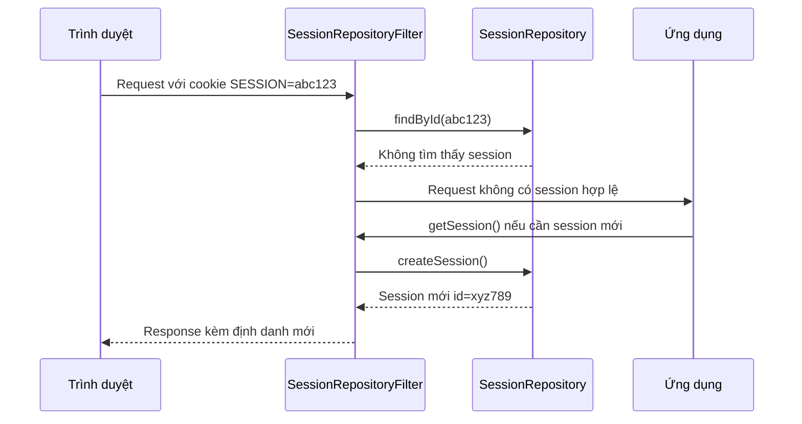

# `invalidate`, `deleteById` và tác động đến yêu cầu tiếp theo

Khi cần kết thúc một phiên Spring Session, hai thao tác thường được nhắc đến là `HttpSession.invalidate()` và `SessionRepository.deleteById(sessionId)`. Cả hai đều có thể làm cho session không còn được tải từ repository, nhưng chúng hoạt động ở hai tầng khác nhau và có tác động khác nhau đến request hiện tại, cookie của client và request kế tiếp.

Trong xử lý web thông thường, hãy dùng `HttpSession.invalidate()` để kết thúc phiên của request hiện tại. Servlet API và `SessionRepositoryFilter` phối hợp để đánh dấu phiên đã bị vô hiệu hóa, xóa dữ liệu phía repository và yêu cầu resolver hết hạn định danh phía client. `deleteById()` là thao tác quản trị ở tầng repository: nó xóa bản ghi theo ID nhưng không tự điều khiển cookie/header trong response đang gửi cho trình duyệt. Hiểu khác biệt này giúp tránh phiên cũ bị gửi lại, session bị ghi lại bởi request đang chạy hoặc trạng thái đăng nhập không nhất quán.

## 1. Hai API ở hai tầng khác nhau

### `HttpSession.invalidate()`

`invalidate()` là phương thức của Servlet API. Nó kết thúc session mà ứng dụng đang sử dụng trong request hiện tại. Khi Spring Session tích hợp Servlet, `SessionRepositoryFilter` cung cấp wrapper cho `HttpServletRequest` và `HttpSession`; lời gọi `invalidate()` được chuyển thành thao tác xóa session tương ứng trong repository và ghi nhận rằng định danh hiện tại cần được hết hạn ở client.

Những tác động thường thấy:

- Session hiện tại không còn hợp lệ; các attribute của phiên bị loại bỏ.
- Session được xóa khỏi repository thông qua cơ chế của Spring Session.
- Resolver được yêu cầu hết hạn cookie hoặc xóa định danh phiên theo cách trao đổi ID đã cấu hình.
- Các tham chiếu đến `HttpSession` cũ không còn được sử dụng như một session hợp lệ.
- Request kế tiếp không thể khôi phục session cũ bằng ID đó. Nếu request cần một session mới, ứng dụng tạo một phiên mới với ID mới.

Đây là lựa chọn phù hợp cho đăng xuất, kết thúc một quy trình cần xóa trạng thái phiên hoặc xử lý một yêu cầu kết thúc session của chính người dùng đang gửi request.

### `SessionRepository.deleteById(sessionId)`

`deleteById()` thuộc API `SessionRepository`. Nó yêu cầu repository xóa session có ID được cung cấp. Thao tác này hữu ích cho tác vụ quản trị hoặc dịch vụ cần xóa một phiên theo định danh, ví dụ thu hồi một phiên cụ thể của người dùng khi quản trị viên buộc đăng xuất thiết bị đó.

Repository chỉ nhận session ID và thực hiện xóa dữ liệu phía server. API này không nhận `HttpServletResponse`, không biết cookie/header của client đang được dùng và không tự gọi `HttpSession.invalidate()` trên các request đang hoạt động. Vì vậy:

- Cookie hoặc header cũ ở client có thể vẫn còn và tiếp tục được gửi.
- Khi request sau gửi ID cũ, repository không tìm thấy session tương ứng; Spring Session xem đó là ID không còn ánh xạ đến một phiên hợp lệ.
- Nếu request sau gọi `getSession()` và cần session mới, một session mới được tạo và resolver có thể phát hành ID mới.
- Nếu request sau không tạo session mới, client có thể tiếp tục gửi ID cũ cho đến khi cookie hết hạn hoặc ứng dụng chủ động gửi chỉ thị hết hạn phù hợp.

`deleteById()` không thay thế đầy đủ quy trình logout của ứng dụng web. Nó là thao tác xóa ở tầng lưu trữ, không phải thao tác kết thúc phiên qua Servlet API.

## 2. So sánh hành vi

| Khía cạnh | `HttpSession.invalidate()` | `SessionRepository.deleteById(id)` |
|---|---|---|
| Tầng API | Servlet `HttpSession` qua Spring Session | `SessionRepository` |
| Đối tượng tác động | Session gắn với request hiện tại | Session có ID được truyền vào |
| Xóa dữ liệu repository | Có, thông qua filter/repository | Có, trực tiếp qua repository |
| Hết hạn cookie/header trong response hiện tại | Được Spring Session phối hợp qua resolver | Không tự thực hiện |
| Đánh dấu wrapper session hiện tại đã invalidate | Có | Không tự đánh dấu |
| Mục đích điển hình | Logout hoặc kết thúc session hiện tại | Quản trị, thu hồi session theo ID |
| Có thể gọi từ tác vụ nền | Không có `HttpSession` của request để gọi trực tiếp | Có, nếu có repository và session ID hợp lệ |

Hai thao tác có thể dẫn đến việc repository không còn session theo ID, nhưng ngữ cảnh HTTP khác nhau. Nếu đang xử lý request của người dùng, hãy để Servlet API điều khiển việc kết thúc phiên để cookie/header được xử lý cùng lúc.

## 3. Dùng `invalidate()` trong controller

Một endpoint logout có thể nhận `HttpSession` và gọi `invalidate()`:

```java
import jakarta.servlet.http.HttpSession;
import org.springframework.http.ResponseEntity;
import org.springframework.web.bind.annotation.PostMapping;
import org.springframework.web.bind.annotation.RestController;

@RestController
class LogoutController {

    @PostMapping("/logout")
    ResponseEntity<Void> logout(HttpSession session) {
        session.invalidate();
        return ResponseEntity.noContent().build();
    }
}
```

Ví dụ này minh họa riêng thao tác Servlet. Trong ứng dụng dùng Spring Security, nên dùng cơ chế logout của Spring Security để cùng xử lý `SecurityContext`, các logout handler, session và cookie theo cấu hình bảo mật. Không nên tạo endpoint logout tự viết rồi bỏ qua các bước dọn dẹp mà ứng dụng đã cấu hình trong security filter chain.

Sau khi gọi `invalidate()`, không tiếp tục đọc hoặc ghi attribute qua tham chiếu `session` cũ. Theo hợp đồng Servlet, thao tác trên session đã invalid có thể ném `IllegalStateException`. Nếu cùng request cần một session mới cho một mục đích khác, hãy yêu cầu session mới một cách tường minh qua request wrapper và chỉ sử dụng đối tượng mới được trả về; không tái sử dụng tham chiếu cũ.

Ví dụ sau minh họa sự khác biệt giữa kết thúc phiên và tạo phiên mới trong cùng request:

```java
import jakarta.servlet.http.HttpServletRequest;
import jakarta.servlet.http.HttpSession;

void restartFlow(HttpServletRequest request) {
    HttpSession oldSession = request.getSession(false);
    if (oldSession != null) {
        oldSession.invalidate();
    }

    // Chỉ tạo session mới nếu luồng tiếp theo thật sự cần nó.
    HttpSession newSession = request.getSession(true);
    newSession.setAttribute("flow.step", "START");
}
```

Không phải endpoint logout nào cũng cần tạo session mới. Việc tạo phiên mới ngay sau logout có thể làm client nhận lại cookie và tạo cảm giác phiên cũ chưa được kết thúc. Nếu không có yêu cầu nghiệp vụ rõ ràng, kết thúc request logout mà không tạo session mới sẽ đơn giản hơn.

## 4. Dùng `deleteById()` cho tác vụ quản trị

Một dịch vụ quản trị có thể xóa session theo ID khi cần thu hồi một phiên cụ thể:

```java
import org.springframework.session.SessionRepository;
import org.springframework.stereotype.Service;

@Service
class SessionRevocationService {
    private final SessionRepository<?> sessionRepository;

    SessionRevocationService(SessionRepository<?> sessionRepository) {
        this.sessionRepository = sessionRepository;
    }

    void revokeSession(String sessionId) {
        sessionRepository.deleteById(sessionId);
    }
}
```

Đây là ví dụ ở tầng service; endpoint quản trị gọi service này sau khi đã xác thực người quản trị và kiểm tra quyền thu hồi session. Không nhận một ID bất kỳ từ client rồi xóa trực tiếp mà không kiểm tra quyền sở hữu hoặc phạm vi quản trị. Session ID là thông tin nhạy cảm, và chức năng thu hồi phiên là thao tác bảo mật.

Nếu quản trị viên cần buộc đăng xuất một thiết bị, giao diện quản trị thường cần một bản ghi phiên có định danh, người dùng sở hữu, thời điểm tạo và thông tin thiết bị ở mức được phép lưu. Khi người quản trị chọn một phiên, backend xác thực quyền và gọi repository để xóa đúng ID. Ứng dụng nên thông báo cho client ở request kế tiếp rằng phiên không còn hợp lệ và yêu cầu xác thực lại.

Không nên dùng `deleteById()` để thay thế việc logout session của request hiện tại. Nếu request hiện tại đã tải session vào wrapper rồi một service gọi `deleteById()` trực tiếp, wrapper vẫn có thể giữ bản session trong bộ nhớ request. Khi request hoàn tất, cơ chế lưu session của filter có thể ghi trạng thái đang giữ trở lại repository, tùy đường đi và cấu hình flush/save của repository. Điều này tạo nguy cơ session bị tạo lại hoặc trạng thái cũ xuất hiện trở lại. Khi cần kết thúc session hiện tại, gọi `invalidate()` trên `HttpSession` để wrapper biết phiên đã bị vô hiệu hóa và không lưu phiên cũ như một session còn hoạt động.

## 5. Request kế tiếp xử lý ID cũ như thế nào?

Giả sử trình duyệt đang giữ cookie `SESSION=abc123`. Repository có session `abc123` với một số attribute. Một thao tác thu hồi xóa session đó khỏi Redis/JDBC. Ở request tiếp theo, trình duyệt vẫn có thể gửi cookie cũ:



Các điểm cần hiểu:

1. Cookie chỉ mang ID, không chứng minh session vẫn tồn tại. Repository là nơi xác định ID còn trỏ đến phiên hợp lệ hay không.
2. ID cũ không tự khôi phục dữ liệu đã bị xóa. Request được xử lý như chưa có session tương ứng.
3. Nếu ứng dụng gọi `request.getSession(false)`, kết quả là `null` khi không có session hợp lệ.
4. Nếu ứng dụng gọi `request.getSession()` hoặc `getSession(true)`, Servlet container wrapper có thể tạo session mới và Spring Session phát hành ID mới qua resolver.
5. Nếu request không tạo session, response có thể không phát hành ID mới; cookie cũ có thể còn ở client và tiếp tục được gửi ở request sau.

Vì vậy, khi dùng `deleteById()` để thu hồi từ một tiến trình khác, không nên kỳ vọng trình duyệt bị xóa cookie ngay tại thời điểm thao tác. Ứng dụng có thể dựa vào việc ID không còn hợp lệ để buộc xác thực lại, hoặc xây dựng cơ chế thông báo/đồng bộ client nếu trải nghiệm yêu cầu xóa ID sớm.

## 6. Tác động đến `getSession(false)` và `getSession(true)`

Hai biến thể `getSession` quyết định request có tạo phiên mới khi không có phiên hợp lệ hay không:

| Lời gọi | Khi repository tìm thấy session | Khi ID không có hoặc session đã bị xóa |
|---|---|---|
| `request.getSession(false)` | Trả về session hiện có | Trả về `null`, không tạo mới |
| `request.getSession(true)` | Trả về session hiện có | Tạo session mới và trả về session mới |
| `request.getSession()` | Trả về session hiện có | Tương đương `getSession(true)` |

Sau logout, các endpoint không cần session nên tránh gọi `getSession()` một cách vô thức. Một filter logging, view renderer hoặc tiện ích giao diện có thể vô tình tạo session mới chỉ vì gọi `getSession()` thay vì `getSession(false)`. Điều đó có thể khiến response phát hành cookie mới ngay sau logout và làm tăng số session không cần thiết.

Khi kiểm tra người dùng đã đăng nhập hay chưa, nên dùng ngữ cảnh xác thực của Spring Security hoặc kiểm tra session hiện có với `getSession(false)` nếu phù hợp. Không tạo session chỉ để kiểm tra session có tồn tại hay không.

## 7. Attribute, listener và sự kiện khi session bị xóa

`invalidate()` kết thúc session Servlet, nên các attribute được gỡ khỏi session và các đối tượng triển khai `HttpSessionBindingListener` có thể nhận callback `valueUnbound`. Ứng dụng cũng có thể có `HttpSessionAttributeListener` để quan sát việc thêm, thay thế hoặc loại bỏ attribute theo cơ chế Servlet.

Spring Session có hệ thống sự kiện vòng đời session riêng, ví dụ sự kiện tạo, xóa hoặc hết hạn session tùy repository và phiên bản. Không nên giả định việc gọi trực tiếp `deleteById()` từ bất kỳ tiến trình nào sẽ kích hoạt toàn bộ callback Servlet trong request của client, vì thao tác đó không đi qua đối tượng `HttpSession` của request. Các listener Servlet gắn với web context cũng không tự nhận được một lời gọi `invalidate()` nếu chỉ có một lệnh xóa repository ở nơi khác.

Với Redis, việc nhận biết session hết hạn có thể phụ thuộc keyspace notifications và cấu hình listener của Spring Session. Với JDBC, quá trình dọn session hết hạn có thể chạy theo cơ chế cleanup của repository. Sự kiện được phát hiện bởi kho lưu trữ, thời điểm phát hiện và việc ứng dụng nhận được sự kiện có thể khác nhau. Nếu cần thu hồi session để thực thi một chính sách bảo mật, hãy dựa vào trạng thái repository và kiểm tra xác thực ở request kế tiếp; không dùng một event bất đồng bộ làm cơ chế duy nhất để chặn truy cập.

Nếu cần thực hiện công việc phụ khi logout, chẳng hạn ghi audit log, thu hồi refresh token hoặc cập nhật trạng thái thiết bị, hãy đặt logic đó trong logout handler/service phù hợp và thiết kế thao tác có tính lặp an toàn. Không phụ thuộc hoàn toàn vào việc mọi repository đều phát cùng một loại event ở cùng một thời điểm.

## 8. Đăng xuất với Spring Security

Trong ứng dụng dùng Spring Security, endpoint logout nên đi qua logout filter và các handler đã cấu hình. Cấu hình điển hình có thể chỉ định URL logout, invalidate HTTP session, xóa cookie và xóa `SecurityContext`:

```java
import org.springframework.context.annotation.Bean;
import org.springframework.context.annotation.Configuration;
import org.springframework.security.config.annotation.web.builders.HttpSecurity;
import org.springframework.security.web.SecurityFilterChain;
import org.springframework.security.web.util.matcher.AntPathRequestMatcher;

@Configuration
class SecurityConfiguration {
    @Bean
    SecurityFilterChain securityFilterChain(HttpSecurity http) throws Exception {
        http
            .authorizeHttpRequests(auth -> auth
                .requestMatchers("/public/**").permitAll()
                .anyRequest().authenticated())
            .logout(logout -> logout
                .logoutRequestMatcher(new AntPathRequestMatcher("/logout", "POST"))
                .invalidateHttpSession(true)
                .clearAuthentication(true)
                .deleteCookies("SESSION")
                .logoutSuccessUrl("/login?logout"));

        return http.build();
    }
}
```

Tên cookie `SESSION` trong ví dụ phải khớp với tên cookie thực tế do resolver phát hành; nếu dùng tên mặc định khác hoặc dùng header resolver, cần điều chỉnh handler tương ứng. Spring Session có thể tự yêu cầu resolver hết hạn cookie khi session bị invalidate; `deleteCookies` là cấu hình phía Spring Security bổ sung cho cookie được nêu rõ. Tránh cấu hình hai cơ chế xóa cookie mâu thuẫn về path/domain khiến trình duyệt vẫn giữ cookie cũ.

Khi logout thành công, các request tiếp theo không còn được xác thực bằng `SecurityContext` cũ. Nếu người dùng tiếp tục truy cập endpoint cần xác thực, họ phải đăng nhập lại hoặc dùng cơ chế xác thực khác đã được cấu hình. Đối với header resolver, frontend cần xóa session ID khỏi bộ nhớ lưu trữ và ngừng gửi header cũ.

## 9. Thu hồi một hay nhiều session

Một người dùng có thể đăng nhập trên nhiều trình duyệt hoặc thiết bị, tạo nhiều session khác nhau. `deleteById(id)` chỉ xóa một session có ID đã biết. Nếu nghiệp vụ cần đăng xuất tất cả thiết bị, cần tìm danh sách session theo principal/index mà repository hỗ trợ rồi xóa từng ID, hoặc dùng cơ chế quản lý session đồng thời của Spring Security.

Không phải repository nào cũng hỗ trợ truy vấn session theo người dùng. Với repository hỗ trợ `FindByIndexNameSessionRepository`, ứng dụng có thể truy vấn theo principal name nếu chỉ mục được duy trì đúng. Với repository không hỗ trợ chỉ mục, cần thiết kế cách quản lý liên kết user-session riêng và bảo đảm dữ liệu đó được cập nhật nhất quán.

Khi xóa nhiều session:

- Xác thực người thực hiện và kiểm tra họ có quyền thu hồi toàn bộ session của tài khoản hay không.
- Xác định rõ có giữ lại session hiện tại hay xóa cả session đang dùng để gửi lệnh.
- Xử lý từng ID có thể đã hết hạn hoặc đã bị xóa bởi request khác; thao tác thu hồi nên idempotent.
- Không trả session ID đầy đủ ra giao diện quản trị hoặc log.
- Chấp nhận rằng client có thể còn cookie/header cũ cho đến request kế tiếp; server phải từ chối khôi phục session đã bị xóa.

## 10. Request đang chạy đồng thời với thao tác xóa

Một tình huống quan trọng là người dùng gửi hai request gần như cùng lúc. Request A tải session vào bộ nhớ request. Trong khi A đang xử lý, request B hoặc tiến trình quản trị gọi `deleteById()` để thu hồi cùng ID. Nếu A tiếp tục cập nhật session và filter lưu bản session ở cuối request, dữ liệu cũ có thể được ghi lại tùy repository, chế độ flush/save và thời điểm thao tác. Việc xóa ở repository không tự hủy bản sao session mà A đã tải.

Điều này có nghĩa `deleteById()` không phải một khóa đồng bộ tức thời cho mọi request đang chạy. Để giảm rủi ro:

- Dùng `invalidate()` khi request hiện tại chủ động kết thúc session của chính nó.
- Với thao tác thu hồi từ nơi khác, cân nhắc cơ chế đánh dấu phiên/tài khoản bị thu hồi ở nơi có thể kiểm tra trong mọi request nhạy cảm.
- Không dựa vào session như nguồn dữ liệu chuẩn cho giao dịch nghiệp vụ; các thao tác quan trọng phải kiểm tra quyền và trạng thái ở tầng nghiệp vụ.
- Kiểm thử request đang xử lý đồng thời với logout/thu hồi và quan sát liệu repository có nhận lại bản session cũ hay không.
- Nếu yêu cầu bảo mật cần thu hồi tức thời, thiết kế kiểm tra trạng thái thu hồi hoặc phiên bản xác thực ở mỗi request cần bảo vệ, thay vì chỉ xóa một bản ghi session rồi giả định mọi request đang chạy dừng ngay.

Một request đã vượt qua bước xác thực trước thời điểm thu hồi có thể vẫn tiếp tục xử lý logic đang chạy. Việc xóa session không tự hủy thread, transaction hoặc request đang thực thi. Những thao tác nhạy cảm cần xác minh quyền gần thời điểm commit và dùng transaction/locking phù hợp để bảo đảm tính đúng đắn.

## 11. Kiểm thử tác động đến request tiếp theo

Một bài kiểm thử tích hợp nên dùng cùng cookie giữa các request để chứng minh hành vi thực tế của filter, resolver và repository. Ví dụ dưới đây mô tả các bước kiểm thử bằng MockMvc; phần cấu hình ứng dụng cần bật Spring Session và filter tương ứng:

```java
import static org.springframework.test.web.servlet.request.MockMvcRequestBuilders.get;
import static org.springframework.test.web.servlet.request.MockMvcRequestBuilders.post;
import static org.springframework.test.web.servlet.result.MockMvcResultMatchers.status;

import jakarta.servlet.http.Cookie;
import org.junit.jupiter.api.Test;
import org.springframework.beans.factory.annotation.Autowired;
import org.springframework.boot.test.autoconfigure.web.servlet.AutoConfigureMockMvc;
import org.springframework.boot.test.context.SpringBootTest;
import org.springframework.test.web.servlet.MockMvc;
import org.springframework.test.web.servlet.MvcResult;

@SpringBootTest
@AutoConfigureMockMvc
class SessionInvalidationIntegrationTest {
    @Autowired
    MockMvc mockMvc;

    @Test
    void invalidatedSessionCannotBeLoadedByNextRequest() throws Exception {
        MvcResult created = mockMvc.perform(post("/test/session"))
                .andExpect(status().isOk())
                .andReturn();

        Cookie sessionCookie = created.getResponse().getCookie("SESSION");

        mockMvc.perform(post("/test/logout").cookie(sessionCookie))
                .andExpect(status().isNoContent());

        mockMvc.perform(get("/test/session").cookie(sessionCookie))
                .andExpect(status().isUnauthorized());
    }
}
```

Đây là phác thảo kiểm thử: các endpoint `/test/session`, `/test/logout` và chính sách trả `401` cần được cung cấp trong ứng dụng kiểm thử. Tên cookie phải khớp resolver. Nếu logout xóa cookie ở response, vẫn cố ý gửi lại cookie cũ trong request cuối để chứng minh server không khôi phục được session đã invalid. Khi dùng header resolver, thay việc trích cookie bằng cách giữ response header ID và gửi lại trong request tiếp theo.

Nên kiểm tra thêm các trường hợp:

1. `getSession(false)` trả về `null` sau khi ID bị xóa.
2. `getSession(true)` tạo ID mới, khác ID đã bị thu hồi.
3. `deleteById()` từ tác vụ quản trị xóa session phía repository nhưng không tự sửa response cookie của client.
4. Request đang chạy đồng thời với `deleteById()` không làm trạng thái cũ sống lại ngoài dự kiến.
5. Logout qua Spring Security xóa `SecurityContext`, invalidate session và xử lý cookie đúng cấu hình.
6. Gọi thu hồi lặp lại trên một ID đã xóa không làm hỏng luồng quản trị.

## 12. Quy tắc lựa chọn

| Nhu cầu | Cách thực hiện phù hợp |
|---|---|
| Người dùng đăng xuất phiên hiện tại | Spring Security logout hoặc `HttpSession.invalidate()` |
| Kết thúc một session trong request Servlet | `HttpSession.invalidate()` |
| Quản trị viên thu hồi một ID session cụ thể | Kiểm tra quyền rồi gọi `SessionRepository.deleteById(id)` |
| Tác vụ nền xóa session đã biết | `SessionRepository.deleteById(id)` |
| Đăng xuất tất cả thiết bị | Quản lý các session theo principal/index hoặc cơ chế concurrent-session của Spring Security |
| Bắt buộc thu hồi có hiệu lực với request nhạy cảm đang chạy | Kiểm tra trạng thái thu hồi ở tầng xác thực/nghiệp vụ và bảo vệ thao tác commit |

Khi kết thúc phiên từ một request web, dùng `invalidate()` để Spring Session đồng bộ trạng thái repository với resolver và response. Dùng `deleteById()` cho tác vụ quản trị ở tầng lưu trữ, đồng thời tính đến cookie cũ và các request đang chạy. Ở request tiếp theo, session ID chỉ còn là một giá trị client gửi lên; nếu repository không tìm thấy phiên tương ứng, ứng dụng phải xử lý như chưa có phiên hợp lệ và chỉ tạo ID mới khi thật sự cần.
