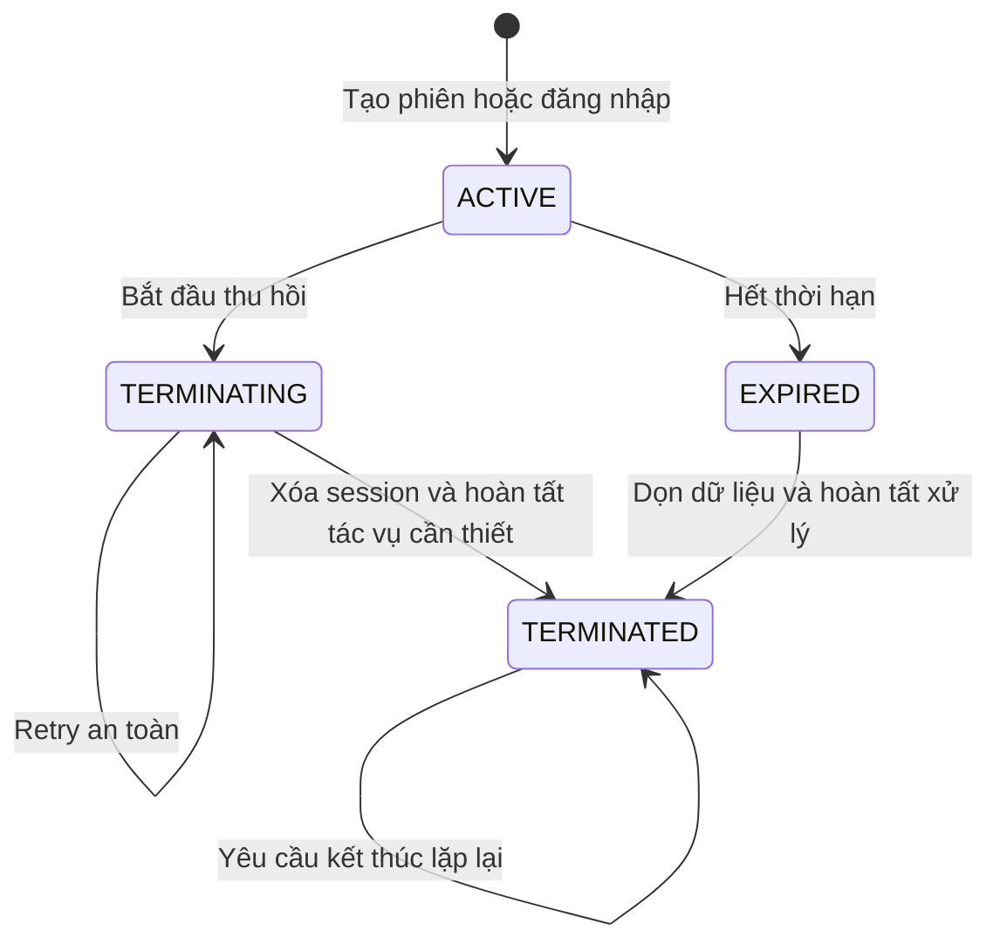

# Thiết kế trạng thái phiên để việc kết thúc có thể xử lý lặp an toàn

Spring Session lưu và khôi phục phiên Servlet thông qua một `SessionRepository` dùng chung như Redis hoặc JDBC. Khi người dùng đăng xuất, phiên hết hạn hoặc quản trị viên thu hồi phiên, nhiều request và nhiều instance có thể cùng tham gia xử lý. Một request có thể bị gửi lại, trình duyệt có thể retry, sự kiện có thể đến muộn hoặc một worker có thể chạy lại sau lỗi. Vì vậy, logic kết thúc phiên cần được thiết kế sao cho một thao tác được thực hiện nhiều lần vẫn dẫn đến cùng kết quả cuối cùng.

Đó là tính **idempotent** (xử lý lặp an toàn). Với thao tác kết thúc phiên, yêu cầu thường là: sau lần xử lý đầu tiên, session ID không còn khôi phục được phiên; các lần gọi tiếp theo không tạo lại phiên, không làm hỏng trạng thái bảo mật và không lặp lại tác dụng phụ nguy hiểm. Ứng dụng cần xác định rõ trạng thái phiên, ai có quyền chuyển trạng thái, thao tác nào phải chạy đúng một lần về mặt nghiệp vụ và cách xử lý request đồng thời.

## 1. Idempotent có nghĩa gì trong vòng đời phiên?

Một thao tác là idempotent nếu thực hiện một lần hay nhiều lần đều tạo ra cùng trạng thái hiệu lực. Ví dụ, yêu cầu đăng xuất một phiên đã đăng xuất vẫn có thể trả về kết quả thành công vì mục tiêu cuối cùng — phiên không còn hoạt động — đã đạt được.

So sánh hai cách xử lý:

| Tình huống | Xử lý không idempotent | Xử lý idempotent |
|---|---|---|
| Người dùng bấm đăng xuất hai lần | Lần hai trả lỗi không nhất quán hoặc phát sinh lỗi nội bộ | Lần hai được xem là phiên đã kết thúc |
| Trình duyệt retry do mất response | Có thể lặp tác dụng phụ như gửi thông báo hoặc ghi audit hai lần | Kết quả nghiệp vụ được nhận diện là đã xử lý |
| Hai instance cùng thu hồi một session | Một instance xóa, instance kia lỗi vì dữ liệu đã mất | Cả hai cùng hội tụ về trạng thái đã thu hồi |
| Worker xử lý lại sự kiện hết hạn | Dọn dữ liệu phụ trợ nhiều lần gây lỗi | Handler kiểm tra trạng thái và chạy lặp an toàn |
| Phiên đã hết TTL trước khi logout | Endpoint báo lỗi dù mục tiêu đã đạt | Không tìm thấy phiên được xem là đã kết thúc |

Idempotent không có nghĩa mọi lệnh phải trả cùng mã HTTP hoặc không bao giờ phát sinh lỗi hạ tầng. Nó có nghĩa ứng dụng định nghĩa rõ kết quả mong muốn và không làm thay đổi trạng thái sai khi thao tác được gửi lại. Nếu Redis hoặc JDBC đang không truy cập được, ứng dụng chưa thể khẳng định đã thu hồi thành công chỉ vì request logout được gọi nhiều lần.

## 2. Phân biệt trạng thái session và trạng thái nghiệp vụ

`HttpSession` là trạng thái tạm thời phục vụ các request của người dùng. Nó thường chứa các thuộc tính như mã người dùng, giỏ hàng hoặc trạng thái quy trình. Khi gọi `invalidate()` hoặc repository xóa session, các thuộc tính của phiên bị loại bỏ. Bản thân session không phải nơi lưu lịch sử đầy đủ về việc ai đã yêu cầu thu hồi, lý do gì và các tác vụ phụ đã hoàn tất chưa.

Nếu chỉ cần đăng xuất phiên hiện tại, repository là nơi có thẩm quyền xác định phiên còn tồn tại hay không. Nếu nghiệp vụ cần theo dõi trạng thái thu hồi, thu hồi nhiều phiên, audit, đồng bộ thông báo hoặc retry tác vụ phụ, nên quản lý vòng đời nghiệp vụ bằng một bản ghi riêng có định danh ổn định.

Một mô hình trạng thái nghiệp vụ có thể gồm:



Đây là mô hình khái niệm cho quy trình quản lý vòng đời. Spring Session không tự cung cấp đầy đủ một state machine nghiệp vụ với các trạng thái `TERMINATING` và `TERMINATED`; ứng dụng phải triển khai phần quản lý bổ sung nếu cần lưu trạng thái, audit hoặc điều phối tác vụ.

Đối với phiên đơn giản, có thể chỉ cần hai trạng thái hiệu lực: tồn tại và không tồn tại. Đối với quản lý thiết bị hoặc phiên đăng nhập, bản ghi nghiệp vụ riêng có thể lưu `sessionRecordId`, principal, thời điểm tạo, trạng thái, thời điểm thu hồi và lý do. Không lưu session ID dạng rõ trong bảng audit nếu không cần; nếu cần liên kết, dùng giá trị băm hoặc định danh nội bộ có kiểm soát.

## 3. Thiết kế thao tác logout lặp an toàn

Với Servlet API, lấy session hiện có bằng `getSession(false)`. Nếu không có phiên, yêu cầu logout đã đạt mục tiêu và có thể kết thúc bình thường. Nếu có phiên, gọi `invalidate()` để vô hiệu hóa phiên phía máy chủ:

```java
@PostMapping("/logout")
public ResponseEntity<Void> logout(HttpServletRequest request) {
    HttpSession session = request.getSession(false);

    if (session != null) {
        try {
            session.invalidate();
        } catch (IllegalStateException alreadyInvalidated) {
            // Phiên đã bị kết thúc bởi request khác.
            // Trạng thái mong muốn vẫn là không còn phiên hoạt động.
        }
    }

    return ResponseEntity.noContent().build();
}
```

Ví dụ này minh họa ý tưởng xử lý phiên đã biến mất hoặc đã bị vô hiệu hóa trong lúc request đang chạy. Khi triển khai thực tế, chỉ bắt `IllegalStateException` tại đúng thao tác invalidate và chỉ xem đó là kết thúc lặp an toàn sau khi xác định nguyên nhân phù hợp. Không bắt mọi exception rồi trả thành công: lỗi kết nối repository hoặc lỗi ghi dữ liệu phải được xử lý như lỗi thật.

`getSession(false)` tránh tạo phiên mới trong lúc logout. Nếu dùng `getSession()` hoặc `getSession(true)` ở endpoint đăng xuất, ứng dụng có thể vô tình tạo một phiên mới rồi ngay lập tức xóa nó, làm luồng khó hiểu và có thể tạo cookie không cần thiết.

Với Spring Security, ưu tiên dùng logout flow có sẵn. `SecurityContextLogoutHandler` có thể xóa `SecurityContext` và invalidate `HttpSession` theo cấu hình; các `LogoutHandler` khác có thể xóa cookie hoặc xử lý token liên quan. Tránh vừa để Spring Security invalidate session vừa tự invalidate ở nhiều tầng không phối hợp. Hãy chọn một luồng sở hữu thao tác kết thúc và kiểm thử việc gọi lặp.

Một endpoint logout thường có thể trả `204 No Content` khi phiên đã kết thúc hoặc không còn tồn tại. Nếu API cần phân biệt kết quả, có thể trả thông tin `already-terminated`, nhưng không nên tiết lộ session ID hoặc thông tin về phiên của người khác. Với trình duyệt, response nên xóa cookie đúng tên, path và domain; việc xóa cookie ở client không thay thế invalidate phía máy chủ.

## 4. Xử lý hai request cùng kết thúc một phiên

Trong môi trường nhiều instance, hai request có thể mang cùng cookie đến hai máy chủ gần như đồng thời:

1. Instance A đọc session và bắt đầu xử lý logout.
2. Instance B cũng đọc session trước khi A xóa nó.
3. A invalidate session và lưu thay đổi.
4. B tiếp tục invalidate hoặc lưu trạng thái đã đọc trước đó.

Chỉ kiểm tra `session != null` không loại bỏ race condition. Giữa lúc đọc và lúc invalidate, request khác có thể đã kết thúc phiên. Với thao tác đơn giản, ứng dụng cần coi trạng thái không còn tồn tại là kết quả cuối hợp lệ và xử lý lỗi do phiên đã bị vô hiệu hóa một cách hẹp, như ví dụ trước.

Với thao tác thu hồi phức tạp, cần một điểm điều phối dùng chung. Ví dụ, một bảng quản lý phiên có thể dùng cập nhật có điều kiện:

```sql
UPDATE USER_SESSION_RECORD
SET status = 'TERMINATING', requested_at = CURRENT_TIMESTAMP
WHERE session_record_id = :recordId
  AND status = 'ACTIVE';
```

Số hàng được cập nhật cho biết request nào đã chuyển trạng thái từ `ACTIVE` sang `TERMINATING`. Nếu số hàng bằng 0, cần đọc trạng thái hiện tại: bản ghi có thể đã `TERMINATING`, `TERMINATED`, hoặc không tồn tại. Các trường hợp này không nên tự động khởi động lại quy trình kết thúc. Cú pháp SQL và cách lấy row count tùy hệ quản trị cơ sở dữ liệu.

Sau khi chuyển trạng thái, worker có thể xóa session trong repository và thực hiện tác vụ phụ. Khi hoàn tất, cập nhật bản ghi thành `TERMINATED`. Nếu worker lỗi giữa chừng, một worker khác có thể tiếp tục dựa trên trạng thái `TERMINATING` và retry. Cần có timeout hoặc lease để phát hiện công việc bị bỏ dở, cùng cơ chế chống hai worker cùng thực hiện tác vụ không an toàn.

## 5. Dùng idempotency key cho yêu cầu thu hồi

Khi một yêu cầu có thể được retry qua mạng, idempotency key giúp nhận diện các lần gửi lại của cùng một ý định nghiệp vụ. Client tạo một khóa ngẫu nhiên cho yêu cầu thu hồi; máy chủ lưu khóa đó cùng kết quả xử lý trong kho dữ liệu có ràng buộc duy nhất.

Ví dụ cấu trúc bản ghi:

| Trường | Ý nghĩa |
|---|---|
| `idempotency_key` | Khóa nhận diện yêu cầu, có unique constraint |
| `principal_id` | Chủ thể được phép yêu cầu thu hồi |
| `target_session_record_id` | Phiên nghiệp vụ cần kết thúc |
| `status` | `REQUESTED`, `PROCESSING`, `COMPLETED` hoặc `FAILED_RETRYABLE` |
| `result_code` | Kết quả nghiệp vụ đã xác định |
| `created_at`, `updated_at` | Thời điểm nhận và cập nhật yêu cầu |

Khi nhận request, server xác thực người gọi, kiểm tra quyền trên phiên đích rồi tạo hoặc đọc bản ghi theo idempotency key. Nếu khóa đã có kết quả hoàn tất, trả lại kết quả đã lưu. Nếu request đầu tiên đang xử lý, trả trạng thái đang xử lý hoặc cho client retry theo hợp đồng API. Nếu khóa giống nhau nhưng payload khác, từ chối vì client đang tái sử dụng khóa sai mục đích.

Không dùng idempotency key thay cho xác thực hoặc phân quyền. Người gọi không được phép thu hồi phiên của principal khác chỉ vì họ biết một khóa. Khóa nên có entropy đủ cao, giới hạn thời gian lưu và không chứa thông tin cá nhân.

## 6. Thu hồi mọi phiên của một principal

Một người dùng có thể đăng nhập trên nhiều trình duyệt hoặc thiết bị. Khi đổi mật khẩu, khóa tài khoản hoặc xử lý sự cố bảo mật, ứng dụng có thể cần thu hồi tất cả phiên. Spring Session cung cấp `FindByIndexNameSessionRepository` cho repository có hỗ trợ tìm phiên theo principal name.

Ví dụ minh họa:

```java
@Service
public class PrincipalSessionRevoker {

    private final FindByIndexNameSessionRepository<? extends Session> repository;

    public PrincipalSessionRevoker(
            FindByIndexNameSessionRepository<? extends Session> repository) {
        this.repository = repository;
    }

    public void revokeAll(String principalName) {
        Map<String, ? extends Session> sessions =
                repository.findByPrincipalName(principalName);

        sessions.values().forEach(session ->
                repository.deleteById(session.getId()));
    }
}
```

Khả năng tra cứu phụ thuộc repository và cách tích hợp principal được index. Cần xác nhận module và phiên bản đang dùng hỗ trợ tính năng này. Ví dụ thể hiện thao tác xóa các phiên được tìm thấy; để xử lý lặp an toàn trong production, cần kết hợp với trạng thái nghiệp vụ hoặc cơ chế thu hồi theo principal, vì danh sách có thể thay đổi trong lúc duyệt và request mới có thể tạo phiên sau khi truy vấn.

Nếu mục tiêu là đăng xuất mọi thiết bị sau khi đổi mật khẩu, chỉ gọi `findByPrincipalName()` một lần có thể bỏ sót phiên vừa được tạo đồng thời. Hãy kết hợp với trạng thái tài khoản hoặc `sessionVersion`/`credentialVersion` được kiểm tra khi xác thực request, để phiên cũ bị từ chối kể cả khi còn sót bản ghi. Cần đồng bộ việc tăng version với sự kiện đổi mật khẩu và bảo đảm mọi instance kiểm tra cùng nguồn trạng thái.

## 7. Session version và revocation marker

Với hệ thống cần thu hồi phiên trên diện rộng, một cách thiết kế là gắn phiên với phiên bản xác thực của principal. Ví dụ, hồ sơ người dùng có `sessionVersion`; lúc đăng nhập, ứng dụng ghi phiên bản hiện tại vào session. Khi đổi mật khẩu hoặc thu hồi mọi phiên, tăng `sessionVersion`. Mỗi request nhạy cảm so sánh phiên bản trong session với phiên bản hiện tại của principal. Nếu khác nhau, từ chối request và kết thúc phiên.

```java
public boolean isSessionCurrent(HttpSession session, UserAccount account) {
    Object value = session.getAttribute("sessionVersion");
    if (!(value instanceof Long sessionVersion)) {
        return false;
    }

    return sessionVersion.equals(account.getSessionVersion());
}
```

Đoạn code là minh họa logic so sánh. Ứng dụng cần đảm bảo `sessionVersion` được ghi lúc đăng nhập sau khi xác thực thành công, cập nhật nguyên tử trong thao tác thay đổi thông tin xác thực và được đọc từ nguồn có tính nhất quán phù hợp. Nếu cache version quá lâu, request có thể tiếp tục được chấp nhận sau khi thu hồi. Nếu đọc database ở mọi request, cần cân nhắc tải và độ trễ.

Một `revocation marker` có thể lưu định danh phiên đã thu hồi hoặc mốc thời gian thu hồi gần nhất của principal. Marker cần tồn tại ít nhất lâu bằng khoảng thời gian mà session ID cũ có thể được chấp nhận, kể cả khi bản ghi session đã bị dọn. Nếu marker hết hạn quá sớm, một bản sao cookie cũ hoặc dữ liệu phiên được khôi phục từ backup có thể trở nên hợp lệ ngoài ý muốn. Chính sách này phải gắn với TTL session, backup/restore và tuổi tối đa của xác thực.

Không cần xây dựng session version cho mọi ứng dụng. Đây là lựa chọn cho yêu cầu thu hồi toàn cục hoặc kiểm tra quyền chặt. Với ứng dụng thông thường, invalidate session hiện tại qua Spring Session và xử lý logout lặp an toàn có thể đã đủ.

## 8. Sự kiện vòng đời và handler lặp an toàn

Spring Session phát các sự kiện như `SessionCreatedEvent`, `SessionDeletedEvent` và `SessionExpiredEvent`. Ứng dụng có thể dùng listener để dọn tài nguyên phụ trợ, cập nhật metric hoặc ghi audit. Tuy nhiên, event listener không nên là nơi duy nhất quyết định phiên có còn hiệu lực hay không.

Ví dụ listener chỉ thực hiện một tác vụ phụ có thể lặp:

```java
@Component
public class SessionCleanupListener {

    private final SessionMetadataService metadataService;

    public SessionCleanupListener(SessionMetadataService metadataService) {
        this.metadataService = metadataService;
    }

    @EventListener
    public void onDeleted(SessionDeletedEvent event) {
        metadataService.markTerminatedIfActive(event.getSessionId());
    }

    @EventListener
    public void onExpired(SessionExpiredEvent event) {
        metadataService.markExpiredIfActive(event.getSessionId());
    }
}
```

Tên API và phương thức truy cập session ID cần đối chiếu với phiên bản Spring Session thực tế. Nếu lưu định danh trong metadata, tránh lưu session ID dạng rõ nếu không cần; có thể ánh xạ qua khóa nội bộ hoặc giá trị băm. Hai phương thức `mark...IfActive` nên dùng cập nhật có điều kiện để lần xử lý sau không làm thay đổi kết quả đã hoàn tất.

Event có thể được phát bởi các cơ chế khác nhau tùy repository. Với Redis, sự kiện hết hạn phụ thuộc cấu hình keyspace notifications và listener. Với JDBC, phát hiện và dọn phiên hết hạn gắn với cơ chế cleanup. Không giả định mọi event được giao đúng một lần, theo đúng thứ tự hoặc luôn có sẵn khi kho dữ liệu mất kết nối. Handler cần chịu được retry, chạy nhiều lần và xử lý trạng thái bản ghi đã biến mất.

Nếu một listener gửi email, gọi webhook hoặc phát message, hãy dùng outbox hoặc một bảng tác vụ có khóa duy nhất để ngăn gửi lặp ngoài ý muốn. Không nên gọi dịch vụ bên ngoài trong một transaction đang giữ khóa database lâu. Tác vụ phụ cần có timeout, retry có giới hạn và dead-letter hoặc quy trình xử lý lỗi.

## 9. Kết hợp transaction và outbox cho tác vụ phụ

Kết thúc session có thể kéo theo nhiều công việc: cập nhật trạng thái quản lý thiết bị, ghi audit, gửi thông báo và thu hồi credential khác. Những hệ thống này thường không nằm trong cùng một transaction với Redis/JDBC repository của Spring Session. Nếu xóa session thành công nhưng gửi thông báo thất bại, hoặc ngược lại, trạng thái có thể không đồng bộ.

Một mẫu thường dùng là transactional outbox:

1. Trong transaction của kho nghiệp vụ, chuyển bản ghi quản lý phiên sang `TERMINATING` hoặc `TERMINATED` theo quy tắc, đồng thời ghi một outbox event với event key duy nhất.
2. Worker đọc outbox và thực hiện thao tác xóa session hoặc các tác vụ phụ.
3. Worker đánh dấu event đã xử lý sau khi hoàn tất; nếu chạy lại, event key và trạng thái nghiệp vụ giúp tránh lặp tác dụng phụ.
4. Một tác vụ đối soát tìm các bản ghi `TERMINATING` quá lâu để retry hoặc cảnh báo.

Outbox không tự tạo transaction phân tán giữa database nghiệp vụ và Redis. Nó giúp lưu bền vững ý định xử lý cùng transaction nghiệp vụ, sau đó thực hiện công việc bất đồng bộ theo cơ chế retry. Cần thiết kế thứ tự sao cho quyền truy cập bị thu hồi đúng thời điểm yêu cầu bảo mật; có thể đánh dấu principal/session không hợp lệ trước, rồi dọn dữ liệu phụ trợ sau.

## 10. Xử lý hết hạn, logout và thu hồi như các nguyên nhân kết thúc khác nhau

Các nguyên nhân kết thúc có thể khác nhau về ý nghĩa nhưng cần hội tụ về trạng thái hiệu lực không còn hoạt động:

| Nguyên nhân | Nguồn phát sinh | Tác vụ chính | Tác vụ phụ có thể có |
|---|---|---|---|
| Logout chủ động | Người dùng gửi yêu cầu logout | Invalidate session hiện tại | Xóa cookie, ghi audit |
| Hết TTL | Repository xác định session hết hạn | Không khôi phục phiên hết hạn; dọn bản ghi | Cập nhật metric, dọn metadata |
| Khóa tài khoản | Dịch vụ quản lý người dùng | Từ chối phiên liên quan và thu hồi các session | Thông báo bảo mật, audit |
| Đổi mật khẩu | Luồng cập nhật credential | Tăng session version hoặc thu hồi mọi phiên | Gửi cảnh báo, thu hồi token khác |
| Quản trị viên thu hồi | Công cụ quản trị có phân quyền | Thu hồi session được chọn hoặc mọi phiên | Ghi lý do và người thực hiện |
| Session ID bị lộ | Quy trình ứng phó sự cố | Thu hồi phiên và marker liên quan | Điều tra, xoay vòng credential khác nếu cần |

Không nên ép mọi nguyên nhân đi qua cùng một endpoint công khai mà không mang ngữ cảnh quyền hạn. Người dùng chỉ được logout phiên của họ; quản trị viên có thể có quyền thu hồi phiên của người khác theo chính sách và cần audit. Hết TTL là hành vi của repository, còn đổi mật khẩu là sự kiện nghiệp vụ của tài khoản.

## 11. Bảo vệ khỏi việc tạo lại phiên ngoài ý muốn

Một lỗi thường gặp là request logout xóa phiên nhưng một filter, controller hoặc callback khác tiếp tục gọi `getSession(true)`. Kết quả là response có thể phát một session ID mới, khiến người dùng tưởng logout không thành công hoặc tạo phiên ẩn danh không cần thiết.

Sau khi logout, không gọi `getSession(true)` trong cùng request để ghi flash message nếu mục tiêu là kết thúc hoàn toàn session. Nếu cần thông báo, dùng response body hoặc redirect đến trang không yêu cầu session. Kiểm tra các filter ghi flash attribute, lưu locale hoặc tạo session mặc định để tránh tạo lại phiên sau khi logout.

Với Spring Security, bảo đảm `SecurityContext` đã được xóa và logout handler được gọi theo thứ tự cấu hình. Không tự tạo session mới trong success handler hoặc filter chạy sau logout. Một bài kiểm thử nên xác nhận response logout không phát cookie session mới, đồng thời cookie cũ được xóa theo đúng thuộc tính.

## 12. Kiểm thử tính idempotent

Kiểm thử cần bao gồm gọi lặp, retry, đồng thời và nhiều instance:

| Kịch bản | Cách kiểm thử | Kết quả mong đợi |
|---|---|---|
| Logout một lần | Tạo session, gọi logout | Session không còn khôi phục được |
| Logout lặp | Gọi logout lần nữa với cookie cũ hoặc không có session | Kết quả nghiệp vụ vẫn là đã kết thúc; không tạo session mới |
| Cookie cũ sau logout | Gửi lại cookie cũ đến endpoint cần xác thực | Request bị từ chối hoặc được chuyển đến đăng nhập |
| Hai request logout đồng thời | Gửi cùng session đến hai instance | Không có lỗi nghiệp vụ không xử lý; phiên cuối cùng không tồn tại |
| Thu hồi mọi phiên | Đăng nhập từ hai client rồi thu hồi principal | Các phiên cũ đều không còn được chấp nhận |
| Retry worker | Cho worker dừng sau khi xóa session nhưng trước khi hoàn tất metadata, sau đó chạy lại | Worker hoàn tất mà không lặp tác dụng phụ nguy hiểm |
| Event trùng | Phát lại cùng loại event trong test handler | Metadata và tác vụ phụ không bị nhân đôi |
| Request tạo phiên đồng thời | Thu hồi phiên trong lúc request khác đăng nhập | Chính sách version/revocation quyết định rõ request nào được chấp nhận |
| Redis/JDBC gián đoạn | Mô phỏng lỗi repository khi logout | Không báo thu hồi thành công khi chưa xác nhận được trạng thái |

Ví dụ kiểm thử ở mức HTTP có thể gửi cùng cookie hai lần:

```java
MvcResult created = mockMvc.perform(post("/test/session"))
        .andExpect(status().isOk())
        .andReturn();

Cookie cookie = created.getResponse().getCookie("SESSION");

mockMvc.perform(post("/logout").cookie(cookie))
        .andExpect(status().isNoContent());

mockMvc.perform(post("/logout").cookie(cookie))
        .andExpect(status().isNoContent());

mockMvc.perform(get("/private").cookie(cookie))
        .andExpect(status().isUnauthorized());
```

Ví dụ cần điều chỉnh endpoint, cookie name và status theo ứng dụng. Để kiểm tra hành vi repository dùng chung, chạy integration test với Redis hoặc JDBC test và hai application instance/context cùng trỏ vào kho dữ liệu đó. Mock session đơn lẻ không kiểm tra được race condition hoặc khả năng thu hồi qua nhiều node.

Với test đồng thời, dùng latch/barrier để điều khiển hai request cùng vượt qua bước đọc trước khi thực hiện invalidate. Không dựa vào `Thread.sleep` để tạo race một cách ngẫu nhiên. Xác nhận trạng thái cuối cùng ở repository và kiểm tra tác vụ phụ chỉ hoàn thành một lần theo idempotency key.

## 13. Quan sát và audit mà không làm lộ session ID

Vận hành cần biết có bao nhiêu phiên được tạo, kết thúc, hết hạn hoặc thu hồi thất bại. Metric có thể đếm theo loại sự kiện, môi trường, repository và kết quả xử lý. Tránh đưa session ID, user ID hoặc email vào label metric vì dữ liệu định danh tạo cardinality cao và có thể làm lộ thông tin.

Audit nên ghi những thông tin tối thiểu cần thiết: principal nội bộ, nguyên nhân kết thúc, người hoặc hệ thống yêu cầu, thời điểm, kết quả, mã tương quan và phiên bản chính sách. Bảo vệ bảng audit theo quyền truy cập riêng và retention phù hợp. Nếu cần đối chiếu một session, dùng mã nội bộ hoặc hash có kiểm soát; không ghi giá trị cookie dạng rõ.

Các cảnh báo hữu ích gồm tỷ lệ lỗi `deleteById`/invalidate, số bản ghi `TERMINATING` quá hạn, số worker retry, lỗi event handler, độ trễ repository và số lượng phiên còn hoạt động sau khi tài khoản đã bị khóa. Cảnh báo nên phản ánh trạng thái nghiệp vụ thay vì chỉ đếm exception.

## 14. Nguyên tắc thiết kế

- Định nghĩa trạng thái kết thúc rõ ràng: phiên đã hết hạn hoặc không còn tồn tại được xem là đã kết thúc.
- Dùng `getSession(false)` trong logout để không vô tình tạo phiên mới.
- Chọn một luồng sở hữu việc invalidate session; phối hợp với Spring Security logout handlers.
- Xử lý race khi hai request cùng kết thúc một session; chỉ bỏ qua lỗi đã invalidated nếu đúng nguyên nhân.
- Dùng bản ghi nghiệp vụ, idempotency key hoặc version marker khi cần quản lý nhiều phiên, audit và retry.
- Thiết kế event handler và worker để có thể chạy lại; không phụ thuộc event được giao đúng một lần.
- Không xem việc xóa session là thu hồi các token hoặc credential độc lập.
- Kiểm thử logout lặp, cookie cũ, request đồng thời, nhiều instance và lỗi repository.
- Không ghi session ID hoặc cookie dạng rõ vào log, metric hay audit.

Spring Session cung cấp cơ chế lưu trữ và xóa phiên dùng chung, còn tính idempotent thuộc về cách ứng dụng định nghĩa trạng thái và điều phối tác vụ kết thúc. Khi phiên đã hết hạn hoặc bị thu hồi, mọi request lặp lại cần hội tụ về cùng kết quả: phiên không còn được chấp nhận, các tác vụ phụ không gây tác dụng lặp nguy hiểm và trạng thái quản lý có thể được kiểm tra, retry và audit an toàn.
