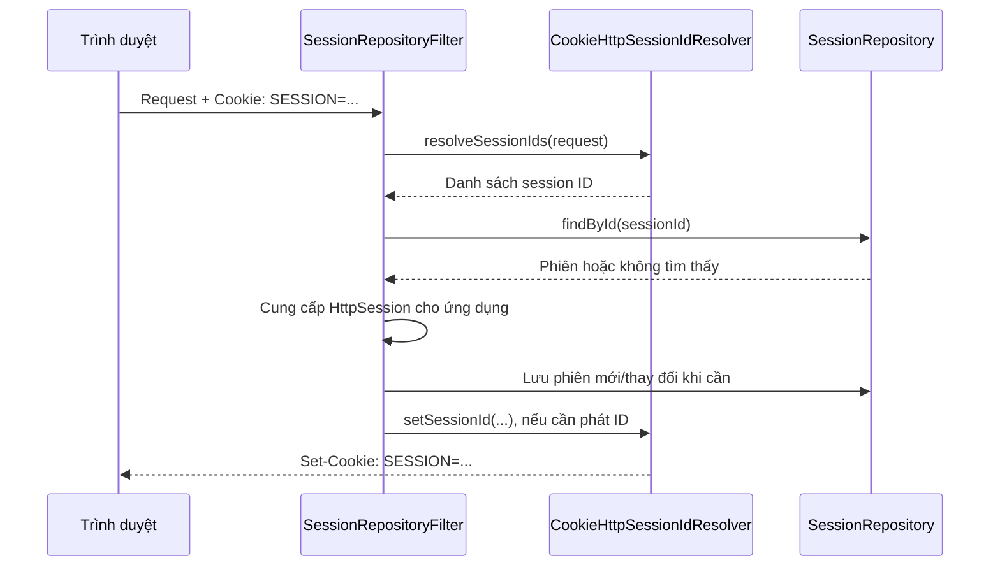
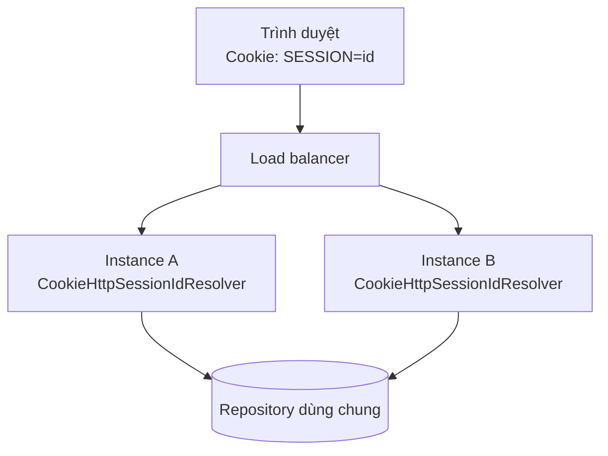

# `CookieHttpSessionIdResolver` và nhận, gửi định danh phiên bằng cookie

Trong ứng dụng Spring Session chạy trên Servlet, trình duyệt thường giữ một cookie chứa mã định danh phiên. Mỗi request tiếp theo gửi cookie đó để máy chủ tìm lại dữ liệu `HttpSession` trong repository như Redis hoặc JDBC. `CookieHttpSessionIdResolver` là thành phần đảm nhiệm việc đọc mã phiên từ cookie của request và ghi cookie vào response khi phiên được tạo, thay đổi định danh hoặc kết thúc.

Resolver chỉ xử lý cách truyền session ID giữa client và server. Nó không lưu dữ liệu phiên, không xác thực người dùng và không quyết định người dùng được phép truy cập tài nguyên nào. Những việc đó thuộc về `SessionRepositoryFilter`, repository và tầng xác thực/phân quyền. Hiểu rõ ranh giới này giúp cấu hình cookie đúng, chia sẻ phiên giữa nhiều instance và tránh nhầm lẫn giữa cookie hết hạn với dữ liệu phiên hết hạn ở máy chủ.

## 1. Cookie phiên mang định danh, không mang toàn bộ session

Một session có thể chứa `userId`, giỏ hàng, ngôn ngữ hoặc trạng thái tạm thời. Những thuộc tính này được lưu ở phía server trong repository. Trình duyệt chỉ cần giữ một mã định danh đủ để server tìm đúng bản ghi.

Ví dụ về một response tạo phiên:

```http
HTTP/1.1 200 OK
Set-Cookie: SESSION=abc123; Path=/; HttpOnly; Secure; SameSite=Lax
```

Request sau đó gửi cookie:

```http
GET /account HTTP/1.1
Host: app.example.com
Cookie: SESSION=abc123
```

`abc123` chỉ là giá trị minh họa. Trong cấu hình thực tế, session ID thường là một giá trị khó đoán và cookie serializer có thể mã hóa biểu diễn của nó. Không nên tự tạo ID dễ đoán hoặc ghi session ID thật vào log.

Các thuộc tính `Path`, `Domain`, `HttpOnly`, `Secure` và `SameSite` được gửi trong `Set-Cookie` để trình duyệt biết cách lưu và gửi cookie. Trong request, trình duyệt thường chỉ gửi cặp tên/giá trị cookie; các cờ bảo vệ không được gửi lại như một phần của header `Cookie`.

## 2. Vai trò của CookieHttpSessionIdResolver

Spring Session Servlet sử dụng `HttpSessionIdResolver` để trừu tượng hóa cách lấy và phát session ID. `CookieHttpSessionIdResolver` là implementation sử dụng cookie HTTP. Nó phối hợp với `CookieSerializer` để đọc giá trị cookie từ request và tạo hoặc hết hạn cookie trong response.

Hợp đồng của `HttpSessionIdResolver` gồm ba thao tác chính:

| Phương thức | Vai trò |
|---|---|
| `resolveSessionIds(request)` | Đọc các session ID mà client gửi lên trong request |
| `setSessionId(request, response, sessionId)` | Gửi cookie mang session ID khi cần thiết |
| `expireSession(request, response)` | Gửi cookie hết hạn để trình duyệt ngừng sử dụng định danh phiên hiện tại |

Luồng xử lý điển hình:

1. Trình duyệt gửi cookie `SESSION` trong request.
2. `SessionRepositoryFilter` gọi resolver để lấy session ID.
3. Filter dùng ID đó tra cứu `SessionRepository`.
4. Nếu tìm thấy phiên hợp lệ, filter cung cấp `HttpSession` được bọc cho ứng dụng.
5. Nếu ứng dụng tạo phiên mới, filter lưu phiên qua repository và resolver phát cookie chứa ID.
6. Khi phiên bị vô hiệu hóa, resolver phát cookie hết hạn để trình duyệt xóa cookie.



Sơ đồ thể hiện luồng khái niệm. Chi tiết thời điểm lưu và phát cookie còn phụ thuộc việc request có tạo phiên, thay đổi ID hoặc invalidate phiên hay không.

## 3. Resolver mặc định và cấu hình CookieSerializer

Khi bật Spring Session cho Servlet, cơ chế cookie thường được dùng mặc định thông qua `CookieHttpSessionIdResolver`. Trong trường hợp thông thường, không cần tự viết resolver. Có thể tùy chỉnh cách cookie được tạo bằng cách cung cấp bean `CookieSerializer`.

Ví dụ cấu hình Redis session và cookie:

```java
import org.springframework.context.annotation.Bean;
import org.springframework.context.annotation.Configuration;
import org.springframework.session.data.redis.config.annotation.web.http.EnableRedisHttpSession;
import org.springframework.session.web.http.CookieSerializer;
import org.springframework.session.web.http.DefaultCookieSerializer;

@Configuration
@EnableRedisHttpSession(maxInactiveIntervalInSeconds = 30 * 60)
public class SessionConfiguration {

    @Bean
    public CookieSerializer cookieSerializer() {
        DefaultCookieSerializer serializer = new DefaultCookieSerializer();
        serializer.setCookieName("SESSION");
        serializer.setCookiePath("/");
        serializer.setUseHttpOnlyCookie(true);
        serializer.setUseSecureCookie(true);
        serializer.setSameSite("Lax");
        return serializer;
    }
}
```

Trong ví dụ, cookie có tên `SESSION`, áp dụng cho toàn bộ ứng dụng, chỉ được gửi qua HTTPS và không cho JavaScript đọc bằng API cookie thông thường. `SameSite=Lax` là lựa chọn thường dùng cho ứng dụng web cùng site, nhưng cần đánh giá lại nếu luồng đăng nhập sử dụng SSO hoặc điều hướng cross-site.

`DefaultCookieSerializer` thực hiện tuần tự hóa và phân tích cookie. Tên cookie mặc định của Spring Session thường là `SESSION`; nó khác tên `JSESSIONID` mà Servlet container thường sử dụng khi tự quản lý session. Nếu muốn dùng tên `JSESSIONID` để tương thích với client hoặc hệ thống hiện hữu, cần cấu hình rõ ràng và kiểm tra không có cookie cũ cùng tên nhưng khác `Path` hoặc `Domain`.

Các thuộc tính API có thể thay đổi theo phiên bản Spring Session. Khi dùng phiên bản cũ, hãy kiểm tra các phương thức serializer có sẵn trong dependency đang dùng, đặc biệt với `SameSite` và các tùy chọn bảo vệ cookie.

## 4. Cách cookie được đọc từ request

### 4.1. Tìm cookie theo tên

Khi request đến, resolver dùng serializer để tìm cookie có tên đã cấu hình. Nếu tìm thấy, giá trị được phân tích thành session ID và trả cho `SessionRepositoryFilter`. Nếu không có cookie tương ứng, request được xử lý như không cung cấp session ID.

Không nên tự đọc header `Cookie` trong controller để khôi phục session. Controller nên dùng `HttpSession`; Spring Session và resolver chịu trách nhiệm ánh xạ cookie sang phiên. Tự phân tích cookie có thể tạo ra logic không đồng nhất về encoding, nhiều cookie trùng tên, path/domain và thay đổi phiên.

### 4.2. Cookie không tồn tại hoặc ID không còn hợp lệ

Có cookie không đồng nghĩa có phiên hợp lệ. Một số trường hợp:

- Trình duyệt không gửi cookie vì cookie đã hết hạn, bị xóa hoặc không khớp domain/path.
- Cookie có tên khác với tên serializer đang cấu hình.
- Giá trị cookie bị thay đổi hoặc không thể phân tích.
- ID hợp lệ về định dạng nhưng repository không còn dữ liệu tương ứng do phiên hết hạn hoặc đã bị xóa.

Resolver chịu trách nhiệm đọc định danh. Việc tra cứu ID và xác định phiên còn hiệu lực do repository và filter đảm nhiệm. Ứng dụng không được coi sự hiện diện của cookie là bằng chứng người dùng đã xác thực.

### 4.3. Nhiều cookie cùng tên

Trình duyệt có thể lưu nhiều cookie cùng tên nếu chúng được tạo với `Path` hoặc `Domain` khác nhau. Khi đó request có thể gửi nhiều cặp cùng tên và việc chọn giá trị phụ thuộc cách serializer phân tích cookie. Đây thường là nguyên nhân của lỗi khó tái hiện sau khi đổi tên cookie, đổi path hoặc chuyển domain.

Khi đổi cấu hình cookie trong môi trường đã chạy, cần có kế hoạch chuyển đổi:

1. Xác định tên, domain và path đang được phát.
2. Phát cookie mới theo cấu hình đích.
3. Hết hạn cookie cũ với đúng tên, path và domain cũ nếu còn có thể kiểm soát.
4. Kiểm thử trình duyệt có nhiều cookie cùng tên và xóa dữ liệu cookie cũ trong quá trình xác minh.

Không nên chỉ đổi `cookieName` rồi giả định cookie cũ tự biến mất. Trình duyệt có thể tiếp tục gửi cookie cũ cho đến khi nó hết hạn hoặc được xóa đúng phạm vi.

## 5. Cách cookie được phát trong response

### 5.1. Khi tạo session mới

Khi ứng dụng gọi `request.getSession()` và chưa có phiên hợp lệ, Spring Session có thể tạo một session mới. Sau khi repository lưu phiên, `CookieHttpSessionIdResolver` gửi `Set-Cookie` chứa ID mới về trình duyệt.

Ví dụ controller đơn giản:

```java
@PostMapping("/cart")
public ResponseEntity<Void> createCart(HttpServletRequest request) {
    HttpSession session = request.getSession();
    session.setAttribute("cartId", "CART-908");
    return ResponseEntity.noContent().build();
}
```

Controller không tự tạo `Set-Cookie`. Filter của Spring Session xử lý việc lưu phiên và resolver phát cookie theo cấu hình. Nếu chỉ kiểm tra phiên hiện tại mà không muốn tạo mới, dùng `request.getSession(false)`.

### 5.2. Khi session ID thay đổi

Một số thao tác bảo mật có thể thay đổi session ID mà vẫn giữ hoặc chuyển dữ liệu phiên theo chính sách của framework. Ví dụ, Spring Security có thể áp dụng session fixation protection sau khi xác thực. Khi ID thay đổi, client cần nhận ID mới để các request tiếp theo tham chiếu đến phiên đúng.

Ứng dụng không nên tự đặt session ID theo user ID, email hoặc giá trị dễ đoán. Session ID cần được tạo bởi cơ chế an toàn của framework. Không gửi ID phiên trong URL, query string hoặc log vì các kênh đó dễ bị lưu trong lịch sử trình duyệt, proxy và hệ thống giám sát.

### 5.3. Khi session bị invalidate

Khi ứng dụng gọi `HttpSession.invalidate()`, Spring Session xóa phiên khỏi repository theo luồng quản lý session và resolver gửi cookie hết hạn về trình duyệt. Cookie hết hạn thường được phát bằng `Set-Cookie` cùng tên và phạm vi cookie nhưng có thời hạn kết thúc hoặc `Max-Age` phù hợp.

Xóa cookie ở trình duyệt không đủ để thu hồi session ID đã bị sao chép. Điều quan trọng là dữ liệu phiên phía server phải bị xóa hoặc vô hiệu hóa để ID cũ không còn được chấp nhận. Cookie expiration chỉ giúp client hiện tại ngừng gửi ID đó.

## 6. Các thuộc tính cookie quan trọng

### 6.1. Cookie name

Tên cookie phải thống nhất giữa mọi instance và mọi phiên bản ứng dụng đang phục vụ cùng người dùng. Nếu A phát `SESSION` còn B chỉ đọc `JSESSIONID`, B sẽ không nhận được ID mà A đã gửi. Khi thay đổi tên cookie, cần cân nhắc triển khai cuốn chiếu và khả năng tương thích với request đang mang cookie cũ.

### 6.2. Path

`Path` giới hạn đường dẫn request mà trình duyệt gửi cookie. `Path=/` khiến cookie được gửi đến các đường dẫn trong toàn ứng dụng. Nếu ứng dụng chỉ đặt `Path=/shop`, request đến `/admin` sẽ không mang cookie đó.

Với nhiều ứng dụng cùng host, path có thể giúp phân tách cookie, nhưng phải thống nhất giữa các instance của cùng ứng dụng. Khi xóa cookie, phải dùng cùng path đã dùng khi tạo cookie.

### 6.3. Domain

Nếu không đặt `Domain`, cookie thường là host-only và chỉ được gửi đến host đã phát nó. Nếu cần chia sẻ cookie giữa các subdomain, có thể cấu hình domain chung, nhưng phải đánh giá rủi ro mở rộng phạm vi cookie.

Không đặt domain rộng hơn mức cần thiết. Cookie chia sẻ cho nhiều subdomain làm tăng số thành phần có thể nhận session ID. Tránh cấu hình domain là public suffix hoặc domain không thuộc quyền kiểm soát của ứng dụng.

### 6.4. Secure

`Secure` yêu cầu trình duyệt chỉ gửi cookie qua kết nối HTTPS. Production nên dùng HTTPS và bật `Secure`. Nếu TLS kết thúc ở reverse proxy, ứng dụng cần cấu hình proxy headers đúng để framework nhận biết request gốc là HTTPS khi serializer tự quyết định thuộc tính này.

Trong môi trường local HTTP, cookie `Secure` có thể không được gửi bởi trình duyệt. Có thể dùng cấu hình riêng cho local/test, nhưng không để cấu hình đó vô tình được dùng ở production.

### 6.5. HttpOnly

`HttpOnly` ngăn JavaScript đọc cookie qua `document.cookie`. Điều này làm giảm nguy cơ mã JavaScript độc hại lấy trực tiếp session ID qua API cookie. Nó không ngăn trình duyệt gửi cookie tự động cùng request và không thay thế bảo vệ chống XSS.

### 6.6. SameSite

`SameSite` kiểm soát việc trình duyệt gửi cookie trong ngữ cảnh cross-site:

| Giá trị | Hành vi khái quát | Khi cân nhắc |
|---|---|---|
| `Strict` | Hạn chế gửi cookie trong điều hướng từ site khác | Ứng dụng có thể chấp nhận việc người dùng phải xác thực lại khi quay về từ liên kết ngoài |
| `Lax` | Cho phép một số điều hướng top-level an toàn nhưng hạn chế nhiều request cross-site | Thường phù hợp ứng dụng web thông thường |
| `None` | Cho phép cookie trong ngữ cảnh cross-site nếu trình duyệt chấp nhận; cần `Secure` | SSO hoặc frontend/backend cross-site có yêu cầu cookie cross-site |

`SameSite=None` cần đi cùng `Secure` trong các trình duyệt hiện đại. Nếu frontend và backend khác site, cần cấu hình CORS credentials và cookie phù hợp; `SameSite=None` một mình không làm request cross-origin tự gửi cookie. Hãy kiểm tra cả chính sách trình duyệt và cấu hình `Access-Control-Allow-Credentials` cùng origin được phép.

### 6.7. Max-Age và cookie phiên

Nếu không đặt `Max-Age` hoặc `Expires`, cookie thường là session cookie và trình duyệt quản lý thời gian tồn tại theo phiên duyệt web. Nếu đặt thời hạn, cookie có thể tồn tại sau khi đóng/mở lại trình duyệt.

Thời hạn cookie ở client độc lập với TTL của session trong Redis/JDBC. Cookie còn hạn không làm sống lại session đã hết hạn ở server. Ngược lại, session có thể vẫn còn trong repository sau khi cookie đã bị trình duyệt xóa. Khi cấu hình cookie bền vững, phải bảo đảm thời hạn phía client không tạo cảm giác rằng phiên được đảm bảo tồn tại lâu hơn chính sách server.

## 7. Ví dụ cấu hình CookieSerializer chi tiết

Một cấu hình minh họa có thể đặt các thuộc tính thường dùng:

```java
@Bean
public CookieSerializer cookieSerializer() {
    DefaultCookieSerializer serializer = new DefaultCookieSerializer();
    serializer.setCookieName("SESSION");
    serializer.setCookiePath("/");
    serializer.setUseHttpOnlyCookie(true);
    serializer.setUseSecureCookie(true);
    serializer.setSameSite("Lax");
    // Không đặt Max-Age để dùng session cookie của trình duyệt.
    return serializer;
}
```

Nếu muốn giới hạn domain, có thể cấu hình `setDomainName(...)` hoặc cơ chế domain pattern được `DefaultCookieSerializer` hỗ trợ. Chỉ dùng domain pattern khi hiểu rõ quy tắc khớp host và đã kiểm thử với tất cả domain hợp lệ. Không lấy domain từ header do client tự gửi mà không xác thực, vì có thể phát cookie cho một phạm vi ngoài dự kiến.

Trong một hệ thống có nhiều môi trường, nên tách cấu hình local, test, staging và production. Cookie production nên có `Secure`, `HttpOnly`, `SameSite` phù hợp và domain/path được xác định rõ. Mọi instance trong cùng môi trường phải dùng cấu hình giống nhau.

## 8. Khi nào cần tự khai báo CookieHttpSessionIdResolver?

Với cấu hình chuẩn, Spring Session Servlet thường tự dùng `CookieHttpSessionIdResolver`. Nếu cần thay cách phân giải session ID, ứng dụng có thể cung cấp bean `HttpSessionIdResolver` riêng. Ví dụ tạo resolver cookie tường minh:

```java
@Bean
public HttpSessionIdResolver httpSessionIdResolver(
        CookieSerializer cookieSerializer) {
    CookieHttpSessionIdResolver resolver = new CookieHttpSessionIdResolver();
    resolver.setCookieSerializer(cookieSerializer);
    return resolver;
}
```

Đây là lựa chọn khi ứng dụng muốn kiểm soát trực tiếp resolver. Nếu cấu hình hiện tại đã tự tạo resolver mặc định và tự liên kết `CookieSerializer`, không cần khai báo thêm resolver bean chỉ để đổi tên cookie. Hãy chọn một cách cấu hình và tránh tạo nhiều bean resolver cạnh tranh.

Một số ứng dụng dùng `HeaderHttpSessionIdResolver` thay vì cookie, chẳng hạn API client gửi session ID trong header. Đó là một cơ chế khác; không nên đồng thời phát cookie và header với cùng mục đích nếu chưa có chính sách rõ ràng về thứ tự ưu tiên, thu hồi và bảo vệ định danh.

## 9. Cookie trong hệ thống nhiều instance

Cookie được trình duyệt gửi đến host của ứng dụng, sau đó load balancer chuyển request đến một instance. Mọi instance cần đọc cùng tên cookie và cùng cách phân tích giá trị. Để khôi phục được phiên, chúng cũng cần truy cập cùng repository, namespace và cấu hình serializer tương thích.



Nếu các instance dùng cookie name, path, domain hoặc cách encoding khác nhau, request có thể không mang hoặc không giải mã đúng session ID. Nếu cookie được đọc đúng nhưng repository khác nhau, lookup vẫn không tìm thấy phiên. Vì vậy, việc đồng bộ cookie configuration và repository configuration là hai yêu cầu độc lập.

Khi triển khai phiên bản mới theo rolling deployment, tránh để hai phiên bản phát cookie cùng tên nhưng có định dạng không tương thích. Nếu cần thay đổi serializer hoặc encoding, hãy có chiến lược chuyển đổi, kiểm thử request cũ/mới và thời gian tương thích đủ cho cookie hiện có hết hạn.

## 10. Bảo mật session ID

Session ID là một bearer credential: người có được ID hợp lệ có thể có khả năng sử dụng phiên tương ứng cho đến khi phiên hết hạn hoặc bị thu hồi. Vì vậy:

- Chỉ truyền cookie qua HTTPS trong production và bật `Secure`.
- Bật `HttpOnly` để giảm khả năng JavaScript đọc trực tiếp cookie.
- Chọn `SameSite` theo luồng ứng dụng và triển khai bảo vệ CSRF phù hợp.
- Không đưa session ID vào URL, log, analytics, thông báo lỗi hoặc mã nguồn frontend.
- Không tự tạo ID từ thông tin người dùng hoặc giá trị tuần tự dễ đoán.
- Bảo vệ endpoint logout bằng phương thức và chính sách CSRF phù hợp; không dùng request GET tùy tiện để kết thúc phiên.
- Sau xác thực, áp dụng session fixation protection; khi logout, xóa phiên phía server và hết hạn cookie.
- Không chấp nhận cookie chỉ vì nó có mặt; luôn để Spring Session tra cứu repository và tầng Security xác minh quyền.

`HttpOnly`, `Secure` và `SameSite` giảm một số rủi ro nhưng không thay thế việc ngăn XSS, CSRF, bảo vệ transport, quản lý quyền và thu hồi phiên.

## 11. Kiểm thử nhận và gửi cookie

Kiểm thử cần xác minh cả header HTTP và trạng thái repository. Một số trường hợp quan trọng:

| Kịch bản | Cách kiểm tra | Kết quả mong đợi |
|---|---|---|
| Tạo session mới | Gửi request tạo phiên và đọc `Set-Cookie` | Có cookie đúng tên và thuộc tính cấu hình |
| Request tiếp theo | Gửi lại cookie từ response trước | Repository khôi phục đúng session |
| Không có cookie | Gửi request không có cookie session | Không khôi phục phiên cũ; chỉ tạo phiên nếu ứng dụng yêu cầu |
| Cookie ID không tồn tại | Gửi ID không có trong repository | Không được xem là đã xác thực |
| Invalidate | Đăng xuất và kiểm tra response | Repository xóa phiên và response phát cookie hết hạn |
| Cookie path/domain | Gửi request đến các path/host khác nhau | Trình duyệt chỉ gửi cookie trong phạm vi được cấu hình |
| Secure | Kiểm thử HTTPS và HTTP | Cookie production chỉ được gửi qua HTTPS |
| SameSite | Kiểm thử luồng cùng site và cross-site trên trình duyệt | Cookie được gửi theo chính sách mong đợi |
| Nhiều instance | Tạo session ở A, gửi cookie đến B | B tìm được cùng phiên trong repository chung |
| Rolling deployment | Gửi cookie tạo bởi phiên bản cũ đến phiên bản mới | Hai phiên bản đọc được định dạng cookie tương thích trong giai đoạn chuyển đổi |

Ví dụ kiểm thử Spring MVC bằng MockMvc:

```java
@Test
void shouldReuseSessionWhenCookieIsSent() throws Exception {
    MvcResult first = mockMvc.perform(post("/cart"))
        .andExpect(status().isNoContent())
        .andReturn();

    Cookie sessionCookie = first.getResponse().getCookie("SESSION");
    assertNotNull(sessionCookie);

    mockMvc.perform(get("/cart")
            .cookie(sessionCookie))
        .andExpect(status().isOk());
}
```

Đoạn mã là khung minh họa; endpoint và status cần khớp với ứng dụng thực tế. Kiểm thử tích hợp nên dùng repository Redis/JDBC thực hoặc môi trường tương đương, sau đó gửi cùng cookie qua hai instance để chứng minh session được chia sẻ.

## 12. Lỗi thường gặp và cách xử lý

| Biểu hiện | Nguyên nhân có thể | Hướng kiểm tra |
|---|---|---|
| Request không gửi cookie | Sai `Path`, `Domain`, `Secure` hoặc cookie đã hết hạn | Kiểm tra `Set-Cookie` và điều kiện request của trình duyệt |
| Resolver không tìm thấy ID | Cookie name không khớp hoặc giá trị không phân tích được | Kiểm tra `CookieSerializer` và header `Cookie` |
| Đăng nhập xong request tiếp theo mất session | Cookie không được lưu/gửi, ID bị thay đổi hoặc repository không dùng chung | Kiểm tra response đầu, request sau và repository |
| Logout nhưng cookie vẫn còn | Resolver không phát cookie hết hạn hoặc sai path/domain | Kiểm tra response logout và thuộc tính cookie ban đầu |
| Có nhiều cookie `SESSION` | Cấu hình cũ tạo cookie với path/domain khác | Kiểm tra cookie trong trình duyệt và hết hạn đúng phạm vi |
| Cookie dùng được trên HTTP | Thiếu `Secure` hoặc proxy HTTPS chưa được nhận diện đúng | Kiểm tra TLS, forwarded headers và serializer |
| SSO cross-site không hoạt động | `SameSite` hoặc CORS credentials không phù hợp | Kiểm tra `SameSite=None; Secure`, origin và credentials |
| Instance A nhận phiên nhưng B không nhận | Cookie resolver hoặc repository configuration khác nhau | Đồng bộ tên cookie, serializer, namespace và store |

## 13. Nguyên tắc áp dụng

- Dùng `CookieHttpSessionIdResolver` để truyền session ID bằng cookie trong ứng dụng Servlet.
- Để resolver đọc, phát và hết hạn cookie; để repository lưu dữ liệu phiên.
- Tùy chỉnh cookie bằng `CookieSerializer` khi chỉ cần thay tên, path, domain hoặc cờ bảo vệ.
- Chỉ cung cấp resolver bean riêng khi cần thay đổi cơ chế phân giải; tránh đăng ký resolver cạnh tranh.
- Dùng `Secure`, `HttpOnly` và `SameSite` phù hợp; production phải dùng HTTPS.
- Đồng bộ cookie name, serializer, path/domain và repository trên mọi instance.
- Phân biệt thời hạn cookie phía trình duyệt với TTL của session phía server.
- Khi logout, thu hồi phiên trong repository và phát cookie hết hạn.
- Kiểm thử header `Set-Cookie`, header `Cookie`, ID không tồn tại, nhiều cookie trùng tên và luồng nhiều instance.

`CookieHttpSessionIdResolver` kết nối định danh phiên ở phía trình duyệt với `SessionRepository` ở phía server. Khi cookie được phát và đọc nhất quán, mọi instance có thể dùng cùng session ID để tìm trạng thái phiên trong kho dữ liệu chia sẻ. Bảo vệ cookie, quản lý TTL và thu hồi session vẫn cần được cấu hình và kiểm thử như các phần riêng của vòng đời xác thực.
