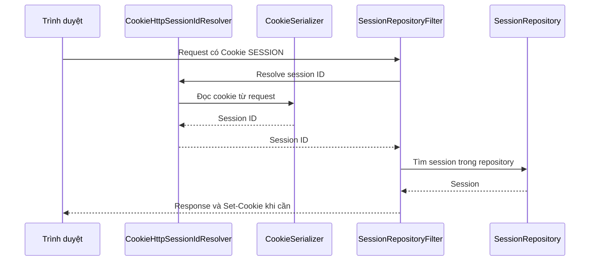
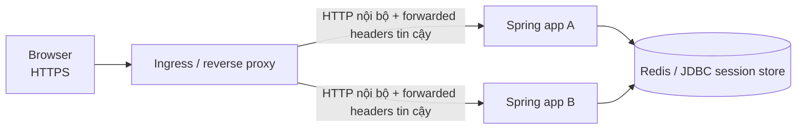

# CookieSerializer, DefaultCookieSerializer và phạm vi cấu hình Servlet

Trong ứng dụng Spring Session chạy trên Servlet, trình duyệt thường giữ session ID trong cookie và gửi cookie đó ở các request tiếp theo. Cookie không chứa toàn bộ dữ liệu phiên; nó mang mã định danh để Spring Session tìm session trong repository như Redis hoặc JDBC. `CookieSerializer` định nghĩa cách đọc và ghi cookie này, còn `DefaultCookieSerializer` là implementation có sẵn để cấu hình tên cookie, domain, path và các thuộc tính bảo mật.

Cấu hình cookie thuộc lớp tích hợp HTTP của Spring Session. Nó ảnh hưởng đến mọi request dùng resolver cookie trong phạm vi ứng dụng Servlet đó. Vì vậy, cần cấu hình nhất quán giữa các instance, hiểu ảnh hưởng của reverse proxy và kiểm thử cả lúc tạo lẫn lúc xóa cookie.

## 1. Cookie session giữ gì và không giữ gì?

HTTP không tự ghi nhớ trạng thái giữa các request. Servlet cung cấp `HttpSession` để ứng dụng lưu các thuộc tính như ID người dùng hoặc mã giỏ hàng. Khi dùng Spring Session, dữ liệu phiên được lưu trong repository. Trình duyệt chỉ cần gửi session ID để máy chủ tra cứu lại dữ liệu.

Ví dụ response có thể gửi:

```http
Set-Cookie: SESSION=eyJ...; Path=/; Secure; HttpOnly; SameSite=Lax
```

Ở request sau, trình duyệt gửi:

```http
Cookie: SESSION=eyJ...
```

Giá trị cookie là định danh phiên, không phải bản sao của các thuộc tính session. Nếu người khác lấy được session ID còn hiệu lực, họ có thể sử dụng phiên đó theo quyền của người dùng. Vì vậy, cần bảo vệ cookie như thông tin xác thực.

Một session ID mới có thể được phát sau khi tạo session hoặc khi cơ chế bảo mật thay đổi ID, ví dụ sau xác thực để chống session fixation. Cookie serializer đảm nhiệm việc biểu diễn ID trong cookie; nó không tự quyết định quyền truy cập của người dùng hoặc thay thế kiểm tra xác thực và phân quyền.

## 2. CookieSerializer và CookieHttpSessionIdResolver

Spring Session Servlet tách hai nhiệm vụ:

- `HttpSessionIdResolver` xác định cách lấy session ID từ request và cách gửi hoặc xóa ID ở response.
- `CookieSerializer` đọc giá trị cookie từ request và ghi cookie vào response.

`CookieHttpSessionIdResolver` là resolver dùng cookie. Nó ủy quyền phần định dạng cookie cho một `CookieSerializer`. `DefaultCookieSerializer` là implementation phổ biến để ứng dụng cấu hình các thuộc tính cookie mà không phải tự tạo header `Set-Cookie`.

Một số phương thức tiêu biểu của serializer gồm:

| Thành phần | Vai trò |
|---|---|
| `readCookieValues(request)` | Đọc một hoặc nhiều giá trị cookie session từ request |
| `writeCookieValue(cookieValue)` | Ghi cookie session hoặc cookie xóa session vào response |
| `setCookieName(...)` | Chọn tên cookie |
| `setCookiePath(...)` | Chọn phạm vi đường dẫn của cookie |
| `setDomainName(...)` | Chỉ định domain của cookie |
| `setUseHttpOnlyCookie(...)` | Điều khiển thuộc tính HttpOnly |
| `setUseSecureCookie(...)` | Điều khiển thuộc tính Secure |
| `setSameSite(...)` | Điều khiển thuộc tính SameSite |

Các API cụ thể có thể khác giữa các phiên bản Spring Session. Khi nâng cấp dependency, hãy đối chiếu Javadoc và kiểm tra cookie thực tế trong response.

Luồng xử lý đơn giản:



Nếu ứng dụng dùng `HeaderHttpSessionIdResolver` để truyền ID trong header thay vì cookie, `CookieSerializer` không điều khiển cách truyền ID đó. Hãy xác định resolver đang hoạt động trước khi thay đổi cookie.

## 3. Cấu hình DefaultCookieSerializer bằng bean

Trong ứng dụng Spring Boot Servlet dùng cấu hình Spring Session tiêu chuẩn, có thể cung cấp bean `CookieSerializer` để thay đổi cách cookie được ghi. Ví dụ:

```java
import org.springframework.context.annotation.Bean;
import org.springframework.context.annotation.Configuration;
import org.springframework.session.web.http.CookieSerializer;
import org.springframework.session.web.http.DefaultCookieSerializer;

@Configuration(proxyBeanMethods = false)
public class SessionCookieConfiguration {

    @Bean
    CookieSerializer cookieSerializer() {
        DefaultCookieSerializer serializer = new DefaultCookieSerializer();
        serializer.setCookieName("APPSESSION");
        serializer.setCookiePath("/");
        serializer.setUseHttpOnlyCookie(true);
        serializer.setUseSecureCookie(true);
        serializer.setSameSite("Lax");
        return serializer;
    }
}
```

Khi Spring Session sử dụng `CookieHttpSessionIdResolver` mặc định, cấu hình tích hợp tiêu chuẩn có thể sử dụng bean serializer do ứng dụng cung cấp. Hãy kiểm tra cấu hình thực tế của phiên bản Boot/Spring Session đang dùng, đặc biệt nếu ứng dụng tự khai báo `HttpSessionIdResolver` hoặc bật cấu hình repository tường minh.

Nếu tự tạo resolver, cần gắn serializer vào resolver đó:

```java
@Bean
HttpSessionIdResolver httpSessionIdResolver(CookieSerializer cookieSerializer) {
    CookieHttpSessionIdResolver resolver = new CookieHttpSessionIdResolver();
    resolver.setCookieSerializer(cookieSerializer);
    return resolver;
}
```

Đoạn cấu hình resolver này là lựa chọn cho trường hợp ứng dụng thực sự cần tự cung cấp resolver. Không khai báo thêm một resolver chỉ để đổi tên cookie nếu resolver mặc định đã sử dụng bean serializer. Khi có nhiều resolver hoặc filter cùng xử lý session, việc đọc và xóa cookie có thể không nhất quán.

Tên cookie, domain, path và chính sách bảo mật nên được xem là cấu hình cấp ứng dụng. Nếu một ứng dụng phục vụ nhiều nhóm endpoint với yêu cầu cookie khác nhau, cần thiết kế resolver và đường dẫn tách biệt có chủ đích; không nên kỳ vọng một bean serializer toàn cục tự thay đổi theo controller.

## 4. Tên cookie và tránh xung đột giữa ứng dụng

Tên cookie mặc định thường dùng trong Spring Session Servlet là `SESSION`. Ứng dụng có thể đổi tên, ví dụ `APPSESSION` hoặc `SHOPSESSION`, để tránh xung đột với cookie của ứng dụng khác trên cùng host và path.

Một số tình huống cần đổi tên:

- Nhiều ứng dụng độc lập cùng chạy trên một domain.
- Ứng dụng chuyển từ session container cũ và cần phối hợp trong giai đoạn migration.
- Nhiều môi trường hoặc ứng dụng dùng chung trình duyệt kiểm thử.
- Cùng host có nhiều ứng dụng với repository hoặc chính sách xác thực khác nhau.

Cookie cùng tên có thể tồn tại ở các path khác nhau. Trình duyệt có thể gửi nhiều giá trị cùng tên trong một request; việc máy chủ chọn giá trị nào có thể gây hành vi khó đoán. Vì vậy, khi đổi `Path` hoặc `Domain`, cần xóa cookie cũ theo đúng thuộc tính đã phát hành trước đó.

Đổi tên cookie không thay đổi ID trong repository và cũng không di chuyển session hiện có. Khi triển khai đổi tên, các trình duyệt vẫn gửi tên cũ cho đến khi cookie cũ hết hạn hoặc được xóa. Nếu cần giữ người dùng đăng nhập qua giai đoạn chuyển đổi, phải có kế hoạch tương thích đọc cookie cũ và phát cookie mới; nếu không, người dùng có thể phải đăng nhập lại.

## 5. Domain và Path xác định nơi trình duyệt gửi cookie

### Domain

Nếu không đặt `Domain`, cookie thường là host-only cookie: trình duyệt chỉ gửi nó đến host đã phát hành cookie. Đây là lựa chọn giới hạn phạm vi tốt cho một ứng dụng đơn lẻ.

Nếu cần chia sẻ cookie giữa các subdomain, có thể đặt domain chung như `example.com` để cookie được gửi đến các host phù hợp dưới domain đó. Việc chia sẻ session giữa nhiều subdomain làm tăng phạm vi nơi session ID được gửi, vì vậy chỉ nên dùng khi các ứng dụng cùng miền tin cậy và có chính sách xác thực tương thích.

Ví dụ cấu hình domain cố định:

```java
serializer.setDomainName("example.com");
```

Không nên đặt domain quá rộng hoặc dùng domain của public suffix. Domain cookie phải thuộc miền mà ứng dụng có quyền kiểm soát.

`DefaultCookieSerializer` cũng có thể hỗ trợ `setDomainNamePattern(...)` để trích domain từ hostname của request. Cách này hữu ích khi một ứng dụng phục vụ nhiều tenant theo subdomain, nhưng regex phải được giới hạn vào các domain được phép. Không lấy domain tùy ý từ Host header rồi phát cookie cho nó; cần kiểm tra hostname tại reverse proxy và ứng dụng. Không cấu hình đồng thời domain cố định và pattern nếu API phiên bản đang dùng xem chúng là hai lựa chọn loại trừ nhau.

### Path

`Path` quyết định request đến đường dẫn nào sẽ gửi cookie. Đặt `/` khiến cookie được gửi trên toàn bộ đường dẫn của host. Nếu ứng dụng chỉ chạy dưới context path riêng, có thể giới hạn cookie vào context path đó.

Ví dụ:

```java
serializer.setCookiePath("/store");
```

Path giúp giới hạn phạm vi gửi cookie, nhưng không phải ranh giới bảo mật thay thế phân quyền. Một ứng dụng khác trên cùng host không nên được coi là an toàn chỉ vì cookie của ứng dụng này có path riêng. Tên cookie riêng, domain phù hợp và tách biệt ứng dụng vẫn rất quan trọng.

## 6. HttpOnly, Secure và SameSite

Ba thuộc tính này kiểm soát cách trình duyệt xử lý cookie. Chúng không mã hóa session ID và không thay thế HTTPS hoặc cơ chế chống CSRF.

### HttpOnly

`HttpOnly` yêu cầu trình duyệt không cho JavaScript thông thường đọc cookie qua `document.cookie`. Điều này làm giảm khả năng mã JavaScript lấy trực tiếp session ID trong một số tình huống XSS.

Nên bật `HttpOnly` cho cookie session. Tuy nhiên, XSS vẫn có thể thực hiện request dưới danh nghĩa người dùng trong trình duyệt, vì vậy vẫn cần mã hóa đầu ra, Content Security Policy phù hợp và các biện pháp phòng chống XSS khác.

### Secure

`Secure` yêu cầu trình duyệt chỉ gửi cookie qua kết nối bảo mật HTTPS. Trong production, cookie session nên có thuộc tính này.

Có thể bật tường minh:

```java
serializer.setUseSecureCookie(true);
```

Nếu để giá trị Secure tự suy ra từ request, `DefaultCookieSerializer` có thể dựa vào việc request có được đánh dấu secure hay không. Khi TLS kết thúc ở reverse proxy, ứng dụng phía sau có thể nhận kết nối HTTP nội bộ và không nhận biết request gốc là HTTPS. Khi đó cookie có thể bị thiếu thuộc tính `Secure` nếu cấu hình proxy không đúng.

Có hai hướng xử lý:

- Bật Secure tường minh trong môi trường production luôn dùng HTTPS.
- Cấu hình forwarded headers để ứng dụng nhận biết giao thức gốc, chỉ tin header do reverse proxy tin cậy ghi đè.

Không tin `X-Forwarded-Proto` từ client tùy ý. Reverse proxy cần xóa giá trị client gửi và tự đặt header đáng tin cậy. Trong môi trường local chỉ chạy HTTP, cấu hình Secure tường minh có thể khiến trình duyệt không gửi cookie; hãy tách cấu hình theo môi trường và kiểm tra qua HTTPS trước khi triển khai.

### SameSite

`SameSite` kiểm soát việc trình duyệt gửi cookie trong request cross-site:

| Giá trị | Hành vi khái quát | Tình huống thường gặp |
|---|---|---|
| `Strict` | Hạn chế gửi cookie trong hầu hết điều hướng cross-site | Ứng dụng có thể chấp nhận trải nghiệm chặt chẽ hơn |
| `Lax` | Cho phép một số điều hướng cấp cao cross-site an toàn, hạn chế nhiều request cross-site khác | Mặc định thực tế phù hợp với nhiều ứng dụng web |
| `None` | Cho phép gửi cookie trong ngữ cảnh cross-site nếu các điều kiện trình duyệt được đáp ứng | Một số kiến trúc frontend/API khác site hoặc tích hợp bên ngoài |

Khi dùng `SameSite=None`, trình duyệt hiện đại yêu cầu cookie có `Secure`, tức là phải được gửi qua HTTPS. Cấu hình `None` làm tăng phạm vi gửi cookie cross-site và cần đánh giá CSRF cẩn thận.

Ví dụ cấu hình tường minh:

```java
serializer.setSameSite("Lax");
```

`SameSite` không thay thế CSRF token hoặc các biện pháp kiểm tra origin. Đặc biệt, ứng dụng dùng cookie để xác thực request thay đổi dữ liệu vẫn cần chính sách CSRF phù hợp với framework bảo mật.

## 7. Base64 encoding và định dạng giá trị cookie

`DefaultCookieSerializer` có tùy chọn mã hóa Base64 giá trị cookie. Cơ chế này giúp session ID được biểu diễn theo dạng phù hợp với cookie và tránh một số ký tự đặc biệt. Tùy chọn cụ thể và giá trị mặc định cần được xác nhận theo phiên bản Spring Session.

Không tự giải mã hoặc chỉnh sửa session ID trong JavaScript, reverse proxy hay middleware khác. Nếu thay đổi chính sách Base64 giữa các phiên bản, cookie cũ có thể không còn được giải mã theo cách mới. Hãy lên kế hoạch triển khai và kiểm thử với session đang hoạt động.

`jvmRoute` là tùy chọn tương thích với một số mô hình định tuyến cũ, cho phép gắn hậu tố route vào giá trị cookie. Khi dùng repository chia sẻ như Redis hoặc JDBC, load balancer không nhất thiết cần route affinity để tìm session. Chỉ bật route suffix nếu kiến trúc hiện tại thực sự yêu cầu nó và mọi instance cùng hiểu định dạng đó.

Không đặt dữ liệu nghiệp vụ, thông tin người dùng hoặc token tùy ý vào session cookie. Cookie session nên chỉ mang định danh do Spring Session quản lý.

## 8. Cookie lifetime khác với session timeout

Có hai thời hạn cần phân biệt:

- **Session timeout:** thời gian session phía máy chủ được phép không hoạt động trước khi hết hạn. Spring Session lưu thời hạn này trong repository; Redis có thể dùng TTL, còn JDBC quản lý timestamp và cleanup.
- **Cookie lifetime:** thời gian trình duyệt giữ cookie. Cookie session thường tồn tại theo phiên trình duyệt; cookie persistent có `Max-Age` hoặc `Expires` để tồn tại lâu hơn.

Hai thời hạn không tự động bằng nhau. Cookie có thể vẫn còn sau khi session phía máy chủ hết hạn; khi đó ID không tìm được session hợp lệ. Ngược lại, trình duyệt có thể xóa cookie trước khi session phía máy chủ hết hạn, để lại bản ghi session cho đến khi TTL hoặc cleanup xử lý.

Không kéo dài cookie lifetime để thay thế cơ chế timeout phía máy chủ. Nếu cần chức năng “ghi nhớ đăng nhập”, hãy dùng cơ chế remember-me hoặc chính sách xác thực phù hợp của Spring Security, phân biệt với cookie định danh session thông thường.

Khi logout, resolver sẽ ghi cookie hết hạn để trình duyệt xóa cookie session và repository sẽ vô hiệu hóa session theo luồng logout. Cookie xóa phải khớp tên, domain và path đã dùng khi phát hành; nếu đổi cấu hình mà không xóa cookie theo thuộc tính cũ, trình duyệt có thể vẫn giữ cookie cũ.

## 9. Phạm vi cấu hình trong ứng dụng Servlet

`CookieSerializer` thuộc tích hợp Servlet của Spring Session. Bean serializer thường được áp dụng cho cookie session của `CookieHttpSessionIdResolver` trong ứng dụng đó. Đây là cấu hình cấp ứng dụng hoặc context, không phải cấu hình tự động riêng cho từng controller.

Một cấu hình Spring Boot tiêu chuẩn có thể kết hợp:

- Dependency Spring Session phù hợp với repository đã chọn.
- Cấu hình Redis hoặc JDBC.
- Bean `CookieSerializer` để kiểm soát cookie.
- `SessionRepositoryFilter` do Spring Session đăng ký để thay thế session của container trên request.

Filter cần chạy trước các filter đọc `HttpSession`, đặc biệt là Spring Security, để toàn bộ chuỗi xử lý dùng cùng một session. Nếu tự đăng ký filter, resolver hoặc listener, hãy kiểm tra thứ tự và tránh đăng ký trùng với cấu hình tự động.

Mọi instance trong cùng một cụm cần có cấu hình cookie tương thích: tên cookie, domain, path, SameSite và cách mã hóa giá trị. Nếu app A phát cookie `APPSESSION` nhưng app B chỉ đọc `SESSION`, request chuyển sang B sẽ không tìm được ID dù cả hai cùng trỏ đến Redis. Nếu các instance dùng path hoặc domain khác nhau, trình duyệt có thể không gửi cookie theo cùng cách.

`CookieSerializer` này chỉ áp dụng cho Servlet. Ứng dụng WebFlux dùng `WebSession` và resolver tương ứng của WebFlux; không dùng bean serializer Servlet để điều khiển cookie WebFlux.

## 10. Cookie sau reverse proxy và nhiều subdomain

Trong kiến trúc phổ biến, trình duyệt kết nối HTTPS tới load balancer hoặc ingress, sau đó proxy chuyển request vào ứng dụng Spring. Ứng dụng cần biết request gốc là HTTPS để tạo cookie đúng thuộc tính.

Ví dụ:



Nếu proxy không truyền thông tin giao thức đúng, ứng dụng có thể tạo cookie không có `Secure` khi serializer suy luận từ request. Hãy cấu hình forwarded header strategy hoặc đặt Secure tường minh trong production, đồng thời giới hạn nguồn header tin cậy.

Với nhiều subdomain, cần quyết định cookie chỉ thuộc một host hay được chia sẻ cho domain cha. Chia sẻ cookie giữa `app.example.com` và `api.example.com` có thể tiện lợi nhưng mở rộng nơi nhận session ID. Các ứng dụng phải cùng tin cậy, cùng hiểu session và có cấu hình bảo mật phù hợp. Nếu không có yêu cầu chia sẻ, host-only cookie là lựa chọn có phạm vi hẹp hơn.

## 11. Kiểm thử CookieSerializer

Kiểm thử cần quan sát header `Set-Cookie` do ứng dụng thực sự trả về, vì cấu hình bean đúng về mặt khai báo chưa bảo đảm request đi qua đúng resolver.

Với MockMvc, có thể kiểm tra các thuộc tính cơ bản:

```java
MvcResult result = mockMvc.perform(post("/cart/item"))
        .andReturn();

String setCookie = result.getResponse().getHeader("Set-Cookie");

assertThat(setCookie).contains("APPSESSION=");
assertThat(setCookie).contains("Path=/");
assertThat(setCookie).contains("Secure");
assertThat(setCookie).contains("HttpOnly");
assertThat(setCookie).contains("SameSite=Lax");
```

Đây là ví dụ kiểm tra chuỗi header. Tùy phiên bản Spring Framework và test setup, response có thể có nhiều header `Set-Cookie`; khi đó hãy lấy đúng cookie theo tên thay vì giả định chỉ có một header.

Các trường hợp nên kiểm thử:

1. Cookie được phát khi ứng dụng tạo session lần đầu.
2. Request kế tiếp gửi cookie đó và repository khôi phục đúng session.
3. Cookie sai định dạng hoặc session ID không tồn tại không được coi là phiên hợp lệ.
4. `HttpOnly`, `Secure`, `SameSite`, `Path` và `Domain` có giá trị như mong muốn.
5. Logout xóa cookie bằng đúng tên, domain và path.
6. Session ID thay đổi sau quá trình xác thực theo chính sách session fixation của Spring Security.
7. Hai instance phát và đọc cùng một định dạng cookie khi dùng chung repository.
8. Request qua reverse proxy HTTPS tạo cookie Secure đúng cách.
9. Cookie cũ được xử lý đúng trong đợt chuyển đổi tên hoặc domain.

MockMvc giúp kiểm tra hành vi của ứng dụng, nhưng trình duyệt thực tế mới xác nhận đầy đủ chính sách SameSite, Secure và cách lưu cookie. Với kiến trúc cross-site, nên có kiểm thử trình duyệt trên môi trường HTTPS tương đương production.

## 12. Checklist cấu hình trước khi triển khai

Trước khi đưa Spring Session Servlet vào production, hãy xác nhận:

- Cookie chỉ chứa session ID, không chứa dữ liệu nghiệp vụ nhạy cảm.
- Tên cookie không xung đột với ứng dụng khác trên cùng host/path.
- Domain được giới hạn theo miền cần thiết; ưu tiên host-only nếu không cần chia sẻ subdomain.
- Path phản ánh context ứng dụng và không được xem là biện pháp phân quyền.
- `HttpOnly` được bật cho cookie session.
- `Secure` được bật khi production dùng HTTPS.
- `SameSite` phù hợp với luồng điều hướng và frontend/API; `None` đi cùng Secure và CSRF phù hợp.
- Forwarded headers chỉ được tin cậy khi đến từ proxy được kiểm soát.
- Mọi instance dùng chung repository và cùng cấu hình cookie.
- Logout vô hiệu hóa session phía máy chủ và xóa cookie theo đúng domain/path/name.
- Session timeout phía máy chủ được cấu hình độc lập với cookie lifetime.
- Đã kiểm thử tạo, đọc, xoay vòng ID, logout, reverse proxy và chuyển instance.

`CookieSerializer` và `DefaultCookieSerializer` cung cấp ranh giới cấu hình rõ ràng giữa session ID phía máy chủ và cookie phía trình duyệt. Cấu hình đúng giúp trình duyệt gửi ID trong đúng phạm vi, bảo vệ cookie bằng các thuộc tính phù hợp và cho phép nhiều instance đọc cùng một session. Hiệu quả cuối cùng phụ thuộc vào resolver đang dùng, repository, cấu hình proxy, chính sách trình duyệt và cách ứng dụng quản lý vòng đời xác thực.

