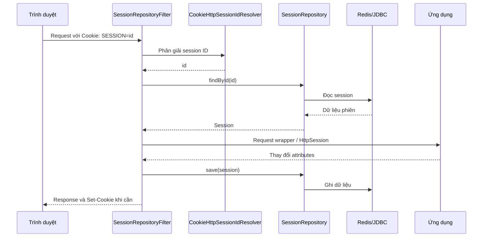

# Tên cookie SESSION, JSESSIONID và tương tác với phiên container

Cookie session thường chỉ mang một mã định danh để trình duyệt gửi lại ở request tiếp theo. Dữ liệu phiên như trạng thái đăng nhập, giỏ hàng hoặc các attributes khác được lưu ở phía máy chủ. Vì vậy, nhìn thấy cookie `JSESSIONID` hay `SESSION` trong trình duyệt chưa đủ để kết luận session được lưu ở đâu. Điều cần xác định là thành phần nào đọc cookie đó và dùng mã bên trong để tìm dữ liệu phiên.

Trong ứng dụng Servlet, `JSESSIONID` thường là tên cookie mặc định của servlet container. Khi tích hợp Spring Session, tên cookie mặc định thường là `SESSION`. Cả hai mô hình vẫn có thể cung cấp API `HttpSession` cho controller, nhưng session manager của container và `SessionRepository` của Spring Session là hai cơ chế quản lý dữ liệu khác nhau.

## 1. Cookie mang session ID, không mang toàn bộ session

HTTP là giao thức không lưu trạng thái giữa các request. Để liên kết nhiều request thành một phiên làm việc, máy chủ tạo một session ID và gửi ID đó cho client. Trình duyệt lưu ID trong cookie và tự động gửi cookie phù hợp ở những request tiếp theo.

Ví dụ một response có thể chứa:

```http
Set-Cookie: SESSION=abc123; Path=/; HttpOnly; Secure; SameSite=Lax
```

Request tiếp theo có thể gửi:

```http
Cookie: SESSION=abc123
```

Giá trị `abc123` trong ví dụ chỉ minh họa một mã định danh. Cookie không cần chứa attributes của session. Khi nhận request, máy chủ lấy ID từ cookie, tra cứu session trong nơi lưu trữ tương ứng, rồi cung cấp dữ liệu cho ứng dụng.

Tách ID khỏi dữ liệu phiên có một số lợi ích:

- Dữ liệu phiên có thể được lưu trong bộ nhớ container, Redis, JDBC hoặc repository khác.
- Client chỉ giữ một định danh ngắn, không phải toàn bộ dữ liệu phiên.
- Máy chủ có thể thu hồi session bằng cách xóa hoặc vô hiệu hóa dữ liệu phía máy chủ.
- Nhiều instance có thể cùng khôi phục một phiên nếu chúng dùng chung repository và cấu hình tương thích.

Session ID là thông tin nhạy cảm. Người khác có được ID còn hiệu lực có thể có khả năng sử dụng phiên của người dùng. Không ghi giá trị cookie session vào log công khai, URL hoặc hệ thống phân tích không được bảo vệ.

## 2. JSESSIONID và SESSION đến từ đâu?

### JSESSIONID: cookie thường gặp của servlet container

Khi ứng dụng dùng session manager mặc định của Tomcat, Jetty hoặc một servlet container khác, container thường tạo cookie có tên `JSESSIONID`. Container đọc ID này để tìm session trong cơ chế quản lý của nó. Trong cấu hình phổ biến, session được lưu trong bộ nhớ của tiến trình container; cơ chế lưu bền hoặc clustering tùy nhà cung cấp và cấu hình.

### SESSION: cookie mặc định của Spring Session

Khi ứng dụng Servlet dùng Spring Session với `CookieHttpSessionIdResolver`, `DefaultCookieSerializer` thường sử dụng tên cookie `SESSION`. Resolver đọc cookie, chuyển ID cho Spring Session và dùng ID đó để tìm session qua `SessionRepository`. Repository có thể kết nối tới Redis hoặc JDBC.

| Đặc điểm | `JSESSIONID` trong mô hình container | `SESSION` trong mô hình Spring Session |
|---|---|---|
| Thành phần thường tạo cookie | Servlet container | Spring Session cookie resolver/serializer |
| Thành phần tìm session | Session manager của container | `SessionRepository` |
| Nơi lưu phổ biến | Bộ nhớ container hoặc cơ chế clustering riêng | Redis, JDBC hoặc repository được hỗ trợ |
| API ứng dụng | `HttpSession` | `HttpSession` qua `SessionRepositoryFilter` |
| Phạm vi chia sẻ | Theo khả năng clustering của container | Các instance dùng chung repository và cấu hình tương thích |

Tên cookie là mặc định phổ biến, không phải định danh bắt buộc của loại session. Container có thể được cấu hình đổi tên `JSESSIONID`; Spring Session cũng có thể đổi `SESSION` thành một tên khác. Việc đổi tên cookie không thay đổi nơi lưu dữ liệu phiên.

## 3. Spring Session đọc và ghi cookie như thế nào?

Trong ứng dụng Servlet, `SessionRepositoryFilter` bọc request và response. Theo mặc định, Spring Session dùng `CookieHttpSessionIdResolver` để nhận và gửi session ID. Resolver sử dụng `CookieSerializer` để chuyển ID thành cookie trong response và đọc cookie từ request.

Luồng request điển hình:

1. Trình duyệt gửi cookie `SESSION` kèm session ID.
2. `SessionRepositoryFilter` nhận request trước các thành phần ứng dụng truy cập session.
3. `CookieHttpSessionIdResolver` đọc cookie và cung cấp ID cho Spring Session.
4. `SessionRepository` tìm session theo ID trong Redis, JDBC hoặc repository đã cấu hình.
5. Request wrapper cung cấp API `HttpSession` cho controller và các thành phần Servlet.
6. Khi session được tạo hoặc thay đổi, Spring Session lưu dữ liệu theo chính sách flush/save của cấu hình.
7. Resolver ghi cookie session ID vào response khi cần.



Cookie resolver chỉ xử lý việc trao đổi ID qua HTTP. Repository chịu trách nhiệm lưu và khôi phục dữ liệu. Vì vậy, đổi cookie name không làm Spring Session tự động đọc session trong bộ nhớ của container.

## 4. Đổi tên cookie Spring Session

Có thể cấu hình `DefaultCookieSerializer` thành một bean để đổi tên cookie và điều chỉnh các thuộc tính bảo mật. Ví dụ:

```java
import org.springframework.context.annotation.Bean;
import org.springframework.context.annotation.Configuration;
import org.springframework.session.web.http.CookieSerializer;
import org.springframework.session.web.http.DefaultCookieSerializer;

@Configuration
class SessionCookieConfiguration {

    @Bean
    CookieSerializer cookieSerializer() {
        DefaultCookieSerializer serializer = new DefaultCookieSerializer();
        serializer.setCookieName("SESSION");
        serializer.setUseHttpOnlyCookie(true);
        serializer.setUseSecureCookie(true);
        serializer.setSameSite("Lax");
        return serializer;
    }
}
```

Trong ví dụ, tên cookie được đặt tường minh là `SESSION`, cũng là mặc định thường gặp của Spring Session. `HttpOnly` hạn chế JavaScript đọc cookie; `Secure` yêu cầu trình duyệt chỉ gửi cookie qua HTTPS; `SameSite` kiểm soát việc gửi cookie trong một số ngữ cảnh cross-site. Chọn `SameSite` theo luồng đăng nhập, chuyển hướng từ nhà cung cấp định danh và yêu cầu tích hợp của ứng dụng.

Chỉ bật `Secure` khi ứng dụng được truy cập bằng HTTPS. Nếu ứng dụng chạy sau reverse proxy hoặc load balancer kết thúc TLS, cần cấu hình forwarded headers và chỉ tin proxy được kiểm soát để ứng dụng nhận biết scheme gốc chính xác. Nếu ứng dụng nghĩ request là HTTP, serializer có thể tạo cookie không có thuộc tính Secure dù client bên ngoài truy cập qua HTTPS.

Có thể tùy chỉnh thêm cookie path, domain và max-age qua `DefaultCookieSerializer`. Chỉ đặt domain rộng khi thực sự cần chia sẻ cookie giữa các subdomain; phạm vi càng rộng thì càng nhiều ứng dụng có thể nhận cookie đó. Cookie path nên giới hạn trong phạm vi ứng dụng khi có nhiều ứng dụng trên cùng host. Max-age của cookie điều khiển thời gian trình duyệt giữ cookie, còn timeout của session điều khiển thời gian session được xem là không hoạt động ở phía máy chủ.

## 5. Có thể dùng JSESSIONID cho Spring Session không?

Có. Spring Session có thể được cấu hình dùng tên cookie `JSESSIONID`:

```java
@Bean
CookieSerializer cookieSerializer() {
    DefaultCookieSerializer serializer = new DefaultCookieSerializer();
    serializer.setCookieName("JSESSIONID");
    serializer.setUseHttpOnlyCookie(true);
    serializer.setUseSecureCookie(true);
    serializer.setSameSite("Lax");
    return serializer;
}
```

Điều này hữu ích khi một hệ thống cần giữ tên cookie đã được client hoặc một lớp tích hợp kỳ vọng. Tuy nhiên, sau khi cấu hình như vậy, `JSESSIONID` do Spring Session phát vẫn chứa ID được Spring Session phân giải và tìm trong repository. Tên giống cookie mặc định của container không biến session Redis/JDBC thành session do container quản lý.

Nếu container cũng phát `JSESSIONID`, hai cơ chế có thể xung đột. Cần bảo đảm chỉ một thành phần quản lý cookie đó trong phạm vi domain/path tương ứng, đồng thời bảo đảm `SessionRepositoryFilter` chạy trước filter hoặc code khác có thể tạo session native.

## 6. Khi JSESSIONID và SESSION cùng xuất hiện

Một ứng dụng có thể phát cả `JSESSIONID` và `SESSION` nếu container tạo session native và Spring Session tạo session riêng. Điều này có thể xảy ra khi một filter, listener hoặc thành phần tích hợp gọi `request.getSession()` trước khi request được bọc bởi `SessionRepositoryFilter`, hoặc khi ứng dụng cố ý dùng hai cơ chế độc lập.

Hai cookie có tên khác nhau có thể cùng tồn tại trong trình duyệt. Khi request gửi cả hai, container có thể dùng `JSESSIONID` để liên kết session native, còn Spring Session dùng `SESSION` để tra cứu repository. Khi đó một request có thể mang theo hai định danh phiên khác nhau. Controller thông qua request wrapper của Spring Session thường thao tác trên session do Spring Session cung cấp; thành phần chạy trước filter có thể đã tạo hoặc dùng session container.

Các dấu hiệu cần điều tra:

- Response có hai header `Set-Cookie` cho `JSESSIONID` và `SESSION`.
- Một session xuất hiện trong bộ nhớ container nhưng không có bản ghi tương ứng trong Redis/JDBC.
- Controller nhìn thấy attribute đã đặt ở request trước, nhưng một filter khác lại không nhìn thấy attribute đó.
- Đăng xuất xong mà một cookie vẫn còn hoặc một session vẫn được lưu ở một nơi.

Không phải mọi response có hai cookie đều sai. Điều quan trọng là xác định ứng dụng có chủ đích dùng hai session hay không. Nếu chỉ muốn Spring Session quản lý session Servlet, hãy kiểm tra thứ tự filter và mọi vị trí tạo session trước filter để loại bỏ session container không cần thiết.

## 7. Domain, path và trùng tên cookie

Trình duyệt xác định cookie theo các thuộc tính như tên, domain và path. Hai cookie cùng tên có thể tồn tại nếu phạm vi domain hoặc path khác nhau. Khi gửi request, header `Cookie` chỉ mang tên và giá trị; thông tin path/domain không được gửi kèm. Nếu request phù hợp với nhiều cookie trùng tên, server có thể nhận nhiều cặp cùng tên và cách thư viện phân giải có thể không như ứng dụng mong đợi.

Ví dụ, hai ứng dụng cùng host có thể đặt cookie `SESSION` với path `/app-a` và `/app-b`. Nếu cấu hình path quá rộng hoặc các ứng dụng cùng đặt path `/`, cookie có thể được gửi đến nhiều endpoint. Tránh tạo nhiều cookie cùng tên, domain và path nhưng do các session manager khác nhau quản lý.

Khi triển khai nhiều ứng dụng hoặc nhiều subdomain:

- Đặt cookie name riêng nếu các ứng dụng có session độc lập.
- Chọn path đúng với context path của ứng dụng.
- Chỉ đặt domain chung khi thật sự cần chia sẻ cookie và đã thiết kế cơ chế xác thực/chia sẻ session phù hợp.
- Không dùng chung tên cookie như một cách giả định chia sẻ session; các ứng dụng còn phải dùng chung repository, namespace, cách serialization và quy tắc xác thực.

## 8. Resolver có thể dùng header thay cho cookie

Mặc định trong ứng dụng Servlet, Spring Session thường dùng cookie resolver. Với client API hoặc một hệ thống không sử dụng cookie trình duyệt, có thể chọn `HeaderHttpSessionIdResolver` để nhận session ID qua HTTP header.

Ví dụ cấu hình resolver dùng header `X-Auth-Token`:

```java
@Bean
HttpSessionIdResolver httpSessionIdResolver() {
    return HeaderHttpSessionIdResolver.xAuthToken();
}
```

Khi dùng header resolver, client gửi ID trong header tương ứng thay vì cookie; response cũng trả ID qua header. Đây là lựa chọn cần cân nhắc cho API client có cơ chế lưu token riêng. Không nên gửi session ID qua URL vì URL thường xuất hiện trong lịch sử trình duyệt, access log, referrer và hệ thống giám sát.

Cookie resolver và header resolver là hai cách vận chuyển ID. Chúng không thay đổi repository lưu session. Nếu đổi resolver khi hệ thống đã hoạt động, client cũ có thể tiếp tục gửi cookie trong khi server mới chỉ đọc header; cần có kế hoạch chuyển đổi và kiểm thử tương thích.

## 9. Chuyển từ cookie JSESSIONID của container sang SESSION của Spring Session

Khi thêm Spring Session vào ứng dụng đang dùng session mặc định của container, các session đang nằm trong bộ nhớ container không tự động được sao chép sang Redis hoặc JDBC. Nếu Spring Session chuyển sang cookie `SESSION`, trình duyệt sẽ bắt đầu gửi ID mới do Spring Session phát. Session cũ được nhận diện bằng `JSESSIONID` có thể vẫn còn trong container cho đến khi hết hạn hoặc bị xóa, nhưng không trở thành dữ liệu trong repository mới.

Một kế hoạch chuyển đổi đơn giản có thể chấp nhận người dùng đăng nhập lại:

1. Chọn thời điểm triển khai và thông báo nếu việc đăng nhập lại ảnh hưởng đến người dùng.
2. Cấu hình repository Spring Session và kiểm tra tất cả instance cùng kết nối đến kho dùng chung.
3. Để Spring Session sử dụng cookie `SESSION` hoặc chọn tên riêng đã thống nhất.
4. Bảo đảm filter Spring Session chạy trước mọi thành phần truy cập `HttpSession`.
5. Kiểm thử đăng nhập, request tiếp theo, chuyển instance và đăng xuất.
6. Theo dõi số lượng session container cũ và dọn chúng theo chính sách của container.

Nếu cần giữ phiên hiện có, phải xây dựng cơ chế di trú có kiểm soát: đọc session cũ, ánh xạ attributes, tạo session mới trong repository, quyết định ID mới hay giữ ID, và xử lý thời hạn cùng bảo mật. Chỉ đổi cookie name sang `JSESSIONID` không thực hiện được quá trình di trú đó. Khi dùng lại tên cookie, Spring Session sẽ coi giá trị nhận được là ID để tra trong repository của nó; nếu không có bản ghi tương ứng, session sẽ không được khôi phục từ container.

## 10. Đăng xuất và thu hồi cookie

Đăng xuất phải thu hồi dữ liệu session ở phía máy chủ. Với API Servlet, `HttpSession.invalidate()` là cách quen thuộc:

```java
@PostMapping("/logout")
public String logout(HttpServletRequest request) {
    HttpSession session = request.getSession(false);
    if (session != null) {
        session.invalidate();
    }
    return "redirect:/login";
}
```

Khi Spring Session quản lý request, thao tác invalidate được chuyển đến repository để xóa session. Resolver cũng gửi chỉ thị xóa cookie theo tên và phạm vi cookie đã cấu hình. Nếu cookie name hoặc path thay đổi giữa lúc tạo và lúc xóa, trình duyệt có thể giữ cookie cũ; khi đó cần bảo đảm cấu hình expire cookie khớp với cookie đã phát.

Nếu ứng dụng từng phát cả `JSESSIONID` và `SESSION`, đăng xuất cần xem xét cả hai nguồn session. Vô hiệu hóa session Spring Session không tự động xóa session native của container nếu session đó đã được tạo riêng. Tương tự, xóa session container không tự động xóa dữ liệu trong Redis/JDBC.

## 11. Bảo mật cookie session

Các thuộc tính cookie cần được chọn theo mô hình triển khai:

| Thuộc tính | Ý nghĩa | Khuyến nghị thực tế |
|---|---|---|
| `Secure` | Chỉ gửi cookie qua HTTPS | Bật trong môi trường production dùng HTTPS |
| `HttpOnly` | Ngăn JavaScript đọc cookie qua API trình duyệt | Bật cho session cookie thông thường |
| `SameSite` | Kiểm soát gửi cookie trong một số request cross-site | Chọn `Lax`, `Strict` hoặc `None` theo luồng xác thực; `None` cần `Secure` trên trình duyệt hiện đại |
| `Path` | Giới hạn đường dẫn nhận cookie | Đặt trong phạm vi ứng dụng nếu cần tách các ứng dụng trên cùng host |
| `Domain` | Quyết định host/subdomain có thể nhận cookie | Tránh đặt domain rộng nếu không cần chia sẻ |
| `Max-Age` / `Expires` | Thời hạn cookie ở phía trình duyệt | Phân biệt với thời hạn không hoạt động của session phía máy chủ |

Cookie an toàn không thay thế HTTPS, CSRF protection hoặc xác thực. `HttpOnly` không ngăn mã độc sử dụng trình duyệt gửi request; `SameSite` cũng không phải cơ chế chống CSRF duy nhất cho mọi kiến trúc. Với ứng dụng có luồng đăng nhập qua domain khác, hãy kiểm thử hành vi redirect và callback khi thay đổi `SameSite`.

## 12. Kiểm thử tên cookie và tương tác với container

Để xác nhận ứng dụng dùng đúng cơ chế session, hãy kiểm thử ở cấp HTTP và kiểm tra repository:

1. Xóa cookie cũ của domain/path thử nghiệm để bắt đầu trạng thái sạch.
2. Gửi request tạo session và xem header `Set-Cookie`: container thường phát `JSESSIONID`, Spring Session mặc định thường phát `SESSION`.
3. Gửi request tiếp theo kèm cookie và xác nhận attribute được khôi phục.
4. Xác nhận session được ghi trong Redis/JDBC khi dùng Spring Session.
5. Gửi request đến instance khác và xác nhận cùng session ID vẫn truy xuất được dữ liệu.
6. Gọi logout, xác nhận repository đã thu hồi session và response expire đúng cookie.
7. Kiểm tra response không phát thêm cookie container ngoài dự kiến; rà soát thứ tự filter nếu có cả `JSESSIONID` và `SESSION`.
8. Thử cookie cùng tên với path/domain khác nhau trong môi trường tích hợp để phát hiện trùng phạm vi.

Khi debug, dùng Developer Tools của trình duyệt hoặc HTTP client để xem `Set-Cookie` và `Cookie`. Không chia sẻ giá trị session ID trong báo cáo hoặc ảnh chụp màn hình không được che. Log phía máy chủ nên ghi nhận sự kiện và kết quả xử lý nhưng không ghi mã phiên dạng rõ.

## 13. Những điều cần ghi nhớ

- `JSESSIONID` thường gắn với session manager của servlet container; `SESSION` thường là cookie mặc định của Spring Session.
- Cả hai cơ chế có thể cung cấp `HttpSession`, nhưng nguồn dữ liệu và thành phần phân giải ID khác nhau.
- Spring Session dùng `HttpSessionIdResolver` và `CookieSerializer` để trao đổi ID; `SessionRepository` lưu dữ liệu phiên.
- Có thể đổi tên cookie Spring Session thành `JSESSIONID`, nhưng đổi tên không di trú session cũ và không làm repository trở thành container manager.
- Nếu cả container và Spring Session cùng tạo session, cần kiểm tra filter order, cookie name/path/domain và luồng logout.
- Muốn chia sẻ session giữa nhiều instance, các instance phải dùng cùng repository và cấu hình tương thích; chỉ dùng cùng tên cookie là chưa đủ.

Khi phân tích một cookie session, hãy lần theo ba bước: ai phát cookie, ai đọc session ID và kho nào chứa dữ liệu phiên. Ba câu trả lời này cho biết request đang sử dụng session của container hay session do Spring Session quản lý, đồng thời giúp phát hiện xung đột khi hai cơ chế cùng tồn tại.
