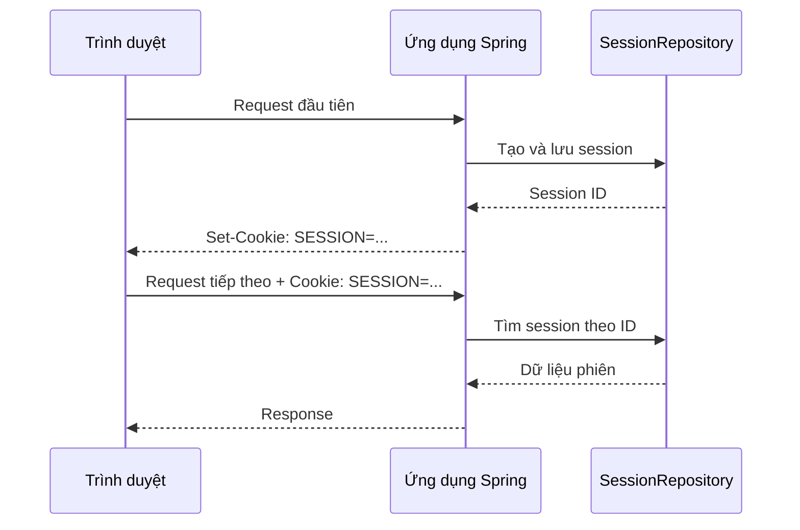

# Secure, HttpOnly và giới hạn bảo vệ của từng thuộc tính

Spring Session thường gửi session ID cho trình duyệt bằng một cookie. Trong các request tiếp theo, trình duyệt tự động gửi cookie phù hợp với tên miền, đường dẫn và chính sách bảo mật của nó. Cookie này là chìa khóa để máy chủ tìm phiên tương ứng trong repository, vì vậy việc cấu hình thuộc tính cookie ảnh hưởng trực tiếp đến khả năng chống đánh cắp session ID và chiếm quyền phiên.

Ba thuộc tính thường được nhắc tới là `Secure`, `HttpOnly` và `SameSite`. Chúng bảo vệ trước những tình huống khác nhau:

- `Secure` giới hạn việc gửi cookie qua kết nối an toàn HTTPS.
- `HttpOnly` ngăn JavaScript phía trình duyệt đọc cookie qua các API như `document.cookie`.
- `SameSite` điều khiển việc trình duyệt gửi cookie trong các request có nguồn khởi phát từ site khác, giúp giảm một số dạng CSRF.

Không thuộc tính nào bảo vệ toàn bộ ứng dụng. Cấu hình cookie cần kết hợp HTTPS, chống XSS, CSRF protection, quản lý vòng đời phiên và chính sách xác thực của Spring Security. Bài học này tập trung vào cookie phiên trong ứng dụng Servlet dùng Spring Session, nơi session được quản lý độc lập với một máy chủ và có thể được lưu ở Redis hoặc JDBC.

## 1. Cookie phiên và session ID

### 1.1. Trình duyệt và máy chủ trao đổi cookie như thế nào?

Khi ứng dụng tạo một phiên, Spring Session cần truyền một định danh để trình duyệt gửi lại ở các request sau. Với cơ chế cookie mặc định, máy chủ trả về header `Set-Cookie`; trình duyệt lưu cookie và tự động gửi header `Cookie` khi request thỏa điều kiện của cookie.



Cookie thường chỉ mang session ID ngẫu nhiên, không nên chứa thông tin cá nhân, vai trò, mật khẩu hoặc dữ liệu nghiệp vụ. Dữ liệu phiên được lưu ở phía máy chủ trong repository. Khi dùng Redis hoặc JDBC dùng chung, nhiều instance có thể tra cùng session ID và lấy cùng trạng thái phiên.

### 1.2. Cookie phiên khác dữ liệu phiên

Cookie và session phía máy chủ có vòng đời riêng:

| Thành phần | Vai trò | Ví dụ |
|---|---|---|
| Session ID | Khóa tra cứu phiên | Giá trị ngẫu nhiên trong cookie `SESSION` |
| Session repository | Lưu trạng thái và thời hạn phiên | Redis hoặc bảng JDBC |
| Cookie `Max-Age`/`Expires` | Điều khiển thời gian trình duyệt giữ cookie | Cookie tồn tại 8 giờ |
| Session inactivity timeout | Điều khiển thời gian máy chủ chấp nhận phiên khi không hoạt động | 30 phút |

Cookie còn trong trình duyệt không có nghĩa session vẫn hợp lệ. Nếu repository đã đánh dấu phiên hết hạn hoặc bị xóa, session ID cũ không khôi phục được phiên. Ngược lại, trình duyệt có thể xóa cookie trước khi dữ liệu phiên ở máy chủ được dọn.

### 1.3. Cookie không phải nơi lưu bí mật ứng dụng

Giá trị cookie có thể bị quan sát trong DevTools, trong các công cụ proxy của người dùng hoặc trong quá trình truyền nếu không dùng HTTPS. `HttpOnly` chỉ hạn chế JavaScript đọc cookie; nó không mã hóa giá trị cookie. Không đưa access token dài hạn, refresh token, thông tin định danh cá nhân hoặc dữ liệu nhạy cảm vào cookie phiên nếu thiết kế không yêu cầu và chưa có biện pháp bảo vệ phù hợp.

Session ID phải khó đoán, đủ ngẫu nhiên và được thay đổi theo chính sách bảo vệ session fixation. Sau khi xác thực thành công hoặc nâng quyền, Spring Security cần áp dụng chiến lược bảo vệ session fixation phù hợp để kẻ tấn công không thể ép người dùng tiếp tục dùng một ID phiên đã biết từ trước.

## 2. Thuộc tính `Secure`

### 2.1. Secure bảo vệ điều gì?

Khi cookie có thuộc tính `Secure`, trình duyệt chỉ gửi cookie qua kết nối được xem là an toàn, thông thường là HTTPS. Nếu người dùng truy cập cùng ứng dụng qua HTTP thuần, trình duyệt không gửi cookie `Secure` trong request đó. Điều này giảm nguy cơ session ID bị nghe lén trên mạng khi truyền qua kết nối không mã hóa.

Ví dụ header:

```http
Set-Cookie: SESSION=opaque-session-id; Path=/; Secure; HttpOnly; SameSite=Lax
```

`Secure` không mã hóa dữ liệu đã lưu ở Redis/JDBC, không bảo vệ máy tính hoặc trình duyệt đã bị xâm nhập và không tự chuyển HTTP sang HTTPS. Ứng dụng vẫn cần bật TLS, chuyển hướng HTTP sang HTTPS ở tầng phù hợp, cấu hình proxy an toàn và tránh phát sinh URL hoặc tài nguyên nhạy cảm qua HTTP.

### 2.2. Cấu hình trong Spring Session

Với ứng dụng Servlet dùng Spring Session, có thể cung cấp `CookieSerializer` bean để cấu hình cookie session. `DefaultCookieSerializer` cho phép đặt các thuộc tính thường dùng:

```java
import org.springframework.context.annotation.Bean;
import org.springframework.context.annotation.Configuration;
import org.springframework.session.web.http.CookieSerializer;
import org.springframework.session.web.http.DefaultCookieSerializer;

@Configuration
public class SessionCookieConfiguration {

    @Bean
    CookieSerializer cookieSerializer() {
        DefaultCookieSerializer serializer = new DefaultCookieSerializer();
        serializer.setCookieName("SESSION");
        serializer.setCookiePath("/");
        serializer.setUseSecureCookie(true);
        serializer.setUseHttpOnlyCookie(true);
        serializer.setSameSite("Lax");
        return serializer;
    }
}
```

Trong ví dụ này, cookie luôn được đánh dấu `Secure`. Đây là lựa chọn phù hợp khi môi trường được phục vụ qua HTTPS. Nếu môi trường phát triển chỉ chạy HTTP, trình duyệt sẽ không gửi cookie này qua HTTP và các request có thể liên tục tạo session mới. Nên dùng HTTPS cho môi trường phát triển hoặc có cấu hình riêng theo profile; tuyệt đối không để profile production vô tình tắt `Secure`.

Spring Session có thể suy luận thuộc tính Secure từ request trong một số cấu hình nếu không ép giá trị. Khi ứng dụng chạy sau reverse proxy hoặc load balancer, cần cấu hình xử lý forwarded headers đúng và chỉ tin header từ proxy đáng tin cậy. Nếu ứng dụng nhận sai trạng thái HTTPS, cookie có thể bị phát hành thiếu `Secure` hoặc bị đánh dấu sai. Với cấu hình production yêu cầu chắc chắn, hãy kiểm tra header `Set-Cookie` thực tế qua đường đi của proxy.

### 2.3. Giới hạn của Secure

`Secure` chỉ quyết định điều kiện truyền cookie. Nó không ngăn mã độc trên thiết bị người dùng đọc cookie bằng công cụ có quyền truy cập trình duyệt, không ngăn một XSS thực hiện hành động dưới danh nghĩa người dùng và không bảo vệ cookie nếu ứng dụng vô tình gửi dữ liệu nhạy cảm trong URL hoặc log. Hãy coi đây là một lớp bảo vệ truyền tải, luôn đi cùng HTTPS và các biện pháp bảo vệ ứng dụng khác.

## 3. Thuộc tính `HttpOnly`

### 3.1. HttpOnly bảo vệ điều gì?

Khi cookie có thuộc tính `HttpOnly`, JavaScript chạy trong trang không thể đọc giá trị cookie qua `document.cookie` hoặc các API trình duyệt thông thường dành cho script. Điều này làm giảm khả năng mã XSS lấy trực tiếp session ID rồi gửi ra ngoài.

Ví dụ cookie:

```http
Set-Cookie: SESSION=opaque-session-id; Path=/; Secure; HttpOnly; SameSite=Lax
```

Đối với cookie phiên do Spring Session quản lý, `HttpOnly` thường nên được bật. Cookie này là credential dùng để tiếp tục phiên và không có lý do để mã JavaScript của ứng dụng phải đọc giá trị thô của nó.

### 3.2. HttpOnly không ngăn XSS thực hiện hành động

Giới hạn quan trọng là trình duyệt vẫn tự động gửi cookie `HttpOnly` khi JavaScript thực hiện request phù hợp tới ứng dụng. Script độc hại không đọc được session ID, nhưng vẫn có thể gọi `fetch`, gửi form hoặc thao tác giao diện dưới danh nghĩa người dùng nếu XSS chạy trong origin của ứng dụng.

Ví dụ, script độc hại có thể gửi request thay đổi email hoặc tạo giao dịch nếu endpoint không có biện pháp bảo vệ phù hợp. Vì vậy, `HttpOnly` giảm khả năng đánh cắp cookie trực tiếp nhưng không chữa được XSS.

Để giảm XSS, cần encode output theo ngữ cảnh, kiểm tra và làm sạch nội dung HTML do người dùng cung cấp, tránh các API DOM nguy hiểm khi không cần thiết, áp dụng Content Security Policy (CSP) phù hợp và cập nhật thư viện phía client. Các biện pháp này bổ sung cho `HttpOnly`, không thay thế nó.

### 3.3. Khi nào không nên bật HttpOnly?

Một số cookie được thiết kế để JavaScript đọc, ví dụ một số cách triển khai CSRF token cookie cho SPA. Những cookie đó có thể cần được script truy cập theo thiết kế. Không nên áp dụng quy tắc `HttpOnly` một cách máy móc cho mọi cookie của ứng dụng.

Hãy phân loại cookie theo mục đích:

- Cookie session ID: thường nên có `HttpOnly`.
- Cookie chứa CSRF token mà JavaScript cần đọc: có thể cần không đặt `HttpOnly`, tùy cách tích hợp CSRF.
- Cookie tùy chọn giao diện không nhạy cảm: quyết định dựa trên nhu cầu đọc từ client và chính sách bảo mật.

Không dùng cùng một cookie cho cả session ID và CSRF token chỉ để giảm số lượng cookie. Hai giá trị có vai trò và yêu cầu bảo vệ khác nhau.

## 4. Thuộc tính `SameSite` và quan hệ với CSRF

Mặc dù đề bài tập trung vào `Secure` và `HttpOnly`, cần hiểu thêm `SameSite` để không nhầm hai thuộc tính đó với khả năng chống CSRF.

`SameSite` điều khiển việc trình duyệt gửi cookie trong một số ngữ cảnh cross-site. Các giá trị thường gặp:

| Giá trị | Hành vi khái quát | Cân nhắc |
|---|---|---|
| `Strict` | Hạn chế cookie trong request khởi phát từ site khác | Bảo vệ mạnh hơn trong nhiều luồng CSRF, nhưng có thể làm gián đoạn điều hướng từ liên kết ngoài hoặc luồng đăng nhập liên kết |
| `Lax` | Cho phép cookie trong một số điều hướng top-level an toàn, hạn chế nhiều request cross-site khác | Thường là điểm khởi đầu hợp lý cho ứng dụng web thông thường |
| `None` | Cho phép cookie được gửi trong ngữ cảnh cross-site theo các quy tắc khác | Trình duyệt hiện đại yêu cầu cookie `SameSite=None` phải có `Secure` |

SameSite không phải một hệ thống CSRF hoàn chỉnh. Cách xác định site, subdomain, scheme và luồng điều hướng có thể tạo ra những tình huống không hiển nhiên. Nếu ứng dụng dùng cookie để xác thực, cần giữ CSRF protection của Spring Security cho các request thay đổi trạng thái và cấu hình token phù hợp.

Một số hệ thống có đăng nhập qua identity provider, iframe, cổng thanh toán hoặc frontend và backend ở site khác. Những luồng này có thể cần `SameSite=None; Secure`. Hãy kiểm thử trên trình duyệt mục tiêu và giới hạn CORS, origin, redirect URI cùng CSRF theo đúng mô hình tích hợp.

### 4.1. Cấu hình SameSite trong Spring Session

Với `DefaultCookieSerializer`, có thể đặt:

```java
serializer.setSameSite("Lax");
```

Chọn `Strict`, `Lax` hoặc `None` dựa trên luồng đăng nhập và request thật của ứng dụng. Không đặt `None` nếu cookie không được phát hành qua HTTPS; trình duyệt hiện đại sẽ từ chối cookie cross-site không có `Secure`.

### 4.2. HttpOnly, Secure và CSRF giải quyết việc gì?

| Biện pháp | Giảm rủi ro chính | Không giải quyết đầy đủ |
|---|---|---|
| `Secure` | Cookie bị gửi qua HTTP thuần | XSS, thiết bị bị xâm nhập, session fixation |
| `HttpOnly` | JavaScript đọc trực tiếp cookie | Script XSS gửi request bằng cookie tự động đính kèm |
| `SameSite` | Một số request cross-site mang cookie | Mọi dạng CSRF, XSS hoặc request cùng site độc hại |
| CSRF token và kiểm tra origin | Request giả mạo thay đổi trạng thái | XSS có thể đọc token hoặc thao tác trong origin hợp lệ |
| HTTPS | Nghe lén/chỉnh sửa dữ liệu trên đường truyền | XSS, CSRF, lộ dữ liệu trong log hoặc thiết bị đầu cuối |

## 5. Các thuộc tính cookie khác cần hiểu

### 5.1. `Domain`

Nếu không đặt `Domain`, cookie thường là host-only cookie và chỉ được gửi tới host đã phát hành nó. Nếu đặt `Domain=example.com`, cookie có thể được gửi tới các subdomain phù hợp như `app.example.com` và `admin.example.com`.

Chia sẻ cookie cho nhiều subdomain có thể cần thiết trong một hệ thống, nhưng cũng mở rộng phạm vi host có thể nhận cookie. Một subdomain yếu bảo mật hoặc bị chiếm quyền có thể làm tăng rủi ro với cookie được chia sẻ. Hãy bỏ `Domain` nếu không có yêu cầu chia sẻ rõ ràng; tránh đặt domain cha quá rộng.

`DefaultCookieSerializer` có hỗ trợ cấu hình domain cố định hoặc mẫu domain. Nếu dùng `setDomainNamePattern`, hãy kiểm tra biểu thức chính quy chỉ khớp các host mong muốn và không vô tình chia sẻ cookie với môi trường khác.

### 5.2. `Path`

`Path` xác định phạm vi đường dẫn request mà trình duyệt gửi cookie. `Path=/` làm cookie có hiệu lực trên toàn ứng dụng; một path hẹp hơn có thể phù hợp với ứng dụng được triển khai dưới context path riêng.

Path không phải ranh giới bảo mật mạnh giữa các ứng dụng cùng host. Không nên dựa vào `Path` để cách ly các ứng dụng có mức độ tin cậy khác nhau. Dùng host riêng hoặc cookie prefix phù hợp nếu cần ranh giới rõ hơn.

### 5.3. `Max-Age` và `Expires`

Hai thuộc tính này điều khiển thời gian trình duyệt giữ cookie. Cookie không có `Max-Age` hoặc `Expires` thường là session cookie, nhưng hành vi khôi phục session của trình duyệt có thể làm cookie tồn tại qua lần đóng/mở lại trình duyệt tùy sản phẩm và cài đặt.

Không đồng nhất cookie lifetime với server-side session timeout. Ví dụ, cookie có thể được lưu 8 giờ trong khi session repository chỉ chấp nhận phiên trong 30 phút không hoạt động. Sau khi session hết hạn, cookie cũ vẫn có thể được gửi nhưng máy chủ không tìm thấy phiên hợp lệ.

### 5.4. Prefix `__Host-`

Các trình duyệt hỗ trợ cookie prefix có thể áp dụng quy tắc bổ sung cho cookie tên bắt đầu bằng `__Host-`: cookie phải có `Secure`, phải có `Path=/` và không được đặt `Domain`. Prefix này giúp giảm một số rủi ro ghi đè cookie từ subdomain hoặc path khác.

Ví dụ:

```http
Set-Cookie: __Host-SESSION=opaque-session-id; Path=/; Secure; HttpOnly; SameSite=Lax
```

Trong Spring Session có thể đặt tên cookie:

```java
serializer.setCookieName("__Host-SESSION");
serializer.setCookiePath("/");
serializer.setUseSecureCookie(true);
serializer.setUseHttpOnlyCookie(true);
serializer.setSameSite("Lax");
```

Không cấu hình `Domain` cùng cookie prefix `__Host-`. Nếu ứng dụng cần cookie cho subdomain hoặc context path hẹp hơn `/`, prefix này có thể không phù hợp.

## 6. Cấu hình cookie phiên trong Spring Session

### 6.1. Khai báo `CookieSerializer`

Spring Session Servlet dùng `HttpSessionIdResolver` để đọc và ghi session ID. Cấu hình cookie mặc định thường thông qua `CookieHttpSessionIdResolver` cùng `DefaultCookieSerializer`. Ứng dụng có thể cung cấp bean `CookieSerializer` để thay đổi tên cookie và thuộc tính.

Ví dụ cấu hình production chạy HTTPS:

```java
import org.springframework.context.annotation.Bean;
import org.springframework.context.annotation.Configuration;
import org.springframework.session.web.http.CookieSerializer;
import org.springframework.session.web.http.DefaultCookieSerializer;

@Configuration
public class SessionCookieConfiguration {

    @Bean
    CookieSerializer cookieSerializer() {
        DefaultCookieSerializer serializer = new DefaultCookieSerializer();
        serializer.setCookieName("__Host-SESSION");
        serializer.setCookiePath("/");
        serializer.setUseSecureCookie(true);
        serializer.setUseHttpOnlyCookie(true);
        serializer.setSameSite("Lax");
        return serializer;
    }
}
```

Ví dụ này không đặt `Domain`, phù hợp với quy tắc `__Host-`. Nếu triển khai dưới context path hoặc cần chia sẻ cookie giữa subdomain, hãy đánh giá lại cookie name, path và domain trước khi sử dụng prefix này.

### 6.2. Cookie serializer và header resolver

`CookieSerializer` chỉ áp dụng khi session ID được truyền qua cookie. Spring Session cũng hỗ trợ resolver truyền session ID qua header, chẳng hạn `HeaderHttpSessionIdResolver`. Với header resolver, trình duyệt hoặc client phải tự gửi header theo giao thức ứng dụng; các thuộc tính cookie như `Secure`, `HttpOnly` và `SameSite` không áp dụng cho header đó.

Không nên chuyển sang header resolver chỉ để né cấu hình cookie. Hãy chọn cách truyền session ID dựa trên loại client, mô hình CSRF, khả năng lưu credential và cách API được gọi. Với browser cookie authentication, giữ nguyên các biện pháp CSRF phù hợp.

### 6.3. Quan hệ với cấu hình Spring Boot

Spring Boot có các thuộc tính cookie cho session của Servlet container, ví dụ `server.servlet.session.cookie.*`. Khi Spring Session thay thế quản lý `HttpSession` thông qua `SessionRepositoryFilter`, cookie session ID được xử lý bởi Spring Session resolver/serializer. Cách Spring Boot kết nối các thuộc tính server với cookie serializer có thể khác theo phiên bản và cơ chế auto-configuration.

Vì vậy, hãy xác minh tài liệu của đúng phiên bản Spring Boot/Spring Session và kiểm tra header `Set-Cookie` thật trong môi trường chạy. Nếu khai báo `CookieSerializer` bean tùy chỉnh, xem đó là nguồn cấu hình trực tiếp của cookie Spring Session và tránh giả định rằng mọi property của Servlet container vẫn ghi đè được nó.

## 7. Các giới hạn bảo vệ trong những tình huống thực tế

### 7.1. XSS

`HttpOnly` giúp ngăn script đọc session ID, nhưng XSS vẫn có thể thực hiện request cùng origin bằng cookie được trình duyệt tự động gửi. Kẻ tấn công có thể thay đổi dữ liệu, gửi biểu mẫu hoặc đọc dữ liệu phản hồi nếu script chạy trong ngữ cảnh ứng dụng. Cần chống XSS bằng encode output, sanitize input, CSP và quản lý dependency phía client.

### 7.2. CSRF

`Secure` và `HttpOnly` không ngăn CSRF. Trình duyệt tự động đính kèm cookie theo quy tắc cookie, vì thế một trang độc hại có thể cố gửi request tới ứng dụng đang đăng nhập. `SameSite` giảm một số trường hợp nhưng không thay thế CSRF token và kiểm tra request origin. Với Spring Security, không tắt CSRF chỉ vì session cookie có `HttpOnly` hoặc `Secure`.

### 7.3. Session fixation và session hijacking

Nếu kẻ tấn công biết hoặc ép nạn nhân dùng một session ID, họ có thể tìm cách tiếp tục dùng phiên sau khi nạn nhân đăng nhập. Spring Security có cơ chế session fixation protection để đổi session ID theo chính sách sau xác thực. Khi session ID bị lộ, `Secure` và `HttpOnly` không thể thu hồi bản sao đã bị lấy; cần invalidate session phía repository và yêu cầu xác thực lại.

### 7.4. TLS kết thúc ở reverse proxy

Trong nhiều hệ thống, TLS kết thúc tại load balancer hoặc reverse proxy rồi request nội bộ tới ứng dụng bằng HTTP. Ứng dụng có thể thấy request không secure nếu forwarded headers chưa được xử lý đúng. Cần cấu hình proxy chỉ định `Forwarded` hoặc `X-Forwarded-Proto`, cấu hình Spring Boot tin cậy proxy phù hợp và chặn client bên ngoài giả mạo các header này. Sau đó kiểm tra `Set-Cookie` trên response công khai để chắc chắn `Secure` có mặt.

### 7.5. Cookie trên nhiều subdomain

Cookie với `Domain` rộng có thể được gửi đến nhiều subdomain. Nếu một subdomain chạy ứng dụng cũ hoặc ít được bảo vệ, phạm vi cookie rộng có thể làm tăng nguy cơ. Ưu tiên host-only cookie; nếu cần chia sẻ, lập danh sách subdomain tin cậy, tách môi trường và cân nhắc `__Host-` khi kiến trúc cho phép.

## 8. Kiểm thử và xác minh thuộc tính cookie

### 8.1. Kiểm tra trong trình duyệt

Mở Developer Tools, chọn Network và xem response tạo session. Trong response headers, kiểm tra `Set-Cookie`. Cookie được lưu trong tab Application/Storage có thể hiển thị các thuộc tính `Secure`, `HttpOnly`, `SameSite`, `Domain`, `Path` và `Expires`/`Max-Age`.

Kiểm tra cả request kế tiếp: cookie có được gửi khi qua HTTPS không, có bị trình duyệt chặn vì `SameSite=None` thiếu `Secure` không, và có được gửi tới đúng host/path không. Không chia sẻ ảnh chụp hoặc log chứa session ID thật.

### 8.2. Kiểm thử tự động

Có thể dùng MockMvc hoặc kiểm thử tích hợp để xác minh header cookie do ứng dụng phát hành. Ví dụ kiểm tra response sau khi endpoint tạo session:

```java
import static org.hamcrest.Matchers.containsString;
import static org.springframework.test.web.servlet.request.MockMvcRequestBuilders.get;
import static org.springframework.test.web.servlet.result.MockMvcResultMatchers.header;
import static org.springframework.test.web.servlet.result.MockMvcResultMatchers.status;

@Test
void sessionCookieHasSecurityAttributes() throws Exception {
    mockMvc.perform(get("/session/create").secure(true))
        .andExpect(status().isOk())
        .andExpect(header().string("Set-Cookie", containsString("Secure")))
        .andExpect(header().string("Set-Cookie", containsString("HttpOnly")))
        .andExpect(header().string("Set-Cookie", containsString("SameSite=Lax")));
}
```

Đây là ví dụ minh họa; endpoint phải thực sự tạo session và response phải phát hành cookie. Nếu response có nhiều header `Set-Cookie`, hãy lấy tất cả giá trị và kiểm tra đúng cookie `SESSION` hoặc `__Host-SESSION`, tránh khẳng định dựa trên một cookie khác. Cũng nên kiểm thử profile production và đường đi qua reverse proxy vì test MockMvc không chứng minh proxy đã truyền trạng thái HTTPS chính xác.

### 8.3. Ma trận kiểm thử bảo mật

| Tình huống | Kết quả mong đợi |
|---|---|
| Request HTTPS tạo session | Cookie có `Secure` và `HttpOnly` theo cấu hình |
| JavaScript đọc `document.cookie` | Không thấy cookie session ID có `HttpOnly` |
| Request HTTP thuần | Trình duyệt không gửi cookie `Secure` |
| Cookie `SameSite=None` không có `Secure` | Trình duyệt hiện đại từ chối hoặc không gửi cookie theo quy tắc của nó |
| Request cross-site thay đổi dữ liệu | CSRF protection từ chối request không có token hợp lệ theo chính sách ứng dụng |
| Cookie `__Host-SESSION` | Có `Secure`, `Path=/`, không có `Domain` |
| Đăng xuất | Session bị invalidate ở repository và cookie bị hết hạn/xóa ở client |
| Session ID cũ sau xác thực | ID được thay đổi theo chính sách chống session fixation |

## 9. Những lỗi cấu hình thường gặp

| Hiện tượng | Nguyên nhân có thể | Cách xử lý |
|---|---|---|
| Mỗi request tạo một session mới | Cookie `Secure` nhưng request đi HTTP, cookie path/domain không khớp hoặc trình duyệt chặn cookie | Kiểm tra HTTPS, `Set-Cookie`, `Cookie`, Path, Domain và SameSite |
| Cookie không có `Secure` ở production | Ứng dụng không nhận diện request HTTPS do proxy hoặc cấu hình serializer chưa ép Secure | Cấu hình forwarded headers và proxy tin cậy; kiểm tra header response công khai |
| JavaScript không đọc được cookie session | `HttpOnly` đang bật | Đây là hành vi mong muốn cho session ID; không tắt chỉ để debug |
| XSS vẫn thực hiện được hành động | `HttpOnly` chỉ chặn đọc cookie, không chặn request cùng origin | Sửa XSS, áp dụng CSP và kiểm soát quyền ở server |
| CSRF vẫn xảy ra | Dựa vào Secure/HttpOnly mà bỏ CSRF protection | Bật CSRF protection, dùng token và kiểm tra origin |
| Luồng đăng nhập bên ngoài bị mất session | `SameSite=Strict` hoặc Lax không phù hợp với luồng callback cross-site | Đánh giá SameSite, redirect và cookie `None; Secure` khi cần |
| Cookie bị gửi tới subdomain không mong muốn | Đặt Domain quá rộng | Bỏ Domain để dùng host-only cookie hoặc thu hẹp domain |
| Cookie prefix `__Host-` không được lưu | Thiếu Secure, Path khác `/` hoặc có Domain | Sửa đủ ba điều kiện của prefix |

## 10. Quy trình cấu hình an toàn

Khi cấu hình cookie phiên cho Spring Session, hãy đi theo trình tự:

1. Xác định session ID được truyền bằng cookie hay header; nếu là cookie, dùng `CookieSerializer` phù hợp.
2. Trong production, phục vụ ứng dụng qua HTTPS và bật `Secure` cho cookie phiên.
3. Bật `HttpOnly` cho session ID để JavaScript không đọc trực tiếp credential.
4. Chọn `SameSite` theo luồng điều hướng, đăng nhập liên kết, iframe và tích hợp cross-site.
5. Chỉ đặt `Domain` nếu có yêu cầu chia sẻ cookie giữa host; ưu tiên host-only cookie khi có thể.
6. Chọn `Path` theo phạm vi ứng dụng; không dùng Path như ranh giới bảo mật.
7. Đồng bộ cookie lifetime với session timeout nhưng hiểu rằng hai thời hạn được thực thi ở hai nơi khác nhau.
8. Giữ CSRF protection, chống XSS và chính sách session fixation của Spring Security.
9. Kiểm thử `Set-Cookie` và request thực tế trên trình duyệt, qua proxy và trên nhiều instance.
10. Khi đăng xuất hoặc thu hồi phiên, invalidate session ở repository và xóa cookie ở trình duyệt.

`Secure` bảo vệ đường truyền cookie, `HttpOnly` hạn chế JavaScript đọc session ID, còn `SameSite` kiểm soát một phần hành vi gửi cookie cross-site. Các thuộc tính này có giá trị khi được đặt đúng với kiến trúc ứng dụng, nhưng mỗi thuộc tính chỉ xử lý một nhóm rủi ro cụ thể. Một ứng dụng Spring Session an toàn vẫn cần HTTPS, CSRF protection, chống XSS, đổi session ID sau xác thực và quản lý session tập trung trong repository.

## Tài liệu tham khảo

- [Spring Session — CookieHttpSessionIdResolver và DefaultCookieSerializer](https://docs.spring.io/spring-session/reference/api/java/org/springframework/session/web/http/DefaultCookieSerializer.html)
- [Spring Session — cấu hình Servlet và HTTP session ID resolver](https://docs.spring.io/spring-session/reference/guides/java-custom-cookie.html)
- [Spring Security — bảo vệ chống CSRF](https://docs.spring.io/spring-security/reference/servlet/exploits/csrf.html)
- [MDN — Set-Cookie và các thuộc tính cookie](https://developer.mozilla.org/en-US/docs/Web/HTTP/Headers/Set-Cookie)
