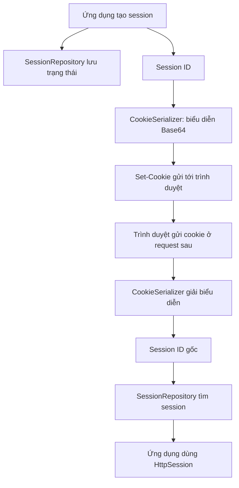

# Mã hóa biểu diễn định danh trong cookie và sự khác nhau với mã hóa bảo mật

Trong ứng dụng dùng Spring Session, cookie thường chứa **session ID** để trình duyệt gửi lại trong những request tiếp theo. Giá trị này là mã định danh phiên, không phải toàn bộ dữ liệu người dùng. Các thuộc tính session được lưu phía máy chủ trong repository như Redis hoặc JDBC.

Spring Session có thể chuyển session ID thành dạng Base64 trước khi ghi vào cookie. Đây là **mã hóa biểu diễn dữ liệu (encoding)**: nó thay đổi cách biểu diễn chuỗi để phù hợp với định dạng cookie. Base64 không che giấu nội dung, không cần khóa bí mật và không bảo vệ giá trị khỏi việc bị đọc hoặc sửa. Điều này khác hoàn toàn với **mã hóa bảo mật (encryption)**, vốn dùng khóa mật mã để bảo vệ tính bí mật của dữ liệu.

Phân biệt đúng hai khái niệm giúp tránh một lỗi thiết kế nguy hiểm: nhìn thấy chuỗi cookie khó đọc rồi cho rằng session ID đã được mã hóa an toàn. Session ID vẫn là thông tin xác thực dạng bearer token; ai lấy được một ID hợp lệ có thể thử sử dụng phiên tương ứng. Vì vậy, cần dựa vào ID khó đoán, HTTPS, cookie flags, quản lý vòng đời và kiểm soát truy cập kho session.

## 1. Cookie chứa session ID, không chứa toàn bộ session

Trong mô hình Spring Session phía máy chủ, luồng thông thường như sau:

1. Ứng dụng tạo một session và repository cấp hoặc lưu một định danh.
2. `HttpSessionIdResolver` xác định cách chuyển định danh qua HTTP. Với cookie, thành phần thường dùng là `CookieHttpSessionIdResolver`.
3. `CookieHttpSessionIdResolver` dùng `CookieSerializer` để ghi session ID vào `Set-Cookie` trong response.
4. Trình duyệt lưu cookie và gửi lại trong các request phù hợp với domain, path, `Secure` và `SameSite`.
5. Ở request tiếp theo, resolver đọc giá trị cookie, giải mã biểu diễn nếu cần và đưa session ID cho Spring Session tìm session trong repository.



Ví dụ, repository có thể lưu session với ID `session-123`. Cookie serializer có thể biểu diễn chuỗi đó thành `c2Vzc2lvbi0xMjM=` bằng Base64. Khi nhận cookie, serializer giải biểu diễn để lấy lại `session-123`. Đây chỉ là ví dụ minh họa: ID thực tế phải khó đoán và được sinh bởi cơ chế phù hợp, không nên dùng một chuỗi tuần tự dễ đoán như `session-123`.

Điểm cần nhớ là cookie mang **định danh**. Các thuộc tính như `app.user.context`, `app.cart.id` hoặc trạng thái quy trình vẫn nằm trong repository. Nếu ứng dụng tự đưa dữ liệu cá nhân hay quyền truy cập vào cookie, đó là một thiết kế khác và phải đánh giá riêng về bảo mật, kích thước, tính toàn vẹn và khả năng thu hồi.

## 2. Encoding là gì?

Encoding chuyển dữ liệu từ một dạng biểu diễn sang dạng khác theo một quy tắc công khai. Người nhận có thể khôi phục dữ liệu ban đầu bằng quy tắc ngược mà không cần khóa bí mật.

Base64 biểu diễn các byte bằng một tập ký tự văn bản. Base64 URL-safe dùng bảng ký tự phù hợp hơn với ngữ cảnh URL và cookie; cách xử lý padding phụ thuộc implementation. Mục đích của việc dùng Base64 trong cookie là làm cho giá trị session ID có một dạng truyền tải phù hợp và nhất quán với serializer.

Một số đặc điểm:

- Không có khóa bí mật.
- Bất kỳ ai có giá trị Base64 đều có thể giải mã nó.
- Dữ liệu sau khi encode thường dài hơn dữ liệu gốc.
- Không có kiểm tra tính toàn vẹn; người dùng có thể sửa chuỗi rồi encode lại.
- Không ngăn việc sao chép cookie sang một trình duyệt hoặc máy khác.

Do đó, Base64 là kỹ thuật biểu diễn, không phải cơ chế bảo vệ thông tin. Nó có thể giúp tránh ký tự không phù hợp với cookie nhưng không làm session ID trở nên bí mật.

## 3. Cấu hình biểu diễn cookie trong Spring Session

Trong Spring Session Servlet, `HttpSessionIdResolver` quyết định cách truyền session ID. `CookieHttpSessionIdResolver` dùng `CookieSerializer` để tuần tự hóa và giải tuần tự hóa cookie. `DefaultCookieSerializer` là implementation phổ biến, cho phép cấu hình tên cookie, path, domain, thời hạn, cờ bảo mật và tùy chọn Base64.

Ví dụ cấu hình rõ ràng việc dùng Base64:

```java
import org.springframework.context.annotation.Bean;
import org.springframework.context.annotation.Configuration;
import org.springframework.session.web.http.CookieHttpSessionIdResolver;
import org.springframework.session.web.http.DefaultCookieSerializer;
import org.springframework.session.web.http.HttpSessionIdResolver;

@Configuration
public class SessionCookieConfiguration {

    @Bean
    public HttpSessionIdResolver httpSessionIdResolver() {
        CookieHttpSessionIdResolver resolver =
                new CookieHttpSessionIdResolver();

        DefaultCookieSerializer serializer = new DefaultCookieSerializer();
        serializer.setCookieName("APPSESSION");
        serializer.setCookiePath("/");
        serializer.setUseBase64Encoding(true);
        serializer.setUseHttpOnlyCookie(true);
        serializer.setUseSecureCookie(true);
        serializer.setSameSite("Lax");

        resolver.setCookieSerializer(serializer);
        return resolver;
    }
}
```

`setUseBase64Encoding(true)` yêu cầu serializer biểu diễn giá trị cookie bằng Base64 theo cách implementation hỗ trợ. Trong nhiều phiên bản, Base64 encoding đã được bật mặc định; khai báo tường minh giúp ý định cấu hình dễ đọc hơn. Hãy kiểm tra API của đúng phiên bản Spring Session trong dự án vì các thuộc tính serializer có thể thay đổi theo phiên bản.

Các thiết lập trong ví dụ có mục đích khác nhau:

| Thiết lập | Mục đích | Có phải encryption không? |
|---|---|---|
| `setUseBase64Encoding(true)` | Biểu diễn session ID dưới dạng Base64 | Không |
| `setUseHttpOnlyCookie(true)` | Ngăn JavaScript phía trình duyệt đọc cookie qua `document.cookie` | Không |
| `setUseSecureCookie(true)` | Chỉ gửi cookie qua kết nối HTTPS | Không |
| `setSameSite("Lax")` | Hạn chế một số request liên site gửi cookie tự động | Không |
| `setCookieName(...)` | Chọn tên cookie | Không |
| `setCookiePath(...)` | Giới hạn path mà trình duyệt gửi cookie | Không |

`HttpOnly`, `Secure` và `SameSite` là các biện pháp bảo vệ cookie trong trình duyệt và khi truyền tải. Chúng không mã hóa nội dung cookie và không thay thế việc bảo vệ session ID.

## 4. Encoding, encryption, hashing và signing khác nhau thế nào?

Các thuật ngữ này thường bị gọi chung là “mã hóa”, nhưng chúng giải quyết những vấn đề khác nhau:

| Kỹ thuật | Có thể khôi phục dữ liệu gốc? | Có cần bí mật/khóa? | Mục tiêu chính | Ví dụ |
|---|---|---|---|---|
| Encoding | Có, bằng quy tắc công khai | Không | Biểu diễn dữ liệu theo định dạng khác | Base64, URL encoding |
| Encryption | Có, nếu có khóa giải mã hợp lệ | Có | Bảo mật tính bí mật | AES-GCM |
| Hashing | Không theo cách thực tế | Không cần khóa trong hash thông thường | Tạo dấu vân tay dữ liệu, so sánh hoặc lưu verifier | SHA-256 |
| Signing / HMAC | Không dùng chữ ký để khôi phục dữ liệu | Có khóa bí mật hoặc khóa ký | Phát hiện sửa đổi và xác minh nguồn tạo | HMAC-SHA-256 |

### 4.1. Encoding không tạo bí mật

Với Base64, người quan sát cookie có thể giải mã để đọc session ID. Không cần biết cấu hình nội bộ hay khóa bí mật nào. Nếu cookie chứa `userId`, role hoặc dữ liệu cá nhân, Base64 không che giấu các giá trị đó.

### 4.2. Encryption bảo vệ tính bí mật

Encryption dùng thuật toán mật mã và khóa để biến dữ liệu rõ thành ciphertext. Người không có khóa phù hợp không thể khôi phục dữ liệu một cách thực tế.

Nếu một hệ thống thực sự cần đặt dữ liệu có tính bí mật trong cookie, phải dùng cơ chế mã hóa đã được kiểm chứng và có xác thực toàn vẹn, chẳng hạn authenticated encryption như AES-GCM. Cần quản lý nonce, khóa, phiên bản định dạng và luân chuyển khóa đúng cách. Không tự thiết kế thuật toán hoặc ghép AES và hash theo cách tùy tiện.

Với Spring Session dùng repository phía máy chủ, thông thường không cần tự mã hóa session ID trong cookie. Session ID nên là một định danh ngẫu nhiên, không chứa thông tin nghiệp vụ; HTTPS bảo vệ dữ liệu trên đường truyền. Encryption không thay thế `Secure`, và mã hóa cookie cũng không ngăn kẻ đánh cắp cookie sử dụng ciphertext như một bearer credential nếu máy chủ vẫn chấp nhận nó.

### 4.3. Hashing là một chiều

Hashing tạo ra một giá trị dấu vân tay từ dữ liệu. Không có phép giải mã để lấy lại session ID từ hash. Nếu thiết kế một hệ thống lưu hash của token ở server, luồng tạo, tra cứu và thu hồi phải được thiết kế nhất quán: client giữ token gốc, server tính hash để tìm verifier.

Spring Session tiêu chuẩn nhận session ID để tra cứu repository. Không tự hash ID ở một lớp controller hoặc resolver mà không có repository tương ứng; làm như vậy khiến ID được gửi lên không khớp với khóa session đang lưu.

### 4.4. Signing bảo vệ tính toàn vẹn

Signing hoặc HMAC gắn một chữ ký xác thực vào dữ liệu. Server kiểm tra chữ ký để phát hiện dữ liệu đã bị sửa hoặc không được tạo bởi bên nắm khóa. Chữ ký không che giấu dữ liệu: người đọc cookie vẫn có thể nhìn thấy payload nếu payload không được mã hóa.

Đối với session ID ngẫu nhiên được tra cứu trong repository, một ID giả mạo thường chỉ dẫn đến kết quả không tìm thấy. Tuy nhiên, signing có thể hữu ích cho cookie tự chứa dữ liệu hoặc khi giao thức yêu cầu xác minh nguồn tạo. HMAC không ngăn việc sao chép nguyên vẹn một cookie hợp lệ; để giảm replay hoặc thu hồi, vẫn cần thời hạn, nonce/ID duy nhất, trạng thái server-side hoặc cơ chế phù hợp.

## 5. DefaultCookieSerializer không phải lớp mã hóa bảo mật

`DefaultCookieSerializer` chịu trách nhiệm định dạng giá trị cookie và các thuộc tính cookie. Tùy chọn Base64 của nó là encoding. Không nên hiểu việc bật Base64 là:

- Mã hóa session ID bằng khóa bí mật.
- Ký cookie để chống sửa đổi.
- Xác minh cookie được phát hành bởi server nào.
- Ngăn kẻ khác đọc hoặc sao chép cookie.
- Ngăn replay một session ID còn hiệu lực.

Nếu yêu cầu hệ thống cần chữ ký hoặc encryption cho cookie, cần chọn một cơ chế bảo vệ riêng có tài liệu rõ ràng và tích hợp đúng với quy trình đọc/ghi cookie. Không sửa chuỗi Base64 bằng cách thêm một phép biến đổi tự chế rồi gọi đó là encryption.

Một nguyên tắc quan trọng: session ID là thông tin xác thực dạng bearer. Bất kỳ ai có ID hợp lệ đều có thể thử sử dụng phiên đó, bất kể giá trị được hiển thị dưới dạng ký tự bình thường hay Base64. Bảo vệ ID bằng cách sinh ngẫu nhiên đủ mạnh, truyền qua HTTPS, hạn chế nơi lưu, tránh ghi log và thu hồi khi logout.

## 6. Vì sao không nên đưa dữ liệu người dùng vào cookie?

Với Spring Session server-side, cookie chỉ cần một định danh. Nếu đưa role, email, user ID hoặc thông tin quyền vào cookie rồi Base64, người dùng có thể giải mã và đọc chúng. Nếu sửa payload rồi encode lại, server cũng không có cách phát hiện sửa đổi chỉ bằng Base64.

Đặt dữ liệu nghiệp vụ vào cookie còn tạo thêm các vấn đề:

- Cookie được gửi trong nhiều request, làm tăng kích thước request và tải mạng.
- Dữ liệu có thể cũ khi quyền, hồ sơ hoặc trạng thái tài khoản thay đổi.
- Người dùng có thể sao chép cookie sang thiết bị khác.
- Việc thu hồi một bản sao cookie khó hơn khi dữ liệu tự chứa toàn bộ trạng thái.
- Dữ liệu nhạy cảm có thể bị lộ qua công cụ debug, proxy, log hoặc extension của trình duyệt.

Hãy lưu dữ liệu session ở repository phía server và chỉ đặt session ID trong cookie. Khi request cần quyền truy cập, kiểm tra quyền trên tài nguyên và trạng thái tài khoản hiện hành; không tin một giá trị role do client gửi lại.

## 7. Bảo vệ session ID dù cookie được Base64

Vì session ID là bearer credential, bảo vệ nó ở mọi giai đoạn:

1. **Sinh ID khó đoán:** dùng cơ chế tạo ID ngẫu nhiên mật mã của Spring Session/repository. Không dùng số tăng dần, email, user ID hoặc timestamp.
2. **Truyền qua HTTPS:** bật cookie `Secure` ở môi trường HTTPS và cấu hình TLS ở reverse proxy đúng cách.
3. **Bật `HttpOnly`:** hạn chế JavaScript đọc cookie; điều này giảm một đường lấy cắp cookie qua XSS nhưng không ngăn mọi hậu quả của XSS.
4. **Chọn `SameSite`:** dùng chính sách phù hợp với luồng ứng dụng và SSO; vẫn cần cơ chế chống CSRF phù hợp.
5. **Giới hạn domain và path:** chỉ chia sẻ cookie với những host/path thực sự cần thiết.
6. **Đổi session ID sau xác thực hoặc thay đổi đặc quyền:** giảm nguy cơ session fixation; dùng cơ chế bảo vệ session fixation của Spring Security khi tích hợp.
7. **Invalidate khi logout:** kết thúc phiên ở repository và yêu cầu resolver xóa cookie đúng tên, path và domain.
8. **Không ghi ID vào log:** che hoặc loại bỏ cookie và session ID khỏi access log, tracing, exception log và hệ thống phân tích.
9. **Giới hạn thời gian:** cấu hình idle timeout và, nếu cần, absolute timeout; cookie persistent không thay thế timeout server-side.

Base64 không làm yếu các biện pháp trên, nhưng cũng không thay thế bất kỳ biện pháp nào trong số đó.

## 8. Có nên tắt Base64 encoding?

`DefaultCookieSerializer` có tùy chọn `setUseBase64Encoding(false)` ở các phiên bản cung cấp API này. Khi tắt, serializer có thể ghi session ID theo dạng trực tiếp, tùy định dạng và giới hạn ký tự cookie của implementation.

Chỉ cân nhắc tắt encoding khi có yêu cầu tương thích rõ ràng, ví dụ một hệ thống trung gian cần định dạng cookie cụ thể. Trước khi tắt, cần xác minh:

- Session ID chỉ chứa ký tự được phép trong cookie theo chuẩn và theo các proxy/browser thực tế.
- Không có ký tự cần escape hoặc cách diễn giải khác nhau giữa các thành phần.
- Mọi instance dùng cùng cấu hình serializer.
- Cookie cũ được xử lý trong giai đoạn chuyển đổi.
- Không có lớp khác encode hoặc decode thêm lần nữa.

Việc bật/tắt Base64 làm thay đổi cách đọc giá trị cookie. Nếu một trình duyệt còn cookie cũ được encode theo cấu hình trước, instance mới có thể giải mã sai hoặc không tìm được session. Khi đổi cấu hình, hãy lập kế hoạch hết hạn/xóa cookie cũ, triển khai đồng bộ trên mọi instance và kiểm thử luồng chuyển đổi. Đây là thay đổi định dạng giao thức giữa client và server.

Không tự Base64 encode session ID trước khi đặt vào `HttpSession` hoặc trước khi repository lưu. Nếu serializer đã bật Base64, làm như vậy có thể tạo double encoding: trình duyệt gửi một giá trị được encode hai lần, serializer chỉ giải một lần và repository nhận ID không khớp.

## 9. Signing hoặc encryption có cần cho session cookie không?

Với mô hình session ID ngẫu nhiên và dữ liệu lưu server-side, Base64 chủ yếu là định dạng truyền tải. Nếu kẻ tấn công thay đổi ID, repository thường không tìm thấy phiên tương ứng; nếu họ đánh cắp ID thật, việc ký thêm cookie không ngăn họ replay cookie nguyên vẹn.

Vì vậy, ưu tiên các kiểm soát sau:

- ID có entropy đủ lớn và được tạo bằng bộ sinh số ngẫu nhiên an toàn.
- TLS/HTTPS cho toàn bộ luồng có cookie xác thực.
- `Secure`, `HttpOnly`, `SameSite`, CSRF protection và chính sách domain/path.
- Đổi ID sau đăng nhập, đổi quyền và các điểm chuyển trạng thái xác thực quan trọng.
- Hủy session phía server khi logout, khóa tài khoản hoặc phát hiện xâm nhập.
- Bảo vệ Redis/JDBC bằng mạng riêng, xác thực, phân quyền tối thiểu và mã hóa kết nối khi cần.

Nếu dùng cookie tự chứa như JWT, bài toán khác đi: cần xác minh chữ ký, issuer, audience, expiration và thuật toán được phép; nếu payload cần bí mật thì cần encryption riêng. Không nên áp dụng cách bảo vệ JWT cho session ID opaque rồi cho rằng hai loại cookie có cùng semantics.

## 10. Kiểm thử encoding và bảo mật cookie

Kiểm thử cần xác minh cả cách biểu diễn lẫn cách ứng dụng dùng session:

| Trường hợp | Cách kiểm tra | Kết quả mong đợi |
|---|---|---|
| Encoding bật | Tạo session và quan sát `Set-Cookie` | Giá trị cookie có dạng Base64 theo serializer; không phải dữ liệu session đầy đủ |
| Round-trip | Gửi lại cookie ở request kế tiếp | Serializer giải biểu diễn và repository tìm đúng session |
| Encoding tắt | Kiểm tra với ID chỉ chứa ký tự an toàn | Cookie giữ đúng giá trị theo cấu hình và vẫn round-trip |
| Cookie bị sửa | Thay đổi một phần giá trị cookie | Không được tự động ánh xạ sang session của người khác; lỗi/không tìm thấy được xử lý an toàn |
| Cookie bị sao chép | Dùng cookie hợp lệ trên client khác trong test | Xác nhận session là bearer credential và các chính sách thu hồi/thời hạn có hiệu lực |
| Cookie flags | Kiểm tra header `Set-Cookie` | `Secure`, `HttpOnly`, `SameSite`, `Path` và `Domain` đúng chính sách |
| Đăng xuất | Logout rồi gửi lại cookie cũ | Session đã invalidate và không thể dùng lại |
| Nhiều instance | Tạo cookie ở instance A, gửi tới B | Cả hai dùng cùng serializer và đọc được cùng session |
| Đổi cấu hình encoding | Dùng cookie tạo bởi phiên bản/cấu hình cũ | Có kế hoạch tương thích hoặc buộc đăng nhập lại có kiểm soát |
| Logging | Kiểm tra access log và tracing | Không ghi giá trị session ID hoặc cookie xác thực ở dạng rõ |

Có thể dùng `MockMvc` để kiểm tra header cookie và hành vi controller, nhưng cần integration test với Spring Session và repository thật để xác minh ID được giải biểu diễn đúng và tìm thấy session ở nhiều instance. Không chỉ kiểm tra rằng cookie “trông khó đọc”; phải kiểm tra round-trip và khả năng thu hồi phiên.

## 11. Lỗi thường gặp và cách xử lý

| Triệu chứng | Nguyên nhân có thể | Hướng xử lý |
|---|---|---|
| Cookie trông như chuỗi ngẫu nhiên nhưng người dùng nghĩ đã được mã hóa | Nhầm Base64 với encryption | Giải thích rõ encoding; bảo vệ ID bằng TLS và kiểm soát session |
| Request luôn tạo session mới | Serializer hai instance cấu hình khác nhau hoặc giải mã không khớp | Đồng bộ cookie serializer và cấu hình deployment |
| Cookie được encode hai lần | Ứng dụng tự encode ID trước khi Spring Session serialize | Chỉ lưu ID gốc; để serializer xử lý cookie |
| Tắt Base64 làm cookie không hoạt động | ID chứa ký tự không phù hợp hoặc client/proxy xử lý khác nhau | Kiểm tra định dạng cookie và bật lại encoding nếu không có lý do tương thích bắt buộc |
| Sau deploy người dùng bị logout hàng loạt | Thay đổi encoding hoặc tên cookie làm cookie cũ không đọc được | Triển khai migration có kiểm soát hoặc hết hạn cookie cũ có chủ đích |
| Kẻ khác có thể dùng cookie đã sao chép | Session ID bị lộ; Base64 không ngăn replay | Thu hồi session, rút ngắn timeout, bảo vệ log, HTTPS và cookie flags |
| Người dùng đọc được dữ liệu trong cookie | Đã đặt payload cá nhân vào cookie và chỉ encode Base64 | Chuyển dữ liệu về server-side hoặc dùng cơ chế mã hóa đã kiểm chứng nếu thật sự cần |
| Cookie sửa được mà server không phát hiện | Chỉ dùng encoding, không có cơ chế integrity | Thiết kế token có chữ ký hoặc dùng session ID opaque tra cứu server-side phù hợp |

## 12. Quy trình thiết kế cookie session

Khi cấu hình cookie cho Spring Session, thực hiện theo thứ tự:

1. Xác định cookie chỉ mang session ID; lưu thuộc tính người dùng trong repository phía server.
2. Chọn `HttpSessionIdResolver` phù hợp, thường là `CookieHttpSessionIdResolver` cho ứng dụng trình duyệt.
3. Cấu hình `DefaultCookieSerializer` với tên, path, domain, thời hạn và encoding rõ ràng.
4. Bật `Secure`, `HttpOnly` và `SameSite` theo kiến trúc triển khai; dùng HTTPS.
5. Không tự encode session ID trước khi đưa vào session/repository.
6. Đảm bảo mọi instance dùng cùng cấu hình cookie serializer và tương thích định dạng khi rolling update.
7. Đổi session ID sau xác thực, invalidate khi logout và tránh ghi ID vào log.
8. Kiểm thử round-trip, cookie flags, cookie bị sửa, logout và truy cập qua nhiều instance.

Base64 trong `DefaultCookieSerializer` chỉ là cách biểu diễn session ID để truyền trong cookie. Encryption bảo vệ tính bí mật bằng khóa; signing/HMAC bảo vệ tính toàn vẹn; hashing tạo dấu vân tay một chiều. Với Spring Session server-side, thiết kế thường dùng là session ID ngẫu nhiên, opaque, được truyền qua HTTPS trong cookie có cờ bảo mật, còn dữ liệu session nằm trong repository chia sẻ. Hiểu đúng vai trò của từng kỹ thuật giúp tránh dựa vào một chuỗi Base64 để bảo vệ thông tin xác thực.
