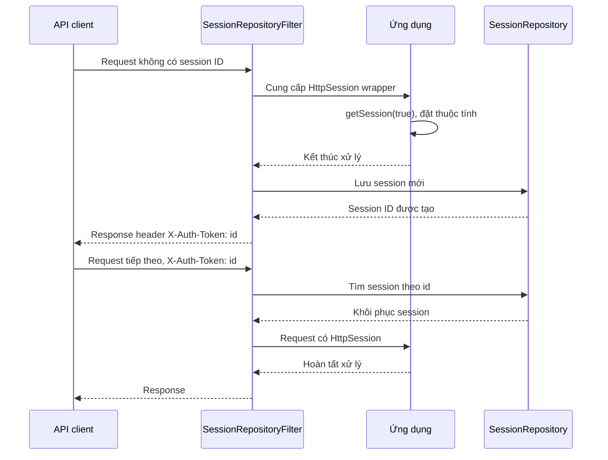

# Phát định danh mới, đọc định danh và thông báo phiên đã kết thúc

Spring Session thường dùng cookie để chuyển session ID giữa trình duyệt và máy chủ. Với ứng dụng API, mobile app hoặc một số kiến trúc SPA, client có thể gửi session ID trong HTTP header. `HeaderHttpSessionIdResolver` cung cấp cách tích hợp này: resolver đọc định danh từ request header, ghi định danh mới vào response header và phát tín hiệu hết hạn khi phiên bị kết thúc.

Việc dùng header chỉ thay đổi cách vận chuyển session ID. Dữ liệu phiên vẫn nằm ở phía máy chủ trong `SessionRepository` như Redis hoặc JDBC; ứng dụng vẫn dùng `HttpSession` và `SessionRepositoryFilter`. Session ID trong header vẫn là thông tin xác thực dạng bearer: ai có giá trị hợp lệ có thể được nhận diện là cùng phiên. Vì vậy, cần bảo vệ header, lưu trữ định danh ở client an toàn và thu hồi phiên ở repository khi đăng xuất.

## 1. Vai trò của HttpSessionIdResolver

Spring Session tách việc quản lý dữ liệu phiên khỏi cách chuyển session ID qua HTTP. `HttpSessionIdResolver` định nghĩa ba thao tác chính:

- Đọc một hoặc nhiều session ID từ request.
- Gửi session ID vào response khi phiên được tạo hoặc định danh thay đổi.
- Thông báo cho client rằng định danh cần được xóa khi phiên hết hạn hoặc bị invalidate.

`CookieHttpSessionIdResolver` thực hiện các thao tác đó qua cookie. `HeaderHttpSessionIdResolver` thực hiện qua một HTTP header do ứng dụng chọn. Khi cấu hình header resolver, `SessionRepositoryFilter` sử dụng resolver này để tìm phiên và gửi định danh về client. Controller không cần tự phân tích header hoặc tự ghi header session ID.

Luồng tổng quát:



Client giữ session ID nhận được và gửi lại trong các request tiếp theo đến ứng dụng. Repository mới là nơi lưu thuộc tính session; header chỉ mang khóa tra cứu.

## 2. Cấu hình HeaderHttpSessionIdResolver

Spring Session cung cấp `HeaderHttpSessionIdResolver.xAuthToken()` để dùng header `X-Auth-Token`. Có thể khai báo resolver bằng bean `HttpSessionIdResolver`:

```java
import org.springframework.context.annotation.Bean;
import org.springframework.context.annotation.Configuration;
import org.springframework.session.web.http.HeaderHttpSessionIdResolver;
import org.springframework.session.web.http.HttpSessionIdResolver;

@Configuration
public class SessionIdResolverConfiguration {

    @Bean
    HttpSessionIdResolver httpSessionIdResolver() {
        return HeaderHttpSessionIdResolver.xAuthToken();
    }
}
```

Bean này yêu cầu Spring Session dùng header `X-Auth-Token` để nhận và phát session ID. Ứng dụng vẫn cần cấu hình repository Redis hoặc JDBC như bình thường; resolver không tạo kho lưu phiên và không thay thế `SessionRepository`.

Nếu muốn dùng tên header riêng, có thể tạo resolver với `HeaderHttpSessionIdResolver.header("X-Session-Id")`:

```java
@Bean
HttpSessionIdResolver httpSessionIdResolver() {
    return HeaderHttpSessionIdResolver.header("X-Session-Id");
}
```

Tên header không phân biệt chữ hoa chữ thường theo quy tắc HTTP, nhưng cần thống nhất một cách viết trong tài liệu API, client, gateway và cấu hình CORS. Tránh đặt tên gây nhầm với header `Authorization` hoặc header do proxy quản lý. Không truyền session ID trong URL, query string hoặc path.

Khi khai báo bean `HttpSessionIdResolver`, resolver đó trở thành cơ chế chuyển session ID của ứng dụng. Không giả định Spring Session vẫn đồng thời đọc cookie cũ. Nếu cần hỗ trợ chuyển tiếp từ cookie sang header trong một giai đoạn migration, phải thiết kế resolver tương thích riêng, xác định rõ ưu tiên khi cả hai định danh xuất hiện và kiểm thử việc hết hạn cả hai nguồn. Không nên để hai định danh khác nhau cùng xuất hiện mà không có quy tắc rõ ràng.

## 3. Phát định danh mới trong response header

Session ID mới thường được tạo khi ứng dụng hoặc thành phần xác thực yêu cầu một session mới. Ví dụ, controller gọi `request.getSession(true)` rồi lưu một thuộc tính:

```java
@PostMapping("/api/session")
public Map<String, Object> createSession(HttpServletRequest request) {
    HttpSession session = request.getSession(true);
    session.setAttribute("workflow", "checkout");

    return Map.of("created", true);
}
```

Controller không tự sinh session ID và không tự ghi `X-Auth-Token`. Spring Session tạo session thông qua repository, rồi `HeaderHttpSessionIdResolver` ghi định danh vào response header trong quá trình lưu session. Response có thể có dạng:

```http
HTTP/1.1 200 OK
Content-Type: application/json
X-Auth-Token: opaque-session-id

{"created":true}
```

`opaque-session-id` chỉ là giá trị minh họa. Client phải đọc đúng header đã cấu hình và lưu giá trị theo chính sách bảo mật của ứng dụng. Không đưa giá trị này vào response body trừ khi API có lý do cụ thể và đã đánh giá rủi ro; header là kênh resolver dành cho mục đích đó.

Không phải mọi response đều có header session ID. Nếu request không tạo session mới và session ID không thay đổi, resolver thường không cần phát một định danh mới. Client nên giữ định danh hiện tại khi response không có header cập nhật, trừ khi response báo phiên đã hết hạn theo hợp đồng ứng dụng.

Nếu session được tạo nhưng response bị commit hoặc bị filter khác làm mất header, client sẽ không nhận được định danh mới. Vì vậy, cần bảo đảm `SessionRepositoryFilter` bọc response đúng thứ tự và các proxy/API gateway không loại bỏ header. Với streaming hoặc ghi response sớm, hoàn tất việc tạo session trước khi response commit.

## 4. Đọc định danh từ request header

Khi client đã có session ID, gửi nó trong header của request tiếp theo:

```http
GET /api/session HTTP/1.1
Host: api.example.test
X-Auth-Token: opaque-session-id
Accept: application/json
```

`HeaderHttpSessionIdResolver` đọc giá trị header và cung cấp session ID cho `SessionRepositoryFilter`. Filter yêu cầu repository khôi phục session rồi cung cấp `HttpSession` cho ứng dụng. Controller chỉ cần truy cập session như thông thường:

```java
@GetMapping("/api/session")
public Map<String, Object> readSession(HttpServletRequest request) {
    HttpSession session = request.getSession(false);
    if (session == null) {
        throw new ResponseStatusException(HttpStatus.UNAUTHORIZED);
    }

    return Map.of(
            "workflow", session.getAttribute("workflow")
    );
}
```

`getSession(false)` không tạo phiên mới nếu header không có, ID không hợp lệ hoặc repository không tìm thấy phiên. Đây thường là lựa chọn phù hợp cho endpoint chỉ đọc trạng thái hiện có. Nếu gọi `getSession(true)`, ứng dụng có thể tạo một phiên mới khi request không mang ID hợp lệ; điều này có thể che giấu lỗi client không lưu hoặc không gửi session ID. Chỉ tạo phiên mới ở endpoint có mục đích rõ ràng.

Không cần gọi `request.getHeader("X-Auth-Token")` trong từng controller. Làm vậy tạo logic trùng lặp và dễ dẫn đến việc controller tự kiểm tra ID nhưng không dùng đúng phiên đã được filter khôi phục. Hãy để resolver xử lý giao thức định danh; ứng dụng làm việc với `HttpSession`.

## 5. Đọc và phát định danh bằng client

Ví dụ dùng `curl` để tạo session rồi gọi lại API. Lệnh đầu tiên hiển thị response header để client lấy giá trị `X-Auth-Token`:

```bash
curl -i -X POST https://api.example.test/api/session
```

Giả sử response có:

```http
X-Auth-Token: opaque-session-id
```

Request tiếp theo gửi lại đúng giá trị đó:

```bash
curl -i https://api.example.test/api/session \
  -H 'X-Auth-Token: opaque-session-id'
```

Client thật cần lưu session ID từ response và tự thêm header vào các request cần xác thực. Không hard-code giá trị session ID vào mã nguồn hoặc file cấu hình được commit vào repository. Không ghi giá trị đó vào log, analytics, crash report hoặc thông tin chẩn đoán.

Với ứng dụng JavaScript chạy trên trình duyệt, có thể đọc response header nếu server cho phép expose header qua CORS. Ví dụ cấu hình CORS cần cho phép request header `X-Auth-Token` và expose response header cùng tên. Cách lưu giá trị ở client cần được lựa chọn theo mô hình đe dọa; lưu trong bộ nhớ trong thời gian ngắn giảm thời gian tồn tại nhưng mất khi tải lại trang, còn local storage tồn tại lâu hơn và có thể bị JavaScript độc hại đọc nếu xảy ra XSS.

## 6. Thông báo phiên đã kết thúc

Khi ứng dụng invalidate session hoặc session hết hạn, client cần biết định danh hiện tại không còn được sử dụng. `HeaderHttpSessionIdResolver` có phương thức `expireSession` để phát tín hiệu hết hạn qua response header. Với header resolver, tín hiệu này thường được biểu diễn bằng header định danh có giá trị rỗng:

```http
HTTP/1.1 204 No Content
X-Auth-Token:
```

Client cần hiểu header rỗng là chỉ dẫn xóa session ID đang lưu. Header rỗng không phải một session ID hợp lệ mới. Client không nên giữ lại giá trị cũ hoặc gửi nó trong request sau khi nhận tín hiệu này.

Với Servlet API, kết thúc session hiện tại bằng `invalidate()`:

```java
@PostMapping("/api/logout")
public ResponseEntity<Void> logout(HttpServletRequest request) {
    HttpSession session = request.getSession(false);
    if (session != null) {
        session.invalidate();
    }

    return ResponseEntity.noContent().build();
}
```

Khi `SessionRepositoryFilter` quan sát việc invalidate, resolver có thể gửi tín hiệu hết hạn trong response. Nếu dùng Spring Security, ưu tiên logout flow và `LogoutHandler` đã cấu hình để xóa `SecurityContext`, invalidate session và thực hiện các thao tác logout khác. Không chỉ gửi header rỗng mà bỏ qua xóa phiên ở repository: client xóa token không làm một bản sao token đã bị đánh cắp mất hiệu lực.

Client nên xử lý phản hồi theo quy tắc rõ ràng:

- Header `X-Auth-Token` có giá trị: lưu hoặc thay thế định danh hiện tại.
- Header có mặt nhưng rỗng: xóa định danh hiện tại và chuyển giao diện về trạng thái chưa đăng nhập.
- Header không có mặt: giữ nguyên định danh hiện tại, trừ khi status hoặc hợp đồng API quy định phiên đã hết hạn.

Quy tắc trên phân biệt response không có cập nhật định danh với response chủ động yêu cầu xóa định danh. Cần bảo đảm proxy không loại bỏ header rỗng; một số hệ thống trung gian có thể chuẩn hóa hoặc bỏ header có giá trị rỗng. Hãy kiểm thử qua toàn bộ đường đi thực tế từ ứng dụng đến client.

## 7. Thay đổi session ID sau xác thực

Sau khi người dùng đăng nhập thành công, cần bảo vệ khỏi session fixation. Nếu ứng dụng tiếp tục dùng một session ID mà kẻ tấn công đã biết từ trước đăng nhập, kẻ đó có thể tìm cách chiếm phiên đã được xác thực. Cơ chế bảo vệ session fixation của Spring Security thường đổi session ID trong quá trình xác thực; với Servlet API cũng có cơ chế `changeSessionId()` trên các container hỗ trợ Servlet phù hợp.

Khi ID thay đổi, resolver cần phát định danh mới trong response header để client cập nhật. Client phải thay giá trị cũ bằng giá trị mới khi response có header mới. Nếu client tiếp tục gửi ID cũ, repository có thể không tìm thấy phiên hoặc từ chối phiên đã đổi ID.

Không tự tạo session ID bằng UUID trong controller rồi ghi đè header. Session ID phải do Spring Session và repository quản lý để gắn đúng với bản ghi session, bảo đảm độ ngẫu nhiên và vòng đời. Cũng không tự sao chép session ID giữa người dùng hoặc giữa môi trường.

## 8. CORS khi dùng header định danh

Nếu SPA chạy ở origin khác API, trình duyệt áp dụng CORS. Header tùy chỉnh như `X-Auth-Token` thường làm request cần preflight `OPTIONS`. Server phải cho phép header trong `Access-Control-Allow-Headers` và expose response header để JavaScript có thể đọc định danh mới:

```http
Access-Control-Allow-Origin: https://app.example.test
Access-Control-Allow-Methods: GET, POST, PUT, DELETE, OPTIONS
Access-Control-Allow-Headers: Content-Type, X-Auth-Token
Access-Control-Expose-Headers: X-Auth-Token
Vary: Origin
```

Đây là ví dụ header phản hồi, không phải cấu hình đầy đủ cho mọi hệ thống. Hãy giới hạn origin theo danh sách tin cậy; không dùng wildcard một cách tùy tiện. Nếu ứng dụng cũng dùng credentials của trình duyệt, cấu hình `Access-Control-Allow-Credentials` và origin phải tuân thủ quy tắc CORS tương ứng.

Spring Security và CORS filter cần được sắp xếp đúng để request preflight được xử lý trước yêu cầu xác thực session. Nếu `OPTIONS` bị chặn bởi authentication filter, trình duyệt có thể không gửi request API thật. Kiểm thử preflight từ đúng origin và header mà frontend sẽ sử dụng.

Header session ID không tự động loại bỏ mọi rủi ro CSRF. Trình duyệt thường không tự thêm một header tùy chỉnh vào request cross-site; tuy vậy, CORS mở quá rộng, XSS hoặc client tự động gắn token vào mọi request có thể làm lộ token. Hãy đánh giá CSRF theo cách token được lưu và gửi, bảo vệ XSS và cấu hình CORS thực tế.

## 9. Bảo vệ session ID trong header

Session ID là bearer credential. Bất kỳ ai có ID hợp lệ đều có thể thử dùng phiên đó, vì vậy:

- Chỉ truyền qua HTTPS; không gửi session ID qua HTTP không mã hóa.
- Không ghi header định danh vào access log, application log, trace, analytics hoặc error report.
- Cấu hình gateway, reverse proxy và hệ thống giám sát để che hoặc loại bỏ giá trị `X-Auth-Token`.
- Không đưa ID vào URL, query parameter, referer hoặc nội dung chia sẻ.
- Giữ token trong bộ nhớ client nếu phù hợp; nếu cần lưu bền vững, dùng cơ chế bảo mật của nền tảng và đánh giá rủi ro XSS, thiết bị bị mất hoặc backup.
- Đổi session ID sau xác thực theo cơ chế session fixation protection.
- Đặt TTL phù hợp, invalidate phía máy chủ khi logout và có quy trình thu hồi khi tài khoản bị khóa hoặc token bị lộ.
- Không cho phép client tự chọn hoặc đoán session ID; ID phải do framework tạo.

Header `X-Auth-Token` không có thuộc tính `HttpOnly` như cookie. JavaScript có thể đọc hoặc gửi header tùy cách client triển khai. Nếu yêu cầu là một website thông thường và muốn trình duyệt tự quản lý cookie với `HttpOnly`, `Secure`, `SameSite`, cookie resolver có thể phù hợp hơn. Header resolver thường hữu ích cho API client có khả năng chủ động lưu và gắn header.

## 10. Reverse proxy và API gateway

Khi request đi qua load balancer, ingress hoặc API gateway, phải bảo đảm header định danh được chuyển tiếp đến ứng dụng. Response header cũng phải được chuyển về client. Một số gateway có quy tắc allowlist, xóa header không được khai báo hoặc dùng cùng tên header cho mục đích xác thực khác.

Kiểm tra các điểm sau:

1. Request header `X-Auth-Token` được chuyển tiếp nguyên vẹn tới ứng dụng.
2. Response header mới được trả lại client và không bị ghi đè bởi gateway.
3. Header rỗng báo hết hạn không bị loại bỏ ngoài ý muốn.
4. Log gateway che giá trị token.
5. Các instance cùng dùng một `SessionRepository`, namespace và cấu hình resolver.
6. TLS được duy trì từ client đến gateway và từ gateway đến backend theo yêu cầu bảo mật.

Không dùng một header vừa làm session ID vừa làm API key hoặc bearer token của một hệ thống khác. Nếu cần hai credential, dùng header riêng với quy tắc phân quyền rõ ràng để tránh một thành phần vô tình ghi đè hoặc log credential còn lại.

## 11. Xử lý định danh thiếu, sai hoặc đã hết hạn

Các trường hợp thường gặp:

| Request | Kết quả xử lý nên có |
|---|---|
| Không gửi header | Không khôi phục session hiện có; endpoint được phép tạo phiên mới có thể tạo khi gọi `getSession(true)` |
| Header có ID hợp lệ | Repository khôi phục session và ứng dụng xử lý theo quyền của principal |
| Header có ID không tồn tại | `getSession(false)` trả về `null`; endpoint bảo vệ yêu cầu xác thực từ chối request |
| Header có ID đã hết hạn | Phiên không được khôi phục; client cần đăng nhập hoặc tạo phiên mới theo luồng ứng dụng |
| Header rỗng | Không có định danh hữu ích để khôi phục; client không nên gửi header rỗng như một token |
| Logout đã invalidate phiên | Response phát tín hiệu hết hạn; client xóa ID và request sau không thể dùng ID cũ |

Không tự động tạo phiên mới cho mọi request có ID sai. Nếu endpoint protected gọi `getSession(true)`, ứng dụng có thể tạo session ẩn danh rồi xử lý tiếp mà không xác thực principal. Hãy phân biệt endpoint khởi tạo phiên với endpoint yêu cầu phiên đã xác thực.

## 12. Kiểm thử phát, đọc và hết hạn header

Kiểm thử nên xác nhận cả header HTTP lẫn dữ liệu repository:

| Ca kiểm thử | Thao tác | Kết quả cần xác nhận |
|---|---|---|
| Tạo phiên mới | Gọi endpoint tạo session không có header | Response phát `X-Auth-Token` có giá trị |
| Đọc phiên | Gửi ID nhận được trong request header | Controller khôi phục đúng thuộc tính session |
| Không có header | Gọi endpoint yêu cầu session với `getSession(false)` | Request được xử lý như chưa xác thực |
| ID không hợp lệ | Gửi giá trị không tồn tại | Không khôi phục phiên và không tạo phiên ngoài ý muốn |
| Đổi session ID | Đăng nhập và kích hoạt session fixation protection | Response phát ID mới; ID cũ không còn dùng được theo chính sách |
| Logout | Gọi logout với ID hợp lệ | Repository xóa/invalidate session và response báo hết hạn |
| Logout lặp | Gửi lại ID cũ | Không tạo phiên mới; kết quả kết thúc được xử lý ổn định |
| CORS | Gửi preflight và request thật từ origin frontend | Request header được phép và response header được expose |
| Nhiều instance | Tạo ID ở A, gửi ID đến B | B khôi phục cùng session từ kho chung |
| Gateway | Kiểm tra qua đường đi production-like | Request, response và header rỗng không bị loại bỏ; log không lộ ID |

Ví dụ MockMvc kiểm tra phát và đọc header:

```java
MvcResult created = mockMvc.perform(post("/api/session"))
        .andExpect(status().isOk())
        .andReturn();

String sessionId = created.getResponse().getHeader("X-Auth-Token");
assertThat(sessionId).isNotBlank();

mockMvc.perform(get("/api/session")
        .header("X-Auth-Token", sessionId))
        .andExpect(status().isOk())
        .andExpect(jsonPath("$.workflow").value("checkout"));
```

Tên header và endpoint phải khớp cấu hình thực tế. Test logout nên xác nhận response có tín hiệu hết hạn theo resolver đang dùng và request tiếp theo với ID cũ không khôi phục được session. Để chứng minh khả năng chia sẻ giữa instance, chạy integration test với Redis hoặc JDBC thật trong môi trường test và hai application context dùng chung repository.

## 13. Chẩn đoán lỗi thường gặp

| Triệu chứng | Nguyên nhân có thể | Hướng kiểm tra |
|---|---|---|
| Response tạo session không có `X-Auth-Token` | Resolver bean chưa được cấu hình, session không được tạo, response đã commit hoặc filter bị đăng ký sai | Kiểm tra bean resolver, `getSession(true)`, filter order và response commit |
| Client gửi header nhưng session luôn null | Sai tên header, gateway bỏ header, ID không có trong repository hoặc kho giữa các instance khác nhau | Kiểm tra request đến backend, resolver, repository và namespace |
| JavaScript không đọc được response header | Thiếu `Access-Control-Expose-Headers` hoặc CORS không cho phép origin | Kiểm tra response CORS và preflight |
| Logout không xóa trạng thái | Chỉ xóa ID ở client mà không invalidate session phía máy chủ | Kiểm tra logout handler và repository |
| Client tiếp tục gửi ID cũ sau logout | Client không xử lý header hết hạn rỗng hoặc gateway loại bỏ header | Kiểm tra response qua gateway và logic client |
| Login thành công nhưng ID cũ vẫn được dùng | Session fixation protection chưa đổi ID hoặc client không thay ID mới | Kiểm tra Spring Security và response header sau xác thực |
| Token xuất hiện trong log | Proxy hoặc access log ghi toàn bộ request header | Che hoặc loại bỏ header ở mọi tầng log/trace |
| Một instance đọc được, instance khác không | Các node không dùng chung repository hoặc cấu hình resolver/store không nhất quán | So sánh endpoint, namespace, schema và cấu hình giữa node |

Khi điều tra, ghi nhận tên header, trạng thái có/không có header, status response, instance và mã tương quan request. Không sao chép giá trị session ID thật vào log, ticket hoặc nội dung trao đổi.

## 14. Quy trình triển khai

1. Xác định loại client: browser SPA, mobile app, service-to-service hay công cụ nội bộ.
2. Chọn header name và cấu hình một bean `HttpSessionIdResolver`.
3. Giữ nguyên repository Redis/JDBC và `SessionRepositoryFilter` cho việc lưu trữ session.
4. Thiết kế client để lưu, gửi, thay thế và xóa session ID theo response header.
5. Cấu hình CORS, reverse proxy và API gateway để chuyển tiếp request header, expose response header và che token trong log.
6. Bảo đảm session fixation protection, HTTPS, TTL, logout và thu hồi phía máy chủ.
7. Kiểm thử phát định danh, đọc định danh, đổi ID, hết hạn, logout lặp và nhiều instance.
8. Triển khai đồng nhất resolver/header name trên mọi instance trong cùng cụm.

`HeaderHttpSessionIdResolver` cung cấp một giao thức đơn giản để client gửi và nhận session ID qua HTTP header. Ứng dụng vẫn dựa vào Spring Session để quản lý vòng đời và dữ liệu phiên ở phía máy chủ. Khi phát ID mới, client lưu giá trị; khi đọc ID, resolver khôi phục phiên; khi phiên kết thúc, server invalidate repository và gửi tín hiệu hết hạn để client xóa giá trị đã lưu. Ba bước phải nhất quán từ ứng dụng đến gateway và client để phiên hoạt động đúng trong môi trường nhiều instance.
