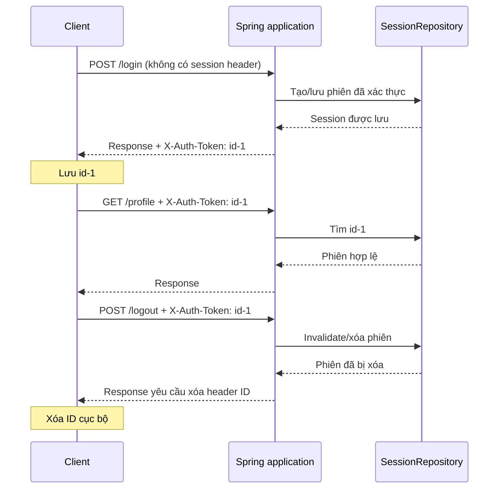

# Thiết kế client giữ, gửi và xóa định danh qua vòng đời đăng nhập

Khi dùng Spring Session với cơ chế định danh qua header, client chịu trách nhiệm giữ session ID nhận từ server, gửi lại ID trong các request cần xác thực và xóa ID khi phiên kết thúc. Server vẫn là nơi lưu trạng thái phiên trong repository như Redis hoặc JDBC. Vì vậy, thiết kế vòng đời ở client phải phối hợp với việc tạo phiên, thay đổi ID sau xác thực, hết hạn, thu hồi và đăng xuất ở server.

Header session ID thường phù hợp với REST API, ứng dụng di động hoặc client không dựa vào cookie tự động của trình duyệt. Spring Session cung cấp `HeaderHttpSessionIdResolver` để đọc ID từ request header và trả ID trong response header. Cơ chế này không biến session thành JWT: giá trị header vẫn là một định danh phiên có trạng thái phía server và phải được bảo vệ như một thông tin xác thực.

## 1. Vòng đời định danh phiên qua header

Một vòng đời đăng nhập điển hình có các giai đoạn sau:

1. **Chưa đăng nhập:** client chưa có session ID nên không gửi header định danh.
2. **Đăng nhập:** client gửi thông tin đăng nhập đến endpoint xác thực. Server xác thực thông tin, tạo hoặc thiết lập phiên và trả session ID trong response header.
3. **Đã đăng nhập:** client lưu ID và gửi nó trong header của mỗi request cần dùng session.
4. **Thay đổi ID:** nếu server đổi session ID, chẳng hạn để chống session fixation sau xác thực, client phải cập nhật ID theo response mới.
5. **Hết hạn hoặc bị thu hồi:** repository không còn chấp nhận ID cũ. Client xóa ID cục bộ khi nhận được kết quả xác thực cho biết phiên không còn hợp lệ.
6. **Đăng xuất:** client gửi ID hiện tại đến endpoint logout. Server invalidate phiên và phản hồi chỉ dẫn xóa định danh; client xóa ID khỏi nơi lưu.



Client chỉ giữ định danh. Quyết định phiên còn hợp lệ hay không luôn được đưa ra ở server dựa trên repository và chính sách bảo mật.

## 2. Bật HeaderHttpSessionIdResolver trong Spring Session

Trong ứng dụng Servlet, có thể khai báo `HeaderHttpSessionIdResolver` làm bean `HttpSessionIdResolver`. Ví dụ sau dùng header `X-Auth-Token`:

```java
import org.springframework.context.annotation.Bean;
import org.springframework.context.annotation.Configuration;
import org.springframework.session.web.http.HeaderHttpSessionIdResolver;
import org.springframework.session.web.http.HttpSessionIdResolver;

@Configuration
public class SessionIdConfiguration {

    @Bean
    public HttpSessionIdResolver httpSessionIdResolver() {
        return HeaderHttpSessionIdResolver.xAuthToken();
    }
}
```

`xAuthToken()` tạo resolver dùng header `X-Auth-Token`. Nếu muốn tên riêng, có thể dùng:

```java
@Bean
public HttpSessionIdResolver httpSessionIdResolver() {
    return HeaderHttpSessionIdResolver.header("X-Session-Id");
}
```

Chỉ khai báo một resolver cho cùng cấu hình Servlet. Nếu ứng dụng đã có resolver cookie mặc định hoặc bean resolver khác, hãy xác định rõ cơ chế được dùng và tránh đăng ký hai resolver cạnh tranh. Không nên gửi session ID đồng thời qua cookie và header nếu chưa có yêu cầu tương thích cụ thể và chính sách xử lý rõ ràng.

Resolver cung cấp ba thao tác trong hợp đồng `HttpSessionIdResolver`:

| Thao tác | Vai trò |
|---|---|
| `resolveSessionIds(request)` | Đọc session ID từ header của request |
| `setSessionId(request, response, sessionId)` | Đặt header trong response khi cần gửi ID |
| `expireSession(request, response)` | Đặt giá trị header hết hạn để client biết cần xóa ID |

Với `HeaderHttpSessionIdResolver`, header phản hồi khi hết hạn thường có giá trị rỗng. Client cần coi header rỗng là chỉ dẫn xóa ID đang lưu. Kiểm thử response thực tế trên phiên bản Spring Session đang dùng để xác nhận hành vi của resolver và middleware ở giữa.

## 3. Request và response mẫu

### 3.1. Đăng nhập và nhận ID

Client gửi thông tin đăng nhập mà chưa có session ID:

```http
POST /api/login HTTP/1.1
Host: api.example.com
Content-Type: application/json

{"username":"linh","password":"..."}
```

Sau khi xác thực thành công, ứng dụng tạo hoặc lưu trạng thái phiên. Spring Session có thể trả ID qua response header:

```http
HTTP/1.1 200 OK
X-Auth-Token: 4b6f...opaque-session-id...
Content-Type: application/json

{"userId":42,"displayName":"Linh"}
```

Client đọc header `X-Auth-Token` và lưu giá trị. Không lấy ID từ body nếu server đã chọn header làm hợp đồng định danh; duy trì một nguồn duy nhất giúp tránh hai giá trị không đồng nhất.

### 3.2. Gửi request đã xác thực

Request tiếp theo mang session ID trong header:

```http
GET /api/profile HTTP/1.1
Host: api.example.com
X-Auth-Token: 4b6f...opaque-session-id...
Accept: application/json
```

`SessionRepositoryFilter` đọc ID qua resolver và tra cứu repository. Nếu phiên tồn tại và còn hiệu lực, ứng dụng có thể truy cập `HttpSession` và `SecurityContext` theo cấu hình. Nếu ID không được gửi, sai hoặc không còn hợp lệ, request được xem là không có phiên hợp lệ và tầng bảo mật quyết định phản hồi phù hợp.

### 3.3. Đăng xuất

Client gửi ID hiện tại đến endpoint logout:

```http
POST /api/logout HTTP/1.1
Host: api.example.com
X-Auth-Token: 4b6f...opaque-session-id...
```

Server cần invalidate phiên phía repository. Response có thể chứa header `X-Auth-Token` rỗng để biểu thị ID cần bị xóa:

```http
HTTP/1.1 204 No Content
X-Auth-Token:
```

Client phải xóa ID cục bộ sau khi xác nhận logout thành công hoặc sau khi nhận chỉ dẫn hết hạn từ server. Xóa ID khỏi client không thay thế thao tác invalidate ở server: nếu bản sao ID bị lộ vẫn còn hiệu lực, người khác có thể tiếp tục dùng phiên cho đến khi server thu hồi hoặc phiên hết hạn.

## 4. Client cần quản lý ID như thế nào?

### 4.1. Một nguồn lưu trữ có chủ đích

Client nên có một thành phần quản lý session ID duy nhất thay vì để mỗi màn hình hoặc API tự lưu một bản sao. Thành phần này chịu trách nhiệm:

- Đọc ID hiện tại khi tạo request.
- Gắn header đúng tên vào request đến API đáng tin cậy.
- Cập nhật ID khi response trả ID mới.
- Xóa ID khi response báo hết hạn hoặc luồng logout hoàn tất.
- Ngăn request sau logout tiếp tục gửi ID cũ.

ID phải được xử lý như mật khẩu tạm thời. Không ghi ID vào log, analytics, crash report hoặc thông báo lỗi. Không đưa ID vào URL, query string hay fragment vì URL thường xuất hiện trong lịch sử trình duyệt, access log, referrer và hệ thống theo dõi.

### 4.2. Lưu trong bộ nhớ của ứng dụng

Với SPA trên trình duyệt, lưu ID trong bộ nhớ của ứng dụng giúp giảm thời gian tồn tại sau khi tab hoặc trang bị đóng/tải lại. Nhược điểm là reload có thể làm mất ID và người dùng cần đăng nhập lại hoặc dùng một cơ chế khôi phục khác.

`localStorage` và `sessionStorage` tồn tại lâu hơn biến trong bộ nhớ, nhưng JavaScript trên cùng origin có thể đọc chúng. Nếu trang bị XSS, mã độc có thể lấy session ID và gửi ra ngoài. Việc chọn storage cần cân bằng trải nghiệm và rủi ro; không có storage phía client nào tự làm session ID an toàn trước XSS.

Với ứng dụng di động native, dùng kho lưu trữ an toàn của nền tảng như iOS Keychain hoặc Android Keystore-backed storage, thay vì ghi session ID dạng rõ vào file cấu hình, log hoặc database không mã hóa. Hạn chế quyền truy cập và xóa dữ liệu khi logout hoặc khi người dùng gỡ liên kết tài khoản.

Nếu ứng dụng web cần session bền vững và muốn giảm việc JavaScript trực tiếp xử lý bí mật, mô hình Backend-for-Frontend với cookie `HttpOnly` có thể phù hợp hơn. Header session ID yêu cầu client có khả năng đọc ID để gắn vào request, nên cần đánh giá kỹ bề mặt XSS.

### 4.3. Không gửi ID đến host không tin cậy

HTTP client hoặc interceptor dùng chung có thể vô tình gắn `X-Auth-Token` vào mọi URL, bao gồm analytics, CDN hoặc dịch vụ bên thứ ba. Chỉ thêm header khi request đích thuộc API origin đã được cho phép. Khi redirect sang host khác, không chuyển tiếp session ID trừ khi đích được xác thực và nằm trong chính sách tin cậy.

## 5. Ví dụ quản lý header trong client JavaScript

Đoạn mã dưới đây minh họa một client đơn giản lưu session ID trong bộ nhớ và gắn nó vào request đến API. Ứng dụng thực tế cần bổ sung kiểm tra origin, xử lý lỗi và đồng bộ khi có nhiều request đồng thời.

```javascript
const SESSION_HEADER = "X-Auth-Token";
let sessionId = null;

async function apiFetch(url, options = {}) {
  const target = new URL(url, window.location.origin);
  if (target.origin !== "https://api.example.com") {
    throw new Error("Untrusted API origin");
  }

  const headers = new Headers(options.headers || {});
  if (sessionId) {
    headers.set(SESSION_HEADER, sessionId);
  }

  const response = await fetch(target, {
    ...options,
    headers
  });

  // Server chỉ gửi header này khi ID được tạo, đổi hoặc hết hạn.
  const returnedId = response.headers.get(SESSION_HEADER);
  if (returnedId !== null) {
    sessionId = returnedId.trim() === "" ? null : returnedId;
  }

  if (response.status === 401) {
    sessionId = null;
  }

  return response;
}

async function logout() {
  try {
    const response = await apiFetch("https://api.example.com/api/logout", {
      method: "POST"
    });
    if (!response.ok) {
      throw new Error("Logout failed");
    }
  } finally {
    // Xóa ID local để request sau không tiếp tục gửi ID cũ.
    sessionId = null;
  }
}
```

Đây là ví dụ về luồng xử lý, không phải thư viện client hoàn chỉnh. Đặc biệt, không nên xóa ID chỉ vì gặp lỗi mạng hoặc `5xx`: server có thể chưa xử lý request, và phiên vẫn còn hiệu lực. Với `401` do phiên hết hạn, client có thể xóa ID và yêu cầu đăng nhập lại theo UX của ứng dụng. Nếu response logout không rõ kết quả do mất kết nối, client có thể xóa ID cục bộ để ngừng sử dụng, nhưng cần hiểu rằng phiên phía server có thể vẫn còn cho đến khi hết hạn hoặc được thu hồi bằng một thao tác khác.

## 6. Cập nhật định danh khi server xoay vòng session ID

Sau khi đăng nhập thành công, Spring Security có thể áp dụng session fixation protection bằng cách thay đổi session ID. Server có thể trả ID mới trong response header. Client phải thay ID cũ bằng ID mới để các request tiếp theo dùng đúng phiên.

Quy tắc xử lý response nên rõ ràng:

- Header không xuất hiện: giữ ID hiện tại, vì server không đưa ra chỉ dẫn thay đổi.
- Header có giá trị khác rỗng: thay ID hiện tại bằng giá trị mới.
- Header xuất hiện nhưng rỗng: xóa ID hiện tại.

Không thay ID bằng một giá trị cũ lấy từ cache hoặc một response đến muộn. Trong ứng dụng gửi nhiều request đồng thời, có thể có response của request cũ đến sau response chứa ID mới. Nếu client cập nhật state theo thứ tự đến mà không kiểm soát, ID cũ có thể ghi đè ID mới.

Một số biện pháp:

1. Xử lý login và logout như thao tác chuyển trạng thái, khóa hoặc tuần tự hóa request trong thời gian chuyển đổi.
2. Dùng một session manager trung tâm để mọi interceptor cập nhật cùng state.
3. Gắn số thế hệ (generation) cho phiên ở client và bỏ qua response thuộc thế hệ cũ sau khi logout/login mới.
4. Tránh tự retry request xác thực bằng ID cũ sau khi server đã xoay ID.

Nếu ứng dụng có refresh hoặc gia hạn phiên, cần định nghĩa rõ endpoint nào có thể trả ID mới và client phải cập nhật state ở thời điểm nào.

## 7. CORS và header tùy chỉnh

Nếu frontend và API khác origin, header như `X-Auth-Token` thường làm trình duyệt gửi CORS preflight `OPTIONS`. Server cần cho phép origin cụ thể và header cần dùng. Ví dụ cấu hình CORS khái niệm:

```java
@Bean
CorsConfigurationSource corsConfigurationSource() {
    CorsConfiguration config = new CorsConfiguration();
    config.setAllowedOrigins(List.of("https://app.example.com"));
    config.setAllowedMethods(List.of("GET", "POST", "PUT", "DELETE", "OPTIONS"));
    config.setAllowedHeaders(List.of("Content-Type", "X-Auth-Token"));
    config.setExposedHeaders(List.of("X-Auth-Token"));

    UrlBasedCorsConfigurationSource source =
        new UrlBasedCorsConfigurationSource();
    source.registerCorsConfiguration("/api/**", config);
    return source;
}
```

`allowedHeaders` cho phép browser gửi header trong request; `exposedHeaders` cho phép JavaScript đọc header trong response. Nếu thiếu `exposedHeaders`, server có thể trả session ID nhưng frontend không đọc được do chính sách CORS.

Chỉ cho phép các origin cụ thể. Tránh dùng wildcard cho origin khi ứng dụng cần credentials hoặc khi chính sách tin cậy yêu cầu giới hạn nguồn. CORS không phải cơ chế xác thực; nó là chính sách trình duyệt kiểm soát việc JavaScript đọc response và gửi một số request cross-origin.

Nếu dùng session ID qua header mà không dùng cookie, request thường không cần bật `credentials: "include"` chỉ để gửi header tùy chỉnh. Nếu ứng dụng đồng thời dùng cookie cho mục đích khác, phải cấu hình credentials và origin theo đúng yêu cầu, không mở rộng tùy tiện.

## 8. Phân biệt header session ID với Authorization bearer token

Header session ID và access token dạng bearer đều là bí mật mà client gửi để chứng minh quyền sử dụng. Tuy nhiên, chúng có mô hình vận hành khác nhau:

| Đặc điểm | Session ID qua header | Access token bearer (ví dụ JWT) |
|---|---|---|
| Trạng thái | Thường tra cứu session trong repository phía server | Có thể tự chứa claim và được xác minh bằng chữ ký; vẫn có thể cần introspection/revocation store |
| Thu hồi | Xóa hoặc invalidate session phía server | Phụ thuộc thiết kế token, blacklist, introspection hoặc thời hạn |
| Nội dung | Định danh opaque, client không nên diễn giải | Có thể chứa claim, nhưng client không nên tin claim nếu chưa được xác minh |
| Gia hạn/đổi ID | Theo vòng đời session và resolver | Theo giao thức phát hành/refresh token |
| Header thường gặp | `X-Auth-Token` hoặc tên riêng | `Authorization: Bearer ...` |

Không nên đặt session ID vào `Authorization` chỉ vì header này quen thuộc nếu ứng dụng còn dùng Spring Security resource server hoặc bearer token. Có thể gây xung đột với authentication filter. Chọn một hợp đồng header rõ ràng và tài liệu hóa cho client.

## 9. Xử lý hết hạn, bị thu hồi và lỗi mạng

Client cần phân biệt trạng thái xác thực với lỗi hạ tầng:

| Kết quả | Ý nghĩa có thể | Hành động client gợi ý |
|---|---|---|
| `401 Unauthorized` | Không có phiên hợp lệ, ID hết hạn hoặc thông tin xác thực bị từ chối | Xóa ID hiện tại và yêu cầu đăng nhập lại nếu API xác nhận session không hợp lệ |
| `403 Forbidden` | Phiên có thể hợp lệ nhưng người dùng không đủ quyền hoặc CSRF/policy từ chối | Không tự động xóa ID chỉ dựa trên 403; hiển thị lỗi quyền hoặc xử lý theo hợp đồng API |
| `5xx` | Server hoặc repository gặp lỗi | Giữ ID nếu chưa có chỉ dẫn thu hồi; cho phép retry có giới hạn theo tính idempotent |
| Timeout/mất mạng | Client không biết server đã xử lý request hay chưa | Không giả định logout/login đã thành công; đồng bộ lại trạng thái qua endpoint phù hợp |
| Header response rỗng | Resolver yêu cầu client xóa ID | Xóa ID hiện tại |

Mã trạng thái cụ thể phụ thuộc Spring Security và API exception handling của ứng dụng. Hãy định nghĩa hợp đồng lỗi thống nhất để client không xóa session chỉ vì một lỗi tạm thời.

Nếu client gửi ID không hợp lệ, server không được tự động cấp quyền hoặc khôi phục trạng thái từ dữ liệu do client tự khai. Server phải tra cứu repository và áp dụng chính sách xác thực. Khi repository không truy cập được, ứng dụng cần phân biệt lỗi lưu trữ với kết quả lookup không tìm thấy; không nên coi lỗi Redis/JDBC như một phiên đã hết hạn.

## 10. Đăng xuất và thu hồi trên nhiều thiết bị

Đăng xuất ở một client thường chỉ invalidate session ID mà client đang dùng. Nếu người dùng đăng nhập trên nhiều thiết bị, mỗi thiết bị có thể có session ID riêng. Để hỗ trợ "đăng xuất khỏi tất cả thiết bị", server cần cơ chế tìm và thu hồi các phiên liên quan đến tài khoản, chẳng hạn chỉ mục user-to-session hoặc cơ chế quản lý phiên của Spring Security.

Client không thể đăng xuất khỏi thiết bị khác chỉ bằng cách xóa ID đang lưu trên thiết bị hiện tại. Server phải thu hồi các phiên tương ứng. Sau khi server thu hồi, request từ thiết bị khác mang ID cũ phải bị từ chối; client đó nên xóa ID khi nhận lỗi xác thực theo hợp đồng API.

Với ứng dụng di động, logout nên xóa ID khỏi secure storage sau khi server xác nhận hoặc theo chính sách offline logout đã định nghĩa. Nếu người dùng chọn xóa tài khoản hoặc thu hồi thiết bị, server cần thực hiện thao tác thu hồi bền vững trước khi client xóa dấu vết cục bộ.

## 11. Bảo mật khi sử dụng header session ID

Session ID là bearer secret. Bất kỳ ai lấy được ID có thể thử dùng phiên đó cho đến khi server thu hồi hoặc hết hạn. Các nguyên tắc cần tuân thủ:

- Chỉ truyền session ID qua HTTPS; không cho phép proxy hoặc gateway ghi header nhạy cảm vào access log.
- Giới hạn header được forward qua reverse proxy và API gateway; loại bỏ header giả mạo ở ranh giới không tin cậy trước khi gắn thông tin nội bộ.
- Không đưa ID vào URL, query string, telemetry hoặc thông báo lỗi.
- Lưu ID ở bộ nhớ hoặc secure storage phù hợp nền tảng; hiểu rõ rủi ro XSS nếu JavaScript có thể đọc ID.
- Chỉ gửi header đến API origin đáng tin cậy; không forward header qua redirect sang host khác.
- Áp dụng session fixation protection khi xác thực và invalidate phiên khi logout.
- Dùng timeout idle và chính sách tuổi đời phiên phù hợp; hỗ trợ thu hồi khi tài khoản bị khóa hoặc thông tin đăng nhập thay đổi.
- Giới hạn quyền, xác thực request ở server và không coi header có mặt là đủ để cấp quyền.
- Nếu dùng header custom từ browser, cấu hình CORS chặt chẽ và vẫn áp dụng bảo vệ CSRF phù hợp với toàn bộ cơ chế xác thực của ứng dụng.

Header custom có thể giảm một số kiểu CSRF dựa trên form HTML vì form thông thường không tự đặt được header tùy chỉnh, nhưng không phải lý do để bỏ qua CSRF trong mọi kiến trúc. Nếu trình duyệt tự động đính kèm cookie hoặc có endpoint chấp nhận nhiều phương thức xác thực, cần đánh giá CSRF trên toàn bộ luồng.

## 12. Kiểm thử vòng đời ở client và server

Kiểm thử cần xác nhận cả việc client quản lý ID và việc server quản lý repository. Một ma trận cơ bản:

| Kịch bản | Điều cần kiểm tra | Kết quả mong đợi |
|---|---|---|
| Login thành công | Client đọc header response | ID mới được lưu đúng một nơi |
| Login thất bại | Response không cấp ID mới | Không ghi đè ID hợp lệ ngoài ý muốn; xử lý theo chính sách đăng nhập |
| Request đã đăng nhập | Client gắn header vào API được phép | Server khôi phục đúng session |
| Response xoay ID | Server trả ID mới | Client thay ID cũ trước request tiếp theo |
| Response header rỗng | Server yêu cầu expire | Client xóa ID hiện tại |
| Logout thành công | Server invalidate repository và client xóa ID | ID cũ không dùng lại được |
| Logout timeout | Client không biết server đã xử lý hay chưa | Client ngừng dùng ID theo chính sách; server session được xác minh/thu hồi theo cơ chế phục hồi |
| Session hết hạn | Server trả lỗi xác thực đã định nghĩa | Client xóa ID và chuyển về login |
| 403 quyền hạn | Phiên có thể vẫn hợp lệ | Client không xóa ID một cách máy móc |
| 5xx repository | Server không xác minh được phiên | Không cấp quyền; client không coi đây là logout chắc chắn |
| CORS | Browser gửi preflight và đọc response header | Header được cho phép và expose đúng origin |
| Hai request đồng thời | Response cũ đến sau response xoay ID | State không bị ghi đè bởi ID thuộc thế hệ cũ |
| Nhiều thiết bị | Thu hồi phiên từ server | Các ID đã thu hồi đều bị từ chối |

Nên có kiểm thử tích hợp với Redis/JDBC và ít nhất hai instance để xác nhận ID do instance A phát có thể dùng ở B, đồng thời logout hoặc thu hồi ở B có hiệu lực khi request tiếp theo đến A.

## 13. Những lỗi thiết kế thường gặp

| Biểu hiện | Nguyên nhân | Cách khắc phục |
|---|---|---|
| Login thành công nhưng request tiếp theo là 401 | Client không đọc response header hoặc không gắn header request | Kiểm tra tên header, CORS expose/allow và middleware client |
| Browser không đọc được ID response | Thiếu `Access-Control-Expose-Headers` | Expose đúng header cho origin được phép |
| ID cũ tiếp tục được gửi sau login | Client bỏ qua response xoay ID | Cập nhật session state khi server trả ID mới |
| Logout xong vẫn truy cập được | Chỉ xóa ID local, server chưa invalidate session | Thực hiện logout server-side và kiểm tra repository |
| ID bị rò rỉ qua log | Gateway hoặc tracing ghi toàn bộ header | Redact `X-Auth-Token` ở mọi lớp logging |
| Request gửi ID đến dịch vụ bên thứ ba | Interceptor gắn header cho mọi URL | Allow-list API origin trước khi gắn header |
| Session bị mất khi reload trang | Chỉ lưu ID trong bộ nhớ | Chọn lại chính sách lưu trữ hoặc yêu cầu đăng nhập lại có chủ đích |
| XSS lấy được session ID | Lưu ID trong storage đọc được bằng JavaScript | Giảm bề mặt XSS, cân nhắc BFF/HttpOnly cookie và rút ngắn vòng đời phiên |
| Nhiều request ghi đè ID mới bằng ID cũ | Response đến sai thứ tự | Quản lý generation và tuần tự hóa chuyển trạng thái login/logout |
| 5xx làm client tự đăng xuất | Gộp lỗi hạ tầng với session hết hạn | Phân biệt lỗi xác thực với lỗi repository/network |

## 14. Nguyên tắc áp dụng

- Dùng `HeaderHttpSessionIdResolver` khi client cần gửi session ID qua header trong ứng dụng Servlet.
- Chọn tên header ổn định, ví dụ `X-Auth-Token`, và tài liệu hóa hợp đồng request/response.
- Lưu ID tại một session manager trung tâm; chỉ gửi đến API origin đáng tin cậy.
- Cập nhật ID khi server xoay vòng và xóa ID khi server báo hết hạn hoặc logout thành công.
- Phân biệt `401`, `403`, lỗi `5xx`, timeout mạng và header hết hạn.
- Cấu hình CORS cho phép request header và expose response header đúng origin.
- Bảo vệ ID như một bearer secret bằng HTTPS, redaction log, storage phù hợp và chính sách thu hồi.
- Không nhầm session ID với JWT/access token; không dùng chung header `Authorization` nếu hợp đồng xác thực đã có mục đích khác.
- Kiểm thử login, request tiếp theo, ID rotation, logout, timeout, nhiều request đồng thời và nhiều thiết bị.

Trong mô hình header-based session, client quản lý việc giữ và gửi định danh; Spring Session và repository quản lý trạng thái thực của phiên. Khi hai phía tuân theo một hợp đồng rõ ràng cho việc tạo, cập nhật, hết hạn và xóa ID, ứng dụng có thể duy trì đăng nhập nhất quán qua nhiều request và nhiều instance mà vẫn thu hồi được phiên ở phía server.
