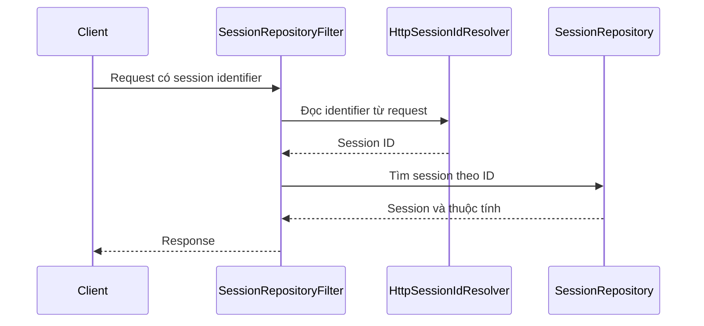

# Định danh phiên và quyền truy cập của bên nắm giữ định danh

Trong Spring Session, session ID là mã định danh để máy chủ tìm lại trạng thái phiên được lưu trong repository. Ứng dụng Servlet có thể truyền mã này qua cookie hoặc qua một HTTP header. Khi dùng resolver dựa trên header, client phải gửi header chứa session ID trong các request cần tiếp tục phiên.

Session ID cần được bảo vệ như một thông tin xác thực dạng bearer: bên nào nắm giữ một ID hợp lệ có thể được máy chủ xem là đang sử dụng phiên gắn với ID đó. Điều này không có nghĩa header tự cấp quyền tùy ý. Máy chủ vẫn phải xác thực phiên, lấy danh tính người dùng từ ngữ cảnh đã được xác minh và kiểm tra quyền trên từng thao tác. Hiểu ranh giới giữa định danh phiên và phân quyền giúp tránh nhầm một header do client tự gửi với danh tính đáng tin cậy.

## 1. Session ID là định danh của phiên

HTTP không lưu trạng thái giữa các request. `HttpSession` cung cấp vùng lưu trạng thái gắn với một phiên người dùng. Spring Session quản lý phiên đó thông qua `SessionRepository`, có thể dùng Redis, JDBC hoặc implementation khác.

Một phiên thường chứa các thuộc tính như mã người dùng, dữ liệu điều hướng hoặc `SecurityContext` do Spring Security lưu trữ. Session ID là khóa tra cứu để Spring Session tìm bản ghi tương ứng. Bản thân ID không cần chứa tên người dùng, vai trò hay quyền truy cập.

Luồng cơ bản:



Nếu ID không tồn tại, đã hết hạn hoặc đã bị thu hồi, repository không thể cung cấp phiên hợp lệ. Ứng dụng sẽ xử lý request như không có session đã xác thực, theo cấu hình bảo mật của mình.

Một session ID hợp lệ không phải là bằng chứng danh tính theo nghĩa sinh trắc học hoặc danh tính pháp lý. Nó là bằng chứng rằng client đang nắm một thông tin bí mật được máy chủ chấp nhận để tiếp tục phiên. Đây là lý do cần bảo vệ ID tương tự mật khẩu hoặc access token.

## 2. Quyền của bên nắm giữ định danh

Trong mô hình bearer credential, máy chủ không biết ai đang cầm ID ở phía client. Nếu một người khác lấy được session ID còn hiệu lực, họ có thể gửi request mang ID đó và được gắn với cùng session. Nếu session chứa `SecurityContext` của người dùng đã đăng nhập, request giả mạo có thể kế thừa danh tính và quyền của phiên đó cho đến khi phiên bị thu hồi hoặc hết hạn.

Ví dụ:

1. Người dùng đăng nhập thành công và nhận session ID `S-123...`.
2. Trình duyệt hoặc ứng dụng lưu ID và gửi nó trong các request sau.
3. Máy chủ tra cứu ID, lấy session cùng ngữ cảnh xác thực đã lưu.
4. Nếu kẻ tấn công lấy được ID, họ có thể phát lại ID từ một client khác trong thời gian phiên còn hiệu lực.

Vì vậy, “bên nắm giữ định danh” có khả năng tiếp tục phiên trong phạm vi quyền đã gắn với phiên. Máy chủ không nên coi session ID là một chuỗi vô hại chỉ dùng để phân biệt request.

Session ID phải được tạo bởi cơ chế sinh ngẫu nhiên an toàn, đủ khó đoán và không do client tự chọn. Không dùng email, số điện thoại, mã nhân viên, ID tăng dần hoặc giá trị dễ suy luận làm session ID. Ứng dụng cũng không nên cho phép client chỉ định session ID mới thông qua một header bất kỳ.

## 3. Truyền session ID bằng HTTP header

Spring Session Servlet định nghĩa `HttpSessionIdResolver` để đọc và ghi session ID. Resolver cookie dùng cookie; `HeaderHttpSessionIdResolver` dùng một HTTP header do ứng dụng chọn.

Ví dụ cấu hình resolver bằng header `X-Session-Id`:

```java
import org.springframework.context.annotation.Bean;
import org.springframework.context.annotation.Configuration;
import org.springframework.session.web.http.HeaderHttpSessionIdResolver;
import org.springframework.session.web.http.HttpSessionIdResolver;

@Configuration(proxyBeanMethods = false)
public class SessionHeaderConfiguration {

    @Bean
    HttpSessionIdResolver httpSessionIdResolver() {
        return HeaderHttpSessionIdResolver.header("X-Session-Id");
    }
}
```

Nếu muốn dùng tên header tương thích với một số client hiện có, Spring Session cũng cung cấp factory `HeaderHttpSessionIdResolver.xAuthToken()`, sử dụng header `X-Auth-Token`. Tên header cần được thống nhất giữa server, client, gateway và các instance ứng dụng.

Sau khi cấu hình, client gửi session ID trong header:

```http
GET /api/profile HTTP/1.1
Host: api.example.test
X-Session-Id: <session-id>
```

Khi ứng dụng tạo session mới, resolver có thể ghi ID vào response header tương ứng để client lưu lại và dùng ở request tiếp theo. Client phải đọc đúng header và gửi lại giá trị đó. Cách trao đổi cụ thể cần được kiểm tra với phiên bản Spring Session và HTTP client đang dùng.

Ví dụ gọi API bằng curl với giá trị minh họa:

```bash
curl https://api.example.test/api/profile   -H "X-Session-Id: <session-id>"
```

Không đưa session ID vào URL query string. URL thường được ghi vào access log, lịch sử trình duyệt, hệ thống phân tích, proxy và header `Referer` trong một số luồng điều hướng. Dùng header giảm các nguồn rò rỉ phổ biến này, nhưng vẫn phải bảo vệ log và kênh truyền.

## 4. Header resolver làm gì trong request và response?

`HeaderHttpSessionIdResolver` thực hiện vai trò định vị session ID qua header. Nó không tự xác thực người dùng và không tự quyết định quyền nghiệp vụ.

Ở request, resolver đọc header được cấu hình để lấy ID. `SessionRepositoryFilter` dùng resolver để tìm session trong repository và bọc request để mã Servlet tiếp tục gọi `getSession()` như thông thường.

Ở response, khi cần phát ID, resolver ghi header để client nhận diện phiên. Khi phiên bị hủy, resolver có thể ghi giá trị header rỗng để báo client loại bỏ ID đã lưu. Client nên xóa giá trị cũ khi nhận response kết thúc phiên hoặc khi server trả trạng thái yêu cầu xác thực lại.

Các bước xử lý:

1. Client gửi request với `X-Session-Id`.
2. `SessionRepositoryFilter` gọi resolver để đọc ID.
3. Repository tìm session và khôi phục thuộc tính.
4. Spring Security hoặc tầng ứng dụng đánh giá trạng thái xác thực và quyền.
5. Response có thể chứa header định danh mới hoặc header xóa định danh theo vòng đời session.
6. Client cập nhật bộ nhớ session ID theo response.

Một response không có header ID mới không nhất thiết là lỗi; nếu request đã có ID hợp lệ và phiên không cần đổi, server có thể không cần phát lại ID. Client nên tuân theo hợp đồng giao thức của ứng dụng thay vì giả định mọi response đều phải chứa header.

## 5. Phân biệt session identifier, danh tính và quyền

Ba khái niệm cần tách bạch:

| Khái niệm | Ví dụ | Vai trò |
|---|---|---|
| Session identifier | `X-Session-Id` | Tìm phiên được lưu phía máy chủ |
| Danh tính đã xác thực | Principal `user-42` | Cho biết phiên đang đại diện cho người dùng nào |
| Quyền truy cập | `ROLE_ADMIN` hoặc quyền `orders:read` | Quyết định người dùng được phép thực hiện hành động nào |

Một session ID không nên chứa hoặc mã hóa trực tiếp quyền quản trị theo cách mà client có thể tự sửa. Quyền phải được máy chủ lấy từ nguồn xác thực đáng tin cậy, chẳng hạn `SecurityContext` đã được xác lập sau đăng nhập.

Ví dụ, endpoint đọc đơn hàng có thể yêu cầu quyền:

```java
@RestController
@RequestMapping("/api/orders")
class OrderController {

    @GetMapping("/{id}")
    @PreAuthorize("hasAuthority('orders:read')")
    OrderDto getOrder(@PathVariable String id) {
        return orderService.findVisibleOrder(id);
    }
}
```

Session ID giúp request được liên kết với session đã xác thực. Spring Security xác định principal và authorities, còn `@PreAuthorize` hoặc kiểm tra nghiệp vụ quyết định người dùng có thể đọc đơn hàng cụ thể hay không. Một người dùng có quyền `orders:read` vẫn chỉ nên truy cập những đơn hàng mà quy tắc nghiệp vụ cho phép.

Không được suy ra quyền từ việc client gửi `X-Role`, `X-User-Id` hoặc `X-Is-Admin`. Những header này chỉ là dữ liệu đầu vào nếu không được một thành phần tin cậy xác thực và ghi đè.

## 6. Không nhầm header định danh với header nhận dạng người dùng

`X-Session-Id` mang session ID do server cấp. `X-User-Id` thường chỉ là một tuyên bố về danh tính. Nếu ứng dụng tin trực tiếp giá trị user ID do client gửi, client có thể thay đổi header để giả mạo người dùng khác.

Một gateway nội bộ có thể truyền danh tính đã xác thực qua header, nhưng chỉ an toàn khi có ranh giới tin cậy rõ ràng:

- Gateway phải xác thực client trước khi đặt header danh tính.
- Gateway phải xóa hoặc ghi đè các header danh tính cùng tên do client gửi từ Internet.
- Ứng dụng backend chỉ nhận traffic từ gateway đáng tin cậy hoặc xác thực mTLS giữa gateway và backend.
- Backend vẫn phải kiểm tra cấu trúc và phạm vi quyền của danh tính được chuyển tiếp.
- Không cho phép truy cập trực tiếp backend để bỏ qua gateway.

Nếu không có kiến trúc gateway được bảo vệ như vậy, backend nên lấy danh tính từ cơ chế xác thực của Spring Security thay vì tin `X-User-Id`.

Tương tự, không tự dùng một header tùy ý làm session ID chỉ vì giá trị đó trông giống UUID. Chỉ resolver được cấu hình mới xác định header nào mang session ID, và repository phải kiểm tra ID đó có gắn với session đang hoạt động hay không.

## 7. Bảo vệ session ID khi truyền qua header

Header không tự mã hóa dữ liệu. Session ID vẫn có thể bị đọc nếu request đi qua mạng không an toàn hoặc bị ghi vào log.

Các biện pháp cần áp dụng:

- Dùng HTTPS cho toàn bộ đường truyền bên ngoài và nội bộ có thể bị quan sát.
- Bật HSTS cho domain web phù hợp để trình duyệt ưu tiên HTTPS.
- Không ghi nguyên giá trị `X-Session-Id` hoặc `X-Auth-Token` vào access log, application log, tracing, metric label hay error report.
- Cấu hình reverse proxy, API gateway và hệ thống APM để che hoặc loại bỏ header bí mật.
- Không truyền session ID qua URL, thông điệp lỗi, analytics hoặc mã nguồn frontend.
- Giới hạn quyền đọc log và thời gian lưu log; kiểm tra các hệ thống trung gian có sao chép header hay không.
- Tạo ID đủ ngẫu nhiên và thay đổi ID sau các mốc xác thực quan trọng.

TLS bảo vệ dữ liệu khi truyền qua mạng, nhưng không bảo vệ khỏi mã độc trong trình duyệt, XSS, extension độc hại, endpoint bị xâm nhập hoặc log đã lưu ở hệ thống đầu cuối. Vì thế cần giảm số nơi có thể đọc session ID.

## 8. Header session và ứng dụng trình duyệt

Header tùy chỉnh thường hữu ích với ứng dụng mobile, desktop client hoặc API client vì client có thể chủ động gắn header vào request. Với ứng dụng trình duyệt, JavaScript có thể đọc response header và lưu session ID để gửi lại trong request sau.

Tuy nhiên, nếu JavaScript phải lưu session ID trong `localStorage` hoặc `sessionStorage`, mã chạy cùng origin có thể đọc giá trị đó. XSS vì thế có thể lấy cắp ID. Việc dùng header thay cookie không tự loại bỏ rủi ro XSS.

Với ứng dụng web truyền thống, cookie `HttpOnly` có ưu điểm là JavaScript không thể đọc trực tiếp giá trị cookie. Nếu kiến trúc buộc phải dùng header do JavaScript quản lý, cần tăng cường chống XSS, giới hạn script bên thứ ba, áp dụng Content Security Policy và tránh lưu ID lâu hơn mức cần thiết.

Nếu frontend và API khác origin, request mang header tùy chỉnh thường kích hoạt CORS preflight. Server cần cho phép origin cụ thể và header cần thiết, ví dụ:

```http
Access-Control-Allow-Origin: https://app.example.test
Access-Control-Allow-Methods: GET, POST, PUT, DELETE
Access-Control-Allow-Headers: Content-Type, X-Session-Id
Access-Control-Expose-Headers: X-Session-Id
```

`Access-Control-Allow-Headers` cho phép browser gửi header trong request; `Access-Control-Expose-Headers` cho phép JavaScript đọc header đó trong response. Cấu hình origin nên giới hạn theo domain được tin cậy. Không bật CORS rộng chỉ để khắc phục lỗi preflight.

Nếu request chỉ dùng header session do JavaScript chủ động gắn và không dùng cookie hoặc HTTP authentication do trình duyệt quản lý, không nhất thiết phải bật CORS credentials. Nếu ứng dụng đồng thời dùng cookie hoặc credentials của trình duyệt, cần cấu hình credentials và origin tương ứng; không thể dùng wildcard origin với credentials theo quy tắc CORS của trình duyệt.

## 9. CSRF khi dùng định danh qua header

CSRF thường dựa trên việc trình duyệt tự động đính kèm thông tin xác thực vào request cross-site, chẳng hạn cookie. Một header tùy chỉnh do JavaScript tự thêm không được trình duyệt tự động gửi như cookie, và request cross-origin thường cần preflight. Điều này có thể giảm một số đường tấn công CSRF.

Nhưng không nên xem việc đổi sang header là đủ để tắt bảo vệ CSRF trong mọi kiến trúc:

- Ứng dụng có thể vẫn nhận cookie session hoặc credentials khác.
- Cấu hình CORS quá rộng có thể cho phép origin không mong muốn thực hiện request.
- Một số client hoặc endpoint có thể chấp nhận nhiều cách xác thực cùng lúc.
- XSS có thể gửi request bằng session ID đã đánh cắp.
- Request cùng site hoặc cùng origin vẫn cần kiểm soát quyền và nguồn dữ liệu.

Hãy phân tích cách trình duyệt gửi credential thực tế, bật CSRF protection phù hợp với Spring Security và kiểm thử request thay đổi trạng thái. CORS là chính sách chia sẻ tài nguyên giữa origin, không phải cơ chế xác thực hay phân quyền.

## 10. Vòng đời session: cấp phát, xoay vòng và thu hồi

Session ID cần được quản lý xuyên suốt vòng đời:

**Cấp phát.** Server tạo session và cấp ID do framework quản lý. Client chỉ nhận và gửi lại ID theo hợp đồng của resolver. Không chấp nhận ID tùy chọn do client tự tạo.

**Xác thực.** Sau khi người dùng đăng nhập, cần bảo vệ khỏi session fixation bằng cách thay đổi session ID theo chiến lược của Spring Security/Servlet. Điều này ngăn kẻ tấn công cố định một ID trước đăng nhập rồi dùng lại sau khi nạn nhân xác thực.

**Sử dụng.** Mỗi request gửi ID qua đúng header đã cấu hình. Server tra cứu session, xác minh trạng thái xác thực và kiểm tra quyền truy cập.

**Hết hạn.** Repository áp dụng session timeout. ID cũ không còn trỏ tới một session hợp lệ sau khi phiên hết hạn được xác định theo cơ chế store.

**Đăng xuất hoặc thu hồi.** Ứng dụng vô hiệu hóa session phía server và thông báo client xóa ID đã lưu. Chỉ xóa ID ở phía client không thu hồi bản ghi trong repository; chỉ xóa bản ghi mà không xóa giá trị client lưu lại cũng khiến client tiếp tục gửi ID vô hiệu trong các request sau.

Khi phát hiện ID bị lộ, có thể thu hồi session tương ứng hoặc mọi session của tài khoản tùy chính sách bảo mật. Nếu cần đăng xuất tất cả thiết bị, repository cần hỗ trợ tra cứu session theo principal hoặc ứng dụng cần một chỉ mục đáng tin cậy để tìm các session cần thu hồi.

## 11. Không trộn lẫn X-Session-Id với Authorization Bearer

Header `Authorization: Bearer ...` thường được dùng cho access token như OAuth 2.0 bearer token hoặc JWT. Session ID của Spring Session là khóa tra cứu một trạng thái phiên phía server. Hai cơ chế có thể cùng mang bí mật dạng bearer, nhưng cách xác minh và vòng đời khác nhau.

| Đặc điểm | Header session ID | Bearer access token |
|---|---|---|
| Giá trị đại diện | ID của session phía server | Token được resource server xác minh |
| Nơi lưu trạng thái | Repository session như Redis/JDBC | Có thể xác minh bằng chữ ký hoặc introspection |
| Thu hồi | Xóa/vô hiệu hóa session trong repository | Theo cơ chế thu hồi, thời hạn hoặc introspection |
| Quyền | Thường lấy từ SecurityContext trong session | Có thể nằm trong claim/scope đã xác minh |
| Cách cấu hình | `HttpSessionIdResolver` | Cấu hình resource server / authentication filter |

Nếu ứng dụng đã dùng Spring Security Resource Server để xử lý `Authorization: Bearer`, không nên âm thầm dùng cùng header đó làm session ID. Hai filter có thể diễn giải cùng một giá trị theo hai cơ chế khác nhau, gây xung đột xác thực và khó chẩn đoán. Hãy chọn một giao thức rõ ràng hoặc thiết kế thứ tự xác thực và ranh giới trách nhiệm có chủ đích.

Tên `X-Auth-Token` của resolver factory không biến giá trị thành JWT hay OAuth token. Nó chỉ là tên header vận chuyển session ID. Client và server cần hiểu đúng semantics này.

## 12. Kiểm thử header identifier và quyền của người nắm giữ

Kiểm thử cần xác nhận cả việc đọc ID, ghi ID và quyền truy cập gắn với session.

Một kịch bản tích hợp cơ bản:

1. Gửi request tạo session mà chưa có header ID.
2. Đọc header ID server trả về theo resolver đã cấu hình.
3. Gửi request tiếp theo kèm header đó.
4. Xác nhận ứng dụng khôi phục đúng session và principal đã đăng nhập.
5. Gửi request với ID ngẫu nhiên hoặc ID đã bị thu hồi; xác nhận không được xem là phiên hợp lệ.
6. Đăng xuất, xác nhận session phía server bị vô hiệu hóa và client được thông báo xóa ID.
7. Gửi lại ID cũ sau logout; xác nhận request không còn được xác thực.
8. Dùng một session có quyền thấp truy cập endpoint yêu cầu quyền cao; xác nhận bị từ chối dù session ID hợp lệ.
9. Kiểm tra gateway và log không ghi nguyên giá trị header bí mật.
10. Với browser client, kiểm tra CORS preflight, header allow/expose và chính sách CSRF.

Có thể dùng MockMvc để gửi header trong kiểm thử controller hoặc filter chain:

```java
mockMvc.perform(get("/api/profile")
        .header("X-Session-Id", sessionId))
    .andExpect(status().isOk());
```

Ví dụ trên chỉ minh họa cách gắn header. Bài kiểm thử đầy đủ phải tạo session qua ứng dụng hoặc repository, lấy ID thực từ response và xác nhận nội dung principal/quyền tương ứng. Không hardcode một ID giả rồi coi đó là bằng chứng session resolver hoạt động.

Ngoài kiểm thử đơn instance, cần kiểm thử nhiều instance cùng dùng repository chia sẻ. Tạo session ở instance A, sau đó gửi cùng header đến instance B. B phải tra cứu cùng session nếu cả hai có cùng cấu hình resolver, repository và namespace. Nếu một instance dùng tên header khác, client sẽ không thể tiếp tục phiên khi request được chuyển đến instance đó.

## 13. Checklist bảo mật trước khi triển khai

- Session ID do server tạo, khó đoán và không chứa dữ liệu nhận dạng trực tiếp.
- Client gửi ID trong một header đã được thống nhất, chẳng hạn `X-Session-Id`.
- Server chỉ đọc header qua `HttpSessionIdResolver` đã cấu hình.
- Mọi request dùng HTTPS; proxy nội bộ cũng được bảo vệ phù hợp.
- Gateway và APM che header session trong log, trace và telemetry.
- Không tin `X-User-Id` hoặc `X-Role` do client gửi.
- Danh tính lấy từ ngữ cảnh xác thực đã được xác minh; quyền được kiểm tra ở server.
- Session ID được thay đổi sau xác thực theo chính sách chống session fixation.
- Logout, timeout và thu hồi xóa session phía server; client xóa ID cũ.
- CORS chỉ cho phép origin và header cần thiết; CSRF được đánh giá theo cách credential được gửi.
- Không dùng chung header với cơ chế Bearer token nếu semantics không được phân tách rõ.
- Tất cả instance có cấu hình resolver và repository tương thích.
- Đã kiểm thử ID sai, ID hết hạn, ID bị thu hồi, session quyền thấp và việc chuyển request giữa các instance.

Định danh qua header là một cách vận chuyển session ID phù hợp với nhiều API client. Quyền của bên nắm giữ ID đến từ session đã được server xác thực và các quy tắc phân quyền của ứng dụng. Bảo vệ ID, tách biệt danh tính khỏi dữ liệu client tự khai báo, thu hồi session đúng cách và kiểm tra quyền ở mỗi request là những điều kiện cần để cơ chế này an toàn.

