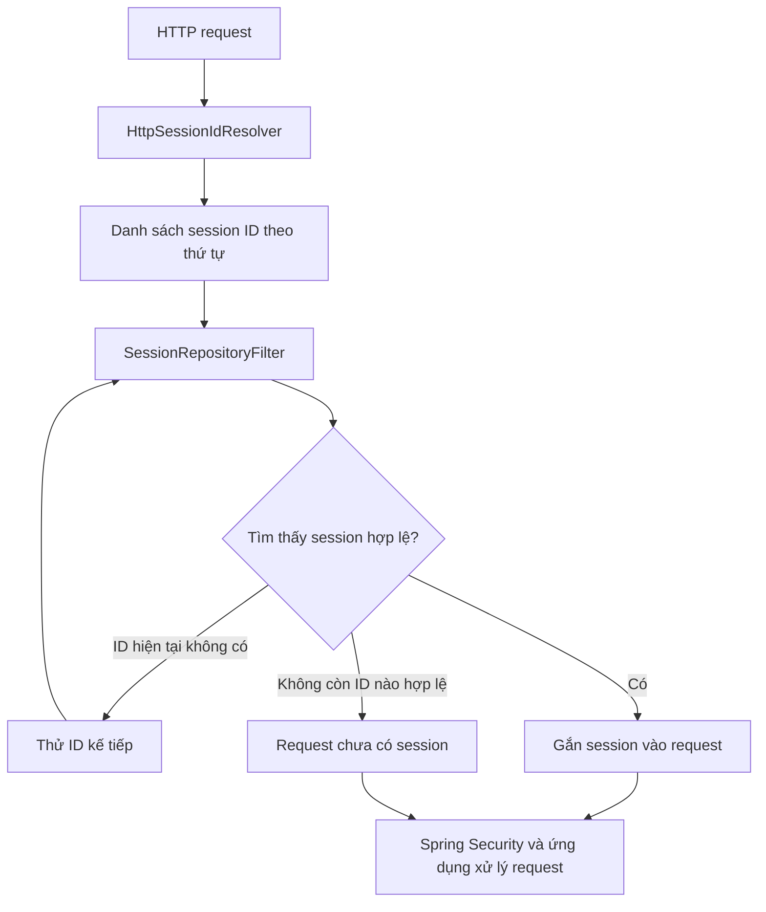

# Cookie, header và thứ tự lựa chọn khi một yêu cầu có nhiều định danh

Spring Session cần nhận được session ID từ mỗi HTTP request để tìm phiên tương ứng trong repository. Với ứng dụng Servlet, session ID thường được truyền bằng cookie; một số API hoặc client không phải trình duyệt có thể truyền ID qua HTTP header. Hai cách truyền này cùng phục vụ một mục đích: cung cấp khóa tra cứu phiên phía máy chủ. Chúng không tự tạo ra hai loại session khác nhau và cũng không đồng nghĩa với JWT.

Khi một request mang nhiều session ID, ví dụ vừa có cookie `SESSION` vừa có header `X-Auth-Token`, ứng dụng cần có quy tắc lựa chọn rõ ràng. Spring Session biểu diễn quy tắc đó qua `HttpSessionIdResolver`: resolver có thể trả về một danh sách ID theo thứ tự ưu tiên. `SessionRepositoryFilter` thử tìm phiên theo thứ tự danh sách và sử dụng session ID đầu tiên tìm được. Nếu hai ID cùng trỏ tới hai phiên hợp lệ, thứ tự này quyết định người dùng nào được gắn với request.

Vì vậy, thứ tự ưu tiên là một quyết định bảo mật và thiết kế API. Không nên để cookie và header cùng có hiệu lực mà không xác định rõ trường hợp xung đột, cách tạo phiên mới và cách xóa định danh khi đăng xuất.

## 1. Vai trò của `HttpSessionIdResolver`

### 1.1. Hợp đồng của resolver

Spring Session Servlet sử dụng interface `org.springframework.session.web.http.HttpSessionIdResolver` để đọc và ghi session ID trong HTTP request/response. Hợp đồng có ba thao tác:

| Phương thức | Trách nhiệm |
|---|---|
| `resolveSessionIds(request)` | Đọc một hoặc nhiều session ID từ request, trả về danh sách theo thứ tự ưu tiên. |
| `setSessionId(request, response, sessionId)` | Gửi session ID mới về client theo phương thức truyền ID mà resolver quản lý. |
| `expireSession(request, response)` | Xóa hoặc làm hết hạn định danh ở client khi session bị invalidate. |

Resolver chỉ giải quyết việc trao đổi ID. Nó không xác thực mật khẩu, không quyết định quyền truy cập và không lưu dữ liệu session. Sau khi có ID, `SessionRepositoryFilter` dùng repository để tìm phiên; Spring Security thực hiện xác thực và phân quyền theo cấu hình.

### 1.2. Luồng xử lý request



`resolveSessionIds` có thể trả về nhiều ID. Theo hợp đồng của Spring Session, thứ tự danh sách có ý nghĩa: filter thử từng ID và dùng ID đầu tiên tìm được trong repository. Một ID sai, không tồn tại hoặc đã hết hạn có thể được bỏ qua để thử ID tiếp theo. Nếu không có ID nào tìm được, request được xử lý như chưa có phiên; ứng dụng chỉ tạo session mới khi một thành phần thực sự yêu cầu tạo session.

Điều này không có nghĩa Spring Session tự động đọc cả cookie và header trong mọi cấu hình. Resolver đang được cấu hình quyết định nguồn ID nào được đọc. Cookie resolver mặc định chỉ đọc cookie của nó; header resolver chỉ đọc header đã chỉ định. Muốn kết hợp hai nguồn, ứng dụng phải cung cấp resolver có hành vi kết hợp hoặc lựa chọn theo loại request.

## 2. Định danh qua cookie

### 2.1. `CookieHttpSessionIdResolver`

`CookieHttpSessionIdResolver` là resolver phổ biến cho ứng dụng web chạy trong trình duyệt. Nó đọc session ID từ cookie và phát cookie qua header `Set-Cookie` khi cần gửi ID về client. Resolver sử dụng `CookieSerializer`, mặc định là `DefaultCookieSerializer`, để điều khiển tên cookie và các thuộc tính như `Secure`, `HttpOnly`, `SameSite`, `Domain` và `Path`.

Ví dụ cấu hình:

```java
import org.springframework.context.annotation.Bean;
import org.springframework.context.annotation.Configuration;
import org.springframework.session.web.http.CookieSerializer;
import org.springframework.session.web.http.DefaultCookieSerializer;

@Configuration
public class SessionCookieConfiguration {

    @Bean
    CookieSerializer cookieSerializer() {
        DefaultCookieSerializer serializer = new DefaultCookieSerializer();
        serializer.setCookieName("SESSION");
        serializer.setCookiePath("/");
        serializer.setUseSecureCookie(true);
        serializer.setUseHttpOnlyCookie(true);
        serializer.setSameSite("Lax");
        return serializer;
    }
}
```

Trình duyệt tự động gửi cookie phù hợp với host, path, scheme và SameSite policy. Đây là điểm tiện lợi cho ứng dụng web, nhưng cũng là lý do cần bảo vệ CSRF: trình duyệt có thể tự đính kèm cookie vào request mà trang bên ngoài khởi tạo. `Secure` và `HttpOnly` không thay thế CSRF protection.

### 2.2. Khi nào cookie phù hợp?

Cookie phù hợp khi client chính là trình duyệt và ứng dụng cần duy trì phiên đăng nhập qua các lần điều hướng. Nên:

- Dùng HTTPS và bật `Secure` trong production.
- Bật `HttpOnly` cho cookie chứa session ID để JavaScript không đọc trực tiếp credential.
- Chọn `SameSite` theo luồng đăng nhập và tích hợp cross-site.
- Hạn chế `Domain` để cookie không bị chia sẻ rộng giữa các subdomain nếu không cần.
- Đặt `Path` đúng phạm vi ứng dụng, nhưng không coi Path là ranh giới bảo mật.
- Giữ CSRF protection cho các request thay đổi trạng thái.

Cookie lưu session ID là credential. Không ghi giá trị cookie vào log, URL hoặc thông báo lỗi. Khi đăng xuất, resolver cần phát cookie hết hạn để trình duyệt ngừng gửi ID; repository cũng phải invalidate phiên phía máy chủ.

## 3. Định danh qua HTTP header

### 3.1. `HeaderHttpSessionIdResolver`

`HeaderHttpSessionIdResolver` đọc session ID từ một HTTP header được cấu hình. Spring Session cung cấp factory method `xAuthToken()` cho header `X-Auth-Token`; cũng có thể chỉ định tên header riêng bằng constructor.

Ví dụ dùng header `X-Session-Id`:

```java
import org.springframework.context.annotation.Bean;
import org.springframework.context.annotation.Configuration;
import org.springframework.session.web.http.HeaderHttpSessionIdResolver;
import org.springframework.session.web.http.HttpSessionIdResolver;

@Configuration
public class HeaderSessionConfiguration {

    @Bean
    HttpSessionIdResolver httpSessionIdResolver() {
        return new HeaderHttpSessionIdResolver("X-Session-Id");
    }
}
```

Hoặc dùng header mặc định của factory:

```java
@Bean
HttpSessionIdResolver httpSessionIdResolver() {
    return HeaderHttpSessionIdResolver.xAuthToken();
}
```

Với resolver này, server đọc session ID từ header và trả ID qua response header tương ứng khi tạo phiên. Client phải chủ động lưu ID và gửi lại ở các request tiếp theo. Trình duyệt không tự động đính kèm header tùy chỉnh như cách nó gửi cookie; JavaScript hoặc ứng dụng client phải thiết lập header.

### 3.2. Header resolver không biến session thành JWT

Một session ID trong header vẫn là định danh của phiên lưu ở server. Request mang ID đó vẫn cần repository để tìm trạng thái session. Đây là mô hình stateful, dù ID được truyền bằng header thay vì cookie.

JWT bearer token là một credential khác: token chứa claim và được xác minh chữ ký cùng các claim như issuer, audience và thời hạn. Không nên đặt JWT vào header `X-Auth-Token` rồi cho rằng nó tự trở thành Spring Session ID. Nếu API dùng JWT, thường cấu hình Spring Security OAuth2 Resource Server với `Authorization: Bearer ...`; nếu API dùng Spring Session, header cần mang đúng session ID mà repository có thể tra cứu.

### 3.3. Khi nào header phù hợp?

Header resolver có thể phù hợp với ứng dụng native, thiết bị, service client hoặc API client tự quản lý credential. Nó tránh việc trình duyệt tự động gửi cookie trong mọi request, nhưng không tự tạo ra bảo mật đầu cuối.

Nếu JavaScript của SPA lưu session ID trong bộ nhớ hoặc storage, XSS có thể đọc ID và gửi ra ngoài. Nếu browser client dùng header tùy chỉnh, cần cấu hình CORS cho origin và header được phép; không bật `Access-Control-Allow-Origin: *` cùng credential một cách tùy tiện. Header không tự có các thuộc tính `Secure`, `HttpOnly` hay `SameSite`; việc lưu trữ và truyền credential thuộc trách nhiệm client và giao thức ứng dụng.

## 4. Một request có nhiều session ID

### 4.1. Danh sách ID có thứ tự

Hợp đồng `HttpSessionIdResolver.resolveSessionIds` cho phép trả về nhiều ID. Ví dụ một resolver tùy chỉnh có thể đọc ID từ header trước rồi mới đọc cookie:

```java
List<String> resolveSessionIds(HttpServletRequest request) {
    List<String> ids = new ArrayList<>();

    String headerId = request.getHeader("X-Session-Id");
    if (headerId != null && !headerId.isBlank()) {
        ids.add(headerId);
    }

    ids.addAll(this.cookieResolver.resolveSessionIds(request));
    return ids;
}
```

Đây là phần minh họa thuật toán của custom resolver, không phải một bean hoàn chỉnh. Cần triển khai cả `setSessionId` và `expireSession` theo cùng chính sách. Trong ví dụ, header có ưu tiên cao hơn cookie. Nếu header ID không tìm thấy hoặc đã hết hạn, filter thử cookie ID. Nếu cả hai ID hợp lệ và trỏ tới hai session khác nhau, session từ header được chọn trước.

Nếu đổi thứ tự:

```java
ids.addAll(this.cookieResolver.resolveSessionIds(request));
if (headerId != null && !headerId.isBlank()) {
    ids.add(headerId);
}
```

thì cookie được ưu tiên. Thứ tự không chỉ là thứ tự đọc cho tiện; nó quyết định principal và `SecurityContext` có thể gắn vào request. Chọn thứ tự theo yêu cầu sản phẩm và mức tin cậy của từng nguồn, không dựa vào việc header hay cookie có vẻ mới hơn.

### 4.2. Bảng hành vi khi có hai ID

Giả sử resolver trả về `[headerId, cookieId]`:

| Header ID | Cookie ID | Kết quả tra cứu | ID được dùng |
|---|---|---|---|
| Không có | Hợp lệ | Tìm thấy phiên từ cookie | Cookie ID |
| Hợp lệ | Không có | Tìm thấy phiên từ header | Header ID |
| Không tồn tại | Hợp lệ | Header không tìm thấy, thử tiếp cookie | Cookie ID |
| Hết hạn | Hợp lệ | Header không còn phiên, thử tiếp cookie | Cookie ID |
| Hợp lệ | Hợp lệ, cùng một session | Header tìm thấy trước | Header ID (cùng phiên) |
| Hợp lệ | Hợp lệ, hai session khác nhau | Header tìm thấy trước | Header ID; cookie bị bỏ qua |
| Không hợp lệ | Không hợp lệ | Không tìm thấy phiên | Request không có session hiện tại |

Trường hợp hai ID đều hợp lệ nhưng thuộc hai người dùng khác nhau cần được xem là xung đột định danh. Dù thứ tự resolver có thể quyết định ID được dùng, việc âm thầm chấp nhận một trong hai có thể khiến client hiểu nhầm danh tính, gây lỗi giao dịch hoặc mở ra đường tấn công khi một kênh bị kiểm soát yếu hơn. Với các hệ thống có nhiều client type, thường nên chọn nguồn định danh theo route hoặc từ chối request chứa nhiều định danh trái ngược.

### 4.3. Không có quy tắc tự động “header luôn thắng cookie”

Spring Session không mặc định áp dụng một quy tắc toàn cục rằng header ưu tiên hơn cookie. Kết quả phụ thuộc resolver bean đang hoạt động và danh sách ID mà resolver trả về.

- Nếu dùng `CookieHttpSessionIdResolver`, header `X-Session-Id` không được resolver này đọc.
- Nếu dùng `HeaderHttpSessionIdResolver`, cookie `SESSION` không được resolver này đọc.
- Nếu dùng resolver tùy chỉnh kết hợp hai nguồn, thứ tự trong danh sách do ứng dụng quyết định.

Vì vậy, việc request có cả cookie và header không đồng nghĩa filter tự chọn header. Cần kiểm tra bean `HttpSessionIdResolver` thực tế và hành vi `resolveSessionIds`.

## 5. Thiết kế chính sách cho browser và API

### 5.1. Ưu tiên phân tách theo loại client

Một ứng dụng có thể phục vụ cả giao diện trình duyệt và API cho thiết bị/service. Cách rõ ràng là chọn kênh định danh theo route hoặc loại client:

| Nhóm request | Kênh định danh | Chính sách |
|---|---|---|
| `/web/**` từ trình duyệt | Cookie `SESSION` | Cookie `Secure`, `HttpOnly`, `SameSite`; bật CSRF protection |
| `/api/**` từ client được kiểm soát | Header `X-Session-Id` | Client tự lưu và gửi ID; giới hạn CORS/origin và bảo vệ credential |
| API stateless dùng OAuth2/OIDC | `Authorization: Bearer` | Dùng Spring Security Resource Server để xác minh JWT hoặc opaque token; không coi token là session ID |

Tách kênh giúp tránh một request vô tình mang cả cookie của người dùng đang đăng nhập trên trình duyệt và session ID của một API client. Nếu một `SessionRepositoryFilter` dùng resolver chung cho toàn ứng dụng, có thể viết resolver định tuyến theo path hoặc client policy, nhưng cần bảo đảm mọi route có hành vi nhất quán.

### 5.2. Ví dụ chọn resolver theo route

Đoạn mã sau minh họa ý tưởng chọn nguồn ID theo route. Phần `setSessionId` cũng phải phát ID về đúng kênh đã chọn; `expireSession` xóa định danh ở cả hai kênh để không còn ID cũ gây xung đột.

```java
import java.util.List;

import jakarta.servlet.http.HttpServletRequest;
import jakarta.servlet.http.HttpServletResponse;
import org.springframework.session.web.http.CookieHttpSessionIdResolver;
import org.springframework.session.web.http.CookieSerializer;
import org.springframework.session.web.http.HeaderHttpSessionIdResolver;
import org.springframework.session.web.http.HttpSessionIdResolver;

public class RouteAwareSessionIdResolver implements HttpSessionIdResolver {

    private final CookieHttpSessionIdResolver cookieResolver;
    private final HeaderHttpSessionIdResolver headerResolver =
        new HeaderHttpSessionIdResolver("X-Session-Id");

    public RouteAwareSessionIdResolver(CookieSerializer cookieSerializer) {
        this.cookieResolver = new CookieHttpSessionIdResolver();
        this.cookieResolver.setCookieSerializer(cookieSerializer);
    }

    private boolean isApiRequest(HttpServletRequest request) {
        return request.getRequestURI().startsWith(request.getContextPath() + "/api/");
    }

    @Override
    public List<String> resolveSessionIds(HttpServletRequest request) {
        return isApiRequest(request)
            ? this.headerResolver.resolveSessionIds(request)
            : this.cookieResolver.resolveSessionIds(request);
    }

    @Override
    public void setSessionId(HttpServletRequest request, HttpServletResponse response, String sessionId) {
        if (isApiRequest(request)) {
            this.cookieResolver.expireSession(request, response);
            this.headerResolver.setSessionId(request, response, sessionId);
        }
        else {
            this.headerResolver.expireSession(request, response);
            this.cookieResolver.setSessionId(request, response, sessionId);
        }
    }

    @Override
    public void expireSession(HttpServletRequest request, HttpServletResponse response) {
        this.cookieResolver.expireSession(request, response);
        this.headerResolver.expireSession(request, response);
    }
}
```

Đăng ký lớp resolver làm bean để `SessionRepositoryFilter` sử dụng:

```java
@Configuration
public class SessionIdResolverConfiguration {

    @Bean
    HttpSessionIdResolver httpSessionIdResolver(CookieSerializer cookieSerializer) {
        return new RouteAwareSessionIdResolver(cookieSerializer);
    }
}
```

Ví dụ trên là mẫu minh họa cho chính sách route, cần kiểm tra với phiên bản Spring Session đang dùng và cấu hình cookie serializer thực tế. Trong hệ thống thật, không nên dùng `startsWith` đơn giản nếu path có thể bị giả mạo hoặc ứng dụng có context path phức tạp; nên dùng quy tắc route nhất quán với security matcher. Có thể thay bằng resolver được cấu hình qua dependency injection để tái sử dụng cùng `CookieSerializer` đã cấu hình cho ứng dụng.

Mẫu này chỉ đọc một nguồn trên mỗi route, vì thế nếu request `/api/**` gửi cả cookie và header thì header được dùng và cookie bị bỏ qua. Đây thường là chính sách dễ hiểu hơn fallback ngầm. Nếu sản phẩm thực sự cần fallback nhiều nguồn, hãy định nghĩa thứ tự và cách xử lý xung đột một cách rõ ràng.

### 5.3. Nếu cần fallback, hãy định nghĩa quy tắc đầy đủ

Một resolver kết hợp cookie/header cần quyết định ít nhất bốn điều:

1. Thứ tự tìm session: header trước hay cookie trước?
2. Khi cả hai ID hợp lệ nhưng khác nhau, ưu tiên một nguồn hay từ chối request?
3. Khi tạo session mới, response sẽ gửi ID qua cookie, header hay kênh phụ thuộc route?
4. Khi logout hoặc invalidate, resolver xóa cả hai định danh hay chỉ kênh đã dùng?

Đối với hệ thống nhạy cảm, lựa chọn an toàn thường là từ chối trường hợp có hai ID xung đột thay vì fallback âm thầm. Việc từ chối nên được thực hiện ở filter/adapter có thể trả lỗi HTTP rõ ràng trước khi `SessionRepositoryFilter` sử dụng một session, hoặc trong resolver tùy chỉnh theo cơ chế lỗi mà ứng dụng kiểm soát. Không dựa vào việc “ID đầu tiên thắng” như một biện pháp xử lý xung đột nghiệp vụ.

## 6. Tạo mới, thay đổi ID và đăng xuất

### 6.1. `setSessionId`

Khi session mới được tạo hoặc ID phiên được thay đổi, Spring Session gọi `setSessionId` để gửi định danh về client. Resolver cần gửi ID qua đúng kênh mà client sẽ sử dụng ở request tiếp theo.

Với cookie resolver, thao tác này phát `Set-Cookie`. Với header resolver, thao tác này đặt response header. Với resolver kết hợp, cần có một chính sách canonical channel: ví dụ route trình duyệt chỉ phát cookie, route API chỉ phát header. Không nên phát cùng một ID vào nhiều kênh một cách vô thức vì client có thể lưu hai bản sao và gửi lại cả hai ở các request sau.

### 6.2. `expireSession`

Khi session bị invalidate, resolver cần xóa định danh ở client. Cookie resolver phát cookie với thời hạn hết hiệu lực; header resolver có thể phát header rỗng theo quy ước của nó. Resolver kết hợp phải xóa mọi kênh mà nó đã từng phát hành, nếu không ID cũ có thể tiếp tục xuất hiện trong request và gây fallback ngoài ý muốn.

Xóa cookie hoặc header ở client chỉ xóa bản sao định danh. Ứng dụng vẫn phải invalidate session trong repository dùng chung để instance khác không thể tiếp tục chấp nhận session ID cũ.

### 6.3. Session fixation

Sau xác thực, Spring Security có thể thay đổi session ID để bảo vệ khỏi session fixation. Resolver phải hỗ trợ cập nhật ID mới về đúng kênh truyền. Nếu custom resolver phát ID mới ở cookie nhưng request tiếp theo lại ưu tiên header cũ, ứng dụng có thể tiếp tục dùng ID cũ hoặc rơi vào một phiên khác. Hãy kiểm thử thay đổi ID cùng resolver và bảo đảm định danh cũ bị vô hiệu hóa theo chính sách.

## 7. Bảo mật khi dùng nhiều kênh định danh

### 7.1. Cookie và CSRF

Cookie được trình duyệt tự động gửi, vì vậy request có thể mang session ID ngay cả khi người dùng không chủ động đặt header. Nếu xác thực dựa trên cookie, hãy giữ CSRF protection cho request thay đổi trạng thái. `SameSite` là lớp giảm thiểu bổ sung, không thay thế token CSRF trong mọi tình huống.

### 7.2. Header và CORS

Header tùy chỉnh như `X-Session-Id` có thể yêu cầu CORS preflight khi được gửi từ browser origin khác. Chỉ cho phép origin cần thiết và header cần thiết. CORS không phải cơ chế xác thực; server vẫn phải xác minh session ID và kiểm tra quyền. Không phản chiếu tùy tiện giá trị `Origin` hoặc cho phép mọi origin với credential.

### 7.3. Session ID là bearer credential

Ai có session ID hợp lệ có thể thử sử dụng phiên tương ứng. Với cookie, dùng `Secure`, `HttpOnly`, `SameSite` phù hợp và HTTPS. Với header, tránh ghi ID vào log, URL hoặc local storage không được bảo vệ; chỉ truyền qua TLS và bảo vệ nơi client lưu credential. Không dùng một session ID dài hạn cho nhiều client không tin cậy.

### 7.4. Không trộn session ID với bearer token

Header `Authorization: Bearer` thường dành cho access token của OAuth2/OIDC. Header `X-Session-Id` hoặc `X-Auth-Token` trong Spring Session có thể mang opaque session ID. Tên header không xác định bản chất credential; cách server xác minh mới quyết định. Hãy đặt tên rõ ràng và không cho một resolver vô tình xử lý JWT như session ID.

## 8. Kiểm thử thứ tự ưu tiên và xung đột

Kiểm thử resolver ở ba mức: unit test cho việc đọc danh sách ID, integration test cho việc filter tìm session, và kiểm thử HTTP cho response header/cookie.

### 8.1. Ma trận unit test

Với resolver trả về `[headerId, cookieId]`, cần kiểm tra:

| Trường hợp | Kết quả mong đợi |
|---|---|
| Chỉ có header | Danh sách chứa header ID |
| Chỉ có cookie | Danh sách chứa cookie ID |
| Có cả hai | Danh sách giữ đúng thứ tự ưu tiên đã định nghĩa |
| Header trống hoặc chỉ có khoảng trắng | Không thêm ID rỗng vào danh sách |
| Cookie trùng ID với header | Có thể loại bỏ ID trùng để tránh tra cứu lặp |
| Cookie/header có giá trị không hợp lệ | Không dùng giá trị để xác thực; repository không tìm thấy hoặc request bị từ chối theo policy |

### 8.2. Kiểm thử tích hợp với repository

Tạo hai session khác nhau, ví dụ `session-web` thuộc Alice và `session-api` thuộc Bob. Gửi request có cookie trỏ tới Alice và header trỏ tới Bob. Nếu resolver trả header trước, filter sẽ gắn session Bob khi cả hai ID đều hợp lệ. Nếu trả cookie trước, filter sẽ gắn session Alice.

Kiểm thử này chứng minh thứ tự có ảnh hưởng đến danh tính. Với ứng dụng không muốn có hành vi như vậy, cần xác minh resolver từ chối request có hai ID hợp lệ khác nhau hoặc chỉ đọc một nguồn theo route.

### 8.3. Kiểm thử tạo session và logout

Kiểm tra response khi tạo session mới: cookie resolver phải phát `Set-Cookie` với flags đúng; header resolver phải phát response header theo tên đã cấu hình. Sau logout, kiểm tra client nhận chỉ thị xóa định danh và repository không còn trả phiên khi tra ID cũ. Với resolver kết hợp, kiểm tra cả cookie lẫn header đều được dọn.

### 8.4. Kiểm thử nhiều instance

Khi repository là Redis/JDBC dùng chung, chạy request đầu tiên qua instance A rồi request tiếp theo qua instance B với cùng session ID. Sau đó lặp lại với cả cookie và header. B phải tìm đúng phiên từ repository dùng chung. Kiểm thử thêm trường hợp một ID đã hết hạn nhưng ID còn lại hợp lệ, xung đột hai session hợp lệ, logout ở A rồi gửi ID cũ tới B, và thay đổi session ID sau xác thực.

## 9. Lỗi thường gặp và cách xử lý

| Hiện tượng | Nguyên nhân có thể | Hướng xử lý |
|---|---|---|
| Gửi header nhưng server vẫn tạo session mới | Đang dùng `CookieHttpSessionIdResolver`, không có header resolver | Kiểm tra bean `HttpSessionIdResolver` thực tế |
| Gửi cookie nhưng API không nhận phiên | Đang dùng `HeaderHttpSessionIdResolver` chỉ đọc header | Chọn đúng resolver hoặc định tuyến nguồn theo route |
| Có cả cookie và header nhưng chọn sai người dùng | Thứ tự danh sách ID không phù hợp hoặc hai ID đều hợp lệ | Kiểm tra `resolveSessionIds`, xác định nguồn canonical và từ chối xung đột nếu cần |
| Logout xong request vẫn nhận phiên | Chỉ xóa cookie/header mà không invalidate repository, hoặc custom resolver chỉ xóa một kênh | Invalidate session phía server và expire mọi kênh đã phát ID |
| Session fixation protection gây mất phiên | Resolver không cập nhật ID mới về kênh client sử dụng | Kiểm thử `setSessionId` sau khi ID đổi và vô hiệu hóa ID cũ |
| Header session ID bị lộ | Ghi log header, truyền qua HTTP hoặc lưu client không an toàn | Che header trong log, dùng TLS và bảo vệ credential phía client |
| Browser API bị CSRF | Chuyển session ID sang header nhưng cookie vẫn tự gửi hoặc CORS quá rộng | Phân tách auth channel, giữ CSRF protection và giới hạn origin |
| Các instance hiểu ID khác nhau | Cấu hình resolver, tên cookie/header hoặc phiên bản không đồng nhất | Đồng bộ cấu hình giữa tất cả instance |

## 10. Quy trình chọn và triển khai

Khi thiết kế cách truyền session ID, hãy làm theo trình tự:

1. Xác định client là trình duyệt, ứng dụng native hay service-to-service.
2. Chọn cookie resolver cho browser session hoặc header resolver cho client tự quản lý header.
3. Nếu cần cả hai, định nghĩa rõ route nào dùng nguồn nào hoặc danh sách fallback có thứ tự.
4. Quyết định cách xử lý khi hai ID cùng hợp lệ nhưng thuộc hai session khác nhau; với luồng nhạy cảm, ưu tiên từ chối xung đột.
5. Định nghĩa `setSessionId` để phát ID mới về đúng kênh và `expireSession` để xóa tất cả kênh liên quan.
6. Giữ cookie flags và CSRF protection cho browser; bảo vệ header credential và CORS cho API.
7. Kiểm thử session fixation, logout, ID hết hạn, hai ID cùng hợp lệ và request chuyển instance.
8. Đồng bộ resolver và repository configuration trên toàn bộ cụm.

Cookie và header là hai cách vận chuyển cùng một session ID. `HttpSessionIdResolver` quyết định ID được đọc từ đâu, thứ tự nào được thử, ID mới được trả về bằng cách nào và định danh bị xóa ra sao. Khi một request có nhiều ID, Spring Session dùng thứ tự danh sách resolver cung cấp và chọn ID đầu tiên tìm được trong repository. Ứng dụng cần làm cho quy tắc này trở nên rõ ràng, kiểm thử được và phù hợp với mức độ tin cậy của từng client.

## Tài liệu tham khảo

- [Spring Session API — HttpSessionIdResolver](https://docs.spring.io/spring-session/reference/api/java/org/springframework/session/web/http/HttpSessionIdResolver.html)
- [Spring Session API — CookieHttpSessionIdResolver](https://docs.spring.io/spring-session/reference/api/java/org/springframework/session/web/http/CookieHttpSessionIdResolver.html)
- [Spring Session API — HeaderHttpSessionIdResolver](https://docs.spring.io/spring-session/reference/api/java/org/springframework/session/web/http/HeaderHttpSessionIdResolver.html)
- [Spring Session — hướng dẫn truyền session ID qua header](https://docs.spring.io/spring-session/reference/guides/java-rest.html)
