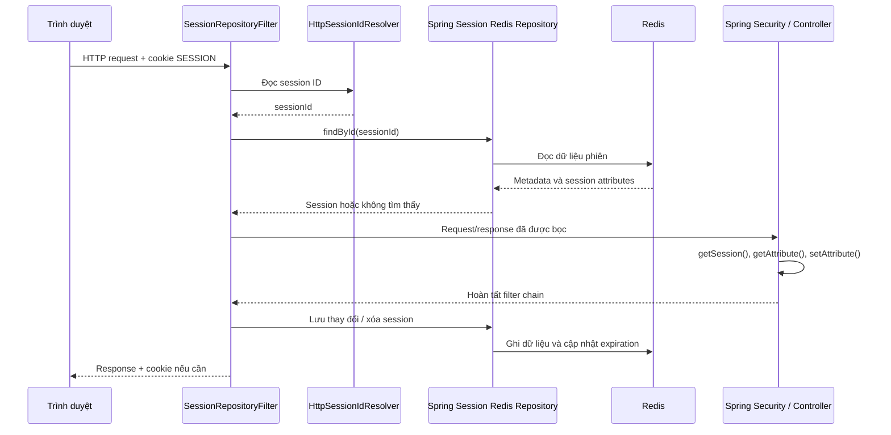

# Spring Session Data Redis và đường đi từ yêu cầu đến dữ liệu trong Redis

Spring Session Data Redis cho phép ứng dụng Spring lưu trạng thái `HttpSession` trong Redis thay vì chỉ giữ session trong bộ nhớ của một Servlet container. Khi nhiều instance cùng kết nối tới một Redis dùng chung, mỗi instance có thể đọc và cập nhật phiên tương ứng với cookie session ID của trình duyệt. Điều này giúp người dùng tiếp tục phiên làm việc khi load balancer chuyển request giữa các instance.

Để hiểu cách tích hợp, cần theo dõi trọn đường đi của một request: trình duyệt gửi cookie, `SessionRepositoryFilter` đọc session ID, repository tìm dữ liệu trong Redis, mã ứng dụng thao tác với `HttpSession`, rồi Spring Session lưu thay đổi và cập nhật thời hạn. Redis là kho lưu trữ phía máy chủ; cookie chỉ mang định danh để tìm phiên.

## 1. Các thành phần tham gia

Một ứng dụng Spring Session Data Redis thường có các thành phần sau:

| Thành phần | Trách nhiệm |
|---|---|
| Trình duyệt và cookie | Giữ session ID và gửi lại trong request tiếp theo |
| `SessionRepositoryFilter` | Bọc request/response để API Servlet sử dụng session do Spring Session quản lý |
| `HttpSessionIdResolver` | Đọc session ID từ cookie hoặc header và ghi/xóa ID trên response |
| `SessionRepository` | Cung cấp API tạo, tìm, lưu và xóa session |
| Redis repository implementation | Chuyển thao tác session thành thao tác đọc/ghi dữ liệu trong Redis |
| `RedisConnectionFactory` | Cung cấp kết nối Redis cho Spring Data Redis và repository |
| Redis server/cluster | Lưu dữ liệu phiên và các cấu trúc hỗ trợ thời hạn, chỉ mục hoặc sự kiện tùy repository |

Ứng dụng thường tiếp tục dùng `HttpServletRequest.getSession()`, `HttpSession.getAttribute()` và `HttpSession.setAttribute()`. Repository phía dưới có thể thay đổi mà phần lớn controller không cần biết dữ liệu nằm trong Redis.

## 2. Thêm dependency và cấu hình kết nối Redis

Với ứng dụng Maven dùng Spring Boot, cần dependency Spring Session Data Redis và Spring Data Redis. Phiên bản thư viện nên được quản lý bởi Spring Boot dependency management hoặc BOM tương thích của dự án.

```xml
<dependencies>
    <dependency>
        <groupId>org.springframework.boot</groupId>
        <artifactId>spring-boot-starter-data-redis</artifactId>
    </dependency>

    <dependency>
        <groupId>org.springframework.session</groupId>
        <artifactId>spring-session-data-redis</artifactId>
    </dependency>
</dependencies>
```

Trong Spring Boot, cấu hình kết nối và session có thể đặt trong `application.yml`:

```yaml
spring:
  data:
    redis:
      host: localhost
      port: 6379
      # password: ${REDIS_PASSWORD}
      # ssl:
      #   enabled: true
  session:
    timeout: 30m
    redis:
      namespace: storefront:sessions
```

`spring.data.redis.*` cấu hình kết nối Redis của Spring Data Redis. `spring.session.timeout` đặt idle timeout mặc định cho session. `spring.session.redis.namespace` xác định tiền tố namespace để phân tách dữ liệu phiên của ứng dụng hoặc môi trường trong cùng Redis. Không ghi password trực tiếp vào source control; dùng secret manager hoặc biến môi trường. Với production, cấu hình TLS, xác thực, network policy và quyền truy cập Redis theo môi trường triển khai.

Spring Boot có thể tự cấu hình Redis connection factory và Spring Session repository khi các dependency phù hợp có mặt. Cơ chế cụ thể phụ thuộc phiên bản Spring Boot và Spring Session. Hãy kiểm tra auto-configuration và bean thực tế của ứng dụng để biết repository nào được tạo.

Nếu cấu hình Java tường minh, có thể bật tích hợp Servlet bằng annotation:

```java
import org.springframework.context.annotation.Configuration;
import org.springframework.session.data.redis.config.annotation.web.http.EnableRedisHttpSession;

@Configuration
@EnableRedisHttpSession(maxInactiveIntervalInSeconds = 1800)
class RedisSessionConfiguration {
    // RedisConnectionFactory phải có trong application context.
}
```

Ví dụ annotation đặt idle timeout 30 phút. Chọn một cơ chế cấu hình phù hợp với ứng dụng: auto-configuration của Spring Boot hoặc cấu hình Java tường minh. Không vô tình đăng ký hai `SessionRepositoryFilter` hay hai repository cạnh tranh nhau.

## 3. Đường đi của request từ trình duyệt đến Redis

Khi người dùng gửi request kèm cookie session, luồng khái quát như sau:



Các bước quan trọng:

1. **Trình duyệt gửi cookie:** cookie chứa session ID, thường có tên `SESSION` theo cấu hình Spring Session mặc định. Tên cookie có thể được tùy chỉnh.
2. **Filter đọc ID:** `SessionRepositoryFilter` dùng `HttpSessionIdResolver` để lấy ID từ cookie hoặc header.
3. **Repository tìm session:** filter yêu cầu repository tìm session theo ID. Repository chuyển yêu cầu thành thao tác Redis.
4. **Request được bọc:** nếu tìm thấy session, ứng dụng nhìn thấy một `HttpSession` đại diện cho session lưu trong Redis. Nếu không tìm thấy, `getSession(false)` trả `null`; `getSession()` có thể tạo session mới.
5. **Mã ứng dụng thao tác:** controller hoặc Spring Security đọc/ghi session thông qua Servlet API.
6. **Lưu thay đổi:** khi request hoàn tất theo cơ chế flush/save, repository ghi metadata và attributes vào Redis, đồng thời cập nhật thời hạn.
7. **Response trả về:** nếu tạo hoặc thay đổi session ID, resolver ghi cookie phù hợp vào response.

Nếu ứng dụng không gọi `getSession()` hoặc không có thành phần nào cần session, request có thể không tạo session mới. Đây là lý do nên dùng `getSession(false)` cho endpoint chỉ kiểm tra trạng thái để tránh tạo session rỗng ngoài ý muốn.

## 4. Ví dụ đọc và ghi session trong controller

Controller không cần gọi Redis trực tiếp. Nó thao tác qua `HttpSession`, còn Spring Session đảm nhiệm lưu trữ:

```java
import jakarta.servlet.http.HttpServletRequest;
import jakarta.servlet.http.HttpSession;
import org.springframework.http.ResponseEntity;
import org.springframework.web.bind.annotation.GetMapping;
import org.springframework.web.bind.annotation.PostMapping;
import org.springframework.web.bind.annotation.RestController;

@RestController
class ShoppingSessionController {

    @PostMapping("/shopping/session/start")
    ResponseEntity<String> start(HttpServletRequest request) {
        HttpSession session = request.getSession(true);
        session.setAttribute("cartId", "CART-2026-001");
        session.setMaxInactiveInterval(30 * 60);
        return ResponseEntity.ok("Session initialized");
    }

    @GetMapping("/shopping/session/cart")
    ResponseEntity<String> cart(HttpServletRequest request) {
        HttpSession session = request.getSession(false);
        if (session == null) {
            return ResponseEntity.notFound().build();
        }

        String cartId = (String) session.getAttribute("cartId");
        if (cartId == null) {
            return ResponseEntity.notFound().build();
        }
        return ResponseEntity.ok(cartId);
    }
}
```

Request đầu tiên tạo session và ghi `cartId`. Trình duyệt nhận cookie chứa session ID. Request kế tiếp gửi cookie đó; filter nạp session từ Redis và controller đọc lại `cartId`. Nếu load balancer chuyển request thứ hai sang instance khác, instance đó vẫn có thể đọc cùng dữ liệu vì repository dùng chung.

Trong ứng dụng thực tế, không nên lưu thông tin nhạy cảm hoặc object lớn trong session. Ví dụ trên chỉ minh họa một định danh giỏ hàng. Dữ liệu nghiệp vụ quan trọng nên nằm trong cơ sở dữ liệu nghiệp vụ; session chỉ nên giữ thông tin cần thiết để liên kết request với trạng thái người dùng.

## 5. Dữ liệu session được tổ chức trong Redis

Spring Session không lưu nguyên một đối tượng Java trong một biến Redis đơn giản. Repository chuyển metadata và session attributes thành các cấu trúc dữ liệu Redis phù hợp với implementation. Repository có thể duy trì thêm cấu trúc phục vụ expiration, tra cứu principal hoặc phát sự kiện.

Ở mức logic, dữ liệu phiên bao gồm:

- **Session ID:** khóa định danh để tìm phiên.
- **Creation time:** thời điểm tạo phiên.
- **Last accessed time:** lần truy cập cuối được ghi nhận.
- **Max inactive interval:** idle timeout của phiên.
- **Session attributes:** các cặp tên/giá trị do ứng dụng hoặc Spring Security lưu.
- **Expiration metadata:** thông tin giúp repository xác định phiên hết hạn và dọn dữ liệu.

Namespace giúp nhóm các key của ứng dụng. Ví dụ `storefront:sessions` là namespace do ứng dụng đặt; tên key và cách chia cấu trúc cụ thể do phiên bản repository quản lý. Không xây logic nghiệp vụ dựa trên tên key nội bộ, vì cấu trúc lưu trữ có thể thay đổi giữa các phiên bản Spring Session.

Với repository hỗ trợ chỉ mục như `RedisIndexedSessionRepository`, Spring Session có thể duy trì thêm chỉ mục principal để tìm các phiên theo người dùng. Nếu ứng dụng cần tra cứu theo principal, phải chọn indexed repository và bảo đảm principal được resolver xác định. Repository lưu session cơ bản không mặc nhiên hỗ trợ mọi thao tác tra cứu chỉ mục.

## 6. TTL và hết hạn phiên trong Redis

TTL (time to live) là thời gian một key còn được Redis giữ trước khi hết hạn. Trong Spring Session, idle timeout được dùng để xác định khi nào session không còn hợp lệ. Repository Redis quản lý expiration metadata và TTL phù hợp để dữ liệu hết hạn được xử lý.

Khi request hợp lệ sử dụng session, `lastAccessedTime` được cập nhật. Deadline inactivity được tính lại dựa trên `maxInactiveInterval`. Repository cập nhật expiration tương ứng khi lưu session. Khi không có request trong thời gian timeout, session hết hạn về mặt logic và Redis/repository có thể dọn dữ liệu theo cơ chế expiration.

Không nên giả định rằng mọi key hỗ trợ một session đều có cùng TTL hoặc bị xóa vật lý cùng một thời điểm. Một số implementation duy trì key phụ để hỗ trợ phát hiện và phát sự kiện hết hạn. Repository có thể cần xử lý sự kiện expiration để dọn các cấu trúc liên quan. Vì vậy, dữ liệu phụ có thể còn xuất hiện trong Redis trong một khoảng thời gian sau khi session không còn hợp lệ.

Idle timeout khác absolute timeout. Nếu người dùng gửi request đều đặn, idle timeout được làm mới và session có thể sống lâu hơn khoảng timeout ban đầu. Nếu nghiệp vụ yêu cầu giới hạn tổng tuổi đăng nhập, ứng dụng phải triển khai absolute timeout riêng dựa trên `creationTime` hoặc timestamp xác thực.

## 7. Kiểm tra Redis khi vận hành

Có thể dùng `redis-cli` để kiểm tra kết nối và quan sát dữ liệu ở mức vận hành. Ví dụ:

```text
PING
INFO server
INFO memory
SCAN 0 MATCH 'storefront:sessions:*' COUNT 100
```

`PING` kiểm tra Redis phản hồi; `INFO` cung cấp thông tin server và bộ nhớ; `SCAN` duyệt key theo từng đợt để kiểm tra namespace. Trong production, tránh dùng `KEYS *` vì lệnh này có thể chặn Redis khi có lượng key lớn. Cũng không truy vấn hoặc in toàn bộ session attributes vào terminal/log vì chúng có thể chứa dữ liệu xác thực.

Khi đã xác định một key cụ thể qua công cụ vận hành được phép, có thể dùng `TYPE` hoặc `TTL` để hiểu loại dữ liệu và thời hạn của key đó. Kết quả TTL cần được diễn giải theo đúng cấu trúc repository; không kết luận session còn hợp lệ chỉ vì một key phụ vẫn tồn tại. Cách kiểm tra đáng tin cậy cho trạng thái session là dùng API Spring Session hoặc thực hiện request thử nghiệm có cookie phù hợp.

Các chỉ số nên theo dõi gồm:

- Redis availability, connection pool usage, timeout và latency.
- Memory usage, eviction count và số lượng key theo namespace.
- Tỷ lệ request không tìm thấy session hoặc tạo session mới bất thường.
- Lỗi serialization/deserialization và lỗi ghi session.
- Tỷ lệ timeout, failover và reconnect của Redis client.
- Số session active/expired nếu repository hoặc hệ thống metrics cung cấp chỉ số phù hợp.

Không đưa session ID thô vào metrics label vì tạo cardinality lớn và làm lộ credential. Hãy dùng metric tổng hợp theo ứng dụng, môi trường hoặc loại kết quả.

## 8. Lưu ý về serialization của session attributes

Redis lưu dữ liệu dưới dạng byte/string và cấu trúc dữ liệu, vì vậy session attributes phải được chuyển đổi bằng serializer của repository. Khả năng lưu một object Java phụ thuộc serializer được cấu hình và phiên bản thư viện.

Nếu dùng serializer dựa trên Java serialization, thuộc tính thường cần triển khai `Serializable` và các lớp phải tương thích khi deserialize. Nếu dùng JSON hoặc serializer khác, kiểu dữ liệu phải phù hợp với serializer và cần quản lý schema/version cẩn thận. Tránh lưu:

- `HttpServletRequest`, `HttpServletResponse` hoặc đối tượng gắn với request.
- Socket, stream, file handle, connection hoặc tài nguyên đang mở.
- Object lớn, object có đồ thị tham chiếu phức tạp hoặc dữ liệu thay đổi liên tục.
- Class nội bộ thay đổi thường xuyên mà không có kế hoạch tương thích khi rolling deployment.

Nên lưu các giá trị nhỏ, ổn định như user ID, cart ID, locale hoặc metadata cần thiết. Với dữ liệu có thể thay đổi độc lập, lưu trong database nghiệp vụ và chỉ giữ khóa tham chiếu trong session.

Khi triển khai phiên bản ứng dụng mới trong lúc các session cũ vẫn tồn tại, serializer và model phải có khả năng đọc dữ liệu được ghi bởi phiên bản trước trong khoảng thời gian rolling deployment. Nếu thay đổi class hoặc format không tương thích, cần kế hoạch hết hạn/migrate session hoặc dùng định dạng dữ liệu có version.

## 9. Vận hành Redis cho session dùng chung

Redis trở thành một dependency quan trọng đối với luồng xác thực và trạng thái người dùng. Nếu Redis không khả dụng, ứng dụng có thể không nạp hoặc lưu session. Cần thiết kế Redis như một dịch vụ production có giám sát, capacity và phương án phục hồi.

### Availability và kết nối

- Dùng Redis deployment có HA phù hợp, ví dụ managed Redis, Sentinel hoặc Redis Cluster theo yêu cầu hạ tầng.
- Cấu hình timeout kết nối/command và connection pool hợp lý; tránh để request web chờ Redis quá lâu.
- Dùng TLS và xác thực khi kết nối qua mạng không tin cậy.
- Giới hạn quyền Redis của ứng dụng vào database/namespace và command cần thiết theo khả năng nền tảng.
- Kiểm thử hành vi ứng dụng khi Redis restart, failover, network partition hoặc connection pool cạn.

### Memory và eviction

Session là dữ liệu phục vụ xác thực và trạng thái người dùng. Nếu Redis chạm `maxmemory` và eviction policy loại bỏ key session trước thời hạn, người dùng có thể bị đăng xuất bất ngờ. Hãy ước lượng dung lượng dựa trên số session đồng thời, kích thước attributes và thời gian lưu; đặt cảnh báo memory headroom và eviction.

Không dùng chung Redis session với workload có thể làm eviction session ngoài dự kiến nếu chưa đánh giá chính sách bộ nhớ. Tách instance, cluster, database hoặc ít nhất namespace theo yêu cầu cô lập và vận hành.

### Persistence và phục hồi

Tùy yêu cầu, Redis có thể dùng RDB snapshot, AOF hoặc dịch vụ managed có cơ chế backup/restore. Session thường có thể được tạo lại khi người dùng đăng nhập lại, nhưng mất toàn bộ session có thể gây đăng xuất diện rộng. Hãy xác định mức độ chấp nhận được, mục tiêu phục hồi và tác động tới người dùng. Không mặc định persistence của Redis thay thế backup/HA hoặc bảo đảm không mất dữ liệu.

## 10. Nhiều instance cùng dùng Redis

Để session hoạt động nhất quán sau load balancer, mọi instance cần dùng:

- Cùng Redis deployment hoặc endpoint logic tương đương.
- Cùng database/namespace và cách cấu hình repository.
- Cùng cookie name, cookie path/domain, SameSite và cách resolver đọc ID.
- Serializer tương thích và cùng quy tắc phiên bản dữ liệu.
- Chính sách idle timeout, absolute timeout và bảo mật giống nhau.

Ví dụ, instance A tạo session và lưu `cartId` trong Redis. Request kế tiếp có thể tới instance B. B nhận cookie session ID, tìm cùng session trong Redis và đọc `cartId`. Nếu B trỏ sang Redis database hoặc namespace khác, repository không tìm thấy phiên và người dùng có thể bị xem như chưa đăng nhập.

Sticky session ở load balancer không thay thế Redis dùng chung. Sticky session chỉ cố gắng giữ request trên một node; nó không bảo vệ dữ liệu khi node bị restart hoặc mất kết nối. Spring Session Data Redis giúp session không phụ thuộc vào bộ nhớ riêng của một instance.

## 11. Kiểm thử tích hợp đường đi đến Redis

Kiểm thử controller bằng mock session chỉ xác minh logic ứng dụng, không xác minh repository Redis. Nên có kiểm thử tích hợp dùng Redis thực tế, chẳng hạn Redis Testcontainers hoặc môi trường test riêng.

Một kịch bản kiểm thử có thể gồm:

1. Khởi động ứng dụng với Spring Session Data Redis và Redis test instance.
2. Gửi request tạo session và ghi một attribute.
3. Lấy cookie session ID từ response.
4. Gửi request tiếp theo với cookie đó; xác nhận attribute được đọc lại.
5. Gửi request thứ hai qua instance khác dùng cùng Redis; xác nhận session vẫn được tìm thấy.
6. Gọi `invalidate()` và xác nhận request sau không còn truy cập được session cũ.
7. Đặt idle timeout ngắn trong test và xác nhận session hết hạn sau khoảng không hoạt động.
8. Kiểm tra dữ liệu attributes có thể deserialize sau khi repository lưu và nạp lại.
9. Kiểm thử lỗi Redis hoặc restart trong môi trường cô lập để xác định ứng dụng phản ứng thế nào.

Không nên dùng `Thread.sleep()` dài để kiểm tra nhiều thời hạn. Có thể cấu hình timeout ngắn trong test, kiểm tra trạng thái qua repository và sử dụng clock/test abstraction khi kiểm tra logic absolute timeout. Test phải dọn dữ liệu namespace riêng sau khi chạy để không ảnh hưởng môi trường dùng chung.

## 12. Lỗi thường gặp và hướng điều tra

| Hiện tượng | Nguyên nhân có thể | Hướng kiểm tra |
|---|---|---|
| Mỗi request tạo session mới | Cookie không được gửi, resolver sai hoặc Redis repository không tìm thấy ID | Kiểm tra `Set-Cookie`, request Cookie, cookie path/domain và repository |
| Request chậm khi đọc session | Redis latency, connection pool cạn hoặc network timeout | Theo dõi latency, pool metrics, timeout và log Redis client |
| Người dùng bị đăng xuất bất ngờ | Redis eviction, timeout ngắn, failover hoặc instance dùng namespace khác | Kiểm tra memory/eviction, session timeout và cấu hình giữa các instance |
| Lỗi deserialize sau khi deploy | Class/serializer thay đổi không tương thích với session cũ | Kiểm tra stack trace, serializer và tương thích dữ liệu qua rolling deployment |
| Session hết hạn nhưng key phụ còn | Repository có cấu trúc expiration/index phụ và cleanup chưa hoàn tất | Kiểm tra trạng thái qua API Spring Session; không kết luận từ một key riêng lẻ |
| Redis đầy bộ nhớ | Session nhiều hoặc attributes quá lớn, workload dùng chung | Kiểm tra memory, số session, kích thước attribute và eviction policy |
| Redis mất kết nối | Redis restart/failover, DNS/network hoặc credentials sai | Kiểm tra health, connection factory, TLS, authentication và retry policy |
| Chỉ một số node không thấy session | Khác database, namespace, cookie serializer hoặc version dữ liệu | So sánh cấu hình và kiểm thử luân phiên request giữa các node |

Khi xử lý sự cố, không xóa hàng loạt key session để “làm sạch” nếu chưa xác định tác động. Không dùng `FLUSHDB`/`FLUSHALL` trên Redis dùng chung. Thao tác xóa phiên nên đi qua API Spring Session hoặc quy trình vận hành đã kiểm soát.

## 13. Nguyên tắc triển khai

- Spring Session Data Redis chuyển API `HttpSession` thành dữ liệu session trong Redis thông qua `SessionRepositoryFilter` và repository.
- Cookie chỉ mang session ID; metadata và attributes được lưu ở phía server.
- Cấu hình dependency, Redis connection, namespace và idle timeout nhất quán giữa các instance.
- Dùng API Servlet/Spring Session để thao tác session; không phụ thuộc trực tiếp vào key nội bộ của Redis repository.
- Hiểu TTL và expiration metadata; thời điểm key phụ bị dọn không nhất thiết trùng với thời điểm session mất hiệu lực.
- Chọn serializer và session attributes nhỏ, an toàn, tương thích qua các lần deploy.
- Giám sát Redis availability, latency, memory, eviction, serialization error và tỷ lệ session lookup thất bại.
- Kiểm thử bằng Redis thực tế và ít nhất hai instance để xác nhận đường đi từ cookie đến dữ liệu Redis.
