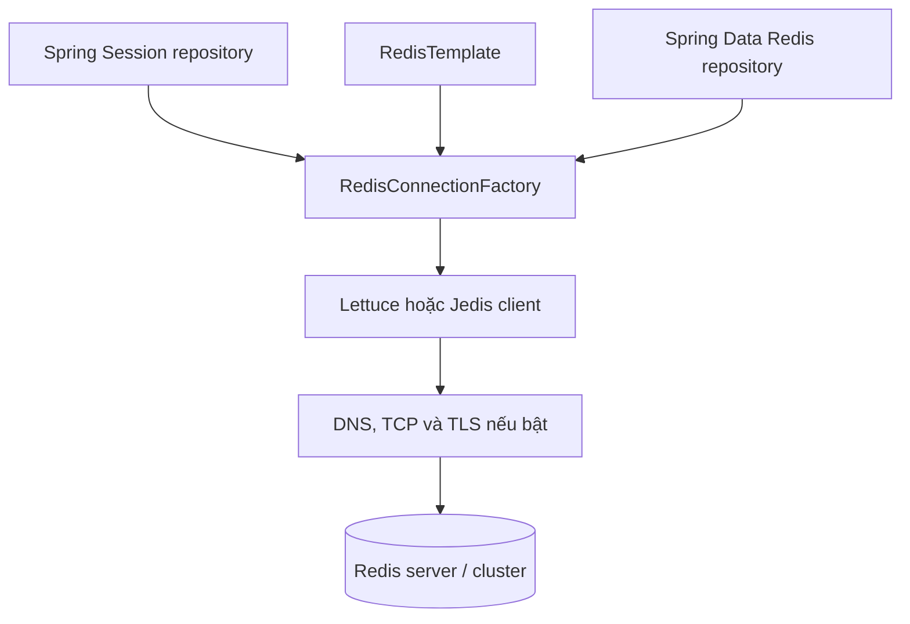

# RedisConnectionFactory, kết nối và cấu hình xác thực, TLS

Khi dùng Spring Session với Redis, ứng dụng cần một kết nối tới Redis để lưu và đọc session. Trong Spring Data Redis, `RedisConnectionFactory` là abstraction cung cấp các kết nối mà `RedisTemplate`, repository và Spring Session sử dụng. Factory che giấu chi tiết client Redis cụ thể, chẳng hạn Lettuce hoặc Jedis, đồng thời giữ cấu hình máy chủ, xác thực, TLS và cách quản lý kết nối ở một nơi.

`@EnableRedisHttpSession` kích hoạt repository session Redis cho ứng dụng Servlet. Cấu hình đó cần một `RedisConnectionFactory` hợp lệ. Khi ứng dụng chạy nhiều instance, mỗi instance có thể có factory riêng nhưng tất cả phải kết nối tới cùng Redis deployment, dùng thông tin xác thực được cấp đúng quyền và có cấu hình TLS tương thích. Nhờ vậy, session được tạo ở instance này có thể được đọc ở instance khác.

Chủ đề này nằm trong chương Redis cơ bản của `SPRING_SESSION`, module quản lý session ứng dụng Spring độc lập với một máy chủ bằng kho dữ liệu chia sẻ như Redis hoặc JDBC. Mục tiêu là hiểu factory có vai trò gì, cấu hình endpoint và credentials thế nào, bật TLS ra sao và kiểm tra kết nối trước khi đưa session store vào vận hành.

## 1. RedisConnectionFactory là gì?

`RedisConnectionFactory` là interface của Spring Data Redis. Nó cung cấp `RedisConnection` để các thành phần Spring gửi lệnh tới Redis. Ứng dụng thường không cần tự tạo socket hoặc quản lý giao thức Redis; thay vào đó, cấu hình một factory rồi để `RedisTemplate` hoặc Spring Session sử dụng.

Các implementation phổ biến gồm:

- `LettuceConnectionFactory`: tích hợp client Lettuce. Đây là lựa chọn mặc định thường gặp trong Spring Boot khi dependency phù hợp có mặt.
- `JedisConnectionFactory`: tích hợp client Jedis. Có thể phù hợp với hệ thống đang chuẩn hóa trên Jedis hoặc cần các đặc tính client cụ thể.

Factory chịu trách nhiệm tạo và quản lý kết nối theo client. Nó cũng có thể cung cấp các loại kết nối dành cho standalone, cluster hoặc Sentinel tùy cấu hình. Ứng dụng nên dùng abstraction `RedisConnectionFactory` trong các bean phụ thuộc để giảm gắn chặt vào một client cụ thể.



Với Spring Session, `RedisConnectionFactory` được dùng bởi repository session để thực hiện các thao tác đọc, ghi, cập nhật TTL và xóa dữ liệu phiên. Controller không nên tự mở kết nối Redis cho mỗi request; controller làm việc với `HttpSession`, còn Spring Session quản lý persistence thông qua repository và factory.

## 2. Kết nối Redis trong Spring Boot

Nếu ứng dụng dùng Spring Boot, cách đơn giản là khai báo dependency Spring Session Redis và cấu hình kết nối bằng application properties. Ví dụ YAML sau dùng namespace cấu hình của Spring Boot 3:

```yaml
spring:
  data:
    redis:
      host: ${REDIS_HOST:localhost}
      port: ${REDIS_PORT:6379}
      username: ${REDIS_USERNAME}
      password: ${REDIS_PASSWORD}
      connect-timeout: 2s
      timeout: 2s
      ssl:
        enabled: true

```

`REDIS_HOST`, `REDIS_PORT`, `REDIS_USERNAME` và `REDIS_PASSWORD` được cung cấp từ môi trường triển khai hoặc secret manager. Không commit mật khẩu thật vào repository mã nguồn, không ghi credentials vào log và không dùng cùng một tài khoản Redis quyền cao cho mọi ứng dụng.

Với Spring Boot 2, prefix cấu hình Redis thường là `spring.redis` thay vì `spring.data.redis`. Hãy dùng đúng prefix theo phiên bản Boot của dự án; không chép nguyên cấu hình giữa các major version mà chưa kiểm tra metadata cấu hình.

Nếu Redis không bật xác thực, bỏ các dòng `username` và `password`. Nếu Redis dùng ACL (Redis 6 trở lên), cấu hình cả username và password của tài khoản ứng dụng. Nếu deployment chỉ hỗ trợ `AUTH` với mật khẩu cho user mặc định, cung cấp password theo cấu hình client và không đặt username ACL không tồn tại.

Khi cấu hình Spring Session:

```java
import org.springframework.context.annotation.Configuration;
import org.springframework.session.data.redis.config.annotation.web.http.EnableRedisHttpSession;

@Configuration
@EnableRedisHttpSession(maxInactiveIntervalInSeconds = 1800)
public class RedisSessionConfiguration {
}
```

Trong ứng dụng Boot, auto-configuration thường tạo `RedisConnectionFactory` từ các thuộc tính `spring.data.redis.*` nếu có client và cấu hình phù hợp. `@EnableRedisHttpSession` sử dụng factory đó để tạo repository session. Không khai báo thêm một factory thủ công nếu auto-configuration đã cung cấp factory đúng yêu cầu; hai factory cạnh tranh có thể khiến repository dùng nhầm endpoint hoặc credentials.

## 3. Cấu hình RedisConnectionFactory thủ công

Khi cần tùy chỉnh client, cấu hình SSL, Sentinel, cluster hoặc các tùy chọn kết nối nâng cao, ứng dụng có thể tạo `LettuceConnectionFactory` trực tiếp. Ví dụ sau minh họa kết nối standalone có ACL username/password và TLS:

```java
import java.time.Duration;

import org.springframework.beans.factory.annotation.Value;
import org.springframework.context.annotation.Bean;
import org.springframework.context.annotation.Configuration;
import org.springframework.data.redis.connection.RedisPassword;
import org.springframework.data.redis.connection.RedisStandaloneConfiguration;
import org.springframework.data.redis.connection.RedisConnectionFactory;
import org.springframework.data.redis.connection.lettuce.LettuceClientConfiguration;
import org.springframework.data.redis.connection.lettuce.LettuceConnectionFactory;

@Configuration
public class RedisConnectionConfiguration {

    @Bean
    public RedisConnectionFactory redisConnectionFactory(
            @Value("${app.redis.host}") String host,
            @Value("${app.redis.port:6379}") int port,
            @Value("${app.redis.username}") String username,
            @Value("${app.redis.password}") String password) {

        RedisStandaloneConfiguration server =
                new RedisStandaloneConfiguration(host, port);
        server.setUsername(username);
        server.setPassword(RedisPassword.of(password));

        LettuceClientConfiguration client =
                LettuceClientConfiguration.builder()
                        .useSsl()
                        .and()
                        .commandTimeout(Duration.ofSeconds(2))
                        .build();

        return new LettuceConnectionFactory(server, client);
    }
}
```

Các thuộc tính `app.redis.*` phải được khai báo trong cấu hình ngoài hoặc biến môi trường. Ví dụ giả định Redis hỗ trợ TLS và ACL user đã được tạo. Nếu Redis không dùng ACL username, bỏ `setUsername`; nếu không bật TLS, bỏ phần `.useSsl().and()` và chỉ dùng cấu hình plaintext trong mạng được bảo vệ phù hợp. Tên package và các tùy chọn builder có thể thay đổi theo phiên bản Spring Data Redis/Lettuce, vì vậy cần đối chiếu với dependency thực tế.

Khi tự khai báo `RedisConnectionFactory`, thường nên tắt hoặc loại bỏ cấu hình auto-configuration trùng lặp theo cách phù hợp với ứng dụng. Chỉ nên có một factory chính mà Spring Session repository sử dụng, trừ khi ứng dụng chủ động quản lý nhiều Redis deployment với qualifier và repository riêng.

## 4. Cấu hình xác thực: AUTH và Redis ACL

Redis có thể chạy không yêu cầu xác thực trong môi trường phát triển cô lập, nhưng hệ thống triển khai thật nên dùng tài khoản riêng cho ứng dụng. Cần phân biệt hai cách xác thực thường gặp:

- **Password-only AUTH:** client gửi mật khẩu cho user mặc định. Đây là mô hình cũ hoặc đơn giản.
- **ACL username/password:** client gửi cả username và password. Redis ACL cho phép tạo user riêng và giới hạn command, key pattern hoặc channel mà user được phép truy cập.

Với Spring Data Redis, `RedisStandaloneConfiguration` hỗ trợ đặt username và password. Trong cấu hình Boot, các thuộc tính `username` và `password` được bind vào cấu hình client. Ví dụ cấu hình cho tài khoản ACL riêng:

```yaml
spring:
  data:
    redis:
      host: redis.internal.example
      port: 6379
      username: spring-session-app
      password: ${REDIS_SESSION_PASSWORD}
```

Tài khoản `spring-session-app` cần được cấp quyền cho các lệnh và key pattern mà Spring Session Redis repository thực sự sử dụng. Không nên tự giới hạn quyền theo phỏng đoán rồi triển khai trực tiếp; hãy kiểm tra command/key access của phiên bản repository, chạy integration test và quan sát lỗi `NOPERM` nếu có.

Nguyên tắc quản lý credentials:

1. Tạo một user riêng cho từng ứng dụng hoặc nhóm dịch vụ có cùng ranh giới tin cậy.
2. Chỉ cấp quyền cần thiết cho các thao tác session; không cấp `allcommands` hoặc `allkeys` nếu không cần.
3. Lưu password trong secret manager hoặc hệ thống quản lý secrets của nền tảng triển khai.
4. Luân chuyển password có kế hoạch, bảo đảm mọi instance nhận cấu hình mới trước khi thu hồi credential cũ.
5. Không đặt password trong command line, log startup, exception message hoặc file cấu hình được commit.

Nếu Redis không xác thực thành công, client có thể nhận lỗi `NOAUTH` hoặc `WRONGPASS`. Nếu username ACL không đúng hoặc thiếu quyền, lỗi có thể là `WRONGPASS` hoặc `NOPERM`. Cần phân biệt lỗi xác thực với lỗi mạng và lỗi TLS để xử lý đúng lớp.

## 5. TLS bảo vệ kết nối Redis

TLS mã hóa dữ liệu trên đường truyền giữa ứng dụng và Redis, đồng thời có thể xác thực danh tính máy chủ bằng chứng thư. Khi bật TLS, client phải kết nối tới cổng TLS của Redis hoặc endpoint TLS do dịch vụ Redis quản lý cung cấp. Không thể chỉ bật `ssl.enabled` rồi tiếp tục kết nối tới một endpoint plaintext.

Với Spring Boot, cấu hình thường có dạng:

```yaml
spring:
  data:
    redis:
      host: redis-tls.internal.example
      port: 6380
      username: spring-session-app
      password: ${REDIS_SESSION_PASSWORD}
      ssl:
        enabled: true
```

Port `6380` chỉ là ví dụ; dùng port/hostname TLS do nhà cung cấp hoặc quản trị viên Redis cấp. Cổng Redis mặc định `6379` thường được dùng cho plaintext nhưng có thể được cấu hình TLS riêng. Không suy đoán port dựa trên môi trường.

### 5.1. Trust certificate và xác thực hostname

Khi Redis dùng chứng thư được CA nội bộ ký, JVM/client phải tin CA đó. Có thể cấu hình truststore của JVM khi khởi động ứng dụng, hoặc cấu hình SSL context/SSL bundle theo khả năng của Spring Boot và Lettuce phiên bản đang dùng. Không tắt xác minh chứng thư để né lỗi trust.

Client cần kiểm tra chứng thư phù hợp với hostname mà nó kết nối. Nếu certificate không chứa hostname endpoint hoặc CA chưa được tin cậy, TLS handshake có thể thất bại. Dùng hostname chuẩn do hạ tầng cấp, phân phối CA certificate qua kênh tin cậy và cập nhật truststore an toàn.

### 5.2. Mutual TLS (mTLS)

Một số deployment yêu cầu client certificate ngoài việc xác minh certificate của server. Đây là mutual TLS: Redis xác minh chứng thư client và client xác minh chứng thư server. Khi dùng mTLS, ứng dụng cần có private key và certificate client trong keystore/SSL context phù hợp, đồng thời Redis phải được cấu hình tin CA phát hành client certificate.

Không lưu private key hoặc keystore password trong source code. Dùng secret manager hoặc volume/keystore được bảo vệ, giới hạn quyền đọc và có kế hoạch thay chứng thư trước khi hết hạn. Cách cấu hình mTLS cụ thể phụ thuộc Lettuce, Netty và phiên bản Spring Data Redis; cần kiểm thử bằng endpoint TLS thật.

### 5.3. TLS không thay thế xác thực Redis

TLS bảo vệ đường truyền và xác minh endpoint theo cấu hình chứng thư. Nó không tự cấp quyền đọc/ghi Redis. Vẫn cần AUTH hoặc ACL nếu deployment yêu cầu. Ngược lại, AUTH gửi credentials qua kết nối plaintext có thể làm lộ mật khẩu trên mạng; vì vậy nên dùng TLS khi credentials đi qua mạng không hoàn toàn tin cậy.

## 6. Timeout, DNS và quản lý kết nối

Kết nối Redis có nhiều khoảng thời gian cần cấu hình riêng:

- **Connect timeout:** giới hạn thời gian thiết lập kết nối TCP/TLS tới Redis.
- **Command timeout:** giới hạn thời gian chờ một lệnh Redis hoàn tất ở client.
- **Socket/network timeout:** phụ thuộc client và cấu hình hạ tầng, ảnh hưởng việc phát hiện kết nối bị treo.
- **Shutdown timeout:** thời gian client chờ đóng tài nguyên khi ứng dụng dừng.

Ví dụ Boot:

```yaml
spring:
  data:
    redis:
      connect-timeout: 2s
      timeout: 2s
```

Giá trị phù hợp phụ thuộc độ trễ mạng, tải Redis và yêu cầu request. Timeout quá ngắn gây lỗi giả khi có spike; timeout quá dài làm thread/request giữ tài nguyên lâu khi Redis mất kết nối. Hãy đặt timeout dựa trên latency thực tế và ngân sách thời gian của request.

`RedisConnectionFactory` quản lý vòng đời kết nối theo client. Với Lettuce, kết nối native có thể được chia sẻ cho các thao tác thông thường tùy cấu hình; không nên mặc định rằng mỗi lệnh luôn tạo một TCP connection mới. Cũng không nên giữ một `RedisConnection` được lấy thủ công trong field singleton rồi dùng mãi. Hãy để template/repository quản lý việc lấy và đóng kết nối theo đúng abstraction.

Nếu cần lấy kết nối trực tiếp cho một thao tác đặc biệt, đóng connection trong `finally` hoặc dùng try-with-resources nếu API/implementation hỗ trợ `AutoCloseable`:

```java
try (RedisConnection connection = connectionFactory.getConnection()) {
    connection.ping();
}
```

Đoạn code chỉ minh họa vòng đời một connection đồng bộ; không dùng thao tác này cho từng request session vì Spring Session đã quản lý persistence. Với Lettuce, đóng wrapper connection trả tài nguyên theo chính sách của factory, không nhất thiết đóng socket native được chia sẻ.

### 6.1. Connection pool

Connection pool có thể hữu ích khi workload cần nhiều connection độc lập, nhưng không phải cứ dùng Redis là phải bật pool. Lettuce có mô hình kết nối và multiplexing riêng; pooling thường cần cấu hình và dependency bổ sung, chẳng hạn Commons Pool. Trước khi bật pool, đo số connection, latency, concurrency và đặc điểm command (đặc biệt blocking command).

Pool quá nhỏ có thể gây chờ lấy connection; pool quá lớn làm tăng số kết nối và tải lên Redis. Giám sát active/idle connection, borrow wait time, timeout và số connection phía server. Chỉ cấu hình pool sau khi có số liệu hoặc yêu cầu rõ ràng.

## 7. Standalone, Sentinel và Cluster

`RedisConnectionFactory` có thể cấu hình các kiểu deployment khác nhau:

| Kiểu triển khai | Cấu hình chính | Khi phù hợp |
|---|---|---|
| Standalone | Host và port của một Redis node | Phát triển, kiểm thử hoặc deployment đơn giản có cơ chế HA bên ngoài |
| Sentinel | Tên master và danh sách Sentinel nodes | Cần phát hiện master mới khi failover trong Redis Sentinel |
| Cluster | Danh sách cluster nodes | Cần sharding và phân phối dữ liệu trên nhiều Redis node |

Ví dụ Sentinel trong Boot:

```yaml
spring:
  data:
    redis:
      username: spring-session-app
      password: ${REDIS_SESSION_PASSWORD}
      sentinel:
        master: session-master
        nodes:
          - redis-sentinel-1.internal:26379
          - redis-sentinel-2.internal:26379
          - redis-sentinel-3.internal:26379
```

Ví dụ Cluster:

```yaml
spring:
  data:
    redis:
      username: spring-session-app
      password: ${REDIS_SESSION_PASSWORD}
      cluster:
        nodes:
          - redis-node-1.internal:6379
          - redis-node-2.internal:6379
          - redis-node-3.internal:6379
```

Các ví dụ tập trung vào cấu trúc endpoint; cấu hình xác thực riêng cho Sentinel hoặc node, TLS, topology refresh và các tùy chọn khác có thể cần bổ sung theo deployment. Redis Cluster có quy tắc hash slot và giới hạn đối với multi-key operation; cần xác nhận các key session mà Spring Session sử dụng tương thích với cách repository triển khai. Không giả định mọi lệnh hoặc transaction hoạt động giống standalone.

Khi chuyển từ standalone sang Sentinel/Cluster, mọi instance Spring Session cần được cập nhật cấu hình thống nhất. Không trộn factory trỏ tới các Redis deployment khác nhau nếu chúng phải chia sẻ cùng session.

## 8. Kết nối factory với Spring Session

Khi `@EnableRedisHttpSession` được kích hoạt, Spring Session tạo repository Redis và sử dụng `RedisConnectionFactory` trong Spring context. Nếu ứng dụng Boot auto-configure factory, repository sẽ sử dụng factory đó. Nếu ứng dụng tự tạo factory, cần bảo đảm bean có thể được inject đúng và không có nhiều candidate gây mơ hồ.

Ví dụ cấu hình tối thiểu theo hướng Boot auto-configuration:

```java
@Configuration
@EnableRedisHttpSession(maxInactiveIntervalInSeconds = 1800)
public class SessionConfiguration {
    // RedisConnectionFactory được Spring Boot cung cấp từ application.yml.
}
```

Ứng dụng không cần tự tạo `RedisTemplate` chỉ để Spring Session hoạt động. Repository session dùng factory theo cơ chế tích hợp riêng. `RedisTemplate` có thể hữu ích cho dữ liệu Redis khác của ứng dụng, nhưng không nên dùng để tự ghi đè cấu trúc key session mà Spring Session quản lý.

Trong nhiều instance:

- Mỗi instance có cấu hình host, port, username, password và TLS tương thích.
- Mỗi instance kết nối cùng Redis deployment hoặc cùng topology Sentinel/Cluster.
- Tài khoản ACL được cấp quyền phù hợp trên toàn bộ node liên quan.
- Mọi instance dùng phiên bản Spring Session và serializer tương thích.
- Việc luân chuyển credential/certificate được triển khai đồng bộ để tránh chỉ một phần instance kết nối được.

## 9. Kiểm tra kết nối và xác thực

Không nên đợi request người dùng đầu tiên mới phát hiện Redis không truy cập được. Có thể kiểm tra cấu hình bằng health indicator của Spring Boot Actuator nếu dependency và health contributor phù hợp được bật. Health check nên phân biệt Redis unreachable, authentication failure và TLS handshake failure.

Một bài kiểm tra tích hợp có thể thực hiện các bước:

1. Khởi động ứng dụng với endpoint Redis, credentials và TLS giống môi trường mục tiêu.
2. Xác nhận Spring context tạo được `RedisConnectionFactory` và Spring Session repository.
3. Thực hiện thao tác Redis đơn giản trong test hoặc dùng health indicator để kiểm tra ping.
4. Tạo session qua một request, ghi một thuộc tính và gửi request tiếp theo với cùng cookie.
5. Xác nhận session được đọc lại sau khi request đi tới instance khác.
6. Kiểm tra log và metrics không chứa password hoặc session ID.
7. Thử credential sai, CA không tin cậy hoặc hostname không khớp trong môi trường kiểm thử để xác nhận lỗi được phát hiện rõ ràng.

Ví dụ kiểm tra ping thủ công chỉ dùng trong test hoặc diagnostic endpoint được bảo vệ:

```java
public String pingRedis(RedisConnectionFactory factory) {
    try (RedisConnection connection = factory.getConnection()) {
        return connection.ping();
    }
}
```

Không công khai endpoint diagnostic cho người dùng không xác thực vì nó có thể tiết lộ thông tin hạ tầng. Health endpoint công khai nên trả trạng thái tối thiểu, không trả host, username, certificate path hoặc chi tiết lỗi nội bộ.

## 10. Phân loại lỗi kết nối

| Triệu chứng | Lớp có thể gặp lỗi | Việc cần kiểm tra |
|---|---|---|
| `Connection refused` | TCP hoặc Redis listener | Host, port, service đang chạy, firewall và network policy |
| `UnknownHostException` | DNS | Tên host, DNS nội bộ, service discovery và search domain |
| Timeout khi kết nối | TCP/TLS hoặc mạng | Connect timeout, route, firewall, Redis load và pool |
| `NOAUTH` / `WRONGPASS` | Xác thực | Password, username ACL, secret version và user mặc định |
| `NOPERM` | Redis ACL | Command/key pattern mà Spring Session repository cần |
| TLS handshake failure | TLS | Cổng TLS, CA trust, certificate expiry, hostname và protocol |
| Hostname verification failure | Xác minh server identity | Host kết nối có khớp SAN trong certificate không |
| Session không chia sẻ giữa instance | Cấu hình ứng dụng/repository | Hai instance có cùng Redis, prefix, database index, serializer và credentials không |
| Nhiều connection hoặc pool wait | Quản lý kết nối/tải | Pool size, leak connection, blocking command và workload |

Không xử lý mọi lỗi Redis bằng cách retry vô hạn. Retry quá dày có thể khuếch đại sự cố và làm Redis quá tải. Dùng retry có giới hạn, backoff, circuit breaker nếu phù hợp và trả lỗi dịch vụ rõ ràng. Với thao tác session, cân nhắc ảnh hưởng tới đăng nhập và request đang xử lý khi repository tạm thời không sẵn sàng.

## 11. Bảo mật vận hành và luân chuyển credentials

Redis session store chứa dữ liệu có thể gắn với danh tính đã xác thực. Bảo vệ Redis quan trọng như bảo vệ session cookie:

- Đặt Redis trong private network; không mở port công khai nếu không có yêu cầu và kiểm soát tương ứng.
- Bật AUTH/ACL, tạo user riêng và giới hạn quyền theo nhu cầu repository.
- Dùng TLS cho kết nối qua mạng không hoàn toàn tin cậy; xác minh certificate thay vì bỏ qua kiểm tra.
- Bảo vệ secret và private key bằng secret manager, file permission hoặc workload identity phù hợp.
- Không ghi connection URI có password vào log, metric label hoặc exception trả về client.
- Giới hạn quyền quản trị Redis và tách user ứng dụng khỏi user vận hành.
- Theo dõi certificate expiry, password rotation, connection failures và ACL errors.

Khi đổi password hoặc certificate, có thể dùng quy trình chuyển tiếp: tạo credential/certificate mới, cập nhật secret cho các instance, triển khai hoặc reload theo cơ chế hỗ trợ, xác nhận toàn bộ instance kết nối thành công rồi mới thu hồi credential cũ. Nếu thu hồi trước khi tất cả instance cập nhật, một số instance có thể mất khả năng đọc/ghi session và người dùng bị lỗi xác thực.

## 12. Lỗi thường gặp và cách khắc phục

| Lỗi | Hậu quả | Cách khắc phục |
|---|---|---|
| Khai báo hai `RedisConnectionFactory` không rõ factory chính | Repository có thể inject nhầm hoặc Spring báo ambiguous bean | Chỉ tạo một factory chính hoặc dùng qualifier rõ ràng |
| Cấu hình sai prefix Boot | Host/password/SSL không được bind như mong muốn | Kiểm tra phiên bản Boot: `spring.data.redis` hay `spring.redis` |
| Bật TLS nhưng dùng cổng plaintext | Handshake thất bại hoặc kết nối bị đóng | Dùng đúng TLS endpoint/port được cấp |
| Tắt certificate verification | Mở đường cho giả mạo endpoint | Cấu hình truststore/CA và hostname đúng |
| Dùng user ACL thiếu quyền | Lỗi `NOPERM` khi Spring Session thao tác | Kiểm tra command/key pattern và cấp quyền tối thiểu cần thiết |
| Ghi password trực tiếp vào YAML commit | Lộ credential trong lịch sử source control | Dùng environment variable hoặc secret manager |
| Tự tạo connection rồi không đóng | Tài nguyên bị giữ, cạn pool hoặc tăng connection count | Dùng template/repository hoặc đóng connection đúng vòng đời |
| Bật pool quá lớn | Redis chịu quá nhiều kết nối và tài nguyên tăng | Đo workload và cấu hình pool theo số liệu |
| Các instance trỏ Redis khác nhau | Session không được chia sẻ hoặc trạng thái không nhất quán | Đồng bộ endpoint, topology, database và prefix |

## 13. Quy trình cấu hình Redis cho Spring Session

Khi đưa Redis vào làm session store, thực hiện theo trình tự:

1. Xác định kiểu deployment: standalone, Sentinel hay Cluster; lấy hostname và port chính xác từ hạ tầng.
2. Chọn client phù hợp, thường dùng Lettuce theo cấu hình Boot mặc định nếu không có lý do chọn client khác.
3. Cấu hình `RedisConnectionFactory` qua Boot properties hoặc tạo một factory thủ công có chủ đích.
4. Cấu hình AUTH hoặc ACL user riêng, cấp quyền tối thiểu và lấy password từ secret manager.
5. Bật TLS khi cần, cấu hình trust CA và hostname verification; dùng mTLS nếu hạ tầng yêu cầu.
6. Đặt connect timeout, command timeout và chỉ bật pool khi có số liệu chứng minh cần thiết.
7. Kết nối factory với `@EnableRedisHttpSession` và xác nhận repository dùng đúng bean.
8. Kiểm thử ping, tạo/đọc session, lỗi credentials, TLS và truy cập qua nhiều instance.
9. Giám sát kết nối, latency, pool, lỗi ACL, certificate expiry và quá trình luân chuyển secret.

`RedisConnectionFactory` là điểm nối giữa Spring Session và Redis. Cấu hình đúng endpoint, client, xác thực và TLS giúp repository lưu session ổn định; quản lý timeout, quyền ACL, chứng thư và vòng đời kết nối giúp hệ thống tiếp tục hoạt động an toàn khi chạy nhiều instance và khi hạ tầng Redis có thay đổi.
