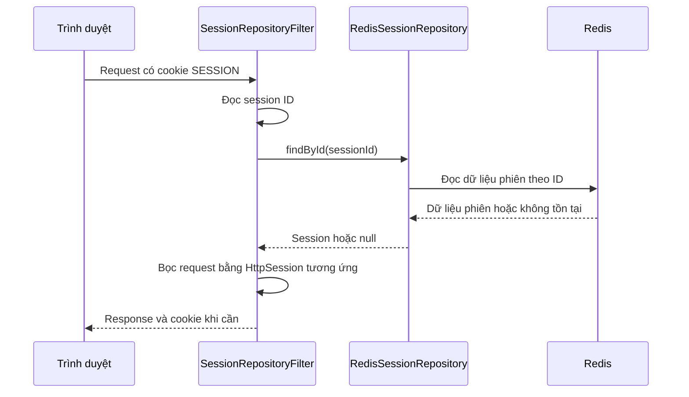

# RedisSessionRepository và tra cứu phiên theo định danh

Spring Session có thể lưu trạng thái phiên HTTP trong Redis để nhiều instance ứng dụng Spring cùng đọc và cập nhật dữ liệu. Khi đã có session ID, repository cung cấp cách tra cứu trực tiếp phiên tương ứng bằng `findById(id)`. `RedisSessionRepository` là implementation đơn giản của hợp đồng `SessionRepository`, phù hợp với nhu cầu tạo, lưu, đọc và xóa phiên theo định danh.

Tra cứu theo ID khác với tra cứu theo principal. `findById` cần biết chính xác session ID; nó không tìm tất cả phiên của một username và không quét các thuộc tính để tìm người dùng. Nếu nghiệp vụ cần tra cứu theo principal hoặc một chỉ mục, cần chọn repository có hỗ trợ index như `RedisIndexedSessionRepository`. Phân biệt hai kiểu truy vấn giúp chọn đúng implementation, tránh tự quét key Redis và giữ cho mã ứng dụng độc lập với cấu trúc lưu trữ nội bộ.

## 1. Vai trò của RedisSessionRepository

`SessionRepository<S extends Session>` là hợp đồng lưu trữ phiên của Spring Session. `RedisSessionRepository` triển khai hợp đồng này bằng Redis. Ứng dụng sử dụng API repository để làm việc với session object, trong khi implementation chịu trách nhiệm chuyển dữ liệu thành cấu trúc Redis, áp dụng thời hạn và khôi phục phiên khi có request tiếp theo.

Các thao tác chính của `SessionRepository` gồm:

| Phương thức | Ý nghĩa | Kết quả khi gọi |
| --- | --- | --- |
| `createSession()` | Tạo một phiên mới với ID do Spring Session quản lý | Trả về session object mới |
| `save(session)` | Lưu phiên mới hoặc cập nhật phiên đã tồn tại | Hoàn tất thao tác lưu |
| `findById(id)` | Tra cứu phiên theo session ID chính xác | Trả về session hoặc `null` nếu không có phiên hợp lệ |
| `deleteById(id)` | Xóa phiên theo session ID | Hoàn tất thao tác xóa |

API này là blocking. `findById` trả về đối tượng session trực tiếp chứ không trả `Mono` hay `Flux`. Nếu ứng dụng dùng WebFlux, cần cân nhắc repository reactive tương ứng thay vì gọi API blocking trên event-loop.

`RedisSessionRepository` phù hợp khi ứng dụng chủ yếu cần lấy một phiên đã biết ID, ví dụ trong quá trình Spring Session khôi phục `HttpSession` từ cookie. Nó cũng có thể được dùng trong tác vụ quản trị nếu tác vụ đã có session ID hợp lệ và được kiểm soát quyền truy cập. Repository không tự biến session ID thành thông tin danh tính người dùng; ID chỉ là khóa tra cứu.

## 2. Session ID được tạo và dùng để tra cứu như thế nào?

Session ID là định danh opaque do cơ chế quản lý phiên tạo ra. Trình duyệt thường nhận ID qua cookie, ví dụ cookie `SESSION`, rồi gửi lại trong request tiếp theo. Spring Session dùng `SessionRepositoryFilter` để đọc ID thông qua `HttpSessionIdResolver`, gọi repository để tải phiên, sau đó bọc request/response để ứng dụng tiếp tục sử dụng Servlet API quen thuộc.

Luồng cơ bản:



Khi request chưa có session ID hoặc ID không tìm được phiên hợp lệ, ứng dụng có thể tiếp tục mà chưa có session. Nếu một thành phần gọi `request.getSession()` hoặc `getSession(true)`, Spring Session tạo phiên mới. Nếu chỉ muốn kiểm tra phiên đã tồn tại, dùng `request.getSession(false)` để không tạo phiên ngoài ý muốn.

Ví dụ, một người dùng đăng nhập ở instance A. Trình duyệt nhận cookie chứa ID. Request tiếp theo có thể được load balancer chuyển tới instance B. Vì cả hai instance dùng cùng Redis repository và cùng namespace, instance B có thể tra cứu cùng session theo ID mà không cần dữ liệu phiên trong bộ nhớ instance A.

## 3. Tra cứu bằng findById

`findById` là phép tra cứu theo định danh chính xác. Kết quả có thể không tồn tại nếu ID chưa từng được tạo, đã bị xóa, đã hết hạn hoặc không còn được repository nhận diện. Không nên xem `null` là lỗi kết nối Redis; lỗi hạ tầng thường được biểu diễn bằng exception. Cần phân biệt “không có phiên” với “không thể truy cập kho dữ liệu”.

Ví dụ service chỉ đọc phiên và chuyển thành kết quả tối thiểu:

```java
import java.util.Optional;

import org.springframework.session.Session;
import org.springframework.session.SessionRepository;
import org.springframework.stereotype.Service;

@Service
public class SessionLookupService {

    private final SessionRepository<? extends Session> sessionRepository;

    public SessionLookupService(
            SessionRepository<? extends Session> sessionRepository) {
        this.sessionRepository = sessionRepository;
    }

    public Optional<String> findExistingSessionId(String sessionId) {
        Session session = sessionRepository.findById(sessionId);
        return Optional.ofNullable(session).map(Session::getId);
    }
}
```

Service trên minh họa việc phụ thuộc vào abstraction `SessionRepository` thay vì gọi trực tiếp Redis. Trong ứng dụng thật, kiểu bean được inject phải là repository mà cấu hình Spring Session đang sử dụng. Nếu context có nhiều repository bean, cần chỉ rõ bean phù hợp bằng qualifier hoặc cấu hình rõ ràng để tránh inject nhầm implementation.

Khi cần hiển thị thông tin phiên, chỉ chuyển các metadata cần thiết sang DTO, chẳng hạn thời điểm tạo, lần truy cập gần nhất và thời gian không hoạt động tối đa nếu phiên bản Spring Session đang dùng cung cấp các accessor tương ứng. Không trả toàn bộ session attributes ra API vì chúng có thể chứa `SecurityContext`, token hoặc dữ liệu nội bộ. Session ID cũng là thông tin nhạy cảm dạng bearer; tránh hiển thị ID thô cho người dùng hoặc ghi nó vào log.

Một endpoint tra cứu phiên cần kiểm soát quyền. Nếu client gửi session ID bất kỳ và ứng dụng trả về thông tin phiên, đây có thể trở thành lỗ hổng truy cập đối tượng trực tiếp (IDOR) hoặc giúp dò phiên. Đối với chức năng “phiên của tôi”, hãy lấy principal từ `SecurityContext` và xác minh session được tra cứu thuộc principal đó. Đối với tác vụ quản trị, yêu cầu role phù hợp, audit thao tác và giới hạn dữ liệu trả về.

## 4. RedisSessionRepository và RedisIndexedSessionRepository

Spring Session Data Redis có các implementation với khả năng khác nhau. Hai tên thường gặp là `RedisSessionRepository` và `RedisIndexedSessionRepository`.

| Đặc điểm | `RedisSessionRepository` | `RedisIndexedSessionRepository` |
| --- | --- | --- |
| Hợp đồng chính | `SessionRepository` | `FindByIndexNameSessionRepository` |
| Tra cứu theo session ID | Có, qua `findById` | Có, qua `findById` |
| Tra cứu theo principal index | Không cung cấp API index | Có, qua `findByIndexNameAndIndexValue` |
| Mục tiêu | Lưu và đọc phiên theo ID | Lưu phiên và duy trì index phục vụ tra cứu theo thuộc tính được hỗ trợ |
| Chi phí quản lý dữ liệu | Đơn giản hơn, ít cấu trúc index hơn | Có thêm công việc duy trì index và xử lý vòng đời index |

Nếu ứng dụng chỉ cần khôi phục phiên từ cookie, `findById` là thao tác cốt lõi. Nếu cần “tìm mọi phiên của user X”, cần repository indexed và principal index được cấu hình/duy trì đúng. Không nên gọi `findById(username)` với hy vọng repository sẽ tìm theo username; session ID và principal name là hai loại định danh khác nhau.

Tùy phiên bản Spring Session và cách cấu hình Spring Boot, cấu hình Redis mặc định có thể tạo `RedisIndexedSessionRepository`. Vì vậy, không nên giả định thêm dependency Redis là ứng dụng đang sử dụng `RedisSessionRepository` đơn giản. Hãy kiểm tra bean repository thực tế và loại interface mà bean triển khai. Nếu chủ đích dùng repository không index, cấu hình nó một cách tường minh theo tài liệu phiên bản đang dùng và bảo đảm chỉ có một repository quản lý cùng loại session.

Không tự chuyển đổi bằng cách khai báo thêm một repository thứ hai trong khi `SessionRepositoryFilter` đã được cấu hình với repository khác. Hai repository riêng biệt có thể lưu cùng session ID vào các cấu trúc khác nhau, dẫn đến request tạo phiên ở nơi này nhưng tác vụ tra cứu lại tìm ở nơi khác.

## 5. Cấu hình Redis và namespace

Trong Spring Boot, dependency Spring Session Data Redis và Redis client phù hợp cho phép cấu hình repository dùng Redis. Ví dụ cấu hình kết nối và thời hạn phiên:

```properties
spring.data.redis.host=localhost
spring.data.redis.port=6379

# Namespace để phân biệt dữ liệu session của ứng dụng
spring.session.redis.namespace=portal:sessions

# Thời gian không hoạt động tối đa của session
spring.session.timeout=30m
```

Tên property và cơ chế auto-configuration có thể thay đổi theo phiên bản Spring Boot. Cần dùng đúng property prefix của phiên bản dự án và xác minh repository bean được tạo. Namespace giúp tách dữ liệu phiên của các ứng dụng hoặc môi trường dùng chung một Redis. Mọi instance của cùng ứng dụng phải dùng cùng namespace, serializer và cấu hình tương thích.

Trong một cấu hình Servlet, `SessionRepositoryFilter` là thành phần kết nối Servlet API với repository. Spring Boot và Spring Session có thể tự đăng ký filter khi dependency và cấu hình phù hợp. Không tự đăng ký filter thứ hai nếu filter đã được auto-configuration tạo. Nếu tự cấu hình repository, cần bảo đảm filter nhận đúng bean đó.

Redis có thể được triển khai riêng cho session hoặc dùng chung với các workload khác. Nếu dùng chung, đặt namespace rõ ràng, cấp quyền truy cập phù hợp, giới hạn bộ nhớ và eviction policy theo yêu cầu. Không để Redis tự loại bỏ session đang còn hiệu lực theo một eviction policy không phù hợp, vì ứng dụng có thể đăng xuất người dùng bất ngờ. Với hệ thống quan trọng, theo dõi memory pressure, latency, connection pool và persistence/replication theo yêu cầu vận hành.

## 6. Dữ liệu phiên, serialization và vòng đời lưu

Repository chuyển đối tượng session thành dữ liệu có thể lưu trong Redis. Dữ liệu thường bao gồm session ID, creation time, last accessed time, max inactive interval và các session attributes. Cách biểu diễn cụ thể là chi tiết nội bộ của implementation; ứng dụng nên dùng API repository thay vì tự đọc/ghi hash hoặc key theo một schema tự suy đoán.

Session attributes phải có thể serialize/deserialize bởi cấu hình serializer của repository. Vì vậy, tránh lưu object phức tạp phụ thuộc classloader, entity ORM còn gắn với persistence context, connection, stream hoặc object không tương thích giữa các phiên bản ứng dụng. Ưu tiên lưu ID, chuỗi, số, giá trị nhỏ và DTO ổn định. Nếu cần lưu object tự định nghĩa, quản lý phiên bản schema và bảo đảm các instance đang chạy song song có thể đọc dữ liệu được ghi bởi phiên bản còn lại.

Khi ứng dụng thay đổi thuộc tính phiên, Spring Session có thể ghi dữ liệu theo flush mode và save mode được cấu hình. Một số cấu hình lưu ngay khi thay đổi, cấu hình khác lưu khi request hoàn tất. Điều này ảnh hưởng thời điểm dữ liệu có thể được đọc từ instance khác và cách xử lý request đồng thời. Không giả định mọi lần `setAttribute` đều đã được Redis xác nhận ngay lập tức; cần hiểu chế độ flush/save đang dùng.

`findById` là thao tác đọc một snapshot của session tại thời điểm repository thực hiện truy vấn. Request khác có thể cập nhật hoặc xóa phiên ngay sau đó. Nếu tác vụ cần thay đổi session, phải cân nhắc tính đồng thời và dùng repository API theo đúng vòng đời; không dựa vào snapshot cũ để ghi đè các thay đổi mới.

## 7. TTL và phiên hết hạn

Spring Session sử dụng `maxInactiveInterval` để xác định thời gian không hoạt động tối đa. Redis repository phối hợp metadata phiên với TTL/expiration để dữ liệu hết hạn được xử lý. Một phiên có thể không còn hợp lệ theo logic của Spring Session ngay cả khi một số dữ liệu phụ trợ chưa được Redis dọn vật lý ngay lập tức. Vì vậy, không dùng việc nhìn thấy một key trong Redis làm bằng chứng duy nhất rằng session còn hợp lệ.

Các khái niệm cần phân biệt:

- **Idle timeout:** khoảng thời gian không có hoạt động phù hợp trước khi phiên hết hạn.
- **Redis TTL:** thời gian còn lại trước khi Redis tự hết hạn một key cụ thể. TTL của các key phụ trợ có thể khác cách diễn đạt timeout ở tầng session.
- **Cookie lifetime:** thời gian trình duyệt giữ cookie. Cookie còn tồn tại không chứng minh session phía server còn hiệu lực.
- **Absolute lifetime:** giới hạn tổng tuổi thọ phiên kể từ mốc nghiệp vụ, ví dụ lúc đăng nhập. Cần triển khai chính sách riêng nếu yêu cầu này tồn tại.

Khi gọi `findById`, repository có thể trả `null` nếu phiên không còn hợp lệ hoặc không tìm thấy. Không tự gia hạn phiên chỉ vì một tác vụ quản trị tra cứu ID; việc gia hạn phải theo quy tắc truy cập và timeout của repository. Cũng không dùng `findById` định kỳ để giữ tất cả phiên sống vô thời hạn.

Nếu cần kiểm tra TTL khi vận hành, hãy sử dụng công cụ Redis với quyền truy cập phù hợp và namespace chính xác. Tránh `KEYS *` trên Redis production vì có thể chặn server khi tập key lớn. `SCAN` có thể hữu ích để quan sát có giới hạn, nhưng cấu trúc key và cách expire là nội bộ của phiên bản Spring Session; không viết mã nghiệp vụ dựa trên tên key nội bộ. Không xóa key trực tiếp để thu hồi phiên nếu repository có API `deleteById`.

## 8. Tìm, kiểm tra và xóa phiên theo ID

Một luồng quản trị có thể gồm ba bước: xác minh quyền truy cập, đọc phiên theo ID và xóa phiên nếu chính sách cho phép. Ví dụ pseudocode service xóa một phiên đã được kiểm soát:

```java
public boolean revokeSession(String sessionId) {
    Session session = sessionRepository.findById(sessionId);
    if (session == null) {
        return false;
    }

    // Trước khi xóa, ứng dụng phải xác minh quyền quản trị
    // hoặc quyền của principal sở hữu session.
    sessionRepository.deleteById(sessionId);
    return true;
}
```

Đây là minh họa luồng đồng bộ; trong ứng dụng thực tế, service nên nhận thông tin principal/quyền từ ngữ cảnh bảo mật và không cho caller tùy ý xóa ID của người khác. Giữa `findById` và `deleteById`, session có thể bị xóa hoặc hết hạn bởi request khác. Vì vậy, kết quả đọc không phải khóa giao dịch. Thiết kế thao tác xóa theo hướng idempotent và xử lý trạng thái đã biến mất như một kết quả hợp lệ theo nghiệp vụ.

Nếu cần đăng xuất phiên hiện tại của trình duyệt, dùng cơ chế logout của Spring Security hoặc `HttpSession.invalidate()` trong đúng ngữ cảnh request. Xóa một ID từ tác vụ ngoài request không tự xóa cookie trong trình duyệt; cookie cũ có thể vẫn được gửi, nhưng server phải từ chối vì repository không còn phiên. Để người dùng nhận được response xóa cookie, cần phối hợp thao tác phía server với response logout.

Đối với người dùng muốn đăng xuất tất cả thiết bị, repository không index không thể tìm tất cả session chỉ từ principal một cách hiệu quả qua API `findById`. Cần dùng indexed repository hoặc một cơ chế ánh xạ do ứng dụng quản lý. Không quét toàn bộ key Redis rồi giải mã từng phiên như một giải pháp mặc định.

## 9. Kiểm thử tra cứu phiên theo ID

Kiểm thử nên bao gồm vòng đời đầy đủ, không chỉ kiểm tra một lần đọc thành công:

| Kịch bản | Kết quả cần xác minh |
| --- | --- |
| Tạo phiên mới và lưu | Repository lưu được phiên với ID do framework quản lý |
| Tra cứu bằng ID vừa tạo | `findById(id)` trả về phiên tương ứng |
| Tra cứu ID không tồn tại | Trả `null` hoặc kết quả không tồn tại theo hợp đồng |
| Cập nhật thuộc tính và lưu | Lần đọc tiếp theo thấy dữ liệu mới theo flush/save mode |
| Xóa bằng ID | Tra cứu sau xóa không còn trả phiên hợp lệ |
| Hết timeout | Repository không trả phiên đã hết hạn |
| ID sai hoặc cookie không hợp lệ | Request không được xem là phiên đã xác thực |
| Hai instance dùng chung Redis | Phiên tạo ở instance A đọc được ở instance B |
| Redis lỗi hoặc timeout | Lỗi hạ tầng được xử lý riêng với trường hợp không tìm thấy phiên |

Ví dụ kiểm thử repository ở mức hợp đồng có thể viết như sau (tùy kiểu session cụ thể và phiên bản API):

```java
Session session = sessionRepository.createSession();
String id = session.getId();
session.setAttribute("cartId", "cart-42");
sessionRepository.save(session);

Session loaded = sessionRepository.findById(id);
assertNotNull(loaded);
assertEquals("cart-42", loaded.getAttribute("cartId"));

sessionRepository.deleteById(id);
assertNull(sessionRepository.findById(id));
```

Trong kiểm thử tích hợp, sử dụng Redis thật hoặc Testcontainers để xác minh serialization, TTL và hành vi repository. Mock `SessionRepository` chỉ kiểm tra logic service; nó không chứng minh dữ liệu thực sự được ghi vào Redis. Với nhiều instance, khởi chạy hai application context dùng chung Redis: tạo phiên ở context A, lấy ID, đọc ở context B, xóa ở A rồi xác minh B không còn đọc được phiên.

Khi kiểm thử qua HTTP, dùng cookie do response tạo ra thay vì tự đoán session ID. Đăng nhập hoặc tạo session ở request đầu, lấy `Set-Cookie`, gửi lại cookie trong request kế tiếp và xác minh cùng phiên được khôi phục. Kiểm tra thêm logout và gửi lại cookie cũ để bảo đảm phiên đã bị thu hồi.

## 10. Lỗi thường gặp và cách chẩn đoán

**`findById` luôn trả `null`.** Kiểm tra ID lấy từ cookie có đúng không, request đã tới `SessionRepositoryFilter` chưa, repository bean đang dùng có trỏ tới đúng Redis/database không, namespace giữa các instance có trùng nhau không và session đã hết hạn chưa. Không dùng username thay cho session ID.

**Phiên đọc được ở instance A nhưng không thấy ở B.** So sánh Redis endpoint, database index, namespace, serializer và phiên bản Spring Session giữa các node. Xác nhận request ở B dùng đúng cookie/ID mới. Nếu một node dùng repository khác hoặc namespace khác, hai node sẽ không nhìn thấy cùng dữ liệu.

**Tra cứu trả lỗi kết nối Redis.** Phân biệt exception kết nối, timeout, lỗi xác thực Redis hoặc lỗi deserialize với kết quả `null`. Kiểm tra mạng, TLS, credentials, connection pool, Redis availability và log repository. Không chuyển mọi exception thành `Optional.empty()` vì điều đó che giấu sự cố hạ tầng.

**Dữ liệu attribute bị lỗi sau deploy.** Kiểm tra class đã đổi package/serialVersionUID hoặc cấu trúc object không tương thích giữa các phiên bản. Giảm dữ liệu phức tạp trong session, dùng DTO ổn định và có kế hoạch tương thích khi rolling deployment.

**Phiên còn key trong Redis sau khi logout.** Kiểm tra thao tác logout có gọi invalidate/delete qua Spring Session hay chỉ xóa cookie. Xem TTL và cơ chế dọn key phụ trợ của implementation. Không kết luận session còn hợp lệ chỉ từ việc nhìn thấy một key nội bộ.

**Tìm tất cả phiên của người dùng bằng RedisSessionRepository.** Đây là nhầm lẫn giữa truy vấn theo ID và truy vấn theo index. Chọn `RedisIndexedSessionRepository` cùng principal index nếu cần tra cứu theo người dùng, hoặc xây dựng index nghiệp vụ có vòng đời và kiểm thử rõ ràng.

## 11. Nguyên tắc vận hành an toàn

- Để Spring Session sinh và quản lý session ID; không tự tạo ID hoặc sửa cookie để giả lập phiên.
- Dùng `findById` khi đã có ID chính xác; không dùng username, email hay user ID thay cho session ID.
- Không công khai endpoint tra cứu ID nếu chưa xác minh quyền sở hữu hoặc quyền quản trị.
- Không trả toàn bộ session attributes, `SecurityContext` hoặc session ID thô cho client.
- Dùng `deleteById` hoặc cơ chế logout/invalidate của Spring Session thay vì xóa Redis key nội bộ.
- Giữ namespace và serializer thống nhất giữa mọi instance dùng chung Redis.
- Theo dõi TTL, memory, latency, kết nối và lỗi serialization; phân biệt phiên không tồn tại với Redis unavailable.
- Chọn indexed repository khi cần truy vấn theo principal; repository tra cứu theo ID không cung cấp truy vấn đó.

`RedisSessionRepository` cung cấp một con đường đơn giản để lưu và khôi phục phiên theo session ID. Khi ứng dụng dùng đúng repository, namespace, TTL và kiểm soát quyền tra cứu, nhiều instance có thể đọc cùng một phiên từ Redis. Việc tách bạch tra cứu theo ID với tra cứu theo principal giúp hệ thống tránh quét dữ liệu nội bộ, bảo vệ session ID và chọn đúng cấu trúc repository cho từng nhu cầu.
