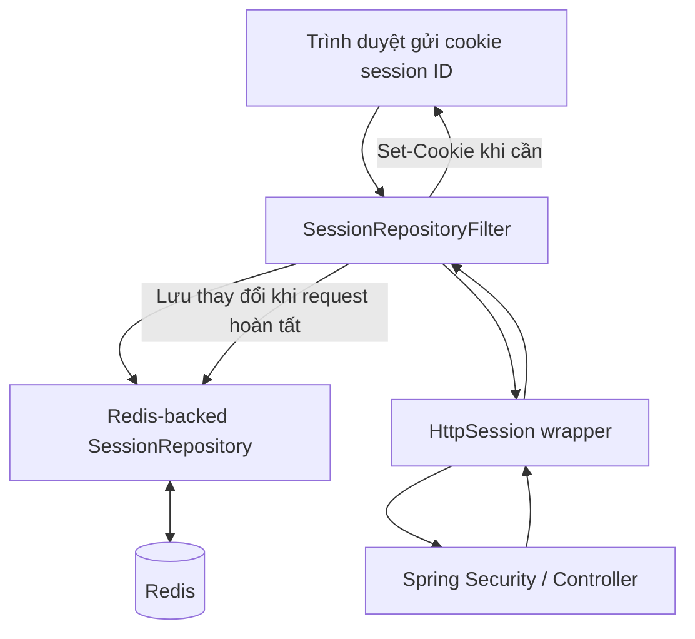
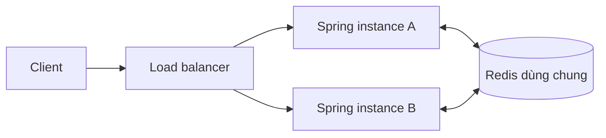

# `@EnableRedisHttpSession` và cấu hình tương đương trong Spring Boot

Spring Session có thể lưu `HttpSession` trong Redis để nhiều instance của một ứng dụng Spring cùng đọc và cập nhật trạng thái phiên. Với ứng dụng cấu hình Spring truyền thống, `@EnableRedisHttpSession` bật hạ tầng session dùng Redis. Với ứng dụng Spring Boot, auto-configuration có thể tạo hạ tầng tương đương khi các dependency và `RedisConnectionFactory` phù hợp có mặt; các thuộc tính trong `application.yml` dùng để cấu hình thời hạn, namespace và cách ghi session.

Hai cách cấu hình phục vụ cùng mục tiêu: controller tiếp tục dùng `HttpSession`, còn Spring Session thay thế việc lưu session cục bộ của Servlet container bằng repository dùng Redis. Nên chọn một cơ chế cấu hình rõ ràng cho mỗi ứng dụng, tránh vừa bật annotation thủ công vừa trông chờ auto-configuration tạo cùng một hạ tầng.

## 1. `@EnableRedisHttpSession` làm gì?

`@EnableRedisHttpSession` là annotation cấu hình Java của Spring Session dành cho ứng dụng Servlet. Khi được khai báo trong Spring `@Configuration`, annotation kích hoạt cấu hình repository Redis và đăng ký các bean cần thiết để tích hợp session với Servlet API. Thành phần quan trọng là filter bean có tên `springSessionRepositoryFilter`.

Filter này xử lý session ở mỗi request:

1. Đọc session ID từ cookie hoặc resolver đã cấu hình.
2. Tìm session tương ứng trong Redis thông qua repository.
3. Bọc `HttpServletRequest` và `HttpSession` để controller dùng API Servlet quen thuộc.
4. Theo dõi thay đổi attribute và lưu session theo chế độ flush/save đã chọn.
5. Khi cần, phát hành hoặc hết hạn cookie mang session ID.



`@EnableRedisHttpSession` không tự cài đặt Redis server và không tự cung cấp kết nối mạng đến Redis. Ứng dụng vẫn cần một `RedisConnectionFactory`, thường do Spring Data Redis tạo từ Lettuce hoặc Jedis. Redis chịu trách nhiệm lưu dữ liệu; Spring Session chịu trách nhiệm biểu diễn và quản lý vòng đời phiên.

## 2. Dependency cần thiết

Với ứng dụng dùng Spring Boot, thường cần module Spring Session cho Redis và starter Spring Data Redis để cung cấp kết nối Redis:

**Maven**

```xml
<dependencies>
    <dependency>
        <groupId>org.springframework.boot</groupId>
        <artifactId>spring-boot-starter-data-redis</artifactId>
    </dependency>
    <dependency>
        <groupId>org.springframework.session</groupId>
        <artifactId>spring-session-data-redis</artifactId>
    </dependency>
</dependencies>
```

**Gradle**

```groovy
dependencies {
    implementation 'org.springframework.boot:spring-boot-starter-data-redis'
    implementation 'org.springframework.session:spring-session-data-redis'
}
```

Khi dùng Spring Boot dependency management, hãy để BOM của Boot quản lý các phiên bản tương thích. Nếu quản lý dependency thủ công, phải chọn phiên bản Spring Session, Spring Data Redis và Spring Framework tương thích với nhau. Không ghép tùy ý một phiên bản Spring Session mới với Spring Boot hoặc Spring Data Redis cũ.

Ứng dụng Spring không dùng Boot cũng cần module `spring-session-data-redis`, Spring Data Redis và một Redis client như Lettuce hoặc Jedis. Phần khác biệt chủ yếu nằm ở cách tạo `RedisConnectionFactory`, nạp cấu hình và đăng ký filter với Servlet container.

## 3. Cấu hình thủ công bằng `@EnableRedisHttpSession`

Trong ứng dụng Spring MVC truyền thống hoặc ứng dụng muốn tự kiểm soát cấu hình session, khai báo annotation trên một lớp `@Configuration`:

```java
import org.springframework.context.annotation.Configuration;
import org.springframework.session.FlushMode;
import org.springframework.session.SaveMode;
import org.springframework.session.data.redis.config.annotation.web.http.EnableRedisHttpSession;

@Configuration
@EnableRedisHttpSession(
    maxInactiveIntervalInSeconds = 1800,
    redisNamespace = "store:sessions",
    flushMode = FlushMode.ON_SAVE,
    saveMode = SaveMode.ON_SET_ATTRIBUTE
)
public class RedisSessionConfiguration {
    // RedisConnectionFactory được cung cấp bởi cấu hình Spring Data Redis.
}
```

Trong ví dụ, session hết hạn sau 1.800 giây không hoạt động, dữ liệu được lưu dưới namespace `store:sessions`, thay đổi được ghi theo chế độ `ON_SAVE` và repository chỉ đánh dấu các attribute được đặt/xóa theo `ON_SET_ATTRIBUTE`. Đây là cấu hình minh họa; thời hạn và namespace cần được điều chỉnh theo ứng dụng và môi trường.

### Cung cấp `RedisConnectionFactory`

Một ứng dụng không dùng Boot có thể tự khai báo kết nối Redis bằng Lettuce:

```java
import org.springframework.context.annotation.Bean;
import org.springframework.context.annotation.Configuration;
import org.springframework.data.redis.connection.RedisConnectionFactory;
import org.springframework.data.redis.connection.RedisStandaloneConfiguration;
import org.springframework.data.redis.connection.lettuce.LettuceConnectionFactory;

@Configuration
public class RedisConnectionConfiguration {

    @Bean
    RedisConnectionFactory redisConnectionFactory() {
        RedisStandaloneConfiguration server =
                new RedisStandaloneConfiguration("localhost", 6379);
        return new LettuceConnectionFactory(server);
    }
}
```

Ví dụ này dùng Redis standalone ở máy phát triển. Trong production, không hardcode mật khẩu hoặc thông tin nhạy cảm trong mã nguồn. Hãy lấy host, port, username, password và cấu hình TLS từ secret/configuration management của môi trường. Nếu Redis chạy Sentinel hoặc Cluster, dùng cấu hình kết nối tương ứng thay cho `RedisStandaloneConfiguration`.

`RedisConnectionFactory` phải được Spring quản lý và sẵn sàng trong cùng application context mà cấu hình session sử dụng. Khi dùng nhiều application context, đặt bean kết nối và cấu hình session ở context phù hợp để filter có thể tìm thấy repository và dependency của nó.

### Đăng ký filter trong ứng dụng Servlet

Annotation tạo filter bean Spring nhưng Servlet container vẫn cần gọi filter đó. Ứng dụng truyền thống thường đăng ký `DelegatingFilterProxy` với tên `springSessionRepositoryFilter` và map đến `/*`. Proxy chuyển request đến bean filter Spring Session. Filter session phải chạy trước Spring Security filter chain để Security sử dụng đúng session đã được tải từ Redis.

Nếu dùng Spring Boot, auto-configuration thường đăng ký filter cho ứng dụng web. Không đăng ký thêm một `DelegatingFilterProxy` trùng lặp khi Boot đã tạo filter. Nếu ứng dụng dùng `web.xml` hoặc Java Servlet initializer tự quản lý, hãy làm theo mô hình đăng ký filter của ứng dụng đó.

## 4. Các thuộc tính quan trọng của `@EnableRedisHttpSession`

Annotation cung cấp các thuộc tính để điều chỉnh vòng đời và cách lưu session. Các thuộc tính thường được quan tâm gồm:

| Thuộc tính | Ý nghĩa | Cân nhắc khi cấu hình |
|---|---|---|
| `maxInactiveIntervalInSeconds` | Thời gian không hoạt động tối đa trước khi session hết hạn | Chọn theo thời gian người dùng có thể không gửi request và yêu cầu bảo mật |
| `redisNamespace` | Prefix/namespace dùng để nhóm dữ liệu session trong Redis | Tách ứng dụng, môi trường và nhóm dữ liệu để tránh va chạm |
| `flushMode` | Thời điểm thay đổi session được ghi vào Redis | Cân bằng tính kịp thời với số lần ghi |
| `saveMode` | Quyết định attribute nào được lưu khi session được lưu | Chọn theo cách ứng dụng đọc và cập nhật attribute |
| `cleanupCron` | Lịch chạy công việc dọn dữ liệu hết hạn theo repository | Điều chỉnh theo tải và yêu cầu dọn dữ liệu |

Tên và giá trị mặc định của thuộc tính có thể thay đổi theo phiên bản Spring Session. Khi nâng cấp, hãy kiểm tra API annotation và tài liệu đúng phiên bản đang dùng.

### Timeout và TTL

`maxInactiveIntervalInSeconds` đặt khoảng không hoạt động tối đa của session. Spring Session cập nhật thời điểm truy cập và TTL tương ứng khi session được sử dụng/lưu theo cơ chế repository. Khi hết hạn, request gửi lại ID cũ sẽ không khôi phục được session đã hết hạn.

Timeout session phía server khác với tuổi thọ cookie ở trình duyệt. Cookie có thể còn tồn tại sau khi Redis đã hết hạn session; khi đó ID trong cookie chỉ trỏ đến một session không còn tồn tại. Ngược lại, cookie hết hạn trước không có nghĩa Redis đã xóa ngay dữ liệu session; dữ liệu phía server được dọn theo TTL và cơ chế cleanup.

Không dùng TTL session làm chính sách lưu trữ dữ liệu nghiệp vụ. Đơn hàng, hồ sơ, thanh toán và bản nháp cần được lưu trong cơ sở dữ liệu nghiệp vụ với thời hạn riêng.

### Namespace

Namespace giúp các ứng dụng không ghi đè key session của nhau khi cùng dùng một Redis. Ví dụ:

- `store:dev:sessions` cho ứng dụng cửa hàng ở môi trường phát triển.
- `store:prod:sessions` cho production.
- `admin:prod:sessions` cho cổng quản trị.

Không nên để nhiều ứng dụng độc lập dùng chung namespace chỉ vì chúng kết nối cùng Redis. Nếu cần chia sẻ session giữa các instance của cùng ứng dụng, các instance phải dùng cùng namespace, cấu trúc dữ liệu và cấu hình serialization tương thích.

## 5. `flushMode` và `saveMode`

Hai chế độ này điều khiển hai khía cạnh khác nhau của việc lưu session.

### Flush mode

`FlushMode` quyết định thời điểm thay đổi được ghi xuống Redis:

- `ON_SAVE`: Spring Session gom thay đổi và lưu khi session được lưu trong quá trình hoàn tất request. Đây là lựa chọn phổ biến vì giảm số lần ghi trong một request.
- `IMMEDIATE`: thay đổi được ghi ngay khi phát sinh. Chế độ này có thể giúp thay đổi xuất hiện sớm hơn với request khác, nhưng làm tăng số thao tác Redis và chi phí mạng.

Ví dụ chọn `IMMEDIATE` khi ứng dụng có lý do cụ thể cần thay đổi session được ghi ngay trong lúc request vẫn đang chạy:

```java
@Configuration
@EnableRedisHttpSession(
    flushMode = FlushMode.IMMEDIATE,
    maxInactiveIntervalInSeconds = 900
)
class ImmediateSessionConfiguration {
}
```

Không nên chọn `IMMEDIATE` chỉ vì nghĩ rằng nó tự giải quyết mọi vấn đề đồng thời. Hai request vẫn có thể đọc/ghi các trạng thái khác nhau và ghi đè lẫn nhau. Nếu nghiệp vụ cần cập nhật nguyên tử, hãy dùng transaction, khóa, version hoặc cơ chế đồng bộ phù hợp ở tầng dữ liệu nghiệp vụ.

### Save mode

`SaveMode` quyết định cách repository xử lý attribute khi session được lưu. Ví dụ `ON_SET_ATTRIBUTE` phù hợp khi ứng dụng chủ động gọi `setAttribute` hoặc xóa attribute mỗi khi trạng thái thay đổi. `ALWAYS` có thể lưu rộng hơn các attribute trong session, nhưng làm tăng lượng dữ liệu được ghi. Một số chế độ khác có thể xuất hiện tùy phiên bản Spring Session.

Điểm quan trọng là Spring Session không thể luôn nhận biết một thay đổi sâu bên trong đối tượng mutable nếu ứng dụng chỉ sửa nội dung đối tượng mà không gọi lại `setAttribute`. Ví dụ:

```java
Cart cart = (Cart) session.getAttribute("cart");
cart.addItem(product); // Chỉ sửa đối tượng đang có trong attribute.
```

Để thay đổi được phát hiện rõ ràng với chế độ lưu dựa trên thao tác set attribute, có thể cập nhật lại attribute:

```java
Cart cart = (Cart) session.getAttribute("cart");
cart.addItem(product);
session.setAttribute("cart", cart);
```

Tốt hơn nữa, giữ session nhỏ và tránh dùng session làm nơi lưu giỏ hàng lớn hoặc dữ liệu nghiệp vụ cần nhất quán. Có thể lưu mã giỏ hàng trong session rồi đọc nội dung giỏ từ cơ sở dữ liệu.

## 6. Cấu hình tương đương trong Spring Boot

Với Spring Boot, cách thông thường là thêm `spring-session-data-redis`, cung cấp Redis connection properties và để auto-configuration tạo repository/filter. Không cần khai báo `@EnableRedisHttpSession` nếu auto-configuration đã được sử dụng.

Ví dụ `application.yml`:

```yaml
spring:
  session:
    timeout: 30m
    redis:
      namespace: store:prod:sessions
      flush-mode: on-save
      save-mode: on-set-attribute
  data:
    redis:
      host: redis.internal.example
      port: 6379
      username: ${REDIS_USERNAME}
      password: ${REDIS_PASSWORD}
      ssl:
        enabled: true
```

Các thuộc tính có ý nghĩa như sau:

- `spring.session.timeout`: thời gian không hoạt động tối đa của session. `30m` là 30 phút.
- `spring.session.redis.namespace`: namespace dùng để tách key session trong Redis.
- `spring.session.redis.flush-mode`: thời điểm ghi session, ví dụ `on-save`.
- `spring.session.redis.save-mode`: cách chọn attribute được lưu, ví dụ `on-set-attribute`.
- `spring.data.redis.*`: cấu hình kết nối Redis của Spring Boot, bao gồm host, port, thông tin xác thực và TLS.

Tên thuộc tính Redis connection khác nhau giữa các thế hệ Spring Boot. Các ứng dụng Boot cũ thường dùng prefix `spring.redis.*`; ứng dụng Boot mới dùng `spring.data.redis.*`. Hãy kiểm tra metadata cấu hình của đúng phiên bản Boot trong dự án. Các thuộc tính session cũng cần được đối chiếu theo phiên bản Spring Boot/Spring Session đang sử dụng.

Nếu chạy local, có thể dùng `localhost` và port Redis mặc định. Trong production, dùng secret manager hoặc biến môi trường cho thông tin xác thực; không commit mật khẩu thật vào repository. Cần cấu hình TLS và network policy phù hợp với Redis được quản lý hoặc Redis trong private network.

### Boot auto-configuration và annotation thủ công

Hai cách triển khai cần được phân biệt:

| Mô hình | Cách bật session Redis | Nơi cấu hình |
|---|---|---|
| Spring Framework/Servlet truyền thống | `@EnableRedisHttpSession` | Java config và `RedisConnectionFactory` bean |
| Spring Boot dùng auto-configuration | Dependency Spring Session Redis và Redis connection config | `application.yml` hoặc `application.properties` |
| Spring Boot muốn tự kiểm soát hoàn toàn | Cấu hình annotation/bean thủ công theo phiên bản Boot | Cần kiểm tra auto-configuration để tránh đăng ký trùng |

Không nên khai báo `@EnableRedisHttpSession` một cách máy móc trong ứng dụng Boot đã tự cấu hình session. Việc bật hai cơ chế có thể khiến cấu hình không rõ ràng, tạo bean trùng hoặc làm auto-configuration lùi lại theo điều kiện. Nếu cần thay đổi repository hoặc filter sâu hơn, hãy đọc điều kiện auto-configuration của phiên bản Boot đang dùng và chỉ thay thế đúng bean cần thiết.

## 7. Repository và cách dữ liệu được lưu trong Redis

Spring Session dùng Redis để lưu metadata session, thời điểm truy cập, timeout và các attribute. Cookie của trình duyệt thường chỉ chứa session ID; dữ liệu session thực tế nằm trong Redis. Tên key, cấu trúc hash, chỉ mục và cơ chế cleanup phụ thuộc repository implementation và phiên bản Spring Session.

Không nên phụ thuộc trực tiếp vào cấu trúc key nội bộ của Spring Session trong logic nghiệp vụ. Tránh viết code ứng dụng tự sửa Redis key session hoặc tự giả định tên hash. Dùng `HttpSession`, `SessionRepository` hoặc API Spring Session tương ứng để thao tác với phiên.

### Serialization

Các attribute session phải được tuần tự hóa để lưu trữ. Vì vậy:

- Ưu tiên chuỗi, số, enum và DTO nhỏ có cấu trúc ổn định.
- Tránh lưu entity JPA, proxy lazy, đối tượng phụ thuộc vào tài nguyên runtime hoặc đồ thị đối tượng lớn.
- Đảm bảo kiểu dữ liệu có thể tuần tự hóa theo serializer được cấu hình.
- Khi triển khai phiên bản mới, cân nhắc session cũ được tạo bởi phiên bản trước còn tương thích hay không.
- Không lưu mật khẩu, khóa bí mật hoặc dữ liệu thanh toán nhạy cảm trong session.

Nếu dùng Java serialization mặc định, thay đổi lớp hoặc package có thể làm session cũ không đọc được. Có thể cân nhắc serializer khác và DTO có version, nhưng cần lập kế hoạch chuyển đổi dữ liệu và tương thích giữa các instance đang chạy song song.

## 8. Redis expiration, cleanup và sự kiện session

Redis hỗ trợ TTL cho key, giúp dữ liệu session hết hạn tự động. Spring Session cũng có cơ chế theo dõi và dọn dữ liệu liên quan đến session hết hạn. Cách phát hiện expiration event và cleanup phụ thuộc repository, cấu hình Redis và phiên bản thư viện.

Một số cơ chế sự kiện của Spring Session Redis dựa trên Redis keyspace notifications. Nếu Redis được quản trị bởi dịch vụ bên ngoài hoặc môi trường không cho phép ứng dụng chạy `CONFIG SET`, cần cấu hình notification ở phía quản trị Redis và sử dụng tùy chọn cấu hình phù hợp của Spring Session, chẳng hạn `ConfigureRedisAction.NO_OP`, nếu ứng dụng được yêu cầu không tự thay đổi cấu hình Redis.

Không bật hoặc thay đổi keyspace notification trên Redis dùng chung mà chưa hiểu ảnh hưởng đến các ứng dụng khác. Hãy phối hợp với người vận hành Redis, chỉ bật loại notification cần thiết và theo dõi chi phí phát sinh. Sự kiện hết hạn thường được xử lý bất đồng bộ; không dựa vào event để quyết định quyền truy cập ở một request nhạy cảm. Repository và kiểm tra xác thực ở request mới phải là căn cứ để xác định session còn hợp lệ.

## 9. Chạy nhiều instance ứng dụng

Để nhiều instance dùng chung session, các instance phải thống nhất:

- Cùng Redis hoặc cùng cụm Redis có khả năng truy cập từ tất cả instance.
- Cùng namespace cho cùng một ứng dụng và môi trường.
- Cùng cấu hình cookie name, domain, path và resolver.
- Cùng định dạng serialization và tương thích phiên bản dữ liệu session.
- Cùng chính sách timeout, flush mode và save mode.

Ví dụ, request đầu tiên đi vào instance A tạo session và response trả cookie chứa ID. Request tiếp theo được load balancer chuyển đến instance B. B đọc cùng cookie, dùng repository kết nối Redis để tải session. Sticky session có thể giảm việc request đổi instance nhưng không thay thế repository dùng chung nếu mục tiêu là chịu lỗi instance và chia sẻ trạng thái.



Redis trở thành hạ tầng quan trọng đối với phiên đăng nhập. Cần giám sát độ trễ, số kết nối, memory usage, eviction, replication/failover và lỗi mạng. Nếu Redis không khả dụng, request cần xử lý lỗi rõ ràng; không tự động chuyển sang session cục bộ vì điều đó có thể làm người dùng đột ngột mất trạng thái hoặc tạo hành vi không nhất quán giữa các instance.

## 10. Kiểm thử cấu hình

Một kiểm thử tích hợp cần chứng minh cookie và session thực sự được lưu qua Redis, không chỉ chứng minh Spring context khởi động thành công.

Các bước kiểm thử cơ bản:

1. Khởi động Redis dùng riêng cho test hoặc Redis Testcontainer.
2. Gửi request tạo session và một attribute đơn giản.
3. Lấy cookie session ID từ response.
4. Gửi request tiếp theo với cùng cookie và xác nhận attribute còn tồn tại.
5. Gửi request cập nhật attribute rồi kiểm tra giá trị ở request sau.
6. Chờ hoặc mô phỏng timeout theo cấu hình, xác nhận session hết hạn và request cũ không khôi phục được dữ liệu.
7. Khởi chạy hai application context/instance cùng kết nối Redis và namespace; tạo session ở instance A rồi đọc ở instance B.
8. Kiểm tra logout, cookie expiration và các event cần thiết nếu ứng dụng sử dụng listener.

Không dùng Redis production để chạy test dọn dẹp. Tránh `FLUSHDB` hoặc `FLUSHALL` trên Redis dùng chung. Dùng namespace riêng cho test, dữ liệu giả lập và cleanup theo key thuộc test. Khi kiểm tra TTL bằng Redis CLI, không in session ID hoặc attribute nhạy cảm vào log công khai.

## 11. Lỗi cấu hình thường gặp

| Hiện tượng | Nguyên nhân có thể | Cách xử lý |
|---|---|---|
| Không tạo được repository | Thiếu `RedisConnectionFactory` hoặc thiếu module Spring Session Redis | Kiểm tra dependency và bean kết nối Redis |
| Ứng dụng không kết nối được Redis | Host/port/credential/TLS hoặc network policy sai | Kiểm tra cấu hình môi trường và connectivity |
| Mỗi request lại có session mới | Cookie không được gửi lại, filter không chạy hoặc namespace khác nhau | Kiểm tra `Set-Cookie`, request cookie, filter order và namespace |
| Instance B không thấy session từ A | Khác Redis, namespace hoặc serializer | Đồng bộ connection, namespace và phiên bản cấu trúc session |
| Session biến mất sớm | Timeout thấp, TTL cập nhật sai hoặc cleanup/eviction | Kiểm tra max inactive interval, TTL và memory policy Redis |
| Thay đổi attribute không được lưu | Chế độ save/flush không phù hợp hoặc sửa object mutable mà không set lại attribute | Chọn SaveMode phù hợp và cập nhật attribute rõ ràng |
| Session cũ lỗi sau khi deploy | Serialization không tương thích | Giữ DTO ổn định, có chiến lược versioning hoặc hết hạn session cũ |
| Không nhận được expiration event | Keyspace notifications chưa bật hoặc quyền cấu hình Redis bị giới hạn | Kiểm tra notification và cấu hình listener theo môi trường |

## 12. Quy trình chọn cấu hình

Khi bắt đầu tích hợp Redis session, hãy xác định các quyết định theo thứ tự:

1. Ứng dụng dùng Spring Boot hay cấu hình Spring Servlet truyền thống? Chọn auto-configuration hoặc `@EnableRedisHttpSession` tương ứng.
2. RedisConnectionFactory được tạo từ cấu hình nào? Xác định standalone, Sentinel hay Cluster, client, xác thực và TLS.
3. Session cần sống bao lâu khi không hoạt động? Đặt timeout phù hợp với bảo mật và trải nghiệm.
4. Có nhiều ứng dụng/môi trường cùng Redis không? Đặt namespace riêng và nhất quán giữa các instance.
5. Ứng dụng thay đổi attribute theo cách nào? Chọn `flushMode` và `saveMode` tương ứng; chú ý đối tượng mutable.
6. Có cần event hết hạn hoặc truy vấn session theo principal không? Kiểm tra khả năng repository, keyspace notification và cấu hình bổ sung.
7. Đã kiểm thử request qua nhiều instance, logout, timeout, serialization và lỗi Redis chưa?

Với Spring Session, `@EnableRedisHttpSession` là cách bật repository Redis trong cấu hình Java truyền thống, còn Spring Boot cung cấp cách cấu hình tương đương qua auto-configuration và `application.yml`. Dù chọn cách nào, các instance của cùng ứng dụng phải dùng chung Redis, namespace, cookie và định dạng dữ liệu. Cấu hình timeout, flush/save mode, serialization và vận hành Redis đúng cách sẽ giúp session tồn tại nhất quán khi request đi qua nhiều instance.
