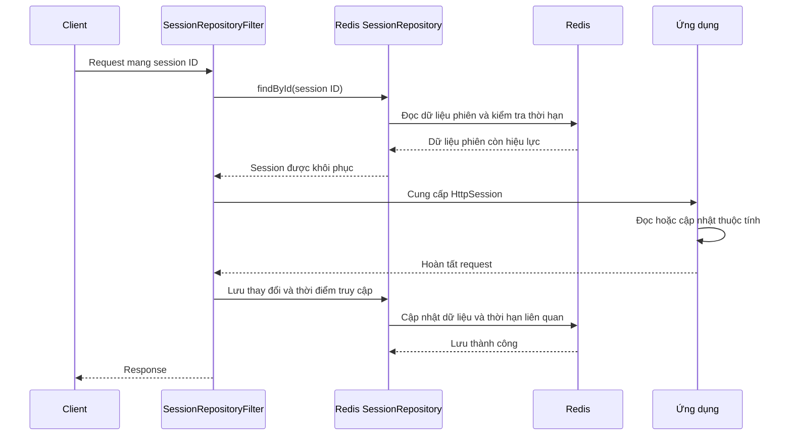

# Khoảng không hoạt động, TTL và đọc phiên đã hết hạn

Spring Session có thể lưu `HttpSession` trong Redis để nhiều instance của ứng dụng cùng khôi phục trạng thái người dùng. Mỗi phiên có thời điểm truy cập gần nhất và một khoảng không hoạt động tối đa. Redis dùng thời gian sống của khóa (TTL — time to live) để hỗ trợ hết hạn dữ liệu phiên. Khi phiên đã hết hạn, ứng dụng phải xem nó như không còn tồn tại, ngay cả khi việc dọn dữ liệu vật lý hoặc phát sự kiện hết hạn chưa hoàn tất.

Hiểu rõ quan hệ giữa thời gian không hoạt động, `maxInactiveInterval`, TTL của Redis và cách repository đọc phiên giúp tránh lỗi đăng nhập bất thường, tránh tạo phiên mới ngoài ý muốn và thiết kế được quy trình giám sát, cleanup phù hợp.

## 1. Thời gian không hoạt động là gì?

Thời gian không hoạt động (inactivity timeout) là khoảng thời gian tối đa một phiên được phép không có hoạt động được ứng dụng ghi nhận. Nếu phiên không được sử dụng trong khoảng này, Spring Session xem phiên là hết hạn. Thời gian này khác với tuổi tuyệt đối của phiên tính từ lúc đăng nhập.

Ví dụ, nếu `maxInactiveInterval` là 30 phút:

- Người dùng tạo phiên lúc 09:00.
- Request hợp lệ sử dụng phiên lúc 09:12 và thay đổi truy cập được lưu.
- Thời điểm hết hạn không hoạt động được tính lại dựa trên lần truy cập được ghi nhận gần nhất, nên phiên có thể còn hiệu lực đến khoảng 09:42.
- Nếu không có hoạt động tiếp theo, request đến sau khi thời hạn đã qua sẽ không khôi phục được phiên cũ.

Đây thường được gọi là **sliding expiration**: mỗi lần hoạt động hợp lệ có thể đẩy thời điểm hết hạn về phía trước. Người dùng sử dụng ứng dụng liên tục có thể giữ phiên lâu hơn 30 phút tính từ lúc đăng nhập.

Thời gian không hoạt động thường được biểu diễn bằng `Session.getMaxInactiveInterval()` hoặc thuộc tính tương ứng trên `HttpSession`. Trong Spring Session, giá trị này được lưu cùng thông tin phiên và được repository sử dụng khi xác định phiên có còn hiệu lực hay không.

## 2. Cấu hình khoảng không hoạt động

Với Spring Session Redis, có thể cấu hình khoảng không hoạt động mặc định bằng annotation:

```java
@Configuration
@EnableRedisHttpSession(maxInactiveIntervalInSeconds = 1800)
public class RedisSessionConfiguration {
}
```

Giá trị `1800` là 1.800 giây, tương đương 30 phút. Khi dùng Spring Boot, có thể cấu hình timeout chung của session trong application configuration nếu phiên bản Boot đang dùng hỗ trợ thuộc tính đó:

```yaml
spring:
  session:
    timeout: 30m
```

Tên và phạm vi thuộc tính cấu hình cần được kiểm tra theo phiên bản Spring Boot và Spring Session của dự án. Nếu dùng cấu hình Java tường minh, không nên đồng thời đặt một cấu hình khác với ý nghĩa xung đột mà không xác định rõ nguồn giá trị hiệu lực.

Ứng dụng cũng có thể thay đổi timeout cho một phiên cụ thể thông qua Servlet API:

```java
HttpSession session = request.getSession(true);
session.setMaxInactiveInterval(900); // 15 phút
```

Giá trị này áp dụng cho phiên tương ứng. Cần cân nhắc kỹ khi thay đổi timeout theo request hoặc theo người dùng: một request không nên vô tình kéo dài phiên đặc quyền hoặc ghi đè chính sách bảo mật được đặt ở tầng cấu hình.

## 3. TTL trong Redis liên hệ thế nào với session timeout?

Redis gắn TTL với một key. Khi TTL về 0, key được xem là hết hạn và Redis loại bỏ nó theo cơ chế expiration. Spring Session sử dụng thông tin timeout của session để quản lý thời hạn lưu trữ trong Redis.

Không nên đồng nhất ba khái niệm sau:

| Khái niệm | Ý nghĩa |
|---|---|
| `maxInactiveInterval` | Khoảng không hoạt động tối đa của phiên theo mô hình Spring Session |
| Thời điểm truy cập gần nhất | Mốc thời gian được repository ghi nhận khi phiên được sử dụng |
| Redis TTL | Thời gian còn lại trước khi một Redis key hết hạn |

Về mặt khái niệm, thời điểm hết hạn được tính từ lần truy cập gần nhất cộng với khoảng không hoạt động tối đa. Redis TTL là cơ chế giúp repository thực thi hoặc hỗ trợ mốc hết hạn đó. Khi request sử dụng phiên được lưu, Spring Session cập nhật thông tin truy cập và repository điều chỉnh thời hạn liên quan trong Redis.

Không phải mọi lệnh đọc Redis đều làm mới TTL. Một thao tác `GET` hoặc `HGETALL` thủ công từ công cụ quản trị không tương đương với một request HTTP sử dụng `HttpSession` qua Spring Session. Việc làm mới thời hạn gắn với vòng đời session và thao tác lưu của repository, không phải bất kỳ lần đọc key nào.

## 4. Vòng đời timeout qua một request

Luồng đơn giản khi request dùng phiên đã tồn tại:



Filter là cầu nối giữa Servlet API và repository. Khi ứng dụng đọc session qua `HttpSession`, code nghiệp vụ không cần tự cập nhật `lastAccessedTime` hoặc TTL. Spring Session theo dõi vòng đời request và lưu trạng thái theo chế độ flush/save của repository.

Nếu request bị lỗi trước khi thay đổi session được lưu, việc kéo dài thời hạn có thể không xảy ra như người phát triển dự kiến. Hãy xem xét thời điểm flush, exception khi lưu và việc response có được hoàn tất bình thường hay không. Không coi một request đã đến server là bằng chứng chắc chắn rằng TTL đã được làm mới.

## 5. Đọc một phiên đã hết hạn

Theo hợp đồng của `SessionRepository`, khi gọi `findById(id)` mà phiên không tồn tại hoặc đã hết hạn, repository trả về `null`. Với ứng dụng Servlet, nếu session không thể được khôi phục, `request.getSession(false)` trả về `null`.

Ví dụ endpoint chỉ đọc phiên hiện tại:

```java
@GetMapping("/account/session")
public Map<String, Object> sessionInfo(HttpServletRequest request) {
    HttpSession session = request.getSession(false);
    if (session == null) {
        throw new ResponseStatusException(HttpStatus.UNAUTHORIZED);
    }

    return Map.of(
            "lastActivity", session.getLastAccessedTime(),
            "timeoutSeconds", session.getMaxInactiveInterval()
    );
}
```

`getSession(false)` không tạo phiên mới khi phiên cũ đã hết hạn hoặc không tồn tại. Đây thường là lựa chọn đúng cho endpoint yêu cầu người dùng đã đăng nhập. Ứng dụng có thể trả `401 Unauthorized`, chuyển hướng đến trang đăng nhập hoặc trả một kết quả hết phiên theo hợp đồng API.

Không dùng `getSession(true)` ở đầu mọi request được bảo vệ. Khi ID cũ đã hết hạn, lời gọi đó có thể tạo một session mới không có trạng thái xác thực cũ. Nếu controller tiếp tục xử lý như thể người dùng đã đăng nhập, ứng dụng có nguy cơ nhầm một phiên rỗng với phiên đã xác thực.

## 6. Phân biệt phiên hết hạn và phiên không được gửi định danh

Ở tầng ứng dụng, cả hai trường hợp có thể khiến `getSession(false)` trả về `null`, nhưng nguyên nhân khác nhau:

| Trường hợp | Nguyên nhân có thể | Cách xử lý |
|---|---|---|
| Client không gửi session ID | Cookie/header bị xóa, không được gửi theo domain/path/SameSite hoặc client chưa từng có phiên | Xử lý như chưa có phiên |
| Client gửi ID không tồn tại | ID sai, session đã bị xóa hoặc repository/namespace không khớp | Không khôi phục; yêu cầu xác thực lại nếu endpoint cần đăng nhập |
| Client gửi ID đã hết hạn | Inactivity timeout đã qua hoặc phiên bị thu hồi | Từ chối phiên cũ và xóa định danh ở client theo giao thức |
| Repository không truy cập được | Redis lỗi kết nối, timeout hoặc lỗi xác thực | Đây là lỗi hạ tầng; không tự xem là người dùng đã đăng xuất |
| Session deserialize thất bại | Dữ liệu lưu không tương thích với class/serializer hiện tại | Ghi nhận lỗi và xử lý theo chính sách triển khai |

Đặc biệt, lỗi kết nối Redis không tương đương với session hết hạn. Nếu không đọc được repository, ứng dụng chưa biết session có tồn tại hay không. Không nên bắt lỗi kết nối rồi tạo session mới và tiếp tục như người dùng chưa đăng nhập; điều đó có thể che giấu sự cố hạ tầng hoặc làm mất ngữ cảnh bảo mật.

## 7. Redis expiration có thể không đồng thời với việc dọn vật lý

Redis có thể thực hiện expiration theo cả truy cập và các chu kỳ kiểm tra chủ động. Do đó, thời điểm một key bị xóa vật lý có thể không trùng chính xác với thời điểm TTL vừa chạm 0. Tuy nhiên, key đã hết hạn được Redis xem như không tồn tại khi được truy cập theo các quy tắc expiration của Redis.

Spring Session cũng phải bảo đảm một phiên hết hạn không được khôi phục chỉ vì một bản ghi phụ hoặc bản sao phục vụ sự kiện còn tồn tại. Chi tiết key, TTL bổ sung, bản sao phục vụ phát event và cơ chế cleanup phụ thuộc implementation (`RedisSessionRepository` hoặc `RedisIndexedSessionRepository`) và phiên bản. Không suy luận trạng thái phiên chỉ từ việc thấy một key còn xuất hiện trong `SCAN`.

Một số implementation Spring Session Redis giữ dữ liệu phụ trong thời gian ngắn sau khi phiên hết hạn để hỗ trợ phát `SessionExpiredEvent` với thông tin phiên. Điều đó không có nghĩa session vẫn hợp lệ để xác thực. Việc đọc phiên qua repository và kiểm tra timeout mới là cơ chế quyết định ứng dụng có được dùng phiên hay không.

Vì vậy, cần phân biệt:

- **Hết hiệu lực:** repository không còn trả phiên như một session đang hoạt động.
- **Redis expiration:** Redis xem key có TTL đã hết hạn là không tồn tại.
- **Cleanup vật lý/phụ trợ:** các key liên quan hoặc bản ghi phục vụ event được dọn theo cơ chế implementation.
- **Sự kiện hết hạn:** ứng dụng nhận thông báo nếu cấu hình và repository hỗ trợ việc phát sự kiện đó.

Không dùng sự xuất hiện của `SessionExpiredEvent` làm điều kiện duy nhất để từ chối request. Phiên phải được xem là hết hạn theo repository ngay cả khi event đến chậm hoặc không được chuyển tới listener.

## 8. Kiểm tra TTL bằng redis-cli

Khi cần điều tra, Redis cung cấp `TTL` và `PTTL`:

```bash
TTL some-session-key
PTTL some-session-key
```

Kết quả thường có ý nghĩa:

| Kết quả | Ý nghĩa |
|---|---|
| Số nguyên dương từ `TTL` | Số giây còn lại trước khi key hết hạn |
| Số nguyên dương từ `PTTL` | Số mili giây còn lại trước khi key hết hạn |
| `-2` | Key không tồn tại hoặc đã hết hạn |
| `-1` | Key tồn tại nhưng không có expiration được gắn |

Tên key thực tế phụ thuộc namespace và repository. Namespace mặc định có thể bắt đầu bằng `spring:session`, nhưng ứng dụng có thể cấu hình namespace khác. Với các repository dùng nhiều key cho một session, cần kiểm tra đúng key expiration/session theo tài liệu phiên bản thay vì giả định mọi key có cùng TTL.

Để tìm key khi kiểm tra môi trường phát triển, dùng `SCAN` với pattern hẹp theo namespace:

```bash
SCAN 0 MATCH 'spring:session:*' COUNT 100
```

`SCAN` trả cursor để tiếp tục duyệt; một lần gọi không bảo đảm trả toàn bộ key. Không dùng `KEYS *` trên Redis production có lượng dữ liệu lớn vì lệnh này có thể chặn server trong lúc duyệt toàn bộ keyspace. Không chạy `DEL` hoặc `EXPIRE` thủ công lên key phiên production để sửa một triệu chứng chưa được xác định.

TTL quan sát bằng redis-cli là dữ liệu chẩn đoán ở thời điểm xem. Một request đồng thời có thể làm mới TTL ngay sau đó; key phụ có thể có thời hạn khác; độ trễ và cơ chế cleanup có thể làm số liệu thay đổi. Đối chiếu với cấu hình session timeout, thời điểm request và log repository.

## 9. Timeout không hoạt động và tuổi tuyệt đối

Inactivity timeout cho phép phiên tiếp tục sống khi có hoạt động. Với ứng dụng nhạy cảm, chỉ đặt timeout không hoạt động có thể chưa đủ: người dùng hoặc script có thể liên tục gửi request để giữ phiên mở rất lâu.

Tuổi tuyệt đối (absolute session lifetime) giới hạn tổng thời gian kể từ khi xác thực thành công, bất kể có request mới hay không. Ví dụ:

- Inactivity timeout: 20 phút.
- Absolute lifetime: 8 giờ kể từ khi đăng nhập.
- Sau 8 giờ, người dùng phải xác thực lại dù request gần nhất mới xảy ra một phút trước.

Spring Session cung cấp timeout không hoạt động; tuổi tuyệt đối thường cần được ứng dụng hoặc Spring Security triển khai bổ sung. Có thể lưu thời điểm xác thực trong `SecurityContext`/session hoặc quản lý một `sessionVersion`/thời điểm đăng nhập trong kho dữ liệu tin cậy.

Ví dụ minh họa:

```java
private static final String AUTHENTICATED_AT = "authenticatedAt";
private static final Duration MAX_AUTH_AGE = Duration.ofHours(8);

boolean requiresReauthentication(HttpSession session, Instant now) {
    Object value = session.getAttribute(AUTHENTICATED_AT);
    if (!(value instanceof Instant authenticatedAt)) {
        return true;
    }

    return !now.isBefore(authenticatedAt.plus(MAX_AUTH_AGE));
}
```

Ứng dụng cần ghi `authenticatedAt` tại thời điểm xác thực thực sự thành công, không cập nhật lại ở mỗi request. Khi quá tuổi, phải yêu cầu xác thực lại và kết thúc hoặc làm mới trạng thái bảo mật theo một quy trình rõ ràng. Không chỉ xóa một thuộc tính rồi tiếp tục sử dụng `SecurityContext` cũ.

## 10. Quan hệ với cookie hoặc header session ID

Client giữ định danh để gửi lại trong request. Thời hạn cookie hoặc thời gian lưu token ở client là một chính sách khác với timeout phía máy chủ:

- Cookie session có thể không có `Max-Age` và tồn tại đến khi trình duyệt kết thúc phiên làm việc.
- Cookie persistent có `Max-Age` hoặc `Expires` và có thể còn ở trình duyệt sau khi Redis đã hết hạn session.
- Header resolver yêu cầu client tự lưu session ID; client có thể tiếp tục gửi ID cũ nếu không nhận hoặc không xử lý tín hiệu hết hạn.

Nếu cookie/header còn giữ ID nhưng repository không còn phiên, request không thể khôi phục trạng thái cũ. Ứng dụng nên xử lý như phiên hết hạn, yêu cầu đăng nhập lại và phát tín hiệu xóa định danh theo resolver đang dùng. Xóa cookie hoặc token ở client không thay thế invalidate phiên ở phía máy chủ.

Không đặt TTL cookie dài hơn rất nhiều so với chính sách phiên chỉ để tránh người dùng phải đăng nhập lại. Cookie còn tồn tại không làm phiên phía máy chủ sống lâu hơn; ngược lại, cookie dài hạn làm session ID cũ tiếp tục nằm trên thiết bị sau khi server đã hết hạn phiên.

## 11. Cấu hình sự kiện hết hạn trong Redis

Một số chức năng sự kiện của Spring Session Redis dựa vào Redis keyspace notifications để nhận biết key hết hạn. Redis có cấu hình `notify-keyspace-events`; các ký tự cấu hình và yêu cầu cụ thể phụ thuộc Redis version, môi trường triển khai và cách Spring Session đăng ký listener.

Không nên tự đặt một giá trị cấu hình theo ví dụ trên Internet mà chưa hiểu cấu hình hiện tại. Redis có thể được dùng chung bởi nhiều ứng dụng; thay đổi notification flags có thể ảnh hưởng listener khác. Kiểm tra tài liệu Spring Session Redis của đúng phiên bản và cấu hình Redis đang chạy.

Ngay cả khi event hết hạn được bật, event không phải đồng hồ chính xác để quyết định quyền truy cập. Keyspace notifications có thể không được phát nếu cấu hình không phù hợp, listener tạm mất kết nối hoặc hạ tầng Redis không chuyển event như mong đợi. Ứng dụng phải dựa vào repository để từ chối phiên đã hết hạn; event chủ yếu phục vụ cleanup phụ trợ, metric và thông báo vòng đời.

## 12. Thực hành kiểm thử TTL

Nên kiểm thử ở nhiều lớp:

| Ca kiểm thử | Cách thực hiện | Kết quả mong đợi |
|---|---|---|
| Phiên mới | Tạo session và xác nhận repository lưu được | Có thể khôi phục bằng session ID |
| Inactivity timeout | Cấu hình timeout ngắn, không gửi request vượt thời hạn | `findById` không trả phiên; `getSession(false)` là `null` |
| Sliding expiration | Gửi request hợp lệ trước khi timeout rồi kiểm tra lại thời hạn | Phiên được kéo dài theo hành vi repository |
| Không tự làm mới khi chỉ đọc Redis | Dùng công cụ Redis đọc key và kiểm tra TTL | Không coi thao tác chẩn đoán là hoạt động HTTP làm mới session |
| Cookie còn nhưng session hết hạn | Gửi lại cookie cũ sau timeout | Ứng dụng yêu cầu xác thực lại; không khôi phục dữ liệu cũ |
| Repository gián đoạn | Ngắt kết nối Redis trong test | Ứng dụng phân biệt lỗi hạ tầng với session không tồn tại |
| Sự kiện hết hạn | Bật notification theo cấu hình test và chờ key hết hạn | Event được phát theo khả năng implementation; handler chịu được event đến trễ |
| Nhiều instance | Tạo phiên ở A, dùng ở B, để hết hạn rồi đọc ở B | Các node cùng từ chối phiên đã hết hạn |
| Tuổi tuyệt đối | Gửi request liên tục nhưng vượt tuổi xác thực tối đa | Người dùng phải xác thực lại dù inactivity timeout chưa hết |

Không nên viết test dựa trên `Thread.sleep` dài hoặc giả định Redis sẽ xóa key đúng tại một mili giây. Dùng timeout ngắn trong profile test, chờ theo điều kiện có giới hạn và xác nhận qua `SessionRepository.findById`. Nếu kiểm thử cleanup vật lý hoặc event, hãy tách kết quả đó khỏi kiểm tra hiệu lực session.

## 13. Chẩn đoán vấn đề thường gặp

| Triệu chứng | Nguyên nhân có thể | Hướng kiểm tra |
|---|---|---|
| Người dùng bị đăng xuất sớm | Timeout thấp, request không gửi ID, request không lưu lại thay đổi hoặc Redis TTL không được cập nhật như dự kiến | So sánh `maxInactiveInterval`, last access, request cookie/header và TTL key |
| Người dùng vẫn được xem là đăng nhập sau thời gian dài | Request liên tục làm mới inactivity timeout; thiếu absolute lifetime | Kiểm tra request nền và chính sách tuổi xác thực tuyệt đối |
| Redis còn key nhưng `findById` trả `null` | Key có thể là key phụ/phantom hoặc session đã hết hiệu lực | Xác định đúng key theo repository và kiểm tra trạng thái qua API Spring Session |
| Redis không còn key nhưng client vẫn gửi ID | Client chưa xóa cookie/header cũ | Kiểm tra response hết hạn và logic client |
| Không nhận `SessionExpiredEvent` | Keyspace notifications hoặc listener chưa được cấu hình, hoặc repository không hỗ trợ event như kỳ vọng | Kiểm tra cấu hình Redis và tài liệu phiên bản |
| Mọi instance có TTL khác nhau | Cấu hình timeout không đồng nhất hoặc dùng kho/namespace khác nhau | So sánh profile, cấu hình hiệu lực và repository trên từng instance |
| Redis trả `-1` cho một key | Key đó không có TTL hoặc đang kiểm tra nhầm loại key | Xác định key session/expiration và hành vi implementation; không tự gắn TTL thủ công |
| Ứng dụng báo lỗi Redis nhưng coi là hết phiên | Exception bị bắt quá rộng và chuyển thành `null` | Phân biệt lỗi repository với kết quả không tìm thấy session |

Khi điều tra, ghi nhận session timeout cấu hình, loại repository, namespace, thời điểm request, trạng thái có/không có cookie/header, mã tương quan và lỗi kết nối. Không ghi session ID thật hoặc toàn bộ thuộc tính phiên vào log.

## 14. Nguyên tắc vận hành

- Chọn inactivity timeout dựa trên rủi ro và hành vi người dùng; không dùng một con số tùy tiện cho mọi loại ứng dụng.
- Hiểu `maxInactiveInterval` là chính sách hết hạn của phiên và TTL Redis là cơ chế expiration ở kho dữ liệu.
- Chỉ xem hoạt động được Spring Session ghi nhận là căn cứ làm mới thời hạn; đọc Redis thủ công không làm mới phiên theo vòng đời HTTP.
- Dùng `getSession(false)` ở endpoint yêu cầu phiên đã tồn tại để tránh tạo phiên rỗng khi ID cũ hết hạn.
- Phân biệt session không tồn tại, session hết hạn và lỗi kết nối Redis.
- Không dựa vào cleanup vật lý hoặc `SessionExpiredEvent` làm cơ chế duy nhất bảo vệ truy cập.
- Bổ sung absolute lifetime khi nghiệp vụ nhạy cảm cần giới hạn tuổi xác thực tổng thể.
- Kiểm tra TTL qua `TTL`/`PTTL` và `SCAN` có giới hạn; tránh `KEYS *` hoặc sửa key production thủ công.
- Kiểm thử timeout, sliding expiration, repository read, logout và hành vi nhất quán giữa nhiều instance.

Spring Session và Redis phối hợp để giữ phiên trong khoảng thời gian không hoạt động đã cấu hình. Khi phiên hết hạn, repository phải từ chối khôi phục nó; việc Redis dọn key và phát event có thể diễn ra theo cơ chế riêng. Ứng dụng nên đọc trạng thái qua Spring Session, xử lý `null` như phiên không còn hiệu lực và phân biệt rõ lỗi hạ tầng để bảo vệ đúng vòng đời xác thực của người dùng.
