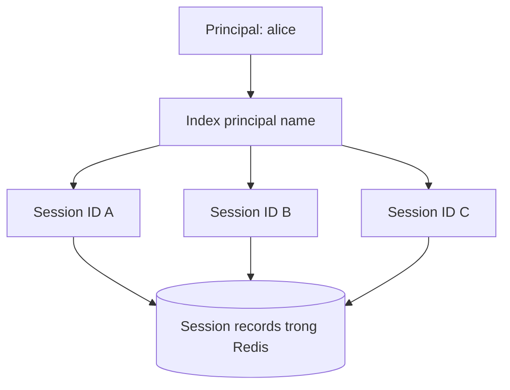

# Giới hạn về chỉ mục và sự kiện của repository cơ bản

Redis có thể lưu dữ liệu phiên rất nhanh và hỗ trợ nhiều kiểu cấu trúc dữ liệu, nhưng khả năng của một repository Spring Session phụ thuộc vào implementation mà ứng dụng đang sử dụng. Repository Redis cơ bản tập trung vào các thao tác theo session ID: tạo, đọc, lưu và xóa một phiên. Nó không tự cung cấp mọi chức năng truy vấn hoặc sự kiện vòng đời mà một hệ thống quản trị phiên có thể cần.

Khi cần tìm tất cả phiên của một người dùng, triển khai chức năng đăng xuất khỏi mọi thiết bị hoặc phản ứng khi session hết hạn, cần phân biệt hợp đồng `SessionRepository` cơ bản với repository có hỗ trợ chỉ mục và sự kiện. Bài học này giải thích những giới hạn đó, cách nhận biết implementation, và các lựa chọn khi ứng dụng cần nhiều khả năng hơn.

## 1. Repository cơ bản làm được những gì?

Hợp đồng `SessionRepository<S extends Session>` tập trung vào bốn thao tác:

```java
public interface SessionRepository<S extends Session> {
    S createSession();
    void save(S session);
    S findById(String id);
    void deleteById(String id);
}
```

Đây là các thao tác theo một ID đã biết. Ứng dụng có thể tạo một phiên, lưu attributes, khôi phục phiên khi nhận ID và xóa phiên khi đăng xuất. Với Redis, implementation ánh xạ session vào cấu trúc dữ liệu trong Redis và quản lý thời hạn theo cấu hình.

Hợp đồng này không định nghĩa một API tổng quát để:

- Tìm mọi session thuộc một người dùng hoặc principal.
- Liệt kê toàn bộ session đang hoạt động.
- Tìm session theo một attribute bất kỳ.
- Nhận thông báo vòng đời theo một cơ chế sự kiện chung.
- Thực hiện truy vấn phân tích hoặc lọc session theo nhiều điều kiện.

Điều đó không có nghĩa Redis không thể lưu index hoặc phát thông báo. Redis có set, sorted set, hash, Pub/Sub và keyspace notifications. Giới hạn nằm ở chức năng mà repository implementation cung cấp và cách nó sử dụng những khả năng đó.

## 2. RedisSessionRepository và RedisIndexedSessionRepository

Spring Session có các implementation Redis với phạm vi chức năng khác nhau. Điểm phân biệt quan trọng là repository đơn giản `RedisSessionRepository` và repository có hỗ trợ chỉ mục `RedisIndexedSessionRepository`.

| Khả năng | `RedisSessionRepository` | `RedisIndexedSessionRepository` |
|---|---|---|
| Tạo, đọc, lưu, xóa theo ID | Có | Có |
| Tra cứu session theo principal name | Không cung cấp chức năng index này | Có, qua API tìm kiếm theo index |
| Hỗ trợ `FindByIndexNameSessionRepository` | Không | Có |
| Phát sự kiện vòng đời Spring Session | Không hỗ trợ các session event như repository indexed | Có hỗ trợ các event theo cấu hình và cơ chế Redis |
| Nhu cầu Redis keyspace notifications cho event hết hạn | Không cần cho chức năng event của repository cơ bản | Cần cấu hình phù hợp để nhận event hết hạn |

`RedisSessionRepository` là lựa chọn gọn hơn khi ứng dụng chỉ cần truy xuất phiên theo ID và không cần truy vấn theo principal hay lắng nghe session events. `RedisIndexedSessionRepository` duy trì thêm dữ liệu index và hỗ trợ các khả năng mở rộng đó. Vì vậy, nó có thêm chi phí ghi, bộ nhớ, cấu hình và vận hành.

Đừng suy luận implementation chỉ từ việc ứng dụng có kết nối Redis. Hãy kiểm tra cấu hình Spring Session, dependency, bean repository được tạo và tài liệu đúng với phiên bản Spring Session/Spring Boot. Một cấu hình auto-configuration có thể chọn implementation khác nhau theo phiên bản và dependency có trên classpath.

## 3. Chỉ mục session giải quyết bài toán gì?

Một session ID thường được tạo ngẫu nhiên và không chứa username hoặc principal name. Nếu ứng dụng chỉ có API `findById(id)`, nó có thể tải một phiên khi đã biết ID, nhưng không thể hỏi repository: “Tìm tất cả phiên của người dùng `alice`”.

Chỉ mục (index) tạo một ánh xạ phụ từ một giá trị có ý nghĩa, chẳng hạn principal name, tới một hoặc nhiều session ID. Với repository indexed, ứng dụng có thể truy vấn các phiên theo index name và index value.

Ví dụ, một người dùng đăng nhập trên trình duyệt máy tính, điện thoại và máy tính bảng. Hệ thống có thể có ba session ID khác nhau. Nếu cần hiển thị danh sách phiên đang hoạt động hoặc đăng xuất người dùng khỏi mọi thiết bị, chỉ biết session ID hiện tại là chưa đủ. Index theo principal name giúp tìm tập session tương ứng.



Index không thay thế session record. Nó là cấu trúc phụ giúp tìm ID. Sau khi có ID, ứng dụng vẫn cần làm việc với session tương ứng và repository chịu trách nhiệm lưu trữ chính.

## 4. API tìm kiếm theo index

Spring Session định nghĩa `FindByIndexNameSessionRepository<S extends Session>` để bổ sung khả năng tìm phiên theo index:

```java
public interface FindByIndexNameSessionRepository<S extends Session>
        extends SessionRepository<S> {

    String PRINCIPAL_NAME_INDEX_NAME =
            FindByIndexNameSessionRepository.class.getName() + ".PRINCIPAL_NAME_INDEX_NAME";

    Map<String, S> findByIndexNameAndIndexValue(
            String indexName, String indexValue);
}
```

Đoạn mã thể hiện ý tưởng của hợp đồng: ngoài các thao tác cơ bản, repository có API trả về một map session ID tới session cho một index name/value. Trong ứng dụng, nên dùng hằng số `PRINCIPAL_NAME_INDEX_NAME` của framework thay vì tự gõ chuỗi index.

Ví dụ sử dụng repository indexed:

```java
Map<String, ? extends Session> sessions =
    indexedRepository.findByIndexNameAndIndexValue(
        FindByIndexNameSessionRepository.PRINCIPAL_NAME_INDEX_NAME,
        "alice");

for (Map.Entry<String, ? extends Session> entry : sessions.entrySet()) {
    String sessionId = entry.getKey();
    Session session = entry.getValue();
    // Hiển thị metadata cần thiết hoặc thu hồi phiên theo chính sách.
}
```

Ở đây `indexedRepository` phải là một bean có kiểu hỗ trợ `FindByIndexNameSessionRepository`; `RedisSessionRepository` cơ bản không đáp ứng hợp đồng tìm kiếm này. Không ép kiểu repository cơ bản sang interface indexed để né giới hạn, vì điều đó không tạo ra index hoặc chức năng còn thiếu.

## 5. Index principal name được tạo như thế nào?

Để tìm session theo principal, repository phải biết principal name nào gắn với session. Với tích hợp Spring Security, Spring Session có thể lấy tên principal từ `SecurityContext` được lưu trong session thông qua cơ chế resolver phù hợp.

Với cơ chế xác thực tùy chỉnh, ứng dụng cần bảo đảm tên principal được đưa vào session theo cách mà index resolver hiểu được. Một cách thường dùng là đặt attribute có tên index principal mà Spring Session định nghĩa:

```java
session.setAttribute(
    FindByIndexNameSessionRepository.PRINCIPAL_NAME_INDEX_NAME,
    principalName);
```

Đây là minh họa cho việc cung cấp giá trị index khi ứng dụng tự quản lý thông tin principal. Với Spring Security, ưu tiên dùng tích hợp có sẵn và kiểm tra principal thực sự được nhận diện đúng. Không nên lấy một giá trị username do client gửi lên làm principal đã xác thực.

Index principal giúp truy vấn phiên, nhưng không tự chứng minh người dùng có quyền quản trị các phiên đó. API hiển thị hoặc thu hồi session của một người dùng phải xác minh principal hiện tại và quyền của họ ở phía server. Đặc biệt, không cho phép client gửi một username bất kỳ để liệt kê hoặc xóa session của người khác.

## 6. Vì sao repository cơ bản không thể đăng xuất mọi thiết bị?

Đăng xuất khỏi thiết bị hiện tại thường chỉ cần biết session ID của request hiện tại và gọi `HttpSession.invalidate()`. Khi cần đăng xuất mọi thiết bị, ứng dụng phải tìm tất cả session ID gắn với principal đó, sau đó thu hồi từng session.

Repository cơ bản chỉ có `findById(id)` và không có index principal. Nếu ứng dụng không duy trì một nguồn ánh xạ khác, nó không thể thực hiện truy vấn “mọi phiên của alice” một cách trực tiếp. Đây là giới hạn về khả năng tìm kiếm, không phải lỗi của lệnh xóa session.

Với repository indexed, luồng có thể là:

1. Xác định principal đã được xác thực từ `SecurityContext`.
2. Gọi `findByIndexNameAndIndexValue` với principal index.
3. Nhận map các session ID thuộc principal đó.
4. Thu hồi từng session theo API repository hoặc API bảo mật phù hợp.
5. Xác nhận các request tiếp theo với ID cũ không còn khôi phục được phiên.

Ví dụ minh họa:

```java
Map<String, ? extends Session> sessions =
    indexedRepository.findByIndexNameAndIndexValue(
        FindByIndexNameSessionRepository.PRINCIPAL_NAME_INDEX_NAME,
        principalName);

for (String sessionId : sessions.keySet()) {
    indexedRepository.deleteById(sessionId);
}
```

Trong ứng dụng Spring Security, chức năng quản lý session còn cần phối hợp với chính sách xác thực, sự kiện và cách vô hiệu hóa context. Không dùng ví dụ này thay thế cho kiểm tra quyền, và cần xem xét session hiện tại có nên được giữ lại hay cũng phải thu hồi.

## 7. Sự kiện vòng đời session là gì?

Sự kiện vòng đời cho phép ứng dụng phản ứng khi session được tạo, bị xóa hoặc hết hạn. Spring Session định nghĩa các application event như:

- `SessionCreatedEvent`: session được tạo.
- `SessionDeletedEvent`: session bị xóa hoặc vô hiệu hóa.
- `SessionExpiredEvent`: session hết hạn.

Ứng dụng có thể đăng ký listener:

```java
@Component
class SessionEventsListener {

    @EventListener
    public void onCreated(SessionCreatedEvent event) {
        // Ghi nhận chỉ số phiên mới.
    }

    @EventListener
    public void onDeleted(SessionDeletedEvent event) {
        // Dọn dữ liệu phụ trợ khi phiên bị thu hồi.
    }

    @EventListener
    public void onExpired(SessionExpiredEvent event) {
        // Xử lý trạng thái phiên hết hạn.
    }
}
```

Các event này là Spring application event trong tiến trình ứng dụng. Chúng không phải một event log bền vững được lưu trong Redis và có thể phát lại vô hạn. Khả năng nhận event phụ thuộc repository, cách nó phát event và cấu hình Redis. Nếu listener không hoạt động khi event được phát, không được mặc định rằng ứng dụng sẽ nhận lại event sau khi khởi động.

## 8. Giới hạn sự kiện của repository cơ bản

`RedisSessionRepository` cơ bản không cung cấp session event support như `RedisIndexedSessionRepository`. Vì vậy, nếu ứng dụng dựa vào `SessionCreatedEvent`, `SessionDeletedEvent` hoặc `SessionExpiredEvent` để cập nhật nghiệp vụ, chọn repository cơ bản có thể khiến listener không nhận được các event mong đợi.

Đặc biệt, sự kiện hết hạn có cách vận hành khác sự kiện xóa chủ động. Khi một session hết hạn trong Redis, Redis có thể phát keyspace notification. Repository indexed lắng nghe những thông báo cần thiết và chuyển chúng thành event Spring Session. Repository cơ bản không triển khai đầy đủ luồng event này.

Không nhầm lẫn ba khái niệm:

1. **TTL:** thời hạn của key hoặc dữ liệu session trong Redis.
2. **Keyspace notification:** thông báo Redis phát ra khi một số sự kiện trên key xảy ra, chẳng hạn key hết hạn.
3. **Spring Session event:** application event được repository phát cho ứng dụng.

TTL có thể hết hạn dù không có listener nghiệp vụ nào nhận được event. Redis keyspace notification là thông báo ở mức Redis; chỉ khi repository có tích hợp và cấu hình đúng thì ứng dụng mới nhận được Spring Session event tương ứng.

## 9. Redis keyspace notifications và cấu hình

`RedisIndexedSessionRepository` cần nhận thông báo hết hạn từ Redis để phát hiện session expired theo cơ chế keyspace notification. Redis có cấu hình `notify-keyspace-events` để bật nhóm sự kiện cần thiết. Cấu hình thường được tài liệu Spring Session nêu cho luồng này là `Egx`:

- `E`: phát keyevent notification.
- `g`: nhóm lệnh generic, gồm các thao tác như xóa key.
- `x`: sự kiện key hết hạn.

Có thể kiểm tra cấu hình Redis bằng lệnh quản trị phù hợp:

```text
CONFIG GET notify-keyspace-events
```

Nếu môi trường cho phép quản trị cấu hình, giá trị cần thiết có thể được thiết lập ở phía Redis theo chính sách vận hành. Tuy nhiên, nhiều dịch vụ Redis managed hạn chế lệnh `CONFIG`. Khi đó, quản trị viên cần bật keyspace notifications qua cấu hình của dịch vụ; ứng dụng Spring Session có thể được cấu hình không cố thay đổi cấu hình Redis lúc khởi động bằng `ConfigureRedisAction.NO_OP`.

```java
@Bean
ConfigureRedisAction configureRedisAction() {
    return ConfigureRedisAction.NO_OP;
}
```

Chỉ dùng `NO_OP` khi Redis đã được cấu hình keyspace notifications bằng cơ chế quản trị ngoài ứng dụng. Nếu tắt thao tác cấu hình tự động mà quên bật notifications ở Redis, session vẫn có thể hết hạn theo TTL nhưng ứng dụng không nhận được sự kiện expired như mong đợi.

Keyspace notifications có chi phí xử lý và có thể ảnh hưởng Redis dùng chung. Chỉ bật nhóm sự kiện cần thiết, xác nhận chính sách của dịch vụ managed, và không thay đổi cấu hình Redis production nếu chưa qua quy trình vận hành của hệ thống.

## 10. Event hết hạn không phải hàng đợi nghiệp vụ bền vững

Keyspace notifications là cơ chế thông báo, không phải hàng đợi message bền vững. Nếu subscriber mất kết nối khi Redis phát thông báo, ứng dụng có thể bỏ lỡ event. Redis không lưu thông báo hết hạn để subscriber đọc lại sau khi kết nối lại.

Do đó, không nên đặt nghiệp vụ quan trọng duy nhất trong listener `SessionExpiredEvent`. Ví dụ, nếu hết hạn session phải thu hồi quyền ở một hệ thống khác, gửi hóa đơn hoặc bảo đảm một tác vụ chạy đúng một lần, cần cơ chế nghiệp vụ có độ bền phù hợp.

Các lựa chọn có thể gồm:

- Dùng lịch đối soát định kỳ để tìm dữ liệu nghiệp vụ đã quá hạn.
- Ghi event vào message broker hoặc outbox có lưu trữ bền vững.
- Thiết kế listener có thể chạy lặp an toàn và có cơ chế retry/quan sát lỗi.
- Tách trạng thái nghiệp vụ quan trọng khỏi session ngắn hạn.

Session event phù hợp cho audit, cập nhật metric, dọn dữ liệu phụ trợ hoặc phản ứng best-effort. Không xem nó là transaction log hoặc cam kết exactly-once.

## 11. Khi nào chọn repository indexed?

Chọn repository đơn giản nếu ứng dụng chỉ cần truy xuất session theo ID, muốn giảm dữ liệu index và không cần session event. Chọn repository indexed khi yêu cầu nghiệp vụ bao gồm:

- Liệt kê hoặc thu hồi session theo principal.
- Quản lý phiên đăng nhập trên nhiều thiết bị.
- Phản ứng với event tạo, xóa hoặc hết hạn session.
- Tích hợp các listener hoặc chức năng giám sát dựa trên vòng đời session.

Đổi lại, repository indexed cần duy trì index bổ sung, cấu hình notifications và theo dõi độ nhất quán của dữ liệu index. Những thao tác ghi session có thể phát sinh thêm lệnh Redis và tiêu thụ thêm bộ nhớ. Hãy đo tải thực tế và chọn tính năng theo yêu cầu, thay vì bật index nếu ứng dụng không dùng đến.

## 12. Nếu vẫn cần index hoặc event khi dùng repository cơ bản

Có thể tự xây dựng cấu trúc phụ trong Redis, nhưng ứng dụng phải tự chịu trách nhiệm duy trì nhất quán. Ví dụ, một set có thể lưu session ID theo principal:

```text
app:session-index:principal:alice -> {session-id-1, session-id-2}
```

Khi tạo, cập nhật principal, xóa hoặc hết hạn session, ứng dụng phải cập nhật cả session record và index. Nếu ghi session thành công nhưng ghi index thất bại, hoặc ngược lại, dữ liệu phụ sẽ lệch. Cần thiết kế thao tác nguyên tử bằng transaction/script phù hợp, chính sách TTL, dọn ID cũ và xử lý trường hợp request đồng thời.

Tự phát event qua Redis Pub/Sub cũng không tự tạo bảo đảm bền vững. Pub/Sub phù hợp cho thông báo tức thời nhưng subscriber có thể bỏ lỡ message khi mất kết nối. Nếu cần lưu event để xử lý sau, chọn Redis Streams, message broker hoặc outbox theo yêu cầu độ bền và khả năng vận hành.

Trước khi tự xây index hoặc event pipeline, hãy so sánh chi phí duy trì với việc sử dụng `RedisIndexedSessionRepository`. Một cấu trúc tùy chỉnh có thể phù hợp với quy tắc truy vấn đặc thù, nhưng cần có kiểm thử về race condition, TTL, xóa phiên và phục hồi sau lỗi.

## 13. Kiểm thử index và event

Kiểm thử nên xác minh chức năng trên repository thực tế, không chỉ kiểm tra listener được gọi trong một unit test.

**Với index:**

1. Tạo hai hoặc nhiều session cho cùng principal.
2. Xác nhận `findByIndexNameAndIndexValue` trả về các ID mong đợi.
3. Xóa một session và xác nhận ID đó không còn xuất hiện trong kết quả index.
4. Cho session hết hạn và kiểm tra index không tiếp tục trả về một phiên hợp lệ đã hết hạn.
5. Kiểm tra principal name được trích xuất đúng từ cơ chế xác thực thực tế.

**Với event:**

1. Tạo session và xác nhận event created được phát khi dùng repository hỗ trợ.
2. Gọi invalidate/delete và kiểm tra event deleted.
3. Đặt TTL ngắn, bật keyspace notifications và kiểm tra event expired.
4. Khởi động lại hoặc ngắt subscriber trong môi trường thử nghiệm để hiểu event nào có thể bị bỏ lỡ.
5. Xác nhận listener có thể chạy lặp an toàn và không ghi log session ID dạng rõ.

Nếu dùng `RedisSessionRepository` cơ bản, hãy viết kiểm thử phản ánh đúng phạm vi: CRUD theo ID. Không viết test kỳ vọng repository này cung cấp index principal hoặc event support mà implementation không cam kết.

## 14. Bảng quyết định

| Yêu cầu | Repository cơ bản | Repository indexed |
|---|---|---|
| Lưu và tải session theo ID | Phù hợp | Phù hợp |
| Đăng xuất phiên hiện tại khi biết ID | Phù hợp | Phù hợp |
| Tìm tất cả session của một principal | Không có API index tích hợp | Có API tìm theo index |
| Quản lý phiên trên nhiều thiết bị | Cần tự xây nguồn ánh xạ | Hỗ trợ index principal |
| Nhận session lifecycle event | Không hỗ trợ đầy đủ | Hỗ trợ theo cấu hình và Redis notifications |
| Muốn giảm dữ liệu phụ và cấu hình event | Phù hợp | Có thêm chi phí index/notification |

## 15. Kết luận kỹ thuật

Repository Redis cơ bản tập trung vào việc lưu trữ và truy xuất từng session theo ID. Hợp đồng `SessionRepository` không bao gồm truy vấn theo principal, liệt kê session hay event lifecycle. `RedisIndexedSessionRepository` mở rộng khả năng này bằng index và tích hợp sự kiện, nhưng cần thêm bộ nhớ, thao tác Redis và cấu hình keyspace notifications.

Trước khi chọn repository, hãy xác định ứng dụng có cần quản lý phiên theo người dùng, đăng xuất nhiều thiết bị hoặc phản ứng khi session hết hạn hay không. Nếu có, hãy dùng implementation hỗ trợ index/event và kiểm thử cấu hình Redis. Nếu chỉ cần CRUD theo ID, repository đơn giản có thể đủ. Với nghiệp vụ yêu cầu xử lý sự kiện bền vững, hãy dùng cơ chế message/outbox riêng thay vì dựa hoàn toàn vào keyspace notification.
