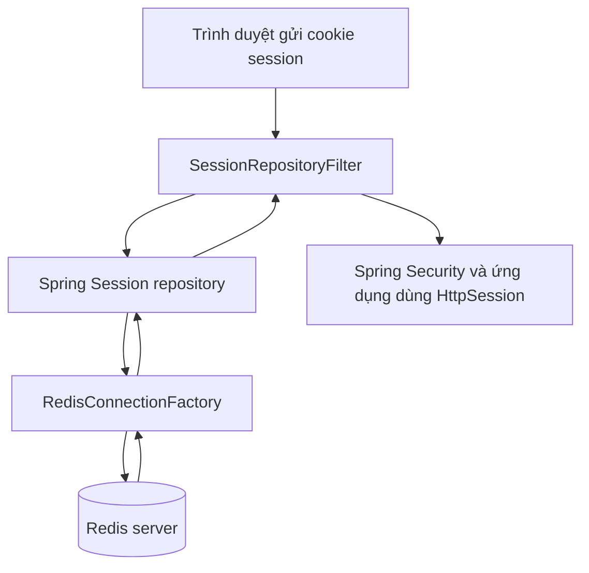

# Phân biệt cấu hình kết nối Redis với cấu hình quản lý phiên

Khi dùng Spring Session với Redis, ứng dụng cần hai nhóm cấu hình có mục đích khác nhau. Cấu hình kết nối Redis cho Spring biết phải kết nối tới máy chủ nào, dùng thông tin xác thực nào, chọn database logic nào và thiết lập TLS, timeout hoặc connection pool ra sao. Cấu hình quản lý phiên cho Spring Session biết cách lưu session vào Redis, đặt namespace, thời hạn không hoạt động, cách ghi dữ liệu và repository nào sẽ quản lý phiên.

Hai nhóm cấu hình phối hợp với nhau nhưng không thay thế nhau. Kết nối Redis thành công chỉ chứng minh ứng dụng có thể giao tiếp với Redis; điều đó chưa chứng minh `SessionRepositoryFilter` đang dùng repository đúng, session được lưu đúng namespace hoặc cookie session được phát phù hợp. Ngược lại, cấu hình timeout hay namespace không thể sửa một kết nối Redis sai host, sai mật khẩu hoặc không truy cập được.

## 1. Hai lớp cấu hình giải quyết hai câu hỏi khác nhau

Có thể phân chia trách nhiệm như sau:

| Lớp cấu hình | Câu hỏi cần trả lời | Ví dụ |
| --- | --- | --- |
| Kết nối Redis | Ứng dụng kết nối tới Redis ở đâu và bằng cách nào? | Host, port, username, password, TLS, database, cluster, Sentinel, timeout |
| Spring Session | Session được lưu và quản lý trong Redis ra sao? | Repository, namespace, timeout, flush mode, save mode, index |
| Cookie/session ID | Trình duyệt gửi và nhận định danh phiên thế nào? | Cookie name, path, domain, `HttpOnly`, `Secure`, `SameSite` |
| Spring Security | Trạng thái xác thực được lưu và khôi phục thế nào? | `SecurityContextRepository`, session fixation, logout, chính sách tạo session |

Trong ứng dụng Servlet, `RedisConnectionFactory` cung cấp kết nối tới Redis. Spring Session sử dụng kết nối đó thông qua repository như `RedisIndexedSessionRepository` hoặc implementation phù hợp với phiên bản và cấu hình. `SessionRepositoryFilter` kết nối Servlet API (`HttpSession`) với repository. Spring Security có thể lưu `SecurityContext` vào phiên này khi ứng dụng dùng đăng nhập dựa trên session.

Luồng tổng quát:



Cookie không chứa toàn bộ dữ liệu phiên; nó thường chỉ mang session ID. Dữ liệu phiên nằm trong Redis và được repository đọc/ghi. Vì thế, cookie settings, Redis connection settings và session repository settings cần được kiểm tra riêng.

## 2. Cấu hình kết nối Redis trong Spring Boot

Với Spring Boot 3, các thuộc tính kết nối Redis thường nằm dưới `spring.data.redis`. Chúng điều khiển client kết nối Redis, không phải thời hạn hay cách Spring Session lưu phiên.

Ví dụ cấu hình cho môi trường phát triển:

```yaml
spring:
  data:
    redis:
      host: localhost
      port: 6379
      username: default
      password: ${REDIS_PASSWORD:}
      database: 0
      connect-timeout: 2s
      timeout: 2s
```

Các thuộc tính quan trọng:

| Thuộc tính | Tác dụng |
| --- | --- |
| `host`, `port` | Địa chỉ và cổng Redis |
| `username`, `password` | Thông tin xác thực Redis/ACL |
| `database` | Database logic được chọn sau khi kết nối |
| `connect-timeout` | Thời gian tối đa để thiết lập kết nối |
| `timeout` | Thời gian chờ cho thao tác Redis theo client/configuration |
| `ssl.enabled` | Bật TLS khi kết nối Redis nếu môi trường yêu cầu |
| `client-type` | Chọn client được Boot hỗ trợ, thường là Lettuce hoặc Jedis |

Tên property cụ thể phụ thuộc phiên bản Spring Boot. Một số dự án Spring Boot 2 dùng prefix `spring.redis` thay cho `spring.data.redis`. Luôn đối chiếu với phiên bản Boot thực tế trong dự án; không chép nguyên cấu hình của một phiên bản khác rồi cho rằng mọi thuộc tính đều được bind.

Trong production, thông tin xác thực nên được cung cấp từ biến môi trường, secret manager hoặc hệ thống cấu hình bảo mật. Không commit mật khẩu Redis thật vào Git, không đưa secret vào log và không dùng tài khoản Redis có quyền quản trị rộng nếu ứng dụng chỉ cần quyền truy cập vào vùng dữ liệu session.

## 3. Các lựa chọn topology và bảo mật kết nối

Redis có thể chạy độc lập, theo Sentinel hoặc Cluster. Cấu hình kết nối cần khớp với topology mà hạ tầng cung cấp.

**Redis standalone:** ứng dụng kết nối tới một host/port. Đây là cấu hình đơn giản cho local development hoặc hệ thống nhỏ. Trong production, cần xem xét tính sẵn sàng cao, backup, monitoring và giới hạn truy cập.

**Redis Sentinel:** client biết danh sách Sentinel và tên master logic. Sentinel giúp client tìm master hiện tại sau failover. Không nên cấu hình một IP master cố định nếu hạ tầng yêu cầu client tự phát hiện master.

**Redis Cluster:** client nhận danh sách node cluster và tự định tuyến lệnh theo slot. Cần cấu hình các node được phép truy cập từ ứng dụng, xử lý topology refresh và giới hạn kết nối phù hợp. Không giả định một Redis Cluster giống hệt một Redis standalone chỉ có thêm nhiều địa chỉ.

Khi kết nối qua mạng không tin cậy hoặc dịch vụ Redis yêu cầu mã hóa, bật TLS theo cấu hình client và cung cấp trust material phù hợp. TLS bảo vệ đường truyền giữa ứng dụng và Redis; nó không tự cấp quyền truy cập. Redis ACL/password vẫn cần được cấu hình. Nếu dùng mutual TLS, cần quản lý certificate, thời hạn và quy trình rotation.

Pool và timeout cần được thiết kế theo lưu lượng. Lettuce hỗ trợ kết nối chia sẻ và có thể dùng pool cho một số kiểu thao tác; không phải ứng dụng nào cũng cần tăng pool size. Pool quá nhỏ gây chờ kết nối; pool quá lớn có thể làm Redis quá tải. Theo dõi connection count, command latency, timeout và số request chờ trước khi điều chỉnh.

## 4. Cấu hình quản lý phiên bằng Spring Session

Nhóm cấu hình Spring Session thường nằm dưới `spring.session`. Đây là nơi khai báo thời hạn phiên và các tùy chọn Redis repository mà Spring Boot/Spring Session hỗ trợ.

Ví dụ cấu hình:

```yaml
spring:
  session:
    timeout: 30m
    redis:
      namespace: portal:sessions
      flush-mode: on-save
      save-mode: on-set-attribute
```

Ý nghĩa:

- `spring.session.timeout`: thời gian không hoạt động tối đa của session. Đây là chính sách timeout của phiên, không phải timeout kết nối Redis.
- `spring.session.redis.namespace`: tiền tố không gian tên giúp tách dữ liệu phiên của ứng dụng hoặc môi trường khi dùng chung Redis.
- `flush-mode`: điều khiển thời điểm thay đổi phiên được ghi vào kho dữ liệu. `on-save` thường lưu khi Spring Session hoàn tất quy trình lưu; `immediate` ghi sớm hơn khi có thay đổi theo cơ chế implementation.
- `save-mode`: điều khiển những thay đổi session attributes nào được theo dõi để lưu, tùy các lựa chọn được phiên bản Spring Session hỗ trợ.

Tên và giá trị mặc định của property cần được kiểm tra theo phiên bản Spring Session/Boot. Ví dụ trên minh họa một cấu hình thường gặp; không nên giả định mọi phiên bản đều có cùng tập lựa chọn hoặc cùng default.

`spring.session.timeout` không quyết định Redis có thể kết nối được trong bao lâu. Nếu Redis unreachable, session repository vẫn lỗi dù timeout session được đặt rất dài. Tương tự, `spring.data.redis.timeout` không phải idle timeout của phiên; nó giới hạn thời gian chờ lệnh/kết nối theo cấu hình client.

## 5. Namespace khác với Redis database và key prefix

Ba khái niệm thường bị nhầm lẫn:

| Khái niệm | Mục đích | Ví dụ |
| --- | --- | --- |
| Redis database | Chọn database logic bên trong Redis server | `database: 0` |
| Spring Session namespace | Tách vùng dữ liệu session theo ứng dụng/môi trường | `portal:sessions` |
| Session ID | Định danh một phiên cụ thể | Giá trị opaque do framework sinh |

Hai ứng dụng có thể dùng chung Redis database nhưng có namespace khác nhau để tránh xung đột key. Ngược lại, dùng database logic khác nhau không thay thế hoàn toàn việc đặt namespace rõ ràng, nhất là khi vận hành Redis Cluster hoặc dịch vụ Redis có giới hạn hỗ trợ database selection.

Tất cả instance của cùng một ứng dụng phải dùng cùng namespace để có thể đọc cùng phiên. Nếu instance A dùng `portal:sessions` còn instance B dùng `portal:session`, request chuyển node sẽ không tìm thấy session dù cả hai kết nối cùng Redis host. Đây là lỗi cấu hình phiên, không phải lỗi kết nối mạng.

Không tự đoán tên key nội bộ để truy cập hoặc cập nhật dữ liệu session. Namespace và key format là chi tiết của implementation/version. Dùng repository API để đọc, lưu và xóa phiên; dùng công cụ Redis để quan sát có giới hạn khi cần điều tra.

## 6. Repository nào sẽ quản lý phiên?

Spring Session Data Redis cung cấp implementation repository cho các nhu cầu khác nhau. Tùy phiên bản và cấu hình, ứng dụng có thể sử dụng repository tra cứu theo ID hoặc repository có thêm index.

| Nhu cầu | Khả năng cần có |
| --- | --- |
| Khôi phục session từ cookie ID | `SessionRepository.findById(id)` |
| Tạo, cập nhật và xóa phiên | `createSession`, `save`, `deleteById` |
| Tìm mọi phiên theo principal | Repository hỗ trợ principal index, ví dụ `RedisIndexedSessionRepository` |
| Dùng Servlet `HttpSession` | `SessionRepositoryFilter` được đăng ký trong Servlet chain |
| Dùng WebFlux `WebSession` | Repository reactive và cấu hình WebFlux tương ứng |

Với Spring Boot, auto-configuration có thể tạo repository và filter khi dependency cùng cấu hình phù hợp. Nếu tự khai báo `@EnableRedisHttpSession` hoặc `@EnableRedisIndexedHttpSession`, hãy hiểu rõ cách cấu hình thủ công tương tác với auto-configuration của Boot. Tránh khai báo hai repository hoặc hai filter cùng quản lý một loại session. Kiểm tra bean repository thực tế thay vì suy ra implementation chỉ từ việc thấy dependency Redis trong build file.

Nếu cần tìm tất cả phiên của một username, chỉ đặt `spring.session.redis.namespace` là chưa đủ. Namespace chỉ phân tách vùng lưu trữ; nó không tạo principal index. Cần repository indexed, cách xác định principal nhất quán và kiểm thử việc index được cập nhật khi tạo, đổi ID, logout hoặc hết hạn phiên.

## 7. Cookie và cấu hình session không phải cấu hình kết nối Redis

Cookie session là giao thức trao đổi session ID giữa trình duyệt và ứng dụng. Các thuộc tính như tên cookie, `Path`, `Domain`, `HttpOnly`, `Secure` và `SameSite` không điều khiển host, port hoặc mật khẩu Redis.

Ví dụ cấu hình cookie trong Spring Boot:

```yaml
server:
  servlet:
    session:
      cookie:
        name: SESSION
        http-only: true
        secure: true
        same-site: lax
```

Khi dùng Spring Session, cookie có thể được phát bởi `CookieSerializer` của Spring Session. Spring Boot có thể tích hợp một số thuộc tính cookie tùy phiên bản và auto-configuration, nhưng một bean `DefaultCookieSerializer` tùy chỉnh có thể quyết định cấu hình thực tế. Hãy xác nhận serializer đang được sử dụng và kiểm tra header `Set-Cookie` trong response thật.

`Secure=true` phù hợp với production chạy HTTPS. Nếu TLS kết thúc ở reverse proxy, ứng dụng cần nhận biết đúng scheme qua forwarded headers đáng tin cậy hoặc buộc cookie secure theo cấu hình. Không tin forwarded header do client gửi trực tiếp; proxy phải xóa/ghi đè header đầu vào và backend chỉ nhận request từ proxy tin cậy.

## 8. Cấu hình theo môi trường

Không nên dùng một cấu hình Redis duy nhất cho local, test, staging và production nếu các môi trường có endpoint, credentials hoặc yêu cầu bảo mật khác nhau. Có thể tách cấu hình theo profile:

```yaml
# application-local.yml
spring:
  data:
    redis:
      host: localhost
      port: 6379
  session:
    timeout: 30m
    redis:
      namespace: portal:local:sessions
```

```yaml
# application-prod.yml
spring:
  data:
    redis:
      host: ${REDIS_HOST}
      port: ${REDIS_PORT:6379}
      username: ${REDIS_USERNAME}
      password: ${REDIS_PASSWORD}
      ssl:
        enabled: true
      connect-timeout: 2s
      timeout: 2s
  session:
    timeout: 20m
    redis:
      namespace: portal:prod:sessions
      flush-mode: on-save
```

Ví dụ production giả định dịch vụ Redis yêu cầu TLS và ACL username/password. Tùy nhà cung cấp, có thể cần cấu hình certificate, Sentinel/Cluster hoặc connection pool bổ sung. Không dùng các giá trị minh họa làm thông số mặc định cho mọi hạ tầng.

Các instance cùng một môi trường phải thống nhất `spring.data.redis.*` và `spring.session.redis.namespace`, serializer, session timeout và cách lưu. Nếu rolling deployment có thay đổi cấu trúc session attributes, cần bảo đảm phiên bản cũ và mới đọc được dữ liệu của nhau trong giai đoạn chạy song song.

## 9. Flush mode, save mode và ảnh hưởng đến dữ liệu phiên

`flush-mode` và `save-mode` ảnh hưởng cách Spring Session ghi dữ liệu, không ảnh hưởng việc thiết lập kết nối TCP tới Redis.

Với chế độ lưu khi hoàn tất request (`on-save`), thay đổi có thể được gom lại và ghi khi Spring Session lưu phiên. Chế độ ghi ngay (`immediate`) có thể làm thay đổi được gửi tới Redis sớm hơn, nhưng có thể tạo nhiều thao tác ghi hơn. `save-mode` xác định những thay đổi nào được nhận diện để lưu; ví dụ chế độ theo dõi khi set attribute phù hợp với mã ứng dụng luôn gọi `setAttribute` khi thay đổi giá trị. Nếu mã thay đổi object mutable đã lưu mà không gọi lại `setAttribute`, chế độ theo dõi thay đổi có thể không phát hiện như mong muốn tùy implementation.

Ví dụ:

```java
Cart cart = (Cart) session.getAttribute("cart");
cart.add(product);

// Có thể cần set lại attribute để thay đổi được nhận diện rõ ràng.
session.setAttribute("cart", cart);
```

Không chọn `immediate` chỉ vì muốn “an toàn hơn”. Nó có thể tăng số lần ghi và latency. Hãy chọn theo nhu cầu nhất quán, khối lượng request và cách ứng dụng cập nhật attributes; sau đó kiểm thử request đồng thời và quan sát tải Redis.

## 10. Chẩn đoán theo đúng lớp cấu hình

Khi session không hoạt động, phân loại triệu chứng trước khi thay đổi property.

| Triệu chứng | Lớp cần kiểm tra đầu tiên | Các điểm kiểm tra |
| --- | --- | --- |
| Ứng dụng không kết nối được Redis | Kết nối Redis | DNS, host/port, firewall, credentials, ACL, TLS, timeout, topology |
| Redis kết nối được nhưng session không lưu | Spring Session | Repository bean, filter registration, namespace, save/flush mode, serialization |
| Request ở node A có phiên, node B mất phiên | Kết nối và repository giữa các node | Cùng Redis endpoint/database, namespace, serializer và cookie ID |
| Cookie không xuất hiện trong response | Cookie/session integration | `SessionRepositoryFilter`, resolver/serializer, request secure, response đã commit chưa |
| Cookie có nhưng request sau không gửi lại | Cookie/browser/proxy | Domain, path, `Secure`, `SameSite`, HTTPS, proxy và CORS/credentials |
| Phiên hết hạn quá sớm | Session timeout | `spring.session.timeout`, max inactive interval, thời điểm truy cập và TTL |
| Tra cứu theo username trả rỗng | Repository/index | Dùng indexed repository và principal index; namespace không tạo index |
| Lỗi deserialize sau deploy | Session data/schema | Serializer, class compatibility, rolling deployment và kiểu object lưu trong session |

Không chuyển mọi lỗi repository thành “không tìm thấy session”. Một kết quả không có phiên và một exception kết nối Redis mang ý nghĩa vận hành khác nhau. Lỗi hạ tầng cần được log/monitor và trả lỗi phù hợp; kết quả rỗng có thể chỉ là session đã hết hạn hoặc ID không tồn tại.

## 11. Kiểm thử riêng từng lớp

Một chiến lược kiểm thử tốt tách biệt xác nhận kết nối Redis khỏi xác nhận quản lý session.

**Kiểm tra kết nối Redis:** xác nhận ứng dụng có thể mở kết nối, xác thực và thực hiện thao tác Redis đơn giản qua đúng connection factory. Trong môi trường test, có thể dùng Redis Testcontainers. Kiểm tra TLS/ACL nếu production sử dụng chúng.

**Kiểm tra repository:** tạo session qua repository, đặt attribute, lưu, đọc lại bằng ID và xóa. Xác minh dữ liệu được lưu vào namespace đúng và timeout được áp dụng. Với serializer tùy chỉnh, kiểm thử round-trip các kiểu dữ liệu thực tế trong session.

**Kiểm tra tích hợp Servlet:** gửi request tạo session, nhận cookie, gửi cookie trong request tiếp theo và xác minh attribute được khôi phục. Kiểm tra logout và cookie cũ. Đảm bảo `SessionRepositoryFilter` được đăng ký đúng thứ tự.

**Kiểm tra nhiều instance:** khởi chạy hai application context dùng chung Redis và namespace. Tạo phiên ở instance A, gửi cùng cookie tới instance B và xác minh cùng trạng thái. Nếu một node dùng namespace khác, kiểm thử phải phát hiện phiên không được tìm thấy.

**Kiểm tra lỗi:** thử Redis unavailable, sai credentials, timeout, hết hạn phiên và lỗi deserialize. Xác nhận ứng dụng phân biệt lỗi kết nối với trường hợp ID không có phiên.

## 12. Checklist triển khai

- Xác định phiên bản Spring Boot và dùng đúng prefix kết nối Redis (`spring.data.redis` hoặc prefix của phiên bản cũ).
- Cấu hình host, port, ACL, TLS, database, timeout và topology theo hạ tầng Redis.
- Cung cấp secret từ môi trường an toàn; không commit credentials.
- Cấu hình `spring.session.timeout`, namespace, flush/save mode theo yêu cầu session.
- Xác nhận repository thực tế và `SessionRepositoryFilter` đang dùng đúng `RedisConnectionFactory`.
- Giữ namespace, serializer và cấu hình session nhất quán giữa mọi instance.
- Cấu hình cookie riêng, kiểm tra `Set-Cookie` và request kế tiếp qua HTTPS/proxy.
- Kiểm thử Redis connection, repository CRUD, TTL, logout, serialization và nhiều instance.
- Theo dõi Redis latency, memory, connection pool, timeout và lỗi repository.

Khi tách bạch đúng hai nhóm cấu hình, việc chẩn đoán cũng rõ ràng hơn: `spring.data.redis.*` giúp ứng dụng kết nối tới Redis, còn `spring.session.*` điều khiển cách Spring Session quản lý dữ liệu phiên trong kho đó. Cookie và Spring Security tiếp tục là các lớp liên quan nhưng có trách nhiệm riêng, giúp session ID được trao đổi và trạng thái đăng nhập được khôi phục an toàn.
