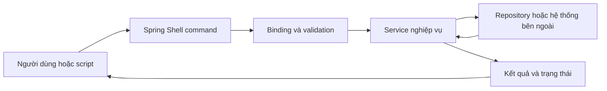

# Spring Shell là gì và khi nào nên xây ứng dụng dòng lệnh

## 1. Ứng dụng dòng lệnh là gì?

Ứng dụng dòng lệnh (Command-Line Interface, viết tắt là CLI) cho phép người dùng làm việc với chương trình bằng cách nhập lệnh và đối số trong terminal. Thay vì mở giao diện đồ họa hoặc gửi yêu cầu qua trình duyệt, người dùng gọi một thao tác bằng văn bản, nhận kết quả và có thể kết hợp thao tác đó với các lệnh hoặc script khác.

Ví dụ, một công cụ quản trị có thể cung cấp các lệnh như:

```text
user list
user create --username linh --email linh@example.com
user disable --username linh
```

CLI đặc biệt hữu ích khi người dùng cần thực hiện các công việc có quy trình rõ ràng, lặp lại được và có thể tự động hóa. Công cụ nhập dữ liệu, kiểm tra trạng thái hệ thống, chạy tác vụ bảo trì, quản lý tài nguyên hoặc hỗ trợ đội phát triển là những trường hợp thường gặp.

Một ứng dụng CLI có thể được sử dụng theo hai cách:

- **Chạy một lần:** người dùng truyền lệnh và các tham số khi khởi chạy chương trình. Chương trình thực hiện tác vụ rồi kết thúc. Cách này phù hợp với script và pipeline tự động hóa.
- **Tương tác trong một phiên shell:** chương trình khởi động và hiển thị dấu nhắc lệnh. Người dùng nhập nhiều lệnh liên tiếp, xem trợ giúp hoặc nhận gợi ý trong cùng một phiên. Cách này thuận tiện khi cần khám phá chức năng hoặc thực hiện một chuỗi thao tác thủ công.

Hai cách sử dụng có thể cùng tồn tại trong một công cụ. Chẳng hạn, người vận hành có thể mở shell để kiểm tra dữ liệu, còn hệ thống CI gọi một lệnh cụ thể để chạy tác vụ tự động.

## 2. Spring Shell là gì?

**Spring Shell** là framework trong hệ sinh thái Spring giúp xây dựng ứng dụng dòng lệnh bằng Java. Framework cung cấp cách khai báo command, ánh xạ đối số vào tham số phương thức và hỗ trợ các chức năng thường cần có trong một shell, như trợ giúp, chuyển đổi kiểu dữ liệu, kiểm tra đầu vào và tự hoàn thành lệnh.

Nếu tự xây CLI từ đầu, chương trình thường phải tự đọc chuỗi đầu vào, tách tên lệnh, phân tích tham số, xử lý giá trị thiếu hoặc sai định dạng, hiển thị hướng dẫn và điều phối vòng lặp tương tác. Spring Shell đảm nhiệm phần lớn hạ tầng này để lập trình viên tập trung vào hành vi của từng command.

Spring Shell phù hợp với ứng dụng đã hoặc muốn sử dụng Spring vì command có thể tận dụng các cơ chế quen thuộc như dependency injection, cấu hình, logging và các service của ứng dụng. Một command có thể gọi service nghiệp vụ đang được dùng ở những phần khác của hệ thống, nhờ đó quy tắc nghiệp vụ không cần bị viết lại trong lớp giao tiếp dòng lệnh.

### Những thành phần chính

| Thành phần | Vai trò |
|---|---|
| Shell application | Khởi động ứng dụng và cung cấp môi trường thực thi command. |
| Command | Một thao tác mà người dùng có thể gọi, thường được khai báo bằng một phương thức Java. |
| Argument và option | Dữ liệu người dùng truyền vào command, ví dụ tên tài khoản hoặc đường dẫn tệp. |
| Binding và conversion | Chuyển dữ liệu văn bản thành kiểu tham số mà phương thức cần. |
| Validation | Kiểm tra dữ liệu đầu vào trước khi thực hiện nghiệp vụ. |
| Help và completion | Giúp người dùng tìm hiểu command, cú pháp và các giá trị có thể nhập. |
| Output | Trình bày kết quả, thông báo lỗi hoặc trạng thái thao tác. |

Các khả năng cụ thể và cách cấu hình có thể khác nhau giữa các phiên bản Spring Shell. Khi bắt đầu dự án, cần chọn phiên bản tương thích với phiên bản Spring Boot và Java mà dự án đang sử dụng.

## 3. Command được khai báo như thế nào?

Trong Spring Shell, một cách phổ biến để đăng ký command là đánh dấu lớp bằng `@ShellComponent` và phương thức xử lý bằng `@ShellMethod`. Các tham số có thể được mô tả bằng `@ShellOption`.

Ví dụ sau khai báo command `hello` với một option tên là `--name`:

```java
package com.example.cli;

import org.springframework.shell.standard.ShellComponent;
import org.springframework.shell.standard.ShellMethod;
import org.springframework.shell.standard.ShellOption;

@ShellComponent
public class GreetingCommands {

    @ShellMethod(key = "hello", value = "Gửi lời chào")
    public String hello(
            @ShellOption(
                    value = "--name",
                    defaultValue = "bạn",
                    help = "Tên người được chào") String name) {
        return "Xin chào, " + name + "!";
    }
}
```

Trong ví dụ này:

- `@ShellComponent` cho Spring Shell biết lớp có chứa các command.
- `@ShellMethod` đăng ký phương thức `hello` thành command có khóa `hello`. Phần `value` mô tả ngắn chức năng của command.
- `@ShellOption` khai báo option `--name`, giá trị mặc định và nội dung trợ giúp cho option.
- Giá trị người dùng nhập được chuyển vào tham số `name`; phương thức trả về chuỗi kết quả để shell hiển thị.

Khi ứng dụng đã được cấu hình và khởi động, người dùng có thể nhập các lệnh tương ứng:

```text
shell> hello
Xin chào, bạn!

shell> hello --name "Lan"
Xin chào, Lan!
```

Đây là ví dụ tối giản để minh họa cách khai báo command. Trong ứng dụng thực tế, phương thức command nên nhận và kiểm tra dữ liệu đầu vào, sau đó gọi service chuyên trách để thực hiện nghiệp vụ. Không nên đặt toàn bộ logic truy cập cơ sở dữ liệu, xử lý tệp hoặc quy tắc nghiệp vụ phức tạp trực tiếp trong lớp command.

## 4. Spring Shell giải quyết những vấn đề nào?

### Phân tích lệnh và ánh xạ tham số

Người dùng nhập dữ liệu dưới dạng văn bản, nhưng mã Java thường làm việc với `String`, `int`, `long`, enum, ngày tháng hoặc các kiểu đối tượng khác. Spring Shell hỗ trợ liên kết đầu vào với tham số phương thức và chuyển đổi kiểu phù hợp. Nhờ vậy, command không phải tự viết bộ phân tích chuỗi cho từng tham số.

Khi thiết kế command, cần làm rõ tham số nào bắt buộc, tham số nào có giá trị mặc định, option nào có thể lặp lại và dữ liệu nào cần được kiểm tra. Cú pháp nhất quán giúp người dùng dễ ghi nhớ và giúp script ít bị lỗi hơn.

### Trợ giúp và khả năng khám phá

Một công cụ có nhiều command sẽ khó sử dụng nếu người dùng phải ghi nhớ toàn bộ cú pháp. Metadata của command và option giúp framework cung cấp thông tin trợ giúp. Người dùng có thể xem danh sách thao tác, mô tả command và hướng dẫn về tham số theo khả năng của phiên bản đang dùng.

Tự hoàn thành lệnh (completion) cũng giúp giảm lỗi nhập liệu. Khi người dùng gõ một phần tên command hoặc option rồi yêu cầu gợi ý, shell có thể đề xuất những lựa chọn hợp lệ. Với dữ liệu động, ứng dụng có thể bổ sung logic gợi ý riêng khi nghiệp vụ cần.

### Kiểm tra đầu vào và xử lý lỗi

Một command cần xác định rõ cách xử lý khi thiếu tham số, sai định dạng, tài nguyên không tồn tại hoặc người dùng không có quyền thực hiện thao tác. Kiểm tra dữ liệu ở ranh giới đầu vào giúp phát hiện lỗi sớm và đưa ra thông báo có thể hành động được.

Không nên xem việc chuyển đổi kiểu dữ liệu là kiểm tra nghiệp vụ đầy đủ. Một giá trị số có thể chuyển đổi thành công nhưng vẫn nằm ngoài giới hạn cho phép; một đường dẫn có thể đúng cú pháp nhưng trỏ đến tệp mà người dùng không được phép truy cập. Những quy tắc này vẫn phải được kiểm tra ở lớp phù hợp.

### Tổ chức kết quả đầu ra

Kết quả CLI cần dễ đọc với con người và ổn định với chương trình khác. Người dùng tương tác có thể cần bảng, thông báo hoặc màu sắc; script thường cần văn bản hoặc dữ liệu có cấu trúc với định dạng nhất quán. Nên chọn định dạng theo mục đích sử dụng và tránh để thông báo ngẫu nhiên làm hỏng đầu ra mà script đang phân tích.

Ngoài nội dung hiển thị, một tiến trình CLI còn có mã thoát (exit code). Quy ước phổ biến là mã `0` biểu thị thành công và mã khác `0` biểu thị có lỗi. Mã thoát cho phép shell script hoặc hệ thống CI quyết định bước tiếp theo. Việc trả về một chuỗi từ phương thức command chỉ tạo nội dung hiển thị; không nên mặc định rằng chuỗi đó tự quyết định mã thoát của toàn bộ tiến trình. Cần thiết kế và kiểm tra cơ chế kết thúc tiến trình theo phiên bản và cách chạy ứng dụng.

## 5. Khi nào nên xây ứng dụng bằng Spring Shell?

Spring Shell là lựa chọn phù hợp khi một hoặc nhiều điều kiện sau xuất hiện:

1. **Có nhiều thao tác liên quan cần một giao diện thống nhất.** Ví dụ, đội vận hành cần các lệnh để xem trạng thái, tạo tài nguyên, cập nhật cấu hình và kiểm tra kết quả.
2. **Quy trình được thực hiện lặp lại.** Thay vì ghi nhớ một chuỗi thao tác thủ công, người dùng có thể gọi command với tham số rõ ràng hoặc lưu các lệnh vào script.
3. **Cần cả thao tác thủ công lẫn tự động hóa.** Người phát triển có thể khám phá chức năng trong phiên shell; pipeline có thể gọi các thao tác đã được chuẩn hóa.
4. **Ứng dụng đã sử dụng Spring.** Command có thể gọi service, repository hoặc thành phần cấu hình sẵn có thông qua dependency injection.
5. **Cần trợ giúp và trải nghiệm shell tốt hơn một bộ phân tích tham số tự viết.** Các chức năng như mô tả command, binding, conversion và completion giúp giảm mã hạ tầng phải duy trì.

Một số trường hợp thực tế:

- **Công cụ quản trị nội bộ:** tạo tài khoản, khóa tài khoản, xem trạng thái dịch vụ hoặc quản lý cấu hình.
- **Công cụ dữ liệu:** nhập, xuất, chuyển đổi, đối soát hoặc kiểm tra chất lượng dữ liệu theo tham số.
- **Công cụ cho đội phát triển và QA:** chạy tác vụ kiểm tra, tạo dữ liệu mẫu, khởi tạo môi trường hoặc thu thập thông tin chẩn đoán.
- **Công cụ vận hành:** thực hiện các thao tác bảo trì có kiểm soát và ghi nhận kết quả để hệ thống tự động hóa đánh giá.

## 6. Khi nào không cần Spring Shell?

Không phải mọi chương trình chạy trong terminal đều cần một framework shell. Hãy cân nhắc giải pháp đơn giản hơn nếu:

- Chương trình chỉ thực hiện một tác vụ ngắn khi khởi động và không cần người dùng nhập thêm lệnh. `CommandLineRunner` hoặc `ApplicationRunner` của Spring Boot có thể phù hợp hơn.
- Chỉ cần một script nhỏ, ít tham số và không có logic cần tái sử dụng. Bash, PowerShell hoặc Python có thể dễ triển khai và phân phối hơn.
- Công cụ cần một bộ phân tích tham số độc lập, ứng dụng không dùng Spring và không cần môi trường shell tương tác. Một thư viện CLI chuyên dụng có thể gọn hơn.
- Người dùng cuối cần giao diện đồ họa, web hoặc mobile, hoặc hệ thống cần cung cấp API cho nhiều ứng dụng khác. CLI không thay thế các giao diện đó.

| Nhu cầu | Hướng lựa chọn ban đầu |
|---|---|
| Nhiều command, có phiên tương tác, cần trợ giúp và completion; ứng dụng dùng Spring | Spring Shell |
| Một tác vụ chạy một lần khi Spring Boot khởi động | `CommandLineRunner` hoặc `ApplicationRunner` |
| CLI độc lập, cần phân tích tham số nhưng không cần Spring | Thư viện CLI chuyên dụng, chẳng hạn picocli |
| Tác vụ nhỏ, ít logic và chỉ dùng trong một môi trường | Script hệ điều hành hoặc ngôn ngữ script |
| Tương tác qua trình duyệt, thiết bị di động hoặc tích hợp hệ thống từ xa | Web application hoặc API; có thể bổ sung CLI nếu có nhu cầu vận hành |

Các lựa chọn trên là điểm bắt đầu để đánh giá, không phải quy tắc cứng. Một hệ thống có thể cung cấp API cho tích hợp, giao diện web cho người dùng và CLI cho đội vận hành cùng lúc.

## 7. Phân biệt Spring Shell với cách chạy tác vụ khi khởi động Spring Boot

`CommandLineRunner` và `ApplicationRunner` là các cơ chế để chạy mã sau khi Spring Boot khởi tạo ứng dụng. Chúng hữu ích khi chương trình cần đọc tham số khởi động, thực hiện một công việc rồi kết thúc hoặc tiếp tục chạy theo thiết kế của ứng dụng.

Spring Shell hướng đến việc cung cấp một tập command mà người dùng có thể gọi theo cú pháp được định nghĩa. Ứng dụng có thể duy trì phiên tương tác, hiển thị trợ giúp và điều phối nhiều thao tác trong cùng một môi trường. Vì vậy, tiêu chí chọn không nằm ở việc chương trình có chạy trong terminal hay không, mà ở việc người dùng có cần một giao diện command có cấu trúc và có thể sử dụng lặp lại hay không.

Ví dụ:

- Tác vụ `--import-file=/data/users.csv` chỉ chạy một lần lúc khởi động có thể phù hợp với runner hoặc một CLI đơn giản.
- Bộ công cụ có các thao tác `user list`, `user import`, `user validate` và `user disable`, được dùng thường xuyên bởi người vận hành, là ứng viên phù hợp hơn cho Spring Shell.

## 8. Cách tổ chức một ứng dụng Spring Shell dễ bảo trì

Nên xem command là lớp giao tiếp giữa người dùng và nghiệp vụ. Một luồng xử lý điển hình như sau:



Một số nguyên tắc tổ chức nên áp dụng:

- **Command tập trung vào giao tiếp:** khai báo cú pháp, nhận tham số, gọi service và chuyển kết quả thành nội dung phù hợp với người dùng.
- **Service giữ quy tắc nghiệp vụ:** thao tác quan trọng phải có thể được tái sử dụng từ command, API hoặc thành phần khác mà không phụ thuộc vào terminal.
- **Thông báo lỗi có hướng xử lý:** cho biết đầu vào nào không hợp lệ, tài nguyên nào không tìm thấy hoặc người dùng cần thực hiện bước nào tiếp theo. Không để lộ stack trace, thông tin bí mật hoặc dữ liệu nhạy cảm trong thông báo thông thường.
- **Command có tính nhất quán:** dùng tên động từ và danh từ rõ nghĩa, quy ước option thống nhất, mô tả ngắn gọn và ví dụ dễ hiểu.
- **Thao tác có tác động lớn cần được bảo vệ:** kiểm tra quyền, xác nhận khi cần, giới hạn phạm vi dữ liệu và ghi log phù hợp. Việc chạy trong terminal không làm cho thao tác trở nên an toàn mặc định.
- **Đầu ra phục vụ đúng đối tượng:** tách thông tin dành cho người đọc khỏi dữ liệu mà script cần phân tích; giữ định dạng máy đọc ổn định nếu công cụ được dùng trong pipeline.

## 9. Những yếu tố cần cân nhắc trước khi bắt đầu

Trước khi tạo dự án, hãy xác định người dùng chính là ai, họ sẽ chạy lệnh trong môi trường nào và công cụ được dùng tương tác hay tự động hóa. Những câu trả lời này ảnh hưởng trực tiếp đến cú pháp command, cách xác thực, định dạng đầu ra và cơ chế phân phối.

**Phiên bản và phụ thuộc:** chọn phiên bản Spring Shell tương thích với Spring Boot, Java và các thư viện hiện có. Không nên sao chép cấu hình dependency từ một hướng dẫn thuộc phiên bản khác mà chưa kiểm tra tương thích.

**Môi trường chạy:** xác định công cụ cần Java runtime nào, quyền truy cập tệp hoặc mạng ra sao, có chạy trong container hay pipeline CI không. Nếu phân phối cho nhiều nhóm người dùng, cần hướng dẫn cài đặt, cấu hình và nâng cấp rõ ràng.

**Bảo mật:** CLI thường có thể thực hiện tác vụ có quyền cao. Không ghi mật khẩu, token hoặc khóa bí mật trực tiếp vào lệnh có thể lưu trong lịch sử terminal. Cần chọn cách cung cấp bí mật phù hợp với môi trường, kiểm tra quyền trên từng thao tác và giới hạn dữ liệu mà command có thể truy cập.

**Khả năng kiểm thử:** kiểm thử riêng service để xác nhận nghiệp vụ, đồng thời kiểm thử command để xác nhận cú pháp, binding, thông báo và cách xử lý lỗi. Với các thao tác phá hủy hoặc cập nhật hàng loạt, cần có kiểm thử cho trường hợp đầu vào sai và trường hợp thất bại giữa chừng.

**Mã thoát và script:** nếu công cụ được gọi từ script, xác định rõ điều kiện thành công, lỗi có thể phục hồi và lỗi nghiêm trọng. Kiểm tra mã thoát thực tế của tiến trình trong môi trường chạy dự kiến, thay vì chỉ kiểm tra nội dung được in ra terminal.

## 10. Quy trình quyết định nhanh

Có thể dùng các câu hỏi sau để đánh giá nhu cầu:

1. Người dùng có cần gọi nhiều thao tác theo tên command và truyền tham số có cấu trúc không?
2. Họ có cần khám phá lệnh, xem trợ giúp, nhận gợi ý hoặc nhập nhiều lệnh trong một phiên không?
3. Các thao tác có dùng chung service và cấu hình trong một ứng dụng Spring không?
4. Công cụ có cần chạy trong script hoặc pipeline với đầu ra và mã thoát ổn định không?
5. Lợi ích của một CLI có cấu trúc có lớn hơn chi phí đóng gói, phân phối và bảo trì không?

Nếu phần lớn câu trả lời là có, Spring Shell là một lựa chọn đáng xem xét. Nếu chỉ cần chạy một tác vụ khi khởi động, hãy đánh giá runner của Spring Boot. Nếu công cụ rất nhỏ hoặc không cần hệ sinh thái Spring, một script hay thư viện CLI độc lập có thể đáp ứng tốt hơn.

## Kết luận

Spring Shell giúp biến các thao tác Java thành command có cú pháp, tham số và trợ giúp rõ ràng. Framework đặc biệt hữu ích cho công cụ nội bộ, công cụ phát triển và tác vụ vận hành cần được sử dụng lặp lại, có thể chạy trong phiên tương tác hoặc được gọi từ script. Quyết định sử dụng nên dựa trên nhu cầu thực tế về command, khả năng tự động hóa, hệ sinh thái Spring và chi phí phân phối. Khi đã chọn Spring Shell, việc tách lớp command khỏi service nghiệp vụ sẽ giúp ứng dụng dễ kiểm thử, mở rộng và tái sử dụng hơn.
